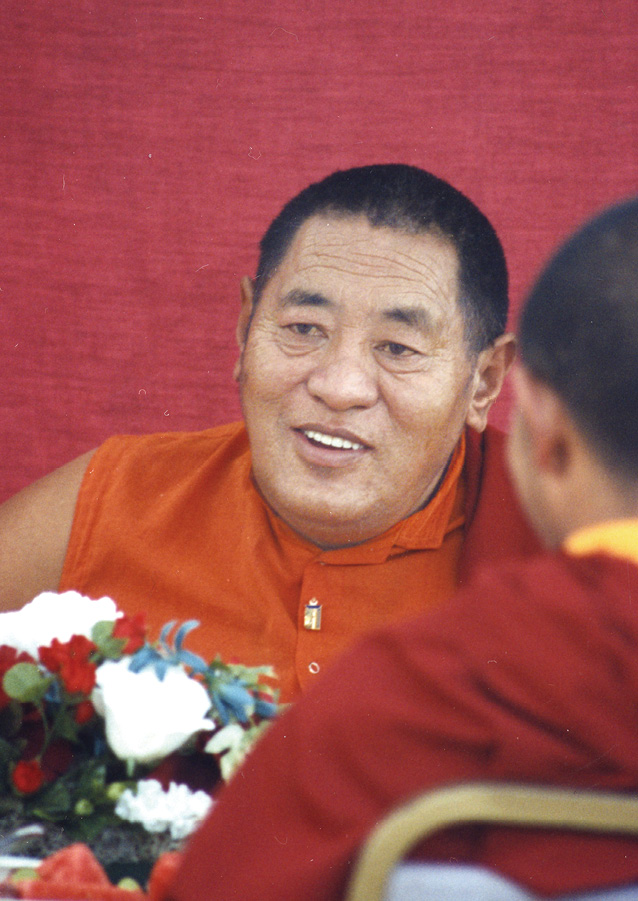

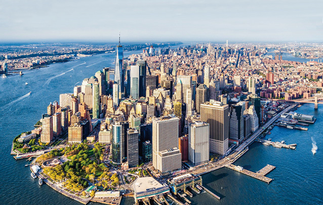

第6站 美国·纽约

New York, USA 8/1-8/8

行程

8月1日，来到纽约

8月2日，传讲时轮金刚的内容

8月3日，上午参观联合国总部

晚上传授“文殊静修大圆满”灌顶

8月4日，上午参观世贸中心

晚上传授“项袋金刚橛”灌顶

8月5日，做金刚橛方面的公开演讲

8月6日，传讲莲师修法

8月7日，上午传授“杰珍宁提”灌顶

下午传讲《杰珍宁提》

8月8日，上午传讲《杰珍宁提》

下午传讲《杰珍宁提》

来到纽约

8月1日，法王乘飞机离开美国政治中心华盛顿，一个多小时后抵达美国经济中心纽约的拉瓜迪亚机场（LaGuardia Airport）。

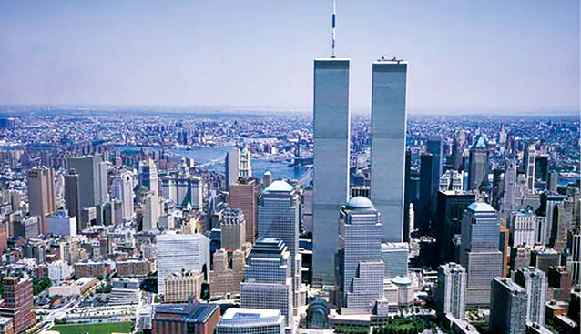

纽约是美国最大的城市。1789年，它成为美国的临时首都，也是第一任总统华盛顿就职的地方。自19世纪以来，纽约以其独特的地理位置，一直是美国的经济中心和金融中心。二战后，随着美元地位在世界上的确立，纽约一跃成为世界金融中心。在这个面积不足60平方公里的曼哈顿岛上，金融和外贸机构数不胜数。全世界的信息都集中在这里，地球上发生的一切都与它有着千丝万缕的联系。

法王在纽约居住的地方，叫做鲍尔瑞大街222号（222 Bowery Street）。这座建筑已有上百年历史，许多有影响力的艺术家曾在此居住。后来一些艺术家给它起了个绰号，叫“地堡”（bunker），至今仍是纽约的标志性建筑。上世纪70年代，敦珠法王的一位弟子将其买下，改造成一个宁玛派的道场，名为“莲师中心”。

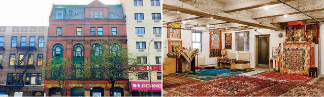

法王在这里住了大约一周。

纽约弘法一览

时隔三十年，法王在纽约、波士顿两站的传法资料已经丢失。虽然我多方打听、到处询问，但能找到的内容寥寥无几。无奈之下，我只能根据我得到的资料，把当年法王的传法日程记录下来。以后如果能找到相关资料，再详细分享给大家。

8月2日，觉囊派中心，传讲时轮金刚的内容。

8月3日，佛恩寺，传授“文殊静修大圆满”灌顶。

8月4日，莲师中心，传授“项袋金刚橛”灌顶。

8月5日，莲师中心，做了金刚橛方面的公开演讲。

8月6日，莲师中心，传讲莲师修法。

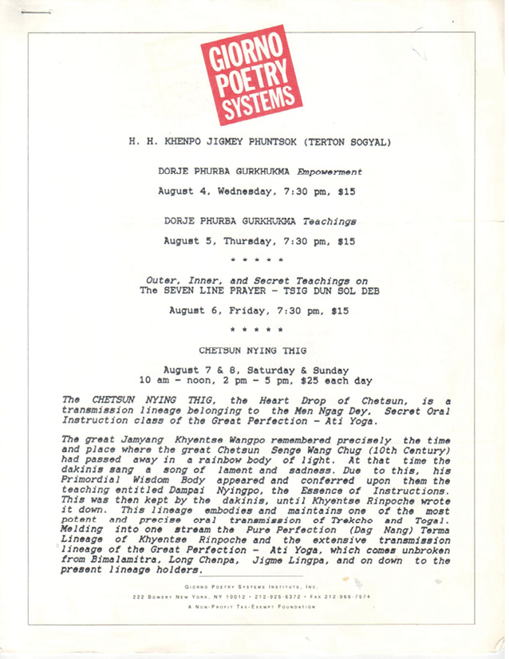

8月7日，莲师中心，上午传授“杰珍宁提”灌顶，下午传讲《杰珍宁提》。

8月8日，莲师中心，分别在上午和下午传讲《杰珍宁提》。

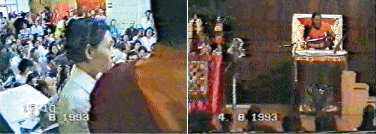

纽约喇荣显密中心

法王在纽约期间，想建立一个喇荣的佛教中心，让很多人可以继续学习显密佛法，并让我负责这件事。

虽然我人生地不熟，语言也不通，但在国外注册道场相对容易。于是在信众的帮助下，经过多次讨论和对接，我在短短几天内完成了道场注册、场地选择等，成立了喇荣在纽约的第一个道场，取名“喇荣显密中心”。起初为了方便交流，成员以华人为主。

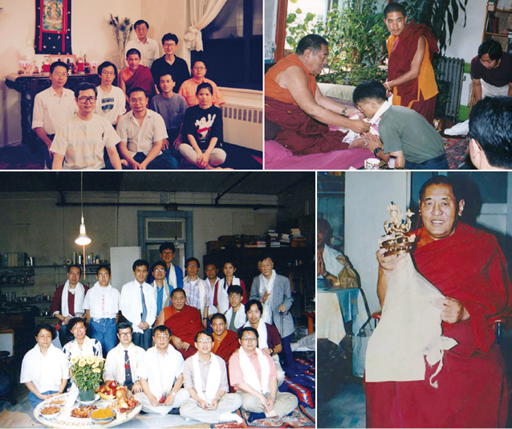

法王亲自来到这里开光，传授了“文殊智慧勇识”的灌顶及相关开示，并给大家一一加持。关于“喇荣显密中心”的成立，《纽约世界报》《纽约新闻周刊》也在头版用醒目的标题刊登了这一消息。

这个道场经营了一段时间，后来因为通讯不便等原因，没有办法坚持下去。但以此缘起为开端，很多人与法王的法脉结上了善缘，对他们的解脱起到了很大作用。当时的有些人，据说现在还在学修喇荣教法，也影响了周围很多人。

参观联合国总部

联合国副秘书长莫里斯·斯特朗（Maurice Strong）致信法王，欢迎他参观联合国总部（United Nations Headquarters），并委托不丹代表担任向导。

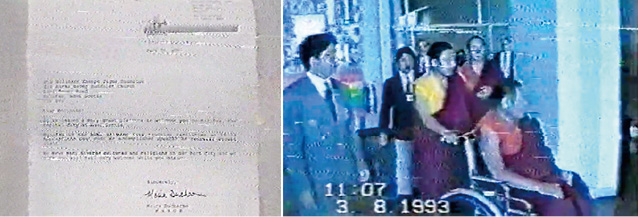

8月3日，法王来到联合国总部。大楼前悬挂着184个成员国（现为193个）的国旗，主旗杆上是联合国的旗帜。

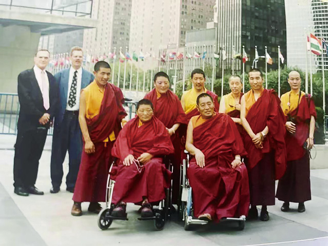

不丹代表带我们逐一参观了秘书处大楼、大会场、会议楼和图书馆。他特意给我们介绍了一副著名的镶嵌画，叫《黄金法则》。这部作品强调不同种族、肤色、信仰的人和谐相处，享有同样的尊严。在这幅画的底部有一句英语：“Do unto others, as you would have them do unto you.”翻译过来就是，你希望别人如何对待你，你就应该如何对待别人。

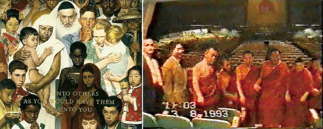

之后，法王去了联合国大会厅，也就是各国代表开会的地方。那天大会厅没有会议，空无一人，但法王对此特别感兴趣。为了世界和平，法王祈祷了很长时间，并和我们随行人员一起念了“大自在祈祷文”。

一位哈佛教授的回忆

哈佛大学有个教授叫珍妮特·嘉措（Janet Gyatso），我去哈佛演讲的时候，两次都是她接待的。1993年她也见过法王，并担任翻译。我最近采访了她，她回忆的大概是这样：

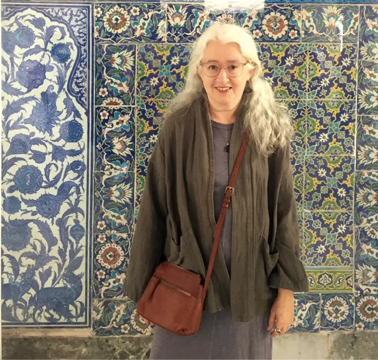

现在的珍妮特·嘉措

“那年我在阿默斯特学院教书，还没去哈佛大学任教。因为法王翻译的父亲生病了，要回去探望，于是在纽约期间，我给法王做了一段时间的翻译。法王说话带有果洛口音，我的藏语也不是很好，但他很善于用浅显的语言表达，思路也极为清晰，所以我完全能听懂他的话。

法王身材魁梧高大，第一次见到法王，我就被他的身高震住了。

当时我正在翻译晋美林巴尊者的传记，准备出版它的英文版，于是就向法王请教了这本书的相关问题。记得其中一个是：晋美林巴尊者有两部自传，一部的名字叫《空行大密语》，我不太明白为什么他的传记叫空行母之语，因为他明明是男性？法王耐心地给我解释，当时他的解释非常巧妙，彻底打消了我在这个问题上的困惑。这是我记得比较清楚的。

后来有一天，法王去联合国总部参观，我和五六个人陪同。联合国有来自世界所有会员国的代表，当我们到达时，不丹代表来迎接法王，并带我们四处参观。那里有一个很大的联合国大会厅，是所有代表一起开会的地方。法王对此非常赞叹，说居然有这样一个地方，可以让世界各国的代表聚在一起，共同讨论一些问题。然后他问了不丹代表很多问题，比如代表们怎么投票、怎么交流，了解了很多联合国运作的细节。

其实法王真的非常伟大，别的不说，光是他创办喇荣五明佛学院，就是一件了不起的事。喇荣规模庞大，力量极强，对整个藏传佛教有着举足轻重的影响。而且喇荣有数量可观的男女僧人，这对藏传佛教长久住世极为重要。

另外，值得一提的是，喇荣藏族堪姆编著的藏传佛教女性成就者丛书非常棒，这也是对藏传佛教的一大贡献。我觉得她们之所以能做到这一点，正是因为受到了法王的感召，随学法王的愿力。”

不可再现的世贸中心

8月4日，法王参观了举世闻名的世贸中心双子塔（Twin Towers of the World Trade Center）。这两座摩天大楼高耸入云，共110层，高417米。它们被称为“世界之窗”，是当年世界上最高的建筑，也是美国繁荣的象征。

进入大厦前，楼下有个纪念品商店，围了很多人。我们走过去，看到各种克林顿人形板，游客会和它们合影。甚至还有恶搞克林顿的玩具，比如有人头狗身的克林顿布偶，人们骑在上面摆出奇怪的造型。我们请法王也拍张照，于是法王把手搭在“克林顿”的肩膀上，合影留念。

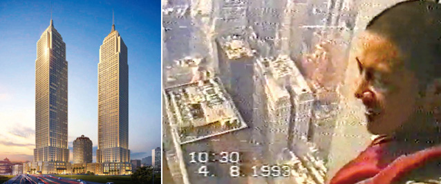

然后我们乘电梯直达110层顶楼。那里有许多望远镜，我们轮流看了一会儿，领略了纽约这个世界金融之城的风采。再往上是大厦的天台，视野更开阔，不仅可以俯瞰曼哈顿全景，还能看到不远处的自由女神像。自由女神像是一座代表自由的雕像。它是美国建国一百周年之际，法国送给美国的礼物，后来成为美国的象征。

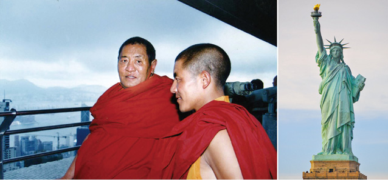

世贸中心是一座令人惊叹的建筑。它历时7年建成，耗资超过10亿美元。但就是这样一座看似坚不可摧的摩天大厦，却在2001年9月11日遭到了恐怖分子袭击，两个小时内彻底倒塌。后来，纽约市政府决定重建世贸中心，计划新建五座摩天大楼和一座遇难者纪念馆。现在这些建筑已经陆续完工。

虽然当年的世贸中心已经不在了，法王也离开我们二十年了，但是法王在那里拍的照片，我还一直保留着。

喇荣居士林的由来

过去在藏地，虽然全民信教，但几乎没有在家人集体学佛的传统。在纽约的一天，法王突然对我们几个人说：“我得到一髻佛母的授记，要在喇荣建一个居士林，这将使很多在家人受益，帮助他们趋入解脱。所以，回去之后我会建个居士林。”

我不敢多问授记是一髻佛母亲自现身告诉法王的，还是法王在觉受或梦中得到的。但听到这个消息后，我特别高兴，因为父母正在佛学院，还没有回家乡，我很想让他们留在喇荣，所以立马给他们报了名，也算是一个缘起吧。

秋天，法王回到佛学院后，亲自在喇荣谷下方选了一块地，开始修建居士林经堂，这可能是藏地第一座在家人的经堂。起初，居士林只有四户人家，包括我父母一家。自从经堂建成后，慕名而来的人越来越多，居士林的规模也越来越大。在这里，许多在家人通过精进修行，临终时出现了不同程度的成就瑞相。

此后，藏地其他地方纷纷效仿，开始建立居士林，创造了藏地居士共修佛法的因缘。

“我给法王当司机”

本来找不到任何关于法王在纽约传法的资料。幸运的是，有一个叫伊文·肖斯布兰奇（Yvon Chausseblanche）的人当时给我们开车，他私下录了法王的几节课。这些课都保存在磁带上，大部分因为年代久远已经听不清了，只有一个还比较清晰。在感谢伊文的同时，我们顺便采访了他。当提到法王时，他非常激动，热泪盈眶。他告诉我们：

“法王来纽约的时候，住在鲍尔瑞大街222号，那里是众多艺术家聚集的地方，接待过很多大德。

那一周，我大部分时间负责给法王一行开车。通常法王等人下车后，我需要先去停车，然后赶去会场。法王来纽约的机会千载难逢，所以我带了录音机，把法王的传法录在磁带上。但是有时候停车花的时间长，录得不完整，而且因为是外录，所以声音效果不尽如人意，有一些杂音。

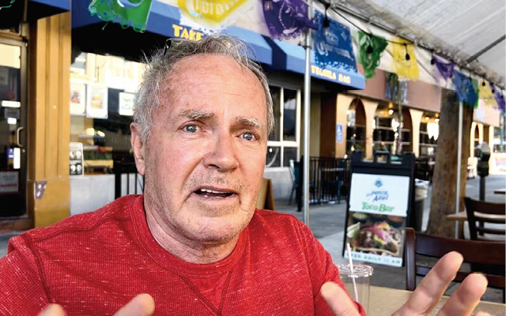

采访时的伊文·肖斯布兰奇

法王灌顶的时候，我感觉就是文殊菩萨在亲自灌顶，应该是因为法王刚开取这个伏藏没多久吧。后来我去波士顿时，得到了一张法王在五台山开取这个伏藏时期的照片。

‘杰珍宁提’那场灌顶，有三种语言，索达吉堪布负责汉语翻译。有一个场景给我留下了很深的印象：法王讲完出离心的修法后，让大家打坐观想。过了一会儿，法王说：‘今天在场的有西方人，藏族人，汉族人。我发现你们中有一种人，身体不动，头却转来转去；有一种人，头不动，眼珠却转来转去；有一种人，眼珠和头都在转，这是最糟糕的。你们认为自己是哪种人呢？’大家听后哄堂大笑。

法王在纽约的最后一天，一想到法王第二天要去波士顿，我就哭得像个婴儿。过了两天，我实在按捺不住想念法王的心，就跑去跟老板请假。他一点头，我就跳上摩托车，一路开到波士顿。结果天公不作美，下了一路暴雨，我也不管了。有时候雨下得太大，我就躲在高架桥下。

到了之后，很幸运地再次得到了法王的灌顶。也有人祈请法王传了一些法，给予了传承。

你可能会笑我，到了波士顿，我想祈请法王如意宝灌‘忿怒莲师’的顶。找到主办方金刚界的工作人员，他们说，这个星期法王已经灌了几次了，你们这次有多少从纽约过来的人想参加？记得当时我回答说‘几个’。结果他们给法王说的是25个纽约弟子。

灌顶的时候，法王看了看大家，然后开玩笑地问，25位从纽约来的弟子是哪些呢？我当时特别不好意思，没敢举手。法王给我们灌顶后，再再强调我们要修、要弘扬这个法，并说，任何人对这个法有信心，希求这个法，你们都可以把他带来，一定会满他的愿。

我们都特别感动。后来才知道，其实当时法王身体不好，严重的时候差点要取消后续行程。但是因为强烈的慈悲心，法王真的是倾其所有，一一满足了我们所有的要求。”

谈谈莲花生大士

8月6日，法王在莲师中心讲了莲师修法。这节课的资料好不容易找到。提供者当年给法王开车，听课前因为要去停车，错过了开头的一点点。不过其他内容比较全，在这里分享给大家：

……

怎么调整意乐呢？要通过广大意乐菩萨乘的发心、广大方便密乘的发心这两者中任意一种来调整。

一、广大意乐菩萨乘的发心

广大意乐菩萨乘的发心是怎样的呢？

只要虚空无处不在，众生就无处不在；只要众生无处不在，业和烦恼就无处不在；只要有业和烦恼，就决定有无尽的痛苦。感受无尽苦难的众生，无始以来无一没当过自己的父母，这个道理，佛陀在佛经中讲得很清楚。所有众生成为父母时，和现在的父母没什么区别，都是用纯净的意乐、善良的行为来养育自己，恩德极大。这些大恩父母虽然希求快乐，却不知道快乐的因是行善；虽然不想受苦，却不断造作痛苦的因，以至于他们想的和做的背道而驰。因此，要萌生“一切苦难众生远离痛苦该有多好”的善良意乐。

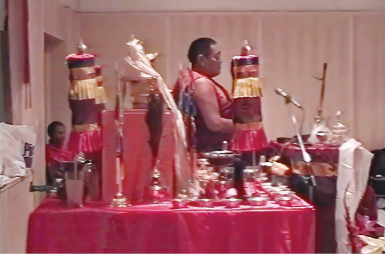

当我们想到要让他们离开痛苦时，还需要生起“将他们安置于身体安康、心情快乐等圆满安乐中”的善良意乐。但是，具足安乐的所依身，三恶趣的众生根本没有，而人天善趣虽然会享受一些安乐，但那也只是暂时的，实际上不会持续很久，超不出变苦的范畴，所以没有实质。可见，即使把一切众生安置于人天安乐，也不会有太大的利益。

我们还要认识到，就算远离了轮回之因的业和烦恼、轮回之果的痛苦，获得了声闻缘觉果位，具有自利圆满的安乐，但因为没有机会行持广大的利他，所以将众生安置于那些果位也无大利。因此，要通过证悟无我的智慧，从根本上断除轮回的一切痛苦；依靠大悲而不住涅槃，乃至虚空际利益众生，也就是说，要发起殊胜菩提心，将一切众生安置于不住有寂二边的正等觉佛果。

这样的佛果，不是无缘无故产生的，需要学修能成熟它的圆满因。是什么呢？就是圆满戒、圆满定、圆满慧。

1．圆满戒

如何才能守护清净戒律呢？从根本上断除害他，就是别解脱戒；不怕累劫的时间长、众生的数量多和难调化，发愿利乐一切有情，就是菩萨戒；可以轻易快速地成办自他大利，就是密乘戒。“轻易快速”中的“轻易”是指，随意享受五种欲妙而不必舍弃，同时获得大乐的境界；“快速”是指，无需观待长久的苦行，在浊世中用短短一生就能成就金刚持果位。

2．圆满定

心一缘安住，就叫定。令心安住的窍诀，是断除五过、依止八行、修行九种住心方便。它的果就是九种次第等至。详细内容可参照弥勒菩萨的论典。从窍诀而言，以心观心，自然安住，逐渐止息一切分别念，这就叫定。

3．圆满慧

慧有三种：闻慧、思慧、修慧。闻慧，是在具法相的上师面前，清楚地听闻显密佛法，尤其是自己所实修的法。思慧，是指对于听到的那些法的句义，要反反复复分析，驱除所有未证、邪证、怀疑的黑暗，对实相义生起定解。修慧，就是把断除疑惑的意义结合自相续去反复实修。

所以，要实修能获得佛果的因——戒定慧三学。

这次在这里，你们要调整自己的发心，听一个清净的修法。

二、广大方便密乘的发心

广大方便密乘的发心，是指通过明观五种圆满来听法。五种圆满是指，以此时讲闻佛法为例，处圆满：把这里观想成真正的铜色吉祥山莲花宫。本师圆满：将说法者观想成真正的邬金莲花生大士，以虔诚的信心恭听。法圆满：以了知密宗金刚乘之道稀有深广的心态来听。时圆满：通过了知“只要具缘者存在，佛陀讲法事业就不会过期”的讲法自性来听。眷属圆满：以了知听闻者是持明勇士勇母的自性来听。

首先，你们要调整为显密的这两种发心来听法。接下来，所听的法就是：你们和其他众生不同，具足修行正法的四种顺缘，对此要生起欢喜心。

四种顺缘是：1．出生在难以投生的南赡部洲，值得欢喜。2．不仅得到了赡部洲的人身，还遇到了高僧大德和说法的上师善知识，这也是一种善缘。3、4．之所以能成就以上两种顺缘，是因为自己往昔的善愿和所积福德的结果，所以要生起无比的欢喜。拥有如此圆满的顺缘时，自己不同于其他普通众生，而是对正法有信解，这也是修法的殊胜因缘。所以，修持正法一定要具足这四种顺缘，有了这四者，我们的顺缘就齐全了。

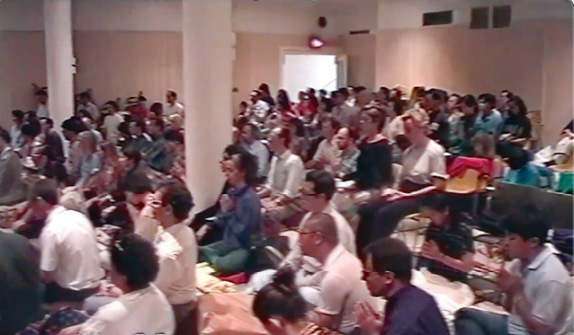

即使具足了四大顺缘，自己也不会一直住留，也是必定会死，死期不定，死时除正法外皆无益。因此，从现在开始，一定要修行清净的佛法。

关于佛法，佛陀随上中下众生不同的界性、根基、信解、意乐，宣说了八万四千法门，这些不需要全部通达，也不需要全部实修，一切法的要点可以合而为一，就是修悲心与信心。想方设法断尽一切众生身体的病痛和内心的痛苦，这就是悲心。消除一切众生痛苦的方法，就是对诸佛菩萨怀有信心，虔诚地祈祷，否则随便想一下众生的苦，不是单靠这个就能消除的。

・莲师的不共功德

如果要虔诚祈祷诸佛菩萨，现在经典中单单是诸佛菩萨的名号，都无法一一念诵。而诸佛菩萨总集的本体，是邬金莲花生大士，如果一心一意祈祷莲师，那么所有的佛菩萨都包括在内。邬金莲师是从一切法身佛的密意中显现的，是一切报身佛所加持的，是一切化身佛任命他为补处的。

若有人想：“他怎么会是诸佛总集的本体呢？”

莲花生大士是在一切所化的清净福德成熟时，三世诸佛的身语意功德事业合而为一，变成“舍”字，收摄于无量光佛的心间，再投射于邬金西南乳海。在没有父因母缘的情况下，他是自然觉性以顿生的方式化生的。当时，他的身体具有与法身金刚持无别的相，所有空行与勇士都奉其为部主，加以承侍，称之为“邬金海生金刚”。

为了消除众生的贫穷之苦，邬金国王恩札布德去海岛取宝。途中经过西南乳海时，遇到了这位化身，以太子的身份迎他回宫，立他为王位继承人，使其拥有整个国政，如理维护王朝，被称为“莲花王”。

后来他放弃王位，以觉性禁行在八大尸林等处，为诸位勇士和空行转大乘法轮，被称为“日光”，具有行走时乘着阳光像风一样无碍云游的神变。

在阿阇黎札巴哈德等印度八大成就者面前，他通过依止，成为精通浩瀚共不共宗派的智者，被称为“爱慧”。

在阿苏拉山洞，他在佛陀的侍者阿难座下出家，守护清净戒律，持比丘相，被称为“莲花生比丘”。

在菩提伽耶期间，他的身体变成纯金色，观察他的所作所为，似乎与佛陀无异，被称为“释迦狮子”。

到了印度北方后，在萨霍国，为了让君主行持正法，他依止业手印曼达拉娃公主做觉性禁行。萨霍国王想将他活活烧死，他并没有被火大所焚，而是泰然自若地坐在具八功德水的湖中央的莲花蕊上，被称为“颅鬘妙力”。

后来在尼泊尔的玛拉蒂卡山洞，他依止曼达拉娃明妃，成就了无死的寿自在持明，被称为“无死莲花生”。

在尼泊尔的扬列雪岩洞，现证大手印成就后，为了降伏一切凶神恶煞、魔鬼、坏誓鬼，示现忿怒明王金刚手的形象，被称为“狮子吼”。

其后，他依止狮面佛母，摧毁了许多难以想象的外道城市。这以上是邬金莲花生大士在印度和尼泊尔弘法利生的情况。

接下来，在今天不丹一个叫虎穴的地方，他怀柔震慑了现有一切骄慢的鬼神，让他们立下誓言。之后，在藏地的上阿里三地、中卫藏四翼、下多康六冈，隐藏了不可思议的法伏藏、物伏藏等伏藏品，授记未来会有108位伏藏师相继出世，并做了发愿、交付、印持，被称为“忿怒金刚”。

莲花生大士在藏地住了55年左右。在圆满了南赡部洲的所化事业后，为了调伏凶残猖獗的罗刹，他前往妙拂罗刹洲，震慑了所有罗刹，弘扬佛法。为了使罗刹进入佛门，他示现威猛身相，被称为“威猛妙力”。

在诸多较广的伏藏品中，为了表示不同的成就相，也有多面多臂的威猛莲师。威猛莲师在妙拂洲吉祥山，不舍肉身而起现大虹身，至今仍在住世说法。

现在莲师住的地方叫妙拂罗刹洲，周围有二十一个罗刹境，中央是铜色吉祥山，形状如心脏。在这座山的山顶，有一座名为莲花光的三层宫殿：下层是化身刹土，是罗刹王绕恰托创为众罗刹说法之处；中层是报身大悲相以具五决定的方式说法之处；上层有法身普贤如来，入定于法性无生义。有这样一个殊胜的无量殿。

妙拂吉祥山莲花光宫殿的四方四隅上下等三十六处，邬金莲师以三十六种不同化身正在利益众生，也正在为现场聚集的弟子君臣、获得成就的不可思议持明众、有缘的所化众生转法轮。

・莲师的伏藏法门

后来，藏地出世的诸位化身伏藏师，都曾在莲师众会中受用过会供轮，莲师亲自将献新交付某位化身，告诉他需要前往藏地雪域利益众生。所有那些伏藏师，大多数都能自在地驾驭甚深地伏藏、广大意伏藏。

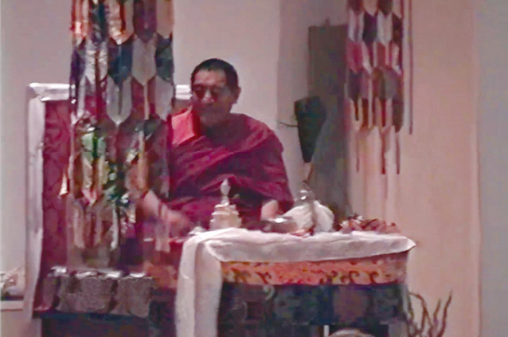

化身伏藏师的传承，有三大独特的殊胜之处：一、这位伏藏师一生如何利生的事业，全部需要莲师时时告知，所以称为付教授记传。二、莲师或丹玛则芒、贝若札那、益西措嘉，无论哪一位将法写在伏藏黄纸上，依靠莲师密意交付的力量，黄纸上的一切词义，除了甚深伏藏主本人，谁也看不懂，这叫黄纸句传。三、不仅授记业手印和发愿，还交付不可思议的护法空行母，委任她们辅助某位伏藏师，这是空行交付印传。

所有的交付印持，最初是在桑耶寺顶层的三楼，莲师与君臣二十五大弟子等聚集一堂时，做了许多交付印持。那时候没有发愿交付印持的，后来有很多在妙拂吉祥山重新做了交付。就这样，化身伏藏师在复兴弘法利生事业、给众生带来安宁快乐方面，有许多完全不同于其他行人的殊胜特点。

化身伏藏师生于什么地方呢？

总的来说，世界上任何地方都会有几位，但大多出生在藏地雪域，这是莲师先前的密意交付方式、委托交付诸位护法神、加持伏藏地的原因所致。

这些成就的化身伏藏师，在哪个宗派中有呢？

随行于莲花生大士的宁玛派中才有，其他教派中很少有这样的成就者。

莲师所有伏藏法藏的伏藏者和开取者是谁呢？

他的明妃，大空行母益西措嘉。莲师去了罗刹洲后，益西措嘉用七年时间结集了莲师的所有言教，然后在各地隐藏伏藏，并做了发愿印持。如今，一大批相继涌现的伏藏师取出的大量伏藏品，也都源于益西措嘉。对于藏地雪域受持莲师法脉的人来说，恩德与莲师无有差别的，唯一就是益西措嘉。莲师前往罗刹洲之后，她实修了七年文殊大圆满法，成就大虹身后，去往妙拂洲的莲师真身前，现在也住在那里。具有如是恩德的莲师佛父佛母，如今就在遥远的妙拂罗刹洲。

・莲师的七句祈祷文

我们祈祷莲师，不可能得不到加持，因为他亲口说过：“住信士前未离去，生六趣中我皆引。”如果在修行时祈祷莲师，会比祈祷其他佛菩萨更有加持，尤其是，它还是上师的修法。我们实修前译宁玛派的人，全部都要祈祷莲师。诸续部中说：“观修十万本尊身，不如一刹那忆念上师的功德大。念诵数百万、数千万的咒语仪轨，不如祈祷一次上师的功德大。”

从哪方面讲祈祷莲师的加持更大呢？

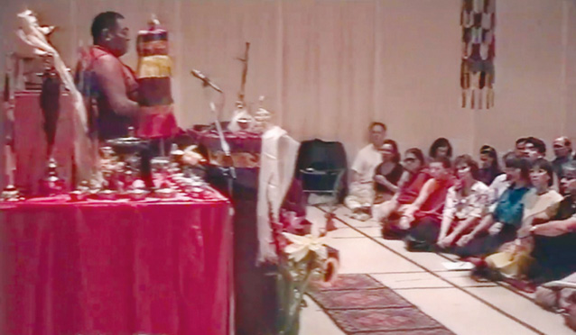

从发愿力来说，莲师不同于其他诸佛，他特别眷顾赡部洲的众生。莲师的传记中记载：“为利赡洲众生，日升日落乘光而来。”明确说了他恒时乘着日出日落的光辉，来利益这个世界的众生。而且他亲口说过，诸佛虽然功德相同，但是以他不共的发愿力，修他会比修其他佛更快得到百倍千倍的加持。莲师还说：“敬我敬诸佛，见我见诸佛，我集诸善逝。”如果修持他，就是修了一切佛；如果见到他，就是见了一切佛，他是一切佛总集的本体。

那么，他是如何总集一切佛的呢？

莲师说过：“往昔佛陀无量光，达拉山怙观世音，达那够夏莲师我，显现三身唯表相，实则无别无他体。法界净刹普贤王，密严刹土金刚持，菩提伽耶大牟尼，自成无二莲师我。”所以要知道，比起在许多劫中祈祷、观修其他佛菩萨，在短时间内祈祷莲师，会更快得到加持和悉地。

关于莲师的修法，虽然各个伏藏品中有很多广修法，但这一切修法的究竟，唯一就是金刚七句祈祷文。

这个七句祈祷文，不是普通人造的，而是从法性无生界与报身无灭妙力中显现并传出的金刚自声。只要是随行于莲师的化身伏藏师，他的伏藏品中似乎不可能没有七句祈祷文。这也是昔日迎请莲师至会供处的诸位空行母的表示语。即使你不明白它的意思，只是简单地念诵词句，莲师也会从妙拂洲降临并赐予加持。

这个七句祈祷文，在基位表示七识聚，在道位表示七觉支，在果位表示七胜义。此祈祷文的莲师修法，可对应依外祈祷方式的修法、依内结合生起次第的修法、依密解脱道的修法、依极密方便道的修法、究竟大圆满窍诀的修法。这一切都摄于七句祈祷文的词句中，不需要其他词句来补充，它的原句就有全部完整的内容。

在此，我简单讲一下依外金刚七句如何修上师瑜伽：

你们自身平常而住，在前方的虚空中，明观邬金无垢达那够夏深海充满八功德水，在自生莲花的花蕊上，邬金莲师与益西措嘉白里透红、神采奕奕，佛父佛母无二双运，勇士、空行、护法所有眷属灿然安住。

观想：“从现在起直至获得菩提果，无论我是苦是乐、是凶是吉、是高是低，除了邬金仁波切您，我不寻求任何其他指望处和皈依处，唯一祈求您的加持。”要生起强烈的信心。

观想自他一切众生以身语意恭敬顶礼；供养各种真实和意幻的供品；带着猛烈的悔恨，发露忏悔无始以来累生累世犯下的一切堕罪。要修七支供的前三支。

然后，没有嫉妒地随喜自他三时所积的一切善业；祈祷莲师您无死寂灭的殊胜之身长久住世；劝请您为一切众生转妙法轮；此时积累的所有善根，为获得莲师您的果位而普皆回向。需要如理实修这后四支。

再观想：依靠这样虔诚的祈祷和七支供积资的威力，莲师身体放射出种种光芒，照耀我和一切众生，从而清净了身语意的障碍，有缘获得了清净身语意的悉地。尽己所能念诵七句祈祷文和莲师心咒：

吽 哦坚耶杰呢香灿 吽 邬金西北隅

巴玛给萨东波拉  莲花蕊茎上

雅灿巧格悟哲尼  稀有成就尊

巴玛炯内益色扎  共称莲花生

括德夸卓芒布果  空行众围绕

切杰吉色达哲吉  我随汝修行

辛吉拉协夏色索 祈临赐加持

格热巴玛色德吽 格热巴玛色德吽

嗡啊吽 班匝儿格热巴玛色德吽

虽然以前也有用诸位空行母的表示语来念诵七句祈祷文和莲师心咒的传统，但现在我们没有一个人会说空行的表示语。你们念诵时，就用藏语念，它是莲师亲口答应加持的语言。

有人会想：“是根本不会用空行母的表示语来念吗？”

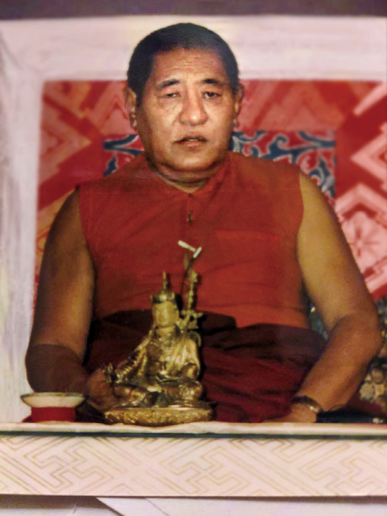

会是会，所有化身伏藏师都会念。空行母的表示文字，在空行洲的主要三十二部中，有三十二种不同的表示文字。在它所有的表示文字中，这七句以前已经广为人知，但化身伏藏师们，谁也没学过空行表示语，都是用藏语念的，所以你们也可以发藏音。即使学了空行母的表示语，也只有诸位空行母才懂它的意思，其他人并不明白。就算知道个别单词，像威猛莲师的心咒“嗡阿则内则……”，但也没有人能理解。如果用藏语念，该解释的词句，我们可以做解释。空行表示语是怎样的呢？就像我们藏语有许多方言，其中嘉绒的有些方言谁也听不懂，空行表示语也是如此。

你们一心一意地祈祷莲师，最后观想从莲师的眉间、喉间、心间三处放出白光、红光、蓝光，分别融入你们的三处，无余获得莲师身语意的加持和悉地。然后莲师佛父佛母化光，变成一个白里透红、光彩奕奕、由“吽”字严饰的明点，融入自己的心间，上师的智慧与自己的心成为无二无别。心一缘安住于无有任何散收的境界中。出定后，了知一切显现是上师的身、一切声音是上师的语、一切分别念是上师的意，将此应用于行住坐卧四种威仪中。

以上就是莲师的修法。

如果想成办浩瀚的事业，必须依靠莲师《心愿自成》中具有十三个如意宝般窍诀的七句祈祷文。所以，诸佛浩瀚法理中的究竟深法，没有比祈祷上师邬金莲花生大士、修持光明大圆满法更好更深的了，请时刻牢记在心并实修。

至此，纽约的弘法行已经圆满。
