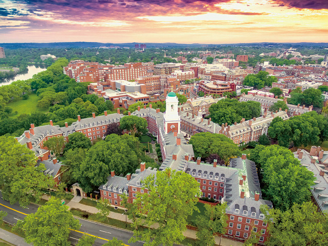

第7站 美国·波士顿

Boston, USA 8/9-8/16

行程

8月9日，来到波士顿

8月10日，“普巴金刚”灌顶

8月11日，“忿怒莲师”灌顶

8月12日，“空行心滴”灌顶

8月13日，“文殊静修大圆满”灌顶和开示

8月14日，传讲《手中赐佛》

8月15日，传讲《手中赐佛》

8月16日，“格萨尔王”灌顶和开示

在波士顿传法

离开纽约后，我们坐了四个多小时的车，到达了美国文化中心波士顿。

这是美国最古老、最有文化价值的城市之一，既有欧洲风情，又有美式味道。它没有纽约那么繁华和快节奏，更偏向于保守和传统。这座城市见证了美国从殖民时期、独立建国到繁荣昌盛的变化。

波士顿最初是由英国清教徒移民建立的。他们大多在牛津和剑桥接受过传统的高等教育。为了让他们的后代在新的土地上接受良好教育，美国历史上第一所大学哈佛大学于1636年成立。此后，麻省理工学院等多所学校也相继成立，这里有非常浓厚的文化氛围。

法王在波士顿也待了一个星期，传法的日程安排如下：

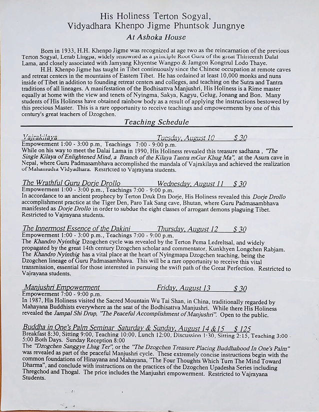

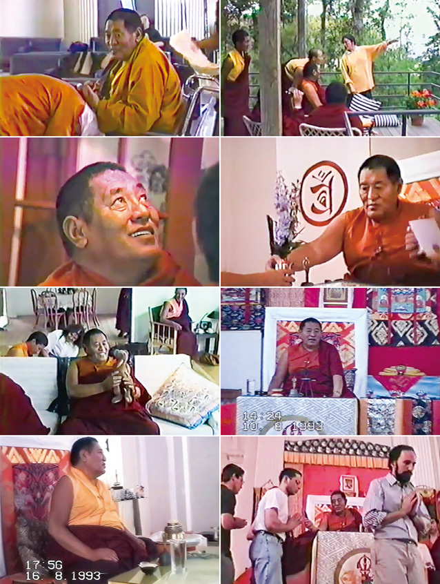

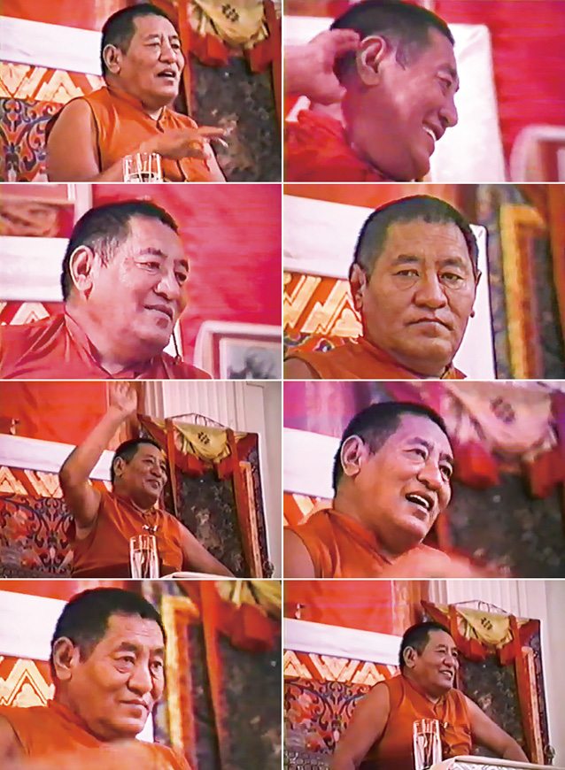

8月10日星期二，“普巴金刚”灌顶，30美元

8月11日星期三，“忿怒莲师”灌顶，30美元

8月12日星期四，“空行心滴”灌顶，30美元

8月13日星期五，“文殊静修大圆满”灌顶，30美元

8月14日-15日，周六周日，传讲《手中赐佛》，125美元

（两天安排：早餐8:30，打坐9:00，开示10:00，午餐12:00，讨论1:30，打坐2:15，开示3:00-5:00，周日宴会8:00）

8月16日星期一，“格萨尔王”灌顶，30美元

地点：法界禅修中心阿育王楼

听法是要收费的

在西方，每个道场都要收取传法的费用，这对于很多东方人，尤其是藏族人来说，有点难以接受。其实这并不是因为他们靠贩卖佛法赚钱，而是因为西方传法的环境与东方不一样。那里的道场很少有人供养，而道场要想维持，就必须支付房租、水电费、维修费、各种税等费用，尤其是在迎请一位上师的时候，他的路费、餐饮费、住宿费、交通费都要由道场自己解决。如果不收取一定的费用，道场很难长久生存。

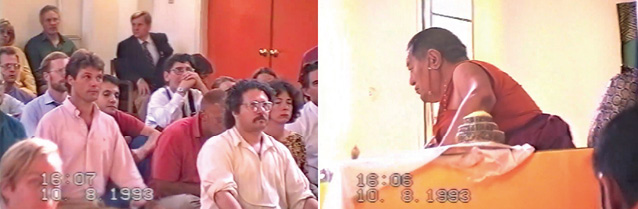

当然，这无疑提高了闻法的门槛。如果经济条件不允许，人们可能没有机会听闻佛法，这和藏地有很大的不同。记得法王在华盛顿传法时，台下就有一个中国大学生，听了《手中赐佛》的第一节课，手里的钱不够了。为了让他顺利听完后面两节课，我私下帮他交了70元美金。

虽然和我们的习惯不同，但从另一个角度来说，很多人仅仅因为交了钱，就把每一次传法都当成了一件重要的事情，对佛法的态度和闻法的效果也大相径庭。

所以，孰是孰非，有时候很难界定。在不同环境下传法，只能入乡随俗，符合当地的文化和人们的习惯。

不落的太阳

8月13日，法王在传授“文殊静修大圆满”灌顶时，说过这样一段教言：

每当我离开一个地方，重感情、信心大的人都会忍不住流泪，就像母子离别一样，这样的人很多。其实，我们不仅在这次讲法期间聚在一起，而且已经建立了生生世世稳固不变的密切关系。

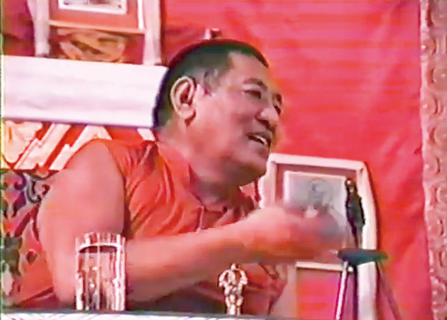

前段时间我在落基山的道场讲法时，突然想起一个预言。是怎么说的呢？“普利之日轮，虽从东山起，光芒照西方，无知众小山，莫思我高傲，自前影遮蔽，汝虽暂自由，终为光普照。”就像太阳升起时不会被群山遮蔽一样，这个法也会逐渐在世界各地弘扬开来。从验相、迹象来看也是如此，所以我当众给大家做了解释。

一般来说，我要做任何事，无论大事小事，都会向上师和本尊祈祷很久，不经过深思熟虑和仔细观察，是不会真正开始做的。但今年是个例外。我来美国，只想看看对这个地方的人有没有帮助，能不能弘扬佛法。况且我在纽约说过，我来不是为了赚钱，也不是为了得到什么地位，而是依靠怙主文殊菩萨的大悲与加持，身不由己地来到了美国这个地方。这次利益你们的时机已经成熟，想必我也是依靠怙主文殊菩萨的加持，才被送到这里的。虽然你们每天都有不少收入，但也全部放弃了，不由自主地聚集在这里，我想这也是文殊菩萨的加持。总之，我们今天聚集一堂，唯一是来自文殊菩萨的大悲摄受。

这一次，你们不仅要听法，还要实修这个法，以后将它广弘给他众。这既是我的希望，也是你们的责任。如果做到了这一点，会让自他受益匪浅。

从以前的历史看，英国统治世界的时候，曾经宣布：“在我们的领土上，太阳永远不落。”就像这个比喻，只要齐心协力，我们也可以说“修此文殊静修法的人，太阳永远不落”，已出现了说这句话的善缘。

它的意思是，当美国太阳落山，你们正在睡觉时，我们亚洲各国的传承弟子正在实修此法，念诵文殊心咒“嗡阿Ra巴匝那德”；而我们在睡觉时，太阳在你们头上升起，你们开始念诵“嗡阿Ra巴匝那德”。因此，完全可以说，在这个世界上，修行此法的人，头上是不落的太阳。

现在已经快11点了，亚洲大部分修持此法的人，不仅躺下了，还睡着了，而这里正是进行文殊灌顶、念诵文殊心咒的时间。今晚我们躺下的时候，正是亚洲各国弟子修文殊心咒的时候。

大后天我就要告别美国了。藏地曾经有个大德叫仓央嘉措，他的道歌中说：“书写之黑字，会被水滴抹，未绘之心画，抹亦抹不去。”比如用墨水在纸上写一个字，然后在上面盖个印章，四大的危害会摧毁它，但我们心中的爱和法的传承永远不会被摧毁，应该像画一样把它刻在心里。

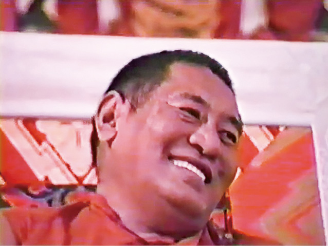

最近，我在美国的很多弟子都说：“希望您能再来美国。”虽然无论从哪方面看，我觉得恐怕都不会再来了，但我不会忘记你们。不管我以后能不能再来美国，你们都要持之以恒地修这个法。如果能精进修这个法，就和我来没什么区别了。只要我在美国的所有弟子不改变意乐和对法的信心，我也绝对不会改变，就像日月运行永远不会偏离自己的轨道一样。

中央妙高山，坚固不变住，日月之运行，永不离轨道。（掌声）

最后，法王用悠长的曲调唱了三遍这个偈颂，作为对大家最后的祈愿。

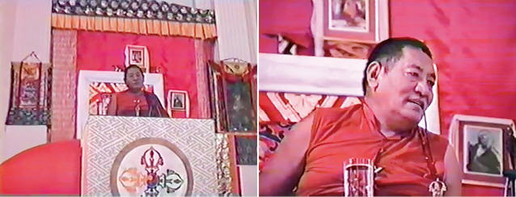

去看大西洋

在波士顿期间，离我们住处不远的地方，可以看到大西洋。有一天，法王来到那里，看着波澜壮阔的大西洋，听着当地人的各种介绍，心情很好。

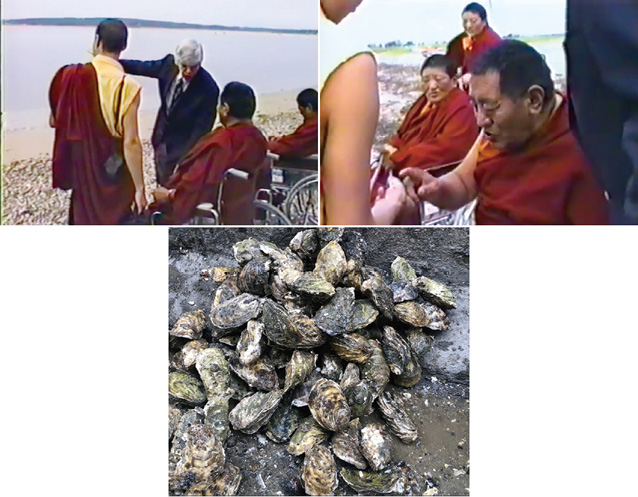

海边的岩石上，长着像石头一样的牡蛎，有人拿给法王看。我们第一次看到这块“石头”里的生命，感到非常惊讶。法王也说众生的业力不可思议，还特意对它做了加持。

无论法王还是其他大德，显现上都很喜欢海。的确，当我们来到海边，所有的分别念仿佛都被海浪卷走，融入了无边的汪洋，只剩下清净无别的法界。

1990年我和法王一起看过印度洋，1993年随法王来美国看过太平洋、大西洋。虽然这些海洋看起来没什么不同，但我总觉得只看过世界四大洋中的三个，还差一个北冰洋，希望也能和法王去看看。我年轻时有过这样幼稚的梦想，后来也没有实现。

神奇的香巴拉

8月16日，法王来到香巴拉道场，给大家做了一场开示：

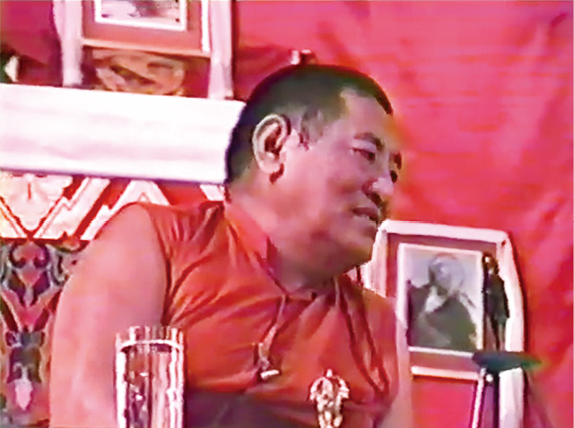

今天有两件事：首先介绍一下香巴拉，第二个是“格萨尔王”灌顶。

・介绍香巴拉

介绍香巴拉，一般来说，就是介绍香巴拉的起源和历代国王的所行事业。

1．香巴拉的历代国王

香巴拉的起源是怎样的呢？

我等本师，善巧方便、大慈大悲的佛陀，无量劫前先发殊胜菩提心，中间于三大阿僧祇劫积累资粮，最后在印度菩提伽耶示现成佛。为了利乐天界等世界的一切众生，佛在鹿野苑初转四谛法轮，当今世界上，斯里兰卡、缅甸等许多国家的人都在修这个四谛法。之后，佛在灵鹫山转无相法轮，现在汉地和日本等地的很多人，也在实修这一法理。最后，佛陀在莲花城等地转善分别法轮，它是连接显宗与密宗的法。接着又在天、龙、夜叉、乾达婆等不同境域，为诸位有缘众生转了密宗金刚乘法轮。现在很多人比如藏族人、不丹人、美国人等，主要都在修密宗金刚乘的法。

铁龙年角宿月（三月）十五日，81岁的大悲佛陀在印度南部的具德米积大塔处，宣讲了《时轮金刚》《文殊真实名经》等密宗金刚乘的法。当场的眷属有人、非人、天人、夜叉等许多众生，其中，首座弟子就是香巴拉的国王——月贤法王。

月贤把时轮金刚的所有法合而为一，结集成一万两千偈颂，在月贤、他的儿子和孙子等七代法王期间，他们都要闻思修行此法。这一时期的香巴拉像印度一样，分为王族、商人、平民、贱种等不同种姓，有“下等种姓不能得法、高贵种姓才能得法”的传统。以上这些法王在位期间，香巴拉的四个种姓中，只有金刚种姓才能接受这个法，其他三个种姓则不能，所以他们不能被称为具种者。

七代法王之后，具种王妙吉祥称出世。他说：“对于受持和护持佛法而言，种姓并不是最重要的，有功德才最重要，要受持佛法的根本。”他将所化的四个种姓全部归为金刚种姓，并赐予他们灌顶，因此，他被共称为具种王。《时轮金刚续》中说：“四种一种故，具种非梵种。”他的事业今天也在维护着香巴拉，在其境内，不分种姓高低，任何人都可以学修佛法。

具种王的第一位就是妙吉祥称。他把祖上七代法王时期的全部时轮金刚法，重新结集并做了解释，撰著了共五品的《时轮金刚略续》。比起他祖上的七代，他的事业更胜一筹。

继他之后，他的太子白莲具种王执政，造了一部《无垢光大疏》，来解释他父王的《时轮金刚略续》。

在此之前，香巴拉行人实修的法只有两个：《时轮金刚根本续》和《时轮金刚略续》。所谓《根本续》，是祖上七代法王时期的那个续；所谓《略续》，就是妙吉祥称具种王所造的共五品的那个续。

所有具种王的每一位，都是从登基开始统治100年，然后由太子继位。其中，难胜和胜海两位比较特殊，他们的总任期是403年，其余的任期都是100年。这里的年数不是指他们的寿量，而是指执政的时间。从寿量来说，他们在登上王位之前，已经住世了很多年，太子继位后还会继续住世很多年。

现阶段是第二十一代具种王执政，他的名字叫不灭，今年是他在位的第67个年头。

继他之后，他的太子将是第二十二代具种王，人中狮王；他执政100年后，他的太子，也就是第二十三代具种王大自在王，将继承王位；之后是第二十四代具种王无边尊胜王执政；最后是他的太子具种王勇武轮王出世。

第二十五代具种王所行的事业是，当这个赡部洲和其他洲的一切众生都在遭受各种不安和苦难时，他显现威猛的身相，让所有众生重获安乐。他不仅会降伏许多残害世间众生的残暴野蛮之徒，还会统治西牛货洲、北俱卢洲、东胜身洲等地。自登基以来，他一直广弘以时轮金刚为主的正法。届时，无论从佛法、世间法哪方面讲，他的广大事业都将胜过祖上七代法王和二十四代具种王。所有秉承和维护他事业的人，也让他的事业几千年都经久不衰。

他的继承人，是太子梵天和天王，二人行持和维护父王的广大事业。

以上简单讲了香巴拉历代国王的生平历史。

2．香巴拉的具体位置

那么，香巴拉在哪里呢？

中央菩提伽耶的北方，有一个叫勒的地方，它外面有座雪山叫具德，再往北就是香巴拉国土。

那座雪山在哪里呢？

它位于中央菩提伽耶的北方，越过九座非常高的黑山。

在具德雪山的外面，有一座香熏山。香熏山和具德雪山之间有一片池，叫无热恼池。这个世界上所有河流的源头，就是无热恼池。香熏山的外面，就坐落着香巴拉城。

九座黑山和具德雪山不是很小，而是特别大的山。粗略估计的话，就像今天藏地和尼泊尔的边界，有一座喜马拉雅山，其顶峰海拔8848米。当今世界上大约有180个国家，没有一个国家有这么高的山。你们美国最高的山是麦金利山（Mount McKinley），海拔也只有6000多米。九座黑山就像喜马拉雅山一样，不是普通的山，那里有大海、雪山、岩山、林苑等，除非是具有神变者和被本尊摄受的人，一般人很难随随便便到达。

很多人会想：“所谓的香巴拉，根本不可能存在，因为世界上的科学家都没见过它。”

虽然世界上所有的科学家普遍都是好的，但他们和佛陀完全不同，他们的智慧还需要提高、完善。佛陀说香巴拉是存在的，则勒巴班智达等许多人，以前也都去过。而现在的科学，其实还有很大的发展空间。以医学为例，在这个世界上，美国的医药可以算是一流的，但很多新的疾病仍无法治愈，医生们似乎都在深入研究。假设一个科学家说这个地方会有一场大风，虽然他知道风会来，却不知道如何阻止它。如果是佛，根本不可能只知道风要来，却不知道阻止的方法。所以，就像所有孩子都需要逐渐成长一样，科学也需要进步和提高。

我还听说一位科学家宣布，会出现一个像太阳光一样的强大电光，可以照亮世界上所有的国家。当时不仅大家都急着去看，还有很多人提醒我去。我认为这是不可能的。后来听说那个电光出了问题，就没有显现。像他这样的语言，佛陀永远不可能说。但关于香巴拉的形成和历代法王出世的情景，佛陀全部都有宣说。

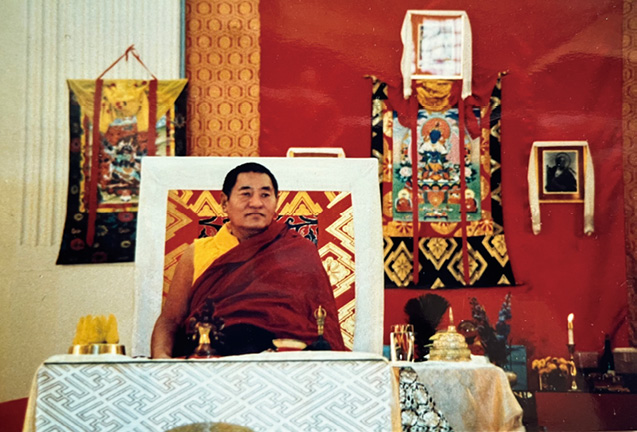

香巴拉的领土面积，大约是这个世界的三分之二。香巴拉的外面被雪山环绕，里面有960百万个大城，这里也被雪山环绕。在中央，有一座城市叫嘎拉巴，历代国王都住在那里，香巴拉的所有河流都流向嘎拉巴城。香巴拉被许多雪山和大海包围着，所以，如果没有得到殊胜的神变，自然不会到达。具有神变的莲花生大士去了香巴拉后，曾在法王月贤面前，得受过时轮金刚和大圆满法。

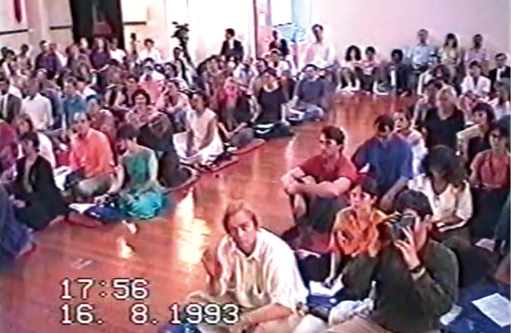

香巴拉所有人和国王的所行事业是怎样的呢？

他们有两种所行事业，一种是对伤害、损恼一切有情的众生，施以降伏的诛业；一种是对具缘的所有修行人，施以正法的善妙事业。

比如具种王勇武轮王，前世是莲花生大士；中间在这个世界兴起各种苦难和不幸时，他以格萨尔王的身份，出现在我们藏地下康区，消除了一切灾难。

有人说格萨尔王只是一个神话，有人说格萨尔王确实存在。那些声称格萨尔王只是一个神话而不是真人真事的人，只是对盲聋讲讲罢了，根本没有人会相信，因为格萨尔王与大臣居住的城堡遗址，现在可以被我们亲眼看到。如果去藏地朝拜，你就会看到它。

例如，格萨尔王有一座宫堡叫狮龙虎顶。1990年我去青海朝拜时，路过那个地方，发现并大致认定了这是格萨尔王狮龙虎顶宫堡的旧址。当时除了一片草原，连遗迹都没有。据说后来在重建格萨尔王宫堡的过程中，出土了王宫的墙壁和一些普通财产等文物。当今深入研究格萨尔王的藏汉学者，也对此深信不疑，并且非常高兴。在平整场地做奠基仪式时，南珠堪布、吾智多杰，还有我们都在现场。

在未来的末法时期，格萨尔王会以具种王勇武轮王的身份出现。

・介绍这个香巴拉道场

这里的香巴拉道场，大家都很清楚，学修方式有两种：一个是香巴拉的学修，一个是佛法的学修。

学修香巴拉的法是怎样的呢？

眷属是不是佛教徒不重要，不管是谁，只要有信心就好。无论是世界上哪个国家的哪个人，对上没有嫉妒，对下没有欺凌，而是善待一切众生，主要是在慈悲心的基础上，竭尽全力利益上上下下所有众生。

有些人会认为：“在香巴拉的眷属中，有金刚护法，基本类似于军队，这会有害于国家和人民吧。”

一点也不。回顾之前的历史，我们会清楚地发现，比如在这个国家，香巴拉道场已经建立了很久，但是在这期间，这个道场从来没有对以美国为主的任何国家做过丝毫伤害，也没有做过伤害上中下各层众生的一件事情。金刚护法将来会转生为勇武轮王的眷属，广泛地利益众生，现在已创造了这样的缘起。所以，香巴拉道场学修的，是一种无害寂灭之道，只会对这个国家的人民有很大好处，这完全是一件好事。

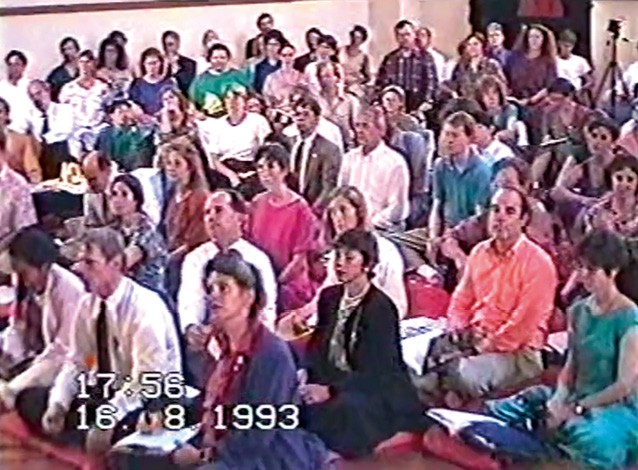

香巴拉道场的第二个学修内容，就是学修内道佛法。在这个团体里，所有修行人都是先修前行、寂止、观想金刚瑜伽母，再学修大手印和大圆满。如果你只学修香巴拉的法，也可以；只学修佛法，也可以。主要是，香巴拉的学修与佛法的学修并不相违，如果能把两者结合起来修行，那么今生安乐，后世也安乐，会带来不可思议的美满幸福。长期以来，一直有很多弟子维护着这个道场的传统，但最重要的是，你们要加强香巴拉的学修和佛法的学修。

主要的情况你们都清楚，我只是简单介绍一下香巴拉道场的清净学修。这样的所行事业，我不知道有没有向别人解释清楚，也可能会给这个道场带来很多混乱。

怎么会造成混乱呢？有些人可能担心香巴拉的学修有害于国家和人民。再者，在道场内部，如果不明白香巴拉军训和学修佛法是一个要点，两者之间就会产生很多矛盾。总之，就像我之前说的，香巴拉道场的学修绝对是无害寂灭之道。如果知道这两种学修并不冲突，是一个要点，那么不仅你们受益、国家受益，名声也会越来越远扬，事业也会越来越兴旺。

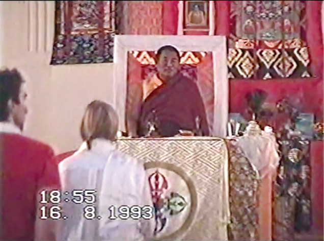

之后，法王以自己造的仪轨，传授了“格萨尔王”灌顶，还念了《格萨尔王供·事业自成》的传承。最后，法王说：“为了你们心想事成，我对护法神也委托了事业。以后你们如果念护法供，广中略的仪轨，我已全部念了传承。”

至此，波士顿的弘法行已经圆满。
