第8站 加拿大·哈利法克斯

Halifax, Canada 8/17-8/22

行程

8月17日，上午来到加拿大

下午接受采访

8月18日，晚上在达尔豪斯大学公开演讲

8月19日，上午抵达多杰丹玛林

下午传讲《对三宝生起信心》

8月20日，“文殊智慧勇识”灌顶和开示

8月21日，上午“项袋金刚橛”“忿怒莲师”灌顶和开示

中午观看香巴拉军队操练

8月22日，临别忠言

来到加拿大

8月17日，法王结束了在美国的所有行程，飞往下一站：加拿大。

加拿大在17世纪早期是法国的殖民地，后来被割让给英国，直到1982年才真正独立。我们1993年去那里时，加拿大人口不到3000万，但它的国土面积比美国和中国都大，是仅次于俄罗斯的第二大国家。

加拿大虽然是美国的邻居，但生活节奏完全不同。这里的人做什么都慢悠悠的，看起来非常有耐心、非常有时间，有点像藏族人，所以我们比较适应。来到这里，不知不觉就会抛开压力，进入一种难以言喻的境界。

从美国波士顿出发，飞到加拿大哈利法克斯（Halifax），只需要一个多小时。因为美加两国关系好，所以通关很顺利。离开机场后，我们去了当地一个名为夏日亲林（Sharchen Ling）的道场，在那里住了两天。

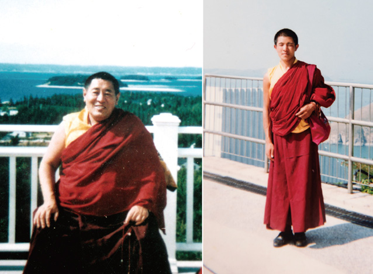

与以往不同的是，这次法王住在三楼，而不是一楼。房间外面有一个很大的露天阳台，可以看到一望无际的大海，也可以眺望远处的岛屿和城市，视野非常开阔。

8月的加拿大，是一年中气候最好的时候，不仅不那么潮湿，而且晴空万里，阳光普照。下午，法王坐在阳台上和大家喝茶聊天。望着水天一色的美景，法王神清气爽，不禁赞叹：“这里有蓝天、有大海、有山川、有森林，景色非常迷人。在我去过的所有地方中，这里是最美的！”

看到法王心情不错，一扫前几天的病容，身体也显得很年轻，我赶紧拿出相机，想抓拍几张照片，回去给僧众当礼物。法王笑意盈盈地配合我，在室外拍完之后，还回到屋里去拍。记得在拍一张照片时，我提前跟法王说，这张想以后发给大家。法王就安住在特殊的境界中，给所有看到照片的众生赐予加持。

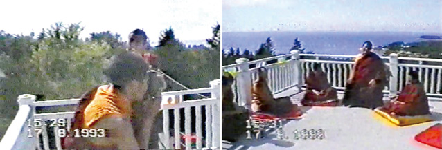

其实法王只要出去弘法，所有弟子最想要的礼物，就是他老人家在当地的照片。大家每次拿到都如获至宝，有人供在佛堂，有人挂在墙上，有人随身携带，作为自己祈祷的对境、观想的所依，也体现了他们对根本上师的信心。

尤其是索顿喇嘛，他家里挂着各种法王的照片，每一张都很大。他私下跟我说，给法王拍照时，一定要多拍法王的全身照，前面不能被法座挡住，旁边不能站任何人，最好是法王在微笑。于是，我当时就想：“像索顿喇嘛这样的道友，这次一定会满意的。”果然，大家看到照片后都很开心，特别喜欢。后来这张照片广为流传。

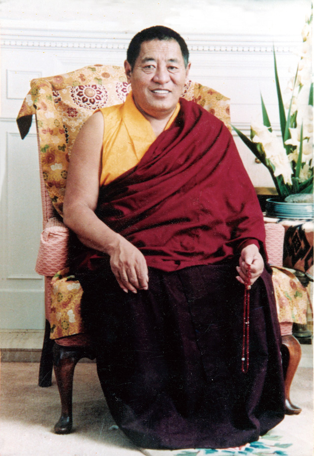

采访二十问

当天下午，法王接受了当地一家佛教媒体的采访。内容如下——

1．问：尊贵的仁波切，您能介绍一下自己吗？为什么人们都叫您“上师”？

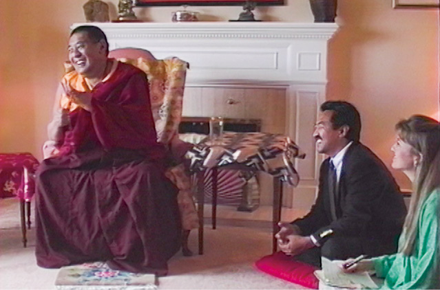

法王：我出生在藏地的子美曲列，位于今天的青海省，现在住在四川色达。我常年学修佛法，后来被授予堪布学位。根据一些前辈大德的授记，我还有一个伏藏大师列绕朗巴转世活佛的称号。我这辈子所做的，就是一心一意传讲佛法、修行佛法、行持佛法，由此聚集了很多来自四面八方的信众弟子，这也是我现在有这个称号的原因。

2．问：我了解过您的一些事迹，比如在石头上留下脚印。我很好奇，这是真的吗？

法王：没错，有类似的巧合，发生过几次。（众笑）

3．问：您这次来西方的目的是什么呢？

法王：根据我的了解，西方国家的佛法，没有藏地那么兴盛。所以，我来这里主要是为了弘扬佛法、利益众生，尽可能为人们的幸福安乐起一点作用。这是我此行的主要目的。

4．问：您对纽约的印象怎么样？

法王：纽约是美国最大的城市，也是全球约184个国家的联合国的所在地。那里不仅有美国人，还聚集了许多不同民族的人。此外，纽约拥有世界第二高的摩天大楼，我很高兴看到许多我从未见过的景象。

5．问：您为什么想来加拿大的佛教中心呢？

法王：和我之前去美国的目的一样，我来加拿大也是为了利益众生、弘扬佛法。同时，我想借此机会看看不同国家的风土人情，也是一种观光吧。

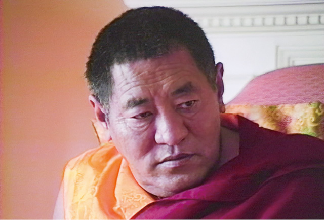

6．问：您有什么想对我们西方人说的吗？

法王：不仅仅是在美国，无论我走到哪里，都想看看我是否能依靠我一生所修的慈悲心，为众生带来一些利益。你们也应该尽力通过这种无害寂灭的唯一妙道，来帮助一切众生。这是我的教导，也是我的希望，仅此而已。

7．问：就藏地和西方而言，佛法在哪里传播得更广？

法王：在我们藏地，大约99%的藏族人热爱并信仰佛法，其中有出家人，也有在家人，尤其是出家人非常多。相比之下，西方国家虽然很发达，但佛法并不像藏地雪域那样兴盛。

8．问：许多西方人花大量时间追逐金钱，您认为对待金钱的健康心态是什么？

法王：在这个世界上，一个人最珍爱的是自己的生命，因为非常爱惜生命，所以为之积累钱财很正常。如果能在赚钱的过程中结合慈悲心，佛法和世间法就可以并行不悖，两全其美。但若通过害他的心态和行为来赚钱，那利益就不大了。

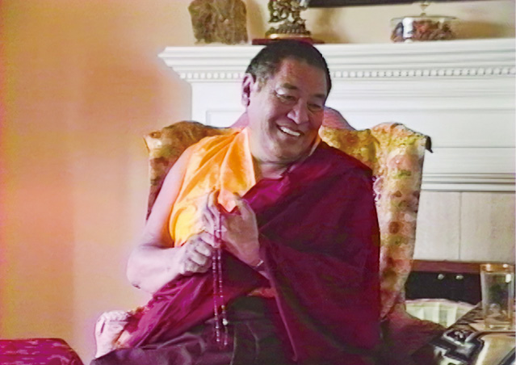

9．问：您能谈谈对创巴仁波切的看法吗？

法王：创巴仁波切似乎是当今时代所有藏地上师中最早来到美国的上师。他依靠两种善巧方便来弘法利生：一种是对于不想入佛门的人，暂时让他们学习和训练香巴拉的法，尽一切可能利益他们；另一种是对于信仰和希求佛法的人，让他们学习佛法。如今，他这种独特的事业得到了广泛弘扬，这是非常稀有的事。

10．问：您对基督教有深入的了解吗？您如何看待它？

法王：据我所知，基督教主要践行慈悲和博爱，我认为这非常好。

11．问：与东方相比，您觉得西方的慈爱教育做得怎么样？

法王：虽然利益众生的目的大概差不多，但采用的方法各种各样，行持的方式也各不相同。

12．问：在您看来，这个道场会成为佛教的最大中心吗？

法王：这要看上师们以前的授记，尤其是你们上师在这方面给过一些开示，此外我没有什么特别的认定。

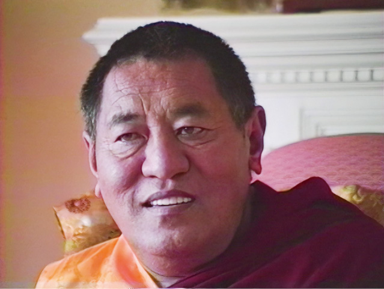

13．问：对您来说，家乡人和外地人，您更偏爱哪一个？

法王：不管是谁，都有一个很深的习气，对家乡有着偏爱和执著。我自己的兄弟姐妹等亲人都在藏地，但到了美国不久，我发现美国人也很善良，心地纯洁，尤其是他们非常关心我，我好像对他们也有和家乡人一样的欢喜之情。

14．问：这个地方的人都不是很乐观热情，您怎么看呢？

法王：没有人能断言哪里的人更乐观。比如我们一家人，随着有没有生病，身体和心情都不一样，时而快乐，时而忧伤。藏地也一样，有些人非常乐观，有些人则很悲观。西方也是如此，每个人的心态都不相同。恐怕很难说西方人和藏族人谁更乐观，这就好比问桑吉和晋美谁更开心一样。

15．问：您如何看待北美人为了健康而花大量时间运动？

法王：当今世界各国，人们都很重视锻练身体，不想生病。我的看法也是一样的，除此之外没有别的。

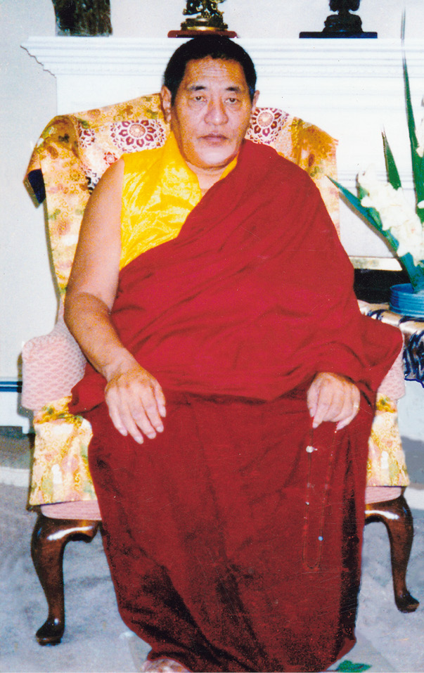

16．问：修四无量心的核心是什么？

法王：四无量心是发自内心地希望一切众生拥有安乐、远离痛苦，身体上要断绝杀生等害他的行为，尽可能地广行布施等。

17．问：藏地和西方在弘扬佛法的方式上有什么不同？

法王：就像我前面说的，如果以占人口的百分比来衡量，西方的佛法并没有藏地那么兴盛，但是渐渐地，也有可能会超越它。所以，你们需要努力。我相信佛法会在这里发扬光大，我也如是发愿。

18．问：您如何看待香巴拉的学习和军训？

法王：你们的上师通过善巧方便，先引导大家进行香巴拉军训，主要修持无害利他的方便法。然后再让他们逐渐入佛门，这一点非常重要。

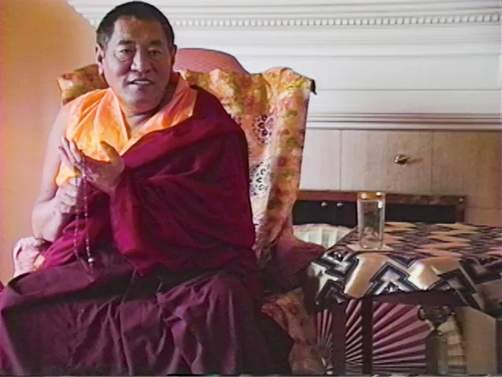

19．问：您有过焦虑或者心情不好的时候吗？您有什么妙方可以传授吗？

法王：无论悲伤还是快乐，我平日里唯一祈祷上师三宝。除此之外，我也没有在修行其他法上下功夫。

20．问：您和丹嘉仁波切的关系如何？

法王：他的前一世，和我的前世伏藏大师列绕朗巴有着非常密切的师徒关系。主要是这个原因，1990年我去印度时拜见了他，他也很亲切地接见了我。

法王生病了

8月18日晚上，法王在达尔豪斯大学有一场演讲。然而，当天法王血压特别高，高烧不退，不停呕吐。阿里美珠特别担心，说高血压容易引起各种并发症。我们把法王送到附近的医院，希望通过输液来降低血压。但是，加拿大不能随便输液、打针，甚至连药也不给开，除了抽血化验，他们没有做任何治疗。我心急如焚，却无能为力。

前两天在波士顿的时候，门措上师也病得很严重，有一次需要去医院，灌顶不得不取消。我们也建议取消当晚的演讲，但法王坚持要去。临走前，法王在卫生间吐得很厉害，我在一旁不知所措，恨不能以身代受。但没想到的是，法王正式讲课的时候，整个过程就像没生病一样精彩。

演讲结束后，法王又示现生病，而且病情严重，情况看起来很不好。这让我不由得想起第二世敦珠法王、第十六世大宝法王都圆寂在国外，法体后来都是用飞机送回去的。我特别不安，心想法王万一出事了怎么办？

接下来，法王还要去欧洲几个国家传法，行程也安排得很满。因为担心法王身体受不了，经过反复讨论，我们决定缩短行程，取消去英国、荷兰等国的传法，只是象征性地去一下法国，然后就回去。

在西方传法，和我们藏地不一样，如果临时取消法会，道场将遭受巨大的经济损失。但为了法王的健康，也顾不得那么多了。甚至我心里想：“如果需要一些赔偿，我会自己想办法支付。”后来那些道场得知此事，都说可以理解，尽管有一些损失，但他们可以自己解决。

法王虽然没有去成英国、荷兰等国家，但有了这个缘起，希望未来还能续上。

智慧与慈悲

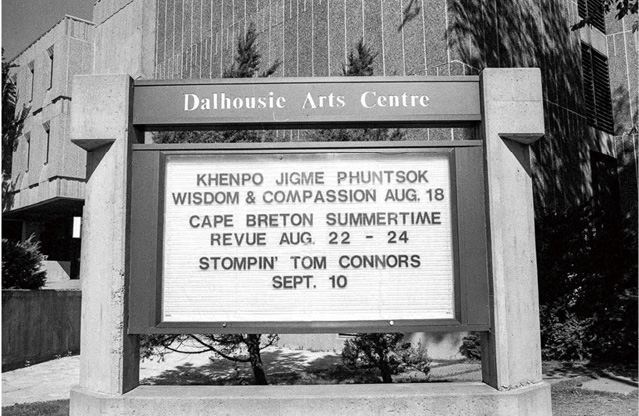

晚上，法王来到达尔豪斯大学（Dalhousie University），给当地信徒和部分师生，做了一场主题为“智慧与慈悲”的公开演讲。

达尔豪斯大学由第九代达尔豪斯伯爵于1818年成立，旨在创建一所不论阶级、不分宗教的高等学府。如今，它已经发展成为加拿大的顶尖大学，曾出过三任加拿大总理、一位诺贝尔奖获得者。

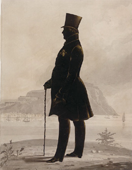

达尔豪斯伯爵

在该校的达尔豪斯艺术中心（Dalhousie Arts Centre），法王登台之前，上千个座位座无虚席。主持人兴奋地向大家介绍：

“欢迎各位来聆听法王晋美彭措仁波切的开示！

法王1933年出生于藏地东北部。大约十多年前，法王开始在西藏各地广泛弘扬佛法。自此，佛教被禁锢数十年后，开始逐渐复苏，他肩负起佛法再弘的重任。

法王这次能够走出藏地，到西方弘法，我们感到非常幸运。在此之前，他只在1990年出访过印度。这是法王的第一次西方之行，能够莅临新斯科舍省，更是我们莫大的荣幸。

不得不提的是，这个行程是法王在最后一刻临时加上去的，他说他想来这个地方，可想而知我们是多么幸运和欢喜。下面有请法王仁波切为大家开示。”

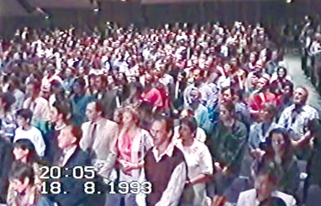

接下来是法王的正式演讲：

今天，在这个吉祥圆满的日子里，我从东亚的一个国家来到了加拿大，这个临近世界北方的特殊国度。见到你们成百上千的人，我感到很高兴。我们都出生在这个殊胜的南赡部洲，还得到了宝贵的暇满人身，此时就要尽量利人利己，摒弃害人害己的行为。这一点大家务必要深思。

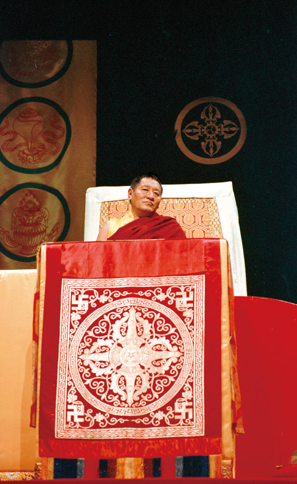

・信仰哪一个宗教

有人会问：“怎么样深思呢？”

世界上有两种人，没有任何宗教信仰的普通人和有宗教信仰的人。没有任何宗教信仰的人，一门心思追求温饱，只考虑自己这辈子的生计，丝毫不会为了后世而行善断恶。其实就算是牛马，也能做到只想温饱、只求吃喝，所以这种人属于比较愚蠢的人。至于第二种人，与普通人相比，还是比较有特色的，他们不仅仅求温饱，为了暂时和长久的利乐，还会加入某个宗教。

在我们拥有人身的这个时候，如果白白虚度，一方面自己会感到惭愧，另一方面，在其他明事理的人看来，也成了耻笑之处。所以，信仰宗教非常重要。

至于什么是最好的宗教，我们需要提前观察，因为宗教可以成办长久的利乐，如果不分析就直接加入，是一个非常大的错误。用我们藏地俗话说，就像饿狗遇到了肺。肺是所有肉里最难吃的，但饿狗不管它香不香，一见到就会吞下去。同样，当你遇到任何宗教、任何上师时，如果不加观察就依止那位上师，加入那个宗教，这种做法非常愚蠢。

信仰宗教是长久之计，必须慎重考虑。我们对于一天的食物，尚且会多方观察，分析它的质量好坏。其实，无论食物是上等还是劣质，很快就会变成不净粪，而与生生世世永久大计相关的法如果是错的，那就真的耽误了长远的未来。所以一定要仔细分析。

・认清真正的宗教

有些宗教宣称，伤害他人的嗔恨是法；有些宗教宣称，与有夫之妇邪淫、偷盗财物的贪欲是法；还有些宗教不加思索就直接把自己的想法教给别人，这是把愚痴当成了法。

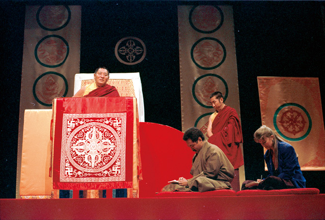

大家可以想象，声称嗔恨是法的，并不是清净的正法。如果别人打你杀你，恐怕没人喜欢。同样，如果你打别人、杀别人，也根本不可能有人愿意。由此可知，认为“嗔恨是法”，纯属本末倒置。

再想想那些宣称贪欲是法的宗教。如果自己的妻子被别人抢了，肯定不会欢喜；如果自己的财产被别人占了，肯定不会愿意。同样，你以贪欲去害别人，也是不合理的。宣称“贪欲是法”的，多半是邪说。

以愚痴为法的，也会把人引入歧途，根本不值得推崇。比如想去加拿大首都的人，谁也不想被带到美国华盛顿。同样，没有人愿意自己生生世世被引入邪道。由此可以断定，把愚痴当成法的，也不是正法。

无论是什么宗教，只有指明成办利乐的方法，才会被认定为正法。当然，即使有成办利乐的方法，某些宗教如果只利益自己、自己的亲人、自己的信徒，却不愿帮助其他人，那么这些方法虽然不是颠倒错误的，但它也稍逊一筹。

有些宗教不仅利益自己，还造福全人类，但对动物等其它众生却不利济，这也不是最殊胜的宗教。要知道，人类如何珍惜爱重自己的生命，牛马等其它生灵也一模一样；人类受到伤害时会感到痛苦，动物被害也会痛苦。所以必须认识到，只有利益一切众生的方便法，才是真正的正法。只有具足愿一切众生安乐的慈心、愿一切众生离苦的悲心，并言行一致地尽力帮助众生，这才是正法。

这个世界上有很多宗教，从怀着无恼心、实践无恼行来看，基督教和佛教还是有相似之处。当然，基督教和佛教也有很多不同，但我不知道怎么说——因为在我们藏地，基督教非常非常少，基督教传教士讲的书更不多见。我只在西方待了两个多月，虽然研究了一点，但是不广泛，所以，基督教和佛教有怎样的区别，确实不太会讲。

如果你们认为基督教和佛教自始至终没有区别，也可以无差别地实践它们；如果觉得二者略有贤劣不同，那就深入细致地思考，然后去实修更好的那个。作为一个佛教传法者，我简单给你们讲一下什么是佛法。

・佛法的核心

佛法有两个宗旨：断除一切害他之事，在此基础上成办一切利他之事。第一，不害他的教义，在当今泰国和缅甸等南传佛教国家比较兴盛；第二，不仅不害他，还要爱他胜过爱己，这种唯一利他的教义就是大乘，它主要在汉地等地兴盛。此外，精勤于无有艰难地迅速成办所有众生广大利益的方便法，是大乘密宗，主要流行于藏地和印度的大部分地区。

所有这些佛法，都是同一个本师、同一个教义，最后的果也一样。但若详细抉择，这三者分别是成办利他的小方便、大方便、大方便且能快速成就，所以要认识到后者比前者更好。

当然，所有佛法的究竟教义都一样，都包含在不害他众、调伏自心这两点里。如果不先调伏自相续，就不可能利他，因为即使你不想伤害别人，但随着放逸也会害人。所以首先调伏自心是根本，这离不开特殊的慈悲和非凡的智慧。

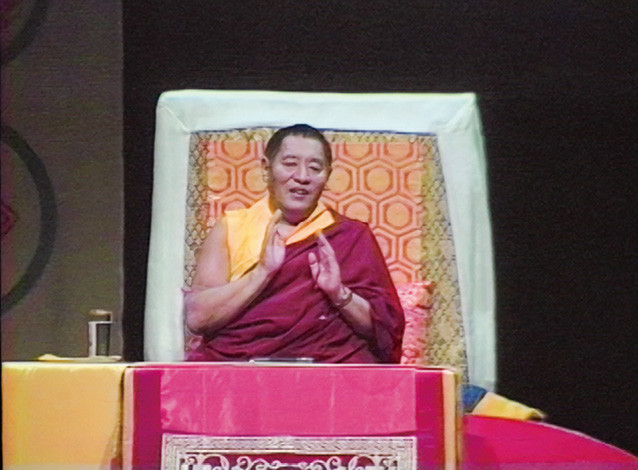

1．慈悲

慈悲是什么样的呢？心里想着“如果一切众生都能远离痛苦，那该有多好”，从而生起善意乐，竭尽全力让他们远离痛苦。

它的修法有两种，即自他平等、自轻他重。如何修自他平等呢？比如，一个人的身体就算有头、手、脚等很多部位，也会想尽办法让各个部位不受伤。同样，无论什么样的众生受苦，同样都很痛苦，我们要像对待自己一样，尽力让他们离苦得乐，这就是所谓的自他平等。

之所以要利他，是因为佛说众生无始以来无一没当过自己的父母。在做父母时，即使是虎豹之类的猛兽，也像我们今天的父母一样，慈爱地养育我们这些幼崽，恩重如山。所以，如果不报答这些众生的大恩，反而去伤害他们，这是一种莫大的耻辱。

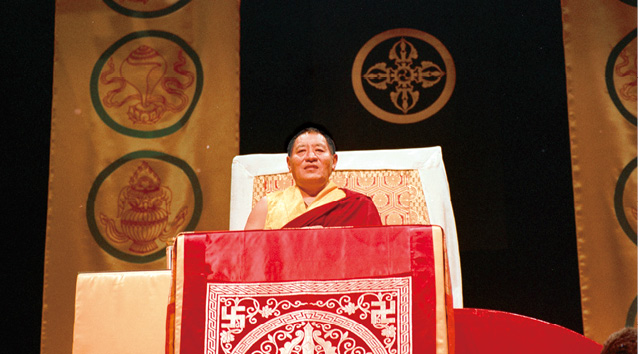

佛陀还说：“在这个世界上，所有的安乐与祥和，都源于希望别人快乐的善心和善行；所有的疾病、饥荒、战争等苦难，都源于只想自己一个人快乐而让别人不快乐的恶心。”之所以这么说，是因为我等本师，善巧方便、大慈大悲的佛陀，他唯一利益众生，而且多生累世、不惜身命，由此成就了不可思议喜乐的究竟果位。但是一般的众生，无始以来只想自己快乐、别人不快乐，所以至今还在感受无尽的痛苦。

要想利益众生，就不能嫉妒一切比自己优秀的众生，排斥一切和自己平等的众生，歧视一切不如自己的众生。心态要公平正直，行为要力求完美，平日多修四无量心，也就是愿众生得乐的慈心、愿众生离苦的悲心、随喜他人享乐的喜心、不贪亲嗔敌的舍心。这就是慈悲的修法。

2．智慧

即使你想让一切众生离苦得乐，但如果不知道它的方法，只有慈悲也无济于事。所以，必须要生起它的助伴——无垢的智慧，也就是要了知成办自他二利、避免自他二害的方法。

当然，这样的智慧不会无缘无故产生，光靠绞尽脑汁也无法了知。要想了知它，就必须依止一位胜过自己、勤于学修、有智慧有功德的上师，在他面前精进地广闻佛陀所说的法。什么法呢？比如在藏地，大约有300多函从印度传承下来的《甘珠尔》和《丹珠尔》，还有几千卷藏地上师撰著的论典。

对于这些，上等者最好全部学习并修行。即使做不到这一点，也必须在上师面前认真聆听自利利他、免受损害的菩萨法藏，然后将所听到的句义进行实践，详细观察自己到底懂不懂。如果你只是听闻，但根本不分析，就没有机会真正领受这个法。举个例子，一个学生在老师面前听了十几年的课，如果完全不思考，那一句也不会懂，更不要说实践了，就如同只知道打方向盘踩油门却从来不开车上路一样。

要知道，你所学的一切，最终还是要付诸实践。否则，所听到的法从不结合自相续，知道再多也派不上用场，就像会开车却不开，那跟不会开也没什么区别。因此，要想生起无垢的智慧，首先要听闻，中间要思维，最后要修行，这三者必须次第行持。

・智悲双修

在这里，我简单给你们讲讲如何修行智慧和慈悲。

怎么修呢？心中观想：众生无始以来无一未曾做过我的父母。他们做父母时，就像现在的父母一样，最好的食物先给我吃，最好的衣服先给我穿，以极其慈爱的心行养育我。但是，这些对我有大恩的众生，虽然希求快乐，却不知快乐之因；虽然不想痛苦，却不由自主去造痛苦之因，真的很可怜。

这些众生所想与所行背道而驰，就像迷失在荒野的盲人。比如，他们大部分人为了长寿而杀生，遇到敌人时，担心如果不杀他，他会反过来杀自己，结果敌人越杀越多，尤其是杀了一个众生，还要偿还五百次生命。这些完全是颠倒的想法和行为。

或者是，他们为了得到财产受用去偷东西，这只会让自己遭受各种不幸，也是耗尽自身受用丰厚的因。特别是，以偷盗业力的程度轻重，还会成为相应的贫穷人。他们对此却一无所知。

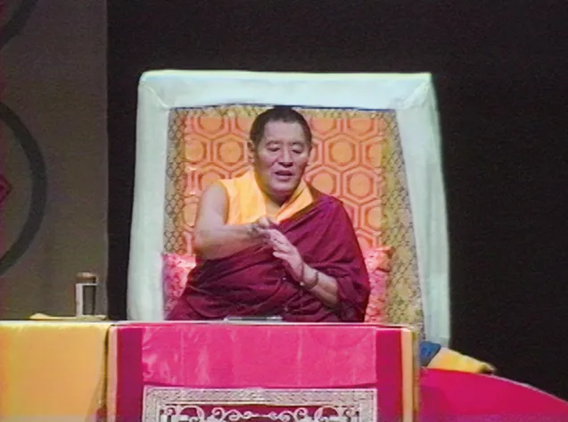

可见，众生不知道如何得乐，也不知道如何避苦，我必须行持一个方便法，让所有众生离苦得乐。但是，我现在没有利益他们的能力。怎样才能获得利益他们的能力呢？必须要获得佛果，这样就能毫无困难又非常快速地利他。认识到这一点后，心里要这样立誓：为了利益一切有情，我要修成佛果。

当然，佛果不会无缘无故产生，必须努力修持它的因，也就是六度。

第一，布施度：就是把自己的身体、受用、善根，毫不吝惜地布施给一切众生。

第二，持戒度：不但不伤害一切有情，还要千方百计地利益他们。

第三，安忍度：无论众生如何伤害自己，不仅不恨他，还想方设法给他带来无尽的利益。

第四，精进度：为了成办利乐一切众生的事，欢喜踊跃地行持清净善法。

第五，禅定度：心不随贪嗔痴所转，一缘安住于善念。

第六，智慧度：了知因果无欺，对所知义不愚昧而悟入。

这六度有以慈悲缘众生、以智慧缘佛果两个侧面。平日里要勤于这样实修，这里面包含了佛法的全部精要。所有想修佛法的人，修行的核心就是慈悲和智慧，所以要一心一意地修。

深入研究佛法是否清净正确的人，也要思考这一点。修无垢的慈悲、无误的智慧，应该与自相续结合，如果它有错，那佛法就有错；如果它没错，佛法也没错。一旦你明白佛法没有错，就应该果断地趋入。如果明知佛法正确无误却仍不趋入，声称“这是我祖辈父辈的规矩”而执有偏见，这是非常愚痴的。

我们藏族有句俗话叫“羊群盲目跳河中”，意思是一只羊先跳进河里，其它羊不管会不会被淹死，都跟着它盲目地跳河，这是不合理的。不知道你们加拿大的羊会不会这样？我们藏地的羊就是这种情况。如果前面的羊跳了，后面的羊明明都看到它淹死了，但还是会跳。同样，即使是祖辈传下来的规矩，如果不经过深入观察就成为首选，这就像羊群跳河一样，应该受到谴责。（众笑）

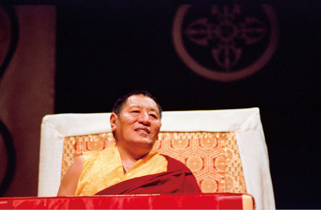

我们藏地的一位上师曾经说过：“智者自己能观察，愚者总是随声行，如同老狗狂乱吠，群狗亦是随声奔。”如果是智者，在入道前会经过一番观察；如果是愚者，则会随波逐流。就像一只老狗在村子上方狂吠，其它狗也会无缘无故一起叫，同样，愚者也是如此。所以，我们不要不加观察就人云亦云。

对此，你们真的应该思考一下，不要认为我是一个佛教的传法者才这么说。我7岁入佛门，现在整整60岁了，从来不迷信佛法是好的，但经过深思熟虑，以我毕生的经验得出一个结论：佛法是世界上所有宗教中最超胜、最可靠的。所以，我修行的核心就是清净的智慧和慈悲，我究竟的皈依处就是三宝。如果这与你们的心相应，你们也可以这样修。

这次我来西方国家，在美国待了两个月，发现美国人心地善良、笑容满面、非常热情。同样，加拿大人和美国人一样热情，我来到这里也很开心。今晚这么长时间，本来想有时候讲讲法，有时候开开玩笑，但这次我身体很不舒服，只能讲这么多，请原谅。

坦白说，我这次来加拿大，不仅受到了大小城市领导的欢迎，他们向我表达了希望以后再见面的愿望，也受到了你们的隆重邀请、热烈欢迎，在此我表示衷心的感谢。

最后，祈愿我们今生还能再相见，并通过修行佛法，未来往生极乐世界，在阿弥陀佛的足下再聚首。扎西德勒！

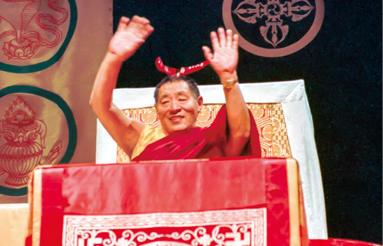

对三宝生起信心

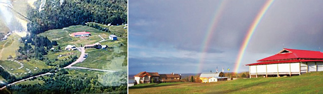

8月19日上午，法王离开夏日亲林，坐了两个小时的车来到多杰丹玛林（Dorje Denma Ling），然后被迎请至校屋（Schoolhouse）并住了下来。在这个道场，法王将传授四天的佛法。

多杰丹玛林，以格萨尔王大臣丹玛的名字命名，他是法王前世丹哲意吾布美的父亲。道场距离哈利法克斯140公里，是香巴拉为数不多的可长期居住的闭关中心之一。它坐落在一个叫坦特么古驰（Tatamagouche）的村庄里，据说这里是几千年来美洲原住民的神圣聚集地。它远离城市的嘈杂纷扰，周围有森林、草原等，是一个特别适合修行的清净地方。

下午，法王给这个道场的佛教徒，以及来自美国、加拿大的数千名信众，做了一场精彩的开示：

今天，我简单讲一下与佛教有关的话题。

・具足顺缘

大家要知道，我们现在有很好的机缘。什么样的机缘呢？

一、生于南赡部洲

我们有幸出生在了南赡部洲，这是非常难以转生的地方。南赡部洲具足修行的圆满条件，而其他世间刹土，如东胜身洲、西牛货洲、北俱卢洲等，虽然受用丰厚、幸福圆满，却没有修行正法的缘分。所以要知道，南赡部洲比其他洲更超胜。

二、得到珍宝人身

在南赡部洲获得珍宝人身，也是极其难得的。

如果生在地狱、饿鬼、旁生、非天等处，这些地方的痛苦非常难忍，而且没有修行佛法的机缘，特别可怜。如果生于天界，虽然有着极其稀有的善妙快乐，但长期一直处于散乱放逸中，也没有因缘修行正法。

不仅如此，佛陀所传的法，如声闻乘、菩萨乘、密乘，都要依靠人身才能获得成就。而天人等其他众生，依靠自己的所依身，无法成就一个完整的道，也没有修行的机缘。所以人身是非常难得的。佛陀及其所有追随者，特意赞叹的“胜过天人身”之处，就是这个珍宝人身。

现在我们都获得了这样的人身，应该生起极大的欢喜心。

三、佛陀出世

佛陀来到人间，也是极其难得的。佛陀出世之劫，谓之“明劫”；佛陀没有现身于世的劫，称为“暗劫”。其中暗劫是反复多次出现，而明劫，像释迦牟尼佛出世的这个贤劫，只是偶尔出现，所以非常罕见。佛陀之所以没有出世，是因为众生修行佛法的善缘和机会很难得。

四、佛已说法，佛法住世

现在佛陀不仅出世，次第转了三次法轮，而且正法的光明并没有隐没，还存在于世，这个也非常难得，缘分十分善妙。这是一件非常可喜的事情。

五、师已摄受

纵然佛陀已宣说正法、佛法也住世，要想得到佛法的真谛，还必须遇到上师善知识。如果没有遇到上师，依靠自力没办法修学所有佛法。所以，能被上师善知识摄受，如理修持上师开示的佛陀言教，就更难得了。

现在，我们所有这些顺缘都具足了：投生到了难以转世的南赡部洲；难以出世的佛陀已经出世；难以宣说的正法也宣说了；不仅宣说了妙法，佛法至今还没有消失，依然住于世间；而且遇到了能开示正法的上师；不仅遇到了上师，上师还在讲经说法。这么好的机缘比昙花一现还要难得，我们应该感到高兴。

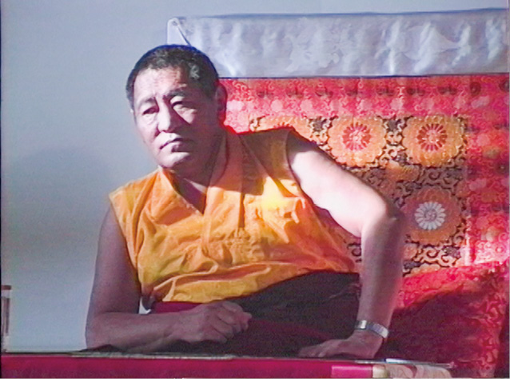

・三种信心

从外部看，各种顺缘都具足了。从自身的角度而言，圆满的信心是不可或缺的。

什么是信心呢？可以分为三种：清净信、欲乐信、胜解信。其中，缘佛宝所生的，是清净信；缘法宝所生的，是欲乐信；缘僧宝所生的，是胜解信。

一、缘佛宝所生的清净信

对佛陀生起不共的欢喜心，可以称为“清净信”。

之所以要对佛生起欢喜心，是因为在这个世上，曾经出现过大自在天、帝释天、梵天等，但佛陀不同于他们中的任何一个，佛具有无与伦比的功德。佛陀有哪些与他们完全不同的功德呢？就算是佛的一个功德，登地大菩萨几十万年也说不尽，更何况佛陀的完整功德了。

一般来说，佛陀具有无量功德，即使我们不能知道全部，也必须知道我们迫切需要的至关重要的功德。我们迫切需要的功德是什么呢？就是了知暂时获得人天安乐、究竟成就无上佛果的方便法。佛陀虽有无量功德，但若对我们没有利益，我们也没必要对他生起欢喜心。就像这个世界上，有许多大权在握的君王，如果对百姓没有饶益，凭什么要喜欢他？任何一个君王，只有给百姓带来幸福，才会被百姓喜欢，所以佛陀的功德一定是能利益我们的。这一点务必要明白。

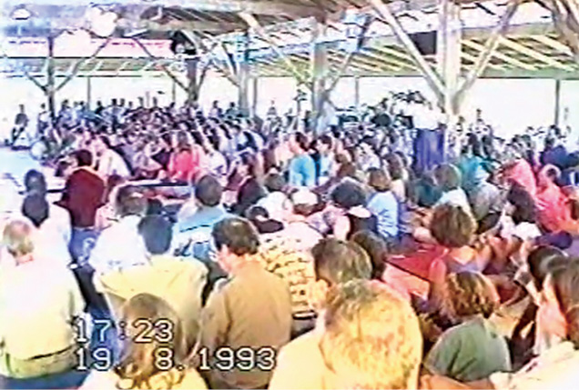

那么，我们迫切需要的佛功德是什么呢？是智、悲、力这三种功德。

1．智

如果佛不知道让无量众生获得安乐、远离痛苦的方法，就不可能利益到众生。但事实上，佛陀无余彻知一切所知法。

2．悲

佛陀虽有无尽的智慧，但若无慈悲心，也不会饶益所化众生。比如，一个人虽然才智出众，但如果他对别人心存恶念、行为残暴，那他根本不会帮助别人。所以在智慧的基础上，还需要慈悲的功德。

佛陀有什么样的慈悲功德呢？佛陀对所化众生的慈悲，超过母亲对独子的爱百倍千倍。为什么这样说呢？无论佛陀在因地学道，还是现前了圆满佛果，他都不惜自己的身命来利益众生。

有人会想：“佛陀往昔在因地时，是怎样不惜身命而利益众生的呢？”

在佛陀初转法轮的印度鹿野苑，为了使众生获得利乐，他曾数十万次地布施过头颅，这是佛陀亲口所说。其实，佛陀不只在鹿野苑这样布施，在赡部洲的其他地方，甚至赡部洲以外的许多地方，为了利益众生，也无数次布施过自己的身体和生命。

而且，佛陀的慈悲是没有偏袒的。如果佛只保护自己最亲近的人和喜欢尊重自己的人，对其他人漠不关心，这样的慈悲就不平等了。但佛陀的慈悲并非如此。到底是什么样的呢？佛陀在世的时候，如果右边是帝释天用旃檀水恭敬为他沐浴，左边是提婆达多以恶心用利刃砍割他，佛陀对他们的慈悲没有任何差别，都会将其安置于无上的安乐道中。

佛的慈悲如果只给予种姓高贵、受用圆满的众生，而不给予可怜无助的下层众生，那就是狭隘的。但事实并非如此，与高层人物相比，佛陀对下层的可怜众生更有慈悲心。佛陀的慈悲绝不像今天某些政客那么狭隘。他们是什么样的？如果看到成千上万的人来，对自己会非常有利，就表现出非常善良和热情的样子，但却不会真心帮助一两个可怜人。而佛陀即使为了一个可怜众生，无数次付出自己的血肉，他也绝不吝惜。佛陀能如此苦行数亿年，并且没有厌倦心，这种慈悲是至高无上的。

也正是因为这个原因，往昔佛陀在地狱转生为加巴谢达时，有一个同伴叫嘎玛热巴，狱卒把马车套在他们脖子上，让他们拉，还用兵器殴打他们。当时加巴谢达就想：“与其两个人受苦，不如让我一个人受苦。”于是他对狱卒说：“大人，请听我说，我愿意承受同伴的业力，把马车的绳子都套在我脖子上吧，让我一个人拉，请让我的朋友得到安乐。”狱卒听后勃然大怒，说：“地狱里的所有众生，业力必须自己感受，谁又能代受呢？”然后他拿起铁锤，狠狠砸在加巴谢达的头上。加巴谢达被打死，当下转生于三十三天。这在佛陀的传记中有记载。

此外，恒时与佛陀竞争、敌对的提婆达多，过去的生生世世一直专门害佛陀，这辈子就更不用说了。可是为了提婆达多，佛陀也愿意舍命饶益他。所以，佛陀对众生的悲心，真的是无以言表。

3．力

佛陀虽然有这样的智慧、慈悲，但还需要具备力的功德，否则，光靠智慧和慈悲是不够的。就像一个没有双臂的母亲，眼睁睁看着儿子被水冲走，虽然她对儿子有着难以想象的爱，却无法把他从水里救出来。同样，如果没有能力，光是悲悯一切有情也没用。但实际上，佛陀是有能力的。

那么，佛陀有什么样的能力呢？有身功德力、语功德力、意功德力。

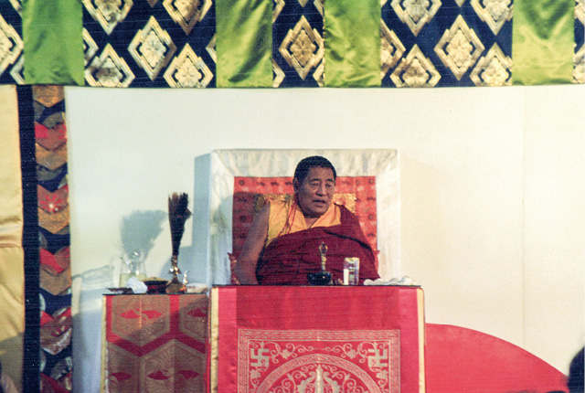

1）身功德力

佛的身功德力是怎样的呢？只要亲眼见到佛身，就能摆脱三界轮回的痛苦，趋入究竟安乐的解脱道。

有人会问：“亲自见佛有这样的功德，那么现在佛陀不在了，我们还能得到这样的利益吗？”

当然可以。如何得到呢？就像佛陀亲口所说“化现种种相，令众行善法”，佛陀会幻化出各种不同的身相来利益众生。比如以铸像为例，无论是佛的金像、土像、木像、石像，对其顶礼、供养、发愿，与礼拜佛陀真身并无区别，这个道理在佛经中也有宣说。再来说说画像，无论佛像画得庄严与否，任何人看到都会获得不可思议的利益。

对于佛的身相，如果满怀信心和恭敬心去瞻礼，有功德是毫无疑问的。就算怀着嗔心去看，也能在不久的将来得到佛果，这在经典中有详细的描述。

2）语功德力

佛陀的语功德力，是指佛在世时能亲耳听到佛陀的教言，或者现在通过全心全意的祈祷，在觉受或睡梦中也会见到佛，并听佛传法。这些都是殊胜的功德，可以迅速获得佛果。

（法王笑着说：“我还以为没给我麦克风呢，原来它在抽屉里，而我还不知道。谁关上了抽屉？是你俩还是我……是我吗？我不知道它在抽屉里，以为没有麦克风就大声地讲。后来听到咚咚的声音，才发现它就在我身边。”）

不仅是佛亲自讲的法，就是现在立成文字的佛法，如果你能亲耳听到，也有不可思议的功德，一定能遮止恶趣之门，获得长寿无病、受用圆满等利益。甚至是不像我们一样有缘听到佛法的人，以及一些飞禽走兽，若能听到提醒传法时间的击鼓声、法螺声，也可以在不久的将来摆脱轮回的痛苦。

3）意功德力

佛陀的意功德力是怎样的呢？佛陀的大慈大悲事业，一切时处都在利益众生，就像波涛永远不会离开大海，佛也根本不可能有不利益众生的时候。

佛陀在十方幻化刹土中，对于应以佛身得度的众生，就以佛的身相度化；应以菩萨身得度的众生，就以菩萨的身相度化；应以声闻身、缘觉身得度的众生，就以声闻和缘觉的身相度化。此外，佛陀对于非人类的众生，在飞禽前化为飞禽，在野兽前化为野兽，在鱼类前化为鱼类……总之，佛陀会化现许多身相来度化众生。

不仅如此，佛还会幻化成山川、林苑、森林等开演佛法，给众生带来无量的利益。所以，佛陀对每一个众生，昼夜六时恒常以各种方便进行饶益，不可能不饶益众生。

现在再重申一下上面讲的内容：

佛陀如果不知道利乐一切众生的方法，那么喜爱佛陀就没有意义了，可事实并非如此，佛具有遍知万法的智慧；佛陀虽然是遍知，没有慈悲心的话，也不会给所化众生指示解脱道，但佛陀具有无量的大慈大悲；佛陀虽有智慧和慈悲，如果没有度化众生的能力，也不能成办他们的利益，但佛陀具有无碍的能力。如是无与伦比的智、悲、力功德，唯有佛陀才具足，除此之外，世界上其他人很难拥有。所以，静下心来仔细观察后，除非是身体里没有心脏、脑袋里没有大脑的人，否则，不会对佛陀生不起清净的信心。

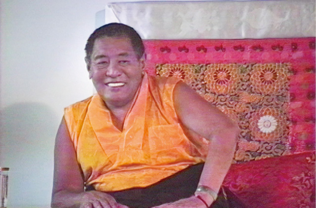

二、缘法宝所生的欲乐信

欲乐信，就是对佛陀所说的妙法，要生起想如实修行的殊胜信解。

有人会问：“那该如何修行佛所说的法呢？”

必须行持众善法，断除诸恶法。

善法是什么呢？对一切众生没有伤害、损恼的意乐，而修慈悲心，这就是善法。不善法又是什么呢？对于上中下任何众生心存害意、行为粗暴，就叫不善法。

关于不害众生的道理，佛陀宣说了沙门四法。之所以叫沙门四法，是因为佛陀的追随者都叫沙门，他们行持的法有四种：第一，“他怒不还怒”，别人对我怎么发怒，我也不会嗔怒于他；第二，“他骂不还骂”，别人对我怎么谩骂，我也不会反唇相讥；第三，“他打不还打”，别人用石头、棍棒、兵器等打我，如果我是佛陀的追随者，就不应该还手；第四，“寻过不还报”，别人说我父母的坏话，说我长得丑、没钱，叫我盗贼和骗子……不管他怎么揭露我的过失，我都不能反过去指责他，这就是佛法所说的“亏损失败自取受，利益胜利奉献他”，所有好事、胜利统统给他人，吃亏、失败全部留给自己。如果能实践这样的沙门四法，就可以称得上是一流的佛教徒。否则，仅仅持有一个佛教徒的形象，口头上说自己是佛的随行者，却做不到沙门四法中的任何一法，那你只是名相上的佛教徒，不是真正的追随者。

那么如何修沙门四法呢？

一般来说，别人伤害自己的时候，普通人怎么可能不记仇？尤其是你平时把这个人当儿子一样照顾，明明没有过错，却被他无端陷害。但即便如此，你也不能恨他。比如，一个母亲的儿子疯了，他再怎么伤害母亲，母亲也不会生他的气，只会想着“儿子什么时候才能好起来”。同样，当你帮助过的人反过来伤害你时，你也要想“他什么时候才能脱离这种烦恼”，要这样来修慈悲心。

如果你曾伤害过对方，他报复你是很正常的，怎么能生他的气呢？但如果你连针尖许的过错都没有，他却要砍下你的头，你也不应该动怒，而应该观想“愿他所有的罪业和痛苦，都成熟于我身”。要生起这样的善念。

再者，如果有人揭露你的过失，你也不能生气。即使他对你的恶语和指责传遍了很多国家，你也要高高兴兴地宣扬他的功德。

另外，如果一个胜过你的人对你百般欺凌，这很正常。但若是一个远不如你的人侮辱你，你不但不能对他怀恨在心，反而要毕恭毕敬地接受。这也是佛教的宗旨。

因此，佛陀的正法绝对是毫无损恼、专门利他的无害寂灭妙道。

可能有人会想：“佛陀的法确实非常好，但真正能做到的寥寥无几，所以没办法实修。”

其实是有办法的。当然，如果一开始就要求这样，不要说刚入佛门的你们，就算是我这样的藏族僧人，甚至是上师，也不一定能真正做到。所以，我们要量力而行，对佛陀所说的这个法，要循序渐进地学修。

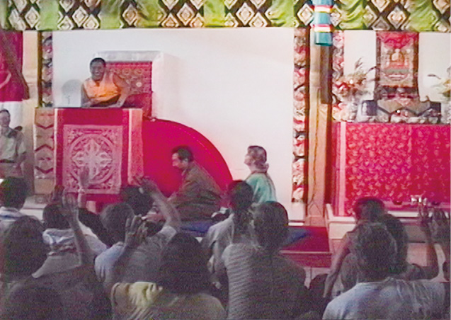

像我们藏地一些德高望重的上师，纵然舍弃自己的生命，也根本不会杀生、偷盗。但对你们来说，恐怕很难从现在开始再也不杀一个众生、不偷一个众生的财物。即使如此，你们也要尽量逐步学修，努力不做伤害众生的事情。

佛陀曾经说过：“若害他众非沙门。”如果对别人心存害意、行为粗暴，那就不是佛陀的追随者，这是佛陀斩钉截铁说的。佛陀还说：“自净其意，莫扰他心，此乃佛教。”我们要慎重守护自己的心，不扰乱别人的心，尽己所能地做到这一点。

那么，如何守护自己的心呢？

当不符合佛法的恶念涌现时，不管是严重的嗔心、巨大的贪心、对他人的嫉妒心、高人一等的傲慢心，我们都应该马上认识到它正在产生，然后立即斩断它的相续，用正知正念来摄持自心。与此同时，尽力祈祷上师三宝加持，以后不要再生这种恶分别念。

如何不扰乱别人的心呢？

我们身体的恶行、语言的恶语、心中的恶念，都会扰乱他人的心。如果出现这种恶劣的心行，最好是从根本上断绝。假设做不到这一点，自己也要警醒自己，心里想：“虽然我是佛的追随者，但还在做扰乱别人的行为，从今以后不能再这样了！”要发起坚定的誓言，同时尽力祈祷三宝。

有人会问：“这样不扰乱别人、守护自己的心，有什么必要呢？”

今生会长寿无病、受用富足、相貌庄严、受人恭敬等，得到诸如此类的众多功德；后世也会往生极乐世界等净土、获得佛果等，得到远离一切痛苦的圆满安乐。

总之，佛所说的这种妙法，如果一个人行持，他自己会离苦得乐；如果一家人行持，全家都会拥有安乐；如果一个城市的人行持，整个城市会得到暂时和究竟的利乐；如果一个国家的人行持，整个国家将会国泰民安；如果全世界的人行持，整个世界都会变得美好，呈现出和平的祥瑞，没有苦难的众生，人人快乐，家家幸福。

只要是众生，谁都喜欢快乐、不喜欢痛苦，没有人愿意失去快乐、遭受痛苦。而让一切众生离苦得乐的方法，只有佛陀讲过。如前所说，如果深入思考、仔细观察，除非是身体里没有心脏、脑袋里没有大脑的人，否则，没有人会对佛法不感兴趣。

既然已经深入思考、仔细观察了，如果还有人不信佛陀的教法，我们藏族会称这样的人为“没心没脑”。倒不是说他真的身体里没有心脏，脑袋里没有大脑。在佛陀的追随者看来，体内那个肉团心并不是特别珍贵；所谓的脑，像酸奶一样乱七八糟的脑浆，也不值得重视。谁有正确的见解，才被称为“有心有脑”。

如果你们也想有心有脑，就要无误了知自己所修的法。不然，只懂睡觉、走路、穿衣和吃喝拉撒，谁也不会管他叫有心有脑的人。

总之，这就是缘法宝所生的欲乐信。

三、缘僧宝所生的胜解信

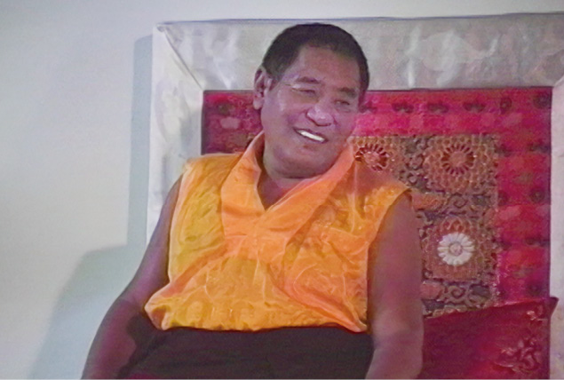

僧宝，是佛陀的追随者，他们唯一的目的就是精勤地自利利他。

佛陀的追随者分为三种，就赡部洲而言，小乘僧众是不伤害众生；大乘僧众不仅不伤害众生，还要饶益众生；利众广大、无需勤作、迅速成办众生利益的，则是金刚密乘僧众。

如果认识到这三种僧众都是对众生有益的，没有人会不信任他们。比如你有一个朋友，他当着你的面欣赏你、恭敬你，背后也是赞叹你、饶益你，这样的朋友肯定值得信任。而有些朋友，表面上赞叹你，背后却说你坏话，给你造成各种伤害，这样的朋友没人会信任。同样，我们要对僧宝生起信心，也是这个道理。

以上简单讲了三宝的功德。

・皈依三宝

你们现在喜欢三宝吗？喜欢的举一下手，让我看看有多少？（大家纷纷举手）……不喜欢三宝的，也举一下手。（没人举手）……非常好，看来每个人都喜欢三宝。（众笑）

你们从现在起，生生世世要祈祷圆满的本师佛陀，要修行无害的妙法，要恒时交往实修佛法的助伴僧众，心里要立誓修行佛法。带着这样的誓言，请在心间合掌，随我念三遍“皈依师、皈依佛、皈依法、皈依僧”。

（法王给大家传授皈依）

现在大家都得到了皈依戒。从今天开始，你们就是真正的佛教徒了。从此刻起，你们做任何世间法和出世间法，都会遣除违缘、成就所愿，遇到人、非人、鬼神、怨魔等所造的种种损害时，也会得到三宝的大悲护佑。如果你们能表里如一不舍三宝，不仅今生安乐，来世也不会转生到地狱、饿鬼、旁生等恶趣。所以，你们刚刚立下的誓言，若能坚定不变，得这个人身也就有意义了。

在座的大多数是加拿大本地人，也有些是美国人。恐怕在你们的一生中，没有像今天这样具有重大利益的时刻了。为什么这样说呢？因为在你们的生活中，除了周六周日，平时都是为了吃穿、名声、金钱而忙碌。其实，以你们这辈子的努力程度，似乎即使得到美国首富洛克菲勒（John Davison Rockefeller）那样的财富，也应该不是什么大问题。然而，现实情况却是，你们得到的财富、吃穿、名望也就那样，没有什么特别的成就，那一生的努力又有什么意义呢？相对于一生努力的成果，你们今天取得了人生中最大的成就。（众笑）

这里的大多数人以前就是佛教徒，有些人今天才成了佛教徒。不管怎么样，如果对佛法生起了不退的信心，我来到这个地方就是有意义的，在我看来，你们这次参加法会就是善缘。

接下来说说皈依的学处：从现在开始，皈依佛后，平时不要忘记祈祷佛陀；皈依法后，要尽量不害众生；皈依僧后，对佛陀所有的随行者，尽量生起信心和恭敬心。若能如此，你们心中所想的就会如愿以偿。

以上我讲了怎样对三宝生起信心，希望大家从中得到广大的利益。我口才不是很好，声音也不动听，可能你们不太喜欢，但我所讲的核心内容，是对你们今生来世有利的善妙法语，所以希望你们用心去体会。

今天的课就到这里。明天和后天还有安排，你们可以随意选择。

四种殊胜性

8月20日，法王在传授文殊灌顶之前，是这样讲的：

下面要进行的“文殊智慧勇识修法·速赐加持”灌顶，我先简单讲一下它的历史由来。

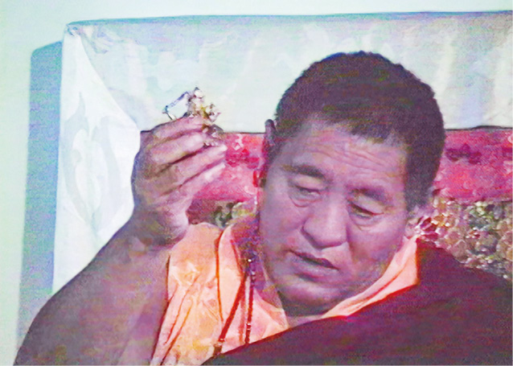

一般来说，这个世界的中心是印度的菩提伽耶，那里是三世诸佛成佛的圣地，仅仅是对它朝拜、顶礼、发愿，也能清净无始以来所积的堕罪。在菩提伽耶以东的摩诃泽纳，有一个圣地叫五台山，这座山有五个山峰，自古以来就是怙主文殊菩萨真正居住的地方。

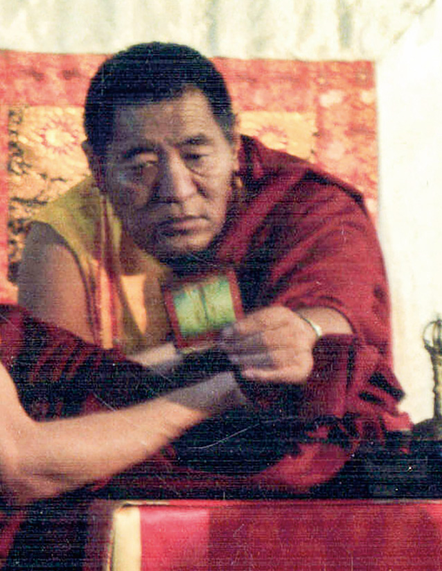

在第十七胜生周火兔年（1987年）藏历四月十五的吉日，为了以《普贤行愿品》等进行发愿，我特意带领眷属去朝拜五台山。当时，几乎上上下下所有人，都看到了文殊菩萨以大悲显现的光芒、幻化相等各种瑞相。依靠文殊菩萨的大悲加持，这个法也从我心中流露出来。谁修这个法，无论根基利钝，都有不可思议的利益。尤其是对西方人，加持更迅速，这是与你们有缘的深法。

今年，在文殊菩萨的大悲加持下，我不由自主被勾召到了这里，你们众弟子也因为前世的缘分云聚而来。这一世，我已有的眷属和你们众弟子相当于此法的首批眷属，如果实修它，加持更是特别大。

这个法的修法和引导文，具有四种殊胜性：第一，它的词句非常简短，意义却完整包含了佛陀及其随行者的所有法要，因此它凝聚了一切密要。第二，与其他法不同，这个教言通俗易懂，即使没有经过长期学修，也能轻松理解。第三，它的加持力胜过其他法，所以是应时之法。何为应时呢？外部世界会有很多变化，所以每个时代都需要一个相应的法，而现今，正好是大家需要这个法的时候。第四，它是必定会让你们受益的特殊法，就像治疗热病要用冰片一样，它是一个能遣除所有业和烦恼、赐予利乐的清净法。因此，你们应该满怀信心地恭敬聆听。

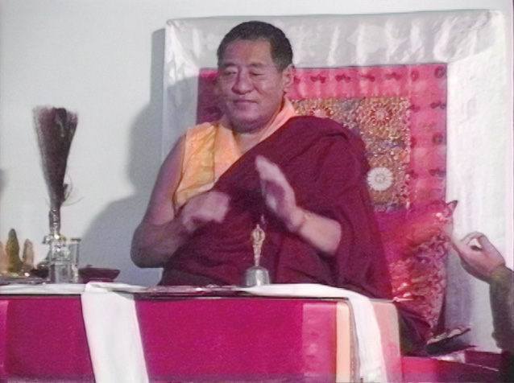

下面，我将传授这个具四种殊胜性之法的灌顶和引导。以后你们自己要实修，也要将它广泛传给其他有缘人。总之，继承文殊菩萨的这个法脉很重要，大家一定要记住。为了让你们生欢喜心，我简单介绍了一下这段历史。

接下来，你们在接受灌顶时，要观想上师不是不清净的凡夫俗子，而是真正的文殊智慧勇识。然后带着虔诚恭敬的心，祈求上师赐予能成熟的甚深灌顶。

当灌顶进行到“直指心性”的部分时，法王讲了一个窍诀：

首先要明白，轮涅一切法只是心的幻现，在外境中了不可得。之后要认识到，心在不观察的情况下，就像水中的月影一样，似乎真实存在，而一旦观察，则是无所成立的空性。

知道这些还不够，平时要安住在这种见解中。在修行的过程中，无论显现的外缘是好是坏，都不加破立、不加分别，要护持这种见解的相续。

若能如此反复修持，你们的贪嗔痴慢嫉等极其强烈的恶分别念，总有一天会像黑旋风消于空中一样融入法界，无需寻求就能任运自成佛陀的功德。因此，这也被称为大圆满或大手印的见修行果。

我留下了一颗牙

在多杰丹玛林期间，虽然环境非常美，但我没心情欣赏，因为法王身边的事情太多，每天忙得不可开交，而且我牙疼得厉害，几乎每晚都睡不着。我深深体会到藏地的一句谚语真实不虚：“致命的疾病中，头疼最安逸。不致命的疾病中，牙疼最痛苦。”

被牙疼折磨了一段时间后，有一天我实在受不了了，就一个人去附近找医院。走了大约一公里后，我找到了一家牙医诊所。医生的态度非常好，给我打了麻药，然后把我的一颗上臼齿拔掉了。结账时需要支付70加元，相当于350多元人民币。听到这个数字，虽然牙不疼了，但是心开始疼了，如果是在藏地，拔牙最多也就几块钱。

回来的路上，我看到了一块空地，突发奇想，把这颗昂贵的牙齿埋在那里，发了个愿。如果以后有机会去加拿大，我应该能在那片土地上，找到这颗牙的藏身之处。

两个灌顶

8月21日上午，法王给大家赐予了两个灌顶，第一个是“项袋金刚橛”，第二个是“忿怒莲师”。

法王先完成了“项袋金刚橛”灌顶前所行的一切法，之后介绍了“项袋金刚橛”的起源：

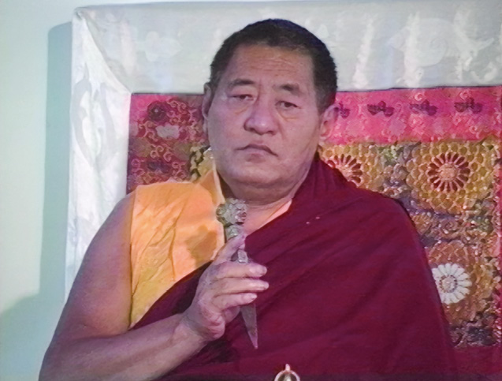

往昔，邬金第二佛莲师为了降伏藏地的一切邪恶鬼神，使佛法在藏地弘扬兴盛起来，他在尼泊尔扬列雪岩洞，潜心勤修此法，获得了与吉祥金刚童子同缘分的悉地，证得了大手印的殊胜果位，金刚橛的所有续部和修法也清晰呈现在他心中。

当时，邬金莲师预见到了一种特殊的必要性，他在《根本伏藏》中说：“自生莲王我，佛法一切续，究竟藏唯此，交则那莫扎，莫舍而实修。未来之末世，汝所幻化士，值遇护教法。”为了利益尼泊尔国王则那莫札等五位眷属及未来众生，邬金莲师从脖子上的袋子中取出“项袋金刚橛”的教言，以发愿交付印持的方式，全部交付于则那莫札。然后对十二护橛母等护法神委托事业，明确给予了未来广弘此法的授记。正如授记的那样，当未来的地点、时间、眷属这些缘起聚集在一起时，我以回忆的方式抉择出此法。

这段历史，我之前在落基山佛法中心广讲过，请大家记在心里。

接下来，在传授“忿怒莲师”的灌顶时，法王穿插了这样一段话：

你们所听到的，是从不丹虎穴取出的甚深伏藏品《忿怒善逝总集》中的一个忿怒莲师略修法。现在就是这个法的灌顶。

此法无论世间何种人修行，均可长寿无病、受用丰富、消除一切违缘障碍，命终后立即往生妙拂洲吉祥山莲花光宫殿或西方极乐世界，享受不可思议的无漏乐果。它是获得殊胜寂灭佛果的不共近因。

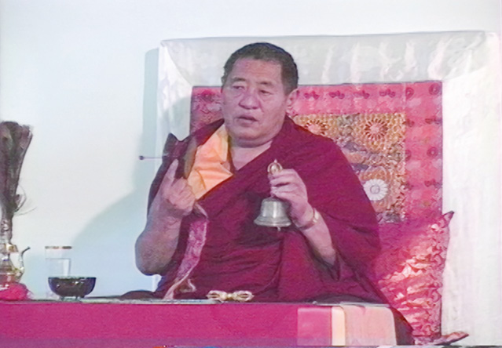

尤其是这个道场的弟子，如果修行此法，就会得偿所愿，有特殊的必要性。其原因，虽然在空行表示教等中没有明说，但我个人估计，创巴仁波切以前从不丹虎穴中取出的“忿怒金刚”伏藏法，和我这个法基本一样。所以我相信，如果道场的弟子们修持我所取的“忿怒莲师”仪轨，就会无碍实现你们的愿望，对弘扬佛法也有很大的帮助。

至于以后修此法的方式，你们可以按照我传的去修，也可以修持你们上师传的那个。无论如何，此法应该是这个道场所有弟子的根本修行。我也在波士顿从总、别的必要性，广讲过它的历史，可能有人比较了解。此外我没什么要讲的了。

我在美国待了两个月，但这个灌顶几乎没有传过，所以要明白，它是你们道场的一个独特修法。我在其他地方舍不得给别人的美食，私下给了你们道场，懂吗？（众笑，掌声）

灌顶进入正行时，法王说：

比如，无论风和云如何在空中动摇，最初都是从虚空中产生的，最后都会融入虚空，不会离开虚空。同样，外器世界和有情世界的所有显现，就像梦境一样是心的幻变，这是首先要明确的。

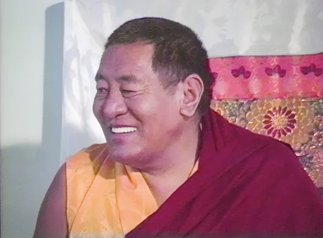

那么，心作为现基，是一种什么样的法呢？不观察的话，它就像水中的月影一样现似存在，然而一旦观察分析，内外空无一物，是无所成立的空性。

这种对心的断定，就叫“见”。护持这种见解的相续，就叫“修”。训练修的妙力，就叫“行”。得到修的坚地，就叫“果”。倘若如实证悟了这种境界，那就是噶玛巴巴协，也是忿怒莲师，总之，两者都是与心无别的自性。

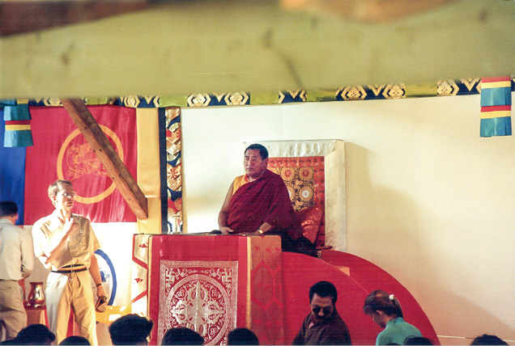

若想认识心的本来面目，请听这段直指的教言……

在藏地所有的上师中，噶玛巴巴协是个例外，这是有原因的。事实上，创巴仁波切所取的“忿怒金刚”，也是与噶玛巴巴协、忿怒莲师本体无别的一个修法。

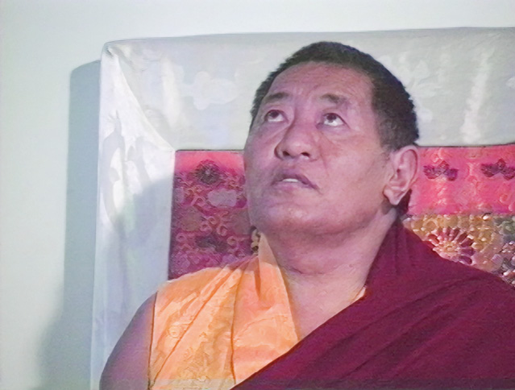

从过往历史来看，邬金莲师曾在《集上师密意》中授记，噶玛巴德松钦巴、巴协等都是他的化身。噶玛巴巴协给汉地国王当国师时，也示现过各种各样的神变，说“时而我是莲花生，时而大圣萨绕哈”，亲口承认过他就是莲花生大士。我讲这些不是怀着什么目的让你们开心，而是让你们知道一个事实：噶玛巴巴协、忿怒莲师、自心并没有什么不同。

这个法的最后，不像其他法那样要念诵吉祥偈和发愿文，而是要求修行者不要离开“一切色法都是忿怒莲师的身，一切声音都是忿怒莲师的语，一切分别念都是忿怒莲师的智慧”的佛慢，并把这种境界应用于其他威仪中。除此之外没有别的了。

圆满灌顶后，法王给大家讲了一段话：

今年我第一次来到西方美洲大陆，然后来到你们的道场，和你们一起享用了不可思议的大乘喜宴。现在，随着美国和加拿大的弘法行接近尾声，在准备告别之际，我想为这个道场的所有人留下几句话。

虽然我们自始至终都没有刻意去建立彼此之间的亲密关系，但是善妙的缘起不谋而合，自然促成了吉祥圆满的结果，这也是因为往昔的宿愿和不可思议的缘起力。

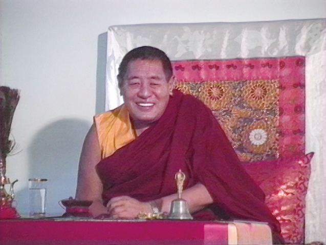

你们不仅在佛法上与我结下了善缘，还从世间角度给了我意想不到的细致照顾，非常感谢！以后我也会再三祈祷，希望你们各个道场团结一致、同心同德，让弘法利生的事业蒸蒸日上。

我再重申一下：创巴仁波切历经千辛万苦，冒着生命危险来到西方国家，就是希望弘扬佛法、利益众生。请尽力把这个事业坚持到底，这是我的肺腑之言。大家要念念不忘他的全部事业。在西方国家佛法最初还不兴盛的时候，他为了随应世间众生，做过各种苦行，比如为别人栽花种树等。后来他能够建立这些道场，是因为他具有“文殊师利勇猛智”般的强大毅力。我对他所做的事业既有悲悯心，又有信心，也向他做过祈祷。你们也要将他的付出铭记于心。

希望我们师徒这辈子能再见面，一起享用大乘妙法，命终后立即往生西方极乐世界，在怙主阿弥陀佛座下再相聚。扎西德勒！

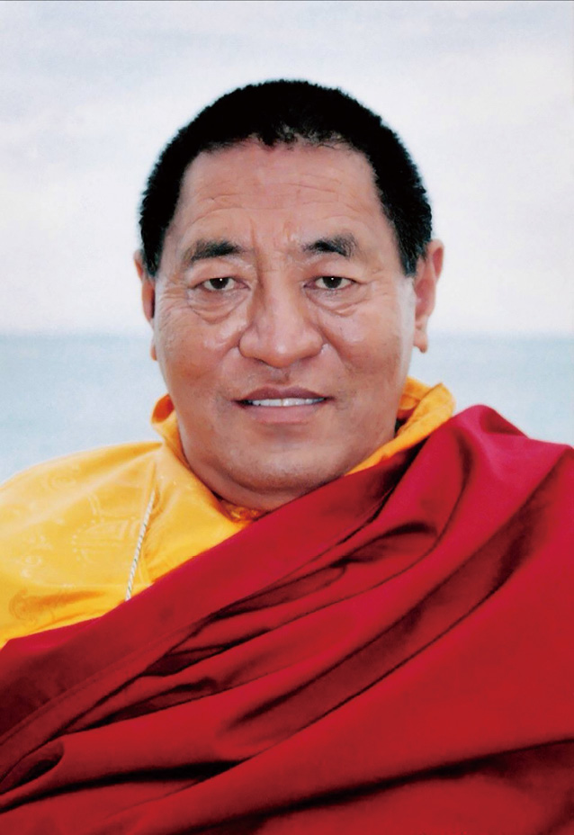

对上师的不共信心

当天中午，因为法王即将离开加拿大，金刚界中心的金刚护法们按照最高礼仪，为法王表演了香巴拉军队操练，唱诵了香巴拉赞歌，献上了特殊的法供养，创造了未来佛教战胜邪魔的缘起。

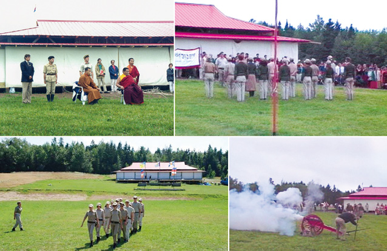

法王在藏地的时候，对于金刚娱乐法会、金刚歌舞、《格萨尔王传》说唱等，就很乐意接受。所以当天法王看得非常认真，表情上也显得很欢喜。

这种军队操练，是创巴仁波切为了让大家克服贪嗔痴三毒，以坚强意志学习正念与觉察，引导大众向善的一种善巧方便。看到那么热爱自由、不喜欢被束缚的西方人，像士兵一样排队，喊着口号，循规蹈矩地服从命令，感觉有点不可思议。

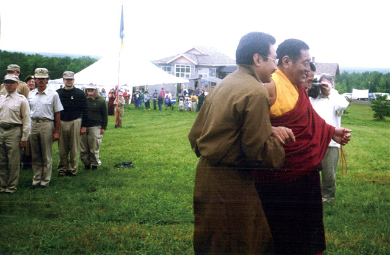

看完表演后，法王给金刚护法们做了开示。在这个过程中，每次提到创巴仁波切的名字，在场的很多人都热泪盈眶，非常激动。其实不只是加拿大，我们之前去美国很多道场时，那些弟子也是这样。

我也问过道场的一些人，为什么一提到创巴仁波切，他们的表情就那么不一样。他们说不知道为什么，每次听到上师的名字，就会勾起自己和上师在一起的美好回忆，藏在心底的某种东西会被唤起，眼泪就忍不住流下来。

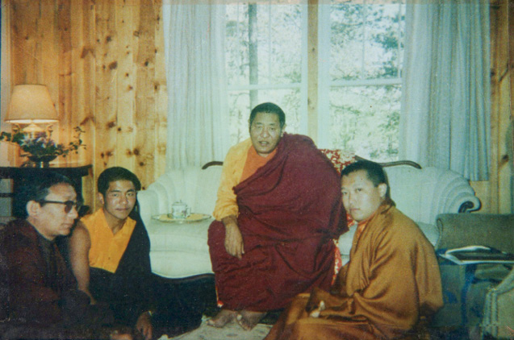

其实，这就是上师的意传加持融入了弟子相续，弟子从上师那里得到了无法言喻的利益，这对一个佛法修行者来说尤为重要。虽然创巴仁波切摄受弟子的方式与传统方法不同，但由于他的大愿和善巧方便，许多弟子的相续被彻底改变，人生也发生了巨大的变化。即使几十年后我去西方传法，只要听法行列中有他的老弟子，听到上师的名字，还是会泪流满面，表现出极大的信心和恭敬心。

他们对上师的思念，并不会因为时间的流逝而减弱，甚至消失，而是会永远留在心中，历久弥新。

“他是超越时间的伟人”

法王在这个道场期间，很多人都表现出极大的信心，其中有一个人叫理查德·佩辛格（Richard Peissinger），他负责接待并保护法王的安全。最近我们联系上了他，问他一些当年的回忆，他告诉我们：

“在我43岁时，作为金刚护卫的橙色军将军，我有幸见到了法王。当时我已经做创巴仁波切的弟子17年了。金刚护卫是金刚护法中的一支，主要职责是承侍和保护上师们。橙色在四庄严中代表温顺的老虎，意为勇士之旅的基础——脚踏实地、谦逊温和。老虎的训练是克服傲慢，培养对自他的友善。

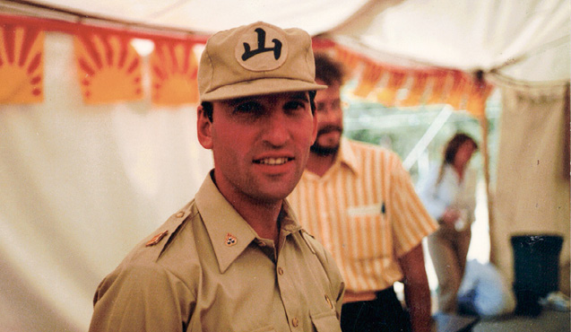

那是多杰丹玛林第一次举办大型法会，地点在一个新搭建的大帐篷里。在我的记忆中，法王私下接见了我们这个小组的金刚护卫，并对金刚护法军表现出极大的好奇。不知道当时法王私下给我们开示的笔记还能不能找到？

实际上，金刚护卫这个角色，让我有幸接待了很多重要的上师，比如顶果钦哲法王、第十六世噶玛巴等。这些经历也让我对证悟者体现出的特质，有着更敏锐的洞察力。法王身上的那种特质是显而易见的，虽然当时他身体不好，但他就像佛法的太阳，源源不断的法义自然脱口而出。

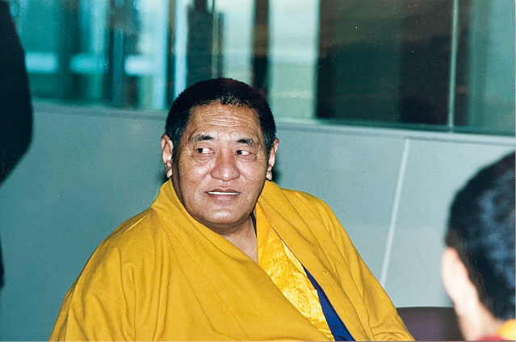

给我印象最深的是，法王身上散发出风马的光芒。他的气场真诚、自信、有力量，具有统率风范。据我所知，法王一生都生活在东方的藏地，这是他第一次来西方，但是他对陌生环境没有一丝不适应，反而非常自在，有种大权在握的王者风范。我记得他的皮肤有一种粗糙的质感，我当时就被这种粗狂吸引住了。现在回想起来，它应该是与元素紧密相连，多杰卓罗应该就有这样的皮肤质感吧。

我记得法王阐述了关于香巴拉和我们上师的授记。我从未听过别人用这样的表达来描述我们上师，以至于我时常会重温法王的这段开示。我觉得，这一开示彰显了法王的超群境界，显示了法王与香巴拉的非凡连接。

法王在多杰丹玛林的时间虽短，但那种影响力非常深远，至今仍在加持着我们。他是一位超越时间的伟人。”

临别忠言

8月22日上午，在多杰丹玛林，法王先给众人念了大自在祈祷文，然后做了一个简短的开示：

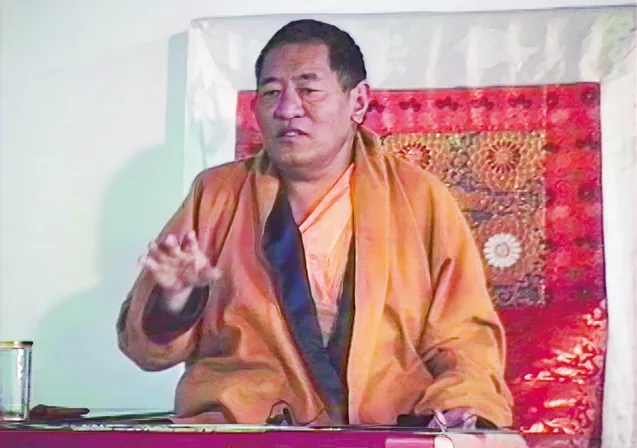

今年我去了美国，又来到加拿大，到今天已经两个月零五天了。我本人和美国、加拿大的几万人结了缘，传播了佛法，这让我心满意足。

今天，我将带着吉祥的祝福跟大家告别。诸位弟子，你们要进一步提升自己以前的功德，尽量生起许多前所未有的功德，祝愿吉祥的光芒周遍一切。

我也发愿：从现在起直至获得佛果，我将尽我所能把一切伏敌护亲等世间琐事，大的放下，小的舍弃，竭尽全力弘扬佛法、利益众生。

你们都是追随过去忿怒莲师、现在格萨尔王、未来勇武轮王的人，他们三位所做的，就是弘扬、受持、保护佛法如意宝，希望你们也能随学这三种事业。

那么他们是如何弘扬佛法的呢？往昔，藏地处于非常黑暗的时候，邬金莲师就把佛法从印度传到了藏地，降伏了从中作梗的一切怨魔、坏誓鬼等恶神，让他们发誓守护佛教。当佛法衰落到低谷时，格萨尔王在这个世界上弘扬佛法，征服了所有作害的魔军。在未来，当佛法基本上被边地邪教摧毁时，勇武轮王将消灭所有这些教敌，并将时轮金刚的《根本续》及其注释广为弘扬，以此受持佛法。后来的几千年间，佛法一直处于鼎盛时期。

以前，佛法在加拿大并不兴盛的时候，主要是因为藏地的大德们树立了法幢，引导大众受持佛法；现在，你们佛教徒也要将佛法传播开来；未来，要以香巴拉学修的事业保护佛法。如此最初树立佛法、中间受持佛法、持续保护佛法，你们的事业就包含在这三者之中了。所以说到底，每个人的终极愿望都是为了给一切众生带来幸福安乐，这唯一依赖于受持、保护、弘扬佛法。

在香巴拉学习、训练的金刚护法和金刚护卫等，就像铁围山，而学修佛法的人，就像里面美丽的乐园。虽然暂时而言，你们各自的学修方式略有不同，但究竟目的都是为了给众生带来安乐，这唯一的途径就是实修佛法，请大家要牢记在心。

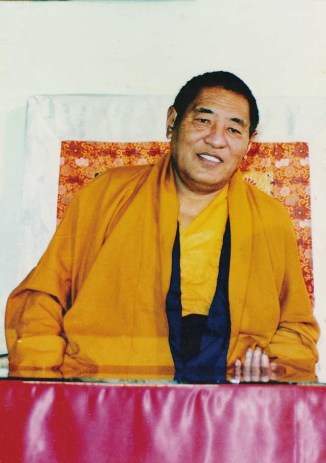

最后，法王唱诵了一些吉祥偈：

> 祈愿佛法广弘兴，一切众生皆安宁，

> 昼夜行持微妙法，自他二利任运成。

> 金刚上师久住世，僧团增盛讲修兴，

> 施主权势财富丰，佛法长存遍吉祥。

> 愿具三学披袈裟，僧众遍布此处所，

> 恒常讲修至有际，佛法兴盛普吉祥。

传法结束，法王给大家摸顶加持，同时给每人发了一条金刚结。按照道场的传统，众弟子列队送别，唱起了“革革！索索！拉迦罗！”在激荡人心的歌声中，法王依依不舍地乘车离开，带走了这里所有美好的回忆。

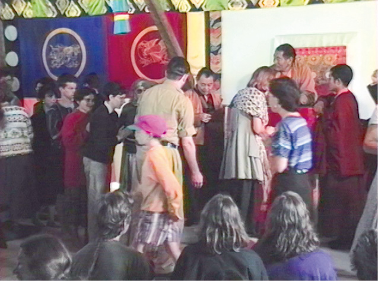

留下指印的水晶

在去机场的路上，法王参观了加拿大的海岸风光和城市建筑。

下午离开哈利法克斯，坐了近两个小时的飞机，到达美国波士顿的机场，准备晚上飞往法国。

在机场，美国和加拿大的许多弟子前来送行。嘉哲仁波切向法王告别时，法王恰好手里拿着一块水晶，说：“这个给你，作为信心的所依。”然后轻轻一捏交给他。

后来发现，这块水晶居然被捏成了食子状，上面清晰可见法王手指的轮廓。直到今天，这块水晶仍然被珍藏在扎西秋林。这也是法王在离开美洲之前，向一些西方弟子示现神通的特殊加持物。

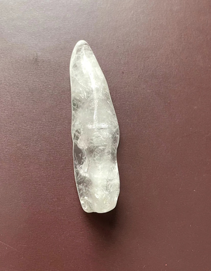

临别时，法王还留下了三句珍贵的窍诀：

“你们西方国家的人，首先最重要的是，要全心全意、满怀信心地祈祷三宝。中间最重要的是，在善心、慈心、悲心的引发下，真正生起菩提心。最后最重要的是，要修持光明大圆满，一生成就佛果。”

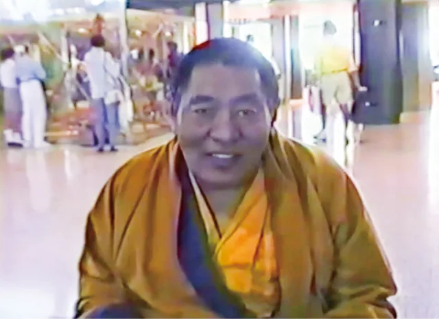

至此，加拿大的弘法行已经圆满。
