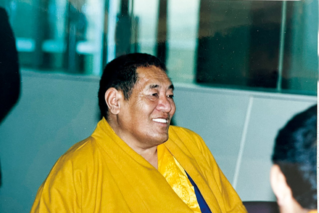

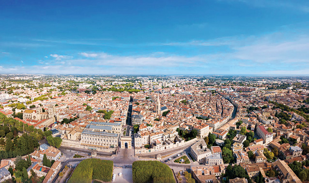

第9站 法国·蒙彼利埃

Montpellier, France 8/23-8/30

行程

8月23日，来到列绕林

8月24日，上午“缘起除障法”灌顶

8月25日，会见道场的高层管理人员并开示

8月26日，参加“缘起除障法”大会供

8月27日，“甚深精藏橛”灌顶和开示

8月28日，传讲《一生成佛的秘密》

8月29日，下午传讲《直指心性的窍诀》

8月30日，上午“文殊智慧勇识”灌顶，传讲  
 《顿超引导》，做离别心语

下午接受采访

飞抵列绕林

法王从美国波士顿飞往法国巴黎，横跨大西洋，飞行时间七个多小时。到达巴黎后，又搭乘另一班飞机，一个半小时后飞到蒙彼利埃。然后坐车一个多小时，前往列绕林（Lerab Ling）。

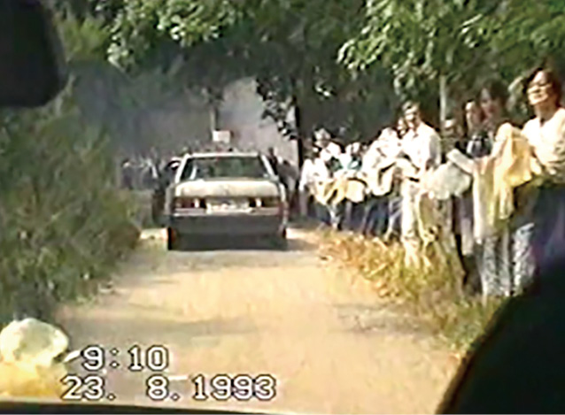

在通往列绕林的山路上，许多佛教徒早早就排起长队，在道路两旁高举哈达，热烈欢迎法王的到来。整个场面非常隆重。

进入列绕林后，法王被迎请到上师宫住下。据说，他住过的房间，后来还接待过贝诺法王、萨迦法王等大德，成为列绕林最神圣的中心。

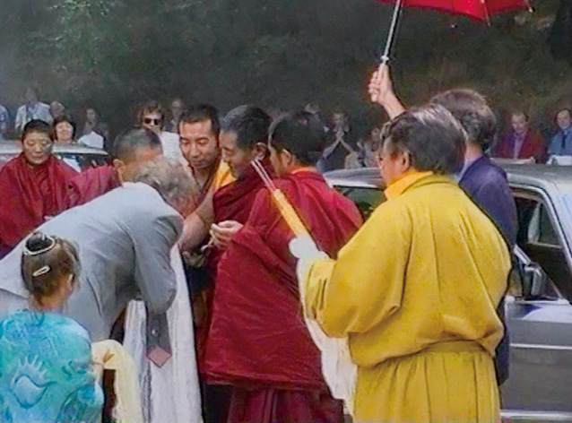

列绕林，是《西藏生死书》作者索甲仁波切（Sogyal Rinpoche）创立的佛教道场，1990年由顶果钦哲法王选址，1991年由多智钦仁波切加持，是法国最大的藏传佛教中心之一。道场的景色和藏地非常像，周围是郁郁葱葱的森林和壮丽的山景。每年夏天，这里会为僧人和信众举行定期、不定期的佛事活动。法王去的时候，正好赶上他们三个月的禅修。远处的山坡上，数百个小帐篷整齐排列，供大家修行用，帐篷有着相同的颜色和款式，就像军营一样，看起来非常壮观。他们平时听闻佛法的地方，是附近的一个大帐篷，在接下来的七天里，法王也会在那里传法，林谷祖古仁波切（Ringu Tulku Rinpoche）担任翻译。

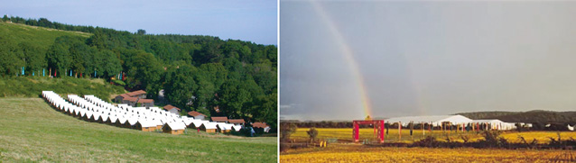

这两天法王从加拿大飞到美国，再到法国，整个旅程非常漫长，光是乘机、候机、坐车的时间，加起来将近20个小时，因此，法王显得很疲惫。看到这种情景，索甲仁波切说：“您这次在西方弘法这么久，时间又这么紧，一定很累了。您不必像在其他道场那样，这个道场的时间是长是短，我说了算。您先好好休息，好好调理身体，想怎么样都可以。只要您老人家欢喜，这就是法！”

的确，法王一路太辛苦，拖着沉重的病体，一场接一场地传法，睡不好，没胃口，来不及倒时差，整个过程是对体力和心力的极大考验。所以，当听到仁波切这样说时，法王轻松了很多。

不过事实证明，后来法王亲自安排的传法，还是很多、很紧凑，一点也不亚于其他道场。

我是列绕朗巴吗？

8月24日上午，法王照样传法，传授了伏藏大师列绕朗巴的灌顶——“缘起除障法”。灌顶前，索甲仁波切向大众介绍了法王：

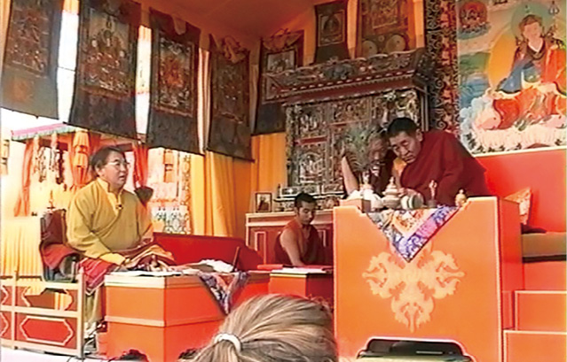

“法王如意宝，被认证为19世纪伟大的伏藏大师列绕朗巴的转世。法王的父亲来自敦珠法王的家族，第三世多智钦仁波切是法王父亲的叔叔。法王从小就进入宁玛白玉派寺院洛若寺学习。18岁时，前往石渠江玛佛学院，依止托嘎如意宝为根本上师，历经六年苦行，满瓶倾泻式地获得了所有金刚乘、尤其是大圆满法教的传授。

法王在藏地建立了许多闻思修的寺院和中心。他在色达创办的喇荣五明佛学院，是一个不分教派、具有高级闻思修行的佛教大学，常驻僧众数千人。法王一生为成千上万的男女修行者剃度出家，并开取了许许多多伏藏。

今年，法王第一次来西方弘法，从美国、加拿大到法国，来到我们的列绕林中心。首先，我谨代表个人对您的到来表示最热烈的欢迎！

您非常慈悲地来到列绕林传法，对我们来说是莫大的加持，言语根本无法表达我们对您的感激之情。列绕林是以伏藏大师列绕朗巴的名字命名的，而您正是列绕朗巴大师的转世。因此，您的到来，对我们来说是非常殊胜的因缘，意义重大。

您不仅是伏藏大师列绕朗巴的化身，也是一位非常伟大的上师。我们久仰您在藏地令人惊叹的弘法事业。多年来我一直听说您不可思议的种种事迹。您是一位伟大的大圆满持教大德，是这个时代莲师的代表，也是最清净的伏藏教法传承上师。这里的每个人都听说过您在藏地令人难以置信的弘法事业，您早已经声名远播。

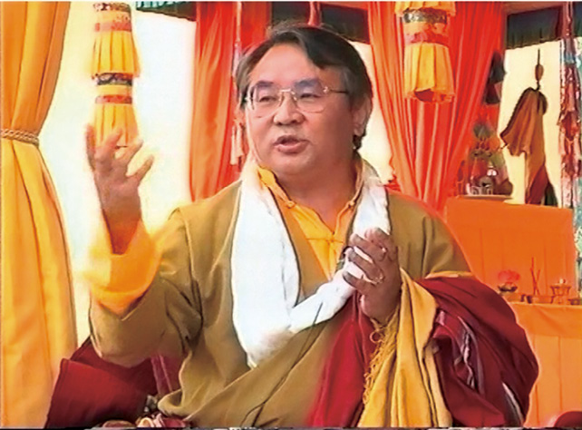

毫无疑问，您在藏地复兴佛法、引导众生修持佛法的事业无人能及，所有在西方的藏传佛教信徒都被您深深感动。我们在这里展开的佛法事业，也只是对您伟大行为的卑微模仿。我们都觉得和您很亲近，和您是一体的。我们非常仰慕您所做的一切，也非常感恩您慈悲赐予我们教法和灌顶。”

紧接着，法王这样回应道：

在这个美好的时刻，很高兴与大家相聚在列绕林中心。伏藏大师列绕朗巴的转世索甲仁波切就住在这里，我也很高兴见到他，有机会共享大乘佛法。

在此，首先感谢索甲仁波切对我的认可。这样的认可都是有必要而说的，不然我真的有这样的功德吗？根本没有。他这样说是有特殊需要的。就像给狗起名叫狮子一样，像我这样一个满身过失、没有真正功德的人，因为表面上有这个名称，并持有修行人的形象，所以他才这么说。

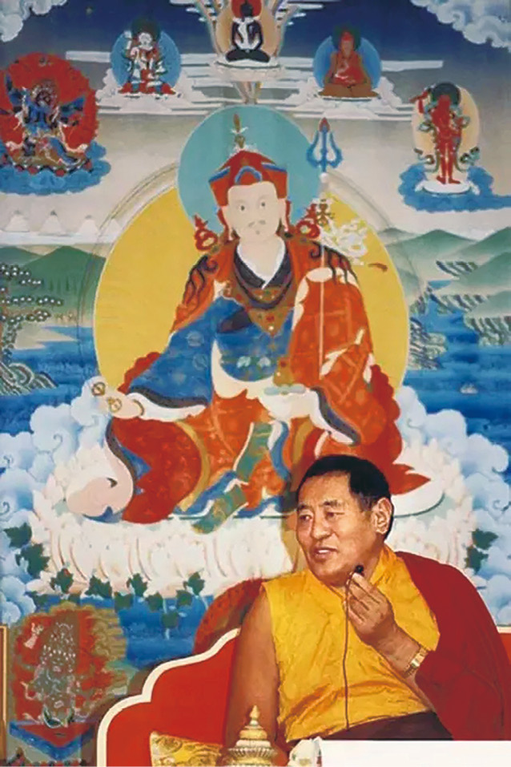

尽管我没有一分功德，但在释迦佛的末法时期，毕竟我坐在大法座上为众人传法，这是谁也无法否认的。过去在迦叶佛教法时，哲哲国王做了一个有十八种预兆的梦，其中一个预兆是，有只猴子坐在狮子的高座上，许多狮子在它前面听法。这是什么意思呢？预示着在未来释迦佛的末法时期，坐在法座上的人就像没有功德的猴子，而聚集在他周围的弟子，则像狮子一样充满功德。不可否认，这个比喻很容易联想到我。

我小时候读书学习很聪明，持戒也很严谨，所以被命名为列绕朗巴的转世，当时我对此进行了反驳。因为列绕朗巴的祈祷文中说“降魔金刚身幻化，金刚亥母语加持，邬金莲师意游舞，开启甚深伏藏门，调化众生持明者，祈祷列绕朗巴尊”，可见他是佛，佛会流转轮回吗？如果会，他也许会变成一个普通人，也许会是我，否则，根本不可能是我，所以我小时候就从来不承认。不过，成年之后，就像华智仁波切说的“虎头蛇尾比丘”一样，我的比丘戒一开始严格受持，后来就有点松懈了。随着年龄的增长，我也考虑了很多事情。按照列绕朗巴的授记，他的大部分弟子和施主都会给我转世活佛的名号，但我不会因此就成了列绕朗巴，只不过这看起来有一些必要，所以我暂时就不再反驳。

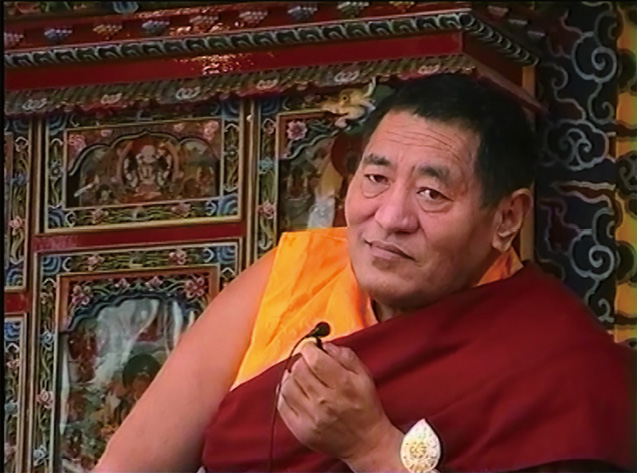

我不反驳的根本原因是，如果有列绕朗巴转世之名，就我个人而言，能做一点点弘法利生的事情；其次，列绕朗巴的伏藏法处于传承中断、接近隐没的边缘，为了复兴这些，有必要给我挂上他的尊名。由此，我尽力弘扬他的伏藏法，我把他散于各地的木刻版法藏收集起来，把老鼠啃坏的旧木刻版重新刻印，把他的寺院和道场进行修缮，一直到今天。

从第一位伏藏大师桑吉喇嘛到现在，似乎从来没有一位伏藏大师像列绕朗巴那样，具有无边的成就、智慧和事业。正因为如此，列绕朗巴在世的时候，在藏地雪域，第十三世土登嘉措、第十五世噶玛巴卡恰多吉、蒋扬钦哲旺波、贡哲云丹嘉措、全知麦彭仁波切等萨迦派、格鲁派、宁玛派、噶举派、甚至包括苯波教在内的智者和成就者都敬其为上师，他是这样一位化身伏藏大师。

第十三世土登嘉措时代，根据授记，边地军队将十二次入侵藏地雪域。到了第九次，列绕朗巴将其全部击退，所以被命名为遣除整个藏地灾难的尊主。为了雪域的弘法利生，他一生经历了难以想象的艰辛。所以他住世的时候，藏地没有受到疾疫、饥荒、战乱等任何灾难的破坏。

在列绕朗巴的所有弟子中，最重要的是嘉瓦土登嘉措和多哲丹毕尼玛。关于多哲丹毕尼玛，蒋扬钦哲旺波亲口说过他只能住世50岁，但列绕朗巴明确表示，在他自己的事业没有圆满之前，两位法主弟子不会圆寂。

列绕朗巴有一个管家叫阿陈，如果他和根本法主西炯活佛慈诚桑波、多哲丹毕尼玛、嘉瓦土登嘉措这四位能齐聚拉萨布达拉宫，列绕朗巴给他们传授自己的伏藏《幻化密藏修法》及续释等诸多引导，以此吉祥的缘起，就可以保证在列绕朗巴转世、再转世的时代，藏地雪域不会有灾难。但由于众生的业力和福报浅薄，多哲丹毕尼玛未能抵达，嘉瓦土登嘉措考虑到这一点，派出特使去迎请他。当时，西炯活佛扮成乞丐的样子，说“我先去等着”，然后到了拉萨。大成就者多哲丹毕尼玛高高兴兴去拉萨的途中，渡过多科河时，驮着他的牲口却不走了，僧人们就用鞭子抽它、用石头打它。丹毕尼玛非常善良，由此生起厌离心，他说：“我们才出发不到一闻距，就造了这么大的恶业。那到了拉萨的话，恶业远远大于善业。”于是他干脆取消了行程。与此同时，阿陈管家圆寂了。

后来正月初一，列绕朗巴去见多哲丹毕尼玛。他们二位离别的时候，列绕朗巴说：“在过去，离别时没有献哈达的传统，但这次我要给您献一条哈达。虽然这辈子不会再见面了，但乃至生生世世，我们永远不会分开。”

此外，列绕朗巴在东方的娘波耶则，开取了伏藏马头明王和金刚亥母的魂石，从一开始就以秘密的方式交给了嘉瓦土登嘉措，如果其历代转世没有离开它，这将成为善妙的缘起。后来，魂石又传到了丹嘉仁波切手中，1990年我见到他时，他亲自给我看过。当年他在临走时，心里想：“不管遇到什么艰难险阻，真正能保护我生命的，就是它。”这个魂石，上方是马头明王的自然显像，下面有自然显现的“旺哈热讷萨”（金刚亥母心咒），现在就在他手里。我想，丹嘉仁波切应该不会被违缘障碍所左右。

同样，列绕朗巴大师的前世——密咒师降魔金刚，深受邬金莲师、法王赤松德赞的器重，他是一个不同于任何君臣、忠心耿耿办事的人。有了这个缘起，后来他每一次转世，都有广大的弘法利生事业。

就效忠赤松德赞而言，他是赤松德赞的首要大臣，也是一位译师，还是邬金第二佛莲师来藏地的迎请者。在法王赤松德赞统治期间，许多国王必须做的事都由降魔金刚来成办，后来太子莫德赞普、莫赤赞普等执政时，也把国王的一切事情都交给了身为大臣的他。没有人像他那样深得大法王（赤松德赞）的信任。

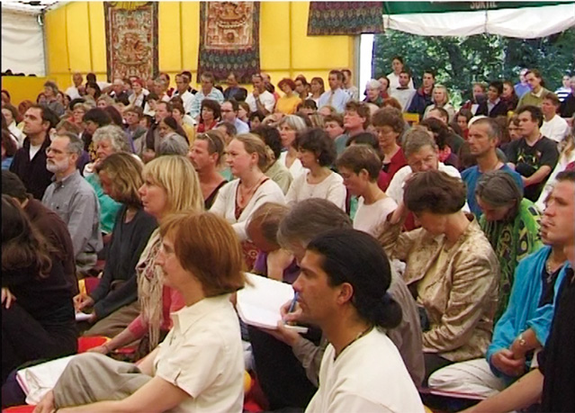

对邬金莲师而言，君臣众弟子没有一个像降魔金刚那样，在他身边侍奉过。当莲师从扬列雪去藏地时，降魔金刚一直背着行李，在路上做各种承侍。当降魔金刚向莲师求金刚橛法教时，所献金银、松石、珊瑚等供品之多，令人难以想象。不仅如此，他还在不伤害一个众生的情况下，供养了大量会供肉，这在金刚橛的历史中有记载。

莲师也说：“众弟子中，降魔金刚如风般无碍。”降魔金刚不仅是证得成就无碍，还被任命为莲师所有追随者中无碍击鼓持橛的密咒师之首，击鼓者没有比得上降魔金刚的，持橛者也没有比他能力更大的了。

现在，索甲仁波切和我也都有一些能力。既然是列绕朗巴的转世，那降魔金刚现在就是我们两个了。他手里拿着一个鼓，我手里持着一个金刚橛，我们俩的能力到底怎么样，全世界应该都清楚了吧。（众笑）

不仅如此，因为降魔金刚深得莲师欢喜、供养丰厚与众不同，所以，降魔金刚历代转世的伏藏品也不同于其他人，原料上乘，形态庄严，持明鹫翎尊者的大多数伏藏品就是如此，列绕朗巴的伏藏品更是这样。这些伏藏品，我也有很多。如今列绕朗巴的伏藏品都分发给了各位法主，所以在各地都有。

总之，对我个人而言，我没有说自己不是列绕朗巴，这也是出于自私的考虑。为什么呢？因为即使只冠上降魔金刚和列绕朗巴的名字，也能起到不可思议的弘法利生作用。

前不久我在美国时，据报道，将有一场毁灭性的大风席卷波士顿。虽然我不是非常有把握，但还是告诉嘉哲仁波切：“如果在这之前有大风，那与我无关，但从现在开始，这里不会有大风了。原因是我有降魔金刚之名，依靠这个名字来成办一件事，现有的鬼神根本无法作害。举个例子，如果是一个没有任何本事的普通人，他有美国总统的签名，还在他的名字上盖了章，单凭一点也会有很大的影响力。同样，虽然我根本不是降魔金刚，但如果我以他的名义吩咐一切鬼神，应该还是会起到作用。”所以，这也是我没有否认我是降魔金刚的一个原因。

当然，我只是没有否认，但也从来没有承认过自己就是列绕朗巴，这是事实。不过我相信，我还是受到了他的特殊加持。

对其他的伏藏大师来说，他们的伏藏法都有自己的果期、修期、教期、唯持形象期。他们住世时这个法的加持特别大，到了他弟子那一代，加持没有那么大，越往后，加持就越小。但是列绕朗巴和他的转世，无论从事业、能力哪方面来说，加持都在百倍递增，越来越大。列绕朗巴自己也说过：“我伏藏法的教期，是人间五百年。在此期间，这些法经久不衰，兴盛圆满。”

今天，我来到了列绕朗巴的道场，心里非常高兴，说的话有点啰嗦，时间也有点拖长。接下来的除障灌顶比较简短，你们再坐一会儿，不会很辛苦的……

兴盛金刚橛的缘起

8月25日，法王会见了列绕林的高层管理人员，并给他们做了内部开示。当天法王没有公开传法，而是让南珠堪布给大众讲了一些教言。

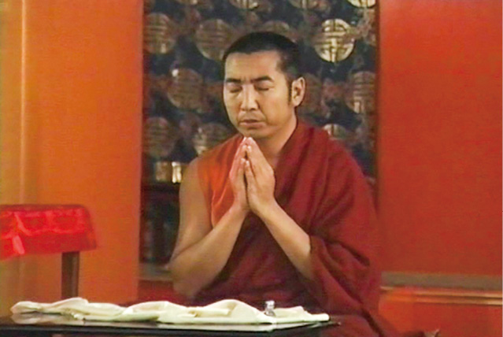

8月26日，正值藏历初十，法王出席了列绕林举办的“缘起除障法”大会供。

8月27日，法王传授了列绕朗巴“甚深精藏橛”的灌顶。灌顶前是这样讲的：

好了，我们现在开始灌顶。首先分为上师所行之事、弟子所行之事。

其中，“上师所行之事”就是先按照传承上师的常规做法，非常简略地行持，这个已经完成了。

接下来，弟子接受灌顶的话，需要遣除违缘、成办顺缘。

“遣除违缘”有净化内在的障碍将身体观想成忿怒甘露漩之身而做沐浴、摈除分别念所生的一切外魔鬼神而修护轮这两个，我们也完成了。

“成办顺缘”分为发殊胜菩提心、供曼茶罗。其中“发殊胜菩提心”是指你们把心态调整成这样而观想：“为了利益普天下的一切众生，我今生要真实修成双运四身五智本性、遍主本来怙主法身普贤如来的果位，为此接受能成熟的灌顶，进而实修能解脱的一切道次第。”这样发殊胜菩提心来听闻。

所听闻的法是，我等本师，善巧方便、大慈大悲的释迦佛，相应众生不同的界性、根基、信解、意乐，宣说了不可思议的次第法。所有这些法归纳起来，有三种：断除害他及其根源的声闻乘，成办利他及其根源的菩萨乘，依于善巧方便和殊胜智慧而顺利快速成办利他的密宗金刚乘。此法属于密宗金刚乘。

密宗金刚乘有两种：依靠三世人身和十六世人身等而于他世成佛的外续、即身成佛的内续。这个法属于内续。

即身成佛的内续，从藏地弘扬的情况来看，也分为两种：从囤弥桑布札到荣索班智达之间翻译的经续，称为前译旧派；在大译师仁钦桑波之后的所有译师的翻译，被称为后译新派。我这次在这里讲的法，属于前译的范畴。

前译法也有两种：从金刚持开始的如来密意传、持明表示传、补特伽罗耳传三种传承不曾间断的法理，都称为经教；在这三种传承的基础上，还具备另外三种传承，叫做伏藏。这次所传的法属于伏藏。

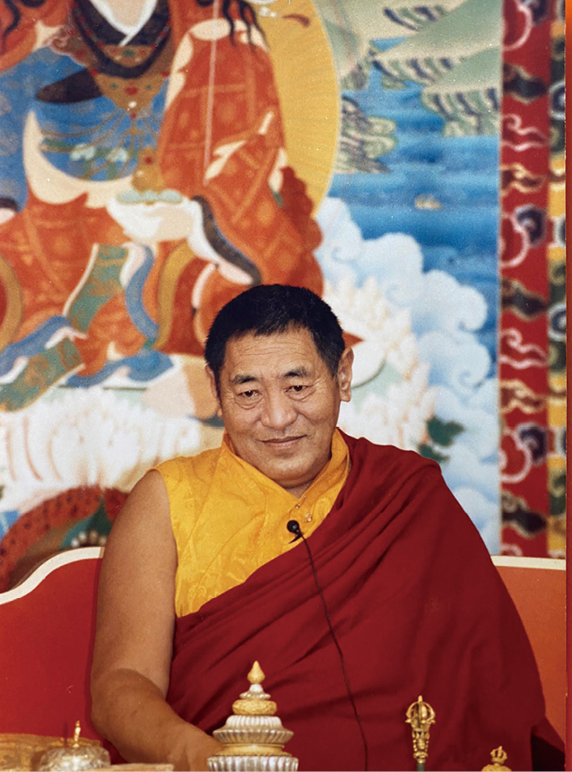

伏藏也有两种：总的伏藏类和真正的伏藏。总的伏藏类，是过去就存在的。往昔密主为五圣贤宣说了密宗续部，尤其是在乐积塔传的所有修部类，被空行母业自在隐藏成伏藏，后由印度八大成就者开取。此外，汉地的西日桑哈大师把大圆满分为耳传和口传两种，其中耳传的所有法类被隐藏在菩提伽耶，后由嘉纳思札开取。诸如此类的伏藏类，早在邬金莲师之前就存在，但那些不是现在所说的伏藏。这方面有很多依据，但今天在这里不广讲。

所谓真正的伏藏，就是莲师去妙拂罗刹洲之前，给所有君臣信众以发愿交付印持的法，以及莲师如今在铜色吉祥山莲花光宫殿对有缘者时不时以发愿交付印持的法。这次的法，就是众所周知的真伏藏。

真伏藏从种类来分，有法伏藏、甚深伏藏、圣物伏藏、智慧伏藏、密意伏藏等十八种。伏藏大师列绕朗巴是驾驭了所有十八种伏藏的尊主，至于详细情节，在他的传记里有明确记载。其中，单就法伏藏而言，有甚深地伏藏、广大密意伏藏两种。这个法属于甚深地伏藏。

这次的这个伏藏法，在前三种传承的基础上，加上发愿伏藏传、付教授记传、黄纸词句传，总共具备了六种传承。

这个法是怎么来的呢？当年邬金莲师降伏了藏地所有的黑方鬼神，把他们怀慑成白方护法神，奠定了藏传佛教的基础。然后，当莲师在桑耶青普的红岩格仓，为君臣九位心子开启神秘的八大法行坛城而做灌顶时，各位心子选择本尊的花都落到了有缘本尊的坛城中，尤其是益西措嘉的花，落到了事业金刚橛的坛城中。后来，益西措嘉开启了金刚橛坛城，获得了与吉祥金刚童子同缘分、摄受十二护橛神母为仆等的殊胜和共同悉地。这是邬金莲师修部所有法教的第一批眷属。

当时降魔金刚不在现场，得知益西措嘉是修成金刚橛的瑜伽母，于是他在鸽子的脖子上绑了七枚金币和一封信，信中写道：“请赐予我金刚橛的全部灌顶。”益西措嘉收到了飞鸽传书。看完之后，她收下了所有的金币，没有任何回复，而是全身心投入金刚橛的修行中。

七天后，半夜时分，十二护橛神母直接现身，对益西措嘉说：“现在是时候劝请邬金上师仁波切，为降魔金刚等具缘者开启金刚橛的甚深法教之门了。”益西措嘉对十二护橛神母，一句温和的答复也没有，只说了一句：“诸位仆女请闭嘴，我依上师言教行，我亦认识汝鬼神。”说完一言不发，一缘安住于境界中。

黎明时分，本尊吉祥金刚童子现前，对她说：“弘扬金刚橛广大法教的时机已成熟，可以去祈请邬金上师传授。”益西措嘉当时想：“本尊虽然不可思议，但上师比他更重要。在邬金上师仁波切没发话之前，我需要保持沉默。”于是她也没有给本尊答复，而是专心入定于三摩地中……

所以在藏地，浩瀚无边的金刚橛法教，至今依然广为流传，没有任何障碍，这个缘起全是她促成的。对于上师和本尊二者，如果认为本尊更好，那她就破坏了所有缘起。在过去，有些大德正因为认定本尊比上师更重要，所以稍微破坏了缘起。

你们要明白，在上师和本尊之间，平时要更重视上师。今天，如果本尊吉祥金刚童子亲自降临，不知你们大多数人会不会说：“我在索甲仁波切面前已经学了很多法，所以今天要在本尊面前得法。”如果你这么说，那就真的错了。以前有这种恶分别念的，应该遣除，因为三世诸佛的总集是上师，所以要把上师看得更重要。

今天我说得太多了，希望你们不要生厌烦心。你们禅修了三个月，很辛苦；尤其是昨天参加了一天一夜的大会供，也很辛苦；今天又听我啰嗦这么久，可能更辛苦了。但大家都要打起精神，我的传法还有三天就结束了。往昔大悲佛陀在因地时，在弗沙佛的山洞外，口诵“天上天下无如佛，十方世界亦无比，世间所有我尽见，一切无有如佛者”，以一只脚站立的方式，七日七夜以此偈赞佛，从而圆满了精进度。这次，我们一天一夜或者今天一整天都振作精神，大概也会圆满精进度吧。

到了第四义灌顶时，法王是这样说的：

根据不同续部的观点，这第四灌顶可以分为大乐灌顶、表示灌顶、句灌顶三种。

第一，大乐灌顶，是《密集续》《吉祥密藏续》中直接宣说的第四灌顶。按照经教部索巴派的观点，在第三灌顶的结尾，是感受上降十六喜，依靠它来直指大乐智慧。

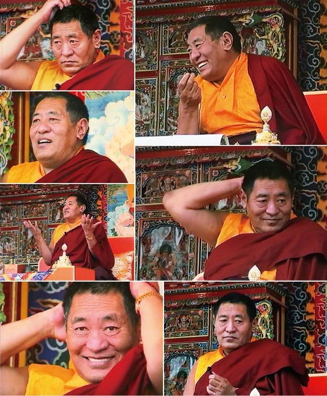

第二，表示灌顶，在《大圆满十七续》、尤其是《四心滴》等的最无戏灌顶中，它主要是顿超的灌顶，依靠表示法来直指。

第三，本来清净的句灌顶，是依靠词句的表述法，现量开显觉性自然本智。它主要是直断的灌顶。邬金莲师大部分伏藏品中的第四灌顶，就是这种灌顶方式。

之后，法王讲了大圆满的见修行果：

现在你们用心去观心，就可以断定，心的自性本来不成立，就像虚空一样，没有任何可贪执的。这不是依靠书本明白的，也不是依靠推理分析的，而是完全通达的，这叫认识见解。或者说，如果你们以心观心，依靠领受力，知道心是空性的，本来就不成立，这叫做大圆满的“见”，除此之外没有别的。

在这种境界中，护持其相续而串习，就叫“修”。

无论显现什么样的分别念和境相，我们都不去跟随，而是看觉性本身是否持在本位，这就叫“行”。

通过修行，不随昨天今天的恶分别念所转，而是赤裸裸地显露全部觉性，这称为“果”。

每个人都需要明白这一点。明白了，就根本不会修偏。即使你没有高深的修证境界，也要对大圆满的这些意义稍有串习。

以上简单总结了所有续、教、窍诀的精髓。

在上师身边

在很多人眼里，我跟着法王去那么多国家，到处旅游观光，一定很快乐、很享受。但实际上，作为侍者，不仅要承侍上面的法王，也要护持下面的信众，还要和中层的其他人对接，里里外外要安排的事情很多，心里时时刻刻有一根弦紧绷着，连正常的吃饭睡觉都成了奢望。

以吃饭为例，经常挨饿是家常便饭。因为法王的行程是连轴转，中间很少有休息的时间，经常是法王在这一站吃完，就匆匆赶往下一站，几乎没有时间收拾行李。所以，法王在吃饭的时候，是我收拾行李的最好时机，收拾完还得仔细检查一下，看看有没有东西落下。就算是平时，我也会趁着法王吃饭有点空闲，出去问问接下来需要做什么准备，比如要带什么东西、灌顶需要什么法器、跟谁对接、现场情况怎么样……不可能像客人一样心安理得地坐在饭桌上，更不可能在大家吃完后让他们单独给我做。偶尔得到一块面包，一边做事一边吃，就很满足了。

至于睡觉，很多道场把心思都放在法王身上，随从不一定会得到很好的照顾。随从有时被安排住在离法王很远的地方，有时又和法王住在一起，这对我来说是绝对不可能的。考虑到法王的安全和方便，我不能住得太远也不能太近，所以只能在外面找个角落随便睡一晚，有时候连枕头被子都没有。

比如在列绕林期间，虽然他们给我安排了一个地方，但是离法王太远了，我就自己去找地方睡，要么在法座旁边，要么在楼梯下面。尤其是法王身体不好的时候，我肯定会睡在门外，他一叫我就能听见。

有一次，我在楼梯下面睡了好几个晚上，结果被法王发现了……其实每个道场都有自己的难处，我们作为客人，只要他们把法王照顾好，就已经很感激了，自己怎么样都无所谓，也不可能向对方要求什么。

在西方，我就像之前去印度时一样，每天照顾法王的衣食住行，帮忙接待各种客人，但各种事情变数很大，随时都要跑来跑去，整天忙得团团转。不过，我还是非常开心，也没有什么烦恼。尽管身体不太好，但每次跟法王出门，这个身体还是很争气，基本不会给我添麻烦。

在法王身边，我不仅要照顾好法王，还要照顾好他所看重的人。法王最看重的就是众生，不管对东方人还是西方人，都是发自内心地关爱。那些远道而来拜见法王的人，除非是病重，法王都会尽力给他们加持。所以，我也要尽可能对众生好，即使不能让所有人满意，也要用温和的语言、慈爱的态度对待每一个人，不能随自己的心情草率应付。

有些人在上师身边待久了，自视甚高，谁都不放在眼里，这样很不好。我们必须经常提起正知正念，否则上师非常慈悲，而旁边的弟子傲慢易怒，也会影响上师的事业。

特别是如果上师有弘法因缘，弟子不能把上师当成自己的私有财产，保护起来不给任何人见，阻止众生与上师结缘，这样会妨碍他的事业，对上师是很大的损失。所以，只要上师身体允许，弟子再累再苦，也要多安排上师与众生结缘。因为很多人平时没有条件听法，这辈子可能只有一次机会遇到上师，哪怕被他摸个顶，念几句咒语加持一下，也能种下解脱的种子。

我在这方面还是很注意，非常希望与法王结缘的众生越多越好。这样的大菩萨在人间时，众生跟他结上一点缘，利益也是不可思议的。所以，只要有人想拜见法王，我都会尽量安排。

法王加持他们时，有时直接用手，有时用宝伞一样的“觉般”，同时会念文殊心咒、莲师心咒、七句祈祷文。遇到修行好的人，还会给他们念一个偈颂“吽 本来怙主自成尊，于心无别安住光，将诸轮回迷乱暗，消于等性大乐界”。

法王的觉般是自己做的，里面装有系解脱、闻解脱、触解脱的经文，出国时常常会带着它来加持信众。有时候我看到大家加持完了，也会把头凑上去，接受法王加持。此时，法王会用他宽厚温暖的大手，重重按在我的头上，我顿时感到无比幸福，仿佛所有的烦恼都消失了。

作为一个随从，最麻烦的是经常有人向法王告状。有时候我也知道是谁、有什么目的，但我不会放在心上。如果法王看起来不高兴，我不会讨厌告状者，反而觉得这是一个反省自己的好机会。所以，我从来不会追究什么，更不会对法王产生邪见。

总的来说，外人觉得上师身边的人都很幸福。但事实上，无论是身体上还是心理上，他们经常面临强大的挑战，并没有看起来那么风光。

一生成佛的秘密

8月28日上午，法王给大家介绍了藏地各教派之间互不相违，并讲述了大圆满的不共特点：

我等本师，善巧方便、大慈大悲的佛陀，在了义中早已现前了正等觉，但在所化众生面前，他仍然示现最初发殊胜菩提心、中间用三大阿僧祇劫积累资粮、最后在印度菩提伽耶圆满成佛。

成佛后，他在鹿野苑初转四谛法轮，在灵鹫山中转无相法轮，在莲花城等不定的地方末转善分别法轮，将共同的所化众生安置于正道。

・佛陀宣讲的密续

对于不共的所化众生，佛陀在天界、龙宫、夜叉和乾达婆的境内传授了密宗广大法，并在人间的乌仗那国传了《密集续》，在米积大塔处传了《时轮金刚》。佛在住世期间，只是简单宣讲了这样的密法。

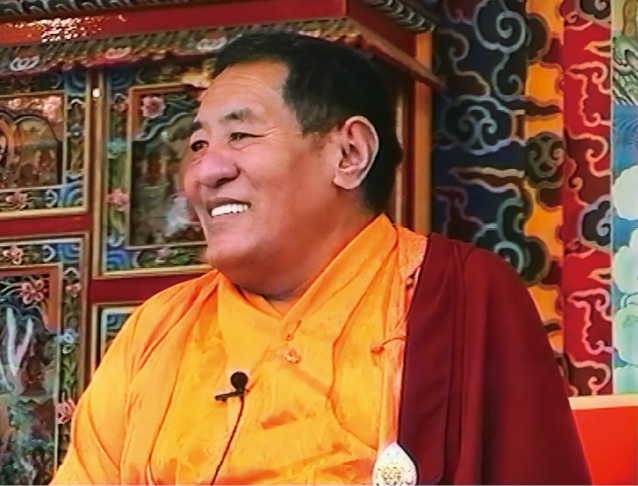

当佛陀临近涅槃时，他说：“我为密宗共同所化众生，已广讲了共同乘的法。但不共的了义密宗金刚乘，未来会在28年后才广为人知。”根据佛陀的授记，28年后，国王匝皇宫的屋顶上出现了金刚手佛像和密续经函，这是玛哈约嘎兴盛于世的由来；后来密主金刚手给五圣贤广讲密法，阿努约嘎由此出现；密主金刚手向持明嘎绕多吉详细宣讲了大圆满的所有密续和窍诀，此后，阿底约嘎逐渐兴盛开来。

本师大悲佛陀的一切教法，如果汇集其要点，可以说为了断除八万四千种烦恼，宣讲了八万四千法门。但就得果而言，大致可分为三种法道：经过几个阿僧祇劫才能成佛、经过几世才能成佛、即生成佛。

第一种是显宗乘，认为众生本来不是佛，为了成佛，需要经过多生累劫，最后才能修成佛果；第二种是外三续，认为众生通过次第的方便法，历经几世才能成佛；第三种是无上续，认为众生本就是佛，通过修道认识了自己的本来面目，即生就可以获得佛果。

无上续，本来是不可言诠的，但从其主要内容来说，分为三种：宣说五次第实修为主的父续，如《密集续》；宣说道果、法理的母续，如《喜金刚》；宣说无二或无勤作的修法，如《吉祥时轮金刚》的圆满次第六支加行。在这三种无上续中，最殊胜的是《吉祥时轮金刚》六支加行的修法。《密集续》的五次第、《喜金刚》的道果、《喜金刚》的法理等，与《吉祥时轮金刚》相比，都成了有勤作的法。因此，密宗新派的所有续部中，最高的就是《吉祥时轮金刚》。

在我们藏地，后译新派兴起的四大教派，各自以不同的续部作为主要修行法门。比如，噶当派和格鲁派主修《密集续》，萨迦派主修《喜金刚》的道果，噶举派主修《喜金刚》的方便道那若六法和解脱道大手印，觉囊派主修《吉祥时轮金刚》外内他三种生起次第的窍诀和圆满次第六支加行。所有这些教派都有主修的不同续部。

前译宁玛派则与之不同，它具有上述这些教派从来没有讲过的最殊胜的窍诀，包括以方便生起次第为主的父续玛哈约嘎、以智慧圆满次第为主的母续阿努约嘎、以无二自住本智为主的大圆满阿底约嘎。

・各个教派互不相违

说到前译旧派和后译新派，就像昨天讲的，后译新派是在大译师仁钦桑波之后的各个教派，比如萨迦派、噶举派、格鲁派等。

可能有人会问：“宁玛派会不会修《时轮金刚》《密集续》之类的新派法呢？”

事实上，宁玛派囊括了所有的佛经和续部，古大德也说：“显密法理全无误，智成持明传承轨，佛教精藏前译密。”将显密所有法理完整翻译出来的，只有前译宁玛派，而后译派的译师，只是零星翻译了一部分。我们要认识到，前译宁玛派的主要特点是显密法理完整，其中内续三约嘎、尤其是大圆满，更是其他教派所不具备的。

可能有人会认为：“这样的话，前译宁玛与后译新派的教法、前译宁玛与后译新派的智者成就者的密意，不就相违了吗？”

并不相违。从各派持教大德来看，无等阿底峡尊者、至尊宗喀巴大师都是邬金莲师的幻化，这在《噶当弟子问答录》里讲得很清楚。再者，怙主文殊化现的萨迦班智达，也是邬金莲师的化身，这一点在他的传记中有明确表述，邬金莲师在许多伏藏法中也有授记。不仅如此，觉囊派的全知朵洛瓦，噶举派的冈波巴和噶玛巴巴协等，也是莲师的真实化现。总之，藏地所有这些持教大德，无一例外都是莲师的化现，所以，他们的意趣并不矛盾。各派教法的要点只有勤作、无勤作的不同，并没有太大区别。

有人又会问：“那么，新派与旧派的法有什么区别呢？”

新派的续部中宣说过一生成就双运金刚持果位的方便法，宁玛派的父续母续等中也讲过即生成佛的方便法，这是相同的。两者之间最大的不同是，宁玛派自宗承许，就大圆满而言，能在浊世中用短短的一生成佛，从更密的窍诀部而言，还有三年或六个月就能圆满佛果的方便法。所以，新旧二派只在修道快慢上有区别。

综上所述，我们应该认识到，所有的佛法都是佛语，所有的上师都是莲师化身。

・给弟子的教诫

下面，我想以好心郑重对大家说几句话，请你们牢记在心。是什么呢？

此前，以丹嘉仁波切为主的大德，包括敦珠法王、第十六世噶玛巴等，依靠殊胜的发心，长时间历经千辛万苦，让佛法在西方开始扎根，并像早上的太阳一样冉冉升起。现在，我们藏地的大乘法教，比其他时代更加兴盛，在西方弘扬得非常广泛，从外内密的验相来看，这得益于住在这里的诸位仁波切和在印度的藏族上师们所做的一切。

但是俗话说“道高一尺，魔高一丈”，当这样的教法和持教大德的事业越来越兴盛时，就会出现恶友和恶知识把你们引入歧途，一定要小心。他们是怎么出现的呢？

在我们藏地，最兴盛的是修传八大教派，他们的教义都是佛陀亲口所说的清净教法，这一点没有任何区别。但作为你们，以后有人会说“少数上师是成就者，大多数上师是魔”，这样的人肯定会出现。藏地历史上也发生过这种事，比如宣称“国王朗达玛是观世音菩萨的化身，邬金莲师是魔的幻化”“宗喀巴大师等诸多大德，是魔子魔孙的幻变”。或者，他们会说，有些法是清净的，有些法是颠倒的。比如声称“我们宁玛派的这个法是正法，萨迦派、噶举派等新派的那些法是邪法”，还有人鼓吹“只有新派的法才是正道，宁玛派的法是邪道”。像这样的语言是根本不能听的。你们必须明白，这些人一定是魔，会把你引入邪道、指示魔道，是毁坏生生世世永久安乐、让你深陷无边恶趣的魔知识。

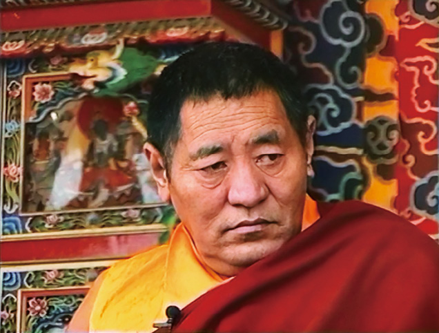

如果你们遇到这种恶知识，生起各种邪分别念，一定要去找具有法相的上师善知识，来消除你的疑惑。我在藏地曾广泛讲过这方面的教言。真的想想，现在我看不清楚，思维也越来越迟钝，但仅凭我这么一个老人，也可以建立并受持“修传八大派的所有持教大德密意一致、教法全部是正法”这个观点。所以，希望大家不要误入歧途。

将来你们可以看到，在我离世后或离世前，会有人站出来说“这个上师很好，那个上师有问题”“这个法是对的，那个法是邪法”，这样那样的人会很多，一定要小心警惕。这是我发自内心的忠告！

当然，并不是说所有教派的法在深浅上没有差别。即使在宁玛派内部，相较于父续、母续，无二续阿底约嘎更深、更快、更易行，它们之间也有天壤之别。但这并不意味着一个是坏的，一个是好的。这些法都是佛陀根据众生不同的界性、根基、信解、意乐而宣说的。其中，佛所说的诸乘之巅或之最，是大圆满阿底约嘎。大家应该明白，大圆满清楚揭示了佛语的所有要点，是一切圣教的总释，是三世诸佛的微妙密意，是一切众生成佛的完整无误之道。

・大圆满的不共之处

可能有人会觉得，这种说法有点像鹦鹉讲法。我们藏族有一种说法，鹦鹉嘴上说不要杀虫、不要杀虫，自己却在吃虫子。我现在也是，一边说着不要偏袒宗派，一边又唯一赞叹大圆满。（众笑）

其实，我赞叹大圆满并不是出于对自宗的偏袒，而是有许多可靠的依据。

1．回顾历史

回顾过去的历史，我们可以看到，持明者嘎绕多吉、蒋花西宁、西日桑哈、嘉纳思札等都成就了大虹身，而且邬金第二佛莲师、布玛莫札不舍肉身，现在分别住在西南妙拂洲吉祥山和汉地五台山。诸如此类，似乎所有宁玛派的传承上师，都成就了离尘虹身或大虹光身的任意身。

时至今日，在藏地的上中下地方，很多实修大圆满的修行人，也呈现了外内密的瑞相和虹身成就相，具体情节在敦珠法王的《藏密佛教史》中有记载。而且，还有很多《藏密佛教史》没有记录的虹身成就案例，这种事迹实际上层出不穷。单凭这一点，像大圆满这样的法，似乎在整个人间都是前所未有的。

2．成道快慢

成道的快慢，需要以各派的教义为准。比如，《密集续》和《时轮金刚》等中提到，具有大精进、大智慧的人，即生会成就佛果。但他们对“即生”的定义，也是在一百年之内，此外并没有说还有比这更快的。既然没有说，我们也不能强加给他们。

那么，大圆满是怎么说的呢？《四心滴》等教典中说，大精进者可以在三年内成就双运果位。甚至窍诀书《杰珍宁提》中提到，具有上等根基或上等信心的人，最快可以六个月成就大虹身。这些都是大圆满中的教言。如果以此为参照，像大圆满这样的成佛捷径，在新派的任何续部中都是不多见的。

3．简便易行

在新派的所有续部中，《吉祥时轮金刚》是最深的法，没有比它更好的了。而它的无勤作之道，是圆满次第六支加行的修法。就实修六支加行而言，深入了解就会发现，当观修第一个加行“摄收瑜伽”时，它有点像大圆满，也宣说了身语意自然安住、眼观离云无垢虚空，但在后续的加行“禅修瑜伽”和“随念瑜伽”中，有很多魔障、很多歧途，想增进修行的话，还需要很多窍诀。特别是，若没有依止一位广闻博学、精通教义、实修经验丰富的上师，是根本没办法修行成功的。这个道理可以从觉囊派全知的引导文《见而有义》等中了解。在当今时代，要实修这样的道，真的很难。

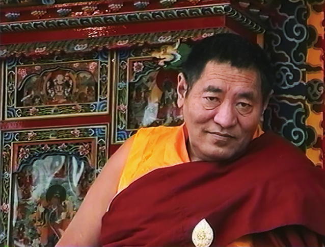

但要修大圆满的话，只需要有视师如佛的信心，虔诚地向他祈祷，并修持一个自然安住的窍诀，其他什么都不需要。《杰珍宁提》中也说：“尤其以无伪强烈之信解，恭敬恳切祈祷上师，是一切除障与增进境界之最。”除此之外，不需要任何其他的修行，舒舒服服躺着坐着都可以。如果这么说，没有哪个法能像大圆满一样。

4．应时之法

当众生的烦恼越来越重，相应地，法也需要越来越深。就像一个病重的人，如果不给他开特效药治疗，他是没有办法康复的。佛法也是如此，在圆满初劫时，一切众生的烦恼特别少，他们的对治法就是事续；在三分劫时，是行续；二分劫时，是瑜伽续；具诤劫时，众生烦恼特别粗大，要宣说无上续；在较具诤劫更甚的今天，五浊横行，众生刚强难化，除了唯一的大圆满，其他任何法都无能为力。就像噶陀都德大师说的：“八乘宗派难化时，开显顶乘阿底法。”在这个时代，八乘任何法都难以调化，只有顶乘阿底约嘎才是应时之法，所以它超群绝伦。

5．佛法住世期

总的来说，佛陀的教法大多数已接近圆满。佛法的住世期包括四个阶段：果期、修期、教期、唯持形象期，而现在，我们正处于教期中刚结束戒学、进入定学的时期。

就总的续部来说，大部分续部也到了它们的末法期，即将在这个世界上隐没。以《时轮金刚》为例，在七代法王和二十五代具种王时期，前期会广泛传播教法，后期是勇武轮具种王的两个儿子广弘时轮教法。现在是前期教法，七代法王时代已经结束，二十五代具种王中的第二十一代不灭具种王，登基至今已有67年，前期教法基本快圆满了。教法住世期越接近尾声，法的加持或力量就会变得越慢。

而大圆满的教法，正如《应成根本续》所说：“持德空行母，受持此教法，人寿十岁兴，尔后不住世。”现在正是广泛弘扬大圆满的时候，许多女性修行人将来都会虹身成就。这个续部还提到，尤其是在人寿10岁时，持德空行母将出世弘扬大圆满，凡是见闻忆触她的众生，都会证得大虹身的果位。因此，这个阶段，是弘扬大圆满、实修大圆满的鼎盛时期。

关于大圆满的殊胜性，如果让一位获得总持的菩萨来讲，他几个劫也讲不完。即便是我这么差的人，也可以讲好几天的长篇大论，但由于时间关系，今天就讲到这里吧。

・结语

为了表示缘起，我用两个教证来总结：

一个是，持明者嘎绕多吉在《一子续密释》的结尾写道：“三世一切佛，无量窍诀中，胜窍诀一子。较此更甚深，无边刹绝无。”也就是说，过去、现在、未来三世诸佛都宣讲过无量的教法，但归纳其全部精要，没有一个超过诸佛之子、自然教法《一子续》这个大圆满法。就像我们藏族人以拉萨来发誓一样，持明者嘎绕多吉为了让我们相信，也发了誓，做了保证。大家要记住这一点。

另一个是，对我们有无等恩德、被誉为诸佛无分别智慧现为善知识形象的全知麦彭仁波切，也亲口说过：“浊世衰败罩如暗，莲师事业明如月。”在这个五浊黑暗猖獗的时候，疾疫、饥荒、战争，尤其是内在的贪嗔痴等烦恼越弥漫，莲师的事业就越兴盛。比如越是黑暗的夜空，月亮就越明亮，同样，浊世黑暗越遮蔽一切，莲师的加持就会越快。

因此，我请求你们把大圆满作为自己唯一的修行法门，把邬金莲师作为自己最主要的依止上师。这是我对你们的祈请！

我和索甲仁波切都被称为列绕朗巴的化身。对于我们来说，这一生的依靠处，唯一就是上师邬金莲花生大士；尽心尽力实修的法，唯一就是大圆满。所以我再次祈请你们，想追随我们两个，特别是索甲仁波切的人，也要这样去做。

今天讲的核心内容，就是唯一要修大圆满，这也是你们上师的意愿。

不是我撒谎，真的，我来到列绕朗巴的这个道场，虽然一个字也没有准备，但好像一开口就停不下来。结果越讲越广，今天还没讲到大圆满的正行。这个法，你们过去也修过，现在正在修，将来还会修，所以就这样也可以。假设还有时间，明天或后天，我可以再简单讲讲。如果没有时间，你们长期依止上师，向他请教，解除疑惑，这样也足够了。

我这个老僧人有点反常，一直讲个不停，继续这样下去的话，恐怕太阳都落山了，我还在喋喋不休。但时间已经到了，那就这样吧。

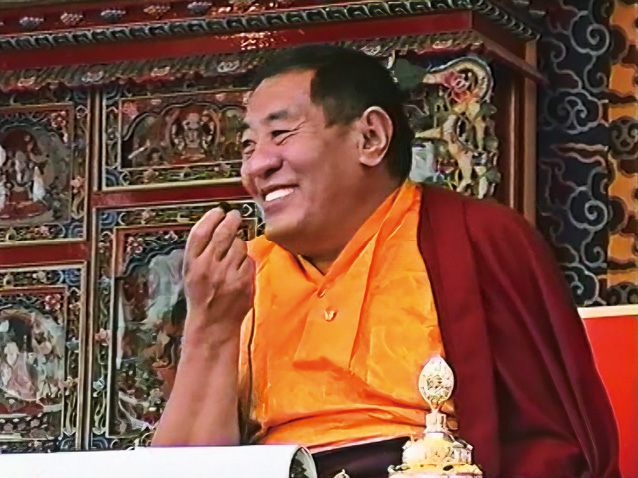

最后法王停顿了几十秒，即兴作了一首诗：

> 列朗道场广阔如虚空，索甲化身加持如日光，

> 吾之发言无穷亦无尽，面面俱到讲述终为难，

> 因时间故暂且言至此。

我也讲了几堂课

当天晚上，应道场信众的邀请，我给大家讲了一堂课，主要介绍了伏藏大师列绕朗巴和他的转世。尤其是结合法王传记，着重分析了他老人家身语意的功德。

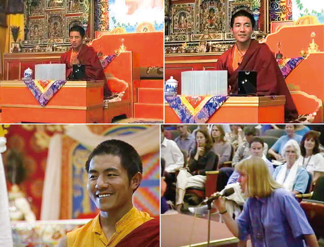

这次随法王出行，不仅是列绕林，在其他几站，我也讲了一些课。比如在纳帕谷，我讲了文殊菩萨的修法，做了两次现场问答。在波士顿，我讲了三殊胜和无我的教义，念了金刚橛仪轨的传承。

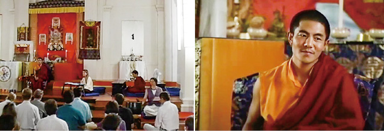

特别是在抉择无我时，我运用不同论师的推理，基于龙猛菩萨《中论》的五相车理、月称论师《入中论》的七相车理、静命论师《中观庄严论》的离一多因、寂天菩萨《入行论》中对整个身体乃至六识都不是“我”的观察，分析了众生执著的“我”并不存在，引导大家用理性方式来认识“我”，并讲解了修无我的具体方法。

其实在西方弘法，要么应该像法王如意宝一样，具有不共的传承加持、超群的修行境界，可以给一切结缘的众生种下善根，有信心的人甚至能当下解脱；要么在西方待过多年，熟悉他们的烦恼、兴趣、文化，同时了解现代心理学等调心的方法。

至于像我这样的路人，没有什么修行境界，也不太了解西方文化，仅仅像蜻蜓点水一样给他们上几堂课，对他们来说起不了多大作用，真正利益众生还是很难的。

所以这本书主要是编辑法王的金刚语，至于我讲课的内容，还是不献丑了，免得惹人笑话。

门措上师

8月29日上午，门措上师给大家授予了“忿怒莲师”的灌顶。

这次几乎每一站，她都应道场的不同希求，传过“项袋金刚橛”“文殊智慧勇识”“缘起除障法”“观音菩萨”等灌顶。

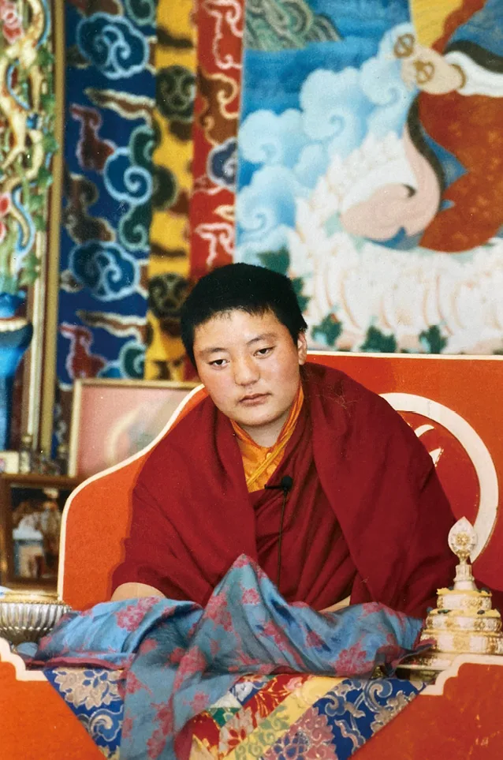

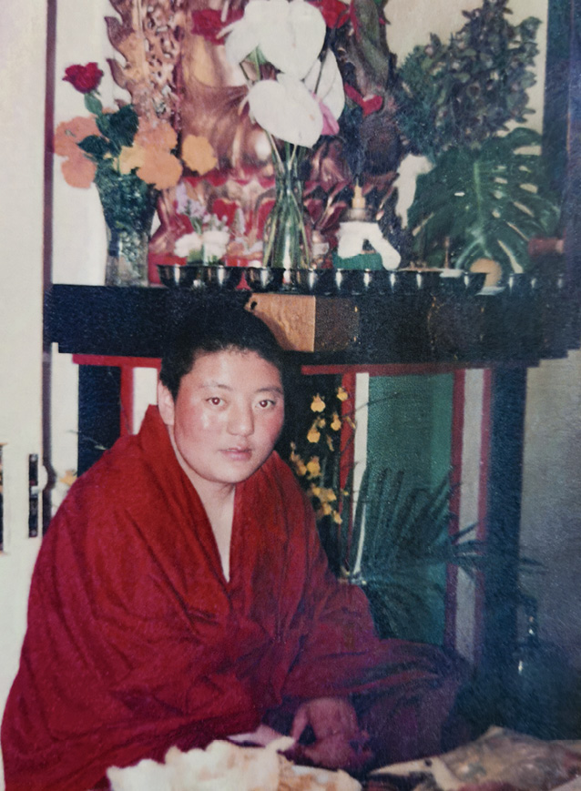

夏威夷

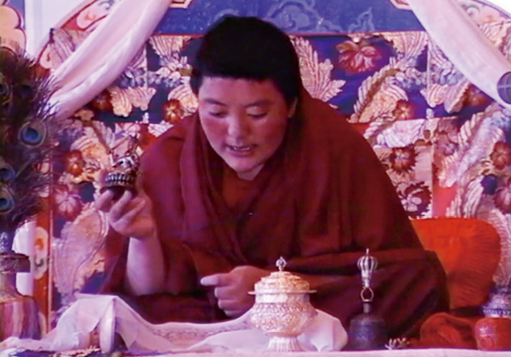

纳帕谷

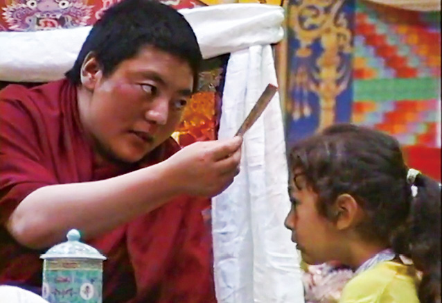

纳帕谷

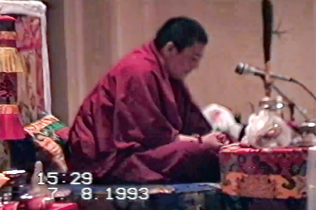

纽约

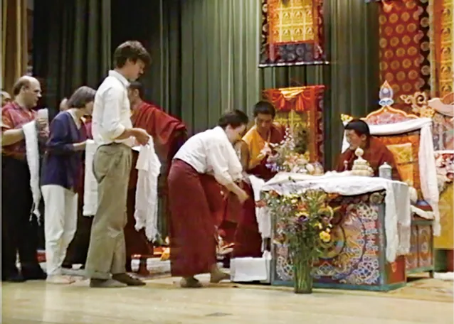

纳帕谷

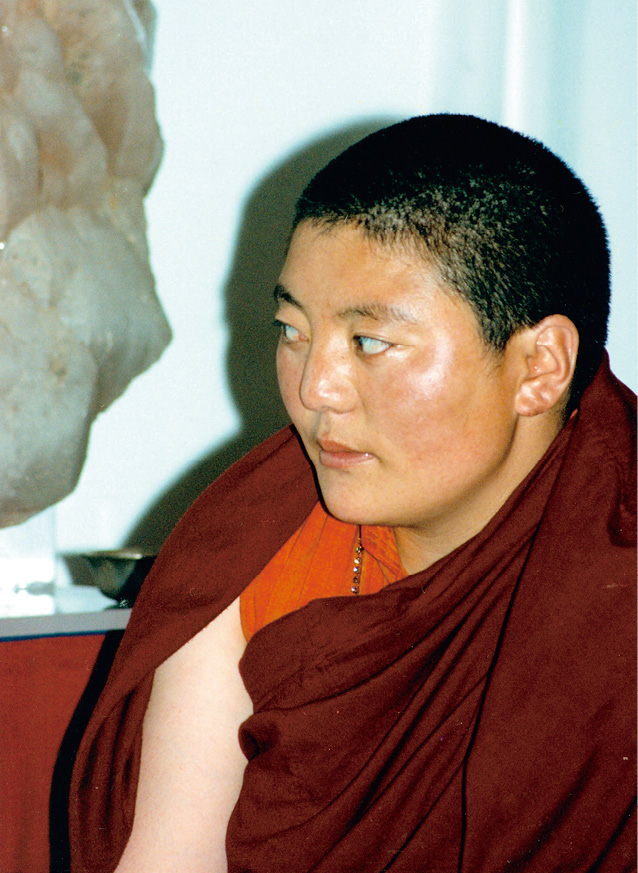

波士顿

在提倡男女平等的西方，很多人对门措上师有一种特别的欢喜，她在每个道场都受到与众不同的欢迎。因为去西方弘法的上师中很少有女性大德，能给大众传法灌顶的空行母和女活佛就更少见了。很多人见到门措上师后，都觉得她是慈悲的化身，她的目光和笑容散发着温柔的光芒。哪怕只见过她一面，也会被她独特的修行气质所吸引。尤其是对于很多女性信徒来讲，门措上师给她们带来了希望，增加了她们修行的勇气。

我跟随法王去国内外很多地方时，和门措上师有过近距离的接触。且不说她超凡脱俗的境界、精通显密教法的智慧，单单是日常生活中的待人接物，她也不像世间有些女性那样脆弱、敏感、喜怒无常。她生性恬静寡言，对世俗没有什么贪恋，衣食住行都很简单，出门在外从不挑剔吃住。

跟舅舅法王如意宝、母亲阿里美珠在一起时，我从没见她发过脾气，她的言行总是毕恭毕敬，全心全意地承侍他们。在法王和众弟子之间，她从不搬弄是非、挑拨离间，而是常年如一日，对每个人都表现出慈爱和关怀。

她有着过人的智慧和非凡的记忆力。例如，我们忘记把行李放在哪里了，她立刻就能想起来，对于发生的每一件事，甚至日期，都记得清清楚楚。她唯一喜爱的就是修行，平时除了持咒和念课诵，不喜欢说很多闲话。

对我个人而言，她在世间、出世间方面的恩德都很大。如今，她也是喇荣五明佛学院所有僧众的金刚上师，为大家不断地灌顶传法。祈愿她长久住世、常转法轮！

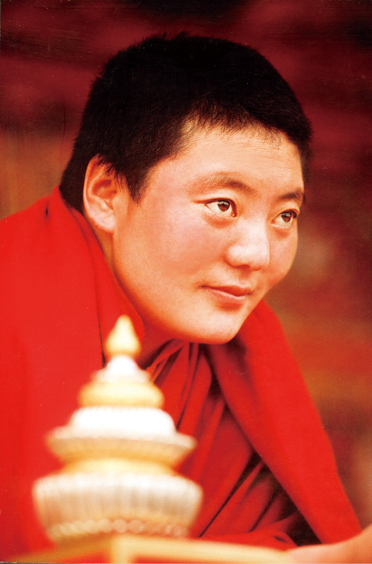

欣赏风景

门措上师灌顶后，索甲仁波切邀请法王去列绕林的山顶上一起煨桑，法王欣然同意。

乘车到山顶，那里挂着许多经幡和格萨尔王经旗，列绕林的弟子们会在殊胜节日来此煨桑。这里风景开阔，周围的山谷一览无余，还可以看到西班牙和法国交界处的比利牛斯山脉（Pyrenees）。他们向法王介绍了附近的山脉，以及欧洲各国的大致方向。之后，法王和大家念诵仪轨，做煨桑，供护法，共同祈愿佛法长久住世、广利众生。

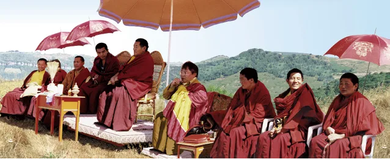

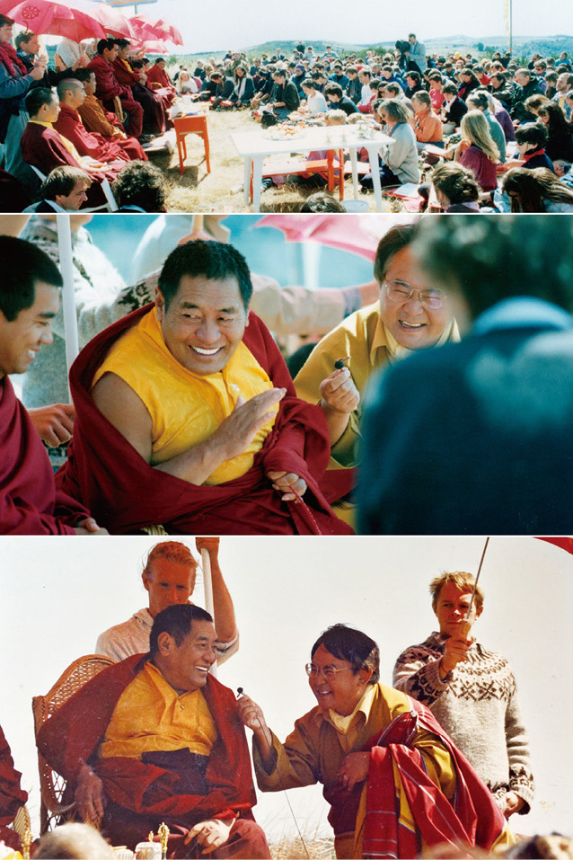

下山吃了午饭后，法王在几位大德的陪同下，被请到了“茶屋”（Teahouse）。它是索甲仁波切在森林里建造的小木屋，位于传法大帐篷下面的山谷中，在一个瀑布附近。通往那里只有一条崎岖的山路，车辆无法直达，法王在大家的搀扶下，上上下下还是有点吃力。

到了茶屋，法王一边欣赏风景，一边讲了莲花生大士、菩提萨埵来藏地弘法的故事，然后就列绕林的弘法现状，聊了很长时间。

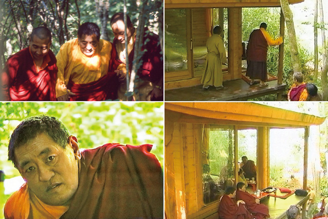

直指心性的窍诀

下午，从茶屋回来后，法王给大家讲了大圆满的十一句义和直断要诀。

今天，从诸乘之巅、三世诸佛究竟密意的光明大圆满入手，我给大家讲几句：

盛行于当今时代的大圆满教法，在人间，最早付教给持明者嘎绕多吉，他将所有大圆满法结集成六百四十万偈。蒋花西宁将其分为外心部、内界部、密窍诀部。西日桑哈将窍诀部分为外类、内类、密类、极密心滴类。大班智达布玛莫札又将极密心滴类分为两种：所有即生解脱的窍诀，都叫口传；所有解脱于中阴自现智慧的窍诀，都叫耳传。

在藏地雪域，对于口传和耳传这两种法理，全知龙钦巴的《七宝藏》《三休息》是以广大班智达派的讲解方式来抉择的，《四心滴》是以甚深古萨里派的讲解方式来抉择的。这些窍诀的传承，当今以文字保留的有续、教、窍诀这三种。其中，就续而言，主要有《甚深精藏十七大续》，加上《明界炽燃续》《黑护法忿怒续》，共有十九续。就教而言，有《金文》《璁玉文》《砗磲文》《镶文》四部甚深书函。就窍诀而言，有119个窍诀精华。

总集这些要点的实修方式，是全知法王龙钦巴具有五十一法部的《上师心滴》。如果按照它去修，就会非常完整、无不摄集。

・十一句义

可能有人会问：“《上师心滴》的窍诀是根据什么续来解说的？”

主要是根据《珍珠鬘续》。而《珍珠鬘续》，又是通过十一句义来讲解的。

十一句义是什么呢？

《珍珠鬘续》中说：“基迷周遍理，处道门与境，实修量中阴，解脱地十一。”

第一句义——基：在最初既没有出现证悟的佛陀，也没有出现未证悟的众生之前，基的本体是一种无记法，以本体空性、自性光明、大悲自相可现的方式安住着。它可分为五身、五智、五风、五空行、五光等五组五功德。

第二句义——迷理：以本体来提供空间，将自性执为对境，将大悲执为心，众生以三因四缘，接连不断地漂泊在轮回中。其中，“三因”是指同性无明、俱生无明、遍计无明，由这三种无明导致迷乱。“四缘”是指增上缘、所缘缘、因缘、等无间缘，通过这四缘导致迷乱。从本基中显现基现时，普贤如来了知基现就是自现，从而当下解脱。解脱方式有六种特法，也可以归为三种。是什么呢？非由因所生的果、非由教所生的窍诀、非由心所生的佛，以这三种特法而解脱。

第三句义——周遍理：如是显现轮回和涅槃的无量相，在如来的自性中从未动摇过。要想抉择这个观点，在显宗中，有第三转法轮诠释如来藏的十部佛经，以及揭示这些佛经密意的、弥勒菩萨《宝性论》中的九喻九义、龙猛菩萨《法界赞》中的六喻六义；在密宗金刚乘中，有《幻化密藏续》《佛陀平等行续》，还有荣索班智达的《建立显现即本尊》《建立有境即本智》，以及全知龙钦巴尊者的众多善说。我们应该根据上述经、续、论来理解其义。

第四句义——本智处：觉性自然本智住于何处呢？真正的本智是住在八棱形的心宝无量宫里。其现相是在头顶的颅腔无量宫、能见的眼无量宫、能行的脉无量宫里。总共有四大无量宫。在心间珍宝无量宫的中央，住着寂静身的本尊；在头顶的颅腔无量宫内，尊众以忿怒相而安住；在能见的眼无量宫中，以光线相而安住；在能行的脉无量宫里，以光的自性而安住。

第五句义——本智道：从嘎德水晶管脉中分出两根白丝，细而盘旋，分别插入左右眼，由此显现自然本智。

第六句义——所现之门：在这个肉眼中央，有一种根部细、顶端粗、状如牛角、清澈光明的“远索水灯”，自然本智是经由这个门而显现的。

第七句义——所现对境：在离垢虚空中，法身所依是太阳，报身所依是月亮，化身所依是灯。依靠这三种所依，可以显现具有五光辐的蓝色周遍法界的“法界净灯”、如投石入泉般有内外多层五光圆形明点中央的“明点空灯”、如水晶珠严饰的金线般的“觉相金刚链”。

第八句义——实修法：如果“基”为本来清净，“道”以直断来修，“果”则清净为微尘；如果“基”为任运自成，“道”以顿超来修，“果”则解脱为虹光身。

第九句义——修行量：以法性现量相、觉受增上相、觉性如量相、法性灭尽相这四相，来认定修行的量。

第十句义——中阴窍诀：按照密类以下的说法，中阴有六种；按照极密心滴类的不共说法，中阴有四种。具体而言，在安立中阴的界限上，莲花生大士和布玛莫札略有不同。但总的来说，中阴分为四种：自性中阴、临死中阴、法性中阴、转世中阴。“自性中阴”是通过闻思来断除增益，忆念如燕入巢的教言；“临死中阴”是提醒不能明观者令其明观，忆念如美女照镜的教言；“法性中阴”是坚信一切皆为自现，忆念如子入母怀的教言；“转世中阴”是依靠善业来延续后世，忆念如接通水渠的教言。

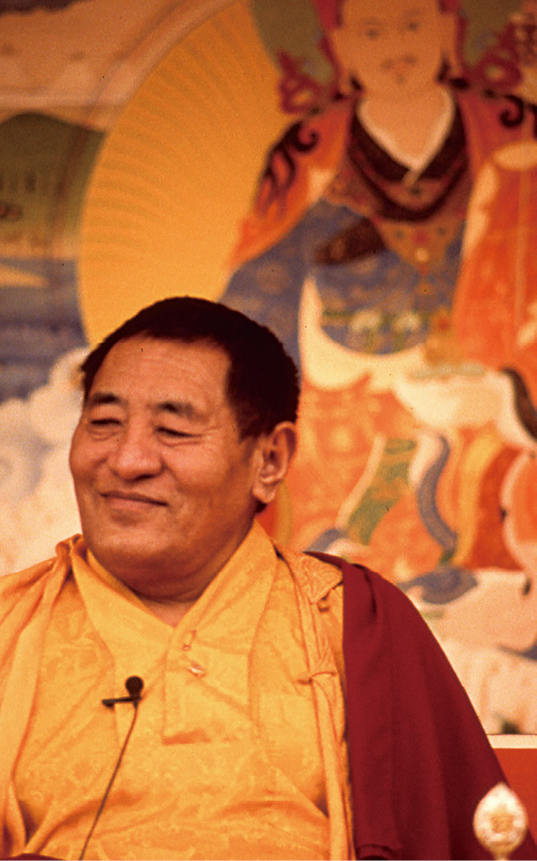

第十一句义——解脱地：依靠真实圆满正等觉、现前圆满正等觉这两种中的任意一种而解脱。

这十一句义，完全涵盖了大圆满的所有续、教和窍诀，也是当年莲师在桑耶不变自成宫的中殿“燃璁玉”中，给密咒师降魔金刚所传的法。这次我以摄要的方式给你们讲了。

以上解释方法，大多来自广大班智达派。今天我直接讲这些，可能你们还不能完全理解，但是依靠缘起力，我在列绕林这个道场，给你们简单讲述了大圆满所有续部的要点。

・直断要诀

接下来，应索甲仁波切的要求，我所讲的核心意义，是大圆满本来清净直断的见解。

关于直断，各大持明者的究竟意趣都一样，但也有不同的说法：持明者嘎绕多吉将其解释为直指本性、断定自决、定见自解，即击要三句。后来，西日桑哈依靠决定法尽大本净、离作通彻赤裸摄要、普解脱大平等持纲，对此进行宣说。莲花生大士将本体空性直指为法身、自性光明直指为报身、大悲周遍直指为化身，以此做了抉择。嘉纳思札是基于四种安住方便窍诀进行抉择：见解直定、修持直定、行为直定、果位直定。全知龙钦巴虽然有很多一般的讲法，但特别是根据《实相宝藏论》，以无有、唯一、平等、自成四者来抉择的。荣索班智达以“以大正知之器摄持大圆满之义，安住于大等舍的境界中”这两句话，概括宣说了大圆满的所有续、教和窍诀。

今天我根据全知麦彭仁波切的教言，将这些传承持明祖师的窍诀合而为一，用一句话总结就是，上师面对面给弟子直指的方法有两种：寂止门引导和胜观门引导。这两者的定义是，“寂止门引导”是从修上寻找见解，类似于大手印的总法规；“胜观门引导”是从见解上寻找修，类似于大圆满的总法规。其中，胜观门引导，按照全知荣索班智达及其随行者的方式，侧重于抉择本体空性的见解；按照全知龙钦巴及其随行者的方式，侧重于抉择自性光明的智慧；全知麦彭仁波切结合了这两位尊者的密意进行抉择。

全知麦彭仁波切的广大言教，如果归纳其全部要点，就是认识本面、自然安住这两句，除此之外，并没有其他的大圆满要诀。这两句是什么意思呢？不管这颗心安住也好、动念也好，当你坦然观它的本体时，会认识到心在外中内何处也不存在，是虚空般的空性，这叫“认识本面”。认识到心是无生空性后，虽然没有能知所知，但可以自然断定它的自性，就像明眼人见到色法一样，当这样的境界现前时，就是“自然安住”。也就是说，了知无生和自明自知，是护持自性的“见”。

修行时，不要失去无生的境界，要在没有任何起心动念的境界中安住。对于了知无生，我刚才引用了荣索班智达的一句话：“以大正知之器摄持大圆满之义，安住于大等舍的境界中。”正知的哨兵不会让任何分别念进来，而是安住于自明自知的境界中，这就是大等舍，也叫“修”。

“行”就是无论什么好的坏的念头出现，都不要去管它、不要跟随它、不要以对治去压制它，只是保持觉性自住不动而护持其相续，这就是认识本面、自然安住的窍诀。

这两者妙力圆满的“果”，是彻底成就法身和色身。

或者总结其要领，用其他窍诀直指的话，所谓大圆满的“见”，就是了知无生。所谓无生，没什么不好懂的，你们观自己的心，不管它是散射还是安住，根本就没有成立过，如同镜子里的影像。如果明白了这一点，这就叫见解。

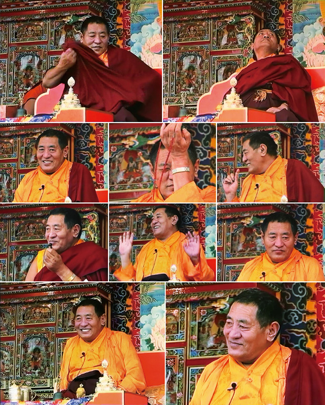

这其实很好理解，就像多哲丹毕尼玛说的：“内观的当下就能获得。”寻找心的踪迹时，根本找不到它，就像水中的月影。月影正在显现时，你看着它就可以，不然，用棍子去搅拌水，月影绝不会显现。同样，你们向内以心观心，心本来就不成立，这就是觉性；你们向内以心观心，了悟心的本体明觉不灭，这就是觉性；你们向内以心观心，这颗心自然安住、不增不减，它在当下的状态，这就是觉性。

邬金莲师也说：“现今明觉不灭了了然，普贤本来怙主即是彼，无所成立空界普贤母，证悟彼性刹那圆正觉。”用心去观自己的心，它在外中内什么地方都不成立，就叫普贤佛母；在空性的同时，可以散现种种妙力不灭，就叫普贤如来。如果认识到这两者无别的自性，瞬间就会获得圆满佛果。其实，认识本性就是这样。

可能有人认为：“真的有那么容易吗？应该比这要难吧。”

其实这是一种误解。上师全知麦彭仁波切说：“自心简易难信之秘密，愿以上师窍诀力见之。”意思是，它简单到令人难以置信，我们要以上师的教言断定、认识本来面目，在这种境界中不断护持其相续，这就称为“修”。修行的时候，没有什么可修的，只要不忘失这种境界而安住，别无其他。第一世敦珠法王的教言中说：“修时无所修，观虚空即可。”

所谓“行”，是指为了增进境界而修炼妙力。也就是在涌现任何分别念时，既不开心也不难过，就像老人看小孩玩耍一样，除了觉性自持本位以外，对贤劣的分别念不喜不悲。

虽然除了觉性以外，不存在一个他法，但人们却一直追随由觉性妙力所显现的分别念。有朝一日，觉性若能自持本位，任何分别念都无法动摇它，这就是妙力圆满的“果”。

对于大圆满，我有两种解释方法：有时候我会说大圆满是最简单易行的法，有时候我会说大圆满经过多生累劫的修行也无法通达。今天我用的是第一种方法，这样你们就可以获得所有大圆满的法了。

最后，为了让你们生起欢喜，我引用全知上师的两个教证。全知龙钦巴在《胜乘宝藏论》中说：“我等师徒定于数多阿僧祇劫中积资净障，因已值遇普贤如来心法之故。”意思是，因为我们往昔在多劫中积累过资粮、净除过罪障，所以今生遇到了大圆满教法。你们是不是很开心？而且他还说：“我等师徒于此生或中阴或自性化身刹土任意一时决定迅速成佛，因为已值遇决定成佛之因、具无碍能力的清净果法，并对此信解行持。”这个推理是正确的。只要大家对上师不发生严重矛盾，对法不妄生邪见，决定于今生或中阴成佛，这是绝对没有欺惑的。

所以，我们应该感到快乐。就像华智仁波切说的：“静处疯僧众人之爱子，生菩提心胜意众依怙，断除你我偏袒普慈境，我等前往何处皆快乐。”我们今生快乐，来世快乐，除了快乐，不会有痛苦和悲伤。大家真的快乐吗？（众笑）

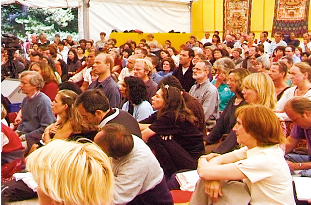

全知麦彭仁波切曾说：“已与最后有法结善缘，未修随意悠闲自安乐。不知真相愚众苦哀嚎，三传上师窍诀刻心底，享用离心本智甘露药，未修随意悠闲自安乐。”我们已与最后有者之法——大圆满结上了善缘，如果能修持它，这是最好的；就算不修而天天睡觉，在这片大地上，也没有比我们更幸福的了。就这样快快乐乐地下课吧。

看得见的缘分

法王在列绕林待的时间不长，但是三十年后，很多人提起法王的到访，依然历历在目，印象深刻。列绕林在世界各地的学佛组织叫本觉会（Rigpa），最近采访了那里的几位老弟子，让我们听听他们是怎么说的——

1．卡琳·贝伦特（Karin Behrendt），现在是本觉会的资深老师。谈到法王，她说：

“每当想起法王，我都有一种很特别的感觉。法王身形魁梧，神态威严，却又谦虚得令人难以置信，自然展现出无限的温暖和慈悲。

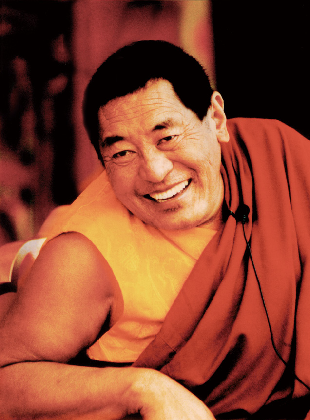

最让我感动的是，法王如意宝与索甲仁波切，他们二位非常恭敬对方，也非常亲近。

对于法王的慷慨和努力，我感激不尽，感谢他来到列绕林，也感谢他让我们参与到伏藏大师列绕朗巴的历史中来。我确信，哪怕只见过他一次，在目睹了他渊博的知识和甚深的证悟之后，对我们人生的影响，绝对会远远超过任何一个凡夫人以分别念所能想象的。”

2．贾博拉·阿努尔（Jaborah Arnoul），是本觉会在德国的一位老师，1993年在列绕林见过法王，她说：

“当我第一次见到法王时，自然生起了一种深刻而强烈的信心。当时由于经济有限，我没有多少钱和珠宝来供养法王。我对此感到非常难过，因为我想把我的一切都供养法王。

但是在心里，我已经这么做了。”

3．简·佩克汉姆（Jane Peckham），是索甲仁波切的老弟子，一位资深的佛法老师，她说：

“我在1994年才开始追随索甲仁波切，很遗憾没有机会见到法王，但我们总是听到索甲仁波切讲法王的功德。

而且，列绕林和世界各地的本觉会，每天都在共修‘缘起除障法’的会供。会供时，会播放法王念诵的大自在祈祷文，这个传统一直保持到现在。

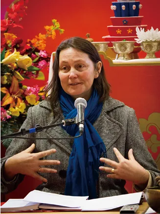

所以，虽然从未见过法王，但每一次会供时，我们都能从法王的念诵中感受到他的加持。”

4．雷娜特·汉德尔（Renate Handel），1993年作为索甲仁波切的侍者，她说：

“我对法王晋美彭措仁波切的印象非常深刻。与我以前见过的任何上师都不同，他是一位非常有力量的上师，极其令人难忘，而且那么和蔼和慈悲。

虽然我记不清他讲课的具体内容了，但仍然记得他是那么有力量。由此可以推断，伏藏大师列绕朗巴在当年肯定也是一个与众不同的人物。

还记得索甲仁波切对法王一行的接待非常重视，容不得半点闪失。法王来到列绕林后，他很在意法王的种种感受：在列绕林住得是否舒服？饭菜是否符合法王的口味？……我从未见过他对待其他来访的上师，就像他对待法王一样，整个过程一丝不苟。

能认识伏藏大师列绕朗巴的转世，绝对是一次非常特别的经历。”

5．珍妮·舒尔茨（Janine Schulz），在提到法王时回忆道：

“1993年，藏地伏藏大师列绕朗巴的化身法王晋美彭措，到访列绕林，与索甲仁波切见面。

当时有两件事给我留下了深刻的印象：第一件事，法王刚到列绕林后不久，有一次在大帐篷里讲法时，他对在场的所有人说：‘索甲仁波切是伏藏大师列绕朗巴疯狂智慧的真实化身。’法王这样说并不是因为我们对此有所怀疑。

还有一件事，法王喜欢用红色念珠，平时不用的时候，经常把它挂在他那硕大的耳朵上。”

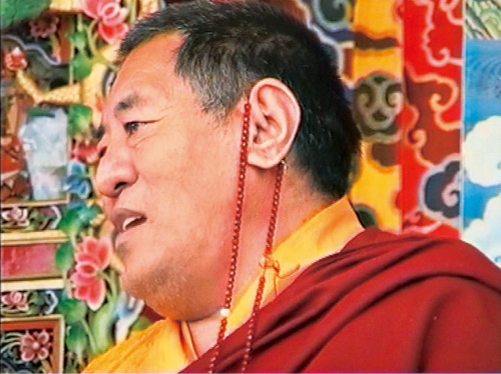

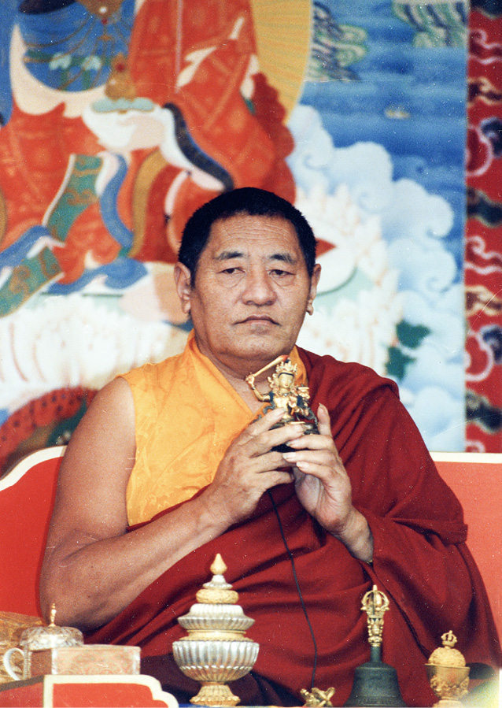

顿超引导

8月30日上午，法王给大家传了“文殊智慧勇识”的灌顶，讲了大圆满中顿超的引导法：

今天你们听到的法，是诸乘之顶巅、诸教之总释、三世诸佛之最深密意——大圆满，它有外、内、密许多分类。这里我简单讲一下光明顿超的实修法，它是极密心滴类的无垢宗轨，密类以下的法门中都没有提到。

顿超包括前行、正行、后行三个次第。

第一，前行：分为三门引导身语意前行、三身引导四大瑜伽、觉性引导区分有寂的行为。

1．三门引导身语意前行：把自己的身体明观为一个蓝色的三股金刚杵，长时间做金刚坐式。断尽一切分别念之际，观心识的本体，自然安住，长时间护持，这叫“身前行”。

将身语意三者合而为一，观想成“吽”字。按照《大圆胜慧》中所说，专心学修印持、修炼、调柔、入道这四者，称为“语前行”。

在寻找心的最初生处、中间住处、最后去处时，最初无有生处，直指为法身；中间无有住处，直指为报身；最后无有去处，直指为化身，这就是“意前行”。

以上这些称为身语意前行。

2．三身引导四大瑜伽：一般来说，在全知法王龙钦巴之前的时代，有广修四大瑜伽的传统，在他之后的今天，几乎很少有人实修它。但按照续部自身的观点，就像心融于地、水、火、风的声音中一样专注，护持觉性本体的境界，这称为四大瑜伽。

3．觉性引导区分有寂的行为：把自己观想成六道众生，随意做他们的三门行为。妄念纷飞的时候，猛喝一声代表方便和智慧的“啪的”，令其戛然而止。随后再三观心识的本体，区分轮回之边与涅槃之边，这就是区分有寂。如是区分究竟后，身不动，语不言，心一缘安住，处于本住等持中。之后，为了止观双运的等持入道或复原，首先相应声闻而行持寂静威仪，中间相应菩萨而行持中等威仪，最后相应忿怒本尊而行持威猛威仪。将此应用于日常威仪中。

以上简单讲述了前行次第。

第二，正行顿超：总的来说，各大持明者的引导方式有很多种，但这里主要遵循全知麦彭仁波切，根据六个要点来讲。

1．身要：依任何一种三身坐式安住。法身坐式如狮子挺立，报身坐式如大象卧下，化身坐式如仙人蹲坐。

2．语要：禁语，口中缓慢呼吸，一缘专注修行。

3．心要：将过去、现在、未来的一切分别念斩断于法界，自然安住来观修。

这是三门的要点。

4．门要：法身看式，眼向上视；报身看式，双目平视；化身看式，双目垂视。依靠这三种看式来修。

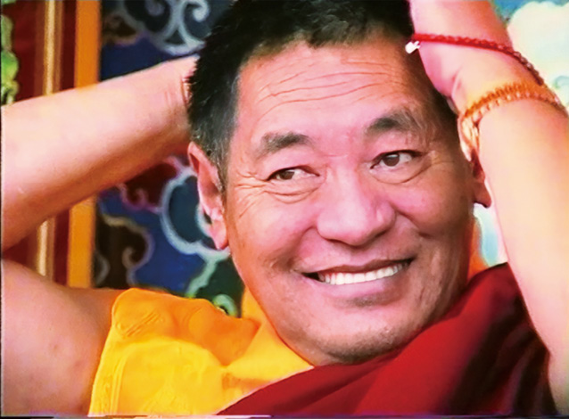

5．境要：依于离垢虚空、日月灯光等。

6．显现要：有法界净灯、明点空灯、觉性金刚链。“法界净灯”是具有五光辐的大周遍蓝色法界；“明点空灯”是如投石入泉般显现内外多层的现相；“觉相金刚链”是如水晶珠严饰的金线般显现弯曲动摇之相。

内在的自然慧灯，通过具足直断的四直定见，眼、意、风三者不跟随觉相金刚链而将它限定在法界净灯与明点空灯的范围内，一缘专注观修。

以上是观修顿超正行完整的六个要点。

这样观修时，首先，法界净灯、明点空灯、觉相金刚链会全部显现，这是“法性现量相”。这些越来越明显、越来越稳固、越来越增上，就是“觉受增上相”。一切不清净的显现得以清净，法界净灯清净为刹土，明点空灯圆满为无量殿，觉性金刚链成熟为佛身，所现皆清净的妙力已经圆满，即“觉性如量相”。最后，一切清净的显现入于内明童子瓶佛身界中，获得不现一切的坚地，称为“法性灭尽相”。

第三，后行：以三不动为基础，以三安住为定量，以三获得来印持，以具四确信解脱量来如理实修。

这些就是光明顿超的实修摄要。我已经按照持明传承祖师的窍诀，完整无误地讲完了。

离别心语

之后，本次传法接近尾声时，法王给道场的弟子们讲了一段教言：

这一次，依靠特殊的缘起，我们具有引导六道的六能仁之数目、挂有“持藏法师”虚名的师徒六人，按照日月运行的方向，绕着整个地球转了一圈，最后来到你们列绕林道场。我在这里受到了索甲仁波切和所有道场弟子难以想象的盛情款待，如同母亲对待远来的游子一样，为此我发自内心地道声感谢。看到你们如此精进地行持清净正法，我不是故意当面赞叹，而是非常真诚地表示随喜。

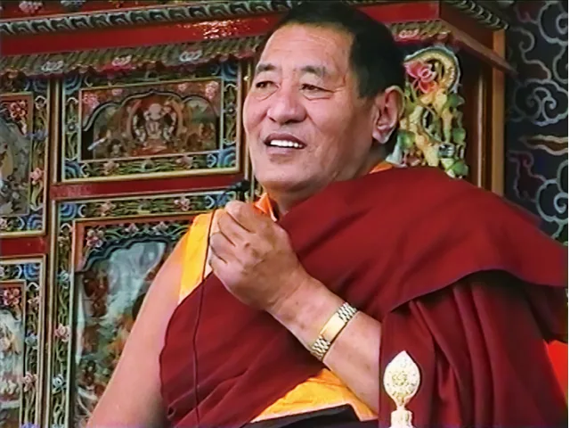

就像刚才主持人说的，两位列绕朗巴的化身很辛苦，这确实是真的。索甲仁波切调化黄头发的人很辛苦，我调化黑头发的人也很辛苦（众笑）。但我们两个这辈子的困难只是微乎其微，未来要做的事可能会更加艰难曲折。我们俩的发心和行为都是随学菩萨，要想乃至虚空际一直弘法利生，在这个越来越恶浊的时代，一切会变得越来越困难。

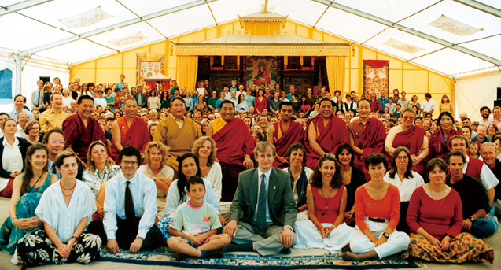

这种辛苦是你们所有弟子有目共睹的。对于我们两个来说，给点吃的喝的，不算什么大的恩惠，我们自己也会想办法解决。最重要的是，利益众生的过程是非常艰难的，希望你们不要把老上师一个人驱逐出境，抛弃他。大家应该齐心协力，以善妙的心和圆满的行为，成办弘法利生的事业。这是我的肺腑之言。

我们师徒的缘分，就像藏族俗话说的：“前言犹如哈达结，后语其上盖印章。”不仅是这一辈子，生生世世都不会改变。仓央嘉措也说：“书写之黑字，会被水滴抹，未绘之心画，抹亦抹不去。”今后，不仅仅是索甲仁波切，他的任何一位真正的弟子，如果去藏地，我都会发自内心地欢迎。说我会给你们提供一切服务，那是假的。对我来说，这个世界上没有比贝诺法王恩德更大的了，但去年他来藏地的时候，我也没能供养一毛钱。如果你们去了，我不能保证给你们提供一切所需，但会尽力帮助你们。

接下来，在诸佛菩萨的见证下，我最后做一些祝福：第一，愿索甲仁波切长久住世，事业兴旺；第二，愿这个道场不断发展壮大，自然享受圆满四德；第三，愿所有弟子以善心善行，为世界和平尽一份力，世间与出世间的一切善举顺利成办；最后，愿我们师徒今生能再相见，共享大乘妙法，命终后立即往生西方极乐世界，面见阿弥陀佛，亲听他的言教，获得成佛的授记。从此成为文殊菩萨的伴侣，乃至虚空际，和他一起精勤广行弘法利生的事业。

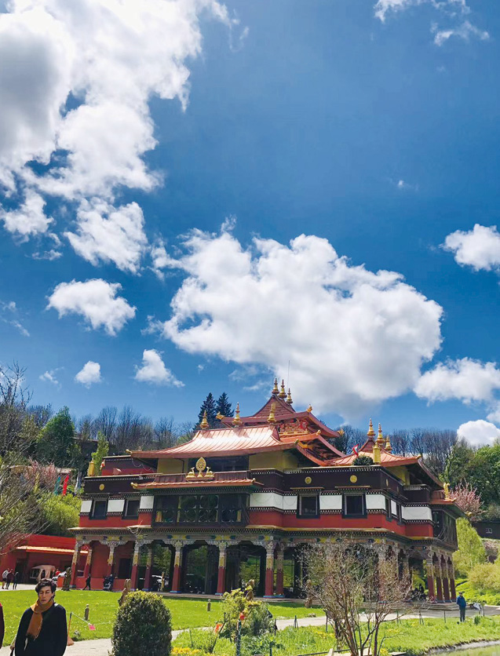

为了实现这些愿望，祈求十方三世诸佛菩萨加持，尤其是在座的众多上师善知识们，以及有信心有智慧的弟子们，要鼎力相助！

又采访二十问

当天下午，法王接受了列绕林媒体记者的采访。

1．问：这次采访的问题，是供大家学习用的。我们本来有很多问题，但最近您在传法时已经解决了，还有几个问题可以在这里问吗？

法王：可以，可以。

2．问：这是您第一次来西方，是什么让您在这个时候做出这个决定的？

法王：我来这里，主要是看能不能对弘法利生起一点作用。在此期间，从众人的表情、心态的变化各方面观察，我相信佛法对他们已经产生了很大的帮助。除此之外，这个时候我来这里，没有其他任何目的。

3．问：您对西方佛教徒的印象如何？和藏地修行人有什么不一样？

法王：印象很好。在藏地，出家人非常多；在西方，出家人比较少，但信佛的人还是很多，这有点出乎意料。除此之外，似乎没有太大区别。

4．问：西方的生活方式与藏地完全不同，比如有许多东西让人分心。佛教中有很多方法，哪一个更有利于西方人？您在这方面有什么想法？

法王：一般来说，佛教的根本，是尽可能平息世间八法，而佛教的精要，唯一就是慈悲心。当然，要在一天之内平息世间八法，那是有困难的。如果慢慢地尽力平定世间八法，然后把慈悲心作为教育的主要内容，这对他们大有好处。

5．问：西方人也应该主要修这些吗？

法王：是的。

6．索甲仁波切经常说，对上师的信心非常重要，您在讲座中也谈到了这一点。据说您的根本上师是托嘎如意宝，您对他主要事业最深的记忆是什么？

法王：托嘎如意宝的主要事业，正如佐钦堪布阿吾拉贡造的祈祷文中所说：“佛法戒律极清净，教证法理讲修弘，斩断八法魔军索，具德师尊前祈祷。”这也是他一生中最重视的事情。

7．问：他在向弟子传授大圆满时，有什么不共的特点？

法王：除了几个有缘的弟子，他不会大规模地做大圆满的灌顶和传法。

8．问：他最看重什么？

法王：前面的祈祷文中提到，他和他的弟子最重视清净戒律、弘扬教法和证法、斩断世间八法的魔军绳索。这是他们一生都在做的事，也是教育别人的主要内容。

9．问：您是伏藏大师列绕朗巴的两大或三大转世之一。很多西方人对一个转世可以理解，但同时有几个转世很难想象，您能解释一下吗？

法王：从获得一地起，在一个时际刹那，就能示现一百个化身；二地菩萨能示现一千个化身；三地菩萨能示现十万个化身……获得佛地时，能示现等同世间微尘数的化身。

至于列绕朗巴，他在世时就曾示现过化身，一个化身去了汉地，一个化身在卫藏讲经说法，相关情节在他的传记中有记载。所以，示现两个化身是轻而易举的事。

10．问：关于列绕朗巴的诸位转世，您还有什么可以教诫的吗？

法王：据说在伏藏大师列绕朗巴的授记中，说他会有101个化身，这是他的主要法主与弟子们曾经说的，我从未见过这方面的文字资料。但在《总集经教》中，是有详细文字记录的。

11．问：您能讲一下列绕朗巴诸位化身的未来事业吗？

法王：列绕朗巴亲口说过，他下一世的事业会更加兴盛，教法住世长达五百年。

12．问：很多大德都确认您是列绕朗巴的转世，您自己对此有什么记忆？

法王：从我自身而言，没有太多。就算有，作为佛教徒也应该保密。我是一个比丘，而作为比丘，没有特殊必要是不允许谈论这种事情的。

13．问：列绕朗巴是个传奇的伏藏师，他的伏藏物和伏藏法有哪些与众不同的特点？

法王：关于他的伏藏物，他可以在一两天内，取出很多箱金佛像、宝箧等。而他的伏藏法，比如《长寿修法仪轨·如意宝》之类的深法，许多在藏地雪域未曾有过，非常不可思议。

14．有人说，“缘起除障法”是在西方的空行母或其他人的帮助下才开启的。这是真的吗？

法王：那要看看列绕朗巴的传记，我现在想不起来。

15．问：我们所有道场长期修“缘起除障法”和“金刚橛”，以后还应该学修哪些列绕朗巴的伏藏法呢？

法王：他在世的时候，主要就是这两个法。目前列绕朗巴的著作中也有许多法，最好尽量去实修，不用担心会修得太多。但最重要的还是“缘起除障法”和“金刚橛”。

16．问：过去出现过很多伏藏师，并广传伏藏法。未来在藏地等很多地方，兴盛伏藏法的远景如何？

法王：佛法没有隐灭之前，邬金莲师的事业不会消失；莲师的事业没有消失之前，正所谓“遍地涌现伏藏师，犹如草地长蘑菇”，伏藏师会接连不断地来到人间，开取各种伏藏法。

17．问：那么，西方会出现伏藏师吗？

法王：当然。哪里有所化众生，伏藏师就会在哪里降临，他们怎么可能只待在一个地方？

18．问：您一生都生活在藏地，当年他们摧毁佛法时，您仍在不断地修行和传法。您是怎么做到的？

法王：唯一就是祈祷三宝。依靠三宝的大悲力，我自己没有遭受任何迫害和磨难，修行和传法也没有出现任何障碍。这就是三宝的加持。

19．问：最近我得知，您以访问教授的身份，在中国藏语系高级佛学院传法。当时他们听法和修行是认真的吗？汉人对此的看法有没有根本上的改变？

法王：那里的学员不是特别多，但仅有的少数人也是表里如一地喜爱佛法，热衷于修行。我传法的时候，大家都满怀喜悦，并在认真修行。除此之外，我对大多数汉人的情况不太了解。

20．问：最后，您对我们在座各位有什么特别的教言吗？

法王：好好，你们要对三宝有信心，尤其是对你们的上师仁波切有信心，要对一切众生有慈悲心，要持之以恒地修持迅速成佛、稀有难得的光明大圆满法。除此之外，没有什么其他的教言了。

亲见法王如意宝

林谷祖古仁波切，是法王在列绕林期间的翻译。多年后我们采访他时，他是这样说的：

“1993年，法王晋美彭措仁波切造访法国列绕林时，我有幸作为仁波切的英文翻译来承侍这位大德。对我而言，这是最珍贵的机会。那时，随同仁波切的有他的妹妹阿里美珠和外甥女至尊门措仁波切，还有两位极为出色的年轻堪布：索达吉堪布和南珠堪布。在这之前，我听说过很多关于这位伟大上师鼓舞人心的故事，也知道喇荣。但这一次，直接从法王座下接受这么多甚深的教法和灌顶，真的是我整个人生中最美妙的一段时光。

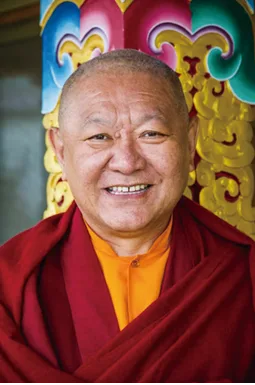

现在的林谷祖古仁波切

我自己不敢要求私下拜见法王，因为他的身体不太好。但一天早晨，十分意外地，堪布们把我带到法王的房间，让我有机会单独与法王交流。在这样一位伟大的上师面前，我所有的问题都瞬间消失了。不自觉地，我只是和他谈起我在藏地的寺院，那是在康区一个很小的噶玛噶举传承的寺院，叫林谷寺。当时有一些‘文革’后幸存的僧人正在重建寺院，当地的老乡也在帮忙。我告诉法王，我们想尽力培养一些年轻僧才，但还没找到一位能为他们授课的堪布。事实上，我每年都会寄些钱回去，让他们不做别的，只能用在培养僧人上。法王于是跟我强调了闻思佛法的重要性，因为不闻思，就不知道怎么完整地修习佛法……

我并没有占用法王很多时间，也没有更多的想法和期待了，他的到来和他的教法对我来说已经远远足够。

几年后，我震惊地听到一个消息：法王晋美彭措仁波切回到藏地后，在喇荣佛学院专门成立了一个‘噶举研修系’，并委任一名博学、有实修的堪布传授噶举传承的论典。我甚至听说，这件事情的其中一个缘起，是因为一位曾在西方为法王担任翻译的噶举活佛做了这样的祈请。

我不知道这个消息是不是真的，也不确定是否还有别的噶举活佛为法王翻译过。但确实如法王所愿，之后藏地很多优秀的噶举派堪布都是从这个噶举研修系毕业的。我寺院里的一些僧人也去了喇荣求学，他们不但成为了优秀的学者，也变成了真正意义上的佛法修行者。每个在喇荣学习过的人都会说，那里的氛围可以完全转变你的感受，会让你的修行变得容易又自然。

如今，喇荣依然延续着法王如意宝晋美彭措仁波切的佛法精神，在他的无尽加持下，众多伟大的堪布们继承了这一清净的传承。喇荣佛学院仍然是这个地球上最大的佛教中心，从佛法的兴盛而言，它的影响力在世界上是无与伦比的。”

仁者无敌

帕特里克·加夫尼（Patrick Gaffney），毕业于剑桥大学，是一名翻译和作家，也是筹备法王去列绕林的成员之一。对于法王的回忆和感悟，他有很多话要说：

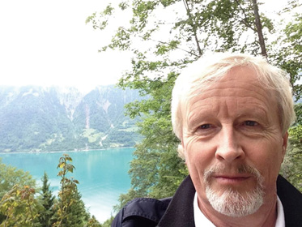

现在的帕特里克·加夫尼

“1993年，法王晋美彭措莅临法国列绕林。当时，作为筹备组的一员，我感到非常荣幸。我们早就听说过法王在亚洲复兴藏传佛教学修传统的不可思议的壮举，同时也怀着极大的兴趣期待着伏藏大师列绕朗巴两位真实化身的相遇。

三十年前，法王来到列绕林，在一个宽敞的大帐篷里向大众传法。听众中有经验丰富的喇嘛，更多的是参加了列绕林举办的三个月夏季闭关的佛教徒。当我听到法王的开示时，瞬间被他那巨大的能量、满腔的热忱和由衷的喜悦所感染，更别提法王的渊博学识和深邃教言带给我的震撼了。法王整个人坐在那里，以及他传法的声音，对我们有着不可思议的摄受力。每天，法王都会给我们传授宁玛教法和大圆满法，包括金刚橛修法、直断、顿超。他的智慧和辩才源源不断地流露，令大众完全着迷，在场的大德也纷纷赞叹法王的甚深智慧。

法王赐予了列绕朗巴伏藏法的两个灌顶，‘缘起除障法’和‘甚深精藏橛’，这是两个对本觉会极为重要的修法。法王还传授了自己的伏藏法‘文殊静修大圆满’。在赐予我们灌顶时，他非凡的气度为我们营造出一种出世间净观的氛围，让我们在一切都是清净显现的感受中得到加持。在讲到大圆满修法时，法王流露出无比的自信和断定，非常清晰地介绍了心性，让我们与大圆满传承祖师建立起直接的法脉关系。追溯到大圆满人间初祖嘎绕多吉以下的历代祖师，似乎法王与每一位祖师都有着密切的私交。当然，法王除了深切的慈悲与热情洋溢的慷慨，他身上还散发着一种极为谦逊的气质。

传法结束后，我们有幸对法王做过一次简短的采访。在休息时，法王欣然同意了我们的请求，林谷祖古仁波切充当翻译，地方就在列绕林最早那栋楼的一个房间里。那天下午，法王背靠着床，边休息边接受我们的采访。期间，我鼓起勇气问法王‘文革’时是怎么熬过那段艰难岁月的，我被他简洁的回答完全怔住了。法王说：‘我只是把全部的信心交付给佛法僧三宝，一切困难就都迎刃而解了。’这个简短到令人怀疑的答案，清楚地传递出一个让我们难以抗拒的信息，那就是信心带来的鲜活力量，以及它能成办种种事业的功德。

除了法王的不共功德和证悟加持，我还经常思考这位伟大的上师对列绕林带来了怎样的影响。当年法王来列绕林为我们传法，从那以后，列绕林日渐发展壮大，不断地传授佛法，举行法会、闭关禅修等活动。法王早年的莅临，不仅在众弟子心中留下了持久的记忆，也对列绕林的未来发展产生了深远影响。

对于我们来说，法王晋美彭措仁波切的到来，是历史性的一刻，具有深刻的意义和不可能被遗忘的加持。这种无可比拟的伟大回响，将长久地被我们感知。”

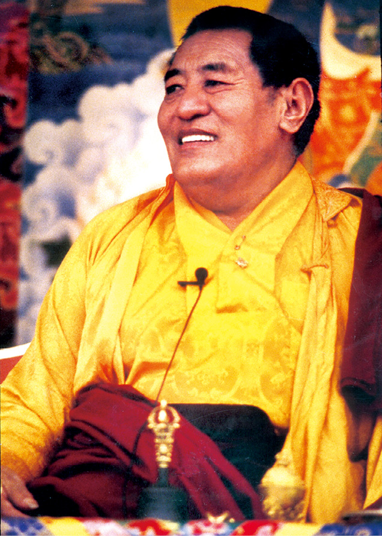

在这段回忆中，加夫尼提到了法王对他们道场的深远影响。其实我也有这种感觉，不仅是列绕林，还有多杰丹玛林、泽噶贡智仁波切的道场、嘉哲仁波切的扎西秋林和慧藏中心，都是刚建立不久法王就去了。直到现在，他们的道场仍然比较兴旺，很多佛事活动也都在延续。可以明显感觉到，1993年法王去了西方后，给很多道场带来了繁荣和发展的缘起。

至此，法国的弘法行已经圆满。
