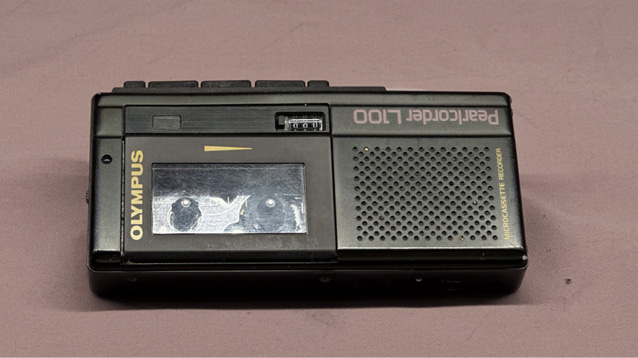
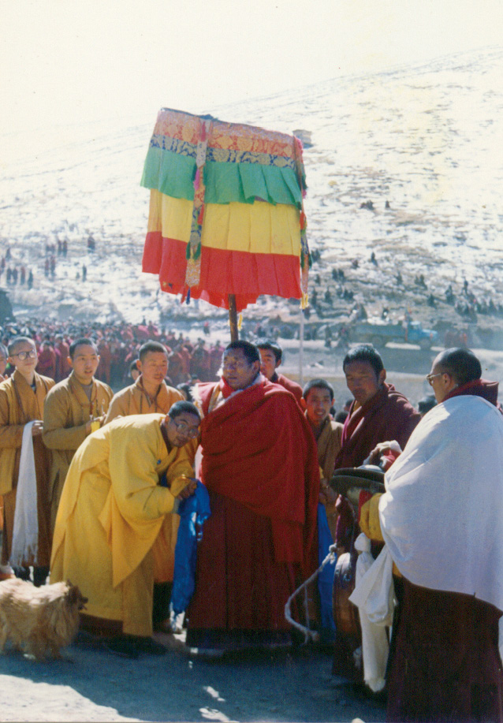
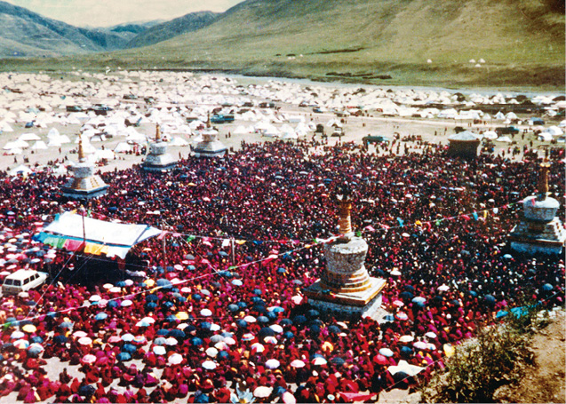
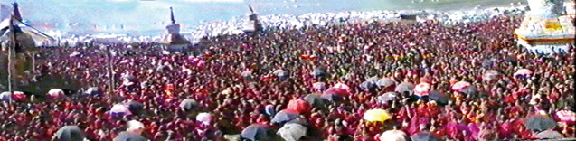
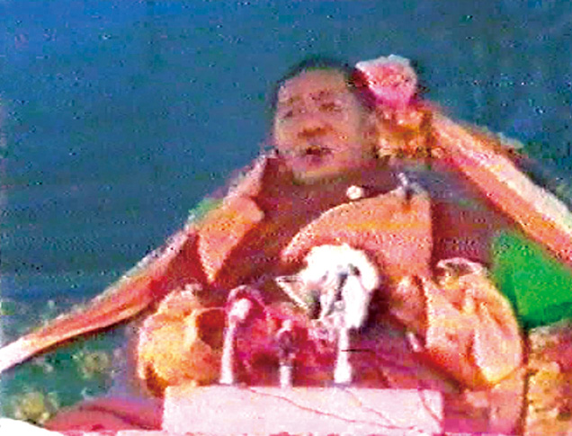
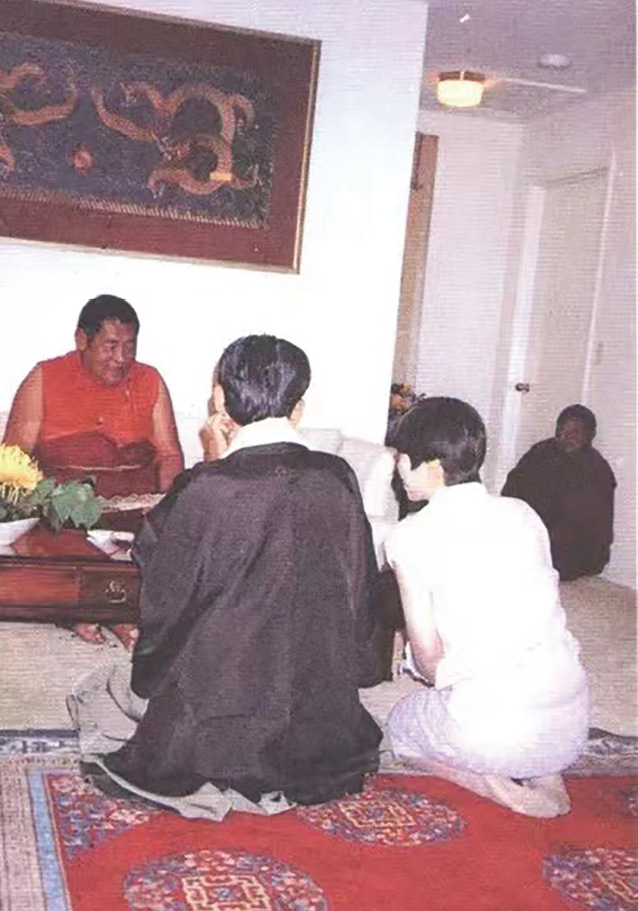

# 缘起

origin 6/12-6/17

行程

6月12日，从喇荣出发，到康定

6月13日，到成都

6月14日，飞往广州

6月15日，在深圳过海关，之后到香港

6月16日，途经日本东京并开示

6月17日，飞往美国夏威夷

三年的保密工作

法王1990年在印度的时候，就有一个去西方宣扬佛法的计划。法王私下对我说：“我打算三四年后去美国等西方国家弘法。如果你有兴趣并且家里也同意，我可以带你一起去。但这件事暂时不要告诉任何人，以免出现不必要的违缘。虽然我们出国没什么好隐瞒的，但是为了一切顺利，还是要严格保密。你守口如瓶，这方面做得不错。”法王接着又说：“这件事，对外联络由南珠堪布负责，内部准备由你负责。”

听到这个消息，喜悦和压力一下子涌上心头，我默默在心里再三发愿：“无论如何，这次我一定要更好地承侍上师，竭尽所能让上师欢喜和满意！”

之后就偷偷开始了各种准备，包括办理护照、筹集路费、买好相机、查阅相关资料等。那时候互联网和通讯没有今天这么发达，我只能通过其他途径了解西方人的性格、习俗和处事方式。

除此之外，我还要准备传法用的法本、仪轨、法器，以及录音——从1990年开始，法王的眼睛就看不清文字了，常见的灌顶仪轨可以背诵，但一些较长的仪轨还是需要提前录下来，灌顶或传法时听一段就按下暂停键，然后进行讲解。因为齐美仁真堪布很擅长朗读，所以我请他帮忙录了《杰珍宁提》《大鹏展翅》等法。有一次他悄悄问我：“你为什么要录这些？上师如意宝要出远门吗？”我没有正面回答，赶紧转移话题……

法王传法时使用多年的录音机

三年之内，法王收到了来自美国、加拿大、法国和其他国家的主要佛教中心的邀请。那时候学院里没几个人懂英语，就算懂也不能让人知道，于是我用特殊方法摸清了邀请函的大致内容，然后偷偷汇报给法王。

总之，这个秘密工作，我做了整整三年，基本上出国前大大小小的准备都做好了。

第一次“极乐大法会”

法王60岁时，藏历水鸡年（1993年）初，在喇荣五明学院传讲《探究本心·金刚宝鬘论》。在此期间，还亲自去为我们新落成的第一座汉经堂——“汉僧显密经堂”开光，并给汉僧赐予大圆满的灌顶和《心性自解脱》的教授。

法王为汉僧显密经堂开光

之后，迎请朵芒寺的帝察活佛、德巴堪布，给佛学院全体僧众传授“集密意续”的灌顶及其教授。法王则前往炉霍、甘孜、白玉、新龙、道孚等地弘法，为有缘者传授“四心滴”“时轮金刚”等灌顶，以及相应他们的开示。

当时我31岁，在佛学院和大家一起接受了半个月的帝察活佛灌顶，听受了德巴堪布传讲的《集密意续释》。同时，我还给汉族道友们讲了《虚幻休息妙车疏》和《禅定休息净车疏》。

一个多月后，法王弘法归来。然后，根据前辈诸多大德对他的授记——“凡与之结缘者皆能往生极乐世界”，决定举行第一次“极乐大法会”，从萨迦月的四月一日开始，为期十五天。

消息一出，数十万人从四面八方纷纷赶来，在洛若的草地上搭起帐篷，参加法会的共修。当时场面特别壮观，白色的帐篷铺天盖地、漫山遍野，人流如大海般一眼望不到边，从信众手中抛出的白色哈达，犹如溅起的浪花，诵经声盖过苍龙的咆哮，声势之浩大难以形容。我的大恩父母也从家乡赶来，有幸参加了这次法会。

法王如意宝给大家灌了“阿弥陀佛”的顶，每天宣讲《无量寿经》和《净土教言》，同时劝勉每一个人，只要持诵100万遍阿弥陀佛圣号，不犯舍法罪和五无间罪，就一定会往生极乐世界。门措上师还给大家灌了“观音菩萨”的顶，传授了《佛子行》。

通过这次法会，无数人与净土法门结下了殊胜因缘。

一个神秘的电话

“极乐法会”第一天下午，法王刚讲完课，有人跑到法座前告诉法王：“南珠堪布来电话，请您到洛若乡政府办公室接一下。”法王甚至还没来得及念完《普贤行愿品》，就马上从法座上站起来，叫我一起去接电话。

当时整个洛若乡政府办公室只有一部座机，距离法会所在地约半公里。我们坐车去了那里，法王拿起电话大声说：“我是晋彭（晋美彭措的略称），我是晋彭……”但是电话质量很差，声音特别小。法王让我来接，我听起来也很费力。就这样，一会儿是法王接，一会儿是我接，折腾了很长时间才听明白——

原来，南珠堪布已经从印度到了成都。法王的出国行程基本都安排好了，由于每一站的日期已定，时间紧迫，他让我们带上身份证和护照，明天下去办理签证。

然而，法王在法会期间天天传法，暂时脱不开身。第二天，只能由我带着所有出国人员的资料独自下山。

到了成都，见到南珠堪布后，我们就赶往美国领事馆。领事馆不大，只有两间小房子和一个小院子。当天有很多人被拒签：一名女学生被拒后当场晕倒；还有一个人不仅拿不到签证，还被领事馆盖章，以后出国会很难。

那时候我很想去美国，特别是和上师一起。看到这一幕，我感到有些不安。因为签证必须本人亲自办理，但法王三人都不能来，不知道领事馆能不能通融一下。

我把法王、阿里美珠、门措空行母和我自己的护照交给签证官，他满头红发，个子很高。他看了看护照，又看了看我，问道：“你们都要去美国吗？其他人没来吗？不来的话，可能办不了！”我只好回答：“他们离这里很远，有重要的事情要做，所以要晚几天才到。我们的海外日程已经安排好了，你们一周只工作一两天，如果非要等他们，可能就来不及了。你能不能帮帮忙？”他看到我的红色袈裟，好像很高兴的样子，竖起大拇指说“Very Good”，然后就盖章了。

拿到签证后我非常开心。回到南珠堪布所住的宾馆，发现他房间里还有座机，这是我第一次看到这么高档的房间。和他聊天的时候，他突然问了一个奇怪的问题：“那天你们怎么知道我房间的电话号码？”

我说：“不是你打给我们的吗？我以为你通过各种关系打听到了洛若乡政府的电话。”

他惊讶地看着我：“不会吧！我不知道洛若乡政府有电话。”

他继续说：“到成都的第二天，我就想联系法王，但色达的通讯极其不便，有电话的地方很少，怎么样也联系不上你们。想到一天就这样浪费了，我特别着急，不知道该怎么办。下午我有点困，正在打盹的时候，突然房间的电话响了。我迷迷糊糊地接了起来，电话里传来法王的声音：我是晋彭……”

那时候电话费比较贵，但这个神奇的电话，他没有付钱，我们也没有。时至今日，每当我们谈起这件事，都觉得难以置信。不知道这是不是护法神的加持？

离开藏地

我办完签证就立即回去了，此时法会还没结束。向法王汇报了具体情况后，法王显得很高兴。

法会接近尾声时，法王公开宣布了出国计划，说：“我这次去西方国家，不是为了观光旅游，而是有弘扬佛法的重要缘起。这一次，我们要去的地方与以往不同，希望僧众能祈求护法神加持。”

法王继续说：“这次的随行人员，外面有南珠堪布、吾智多杰，内部只有索达吉。那些国家太远了，我们能不能回来还不好说。如果索达吉回不来，相信帝察活佛和德巴堪布也不会来找我麻烦的。所有常住僧众都要好好听受堪布堪姆的传法，精进地闻思修行……”

临行前，我为汉僧各选了一名堪布堪姆讲《入行论》。父母暂时不想回炉霍，我就给他们借了一顶黑色牛毛帐篷住在佛学院。

这次出国，虽然比去印度时更有经验，但我一个人不仅要负责法王的衣食住行、身体保健，还要负责法王所有传法事宜，压力不是一般的大。于是，我每天都随身带着一个沉甸甸的黄色背包，里面装着常用药品、相机、录音机、笔记本等。

6月12日，法会圆满的第二天，我们离开学院，下午到达康定。法王在这里见了一位老朋友，他是公安局的领导。他提醒我们：“当前，国内外局势紧张、形势复杂，不确定因素较多，如果不尽快出去，恐怕会有变数。你们应该马上离开，直接从外省或者香港出国。省里其他部门就不用打招呼了。”

13日，我们从康定到成都。14日一早，乘坐5点的飞机飞往广州。这时一个红衣女居士来接机，说住宿已经安排好了。我们都不认识她，也不太敢相信，但法王说她看起来像个虔诚的佛教徒，就让她安排吧。于是我们在广州住了一晚。

难“过”的海关

6月15日在深圳过海关，前往香港。当检查护照的时候，没想到节外生枝，海关人员说：“这个护照有问题！因为你们1990年去印度时，出国盖了章，回国却没有，这是违法的。”其实，当年我们从尼泊尔回来时，为了方便寄运佛像等，办了一个临时护照，这种现象在当地非常普遍。但我们解释了半天，他们就是不依不饶，坚持一定要上报。

他们把我们带进一个房间，关在里面。我们请求法王加持，以遣除违缘。此时，法王似乎处于一种入定的状态，一心祈祷莲花生大士，嘱托格萨尔王和紫玛护法，同时默默念着什么。结果几分钟后，海关人员进来说，虽然我们的情况比较复杂，但还是同意放行。

如此棘手的事情，居然奇迹般地有了转机，这让我深深体会到上师和护法的加持不可思议。

离开深圳后，我们坐车来到香港，在白玉中心住了一晚。第二天早上，法王让我们记录了前一天在海关念的祈祷文，内容如下——

在深圳与香港交界处，检查护照时，我心有不安，觉受中面见了邬金莲师、战神格萨尔王、紫玛护法。当时，我如是祈祷：

> 无边诸刹佛菩萨，三密功德总集身，

> 莲师尊前诚祈祷，加持意愿任运成。

> 智悲力德至究竟，慈雪域众如独子，

> 义成战神今垂念，加持如意成顺缘。

> 呼唤悲疾超闪电，嘱托力猛胜霹雳，

> 紫玛夜叉伏敌王，当下灭除违缘障。

> 如是虔诚祈祷时，恐惧迷现融法界，

> 一切自执本尊执，消于无缘法身界。

阿旺罗珠宗美次日清晨于香港哲旺班玛罗吾精舍立成文字。

在香港期间，南珠堪布送了我一件黄色衬衣和一件东嘎，说是从印度带来的，印度布的质量很好。这两件衣服是我出国后一直穿着的，经历过很多次法王的灌顶和传法，对这些衣服也产生了感情。现在已经穿了30年了，质量还是很好，没有怎么褪色，我每次出门都带着它。也许这是一种执著，也许这是一种信心。

在太平洋上飞行

法王出国的那个年代，各国之间不像现在这么开放。我们应该是第一批从藏地直接去美国的藏族人。

听说美国是夏天，我特意给法王准备了一两套薄衣服，还买了一个不错的行李箱。和上次相比，这次带的食物少了很多。

6月16日，我们从香港乘飞机四小时抵达东京国际机场。日本的机场就像水晶宫，清澈晶莹、宽敞明亮，地面一尘不染，当你走在路上，可以看见倒映在地面上的人脸。第一次看到发达国家的样子，仿佛来到了另一个世界。

法王给日本弟子传法

法王在日本逗留的时间并不长，但他还是抽出时间给东密、藏密的有缘人，传授了慈悲和智慧方面的教言，然后与大家探讨佛教和科学的关系。法王说：“科学和佛教对人类都是不可缺少的，科学满足了人们的物质需求，佛教带给人们精神上的快乐。没有佛教，一味追求物质享受只会适得其反。在许多亚洲国家，无论是顶级富豪还是普通百姓，都非常需要佛法甘露……”在场的所有人深受启发，对法王表现出非凡的敬意。

之后飞往美国夏威夷。法王坐的是经济舱，美国飞机不提供免费餐饮，空乘人员都是中老年人。法王吃药时需要热水，我之前自学过一点英语，这时候就派上用场了。我说的第一个单词就是“Hot Water”。

飞机在无边无际的太平洋上空飞了很久，看着天空和大海融为一片蓝色，这种美令人深深陶醉，但一直在大海上飞，偶尔又会觉得孤独和苍凉。法王静静地望着窗外，手里拿着红色的念珠，神情慈悲，若有所思。

七个小时后，我们到达了夏威夷的檀香山国际机场。
