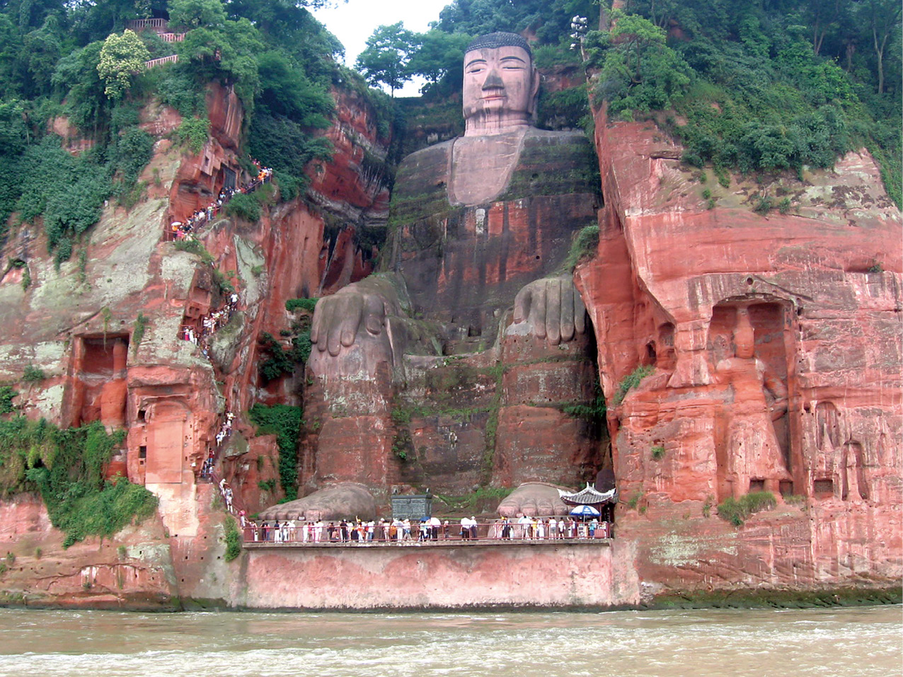

# ·乐山大佛

从山脚的报国寺坐车前往乐山市，再乘船向东南方向前行，便可见到著名的乐山大佛。这是在岩石山上雕刻的一尊补处弥勒菩萨像。

历史上记载，从前，这里水势凶猛，常常摧毁船只。唐朝时期，常住在现今海师洞的海通法师认为，若能在此造一尊弥勒像，一切灾难将会平息，并能成办弘法利生的广大事业。于是，他毕生致力于雕刻此像。后来他圆寂时，将少许未完成的部分交给弟子。前后共用九十年才完成。

根据当地史料记载，这尊像高达71米，是世界上最高的古代石刻佛像。由于此像加持力极大，后来危害果然平息。

法王如意宝也曾携眷属到此，念诵《弥勒略愿文》等，并作广大发愿。
