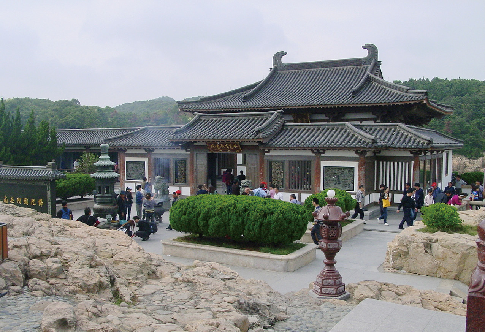
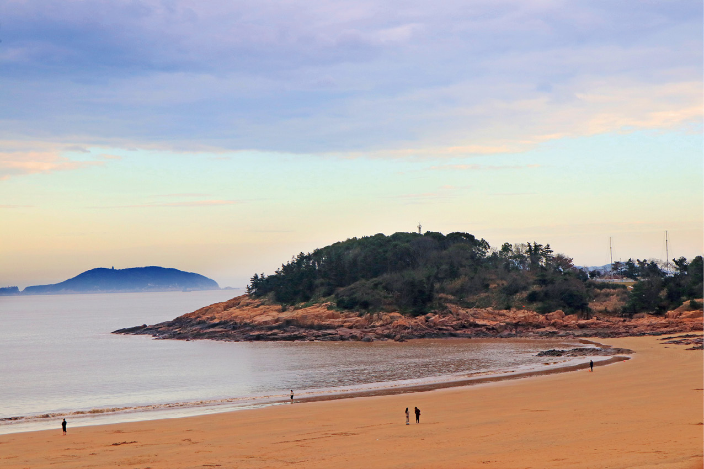
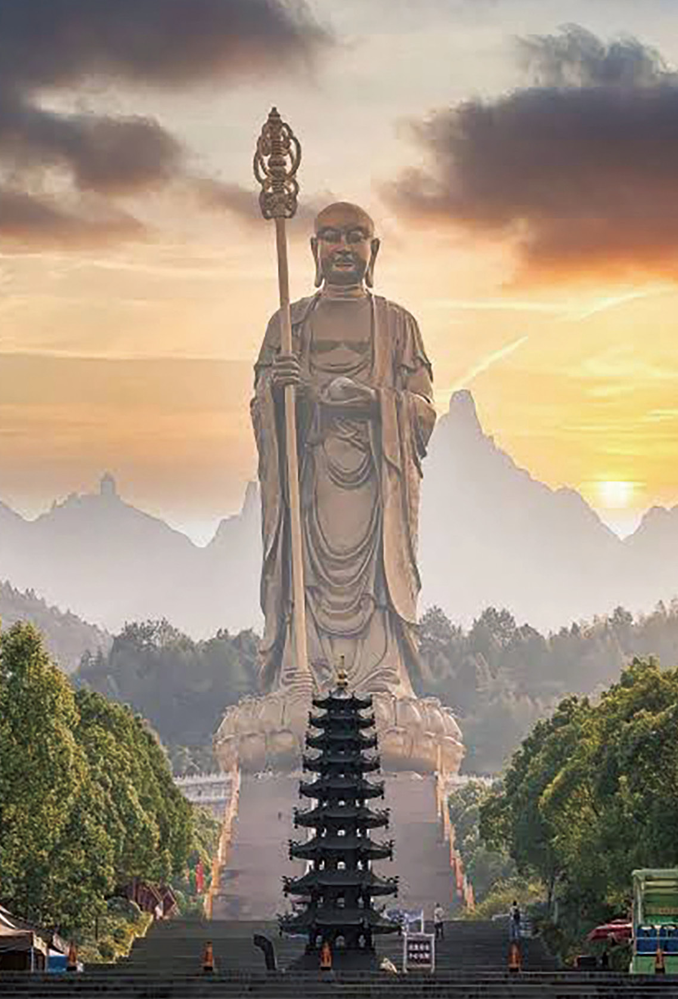
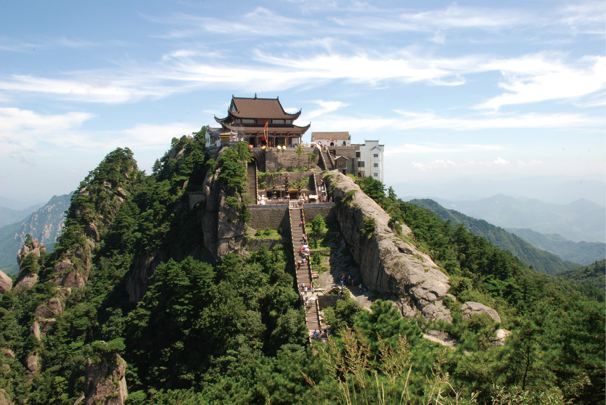
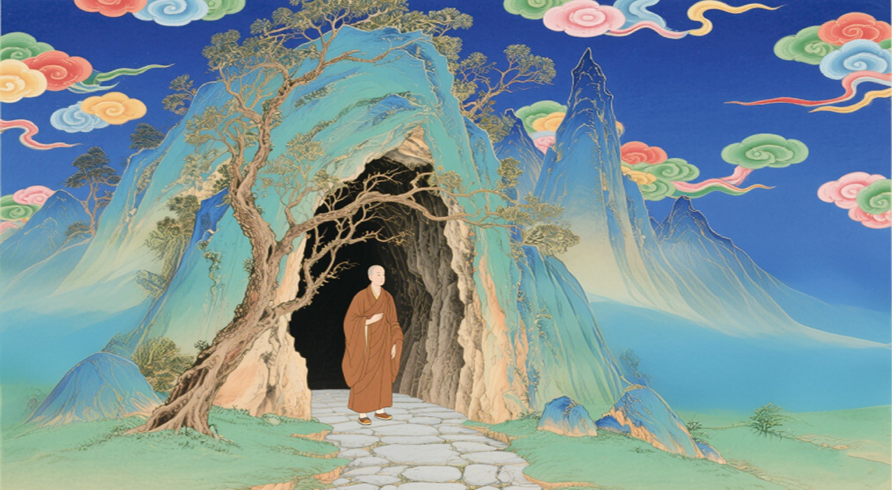

#### ·九华山

第四个九华山，是圣者地藏菩萨常住的圣地，现位于安徽省青阳县。前往此处，需从成都坐火车前往南京长江大桥，约1700公里，然后再乘车一天多才能到达。据说，在明清时期，这里曾有三百多座寺院和五六千名僧人，而如今仅剩下九十多座寺院，其中最著名的是《九华山志》中提到的百岁宫。

据说，有一位名为无瑕的僧人，他在五台山出家，然后来到九华山，唯以野果为食。他用了28年时间，放自己的舌血，书写了《大方广佛华严经》八十一卷。他离群索居，在九华山的山洞中住了整整100年。126岁时，九月十四日上午，他写好自己的生平简介，放在身旁，随后安详圆寂。

三年多后，当地人在夜里看到某处祥光齐放，前去查看时，发现了无瑕和尚的生平简介、用血写成的《华严经》以及他的遗体依然完好无损。现如今，那部《华严经》珍藏在九华山历史文物馆中。他的遗体尽管已过三百六十多年，但仍未腐坏，供人瞻仰。此外，九华山还有超过1400年的凤凰松，以及加持力极大的地藏铃等。

以上圣地的每一座寺院，都有许多精彩的历史和特殊的圣物，但在此不一一详述。
