# ·五台山的三宝所依

现在谈一下，五台山所有寺院的三宝所依，全部是文殊菩萨以神变所建的。

首先，正如前文所说，佛教传入汉地，是由班智达摄摩腾和竺法兰二人带着佛陀的画像等物骑马前来，并在洛阳建立了“白马寺”。后来，他们通过神通发现五台山放射各种光芒，知道那里有舍利塔，于是前往此地。在形似灵鹫山的山脚下，他们建立了寺院，取名为“灵鹫寺”（今显通寺）。

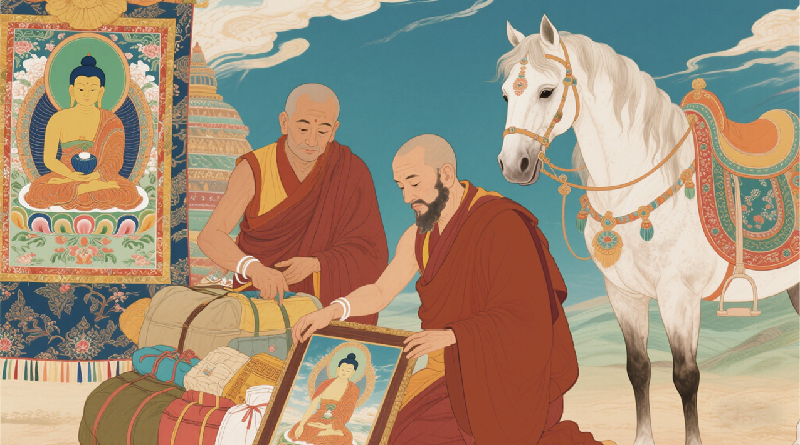

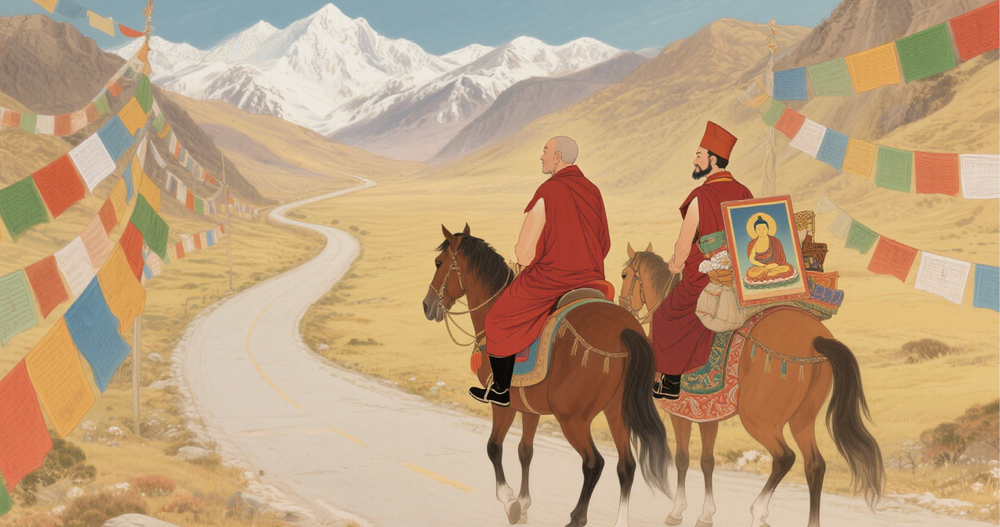

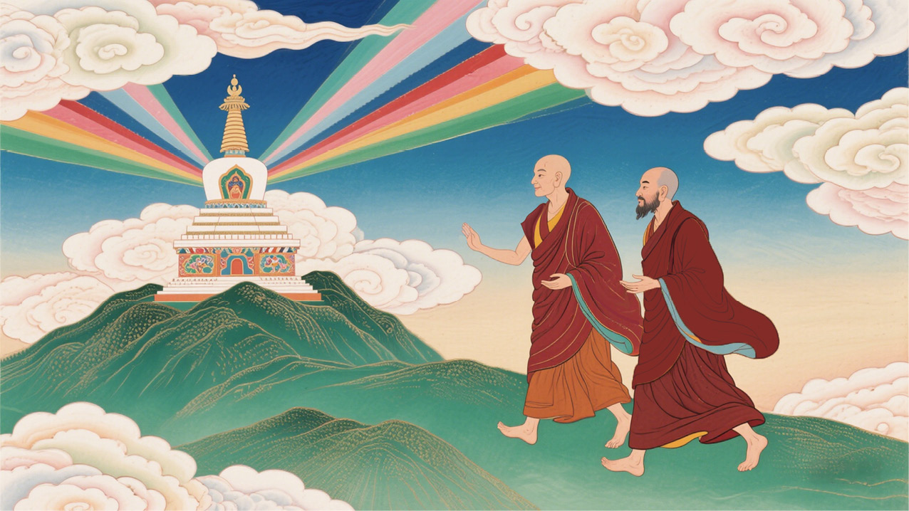

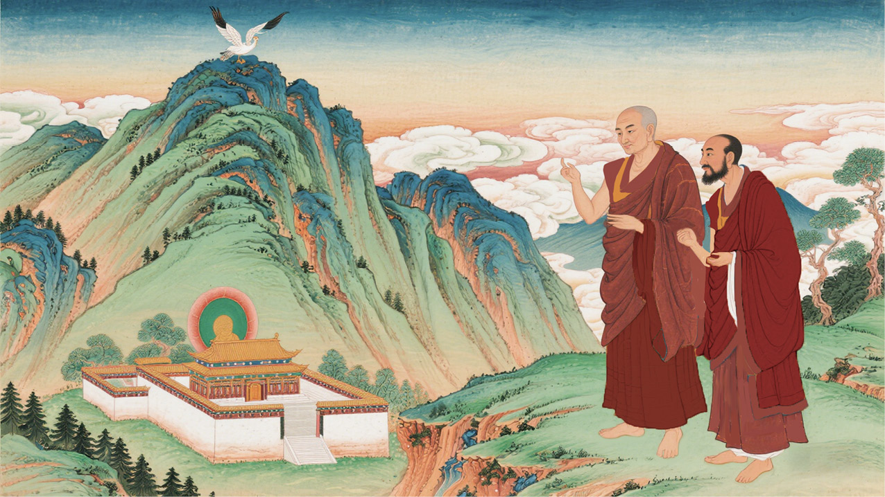

因此，白马寺与显通寺被认为是汉地最早的佛教寺院。

1．大白塔

特别是，此地非常著名且加持力极大的白塔，是阿育王在我等导师佛陀涅槃后，为忏悔自己对许多国家发动战争的罪业，建造了八万四千或一千万座佛舍利塔，按照授记分布于不同地方。据说，现今汉地有十九座，藏汉智者和成就者们明确表示此塔就是其中之一。据汉地的一些史料中说，这座佛塔是从灵鹫山飞来的；有些则说，它是被众天人迎请至此地；还有些说，它是由尼泊尔最出色的工匠耗时十二年建造的。总之，据史书记载，这两位阿罗汉通过神通认定：该塔内藏有佛舍利。

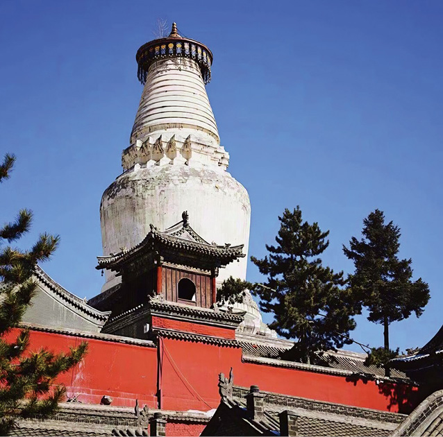

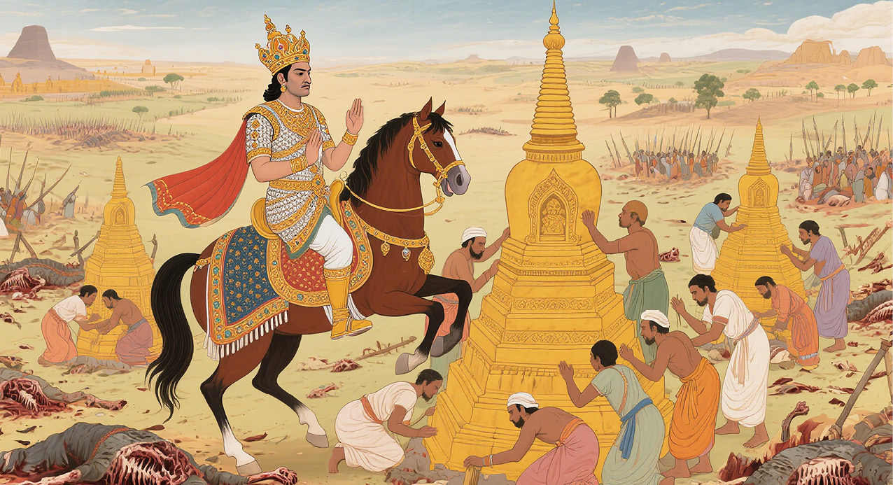

后来，在明朝时期，塔身外部进行了扩建。1953年，这座塔又进行了粉刷和修缮，花费十六万元。如今，这座佛塔高约75米，塔顶有252个小铃铛，据说其中一个是文殊菩萨所赐：从前有一对贫穷的母子，缺衣少食，住处仅是茅草屋，他们经常祈祷文殊菩萨。一次，在重修这座佛塔时，来了一位不知名的工匠，在他们家住了几天。有一天，他给了他们母子一个小铃铛，说“你们依靠这个，一定能得到生活所需。”说完突然消失了。后来，当佛塔竣工并按照数量悬挂铃铛时，发现缺少一个。那天正是开光诵吉祥文的日子，如果少一个铃铛，恐怕会带来不祥，大家都非常着急。这时，有人听说贫穷人家有一个铃铛，于是用五十两银子买下来，挂在佛塔顶上，发现与其他铃铛没有任何区别，大家都感到惊奇，明白先前那个工匠是文殊菩萨的化身。那对贫穷母子因对文殊菩萨的信心，此生也获得了财富。

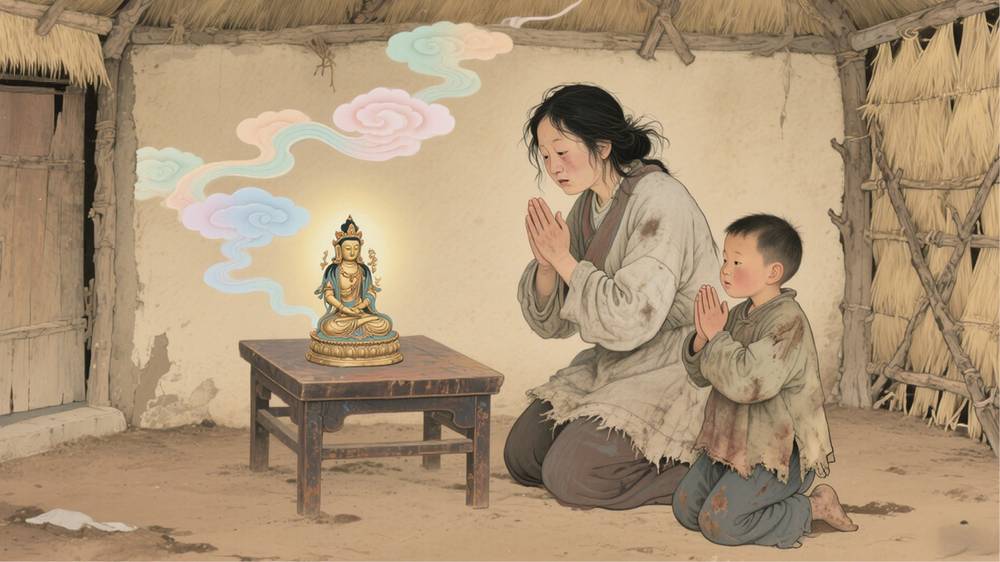

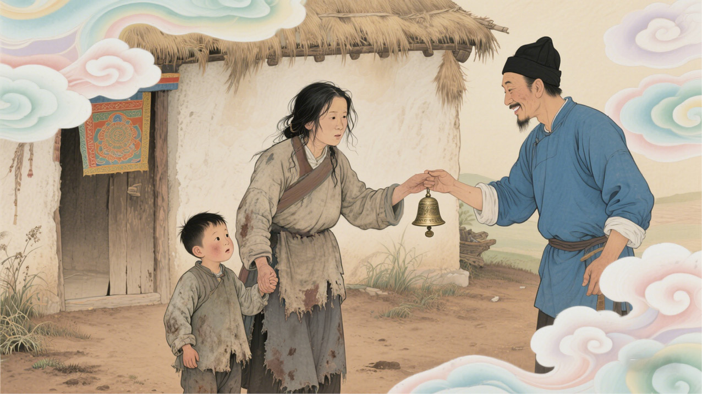

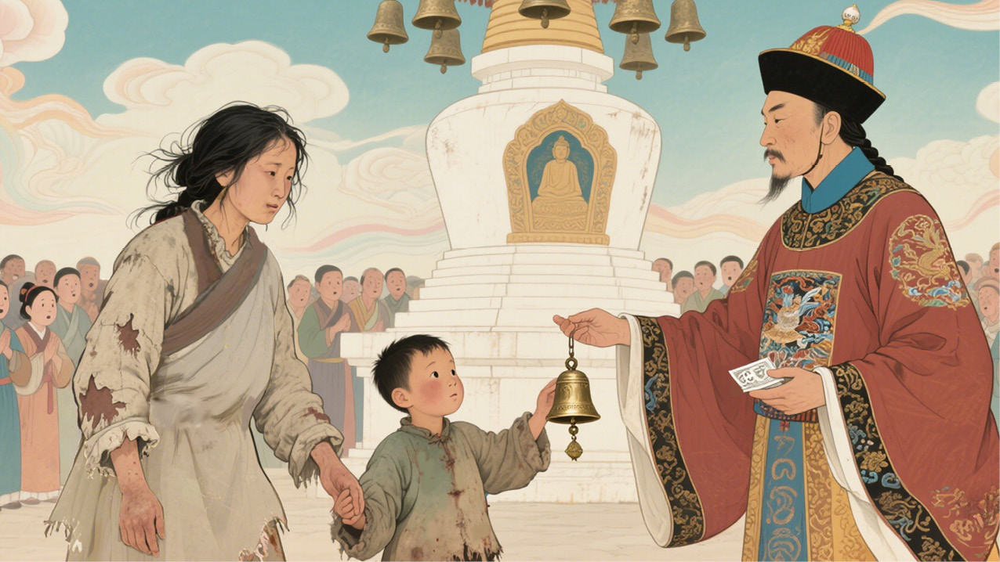

在白塔附近，有一块“佛足碑”，据说是根据皇帝唐太宗的旨意，仿照印度菩提伽耶佛陀脚印刻在石头上的。这个脚印被视为具有极大加持，受到众人的敬重。

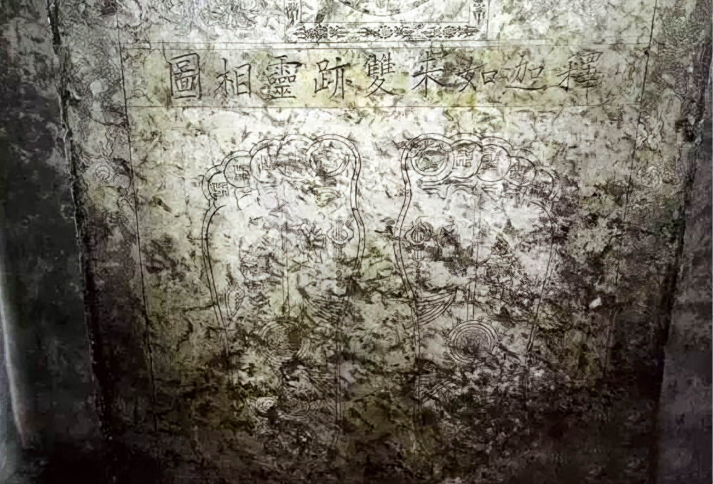

总之，向这座佛塔礼拜供养，与向佛陀本人礼拜供养的功德相同。经中说：“现今供养我，未来供舍利，彼二福果等。”《入行论》也说：“供奉今昔佛，经说福等故。”

2．文殊发塔

文殊发塔位于白塔东侧的院落内。据说在北魏年间，这里的灵鹫寺每年三月为众人广施斋饭。有一次，一位贫穷的孕妇怀里抱着一个婴儿，手里牵着一个孩子，还带着一条狗，与众人一起来到寺院。当贫妇看到其他人按照各自的财力供奉金银等供品时，她因极度贫穷而无其他供品，便剪下一缕头发作为供养，还说这非常珍贵。

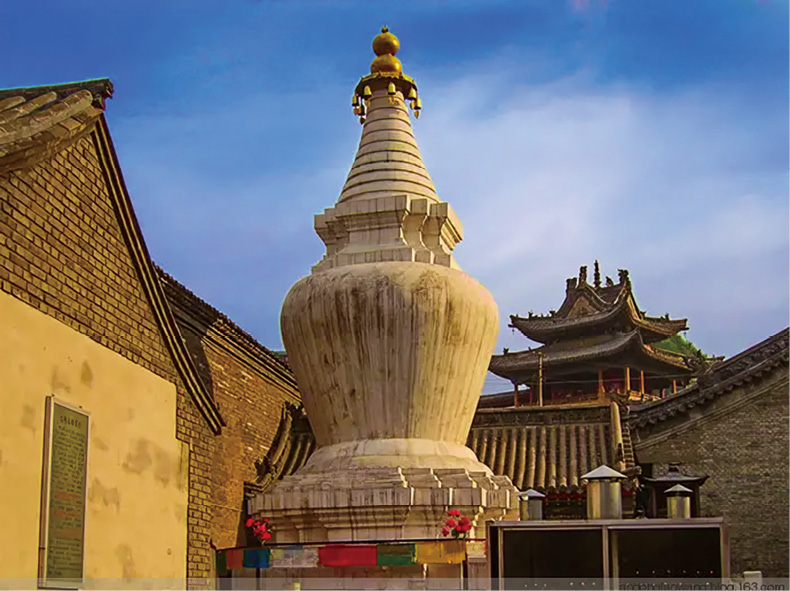

那时，虽然还未到施食时间，她却去找施斋僧，说自己时间紧迫，需要提前领取食物。那位僧人心想，她怀里的婴儿不会吃东西，就给了她两份。妇女说：“我们有三个人，为何不给？”于是，僧人又给了她一份。她又说：“我还有一条狗，它也是有生命的，需要食物。”僧人又给了她一份。然后她又说：“我腹中还有孩子，也需要一份。”那位僧人勃然大怒，说：“未出生的孩子为何需要食物？你真是贪得无厌。”说了一些恶语。

之后，那位妇女吟诵了一首偈颂。接着，她的身体越升越高，飞到空中，现为文殊菩萨的身相。两个孩子变成两个仙童，站在她身后。狗也变成了青狮坐骑。在无边的彩虹光中，空中传来悦耳的声音：“众生学平等，心随万境波，百骸俱舍尽，其如憎爱何？”在场的无数信众蜂拥而至，都望向天空，双手合掌，一心祈祷。随后，文殊菩萨慢慢消失不见了。此后，施斋僧为了忏悔，用那些头发装藏，建造了这座文殊发塔。

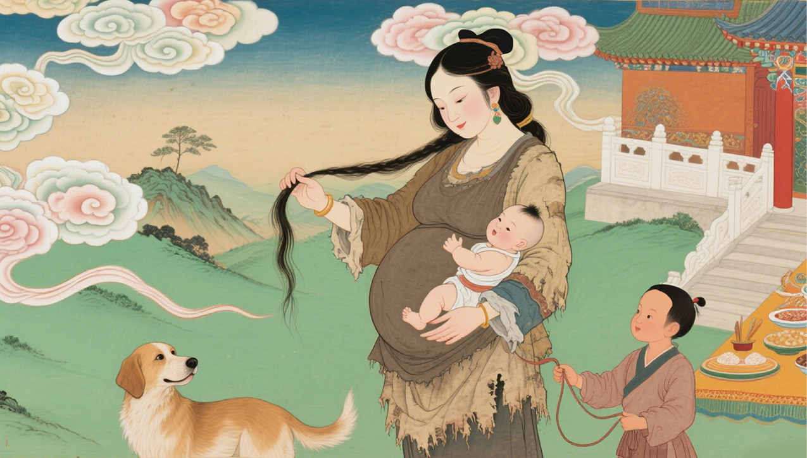

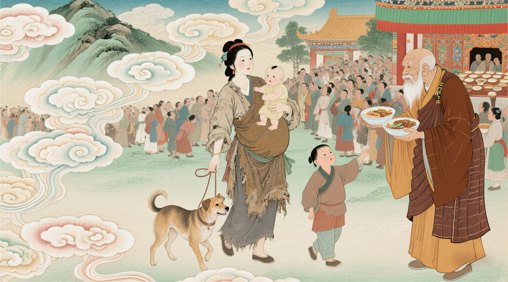

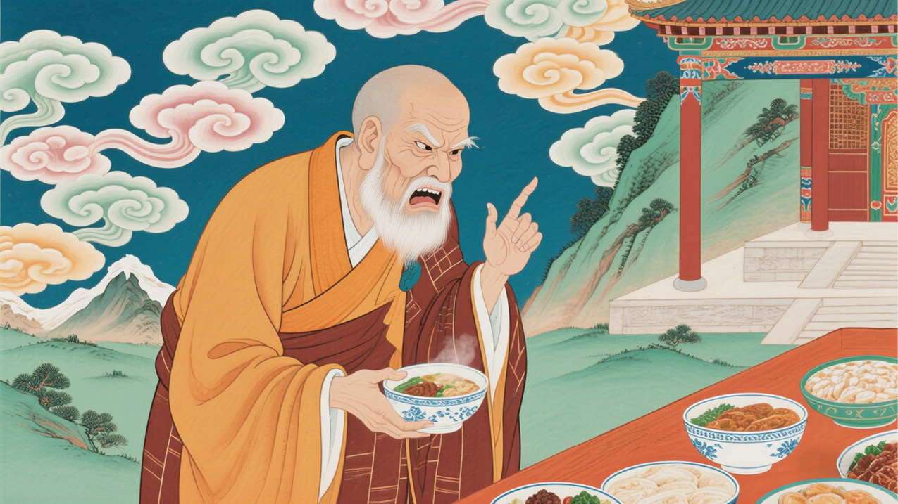

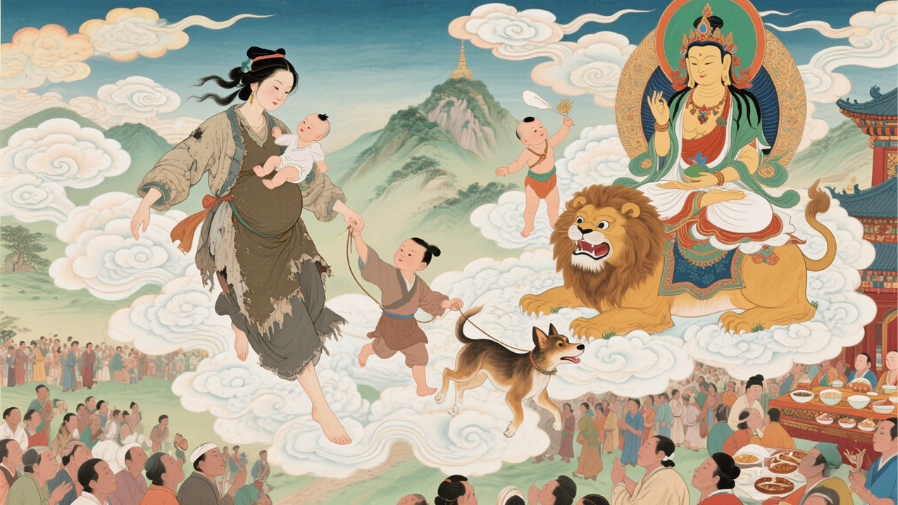

之后，经过十八个朝代的更迭，约一千年后，在明朝万历年间重修佛塔时，据《五台山志》记载，那些头发乍看金光闪闪，仔细再看，发色却变化不定。

此外，文殊菩萨显现的情景和所吟诵的偈颂，被清晰地刻在石头上，至今仍可在圆照寺大雄宝殿外左角的小玻璃房中看到。《五台山志》中还提到，这位僧人为了忏悔，曾想挖出自己的双眼，但被众人制止了。

这两座佛塔现位于五台山脚下台怀镇的塔院寺内。在这里，至尊法王如意宝与众多藏汉信众一起，怀着对极乐世界的虔诚信心，从萨嘎月（藏历四月）初八到十五，念诵了两千万多遍《普贤行愿品》。这样做的目的也是因为经中说：“何人发何愿，当得如是果。”《普贤行愿品》中也提到：“愿我临命欲终时，尽除一切诸障碍，面见彼佛阿弥陀，即得往生安乐刹。我既往生彼国已，现前成就此大愿，一切圆满尽无余，利乐一切众生界。”

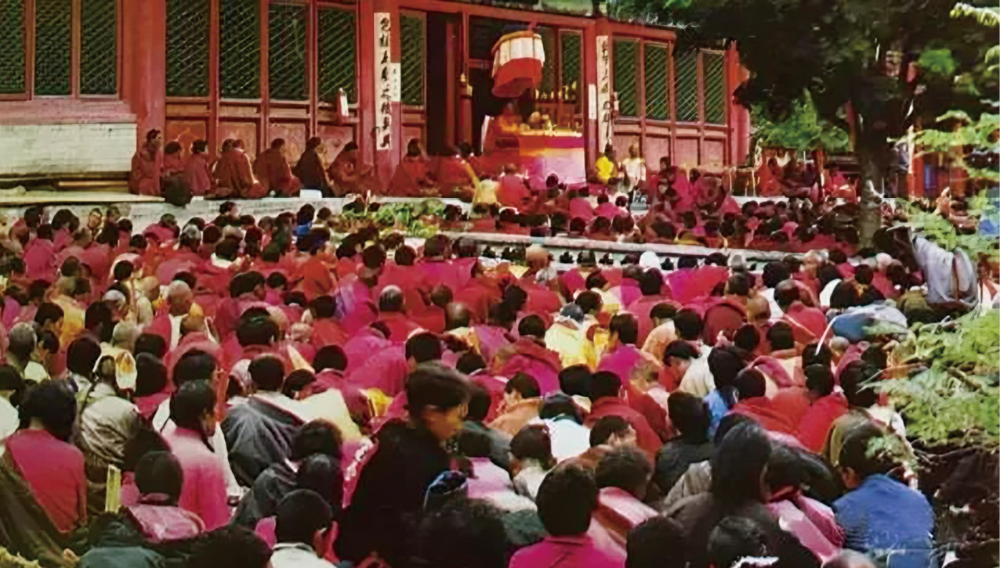

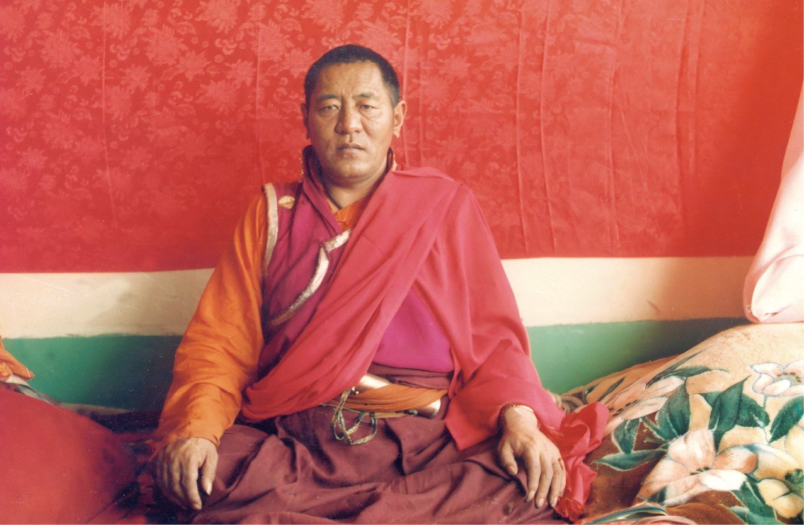

法王在塔院寺

此外，这座寺院还有四众弟子的大型僧团，以及藏文、蒙古文、汉文等版本的《大藏经》共计两万多册，各殿堂内还有诸多殊胜圣物。

3．飞来塔

从塔院寺向北约七公里处，有一座宝华寺，寺前矗立着这座塔，周围有四座小佛塔环绕。非常奇妙的是，这座佛塔的基座在拉萨，塔身位于现在青海省宗喀巴大师的诞生地——塔尔寺，而塔顶则被文殊菩萨请至五台山圣地。

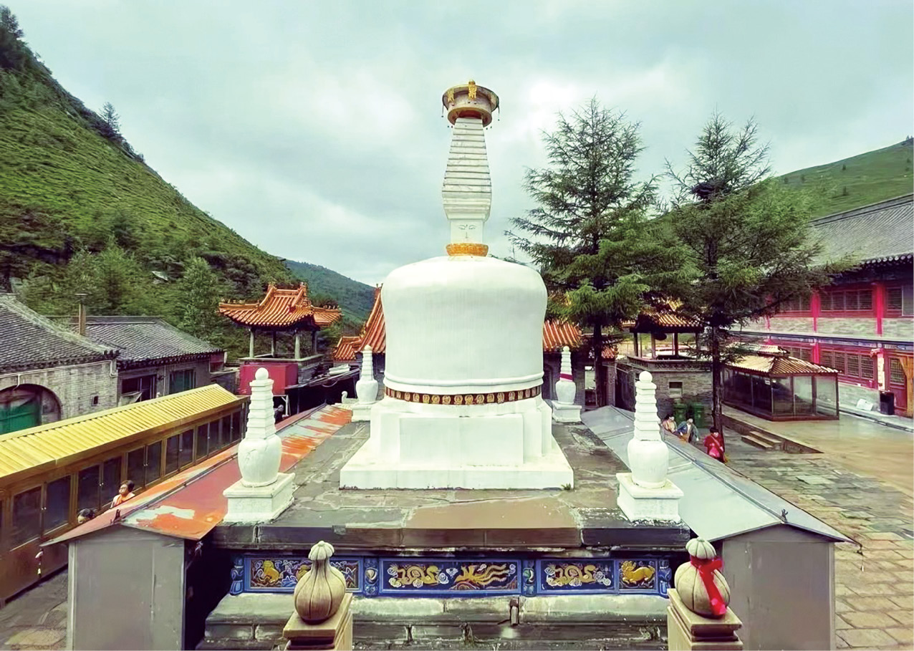

据说，在现今佛塔所在的地方，原先有六七户人家。一天，一位不知名的老人出现，告诉村民：“今天中午将有一座佛塔的塔顶从天空飞来，如果不小心，房屋可能会被毁，所以大家不要待在家里。”村民们认为这老人可能疯了，“佛塔的塔顶会飞”这种事简直闻所未闻，不可能发生，因此，谁也没有把他的话当回事。

接近中午时，那位老人再次急促喊道：“来了！”当时，田野里有一个六岁的小孩正在玩耍，老人走上前狠狠扇了他一记耳光，小孩大哭，老人将其抱起飞奔而去。村民们见状，齐声呼喊着从家里涌出，成群结队地追赶。但仅仅追了约半公里，便追到了老人和小孩，他们正悠然地坐在一片美丽的草地上。村民们正准备打这个老人，突然天昏地暗，日月无光，狂风大作，随即传来震天动地的巨响，大地也晃动起来。片刻之后，狂风停息，云开日出，大家看到这个地方出现了一个铜制的大佛塔顶。尽管村里的部分房屋被毁，但因人们都在外追赶孩子，故无人受伤。这时，村民们才意识到，这位老人是文殊菩萨的化身。转瞬间，老人已不知去向，消失无踪。

之后，为防止塔顶再次飞到他处，村民们建造了一座寺院，并雕刻了一尊精美的文殊菩萨木像安置其中。这座塔又被称为“西藏飞来塔”。塔顶高约三尺，新建的石基上刻有各种动物的精美图案。

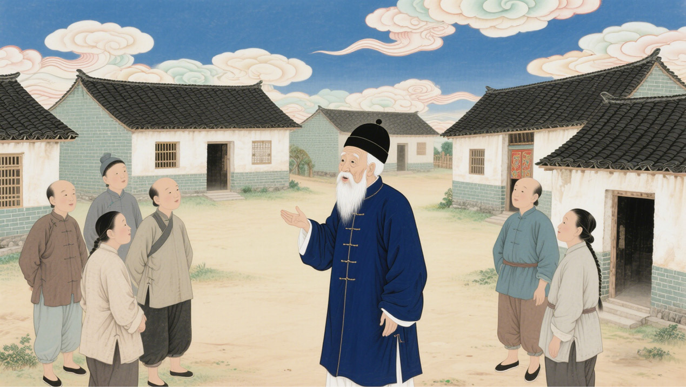

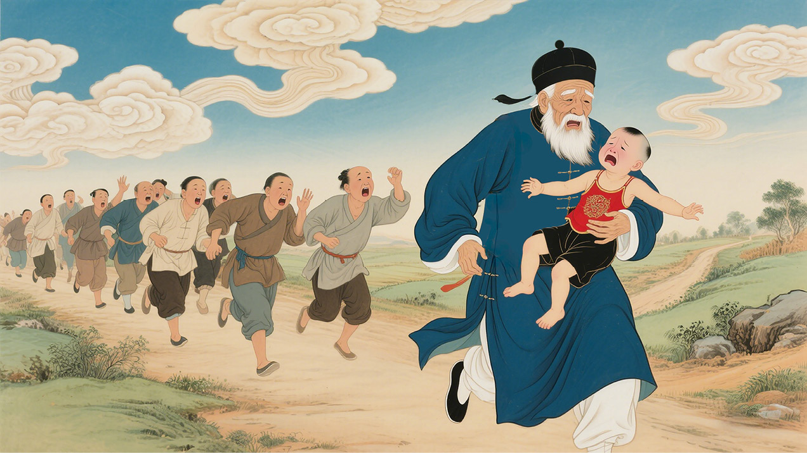

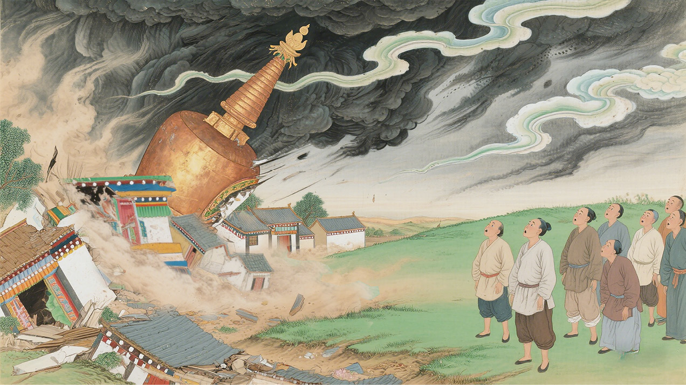

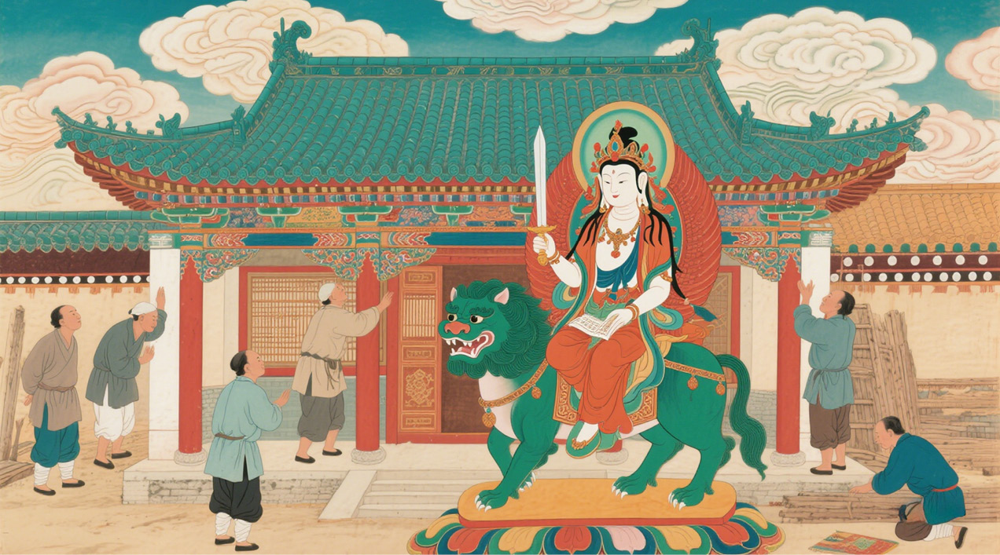

这座寺院还有许多雕刻在檀香木上的菩萨像等三宝所依，以及藏文、蒙古文的珍贵石碑等。

4．狮子窝琉璃塔

狮子窝琉璃塔，位于塔院寺西南约十公里处，坐落于前往中台山路的一个山岗上，是一座八角十三层的佛塔。

从前，一位有缘人在此见到数万头狮子在玩耍。由于那些狮子是文殊菩萨的坐骑，他意识到虚空中有如此多的文殊菩萨，于是在这里修建了一座寺院，命名为“文殊寺”或“狮子窝”。他还精心建造了这座琉璃塔。

后来，乾隆皇帝花费两千多两银子对寺院进行了修缮，目前只剩下遗迹。然而，这座佛塔经过三百八十年的风雨，依然巍然屹立。之所以称它为琉璃塔，是因为塔身全部由琉璃装饰，塔外更有多达一万尊的琉璃佛像。

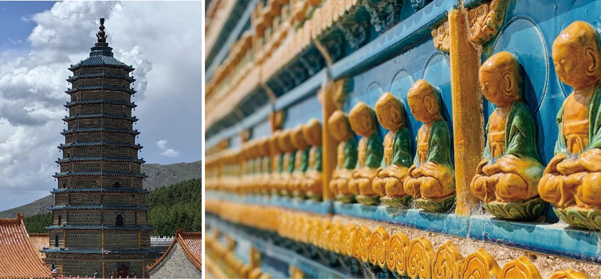

5．明月池

明月池是位于塔院寺向南约六公里的一座寺院，过了一座白石桥后，再向东走约两公里即可抵达。寺院前方的山坡上有一座佛塔。

在明朝时期，明珠大师来到此地，想建造文殊像与寺院。一天晚上，他在现今寺院前的草地上休息时，突然从对面的山腰，看见一尊身相黑色、九头十八臂的文殊菩萨，每只手都拿着不同的法器，如蛇索、太阳、月亮、法轮、钵盂、宝剑等，身姿在无边的白光中显现。随后，他便在看到文殊菩萨的山腰处，建造了一座佛塔，至今仍然完好无损。寺院内还按照他的所见塑造了一尊非常威严的文殊菩萨像。据汉文史料记载，这是文殊三十二化现之一的“密迹金刚”。

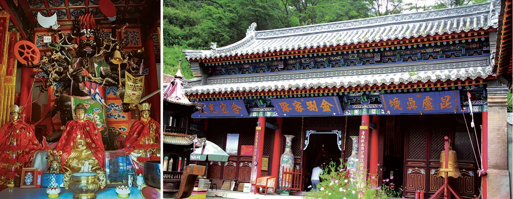

这里有个“明月池”，曾有位大德在漆黑之夜观看池中时，清楚地看到了一轮圆月，因此得名。据说许多人在水中可以看到佛菩萨的身影，或者能窥见自己的前世。

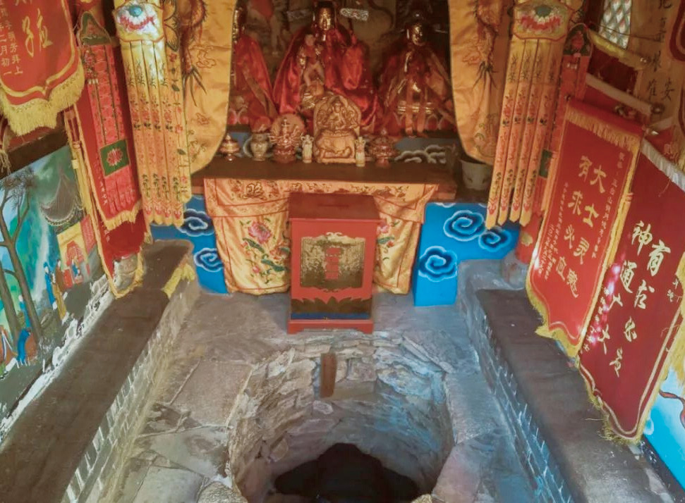

法王如意宝曾到此地念诵了深广发愿文。这里具备寂静处的一切功德，夏季时百花盛开，令人心醉。

6．菩萨顶

菩萨顶，犹如拉萨红山上的布达拉宫，雄伟地矗立在灵鹫峰的山顶。殿堂的金顶在阳光照耀下熠熠生辉，显得异常庄严。这座寺院始建于北魏时期，历代多次重修，又称为“大文殊寺”。

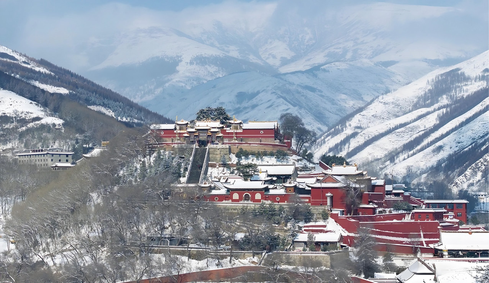

此地有一座殊胜且加持力极强的“文殊幻化殿”，殿内供奉着一尊被称为“带箭文殊”的佛像。据说，曾有位名叫法云的僧人想要塑造文殊像，于是命工匠去做。工匠不知塑造什么样的文殊菩萨，询问他时，他也无法清晰描述其面相和手势等，于是便虔诚祈祷。一天晚上，在长明灯下，文殊菩萨从无边蓝光中亲自现前，法云根据所见塑造了这尊像。还有一种说法是，法云不知如何塑造，专心祈祷七天后，一天早晨在天空美丽的彩虹帐幕中，文殊菩萨现出令人观不厌足的身相，法云迅速照样塑造。完成后，文殊菩萨化光融入了这尊塑像中。这座像的简要介绍在殿门上方以多种文字记录着。

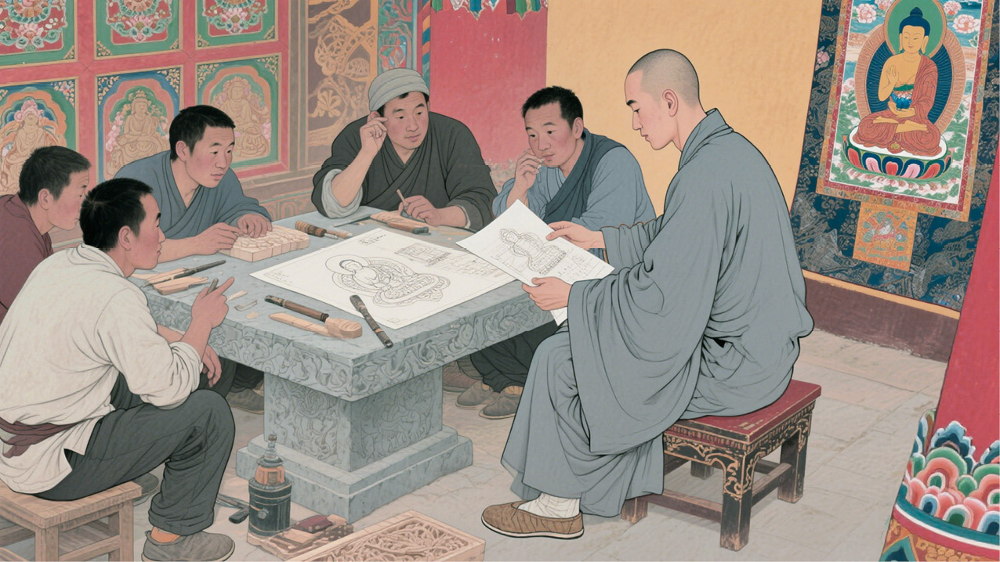

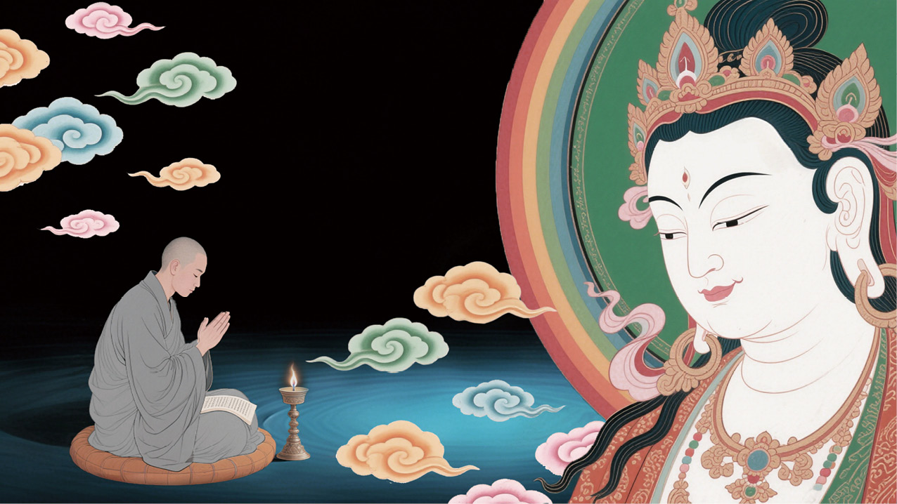

之所以称为“带箭文殊”，据《五台山志》记载：曾有一次，康熙皇帝前往北台朝拜，回程时经过一个名为“澡浴池”的池塘，看到许多女子在池边洗衣，而池内却有一位僧人在裸体洗澡。皇帝认为这有伤风化，有损佛门声誉，因而非常愤怒，射出一箭，正中僧人的右肩，僧人带箭逃走。皇帝顺着血迹追至菩萨顶的文殊幻化殿，竟发现那支箭插在文殊菩萨像的右肩上。皇帝大为惊恐：“啊，原来他是文殊菩萨！”心生极大忏悔，连连顶礼后才离去。从此，很长时间里，人们都能看到那支箭。后来，十世班禅仁波切将箭带走，并塑造了一尊文殊像。以上是这座殿堂和文殊菩萨像的名称由来。如今，这尊像依然光芒四射，成为众生信心的所依。

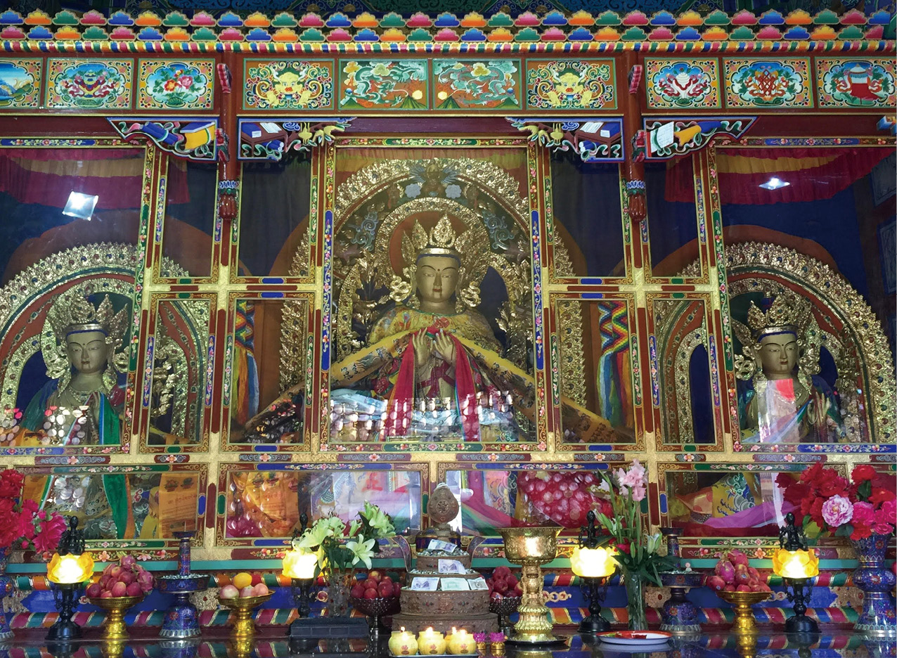

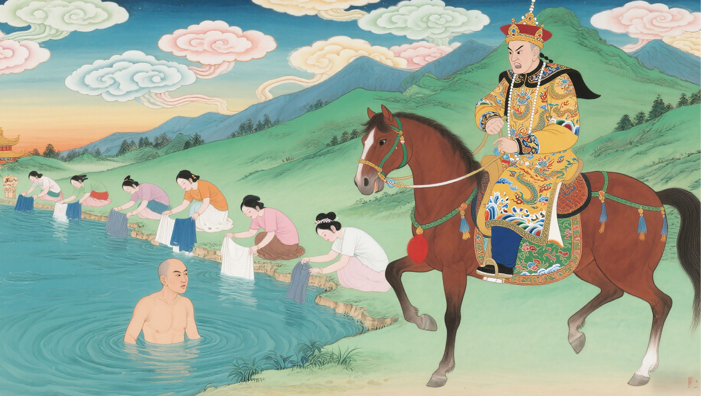

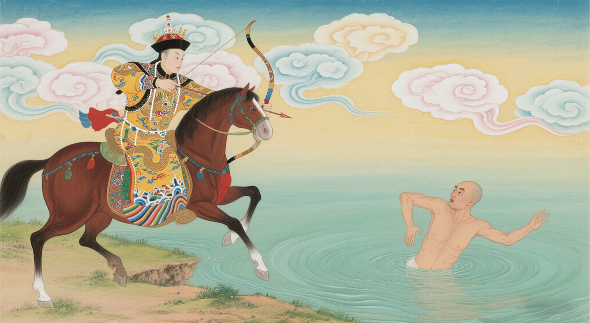

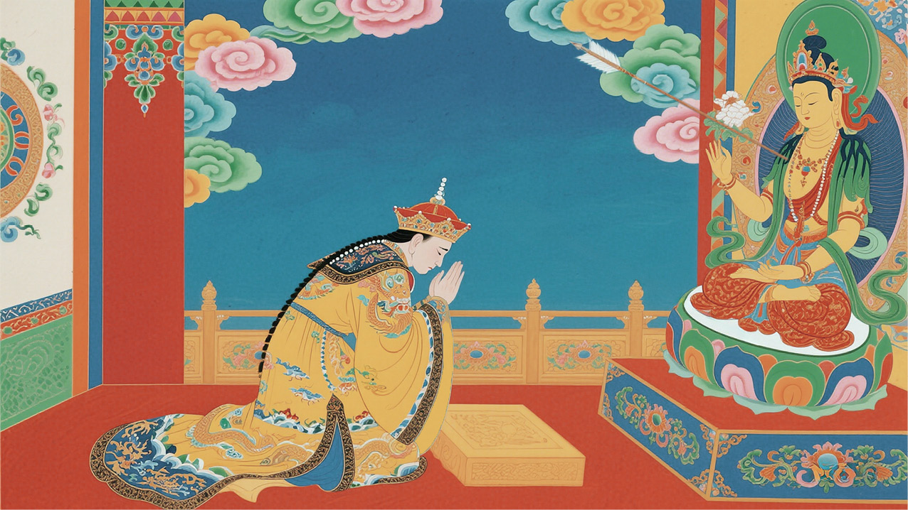

寺院内还有“滴水文殊殿”，位于北面，此殿曾多次遭遇火灾。为了防火，屋顶四角雕刻有龙的形象，自此无论天气冷暖、是否下雨等，总会有清澈的水滴持续滴落，甚至在石阶上留下蜂窝状的深坑。这一神奇现象至今可见，许多信徒都说“这是文殊菩萨在沐浴”。

关于稀有的无舌石狮，1714年，当寺院的牌楼在建时，食物屡屡失窃，还发现了猛兽的足迹。厨师不知是怎么回事，有一天躲起来观察，看到两只狮子渐渐走来，吃了很多食物后离开。第二天，他出于好奇，在食物中放了一把刀。当两只狮子再次来吃食物时，一只狮子的舌头被割断，发出“嗷”的惨叫声，落荒而逃。当天下午，厨师注意到寺院门角的两头石狮，右边那只没有舌头，感到非常惊讶，走近后问道：“偷吃的是你吗？”石狮羞愧地点点头。至今，仍可以看到这头石狮。据说文殊菩萨每天都以不同形象，出现在寺院门口的一百零八级台阶上。寺院内东侧有一块石碑，上面刻有藏文、汉文、蒙古文和满文等精美文字。总之，这座寺院有许多殿堂和三宝所依。

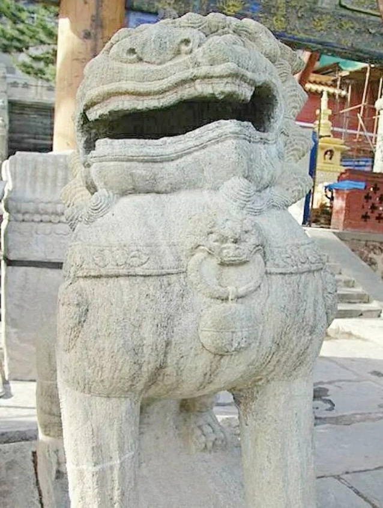

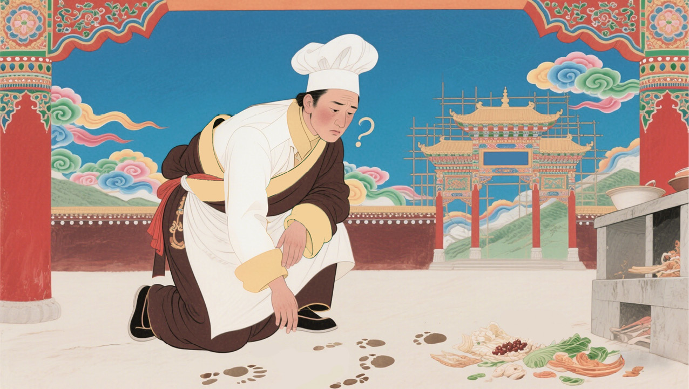

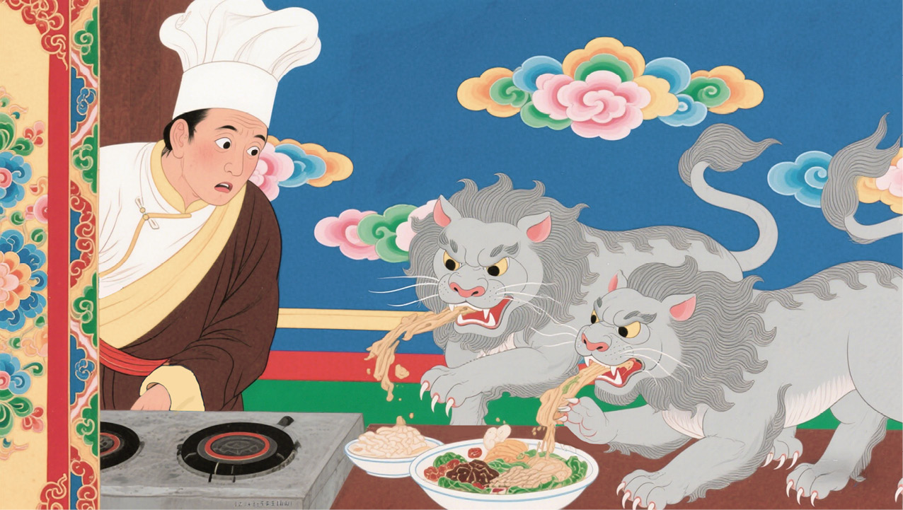

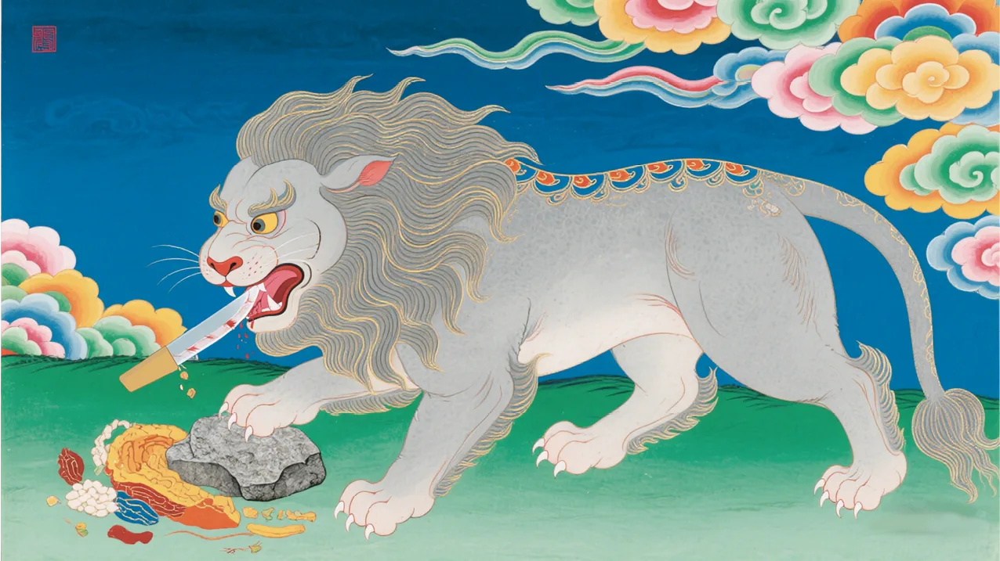

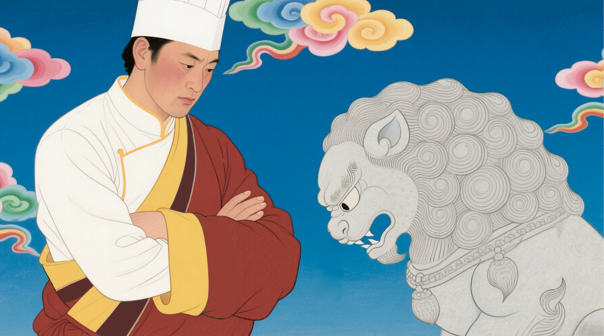

法王如意宝曾在此驻留很长时间，为不共根器的弟子传授了“缘起除障法”的灌顶，《法界宝藏论》的颂词、引导与传承，以及《杰珍大圆满》等深广法要。对于共同的眷属，包括藏人、汉人、蒙古人和满人等，以及来自外蒙古、日本、缅甸、美国等多个国家的一万多名听众，讲授了宗喀巴大师的《三主要道论》《菩提道次第摄颂》以及无著菩萨所作的《佛子行》等，引导无数众生走上解脱之道。

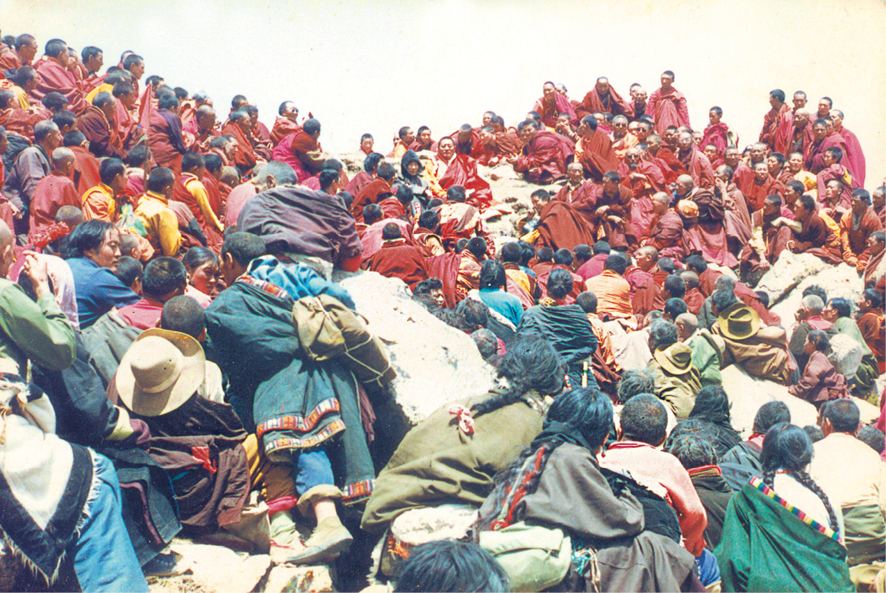

法王在附近为四众弟子传法

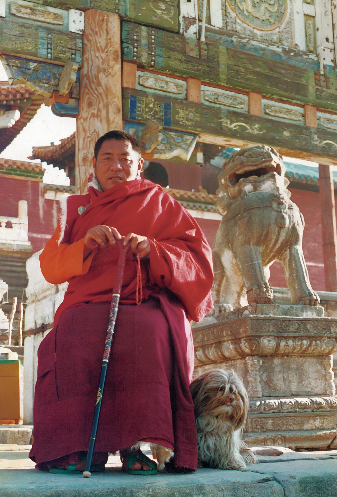

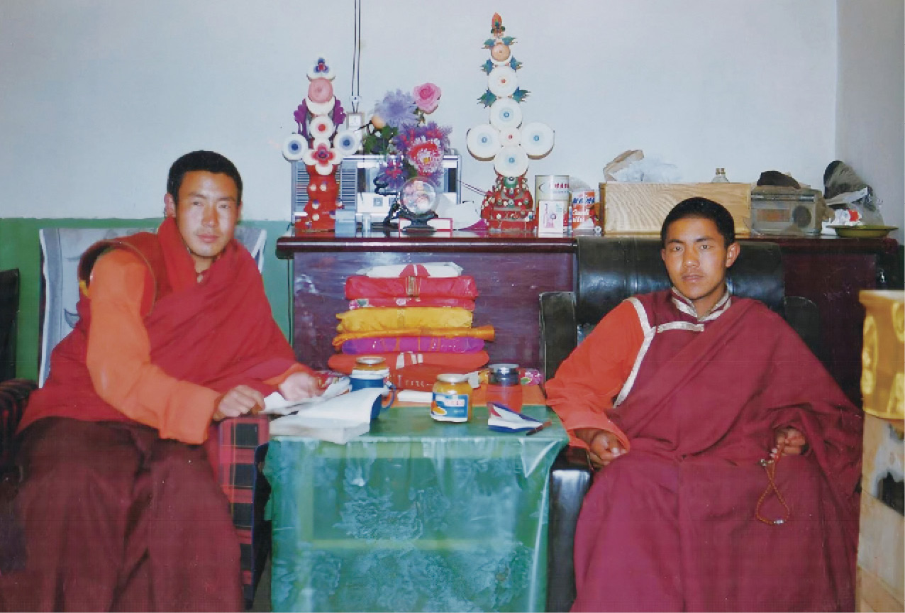

慈诚罗珠堪布和索达吉堪布分别将《菩提道次第摄颂》《佛子行》翻译成汉文

在此圣地新造三宝所依的情况：在文殊幻化殿左侧，建有两座藏式大殿，一座名为“扎嘎如意宝殿”，另一座名为“大密虹身解脱殿”。第一座殿中，正如班禅洛桑却坚所说：“成就自在莲花生，化现具德燃灯智，再化洛桑札巴尊，非汝我无余依处。”中间供奉的是成就自在者莲花生大士，右侧是具德阿底峡尊者，左侧是至尊宗喀巴大师，这些像都面向藏地而塑。邬金莲花生大士的像，呈现他在西南乳海莲蕊中诞生的形象。右边的莲瓣上依次为觉沃如意宝像、全知龙钦巴像、持明晋美朗巴像；左边是文殊菩萨像、全知麦彭仁波切像、伏藏大师列绕朗巴像。

此外，这座大殿右侧还有文殊菩萨像、金刚萨埵像、嘉达·希饶嘉措像；左侧有两尊大班智达布玛莫札像、虹身成就者白玛邓灯像、邬金德达朗巴像，都是以极其精湛的工艺塑造，栩栩如生。

第二座大殿内供奉着上师布玛莫札、本尊文殊菩萨、护法格萨尔王等神奇的像，以及师君三尊像、金刚萨埵像、布玛莫札像。其中，莲花生大士像的心间是莲师亲自加持的“如我像”，后由伏藏大师列绕朗巴取出，被称为“会说话的莲师像”。文殊菩萨像的心间，则是以全知麦彭仁波切遗骨制成、具有神奇瑞相和无量加持的文殊小像。

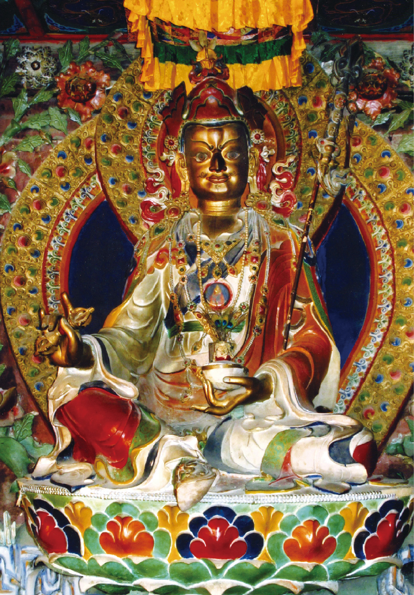

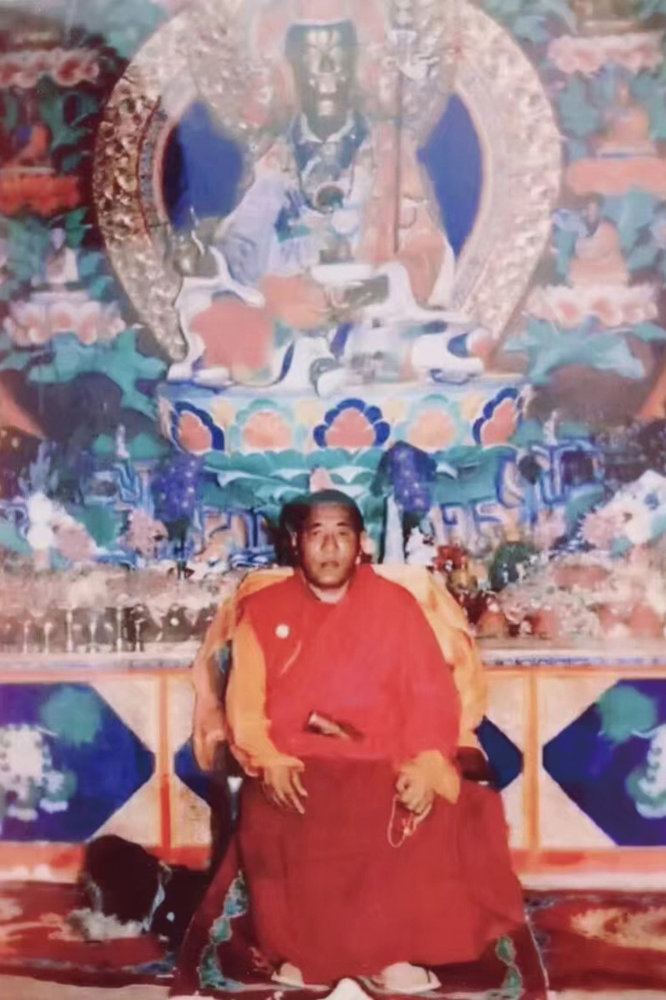

所有新造圣像的装藏物中，都有陀罗尼咒、芥子许舍利、钦哲仁波切所取伏藏之佛舍利、香根佛塔增生舍利、迦叶佛增生舍利、莲师头发和法衣、噶陀十三代上师舍利、宗喀巴大师法衣、列绕朗巴尊者骨灰、华智仁波切牙齿等，还有许多舍利、遗骨等由法王亲手赐予的其他圣物，暂不一一详述。

7．广宗寺

广宗寺，位于菩萨顶东南侧的山腰处。寺内有许多殿堂，尤其是主殿，其屋顶曾完全由铜瓦覆盖。殿内供奉着铜铸的阿弥陀佛主尊及其眷属，以及铁铸的十八罗汉等像。

文殊菩萨幻现为鹅饮水的神奇故事，据说就发生在此寺。

主殿背后的塔，是法尊法师的灵塔。法尊法师精通藏汉文，并曾将宗喀巴大师的《菩提道次第广论》《密宗道次第论》等翻译成汉文，对佛教的贡献极大。

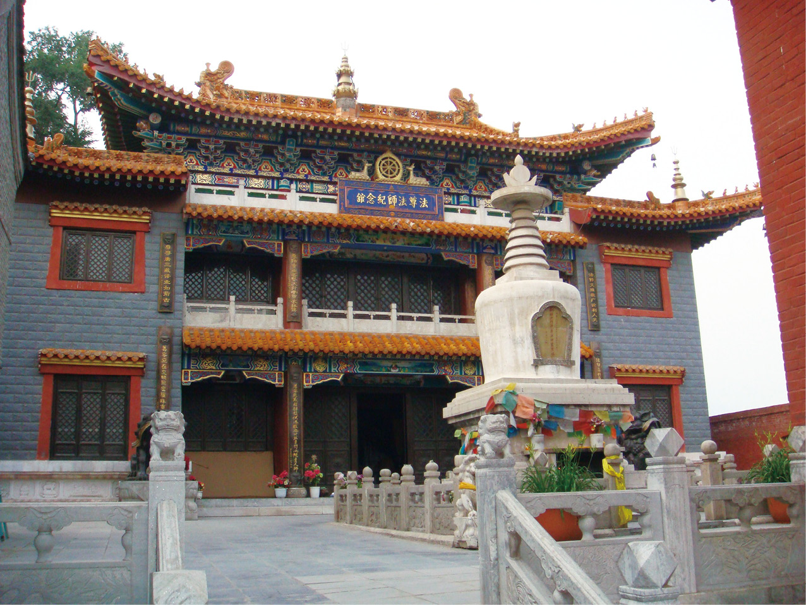

法王在这里新修了一尊莲师像。

8．圆照寺

圆照寺，藏语称“愿海寺”，位于广宗寺下方，古称普宁寺。

从尼泊尔来的大成就者色内萨，曾在此寺长期入定。当时，汉地皇帝邀请他前往北京传深广法门。一天，他说需要尽快返回五台山，但皇帝不允许他离开，要求他继续留在北京。第二天清晨，色内萨示现圆寂，身体化为虹光身，只留下许多舍利。皇帝非常后悔，将所有舍利分配，一部分留给北京寺院的佛塔装藏，该寺名为真觉寺；另一部分则被安放在五台山圆照寺的塔内。

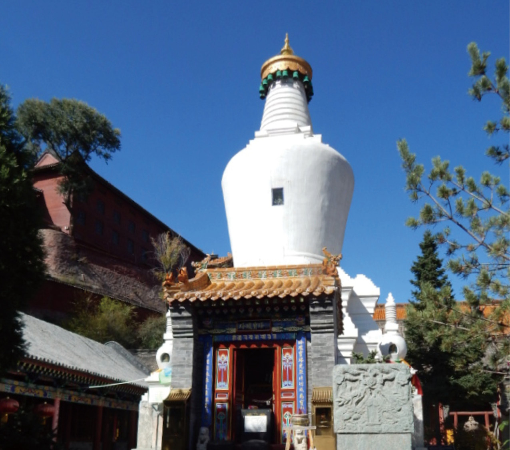

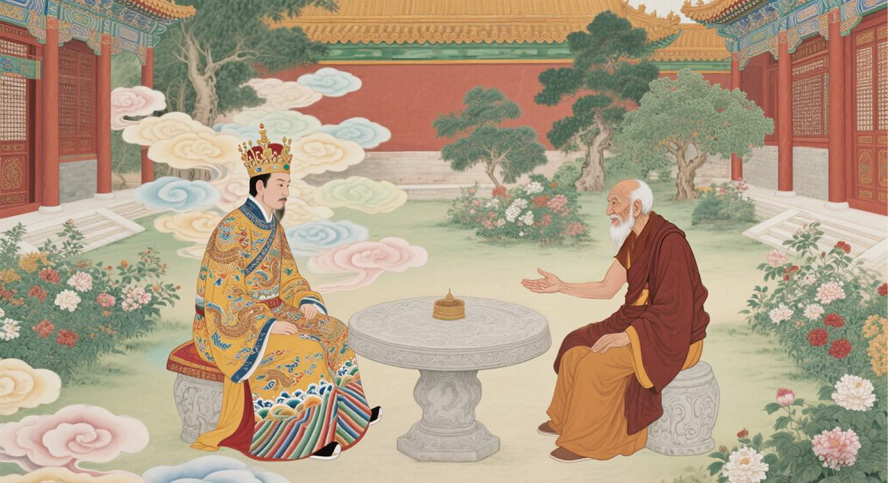

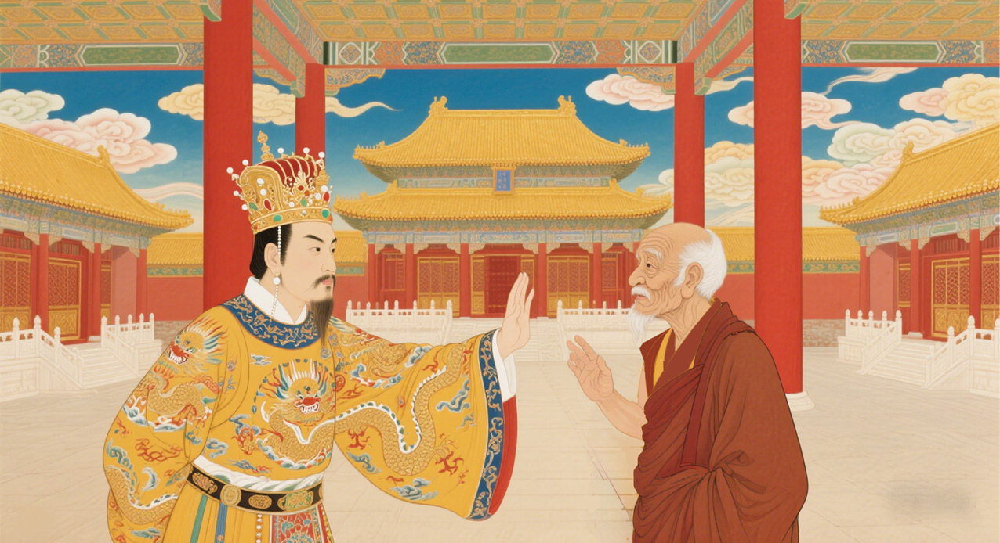

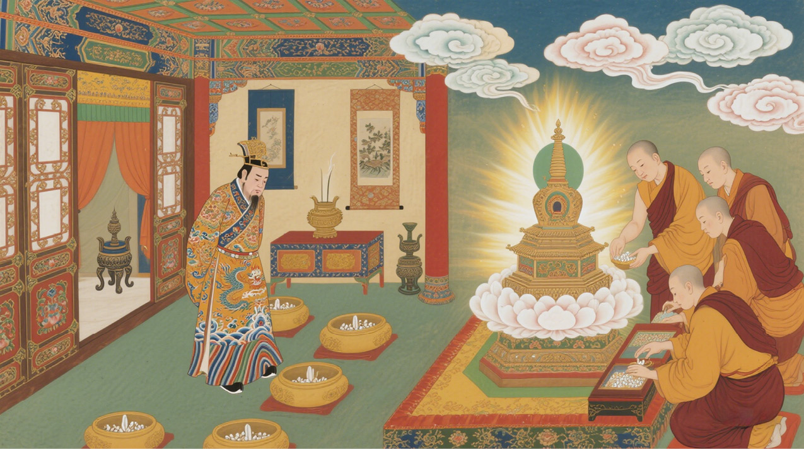

法王在此寺也新修了一尊莲师像。

9．罗睺寺

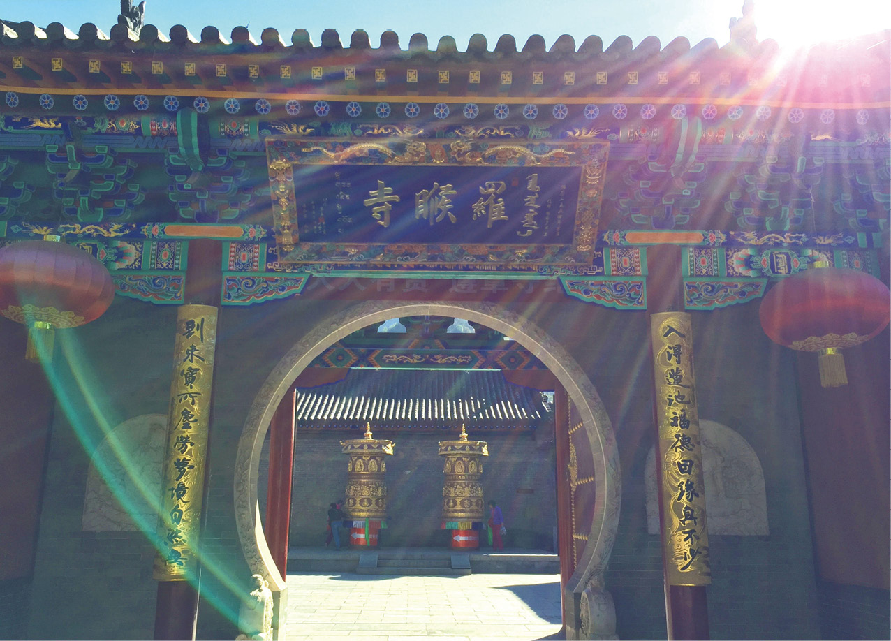

罗睺寺，位于圆照寺下方。根据《五台山志·密严庄严》记载，文殊菩萨曾在五台山东方“十城堡”处，示现为从母亲头顶诞生的童子形象，随后又显现在一棵树上，向首批眷属传法。当时的降生地、传法地，即为罗睺寺的所在。

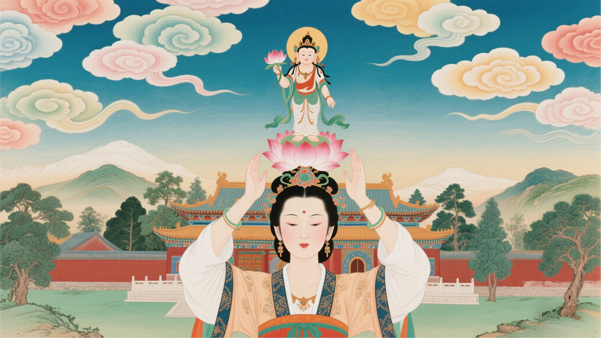

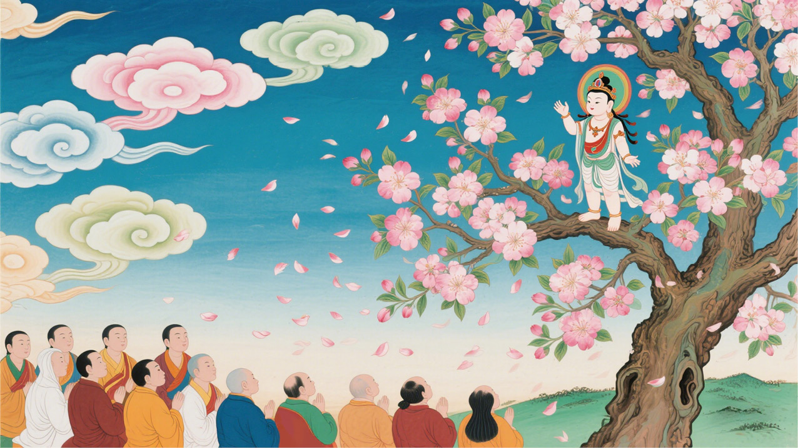

智者诺桑嘉措等根据普巴派的历算，认为我等本师释迦牟尼佛在81岁时于铁龙年三月十五日宣说《时轮金刚》，四月在拘尸那罗示现涅槃。四十四年后，文殊菩萨降生于此地。

法王在此寺也新建了邬金莲师像、无等阿底峡尊者像、宗喀巴大师像、阿弥陀佛像、尊胜佛母像以及度母像。

10．显通寺

显通寺，位于塔院寺的背后。此处的主要殊胜圣物，是一尊极具加持力的文殊像。据说在1983年，上海的许多居士准备前往五台山朝圣，途中遇到一位穿着邮递员灰蓝制服的陌生人，说要和他们一起去五台山。于是，他们同行，乘坐了多天的火车和汽车，那人也帮助大家拿行李。当他们来到五台山显通寺的门口时，那人说：“我对五台山非常熟悉，我带你们去文殊殿上香。”来到文殊殿后，那人与文殊像竟融为一体。众人发现文殊像与那人的面容、装饰等很多方面极为相似。就在此时，文殊像中升起了香烟，整个殿堂弥漫着香气。大家惊叹不已，信心倍增，连连顶礼并猛烈祈祷。这尊文殊像至今仍在寺中。

显通寺还有一位曾名无尘的苏州僧人，他心怀供养五台山僧众的愿望，四处化缘。有一次，他在连续多日的大雪中前往凤州城，夜晚时到达城边。他的衣衫单薄，冷得几乎冻死，但他心想：“半夜叫醒人们，会打扰他们休息，就算死也无所谓。”于是，他哆哆嗦嗦地待在城边。

当黎明将至时，城中突然出现数百上千人，救了他的性命。他们来的原因是：该城所有人都做了同一个梦，梦见一位穿金甲的天神告诉他们：“你们城边上的五台山文殊菩萨快要冻死了！”这位天神高声呼喊了很多次。人们醒来后相互说起，颇感惊奇，便决定去看看是怎么回事。从那以后，众人如同对待真正的文殊菩萨一般信奉无尘，用金银珠宝等财物对他进行供养。无尘返回五台山后，供养此地僧众，并为寺院建造了许多三宝所依。

显通寺内还有一座令人惊叹的响铜殿，据说该殿是明朝时用十万斤铜铸造的，殿内的四壁上有一万尊浮雕小佛。铜殿前方原有五座明代僧人胜洪所建的铜塔，但现在仅存两座。此外，寺院展览馆内还珍藏着文殊菩萨的鞋子等许多特殊圣物。

这里还有一座华严经字塔，这是清朝康熙年间苏州一位工匠用十二年时间将《华严经》全文写在白绫上组成塔形，长十七尺，宽五尺。此外，还有宋朝杨五郎在五台山出家后单手常玩的铁棍，重达八十一斤，我们用双手都难以抬起。

寺院的钟楼内悬挂着一口明朝所铸的大铜钟，重九千九百九十九斤半。每当敲击时，声响可传至十里之外，凡是听到者都不会堕入恶趣。钟身上铸有一万余字的经文。现在很多汉人和蒙古人在此超度亡者。

11．殊像寺

殊像寺，位于大白塔南方约1公里的地方。寺内有一尊广为人知的“说话文殊像”，又名“荞面头文殊菩萨”。据记载，明朝时期，此寺计划建造一尊文殊菩萨像，但没人能很好地塑造其头部，只能搁置下来。一天，众人看到在天空的云层虹光中，显现出文殊菩萨骑着狮子的动人身影。当时工匠迅速用荞面按照文殊菩萨的真容捏制头部，之后文殊菩萨便悄然隐去。尽管之后工匠又尝试用泥等材料制作头部，但始终未能达到理想效果，最合适的头部仍然是最初的荞面头。

另一种说法是，这尊像是明朝皇帝命令工匠所建造的，除了头部，其余部分都已完工。有一天，工匠们得知第二天皇帝将亲临视察，大家非常惊慌，便迅速用荞面制作了头部。次日早晨，皇帝驾到，召集僧众举行开光仪式后离开。之后，工匠们准备换下那个头部，可是却无法切断。这时，文殊像亲自开口说：“不需要更换。”因此，这尊像被称为“说话文殊”。尽管这段说法没有在史料中得到证实，但它在当地民间广为流传，所以也记录在此。

总之，这尊像至今完好无损。文殊菩萨骑着绿色狮子，极为威严，是此圣地最大的圣像，高9.3米。法王如意宝曾在吉祥日来此像前广发大愿，并供养法器，同时，在此寺还新建了释迦牟尼佛像、舍利子像、目犍连像等诸多圣像。

寺内有一座“无垢殿”，据说在清朝时期，一位僧人和一位皇室女子曾在此殿内讲闻正法，却遭到他人的些许诽谤。康熙皇帝听闻后，担心影响皇室声誉并玷污佛教，下令烧毁整座寺院，并从北京派了许多人前去执行。他们连续三天在此寺放火焚烧，结果其他所有建筑都被烧毁，唯独这两人所在的殿堂未受丝毫损坏。众人对此感到非常惊讶，向皇帝禀报后，皇帝也意识到先前的传言是诽谤，文殊菩萨为此事作了真实见证。于是，他赏赐大量银两用于重建，并将这座殿命名为“无垢殿”，故此寺也有“无垢寺”之称。

殊像寺外的东侧有一口灵泉，名为般若泉。据说在唐朝时，一位名叫慧潜的僧人，用九千九百九十九天唯一诵读《金刚经》，以此加持力，最后一天即一万天时，泉水突然涌现，被誉为“文殊成就水”。饮用它能增长智慧、治愈疾病。

12．灵应寺

灵应寺，位于塔院寺以南约3公里的梵仙山顶。山体因富含铁矿呈红黄色，远远望去，仿佛被霞光环绕，景色迷人。

很久以前，有一位朝圣者，历经千辛万苦，长途跋涉来到了五台山。当他到达时，已经疲惫不堪，饥渴交加。天色已晚，他找不到落脚之地，也不知五台山还有多远。就在此时，他在黑暗中看到前方有星星点点的灯光，走近后发现是一户人家。他敲门说：“我是来朝圣的旅人，想借宿一晚。”房主出来，热情地将他领入屋内，并用丰盛的晚餐款待他。

半夜里，他见到一位美丽女子，问他要去哪里。他回答：“我要去五台山修行，不知此地距五台山还有多远？”女子说：“你要去的五台山，远在天边，近在眼前。”第二天早晨，他醒来时发现自己竟然枕着一块石头，躺在一棵树下，昨晚的宅院已无影无踪。这时，他才明白那位女子和那户人家正是文殊菩萨的化现。另有一种说法是，这位女子是一位千年狐仙。

由于山上发生了许多神奇的故事，大家认为应该在山顶建造文殊寺。如今，这座寺庙便是位于梵仙山顶的唯一寺院。从这里望去，除了南台外，其他四台山顶和台怀镇的所有寺庙都能尽收眼底，仿佛看在手掌心一般。每年夏季，山顶遍布野花，景色宜人，吸引了无数信众前来朝拜。

13．镇海寺

镇海寺，是章嘉六寺之一，位于大白塔以南约5公里处。

据说西日桑哈大师曾住在此寺，寺附近有一眼泉水。泉水旁有几户人家，其中有一对母女，女儿容貌美丽，常常在泉边沐浴并歌唱。这泉水与东海相通，龙王九太子对这位女子极为迷恋。一天，女子又来沐浴时，龙太子想要她做妻子，将她拖入水中带到龙宫。

此时，女子思念老母亲和人间，尽管龙宫的受用极为丰厚，但她不愿留下，于是想出一个妙计，对龙太子说：“我已皈入佛门，若要成为你的妻子，首先要回家乡守持三天八关斋戒，然后你们再来迎娶，我就可以回来。否则，我宁死也不留在这里。”龙太子无奈答应，并警告她：“如果你到时不回来，我的东海将淹没你们整个村庄。”两天后，女子被送回家，老母亲无比欢喜。女子告诉她事情经过，老母亲非常害怕，母女俩立即去了文殊寺。为消除此危难，她们在文殊菩萨像前广做香供等，一心祈祷后，方才离开。

当天晚上，母女俩都梦见一位老和尚来说：“从现在开始的第三天，女儿和村民们一起去黛螺顶文殊五部寺烧香供养，而母亲独自留在家中念经，你们便能解脱此难。”两人在感恩心中醒来，之后互相交谈，感到非常稀有，便在第三天这样去做了。

当天，龙太子带着随从、伴着奏乐前来迎亲，但女子却不见踪影。询问老母亲时，她头也没抬地说：“五台山是佛门圣地，你们不要喧哗。”龙太子大怒，立即从泉水中涌出滔天巨浪，淹没了整个村庄。然而，老母亲却安然无恙。当水浪再度涌起时，突然空中出现了一个火光团，伴随着声响，完全覆盖了泉水，直接切断了水浪。这个不可思议的火光团，便是文殊寺的铜锅。

最终，女子与村民们欢喜地回到家中，念及文殊菩萨的恩德，常常虔诚祈祷。因为这个原因，人们在此地建寺，命名为“镇海寺”，在铜锅上建造的塔被称为“镇海塔”，至今信众仍可朝拜。

章嘉·若必多吉尊者在汉地广弘佛法时，尤其喜欢在这座百花丛生、寂静山坡上的悦意寺院长期禅修。后来乾隆年间，他在北京示现圆寂，舍利被安放于此寺所建的塔中，至今仍在寺内供奉。虽然传说众多，但这一说法似乎最为可靠。

14．多福寺

多福寺，位于太原市西北约24公里处的崛围山顶，四周花木繁茂，绿树成荫，前方清澈的溪水潺潺流淌，气势雄伟。

此寺始建于唐朝。公元786年建寺时，由于没有水源，需从山脚挑水上山。大家经常背水，许多人的肩膀因磨破而无法挑水，只剩下两位僧人还在坚持。

一天，他们在路上遇见一位老人，老人问他们为何挑水，他们回答：“我们正在山顶建寺，需要用水。”老人听后哈哈大笑道：“就凭你们两个人挑水，能把寺院建成吗？”说完，老人停下脚步与他们聊天，并表示：“我从附近的五台山来，口渴得很，请给我些水喝。”他一口气喝完了四桶水，两人带着欢喜的表情让他喝。

老人说：“谢谢你们两位。”然后从怀中取出一个小盒子，郑重地交代：“把这个放在寺院西边的草地上，然后打开盒盖。但在路上千万不要打开，切记切记！”说完交给他们。这时突然跑出来一头狮子，老人骑上狮子，瞬间就不见了。

他们在路上好奇盒子里有什么，轻轻打开一道缝，结果两条龙从里面飞出，变成了两口泉水，即山腰的晋祠第二泉和烈石寒泉。他们赶紧扣住盒子，继续带到寺院。打开后，又有两条龙出现，钻入地下，变成两池清水，这就是龙池，即如今的八功德水源。

他们意识到那位老人是狮吼文殊的化现。于是在寺内建造了不可言喻的文殊殿，内有一尊庄严的文殊像，两侧是这两位僧人的塑像，成为众人瞩目的圣地。

15．金刚窟

金刚窟，位于大白塔以北1.5公里处，楼观谷右侧的山脚下。

据说洞窟内常常显现出奇异的光芒与声音。特别是唐代印度僧人佛陀波利曾赴五台山，受文殊菩萨点化后，返印度迎请《佛顶尊胜陀罗尼经》，译经后隐入金刚窟，汉藏文献中均有记载这一事迹。所有这些文献均称之为“金刚窟”，《汉地佛教史》则写作“根刚窟”。据说从前几个青年和布商进入洞中后再未出来。

这里有一个殿，殿中供奉着一尊药师佛铜像，据说是用七千斤铜铸成的。此外，还有四头八臂文殊像和铜制观音像等。

唐朝时，元著禅师曾在此窟供香，突然一位老人出现并指点他，在此附近建寺将大有利益，随即消失。他知道这是文殊菩萨，便在那里建寺，命名为“般若寺”。此寺后来在明清时期重建，但近代佛教衰落时被摧毁，如今只剩下遗址，已被野草覆盖。

16．尊胜寺

尊胜寺，位于大白塔西南方约四十公里的地方，坐落在一座高塔附近。

从前，佛陀波利前往五台山朝拜文殊菩萨。当他来到现今寺院所在地时，突然从森林中走出一位须发如贝壳般雪白的老人，身着婆罗门装束，用梵语问他来意。他如实回答：“我来此地拜见文殊菩萨。”

老人说：“汉地众生，多造罪业，出家人犯戒者甚多，现在印度有一部《佛顶尊胜陀罗尼经》，能够灭除众生很重的罪业垢染，你带来了吗？”他说没有。老人说：“如果不带此陀罗尼经，即使见到文殊菩萨，也不认识。”他在老人足下顶礼，但抬头时已不见人影。他立即起身返回印度，多年后带着陀罗尼经再次来到五台山，进入上述的金刚窟后，再也没有出来。

这位阿阇黎的名字，在藏地称为帕单巴，《汉地佛教史·智者欢喜耳饰》中说：“佛陀波利，又名佛护，藏人称之为单巴桑吉。”

因此，在他初次见到文殊菩萨的地方，唐朝时建立了这座寺院，命名为“尊胜寺”。由于过去没有现在这样的公路，前往五台山的人必须经过此地，所以它被称为“五峰咽喉”。

总之，现在这座寺院非常兴盛，共有三百多间殿堂。1984年，来自香港的智开法师捐资三百多万元，重修了此寺。

17．吉祥寺

吉祥寺，又名清凉桥，位于大白塔以西约20公里，地处西台和中台两山的南麓，附近溪水潺潺，景色宁静宜人。

据说康熙皇帝曾造访此寺。途中，突然浓雾弥漫，天色渐晚，皇帝迷失了方向，不知该往哪里走。正当他束手无策时，看到前方有一位平和温顺的老僧，衣着庄重，手持一盏红灯笼。皇帝急步走上前，向老僧询问吉祥寺的所在。老僧微笑着答道：“阿弥陀佛，我就是吉祥寺的僧人。请跟我来，我带你去。”

皇帝与老僧同行不久，走过一座桥后，便抵达了吉祥寺。老僧带皇帝进入文殊殿朝拜，一进殿，老僧却突然消失了。皇帝大为惊讶，他环顾四周，发现文殊像手中提着一盏红灯笼，所穿妙衣与刚才那位老僧的衣服颜色一模一样。此时，皇帝恍然大悟，原来先前的老僧正是文殊菩萨化现。康熙皇帝生起极大信心，于是将此殿命名为“灯笼文殊殿”。

此外，吉祥寺又被称为“清凉桥”，这一名称也被《清凉山志》所记载。寺内还供奉有从缅甸迎请的玉佛等许多具加持力的圣物。

18．碧山寺

碧山寺，位于大白塔东北方约2公里处。

寺内有一尊著名的玉佛。清朝时一位名叫慧根的普陀山僧人，经峨眉山、拉萨等地前往缅甸，迎请了五尊玉佛返回。其中两尊在途经上海时留在那里，成为上海玉佛寺的来源；一尊留在北京；另外两尊则供奉在五台山——此寺所供奉的是其中较大的一尊，高约六尺多，而较小的一尊则是上述吉祥寺的玉佛。据说以前许多善男信女用金手镯、金项链等，供养这些佛像。

此外，后殿有一尊令人惊叹的大肚弥勒佛，高十尺。另有毗卢殿、文殊殿等殊胜庄严的能依所依。

19．金阁寺

金阁寺，位于大白塔以西约17公里处的公路上方。

公元736年，一位法号为道义的高僧前往五台山朝礼文殊菩萨。当他来到现今寺院所在地时，突然刮起强风，飞沙走石，天昏地暗。就在此时，他眼前突然出现一座气势宏伟的寺院，所有殿堂都金光闪耀，动人心弦，却找不到通往里面的路。片刻之后，寺院等一切景象都消失了，狂风也随之平息，天空恢复如初。他感到十分奇特，环顾四周，只见前方有一棵树，周围别无他物。他明白这是文殊菩萨的幻化，便决定在此地修建一座寺庙。

此外，《广清凉传》中记载：僧人道义前往五台山朝圣。来到南山一带时，忽然刮起强风。他闭上眼睛，双手合十专心祈祷。这时前面来了一个小童，邀请他去喝茶。两人一同向西北方走了一百多步，出现了一座令人惊叹的金桥。过桥后，眼前是一座大寺院，内有众多圣僧，殿堂和围墙皆闪烁着耀眼的金光。寺内有一座三层的殿堂，金光四射，地面全部由宝石琉璃铺成。

他被带到一间僧房，房中有一位白须老僧坐在金线制成的床上，他们进行了广泛交谈。童子端来茶水，异香扑鼻。他享用了茶和餐食后，老僧送他到门口。童子带他详细参观了寺院内外。突然间，童子与寺院等消失不见。这时先前的风已平息，天空也晴朗了。

道义知道自己见到了文殊菩萨，心中无比欢喜。后来，来自印度的三藏法师不空应唐代宗的要求，按照道义法师所描述的清净所见，建造了这座寺庙，并命名为“金阁寺”。

现今，金阁寺有众多殿堂，尤以一尊高达17.7米的铜质镀金千手观音像最为引人注目，它是五台山最高的佛像。寺内设有观音殿、地藏王殿、药王殿、大雄宝殿等169间殿堂。各殿中塑像共有1000多尊，是五台山佛教塑像最多的寺院。

20．玉华寺

玉华寺，位于大白塔西北方约12公里的中台顶东南侧山腰处。它是唐朝三藏法师不空修建的密宗护国道场，也是格鲁派在五台山最早的寺院。后来在特殊年代被毁，如今只剩下遗址。

当年这里有非常著名的五百罗汉像，关于它们的来历，有一段神奇的故事：明朝时期，玉华寺的一位老僧对弟子们说：“你们留在寺院好好修行，我打算为寺院造一些佛像，所以要到外地化缘。”怀着虔诚之心，老僧一路苦行，来到今天的孟县一带，成功化得大量的铁，并将其交给当地铁匠，铸造成五百尊罗汉像。半年后，这些罗汉像终于完成，但由于当时没有现代化的交通工具，罗汉像沉重无比，甚至骡马也无法搬运。

老僧发愁如何将佛像带回寺院，不禁自言自语道：“你们这些罗汉若能自己走回五台山该多好！”话音刚落，铁铸的罗汉像们竟纷纷站起，真的开始迈步前行。老僧欣喜若狂，赶紧带路，顺利返回五台山玉华寺。弟子们看到师父回来，高兴地迎上去，将罗汉像安置在殿内。然而，一一清点时，却发现只有四百九十九尊，少了一尊。再三检查，依然少了一尊。于是，大家外出寻找，最终在今天的寺沟村找到了这尊罗汉像。

这尊罗汉像为什么掉队呢？原来，它是五百罗汉像中的最后一尊。当它经过此地时，见到一位妇女正在河边洗衣，于是走过去问：“从这里到五台山玉华寺有多远？”妇女答道：“大约60里山路。”罗汉像又问：“我是要去那座寺院的僧人，今天能到达吗？”妇女笑着回应：“现在太阳快要落山了，别说你是个肉身的人，即使是铁铸的罗汉，也不可能到的。”一听到“铁铸”二字，罗汉像立即显出原形，不能动了。老僧和众弟子找到它时，试图将其带回，但因无法挪动，最后只能在此处建庙，供奉这尊罗汉像，并命名为“铁佛寺”。如此一来，玉华寺的五百罗汉像，最终变成了四百九十九尊。

后来，佛教遭到毁坏，铁佛寺与玉华寺双双被毁，现已不复存在。尽管如此，其中的两百多尊罗汉像，现今仍保存在显通寺的无梁殿内，正如五台山许多史料所述。

21．寿宁寺

寿宁寺，位于大白塔西北方约1公里的山坡上。

在南北朝时期，北齐的一位王子连年带兵打仗，最终负伤并生了重病，医治无效。于是，他前往五台山，祈祷文殊菩萨。一天晚上，他梦见一位老人对他说：“你修持圣道的精进不够。”他醒来后，心想：“现在应该忏悔过去的罪业。”于是无视自己的身体，第二天点燃干柴，举身赴火。就在焚身的火光中，众人亲眼看到文殊菩萨现身。后来，人们在王子遗迹处建造了这座寺院。

寿宁寺内有一座六角形的文殊殿。大雄宝殿里供奉的铁铸释迦佛像，高2米多，重达两万斤，是五台山最重的一尊铸像。

22．佛母洞

佛母洞，又名千佛洞，位于大白塔以南约20公里处，靠近白云寺，需沿南台山谷步行两公里半才能达到。途中有一处红土，集百圣地之加持，可以取用。

明朝时，一位名叫道方的和尚在五台山夜行时，看到此洞发出神光，于是进入洞中。在洞内，他看到许多玉佛像。深入洞穴后，他听见海浪声，感到非常害怕，急于逃离，却发现找不到出口。他向观音菩萨祈求，并发愿要建造许多佛像。突然间，一道明亮的灯光出现，指引他走出了山洞。之后，他在洞口造了许多石佛像等。

若能前往此处祈愿，可以报答现世父母的恩德，因此该洞又被称为“报父母恩修行洞”。洞内布满了无数奇妙的天然佛像，现今这里也有一所寺院。

23．黛螺顶

黛螺顶，又名五部文殊寺，位于大白塔对面东方的山顶上。

黛螺顶的住持青云和尚，曾奉乾隆皇帝的旨意，在此建造了五座文殊像。据说朝拜此地可获得朝拜五座台的功德，故这里又被称为“小朝台”。此地集五座台的加持于一体，尤其在寒冷的冬季，朝拜五座台的过程极其艰难，因此，诸多智者成就者高度赞叹黛螺顶，说在这里朝拜修行，具有极大加持力。

如今，黛螺顶的殿堂和三宝所依远近闻名。无等大恩上师法王如意宝也曾徒步至此，发下深广大愿，并多次谈及此地的奇妙与庄严。

24．文殊说法台

文殊说法台，位于黛螺顶右侧的山坡上。这里是文殊菩萨常为一万圣者佛子转法轮的地方，因此得名。同时，又因许多高低不同的众生在此面见文殊尊容，所以也被称为“面见文殊台”。

法王如意宝曾在此驻留三天，从觉性中自然流露出《忠言心之明点》并立成文字，还灌了全知麦彭仁波切“续派文殊”的顶，并赐予了许多窍诀和开示。

25．观音洞

观音洞，位于大白塔以南约3.5公里处。在陡峭的山脚下，经过398级石阶，便可抵达这个十分悦意的天然洞穴。

大悲观音化现的六世达赖仓央嘉措，曾在此洞中禅修六年，期间以牛奶为食，常有一小姑娘前来送牛奶。有一天，他对小姑娘说，自己想用金丝线绣一尊观音像供奉在洞内。第二天，小姑娘将绣好的观音像送到他面前。他大为惊讶，问她是否为观音化身。小姑娘腼腆一笑，随即消失。此后，六世达赖试图为观音像开光，没想到那像竟开口说话：“我可以自己开光。”自此，六世达赖将此洞称为“观音洞”。洞内还自然涌现出极具加持力的观音圣水，至今仍在流淌。

1908年，十三世达赖土登嘉措从蒙古前往北京时，也曾在此驻足，并为众多寺院广转讲修法轮，长达半年之久。

洞口的大殿内供奉着观音菩萨等许多圣像。法王曾两次来到这里，诵唱金刚道歌，并新塑了一尊小型莲师像。

法王在观音洞

26．南山寺

南山寺，位于观音洞西南方的山坡上。

寺内随处可见精美的汉白玉浮雕，据说是幻化工匠们耗时十三年雕刻而成。

史料记载，这里独具的十八罗汉像造型生动，且具强大加持力。

此地环境清幽，景色宜人，吸引了许多不同民族的信众和游客。寺院门口有一百零八级石阶。

27．龙泉寺

龙泉寺，位于南山寺西侧。因周围环绕着九条如绿龙般的山脉，好似九龙在泉中饮水一般，由此而得名。也有些史料说，从前有九条龙在此地作祟，文殊菩萨降伏了它们，并将其镇压在山下，此后清凉泉水中常显现九龙影像，因此称为“龙泉寺”。

此寺有一座著名的石牌楼，建于民国时期，耗资三万六千四百多两银子，由100多位顶级工匠历时6年，在石头上雕刻各种图案而建成。牌楼上饰有汉白玉雕刻的八十九条飞龙等奇妙图案，栩栩如生，如同用酥油制作的一般。寺院门前也有一百零八级石阶。

汉地大德普济和尚，一生重修了龙泉寺、南山寺、金阁寺等18座寺院，并与寺内塑像经常聊天。他的灵塔至今仍存于寺内，据说他是弥勒化身，塔外有许多弥勒菩萨的浮雕像。

此外，这里还有文殊殿、天王殿等殿堂，内供奉有诸多极具加持力的佛像。附近的龙泉被信众称为文殊菩萨的甘露，经常欢喜享用。

28．慈福寺

慈福寺，位于菩萨顶寺东北方。始建于清朝，是章嘉六寺之一，寺名为皇帝所赐。

法王在此新塑了多尊圣像，包括师君三尊像，全知龙钦巴像、宗喀巴大师像、萨迦班智达像这三尊文殊化身像，以及文殊菩萨像、持明晋美朗巴像、伏藏大师秋嘉朗巴像等。

29．竹林寺

竹林寺，位于大白塔的西南方。

唐朝时，法照和尚在此看见竹林，片刻后即消失，他意识到这是文殊菩萨的幻变，于是建造了这座寺院。

法王在这里新修了文殊菩萨像、师君三尊像、至尊密勒日巴像、宗喀巴大师像、持明鹰翎尊者像等。

总之，如今五台山有六十多座寺院，每一座都有来自文殊幻变的奇妙缘起，但此处仅做了简单介绍。当然，上述寺院的殿堂和三宝所依等，还有许多可写的地方，但恐繁不述。

二、别说三个特别具加持力的圣迹

以下特别介绍与佛陀授记相关、具大加持力的三处圣地：善财洞、那罗延窟、清凉石。

1．善财洞

善财洞，位于塔院寺对面黛螺顶脚下的清凉大尸林附近。

善财寺分上下两院，上院内的山洞即是善财童子初次见到文殊菩萨的地方。文殊菩萨对善财童子说：“善男子，要无有厌倦地寻找善知识……”随后，善财童子依止了一百一十位善知识，最后根据德生童子及有德童女的授记，前往南方海岸国的大庄严园，在楼阁中见到弥勒菩萨，看见他从初发心以来如梦如幻的无量菩萨行。

善财童子遵照弥勒菩萨的授记，再次去拜见文殊菩萨。善财童子到达时，文殊菩萨伸手为他摸顶，使他趋入普贤行道场。随后，他又去拜见普贤菩萨，普贤菩萨诵念了“所有十方世界中”等《普贤行愿品》偈颂，这些内容在《华严经·入法界品》中有广说，可查阅相关资料。实叉难陀翻译的汉文版“八十华严”中说，善财童子依止了五十三位善知识，这与上述提到的一百一十位的数量有所不同。

此外，第二佛莲师、班智达布玛莫札、嘉纳思扎大师、章嘉·若必多吉等，也曾在这个洞中长期禅修。这次法王本人也在此闭关二十一天，并于萨迦月二十九日上午亲见文殊菩萨尊颜，自然流露出以下的金刚语：

> 离尘空性法界一味性，

> 遍满虚空智慧金刚身，

> 见之不厌相好韶华者，

> 持童子相您前作顶礼。

> 犹如无依幼子依慈母，

> 以强烈信引发之渴望，

> 日夜寻觅却未见您身，

> 此前何处是您之住所？

> 数以万计补特伽罗众，

> 不畏长途劳顿之艰辛，

> 唯念怙主您而来至此，

> 慈悲宝藏您岂忍弃舍？

> 哀哉我等众生实可怜，

> 陷入难忍轮回之牢狱，

> 业惑铁索紧紧相束缚，

> 离善心之光明您见否？

> 若见请以悲威力展示，

> 一切能所取轮回幻相，

> 如同梦境醒来之景象，

> 于平等大乐中令消融。

> 您为诸佛事业执行者，

> 多劫之前已得授权故，

> 愿以无垢佛法日月光，

> 遍满众生福德虚空界。

> 我为利益遍空众生故，

> 誓愿精进直至虚空尽，

> 唯一父尊与您同等缘，

> 祈请此刻赐予我加持。

> 从今乃至生生世世中，

> 愿与至尊刹那不分离，

> 普贤行愿之王所涵摄，

> 一切意义之果皆实现。

此偈写于殊胜圣地五台山中心的东台脚下的清凉大尸林，曾有持明者西日桑哈、邬金第二佛莲师、智者嘉纳思札、大班智达布玛莫札、大译师贝若札那等在此长期禅修，特别是善财童子初见文殊菩萨发起菩提心之后，依止一百一十位善知识，最终在文殊菩萨的加持下现见普贤如海坛城，得受《普贤行愿品》偈颂时，此为文殊菩萨所住之特殊修行洞。阿旺洛珠宗美（法王晋美彭措）在此洞中，于第十七胜生周之初火兔年（1987年）四月二十九日上午，当稍入清净境相时，自然流露出此内容，后依据录音带立成文字。愿增吉祥！[^1]

如是祈请文殊菩萨和法王当时发菩提心的相关介绍等，已用藏、汉、蒙三种文字刻写于洞内。

现今，该洞中央供奉的是文殊菩萨像，右侧是善财童子像，左侧则是怙主法王以供施手印持宝珠和念珠的像。若有信众在此发愿，可消除无始以来的罪障；若立誓行善断恶，则会与三位依怙的善根融合而获得菩提。

在洞外右侧，是朵芒佛法增善林殿。其中新造了中央的文殊菩萨像，右侧是印度风格的莲师像，左侧是宗喀巴大师及二十阿罗汉等像，此外，还有一尊精美的小型密勒日巴像。

法王在善财洞与朵芒寺僧众一起

突然出现几位神奇的孩童

德巴堪布在善财洞手工塑造的文殊像和宗喀巴大师像

2．那罗延窟

那罗延窟，又名无爱子洞，位于东台顶观海寺以东、下行约半公里的地方。这里是文殊菩萨为万众菩萨眷属说法并常住之处。尤其在《华严经》中有记载：“震旦国有一住处，名那罗延窟，从昔已来，诸菩萨众于中止住。”据说一位名叫罗延的成就者曾进入洞中，之后再未出来，他留下的帽子被用作装藏物，建造了一座塔，至今仍可在东台顶寺院中瞻仰。

此洞非常独特，即使在炎热的夏季，洞内也常常结冰。洞底通向龙宫，因此，许多龙族的菩萨们常聚集于此，显现各种神变。有时从洞中涌出雾气和烟云，有时可以听到各种轰鸣声。

据说普通人通常无法在这里逗留超过一天，但法王却在此住了两周多。他初到那日的下午，在洞口被称为观音宝座的地方，以悲伤的曲调为五百多名僧众念诵了全知麦彭仁波切所造的《益西措嘉祈请文》。

此后，法王每天都讲法，依次传授了“忿怒莲师集善逝”的灌顶、《七句祈祷文释·白莲花》、《与七句祈祷文相属之上师瑜伽》、《与七句祈祷文相属之会供》，以及列绕朗巴著作中《诸佛菩萨供养偈》的“具恩本师佛陀”灌顶、“金刚手一勇士”灌顶，大悲观音法类中的“简略自观成熟”灌顶，持明聚集十密印中的“莲师”甚深灌顶、“马头明王”甚深灌顶、“益西措嘉”甚深灌顶、“长寿甘露宝瓶”灌顶等。

在那罗延窟，法王两次广泛传授了他从意伏藏中取出的“文殊静修”灌顶和传承。不仅如此，他老人家还传授了许多引导传承，比如文殊怙主上师麦彭仁波切所造的大圆满引导文《手中持佛》、全知龙钦巴的《句义宝藏论》。同时，法王还从觉性界中无勤流露出多部意伏藏，如《文殊静修分支引导文·手中赐佛》《生生世世摄受愿文》《快乐歌·童子欢喜法宴》《文殊静修传承祈祷文》《心滴续密意释——文殊欢喜言教·善说海喜悦种子》《密语歌·童戏三韵》《取舍教言道引导》《速赐加持祈祷文》《文殊静修分支·增智丸修法》《妙音天女修法·赐语智吉祥》等，并逐一传授给大家。

法王在那罗延窟洞口

此外，在这里，嘎巴堪布仁波切传授了《如意宝藏论释·白莲花》的引导传承，晋旺堪布仁波切传授了《智者入门论》《胜乘宝藏论》《宗派宝藏论》《法界宝藏论》《实相宝藏论》《窍诀宝藏论》等的引导传承。在此，我们每个人都按各自的缘分见到了文殊菩萨真容，正如法王在此所作的《快乐道歌》中说：“相伴已久文殊尊，未曾面见今明见。”

洞内的土石也如文殊丸一样，能够消除疾病、饥荒、战争等，是见解脱、触解脱，因此，这里的加持极为殊胜。这次，法王在洞内新造了一尊文殊菩萨像。

3．清凉石

清凉石，又名文殊菩萨宝座，位于大白塔西南方约18公里处。在摇曳的翠绿树林间，伴随着百鸟啼鸣的幽静胜地中，矗立着清凉寺，寺内至今仍保存着这一菩萨宝座。此宝座长约5米，宽约2.5米，高约2米。

昔日，五台山气候不调，冬天寒风刺骨，夏日酷热难耐，当地居民无法耕种庄稼，生活十分困苦。那时，文殊菩萨化现为人形，前往东海龙宫，索要龙宫外的一块石头。龙王恭敬地说：“大法师，您需要其他财宝我都可以给您，但这块石头是我们花了几百年艰辛从海底取出的，它清凉异常，是我们避暑休息之处，恕不能给您。”文殊菩萨回应道：“我这老和尚专程从五台山来，就是为了这块石头，请您务必赐予。”龙王心想，这石头重达万斤，一个人无法搬动，便狡猾地说：“好吧，给您。”文殊菩萨说：“十分感谢。”他念了一个咒语后对石头吹气，使其变成弹丸，然后放入衣袖，带回五台山南台脚下，放下时石头恢复原状。

从那时起，此地变得清凉宜人，人们的生活也变得幸福美满，故五台山又被称为“清凉山”。如前引用的《华严经》中所说：“东北方有处，名清凉山。从昔以来，诸菩萨众于中止住。现有菩萨名文殊师利，与其眷属诸菩萨众一万人俱，常在其中而演说法。”汉藏可靠史料中一致称其为“清凉山”，正是源于此缘由。

当初龙王赠予清凉石后，龙王五子极为愤怒，追赶文殊菩萨至五台山，用龙尾把五个山峰扫成平台，用利爪把岩石刨得乱七八糟。据说古时的五台山是一山连五峰，犹如天铁般直耸云霄，人们无法攀登，而今却变成五个平台，正是当时龙族破坏所致。

最后，文殊菩萨显现为老者形象，告诉他们石头在秘魔岩。龙子们前往那里，却被困在一个岩窟之中——洞大口小无法脱身。他们意识到这是文殊菩萨所为，惊恐地请求原谅。众龙被降伏后，发誓保护此圣地免受四大侵害，这也是如今五座台顶各有一座龙宫的原因。那个岩窟被称作“龙洞”或“朝龙洞”，是两座岩山合并后形成的奇妙之处，在洞口还能见到各种神奇景象。人们到五台山常常会朝拜此地，素有“朝五台山，若不朝龙洞，只算朝拜了半个五台山”的说法。

关于此宝座，《五台山志·密严庄严》中提到：“佛陀与五百罗汉及数万菩萨也曾坐于此座。此宝座由龙王们恭敬供养给文殊菩萨。”《章嘉圣地指南》也记载：“曾有一位僧人在此座上现可怖状，向众多眷属以清晰悦耳的声音讲法，但前来接近时，他却突然消失。”还说：“有些圣者听到此宝座的名字，便能忆起前世。”不仅如此，汉地关于五台山的一些史料中记载，这个宝座具有神变力，有时只能容纳四十人，有时又能容纳四百人。这次法王与我们五百眷属弟子在此座上时，也能很好地容纳，令人称奇。

法王在此地传授深广法要的情况：继续讲解之前未传完的《句义宝藏论》；赐予伏藏大师列绕朗巴伏藏法中“上师总集悉地海·莲师八相”的灌顶；根据从水晶岩中取出的“化身灌顶仪轨·甘露宝瓶”“意修灌顶仪轨摘要·甘露滴”“上师总集悉地海·报身灌顶仪轨”“上师总集悉地海·法身灌顶仪轨”进行灌顶；赐予“忿怒莲师集善逝”灌顶和法王本人所造的“格萨尔王交付命脉”灌顶等；还详细口传了《大圆满见歌·美妙音乐》《二规教言论》《药师经略轨·甘露妙瓶》《普贤行愿品》等。此外，他老人家常以欢喜的心态唱起大圆满道歌及其他道歌，并进行详细讲解。同时，在此地新造了文殊像和莲师像。

总之，后三处圣地与佛经授记相关，法王如意宝对这些地方也极为重视。若来到此圣地却没有朝拜这三处，将会非常可惜。

一般而言，前往这些具加持的圣地时，若不根据自己的缘分发一些善愿，而是如同山兔惊跑般，只想游历各地而心不在焉，则意义不大。正如《莲苑歌舞》中所说：“游历各地有相似，观光好奇欲乐一，不生信心朝圣二，不知功德转绕三，为寻食找借口四，未思考却盲奔五，虽似朝圣非朝圣。”

[^1]: 现名为《面见文殊歌》，收录于《法王全集》中。
