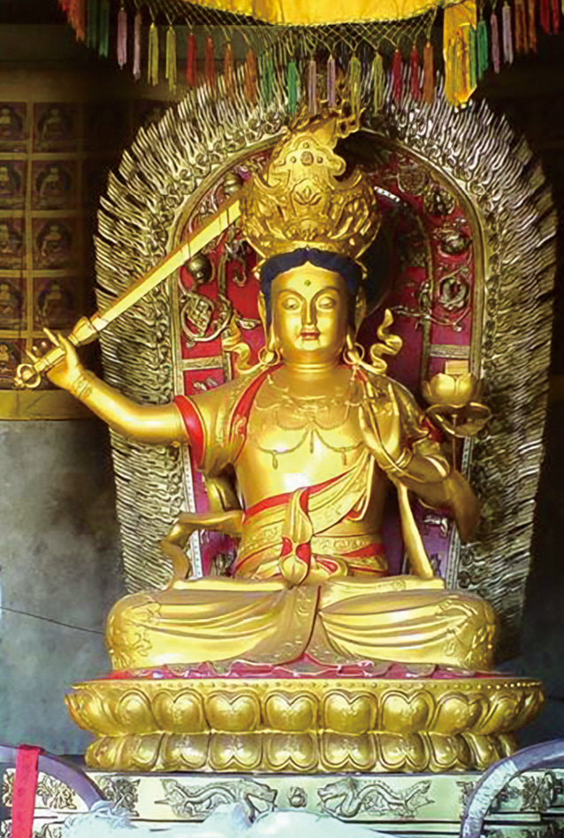
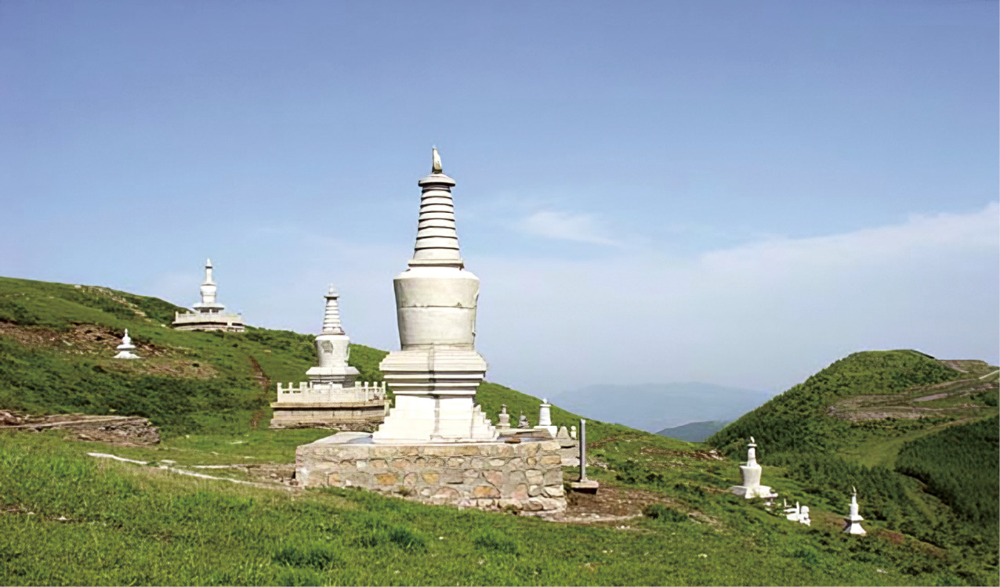
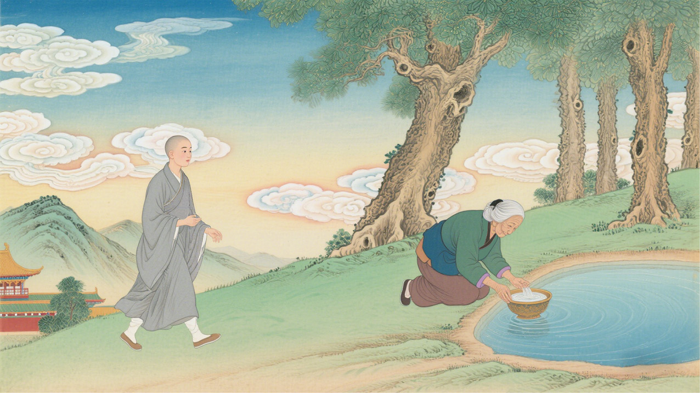
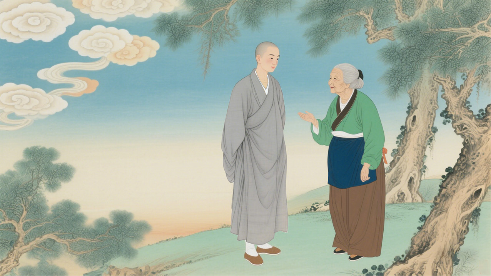
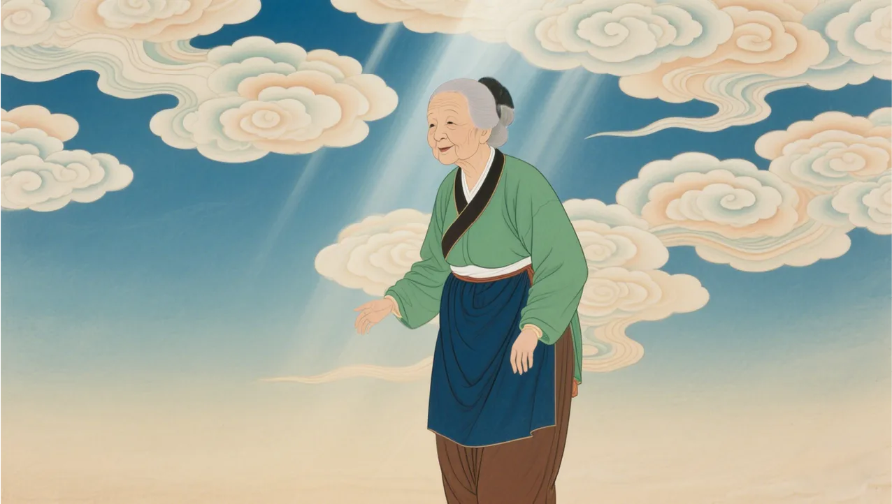
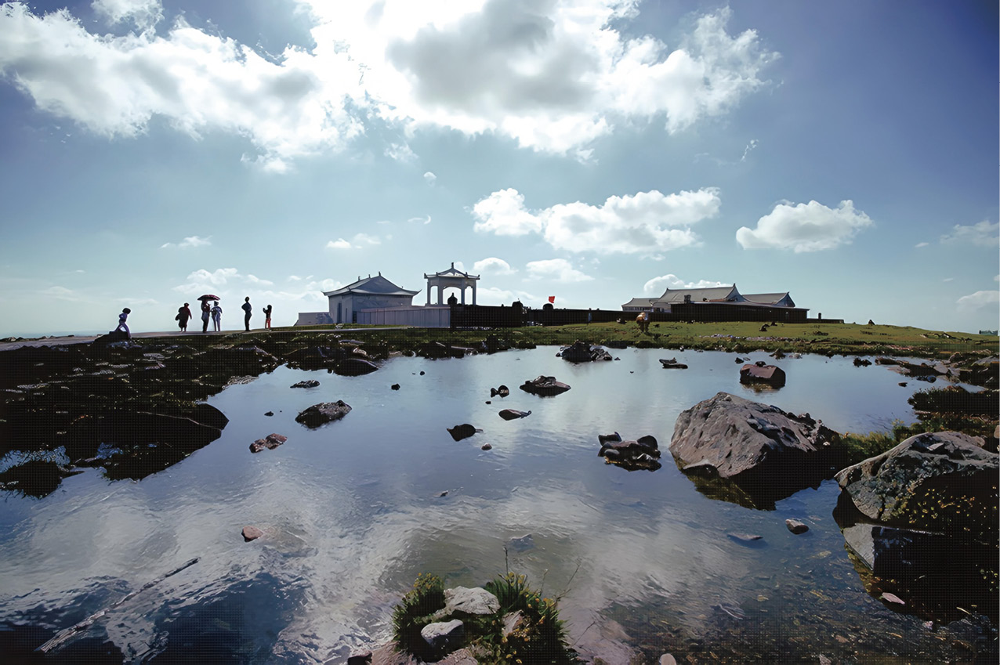
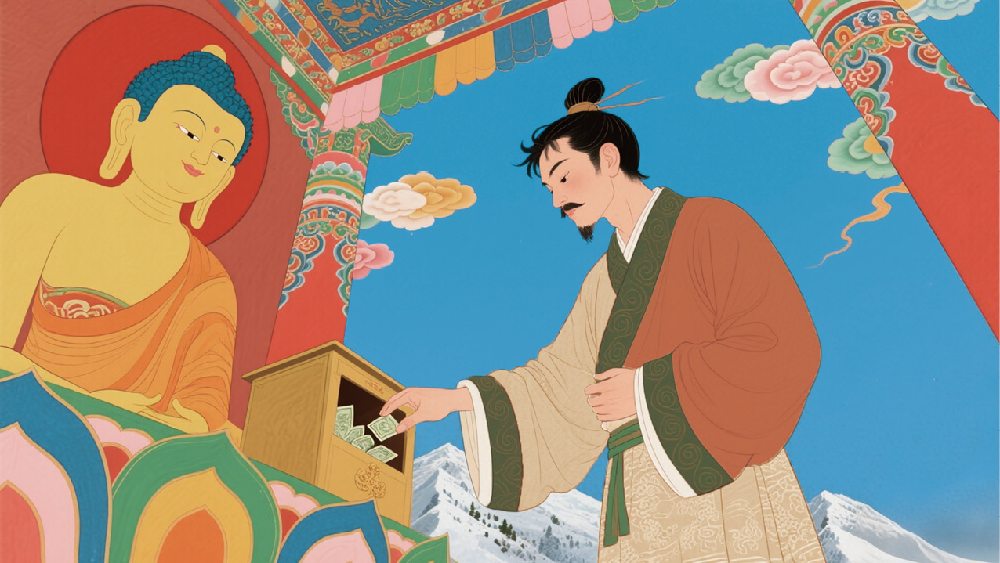
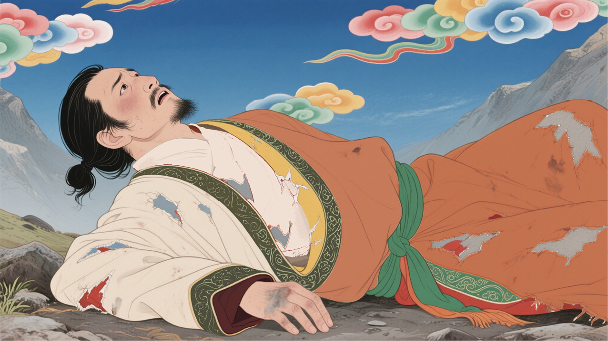
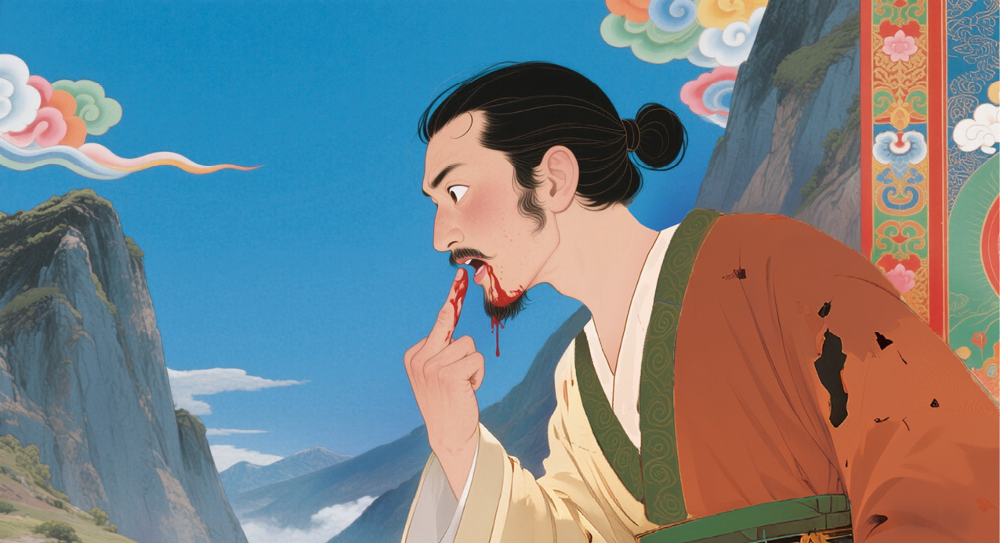
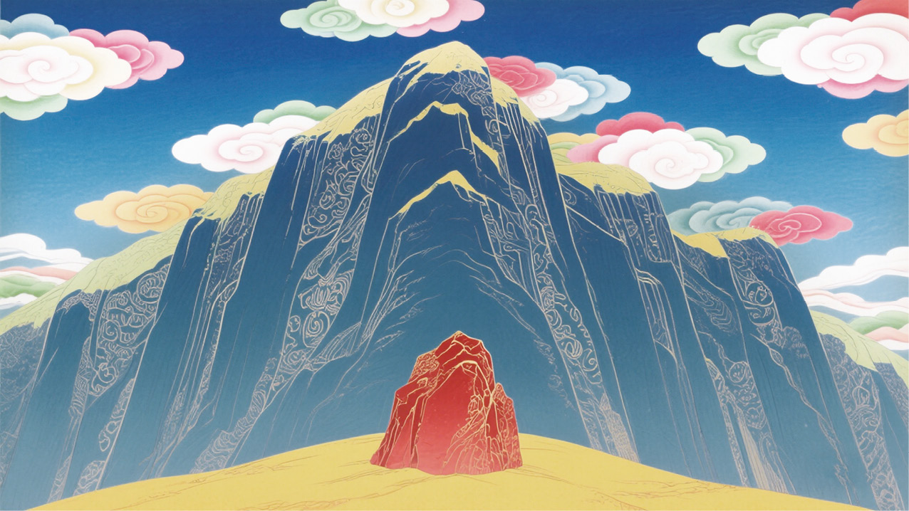

# ·五台山的庄严

第三，真实宣说五台山神奇的器情庄严，别说三个特别具加持力的圣迹。

一、五台是五方佛和五部文殊的刹土

五台山，位于今天山西省境内。要前往此地，从成都乘火车到太原市约1493公里，再从那里前往五台山约200公里，乘公共汽车一天内可以顺利到达。

这座山有五个台，代表五方佛的刹土：东台是金刚萨埵的刹土，南台是宝生佛的刹土，西台是无量光佛的刹土，北台是不空成就佛的刹土，中台是毗卢遮那佛的刹土。

同样，这里也是五部文殊的刹土：

中台，山形如菩提塔，名为翠岩峰，象征平等性智，是黄色孺童文殊的刹土。这里有藏王赤热巴坚在山顶亲见文殊菩萨骑狮子被上万菩萨围绕的圣迹等二十八处加持圣地。现今这个台顶有佛塔和演教寺，寺内供奉着一尊奇妙的孺童文殊菩萨石像，法王如意宝携眷属曾在像前发下大愿。从山脚白塔到山顶约二十公里。

东台，山形如吉祥多门塔，名为望海峰，象征大圆镜智，是蓝色利智文殊的刹土。这里有善财童子拜见文殊菩萨的修行洞等十四处加持圣地。山顶有观海寺，从这里可以远眺东方的云海，尤其在夏季清晨五点左右，能够清晰地看到太阳从东方云海中缓缓升起。此地的天空常布满彩虹帷幕，空气中弥漫着青莲花的芬芳，白色云海波浪遍布各方时，极为迷人，呈现出人间净土的景观。从白塔到山顶的距离与中台差不多。

南台，山形如神变塔，名为锦绣峰，象征法界性智，是红色智慧文殊的刹土。这里有大成就者佛护曾在芦苇林见到文殊菩萨后建立的尊胜佛顶塔等二十一处加持圣地。山顶有佛塔和普济寺，法王如意宝曾到此广发大愿。这座山遍布香气四溢的文殊花，食用后能忆起前世并增长智慧。从白塔到山顶约二十五公里。

西台，山形如孔雀开屏般的涅槃塔，名为挂月峰，象征妙观察智，是白色狮吼文殊的刹土。这里有乐匝布与文殊菩萨对话的两座寺院等十七处加持圣地。山顶原本有隋文帝建立的法雷寺，但如今只剩下遗址。此地还有两座白塔。《清凉山志》记载，山顶有成就者在石头上留下的马蹄印和图案等。北方有一个水池，名为“文殊洗钵池”：从前，法雷寺有一位名为明信的僧人，他从山脚返回寺院的途中，看到一位老妇人在洗钵，便问她从哪里来。她说来自西台顶的法雷寺。僧人说他也来自那里，但从未见过她。老妇人说：“我常常看到你，但你看不见我……”两人交谈片刻后，老妇人就消失了，她被认为是文殊菩萨的化现，“文殊洗钵池”也因此得名。从白塔到山顶约二十公里。

北台，山形如降魔塔，名为叶斗峰，象征成所作智，是黑色无垢文殊的刹土。这里有印度大德帕单巴在甘露泉见到文殊菩萨以仙人老者形象显现的圣迹等二十八处加持圣地。据说，五个台总共有一百零八处圣地。然而，现在大部分已难以辨认，后来的学者与成就者有不同的认定，所以并不能完全确定。北台顶的寺院叫灵应寺。附近有一个湖泊，称为“黑龙池”或“金井池”。这个台顶比其他台都高，据说可以清楚地看到蒙古草原。在台顶北侧附近，有一块高约八九尺的红色岩石，称为“生陷狱”：据说在隋朝时，有一个名叫张爱的人，从台顶的寺院偷了很多钱。匆忙逃跑时，一阵狂风突然刮起，他被卷入空中，像树叶般身不由己，片刻后落入一个陌生的恐怖山谷，周围是几由旬高的悬崖。当时他想：“现在没有逃脱的机会了，我偷窃冒犯了文殊菩萨。”他生起强烈的忏悔心，将中指放在口中咬破。瞬间，那巨大的山崖变得越来越小，最终仅剩那块小岩石。现在它表面呈红色，据说是他中指的血迹。从白塔到山顶约二十公里。除北台和西台外，其他的台顶都有公路。

黑龙池

以上归纳性地讲述了五个台是五部文殊的刹土。
