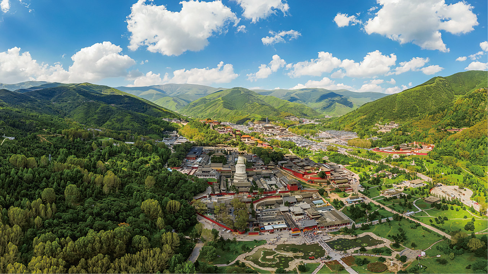

### 二、广说五台山圣地庄严

此内容分为：以圣教证成文殊菩萨与大班智达布玛莫札真实安住于五台山之理，到此圣地如何见到文殊菩萨之理，以及此圣地神奇的器情庄严。

第一部分包括两个方面。首先，说明印藏诸位智者成就者的殊胜本尊——文殊菩萨，现今仍安住于五台山圣地的情况：

#### ·以教证说明五台山是文殊刹土

《文殊师利法宝藏陀罗尼经》中说：“尔时世尊复告金刚密迹主菩萨言：我灭度后，于此赡部洲东北方，有国名大振那。其国中间有山，号为五顶。文殊师利童子游行居住，为诸众生于中说法。及有无量无数诸天龙神药叉罗刹紧那罗摩睢罗伽人非人等，围绕供养恭敬于是。”

又在《大方广佛华严经·诸菩萨住处品》中记载：“东北方有处，名清凉山。从昔以来，诸菩萨众于中止住。现有菩萨名文殊师利，与其眷属诸菩萨众一万人俱，常在其中而演说法。”这里所说的“清凉山”就是五台山的别名，理由将在下文解释。

《佛教史·智者喜宴》中引用《文殊根本续》称：“文殊大光明，现前彼境中，童子相安住。”

《章嘉目录》中也如是说道：“文殊菩萨亲自住在五台山。普贤菩萨从紫宝中自然显现而安住于峨眉山，受用犹如多闻天子。”

又《莲花生大士传》中说：“莲花生大士对前往汉地的班智达们说：‘汉地五台山的每座山都有不同名称，请说说。’哈绕那波上师回答：‘汉地五台山有五座山峰。中央山顶名为贝达则，孺童文殊住在那里；东方阿查德山顶，智慧文殊住在那里；南方达那山顶，利智文殊住在那里；西方阿巴山顶，狮吼文殊住在那里；北方苏达阿处山顶，无垢文殊住在那里。’”正如其中所述，《清凉山志》也提到了那是五部文殊的刹土。

再者，《七品祈祷文》中也说：“汉地五台山宫殿，佛身化现文殊尊，上下四方身利生，身为菩萨眷属绕，祈祷文殊圣尊众。”

同样，《文殊修法·降加持雨》中提到：“从大圣境五台山，万数眷属所围绕，文殊智慧勇识众，临此加持有缘者。”

《宁玛续史》中记载：“文殊友对弟子佛智说：‘若想证悟真实义，应向圣者文殊请教。’佛智想：‘文殊菩萨住在五台山，应该去那里。’于是前往……”

诸如此类的记载不胜枚举。
