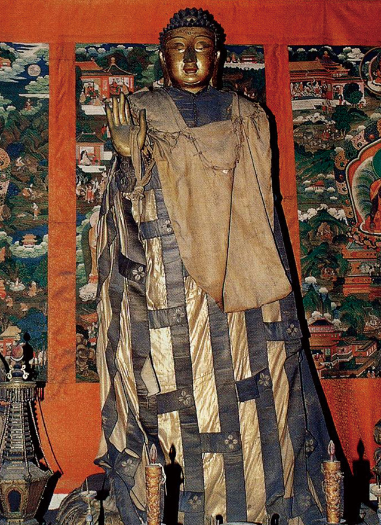
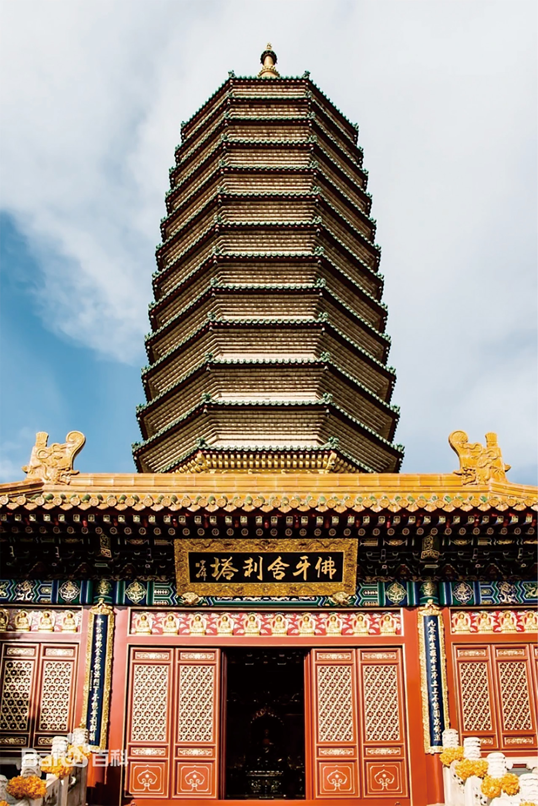
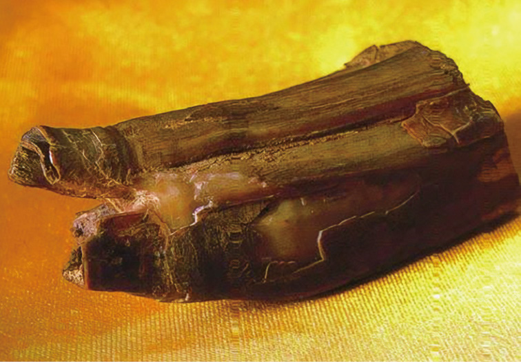
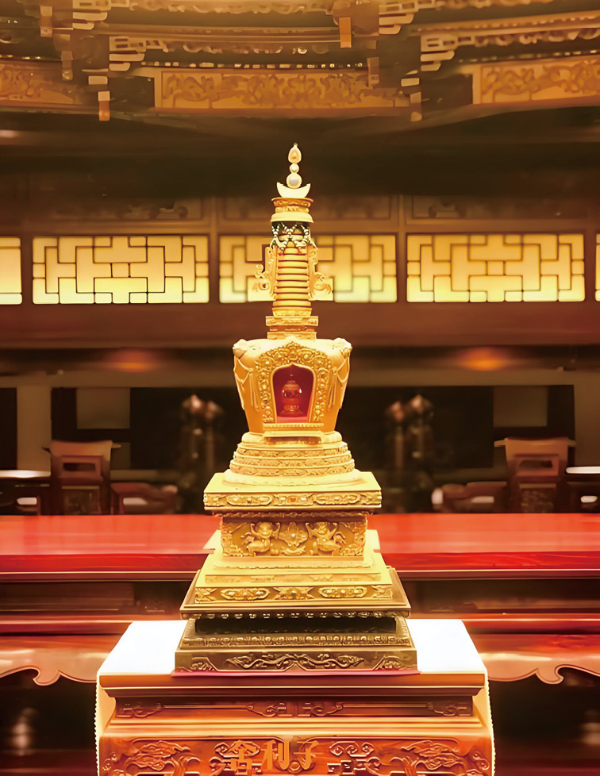

#### ·佛牙舍利

同样，佛牙舍利是我等无上导师、具足方便与大悲的释迦牟尼佛真身的牙齿，留在人间以利众生。现今，此牙保存在北京八大处的灵光寺中，安奉在十三层佛塔内。

《毗奈耶经》中记载：“佛有四牙舍利，一在天帝释处，一在犍陀罗国，一在羯陵伽国，一在阿罗摩邑海龙王宫。”《大般涅槃经》也提到：“世尊大悲力故，碎金刚体成末舍利，唯留四牙不可沮坏。”

如上所述，释迦牟尼佛的第一颗牙齿由帝释天等天神迎请至三十三天；第二颗由犍陀罗国王等人类迎请；第三颗由羯陵伽王等罗刹迎请，此地即今天南亚印度洋中的小岛国——斯里兰卡，根据根登群培的《印度游记》，这颗牙齿至今仍在那里；佛陀的第四颗牙齿由阿罗摩邑龙王迎请并供养。

同样，佛陀的舍利以摩揭陀国的度量是八升，被分为八份，由八大国王各自造塔供养。多年之后，阿育王搜集了这些佛舍利，在夜叉的帮助下，于全世界的千万个地方，建造了千万座内含如来舍利的佛塔，这样的历史记载不胜枚举。有些汉藏佛教史中提到，佛塔的数量常被称为“八万四千塔”。

因此，今天在灵光寺供奉的佛牙舍利，即为犍陀罗国王迎请的那颗。此牙后来经印度西部的巴基斯坦，传至现今的新疆。之后在5世纪时，经过古代汉地的首都南京、长安等地，最终迎请至北京。其间，缅甸和斯里兰卡等国也曾迎请并供养数日后，又送回原地。简而言之，这颗佛牙被迎请到汉地已有一千五百多年了。

此外，根据汉文和英文的佛牙舍利简介，佛陀涅槃后，人间保留了两颗佛牙作为信仰的所依：一颗在斯里兰卡，另一颗则经巴基斯坦等国传至汉地，即现今的这颗佛牙。

此牙现安奉在八角十三层的佛塔内，塔高约51米。在红旃檀宝座上，有一座纯金打造的小佛塔，高约1米，塔腹内金莲花瓣绽放的中央安奉着佛牙，从前方可清晰瞻仰佛陀的珍贵牙齿。据说，这座金塔由135公斤纯金打造，周围有狮子、金刚杵、莲花等美丽图案，镶嵌着各种珍宝，令人心醉。特别是在塔顶上，有一颗稀世之宝，据说是某位汉地皇帝母亲的供养，其价值甚至超过整座金塔。佛塔四周，还有四座较小的金塔。

在这五浊恶世极为严重的时代，虽然我们福薄，无缘亲见佛陀本人，但能够瞻仰供奉佛陀真身的珍贵牙舍利，也是巨大的福报。第十七胜生周的第一年——火兔年（公元1987年）萨迦月十五日之吉日，十世班禅额尔德尼·确吉坚赞与法王如意宝晋美彭措两位大德前来，与随行的具戒僧众一起，念诵《文殊祈祷文》《佛法兴盛愿文》等，举行了开光仪式。

从成都到供奉佛牙舍利的北京，距离超过1800公里，乘火车需四天，乘飞机约两小时便可到达。

以上为附带说明。
