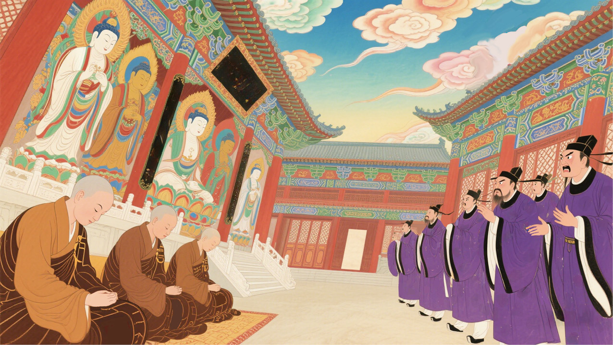
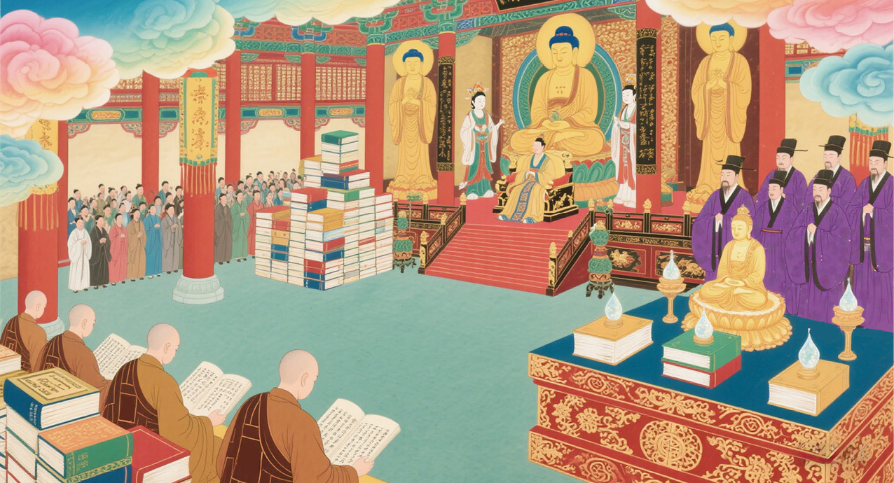
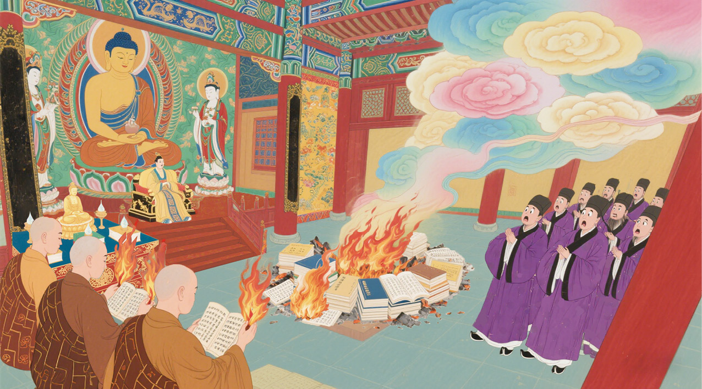
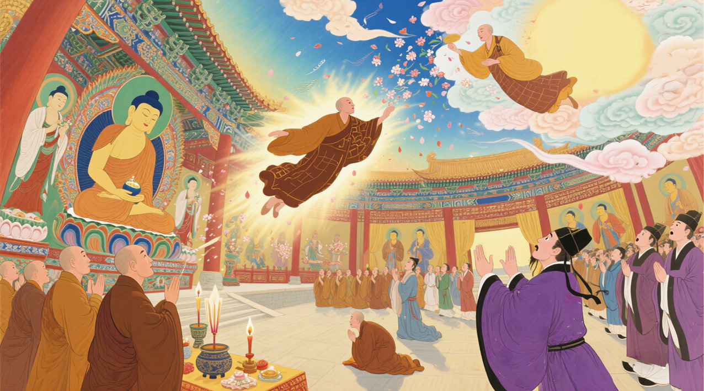
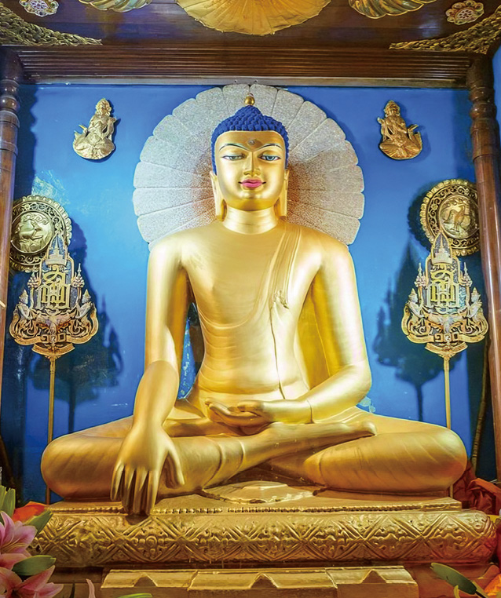
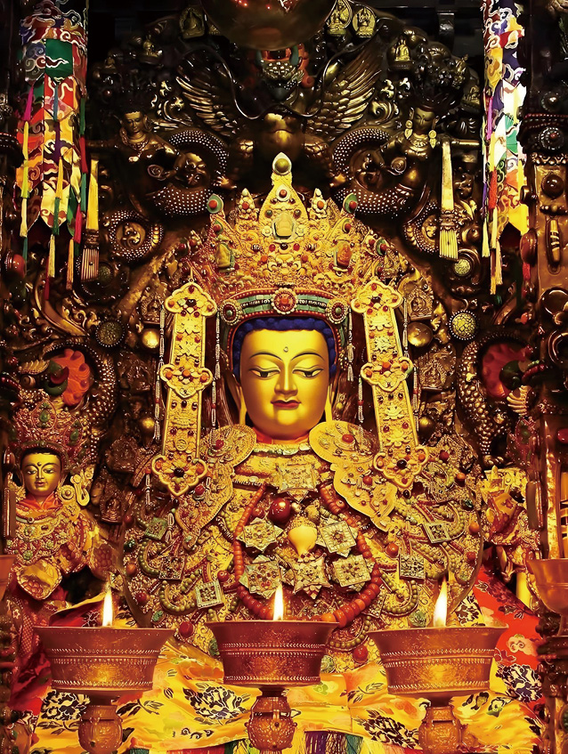
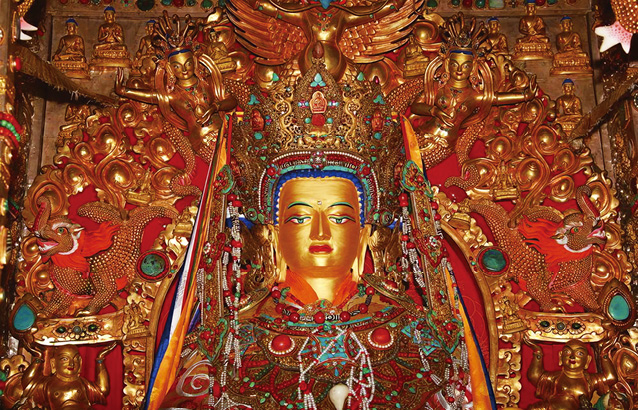

#### ·佛陀等身像

此外，在这个世间，还有许多被佛菩萨加持、拥有天然圣迹、稀有庄严的殊胜圣地，以及由神通形成的令人神往的三宝所依等。

与佛陀本人加持力等同的特殊圣物：一般而言，昔日出世的化身工巧王毗首羯磨，曾以神通将金刚座和香巴拉等地的土、水、各种如意宝珠合为一体，所造的佛陀二十五岁等身像，现存于菩提伽耶；十二岁等身像“觉沃释迦牟尼”，以及八岁等身像“觉沃不动金刚”，这两尊佛像现今在拉萨。这些都是佛陀亲自开光加持，并授记未来会利益众生的佛像。

二十五岁等身像

十二岁等身像

八岁等身像

同样，根据莲花生大士在《伏藏圣地记》中的明确记载，现在的塔公觉沃“见者受益”，也是佛陀亲自开光加持，且由工匠王毗首羯磨制造的佛像。
