# ·到五台山如何见到文殊菩萨

第二，凡是来到汉地五台山的信众，无论高低贵贱上中下任何人，都能根据各自界性、根器、信解、意乐的不同，无欺地亲见怙主文殊菩萨的尊颜。

面见的方式是：对于上等根器者，文殊菩萨会直接显现，赐予灌顶、教言，并与其进行法义交流等；对于其他人，文殊菩萨也会依其各自的信心、清净观、业障轻重，应机调化而显现各种形相。如《无垢光天女请问经》中所说：“若问：文殊之行为如何？于一切众生前，随心所欲转变身相，菩萨相、国王相、王妃相、比丘相、婆罗门相等属于欲界的所有众生相。譬如，对乐师显现精通音乐技艺的各种形相，对具贪众生显现美女相……”

如是显现为国王、王妃、沙弥、比丘、婆罗门、汉人、藏人、蒙古人、老人、少年等人与非人相。也就是说，来到此圣地的信众，若不从一开始就对所见的一切人与非人相生起“这是文殊幻化”的清净观，那么就很难辨认。

1．达西老猪

从前，一位蒙古格西对他的弟子说：“你去汉地五台山，就会见到文殊菩萨，我无法利益你。”弟子去了五台山修行，但没有见到文殊菩萨的任何身影，于是返回后去了汉地峨眉山，看见一个大房子里有许多不认识的汉人在吃饭。他进去乞食，但无人回应。里面有一位汉族官员，坐着向他招手。他犹豫不决地走过去，那人给了他很多剩饭，并问他从哪里来，要到哪里去。他回答：“我去五台山想见文殊菩萨，但没有见到，现在准备回去……”他讲述了自己的经历。那位汉族官员说：“如果你现在要回家乡，从这里往前有座名为雅杰的城市，那里有个叫达西的人，请把这封信交给他。”说完给了他一封信，还有许多路上的食物。

他带着信来到雅杰城，到处打听达西在哪里，但谁都不知道。他再三询问，仍未找到名叫达西的人。这时有人说：“这里有一头老猪叫达西，对众生很慈爱，除它之外，再没有叫达西的了。”他想可能是它，就让人带路找到老猪，把信扔在它面前。

老猪用鼻子拱开信，稍微看了一眼后立刻死去。他感到惊奇，拿起信看，上面写道：“致菩萨达西：您在此以旁生身利益众生的事业暂时已圆满，现在请前往东方，行持其他行境。文殊敬上。”他这才意识到，之前的汉族官员正是文殊菩萨，于是赶紧返回，但发现一切都不见了。

据说，这个弟子以见到文殊菩萨的加持，最终获得了成就。

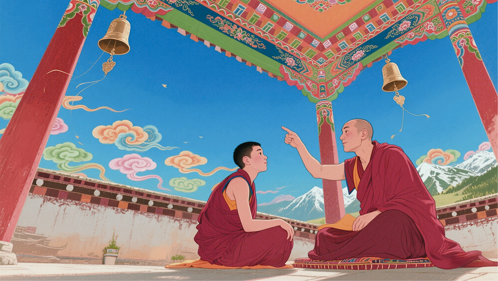

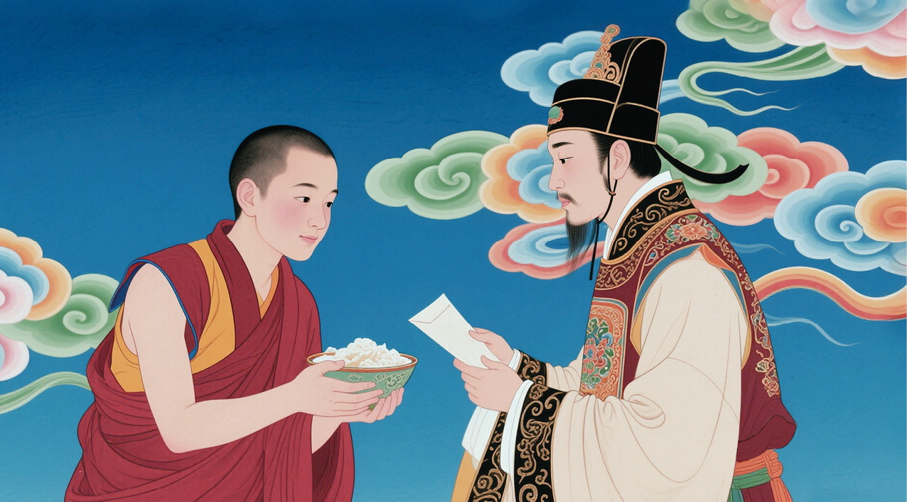

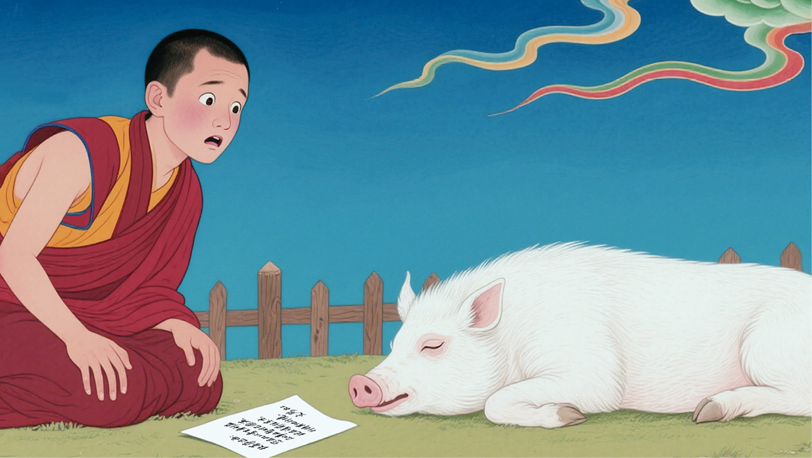

2．白鹿老人

同样，文殊菩萨有时以老人的形相显现：后魏时期，恒州刺史呼延庆为了打猎来到五台山，随行的有四名猎人。他们看到一只白鹿，就想射杀它，于是穷追不舍。白鹿逃进一个大宅院里，猎人们准备进去时，一位白发老人拄着拐杖走出来，问他们：“你们为什么追我的鹿？”猎人们回答：“不杀它就没有食物，我们又累又饿，实在没办法。”老人用手杖指向东方，说：“那边有水果，你们可以充饥。”说完，老人和院落瞬间消失了。

他们惊奇地往东走，果然发现了许多水果，但无论用刀或手都无法摘下。这时，他们意识到这是文殊菩萨的幻变，于是发誓从今以后不再打猎，立即所有水果自行掉落，他们高兴地吃了起来。

然而，过去常打猎的大罪人虽然吃的是同一种水果，但尝起来全是苦的。其他人根据罪业的轻重，品尝到的则是酸味或甜味等。由于这种亲身感受，他们对业因果产生了信心，知道是在感受业果的报应，因而对文殊菩萨生起极大的信心。吃完后，所有水果也随之消失。此时，他们才明白，这是文殊菩萨赐予的食物。那位老人正是文殊菩萨，白鹿则是他的坐骑狮子。

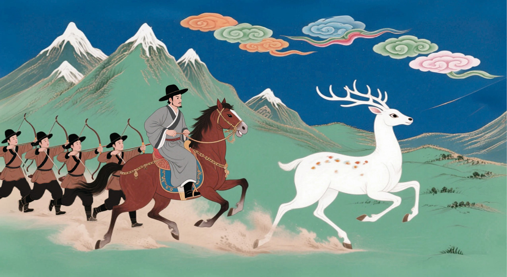

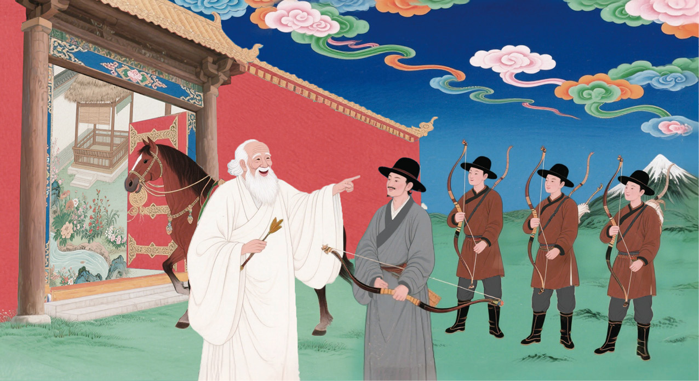

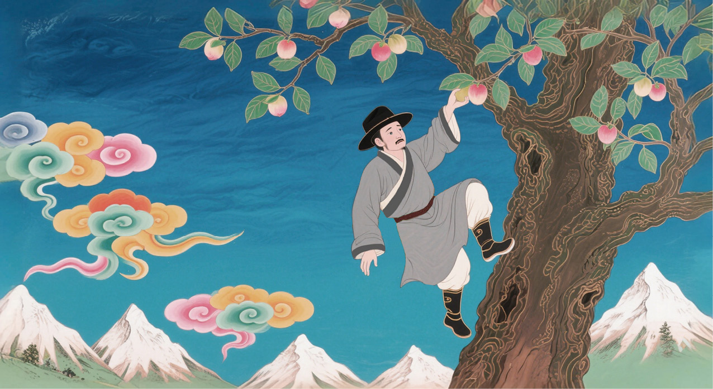

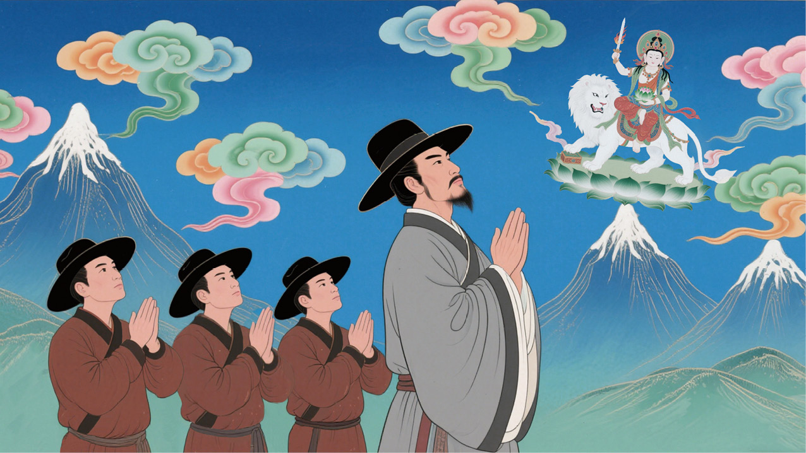

3．丑陋病僧

此外，文殊菩萨有时以丑陋的形象显现：从前，一位定州的僧人名叫明勖，他渴望亲见文殊菩萨，于是前往五台山，一心一意地祈祷。

一天，他面前突然出现一位不认识的僧人，双腿一长一短，双眼一大一小，两个鼻孔向上翘。他双手合掌问：“圣者，您从哪里来？文殊菩萨住在哪儿？”那位僧人也反问了同样的问题。两人于是明白，对方并非文殊菩萨，便结伴同行，一起住了很多天。

有一天，他们来到东台脚下时，那位僧人突然昏倒，吐了许多血，明勖赶紧将其搀扶起来。此时，附近突然出现一座寺院，许多僧人从里面出来，迎接他们进入寺内。明勖看到了奇妙的佛殿和文殊殿，他们被安置在一个房间里，僧人们则去参加法会了。

天色将晚时，病人口中再次不断吐出大量脓血，整个房间弥漫着臭味。这时病人说：“十分感恩你，我这病既不能死也不能好，一直这样痛苦。现在你可以离开了。”明勖坚持不走，病人又说：“你可能会见到文殊菩萨，请把我留在这里，走吧。”被再三催促后，明勖说：“那我先出去一下，见到文殊菩萨后再来照顾你。”说完，他拿着手杖从寺门走出。

刚一跨出门，他感受到了一种前所未有的殊胜空乐证悟。这时，突然听到一声响，他回头一看，寺院和佛殿都消失了。远处的云中，文殊菩萨骑着狮子，正在离去。明勖感到极度懊悔，双手捶胸，以悲声祈祷并数数顶礼。文殊菩萨再次从空中宣说偈颂教言，随后一切都消失了。

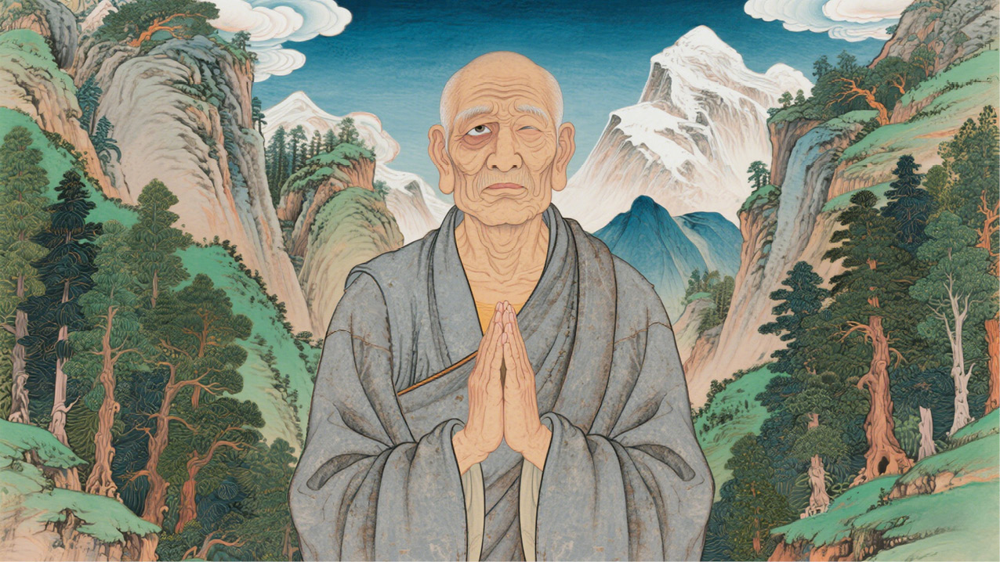

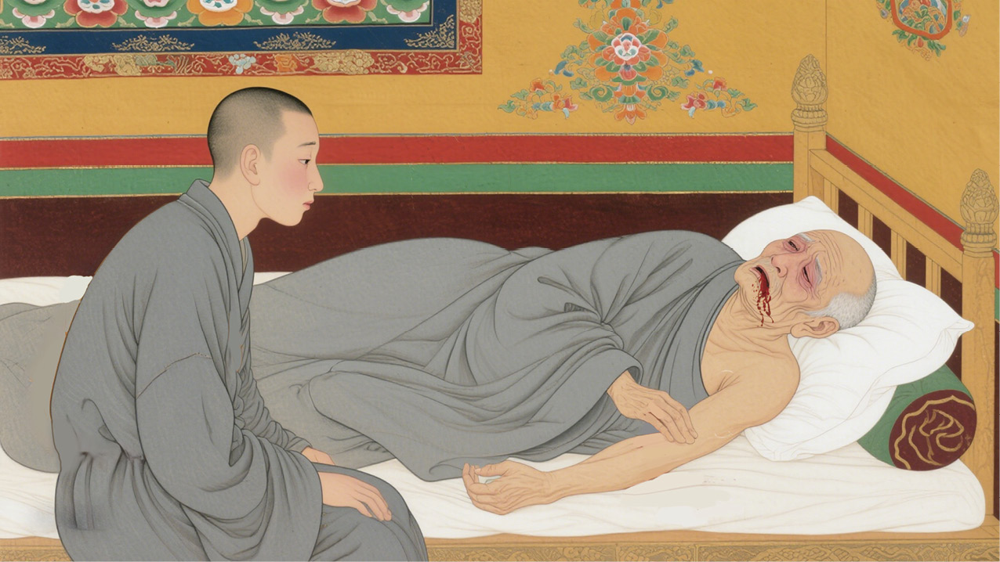

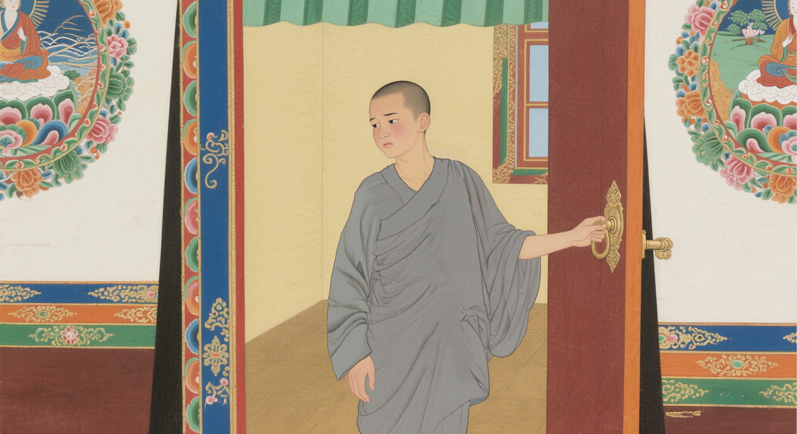

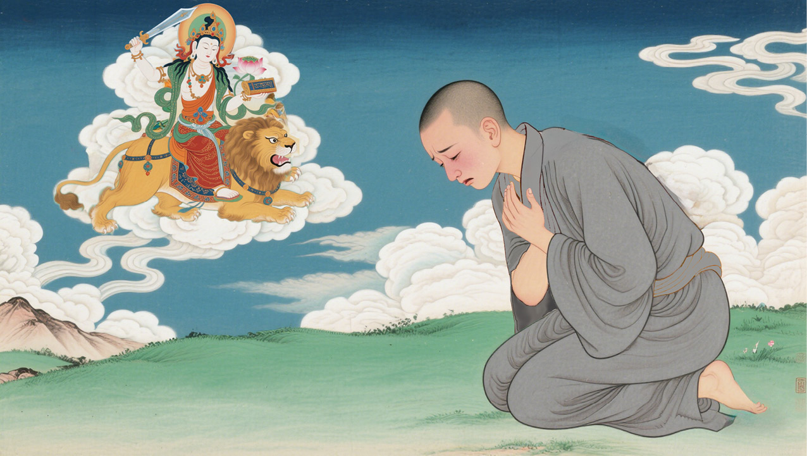

4．空中现身

此外，还有一位汉地僧人不理解《华严经》中的许多句义，虽然请教了很多智者，但仍无法解开疑团。于是，他历尽千辛万苦，前往五台山祈祷文殊菩萨。

有一天，文殊菩萨亲自从空中显现，并为他说法。他由此斩断了疑惑，心满意足地回去了。

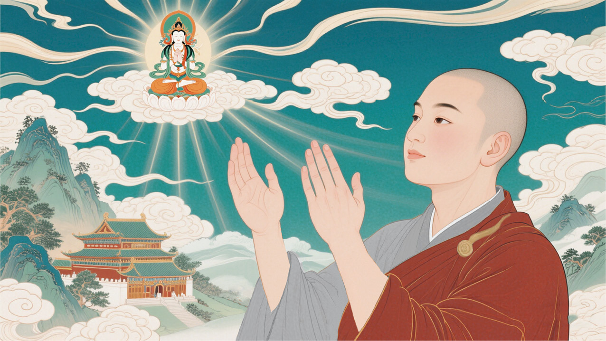

5．乞丐文吉

一般来说，凡是来到五台山的人，不管是谁，文殊菩萨都亲口承诺“接一千送八百”（从一千里外迎接，送行至八百里处）。汉地大成就者虚云老和尚的传记中提到：他曾用三年时间，三步一拜前往五台山。一次，当他到达现今河南省边界时，遇到连续多日的大雪封路，但他依然坚持前行。然而，他的路粮用尽，因饥饿疲惫、长途跋涉、饱受严寒，不由自主地倒在积雪中，昏迷过去。就这样，他躺了好几天，身上积了一尺多厚的雪。

就在此时，文殊菩萨化身为一位乞丐，扫去他身上的积雪，将他扶起，来到旁边的一个小茅棚，生起火，把他抱进去，慢慢地往他口中灌入稀粥。虚云和尚渐渐苏醒，恢复了意识。他想继续礼拜前行，乞丐劝道：“你实在太辛苦了，没必要再朝拜了。”但劝阻不了他。乞丐说：“那我来帮你背行李吧。”于是拿起所有行李，一起与他同行数日。

有一天临近五台山时，乞丐说：“现在我带着你的行李先行一步。五台山没有一个人不认识我，我叫文吉，你到那里再来找我。”说完就离开了。

虚云和尚一直拜到五台山时，便向人打听文吉。众人都说：“这里根本没有这样一个人，可能是文殊菩萨去迎接你的。”后来，虚云和尚发现自己的行李被放在一座文殊殿中。

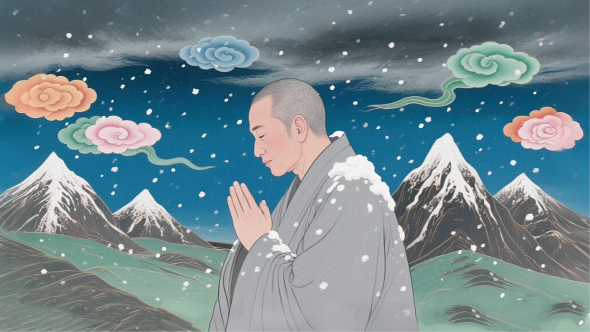

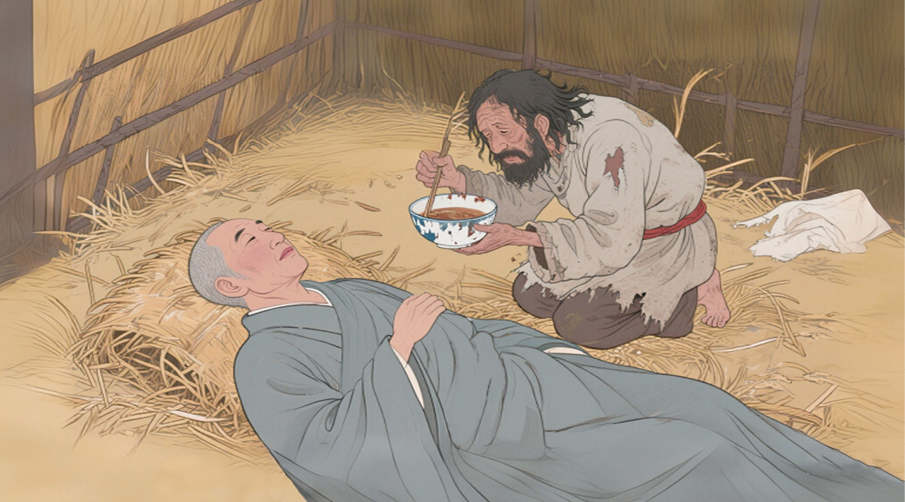

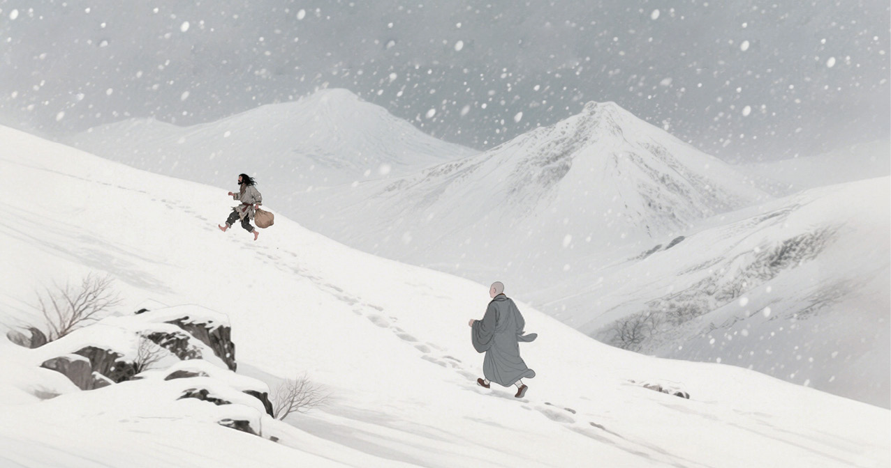

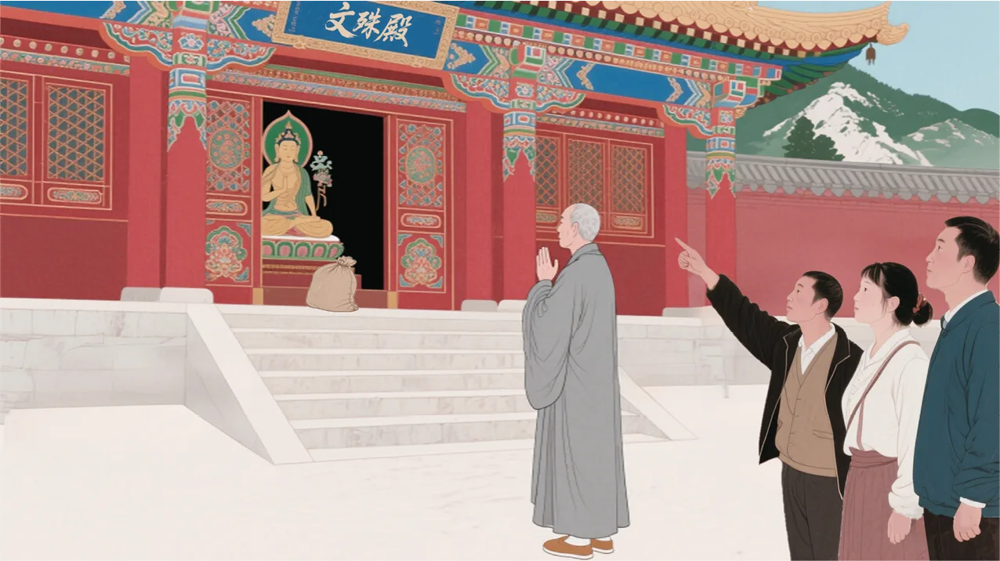

6．“七十二”老人

在“文革”期间，一位名叫法严的喇嘛，打算在五台山的一处寂静地闭关。他带着一百斤左右的粮食和行李，乘车抵达五台山脚下。由于行李太重无法搬动，这时从附近走来一位年迈的老人，头裹黄色头巾，穿着棉质长袍和草鞋，年龄约六十多岁，说道：“喇嘛，让我帮你拿行李吧。”老人扛起所有行李，迅速走了几公里路，到达此地的一家旅馆门口。喇嘛心想：“这么大的年纪，还这么有力气，真是奇怪。”

当晚，两人同住在那家旅馆。喇嘛问老人家乡在哪里，老人回答：“我家就在这五台山，我的名字叫七十二。”喇嘛感到惊讶，问道：“为什么你的名字叫七十二？”老人说：“因为我母亲七十二岁时才生下我，所以乡亲们给我取名七十二。”喇嘛心想：“女人七十二岁还能生孩子，这样的事情简直闻所未闻，不知他在说什么。”

两人临睡前，老人说：“喇嘛，修行人若不能调伏心的野马，修行会非常困难。”喇嘛回答：“明白了。”然后慢慢入睡。

第二天早晨起床后，他们一起吃了饭。准备分别时，喇嘛说“感谢你帮我把行李背了这么远”，想给他搬运费。但老人没有接受，说：“我经常这样帮助出家人，这是举手之劳，不需要任何报酬。”说完一会儿就消失了。

喇嘛这才意识到他是文殊菩萨。仔细思考他的汉族名字，发现“七”和“二”是第一个字“文”，“十”则是第二个字“殊”需要十笔画，由此明白了“七十二”这一名字的深意。

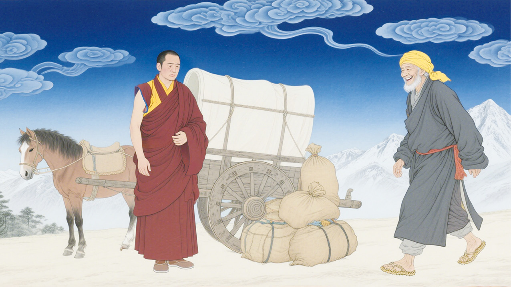

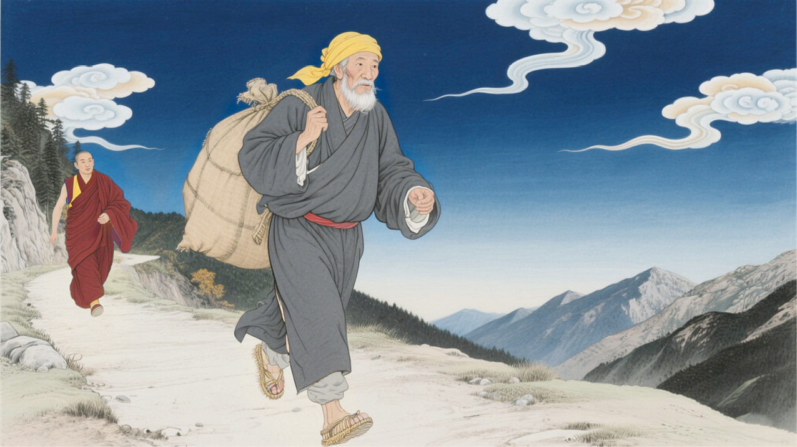

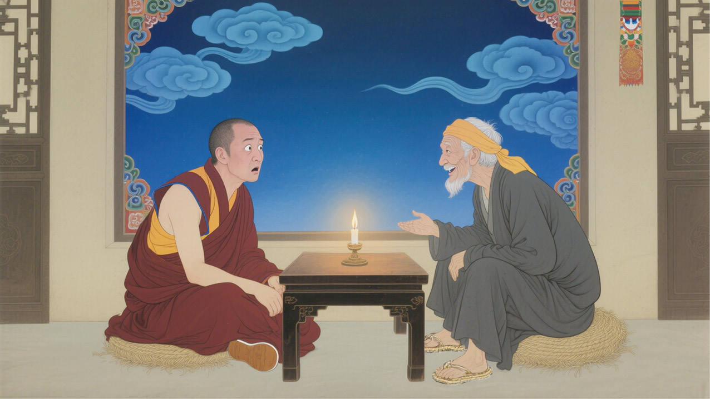

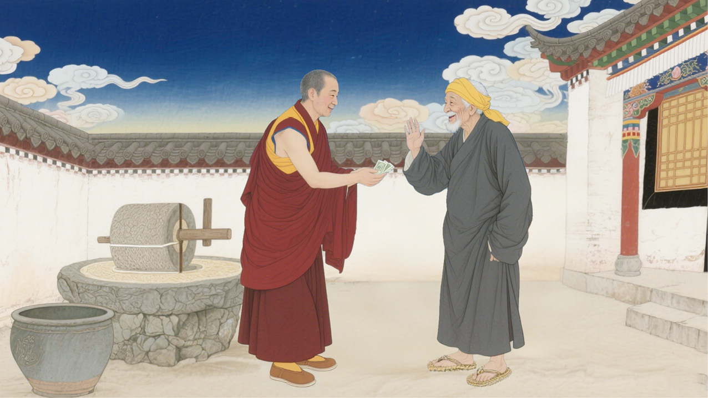

7．红牛牧人

再者，被称为白文殊化现、精通汉藏各种文字的上师云丹嘉措的弟子——青心居士，遵照上师的指示来到五台山圣地，用一百天专心祈祷，希望能见到文殊菩萨的尊颜。

他日夜不停地修行，但没有任何验相。到了最后一天时，他想到第二天便要回家乡，决定今天先去山顶转一圈。他爬上山顶后，下山时太阳快要落山了，他没有带任何干粮，饥饿疲惫地在路边休息。

这时，突然从背后来了一位约四十岁左右、衣衫破旧的牧人，赶着一头红牛，手里还带着许多用面粉做的馒头，边吃边走。居士向他解释自己的困境，请他给些食物。那人没有说话，给了他一些吃剩的食物。居士高兴地吃下去，顿时品尝到一种无法言喻的极佳美味。他不禁心生怀疑，心想他到底是谁，便追了上去，问道：“大哥，您是文殊菩萨吗？”对方回答：“我不是文殊菩萨。”居士再再询问，那人说：“好吧，我是文殊菩萨，你有什么要说的？”

此时，居士惊讶得说不出话来。随即，红牛变成狮子形象，牧人说：“现在骑上狮子吧。”他走近时，看到狮子神威十足，不敢骑上去。牧人说：“那么，你回家乡后继续忏悔罪业，好好修行吧。”说完，牧人骑上狮子，瞬间变成了文殊菩萨身相，在前方空中越升越高而离去。居士在极度后悔与恭敬交织的心情中，以额头触地顶礼，心中生起了明乐无念的殊胜觉受。第二天他返回了家乡。

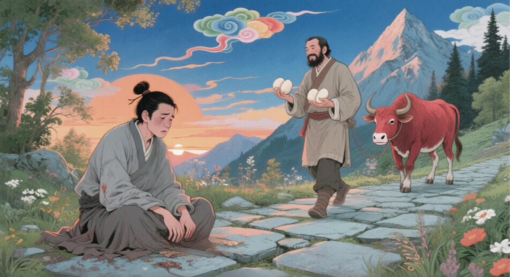

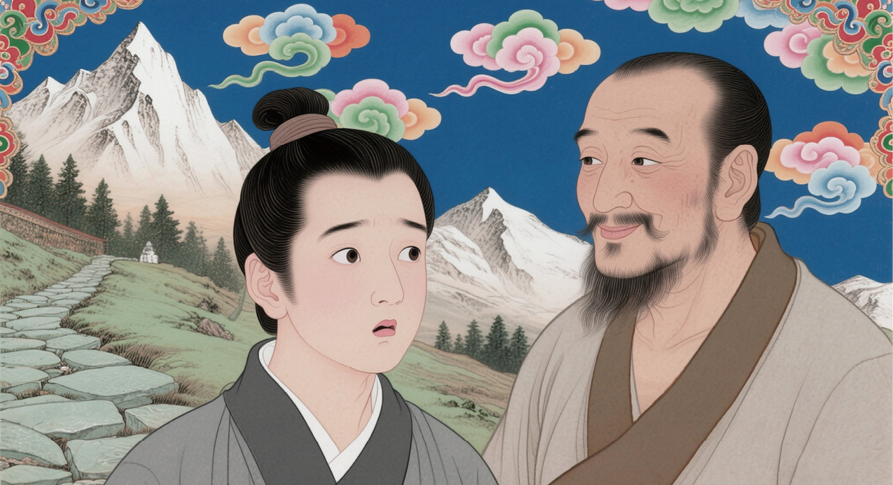

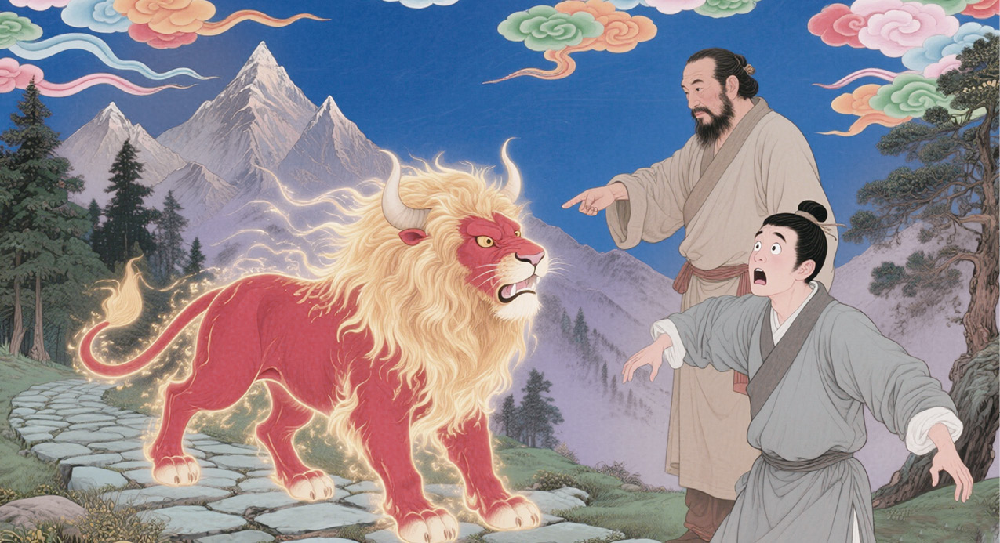

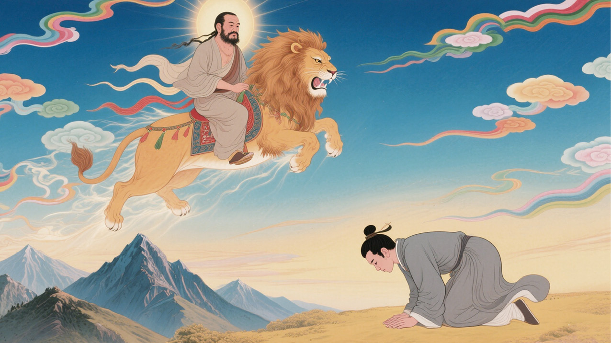

8．顽皮小孩

此外，据说五台山曾有一位比丘，名叫慧光，他在南台背面见到过文殊菩萨的童子形象。

同样，从前还有一位僧人在五台山长期修持文殊菩萨。有一天，他在山顶遇见了一个小孩，僧人问：“你去哪里？”小孩也这样问他。他回答：“我去见文殊菩萨。”小孩说：“我也去见文殊菩萨。”于是僧人说：“那我们一起走吧。”

他们同行同住了多日，这个小孩非常顽劣，经常责骂僧人。一天，当他们一起走时，小孩突然像彩虹消失般不见了。僧人这才明白他就是文殊童子，感到十分懊悔。

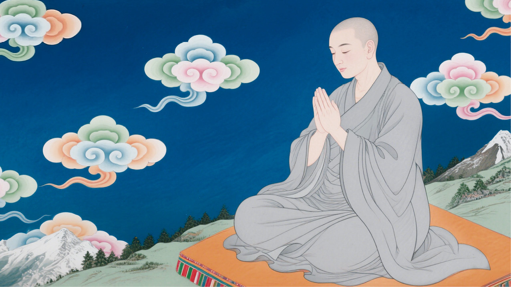

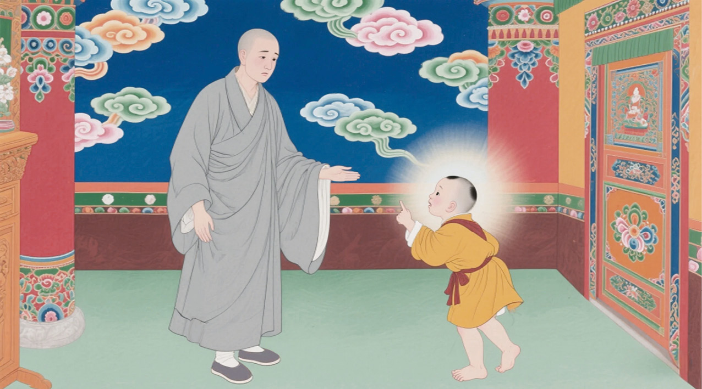

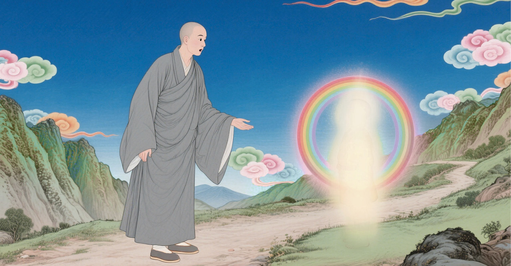

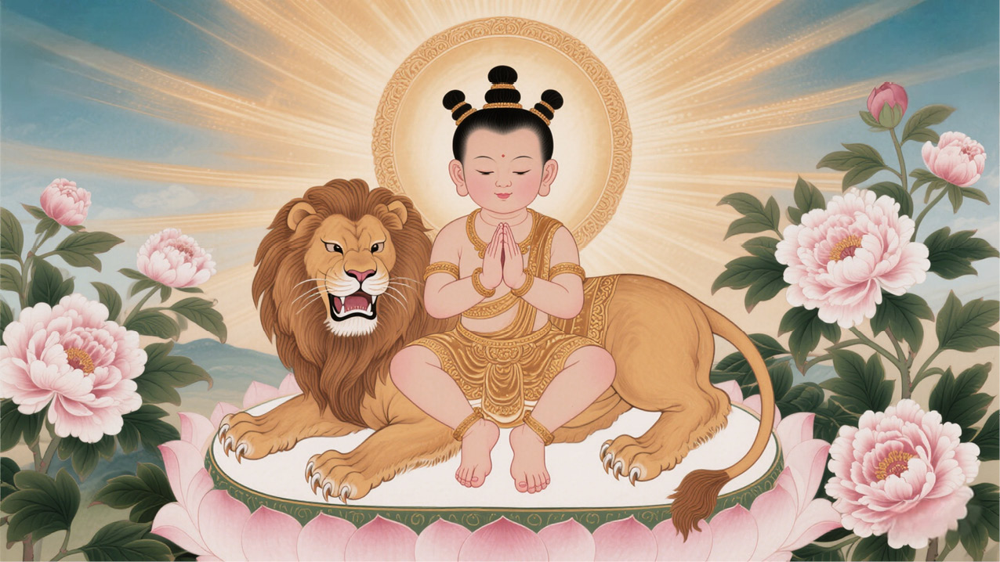

除此之外，文殊菩萨还常以男女等不同形相显现，这将在下文进行说明。

总之，五台山圣地的草木花卉、河流池塘、山川森林、草地花园等一切，都是文殊菩萨的幻变自相。尤其与其他圣地不同的是，常常在整个天空中显现白云或五色彩虹的圣尊身，或是各种文字、宝剑经函等种种手帜的庄严，凡是来此地的人都能见到。见到这些，就是见到了文殊菩萨的十种光等相。如《山王庄严论》中所言：“示现种种幻化相，文殊与幻化神变，放射光芒验相等，随所化性不固定，具信士前显光相，现相虽有不可量，今按种别分十光。”其中，第一种光是极广大光，“五色如彩虹，圆满如金轮，遍覆天地间”……如是详细描述了见到文殊十种光的情景。
