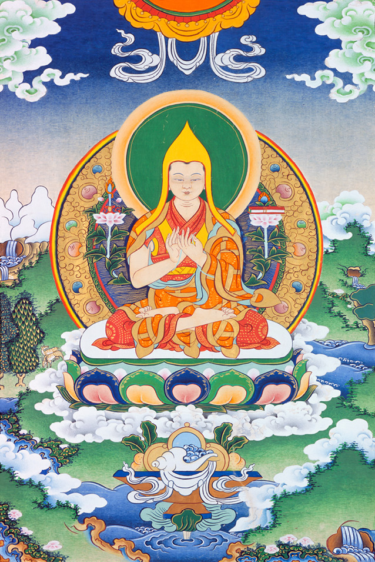
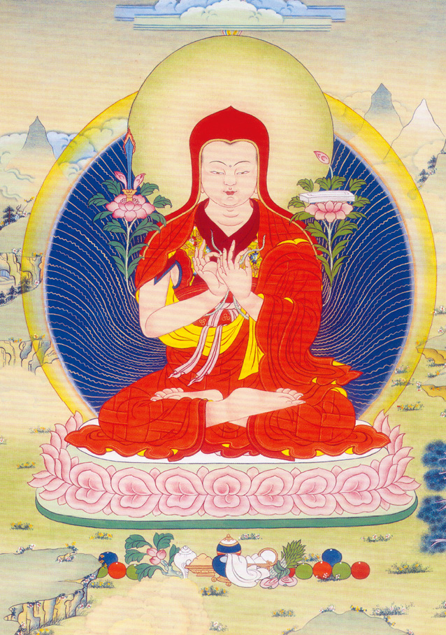
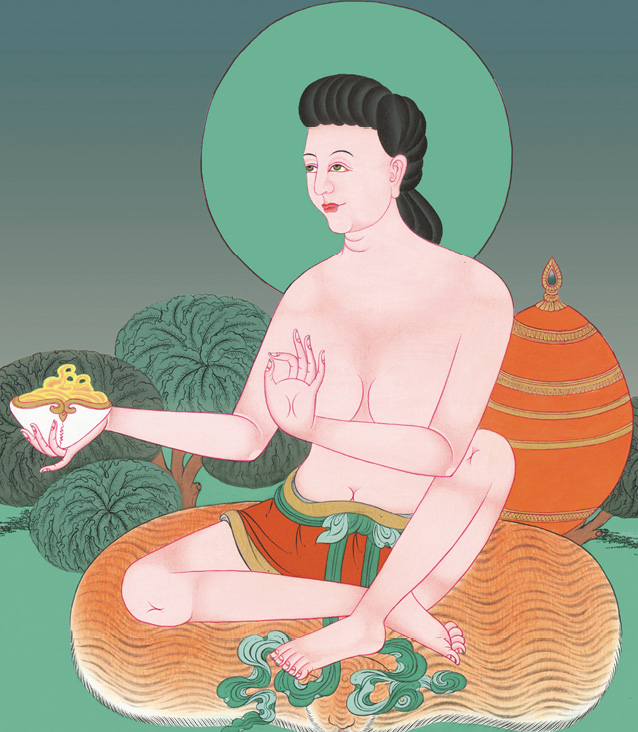

# ·印藏大德在五台山的经历

同样，宁玛、格鲁、萨迦等各派的教主们，也在此地拜见过怙主文殊菩萨，或以其本体安住于此护持佛法。

《前译续部宝藏·天鼓语》中讲道：“嘎绕多吉阿阇黎、幻化比丘阿嘎玛德、法王赤松德赞、王子拉吉、雅吉邬金朗巴、全知无垢光尊者、阿里大班智达等，尤其是五百班智达顶宝的大师无垢友，亦即大班智达布玛莫札，亲自承诺：以无漏身直至轮回未空之前，安住在文殊童子说法的圣地五台山，每一百年在藏地雪域投生一位化身，复兴心滴教法，清净一切迷乱垢染。如其承诺，他在中土南方降生为自生金刚晋美朗巴，身有明显的文字相。”其意将在下文说明。

《宗喀巴大师传·宝珠鬘》记载：“宗喀巴大师圆寂后，克珠杰随即祈祷，大师以先前的出家形象显现于白云团中，说：‘孩子，现在速做准备，我将派人迎接。’克珠杰问道：‘至尊上师现今住在何处？我也将去那里。’答言：‘一般而言，我的化身在空行刹土、兜率天、南赡部洲等地有许多。现今我在汉地五台山，为大约一千八百名金刚持比丘，上午宣讲中观和道次第，下午讲密集金刚、胜乐金刚、大威德金刚的生圆次第。你也应发愿往生彼处，通过长时间的强烈祈祷，不久我们就能相见。’对于其他所化众生如何积累资粮才能转生此刹土等问题，大师也给予了很多教诲。”

宗喀巴大师

《藏那巴·文殊慧光传》中说：“我认识梦后，飞到空中前往东方，到了一座被称为汉地五台山的美丽青山上，看到一座特别庄严的殿堂。我想这是至尊文殊殿，于是转绕并祈祷，但很久找不到门。最后从东方开了一扇门，我进入里面。那里有一个格外精美的殿堂，中央有一个大宝座，上面坐着上师萨迦法王，面向北方。我想这就是至尊文殊菩萨本人，便多次顶礼、转绕并祈祷，但他没有说话。他给我一本用许多绸缎包裹的经函，打开一看，是一本金制《真实名经》。之后很长一段时间内，我白天对空性义理生起智慧，晚上出现许多善梦。”

此外，《萨迦班智达传》中记载：“萨迦班智达在朗切则卡讲法时，许多人前往五台山朝拜。结果，所有人都做了相同的梦：现在文殊菩萨并不在五台山，而是在朗切则卡说法。醒来后，众人毫无怀疑地赶来，正好赶上法王在讲发殊胜菩提心，他们都得受了法。”

萨迦班智达

通常来说，至尊文殊菩萨是印藏诸位智者成就者的殊胜本尊，尤其是许多前辈持明上师与此大圣地有缘，借此获得了成就，成办弘法利生的事业。《心滴大史下部》记载：“西日桑哈大师前往五台山，于七年间在白拉嘎德阿阇黎前，学习了外内密共称的所有续、教、窍诀等。有一次，他在五台山东方的一个平缓柔顺的浴池中沐浴时，现见大悲观音并得到授记。之后，他前往印度依止蒋华西宁二十五年。”《续部全集目录》中也说：“为了更容易获得无上果，西日桑哈大师想精通其他密续，前往五台山跟随旃陀罗种姓的阿阇黎白拉嘎德，无余听受外内密的法并获得证悟。”

再者，关于嘉纳思札和布玛莫札大师，诸如《前译续部宝藏·天鼓语》中讲述：“金刚萨埵亲自现身，对布玛莫札和嘉纳思札两位授记道：‘奇哉，二位善男子，虽然你们五百世转生为班智达并修持正法，但之前并未得果，现在也不会获得。如果想在今生消除有漏蕴身而成佛，应前往汉地菩提树下的殿堂。’布玛莫札回去取了钵盂，立即前往五台山，遇见了西日桑哈大师，二十年间上师传授耳传外内密的一切教言，但并没有给予法本。

随后，布玛莫札心满意足地返回印度，向嘉纳思札述说了自己的经历。嘉纳思札也以最大的精进和努力前往汉地，依空行母的授记，在清凉大尸林遇见上师，三年中尽可能地做各种令上师欢喜的事情。最后，他献上金曼茶罗请求教言，九年间获得了带有法本的耳传教言。”这里所提到的汉地“清凉大尸林”，一些汉藏学者认为，现今在五台山善财洞附近，地下埋藏着大量的骨架，其中有很多汉人与蒙古人的棺材。

嘉纳思札

此外，同一历史中还提到：“最后西日桑哈圆寂后，安住于空中，将《导盲七钉》交到嘉纳思札手中，并授记所有秘密心滴的窍诀书藏于吉祥门柱内，取出后前往巴桑尸林。嘉纳思札依此而行。”如是所说的“吉祥门”，即现在的西安，也就是近期发现佛指舍利的地方。

再者，在下伏藏中共称的秋吉旺修的伏藏史中讲述：“上师秋吉旺修十八岁时，一天晚上梦见去五台山寻找青莲花，结果文殊菩萨在青莲花上说道：‘嘉纳嘎雅达玛达德（智慧身法界），秋吉旺修是我，我是你心念，心念是不可思议法门，不可思议法门是自然本智唯一明点。八万四千法门的意义已对你说完，请思维其义。’说完，他便醒来，获得了对一切法的定解。”

同样，《第一世敦珠法王自传》中记载：他二十一岁时，七月十八日的晚上，梦见一切显现为清净大乐空行刹土。此时，一位令人百看不厌的白人骑鹿而来，说是要去至尊文殊刹土——汉地五台山。于是，二人结伴而行，来到一座山。此山有五个台，他们到了其中最高的中台顶。那位白螺色的白人说：“你看看。”并为他展示了东西南北方向的各种景象。当时，还遇到两位天童，他们说：“奇哉，睿智少年请谛听，你若不识我们，我是螺髻天童，妹妹是非人则乐……我们兄妹要去虚空界，而你也要返回人间。当你将来前往大乐莲花庄严刹土时，我们兄妹必定来迎接。”说完，他就醒了。

同样，怙主法王如意宝在色达喇荣时，依靠梦境幻变，曾先后三次来到五台山圣地。一次是在中台金刚寺附近的一棵树下发现了一尊破损的佛像；一次是来到阳面有许多出家人聚集的地方；还有一次来到城镇边的一片草坝上。后来，法王亲自前往五台山时，提到曾来过这些地方，并诵念了“怀业祈祷文”等。

此外，关于匝雅安达大师来到五台山的情景，华吾·则拉创巴曾讲述：“匝雅安达班智达来到藏地，由巴擦译师担任翻译，与夏瓦辩论中观应成派与自续派的教义，结果班智达未能获胜。后来，他前往汉地五台山修持文殊，在五台山脚下撰写了《入中论广释·理辩锤》。再次返回去辩论时，夏瓦已经圆寂。巴擦的四位弟子等人，将中观应成派在藏地广弘。”

再者，文殊怙主萨迦班智达到此圣地的情节是：《种族奇库》中记载：“萨迦班智达前往汉地五台山，向一位名为坚波的证悟者，先以喜金刚卓布派的坛城灌顶为前行，加持那洛空行母森德绕坛城，之后授予甚深不可思议的圆满次第窍诀，赐予能直指大手印智慧的甚深教授，使其相续获得解脱。该教言中提到：‘至尊文殊菩萨化现的法王萨迦班智达来到汉地五台山住留时……证悟者你将这些记在心中并修持，将获得巨大的利益。’并特意嘱咐。法王萨迦班智达的著作中也有对证悟者坚波的教授《大手印眼扦》，由布则在五台山记录。”

以上是关于文殊菩萨住在五台山由教证证明的延伸简述。

有些人或许认为：“虽然文殊菩萨确实亲自住在五台山，但他的大悲无远近之分，因此不必刻意朝拜。”

如果真是这样，那么曾经出世的诸位圣贤大德历经千辛万苦多次前往此圣地，就成为无有意义。而且，如古大德所言：“与其在他处修持一年，不如在此等圣地修持一日。”这种关于圣地加持力超胜的说法，也将难以解释。
