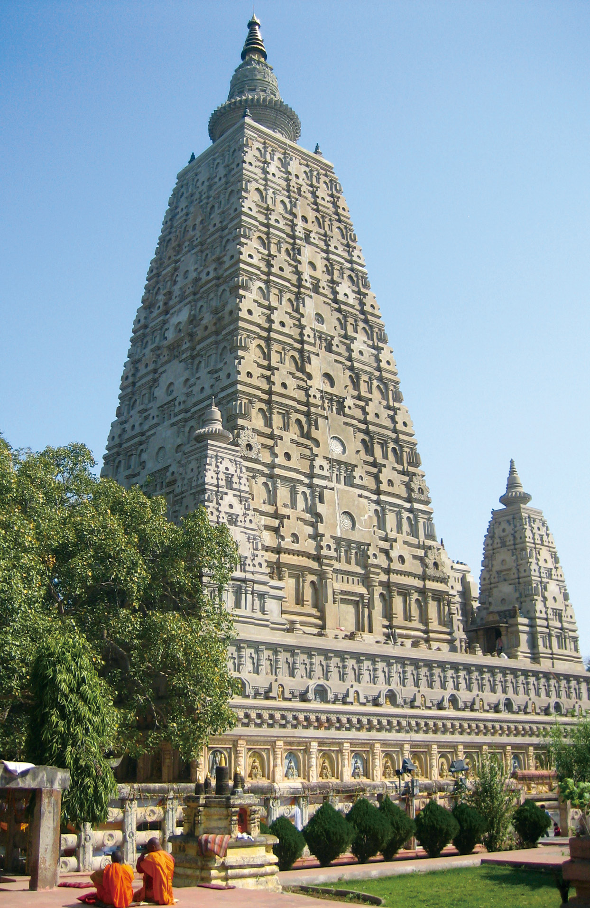
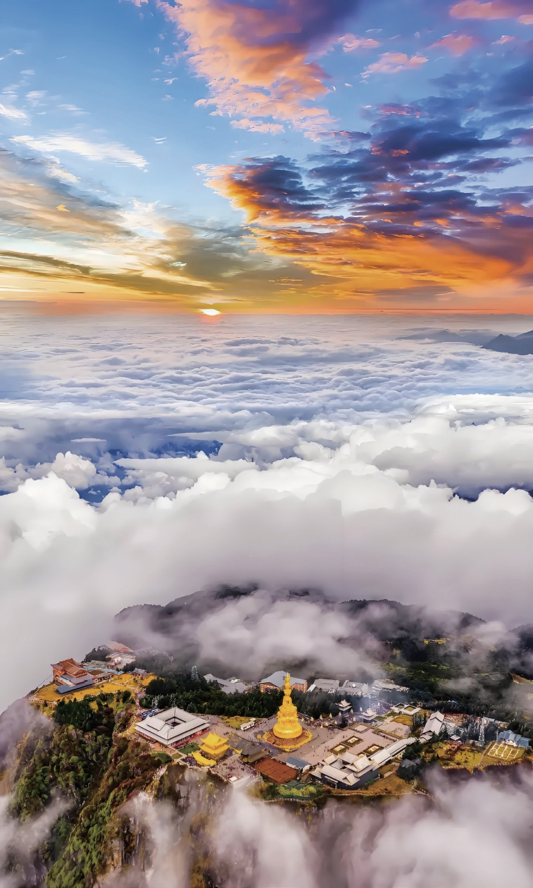
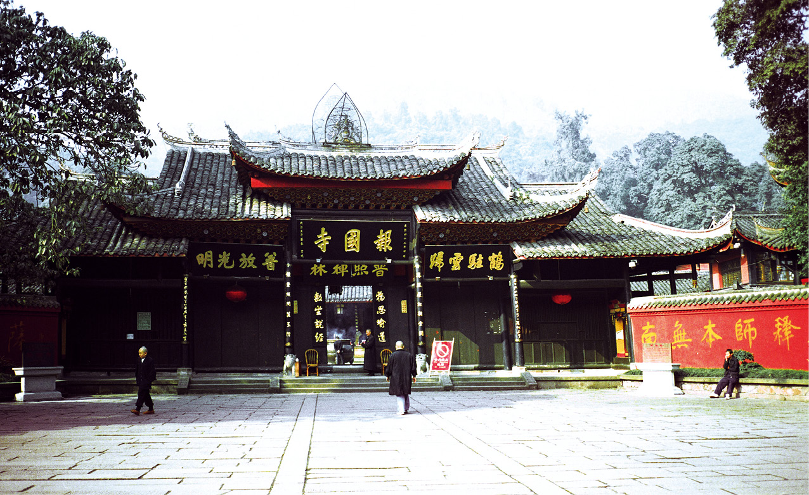
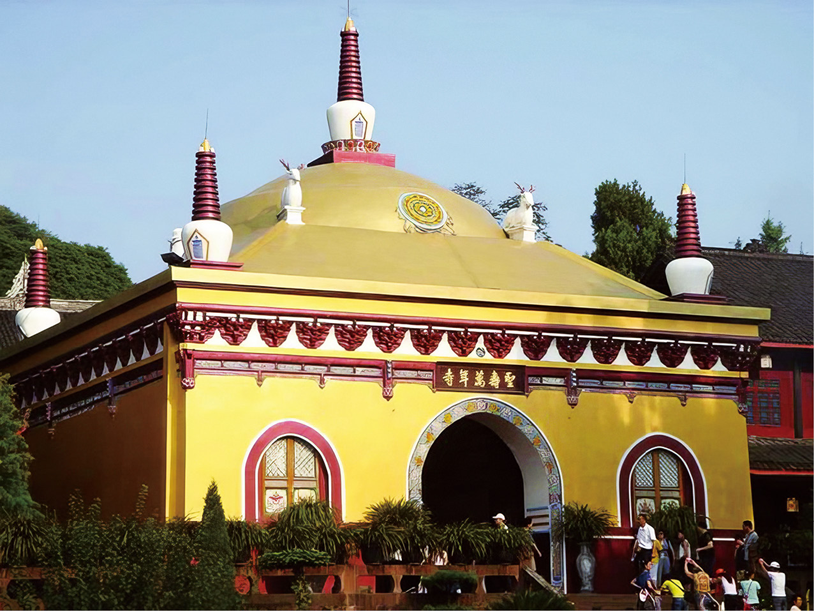
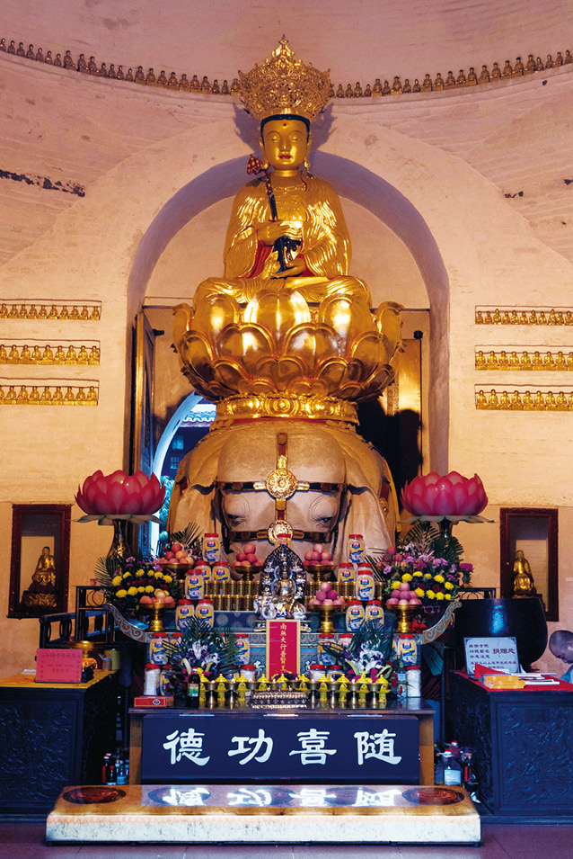
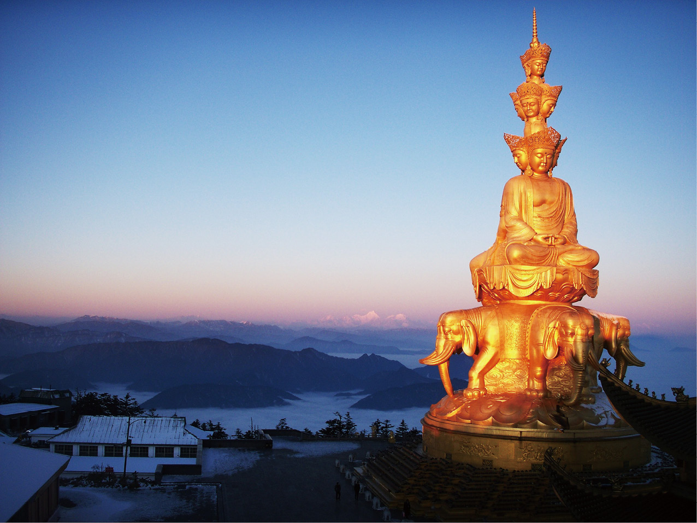
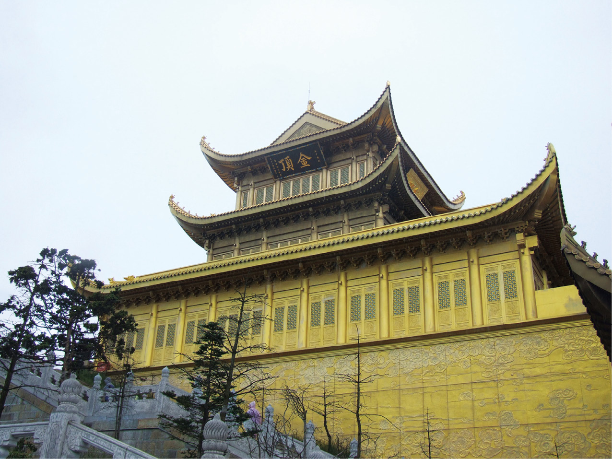
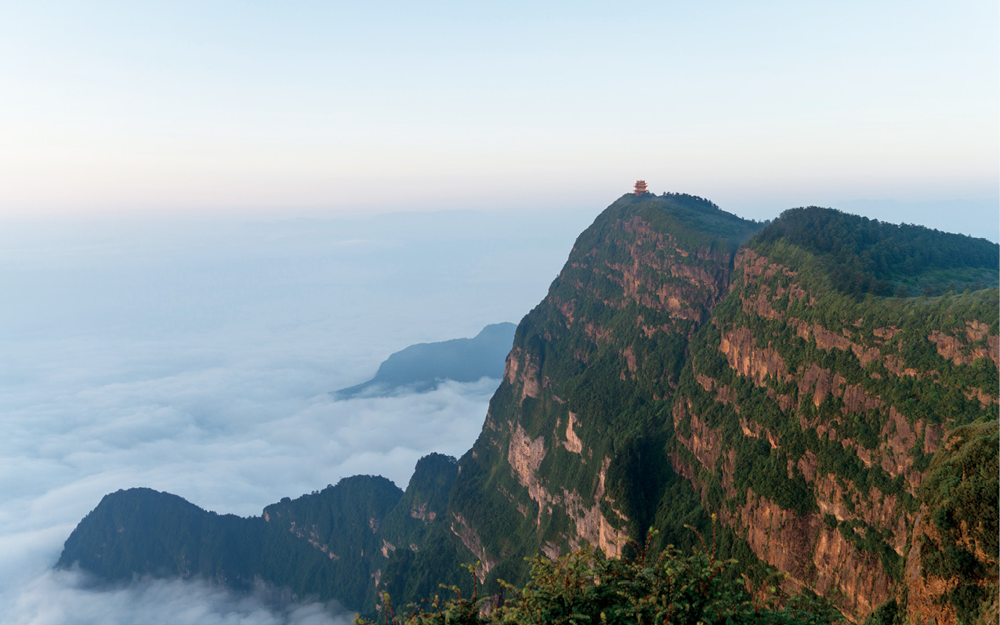

### 一、概说诸大圣地

一般而言，正如章嘉·若必多吉等诸多智者成就者所说，人间净土著名的有：东方五台山、南方普陀山、西方铜色吉祥山、北方香巴拉、中央印度金刚座。尽管大多数圣地的认定方式不同，但五台山是无有争议、一致公认的。

特别是在汉地，有四座加持力极大且菩萨常住的名山，分别为五台山、峨眉山、普陀山和九华山。其中，第一个五台山将在下文详述。

#### ·峨眉山

第二个峨眉山，是普贤菩萨常住的圣地，位于今成都市西南方百里之外。明清时期，这里有111座寺院，而如今仅存20多座。最著名的寺院是山脚下的报国寺与山腰的万年寺。

在万年寺中，有一尊极为殊胜且加持力强大的普贤菩萨骑象铜像，高二十余尺，屹立在著名的千佛殿中。至尊法王如意宝晋美彭措吉祥贤曾携眷属来到此地，为弘法利生持诵《普贤行愿品》，发广大愿。

峨眉山顶有万佛顶、千佛顶和金顶。金顶上建有寺院。晴空万里时，从山顶一眼望去，山下一切皆如鲜白的乳海或白色棉絮覆盖四方。藏地的贡嘎山也清晰可见，犹如摆放的白色酥油神馐。

当影子落入东方云海时，会形成一个奇妙的圆形光环，无论高低贵贱，谁都能经常看到。根据许多对该圣地的描述，这正是普贤菩萨的五色光环。每当清晨，从山顶俯瞰，刚从云海升起的太阳没有光芒，只现为红黄色球体，随即逐渐变得明亮。
