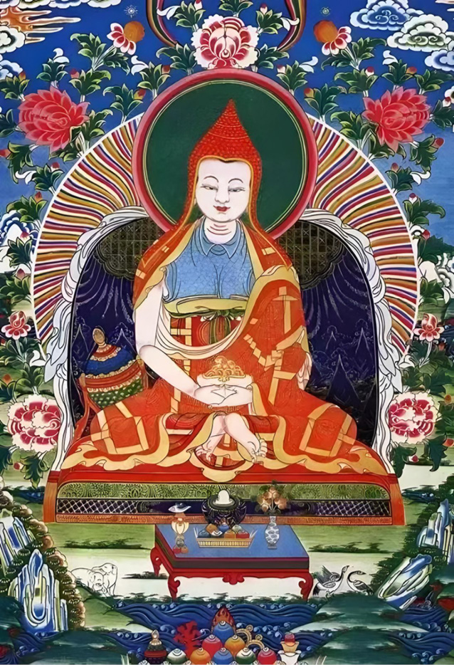

# ·布玛莫札安住于五台山

大班智达布玛莫札成就大虹光身后，亲自住在汉地五台山圣地直到劫末，并承诺每一百年在藏地投生一次化身，待贤劫千佛之后，再前往印度金刚座成佛。如《心滴大史·上师心滴》中所述：“布玛莫札将一切教言精要汇集成甚深的四函，隐藏于青朴红岩给贡作为伏藏，之后前往汉地五台山，住留直至劫末。”

又，全知上师的《密宗总义·梵音苍鸣》中提到：“当布玛莫札班智达住在印度时，藏地有一位国师酿·登珍桑波，以肉眼能同时照见四大洲。他发现大班智达的功德后，向国王赤松德赞禀报，国王派使者送纯金礼物给印度国王。布玛莫札师徒请求国王及班智达们：‘我去藏地后，必须翻译一部藏地前所未闻的法门。’班智达们说：‘金刚座下藏有窍诀法，虽然我们印度人无权使用，但你既然如此渴望去藏地，请适当取用吧。’于是，布玛莫札师徒取出所有法，据说印度的这些法本由此断绝。布玛莫札抵达桑耶后，翻译了总的显密法、尤其是九乘之巅大圆满三续部的所有法，最后前往汉地五台山，承诺住留于此直到千佛教法住世期间，每一百年在藏地投生一次化身。”

布玛莫札

《密宗宁玛法源》中记载：“布玛莫札将秘密心滴法类翻译成藏文后，隐藏于青朴给贡地方。他预见到未来心滴类的续部、教言、窍诀的法本将如集市的牛奶般被染污和破坏，所以将其隐藏为校对本。如是他在藏地住了13年后，113岁时前往汉地，在佛法住世期间不舍其身而一直安住，且每一百年在藏地显现化身的庄严。他曾七次面见嘎绕多吉而闻法，将来佛法最终迁移到其他世界时，他的光明身将在金刚座消于法界。”
