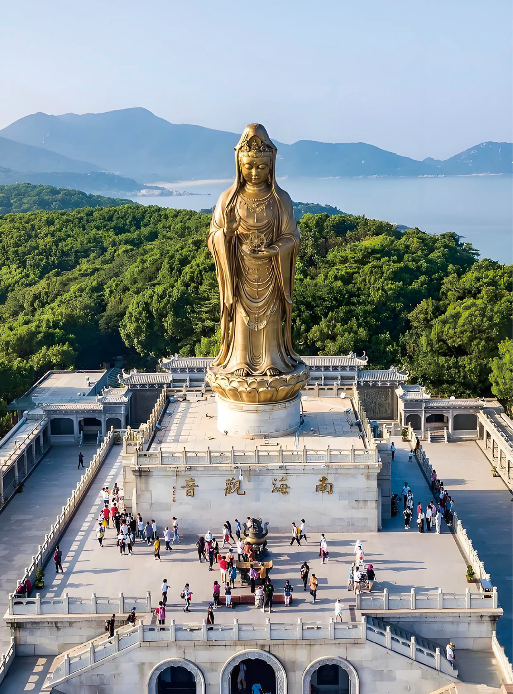

# ·普陀山

第三个普陀山，是圣者观音菩萨常住并传法的圣地。《华严经》第六十八卷中说：“于此南方有山，名补怛（普陀）洛迦，彼有菩萨名观自在。”普陀山现位于浙江省的莲花海中，是舟山群岛的一个岛屿。前往那里，需从北京坐火车到上海，全程1462公里，然后乘船一天多才能抵达。据说普陀山在清朝时有八十多座寺院，但现存的寺庙只有二十多座。

公元858年，一位日本僧人从五台山请了一尊观音像，准备带回日本供奉。然而，在途经普陀山沿海时，“海生铁莲花，舟不能行”。于是僧人在山脚下修建了“不肯去观音院”，并将观音像安奉于此。从那里到山顶有1088级石阶。

此地还有加持力极大的观音菩萨脚印，以及著名的石心、金沙滩等许多奇观。
