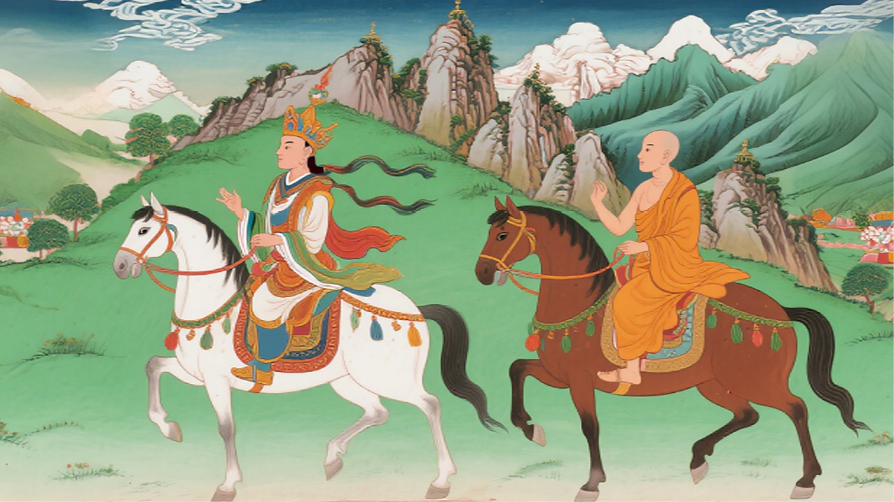
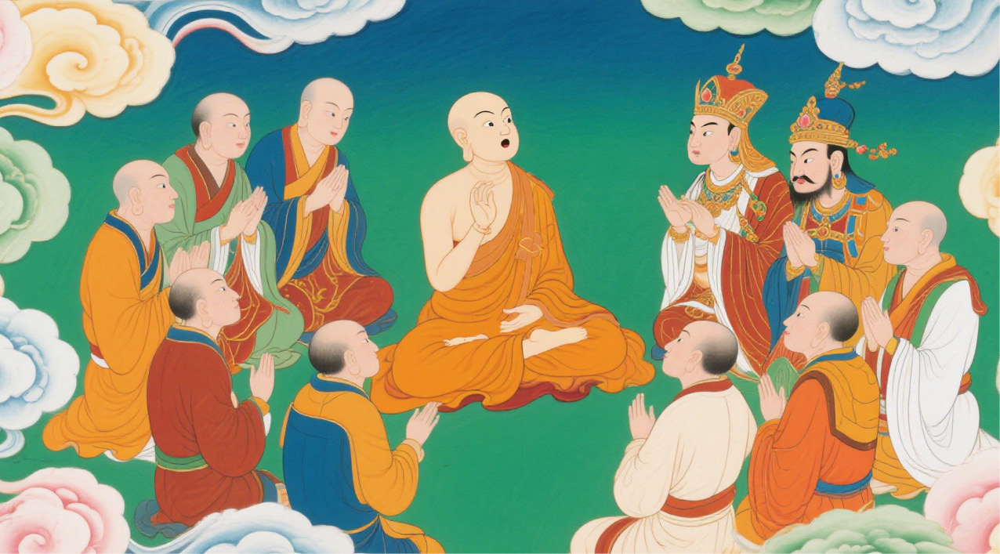
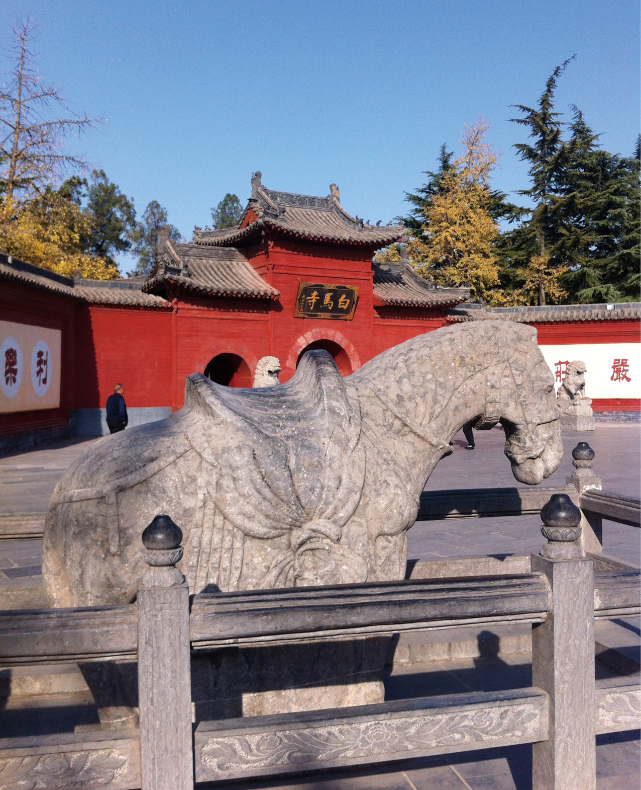

#### ·白马寺

如是以这些大圣地为主，佛法在汉地的弘扬情况是：在汉明帝时期，两位见真谛的印度班智达——摄摩腾与竺法兰，用白马驮着佛经、佛像来到汉地，建立了洛阳的白马寺与五台山的显通寺，并翻译了《四十二章经》等经典。

根据《红史》与《佛教史·智者喜宴》等记载：两位班智达皆获得阿罗汉果。一位在白马寺殿堂下入灭尽定，直至未来弥勒佛出世时才入涅槃；另一位则以神通飞到空中，前往海洋中名为“白高丽”的王国入涅槃。这里的“白高丽”，有人认为是今天的朝鲜。

当佛法传入汉地后，与本土道教发生了冲突，道士们向汉明帝表示不满。永平十四年正月十五，应皇帝旨意，双方进行了一场教法比试：一方的坛上堆放着道教的《道经》等五百多卷典籍，另一方的坛上则是佛舍利与佛经。南方设立大宝座，君臣眷属坐于其上，无数民众聚集观看。

然后，双方同时点燃火焰。道教典籍瞬间化为灰烬，道士们脸色大变，所施种种咒语法术，皆不灵验。佛经不仅未被焚毁，而且纸张如纯金般光亮，完好无损；佛舍利放出五色光芒，在上空形成宝盖，遮住太阳，照映众人，显现出前所未有的景象。摄摩腾与竺法兰两位班智达飞到空中，显现种种神通。此时，天空降下花雨，天乐不断奏响，所有在场的众生对佛法生起了无比的信心，恭敬地供养佛法。

此事件发生的圣地，据说是如今的白马寺焚经台。
