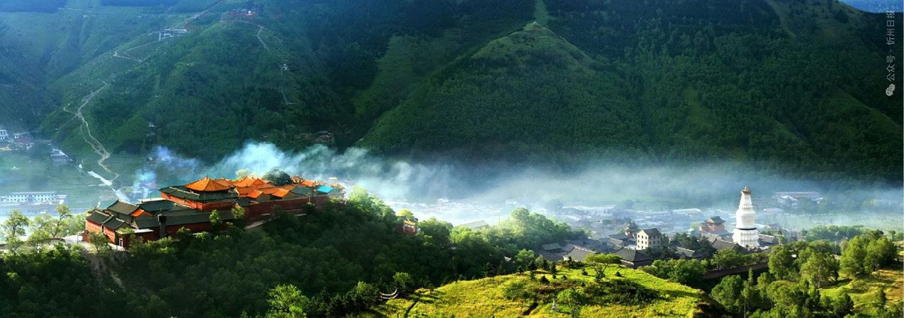
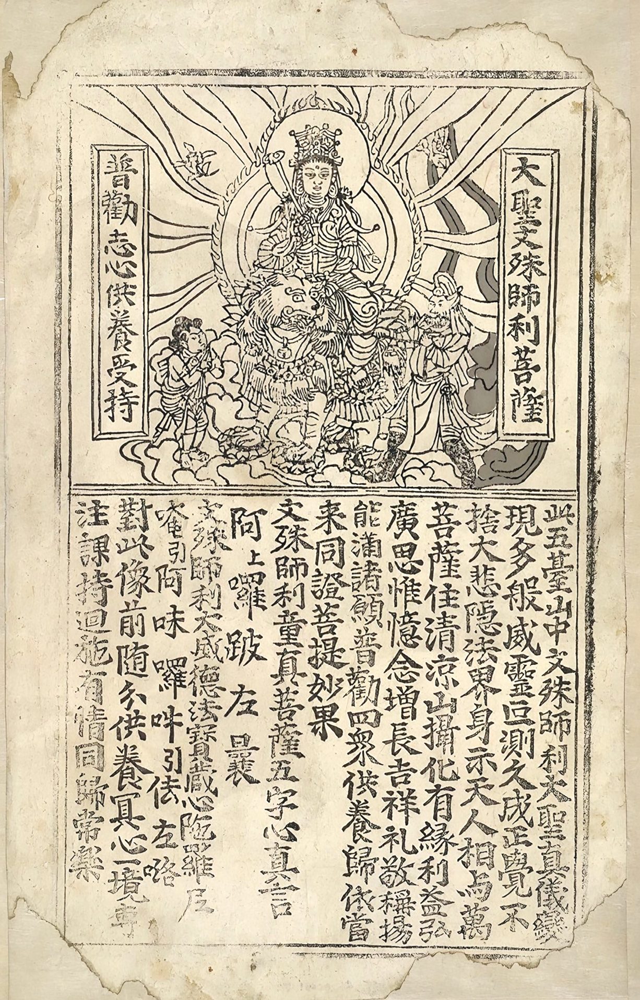

### 三、以功德利益结尾

以与文殊菩萨相关的任何行持都具大利益的方式来结尾，它分为两部分：真实功德利益、附带以造论方式结尾。

#### ·真实功德利益

首先，来到文殊童子常住的净土有大功德：如果守持清净戒律，以金银等七宝供养十方无量刹土中的诸佛菩萨，历劫不断，并布施一切众生，不如为随学文殊师利童子而向五台山迈出七步，其功德胜过前者百倍、千倍、万倍。何况亲临此圣地，发清净愿，其功德更是不可思议。如《文殊刹土功德经》中说：“佛陀以无碍眼照见十方诸佛刹土，以七宝充满彼等诸刹供养一一如来，为众生以平等心持守一切戒律，至未来际布施一切众生，不如发心随学文殊童子而迈出七步，其功德不可言喻，百分之一也无法相比。”

同样，单单忆念文殊菩萨名号的功德也不可思议。《文殊根本传》中说：“仅忆文殊汝之名，佛说功德不可思。”《文殊根本续》也说：“仅凭忆念者，必定成佛陀。”此外，关于修持文殊菩萨而得加持的方式，《金刚藏庄严续》中说：“诸佛最胜智，广称文殊名，唯一修行此，智慧成无垢。”

再者，称诵文殊菩萨名号的功德，如《文殊刹土功德庄严经》中所言：“若有人念诵十万俱胝那由他佛名号，不如念诵文殊童子名号所生福德多，何况称诵普见如来名号。何以故？文殊童子一一劫中所做之众生利益，十万俱胝那由他佛也未曾做。”经中又说：“称诵恒河沙数如来名号一劫或过一劫，若有人称诵文殊名号，其福胜彼。”《集文殊密意续》中也说：“文殊勇识名，真实诵最胜，能净除诸罪。”诸如此类，许多典籍中宣说过其功德。

总之，仅仅来此圣地，便能清净一切自性罪和佛制罪。即使是那些已经成熟而需要感受的顺次生受业，也只需感受如线团落地后弹起般短暂的痛苦。文殊菩萨的加持会融入心相续，使闻思修、讲辩著的智慧如大火蔓延森林般比以往更加炽盛，能够自在地受持、护持、弘扬佛法等，有不可思议的功德利益。
