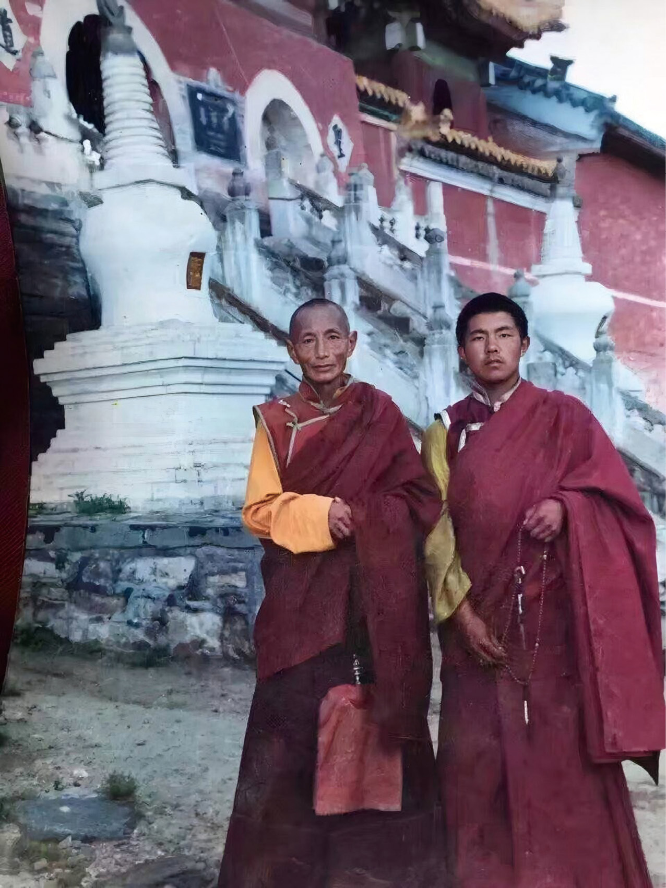

# ·附带以造论方式结尾

无等大恩上师法王如意宝——为便于表达而尊称其名为被佛授记的“晋美彭措勇列吉祥贤”，在他那无量大悲的白伞盖凉荫下，当我尚未舍弃有漏色身时，在布谷鸟不断发出动人鸣啼之际，我于一百多天里不断享用各种灌顶和《龙钦七宝藏》等传承、窍诀的甘露，与数千僧众一同朝圣、发深广愿等，所有世出世间的事业皆顺利成办，享受喜乐之情景正如法王所言：

> 幻化刹土五台山，万圣围绕文殊尊，

> 展现无量幻庄严，恒赐有缘享喜宴。

> 仅至此处净堕罪，仙王谛语入耳时，

> 欢喜泪流如雨下，全身汗毛同起舞。

> 善信藏人万众聚，礼供发愿深广行，

> 不久自现净土中，师徒齐聚缘起熟。

> 我等今后生生世，尊奉文殊童子父，

> 观赏轮回幻城景，已播度众之种子。

> 智慧文殊成本尊，辩才总持法甘霖，

> 无余注入我心瓶，轻易获此善缘分。

> 上观虹光云庄严，胜过人工彩绘饰，

> 尊身文字手帜遍，依文殊力而亲见。

> 外观山川树木花，文殊圆熟净本相，

> 兜率天界黯失色，未舍身至此净土。

> 下观此刹诸有情，看破今生离贪执，

> 信心慈悲性显露，五髻所化明现见。

> 内观自心似彩虹，寻不得而置了然，

> 相伴已久文殊尊，未曾面见今明见。

> 无须苦修观察负，心间童子瓶佛刹，

> 自觉文殊师徒聚，善说法宴施众生。

> 于此净土菩萨行，深广法语令众喜，

> 梦中亦难得此境，师徒同享今已得。

> 从今即使放逸眠，已结净土圣尊缘，

> 以净心发广大愿，从乐趋乐获确信。

> 生亦欢喜成他利，死亦欢喜定往生，

> 无论如何皆喜乐，智慧文殊之深恩。

> 为报恩尽虚空际，度无边众成大利，

> 诚心无畏立誓言，父尊汝赐加持力。

此乃阿旺洛珠宗美于那罗延窟所说之戏语。[^1]

这部《五台山圣地记》，是我在那段时间里，根据藏文版《文殊刹土功德经》《华严经·入法界品》《八大菩萨传》《宁玛续集》《宁提大史》《汉地佛教史》《章嘉圣地指南》《五台山志·密严庄严》等，和汉文版《华严经》《新清凉山志》《旧清凉山志》《五台山历史》《五台山故事》《五台山寺院史》《圣地赞颂诗歌集》《五台山朝圣指南》《五台山地方典故》《五台山研究期刊》《五台山奇妙圣地记》等，以及各寺院简介等现存的十余种此圣地史料，详细研究编写而成。期间，我亲自考察了大部分具加持的圣地，确认其是否依然存在，并将一致公认的稀有典故或故事翻译成藏文，只选取了可靠的来源而撰著。

至此，附带内容已略述完毕，文殊菩萨净土——汉地五台山圣地记暂告圆满。

> 如上略述之勇气，唯依文殊师加持，

> 不解错谬相违处，具慧众前诚忏悔。

> 若问净刹五台山，奇妙圣境何庄严，

> 较询愚者妄语者，此撷可靠源更胜。

> 精通藏汉文字者，诸智者不需此文，

> 然于未学不解者，或许有益故撰写。

> 能诠语句虽不美，所诠义无臆造染，

> 多数山志难解故，以俗语著圣地记。

> 以此功德皎月光，尽消苦众之热恼，

> 文殊童子永摄受，最终往生极乐国。

> 愿我今后生生世，顶戴文殊化现身，

> 麦彭尊及怙主师，广泛成办利他事。

此文承蒙无等大恩上师德巴堪布亲口嘱托“将此圣地之诸多奇妙典故翻译成藏文”，我也认为在此净土与文殊圣迹结上善缘将有大利益，于从汉地五台山将返雪域之际，在南台锦绣峰附近之清凉寺，火兔年夏季六月初十（1987年8月4日）广作续派文殊大会供时，天空遍满文殊化现极广大光等十种光之五色彩虹等各种稀有瑞相，法王及五百余眷属各自依缘见到不同清净境相，皆信心倍增、喜不自禁。于此吉日之中午，时年二十五岁的我，朵芒僧人索达吉，在悦意文殊花遍开之花园中撰著圆满。后于1989年，在东方圣堡福地文殊圣山脚下之阳绕扎西切龙寺显密日光喜乐园略作调整而定稿。善哉！

于孔雀灭毒林河畔之威猛莲师宫由藏译汉

2025年5月9日

附：

[^1]: 现名为《快乐道歌》，收录于《法王全集》中。
