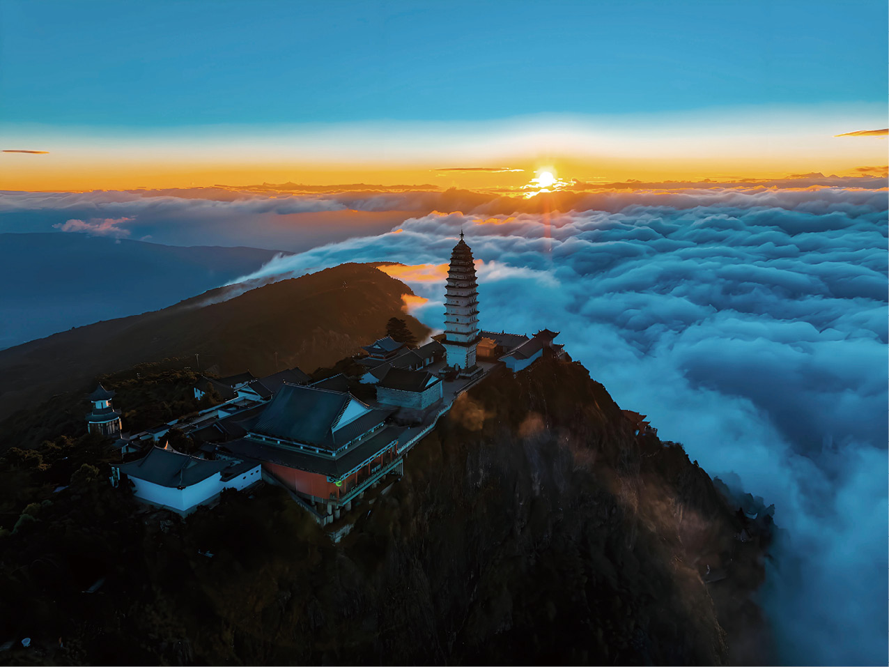
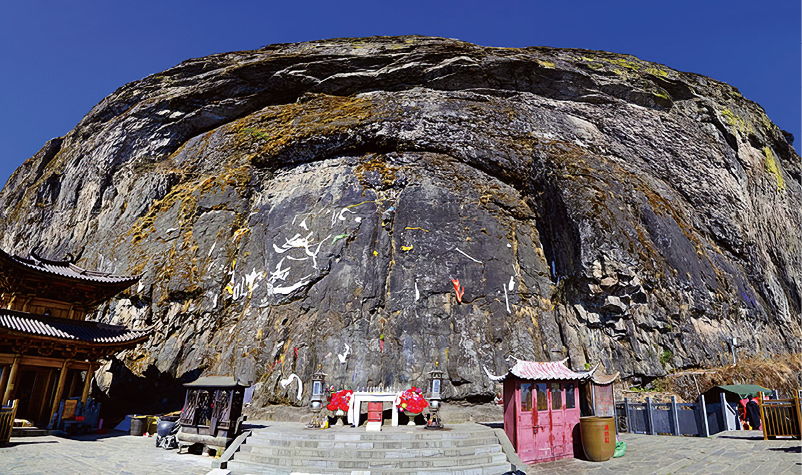

# ·鸡足山

另外，圣者无著菩萨在十二年间修持弥勒菩萨、最终得见其面的圣地鸡足山，同时也是安放迦叶尊者法体的地方，现位于印度中部。关于其地理位置，学界存在不同的认定，但根据《白古通记》等史料的记载，许多人认为鸡足山位于云南省。

鸡足山内安放着付教大师声闻大迦叶的法体。全知龙钦巴在《三休息总义·善说海》中提到：“上座大迦叶将入涅槃时，把佛法交付给阿难，从天界、龙宫取来佛牙舍利并顶礼，之后返回鸡足山，加持其法体不坏而入涅槃。其目的是：未来人寿八万岁时，弥勒菩萨将携一亿眷属到此，山裂开时见到这具法体。眷属询问时，弥勒广说其义，令所有人获得头陀功德。”迦叶尊者法体所在的岩石山，就是从山顶稍下的华首门。山口闭合的痕迹，至今仍清晰可见。

据说，山顶上还有阿难与未生怨王当初所造的佛塔。正如《藏密佛教史》所述：“迦叶尊者对所有的佛舍利塔及佛牙塔进行供养，然后登上南方的鸡足山。他刚到那里，山门便自然打开。他在中央铺上草垫，披上世尊的粪扫祖衣，加持法体不坏一直保持到弥勒成佛，接着示现众多神变而趣入涅槃。诸位天人供养，整个山门闭合。迦叶尊者又作加持：待未生怨王前来朝拜时，此门再度开启。

当时，未生怨王梦见王族的国舅后继无人，醒来时恰巧得知迦叶入灭之事。于是，他与阿难一起前往鸡足山，夜叉随即将山门打开。国王向迦叶尊者的法体礼拜并供养后，准备进行荼毗。

阿难急忙阻止，说：‘迦叶尊者已加持此法体一直保存到弥勒佛出世。到那时，弥勒佛与首批眷属九十九俱胝声闻弟子一同来到此地，弥勒佛将尊者的法体放在掌中说：“这是释迦佛声闻弟子中头陀第一的尊者，他所披的祖衣也是释迦佛的祖衣。如今，像他这样持守沙门头陀功德之人，已不复存在。”弥勒佛话音刚落，迦叶的法体即大显神变，无余融入法界。’阿难继续说道：‘弥勒佛的那些眷属依此而持守头陀功德，将证得阿罗汉果。因此，法体绝不能焚烧。’

当他们启程返回时，山门又自然闭合。后来，阿难与未生怨王在鸡足山顶建造了遗塔。”
