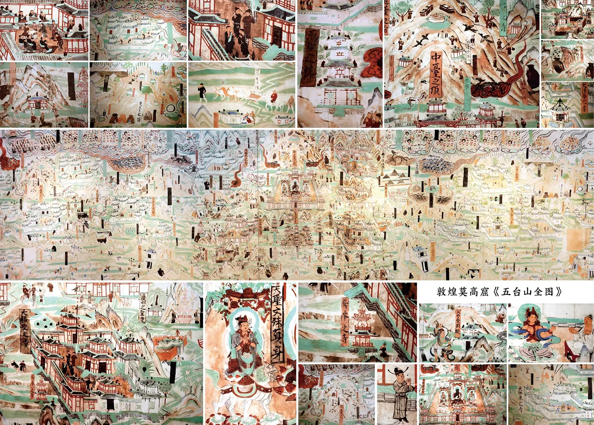

# 无等大恩文殊怙主 上师如意宝晋美彭措祈祷文

索达吉堪布·造

> 顶礼文殊师利菩萨！

> 语日轮照心间莲，语天女戏喉乳海，

> 三传上师住顶垫，皈处总集摩尼知。

> 您乃三世佛化身，动心六十梵音语，

> 普天无缘大悲心，加持成熟吾三门。

> 教法证法莲闭时，文殊勇识三密日，

> 雪域金山上升起，祈祷开教莲苑尊。

> 佛法透明水晶镜，沾染恶世破戒垢，

> 纯净三戒白绸拭，祈祷再弘佛教尊。

> 讲经善缘自召集，辩论非见自远去，

> 著论诗词自流露，祈祷具智三德尊。

> 智慧洞察诸所知，严谨远离细堕罪，

> 贤善呵护诸苍生，祈祷圆圣三德尊。

> 以闻圆满教理力，以思吸取诸真义，

> 修行觉相本任运，祈祷成就三德尊。

> 愿生生世水晶串，誓言丝线善妙穿，

> 精进利益群生时，不离欢喜摄我等。

> 清净戒律嫩白莲，未遭堕罪垢霜害，

> 明耀妙慧艳花蕊，与文殊怙您同缘。

> 佛说四谛法轮日，神洲弘法圆满时，

> 祈请文殊上师尊，长久安住文殊座。

> 如此祈祷妙音赞，文殊幻化净土中，

> 语自在现上师时，善缘弟子设喜宴。

> 您深教言一句价，遍满虚空之黄金，

> 供云海献不可量，世出世恩何以报？

> 于无等恩慈师前，我无财富之供养，

> 亦无辛勤敬承侍，唯以净心献颂赞。

此文乃火兔年（1987年）藏历六月初四，佛初转法轮之吉日，于汉地五台山南台静处清凉寺内，弟子索达吉恭敬奉上。

善哉！愿一切吉祥！

