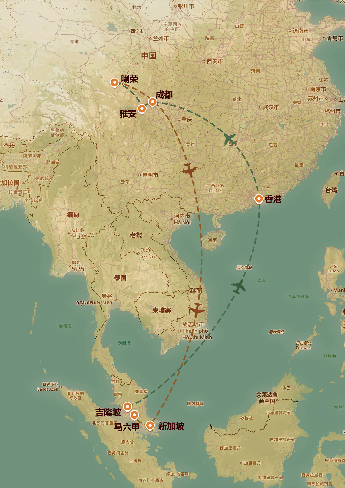

# 序

这本《水月回忆录》，记录了法王如意宝晋美彭措于1995年前往东南亚弘法的经历。那段时光，我有幸随侍在法王身边，亲眼见证了许多动人瞬间。

法王一生共三次出国弘法：第一次是在1990年，踏足尼泊尔、印度、不丹，其行迹被记载在《梦尘回忆录》中；第二次是在1993年，远赴美国、加拿大、法国，相关经历收录在《西游回忆录》中；而本书所述，正是法王最后一次的海外弘法之旅，足迹延伸至新加坡、马来西亚，最终汇编成《水月回忆录》。

这三部回忆录的完成，确实是一段奇妙的缘起：我原本计划在法王在世时就动笔，然而因缘未具，屡屡推迟；法王圆寂后，我依然渴望将其写成文字，多次尝试，却始终未果。令人意外的是，这三次出国的经历，竟各自在整整三十年后次第成书，相继问世。这并非我刻意安排，而是因缘使然，水到渠成。

这本书的内容，慈诚罗珠堪布也是亲历者与见证者。我曾劝请他记录这段历史，然而他未应允，反而嘱我执笔，并愿意为此书作序。于是，在2024年2月、2025年1月，我前后花费一个半月的时间，完成了《水月回忆录》藏文版与汉文版的撰写、修订，包括内文排版、照片选择、封面设计等各项工作。尽管我尚有许多法本需翻译与校对，且日常事务繁杂，但我仍尽力抽身，终于将此近十万字的回忆录编纂成书。

本书所载的行程，自法王收到邀请函，到出国弘法，再到返回喇荣，总计一个多月。尽管在法王波澜壮阔的一生中，这段经历并不算长，相关记载也较为有限，然而，如果不及时整理，这一段重要经历恐将随着岁月流逝而被遗忘。因此，我竭尽所能，搜集当年的文字记录、照片和影音资料，反复回忆、核对、整理，力求内容真实无误。然而，由于个人能力有限，若有任何疏漏和错谬之处，我在此诚恳忏悔。

在藏文编辑的同时，我也同步进行了汉文的编辑，之后交由国际翻译小组翻译成英文等。多种语言版本的同步发布，实属不易，也极具意义。

今年正值法王圆寂二十二周年，同时也恰逢东南亚弘法三十周年之际，我将这份法礼献给大家。书中字里行间，虽然看似平实，却蕴藏着法王珍贵的心滴窍诀。若能够静心品读，无需借助任何赞美之词，你便能自然感知法王那独特的智慧与境界。

特别需要说明的是，书中涉及法王传授的无上密法。未来若有修行者想要修持，务必先求得相关灌顶、传承与口诀，方能如法修行，获得真实的利益。

在编纂过程中，感恩所有提供资料、参与记录、协助校对的善友同仁。特别感谢空行护法始终赐予开许与鼎力相助，祈请继续护持，对于具信心者赐予庇佑、加持。

人生如梦，偶尔回望，还是有一些难忘的片段。将这些记忆整理成文，与有缘者分享，也是我心之所愿。希望你能藉此忆念上师的功德，最终证得了义上师之果位！

索达吉

木蛇年九月二十二日天降日

（2025年11月11日）

本初法界法身刹土中，文殊普贤如来无二体，

金刚持佛法王上师尊，源自法性加持入我心。

三十年前往昔岁月中，青春韶华如花正盛时，

追随如佛亲临之上师，遍游东西诸多国土间，

指尖笔墨从未有停歇，随手撰写诸般札记文，

今撷赴往东南亚游记，编纂多种语言而分享。

此中阐释甚深妙窍诀，法界女主一髻佛母等，

如海空行护法莫惩罚，于诸善缘信者解封印。

origin
