# 归 来

第三站

5/29-6/21

行程

Schedule

5月29日，抵达香港

6月3日，抵达成都

6月14日，前往雅安的永兴寺，

传授“文殊智慧勇识”灌顶并开示

6月15日，前往康定的金刚寺，

传授“文殊菩萨”灌顶并开示

6月20日，途经道孚

6月21日，回到喇荣

途经香港

5月29日，法王从吉隆坡乘飞机抵达香港，飞行时长约四小时。那时，香港的国际机场还位于九龙城。

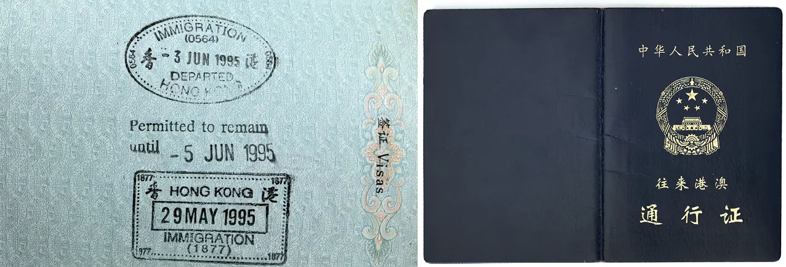

飞机一落地，热情的居士们早已在机场等候，恭候法王的到来。随后，他们热心地邀请法王前往一家素食餐馆用餐。按照香港的传统，出家人和居士们分坐两桌，出家人的餐费由大家共同供养，而居士们则采取AA制，各自结算，这一习俗至今依然盛行。

饭后，我们入住了白居士家中。这里的空间与以往大相径庭，显得有些局促。香港土地寸土寸金，无论是公共场所还是私人住宅，空间都极其狭小。白居士的家不到70平方米，只有两室一厅。法王住一间，阿里美珠与门措空行母住另一间，客厅的沙发则由慈诚罗珠堪布和我轮流使用，其他人则紧紧挤在地铺上，连走动的空间都显得十分紧张。

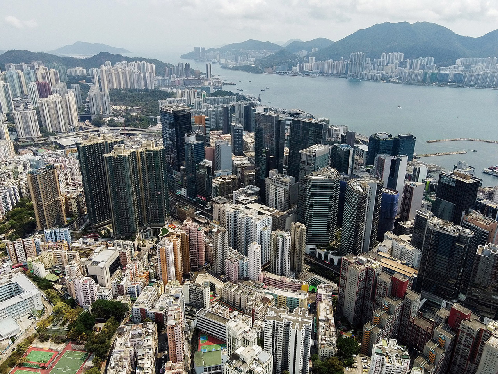

尽管空间有限，天气也异常闷热，但每天都有前来拜见法王的信众。法王在这里并未举行大型法会，只是给少数人传授了“项袋金刚橛”灌顶，做了一些关于皈依的开示，同时进行了摸顶加持。

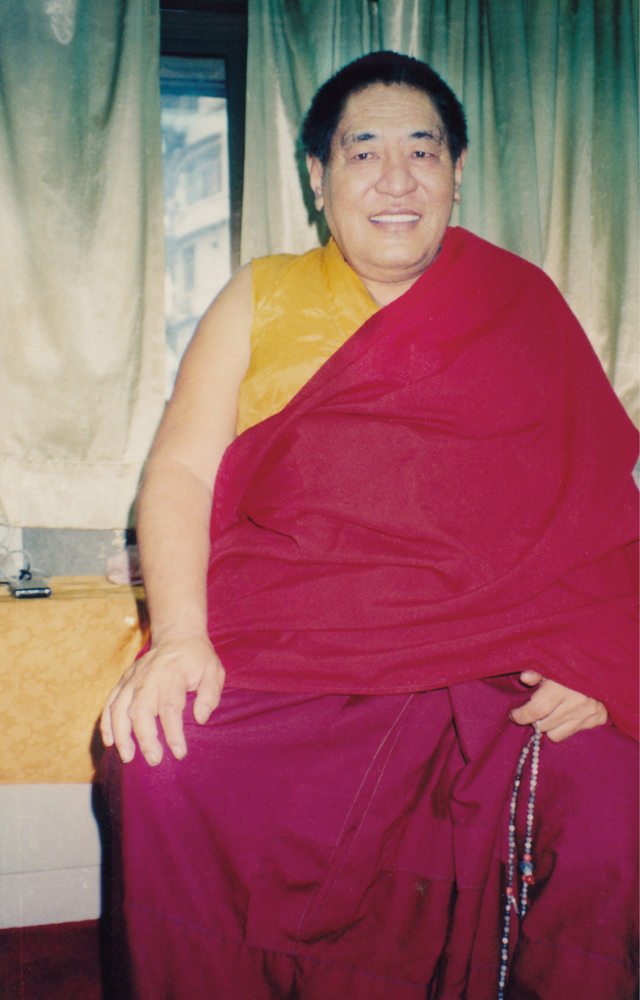

有一天，我在早上送饭时，忍不住问法王：“您本来喜欢明亮的房子，但这里的窗户很小，您会不会觉得不太舒服？”法王微微一笑，温和地回答道：“为了利益众生而外出，什么都会经历的，这很正常。我不是曾经说过吗，‘伴随长子文殊尊，云游种种诸世界，必将亲睹极欢喜，以及忧伤之游戏’。跟随文殊菩萨为了弘法利生而游历十方，可以观赏任何景象。这里很好。”

法王在香港停留了几天。临行前，我们特意在香港的商场挑选了一些电子产品，作为带回去的礼物。

到了成都

6月3日，法王从香港出发，经过两个多小时的飞行，顺利抵达成都双流国际机场。

一下飞机，前来迎接法王的庞大人群立即涌现。迎接队伍中，不仅有丹增活佛、希阿荣博堪布、益西彭措堪布、齐美仁真堪布、诺尔巴堪布为首的学院弟子，还有来自成都、绵阳等地的众多居士。

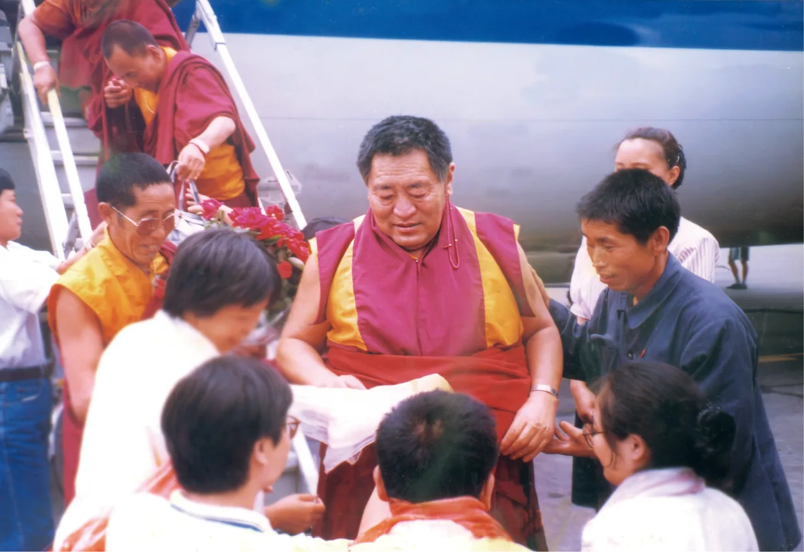

随即，法王乘车前往位于国际大都会的住所，这是一位刘居士供养的房子，作为法王在成都的落脚点。刘居士后来在喇荣出家，长年依止法王。

法王的住处位于七楼，尽管没有电梯，上下楼的过程稍显艰难，但不管怎么样，法王终于安顿下来了。

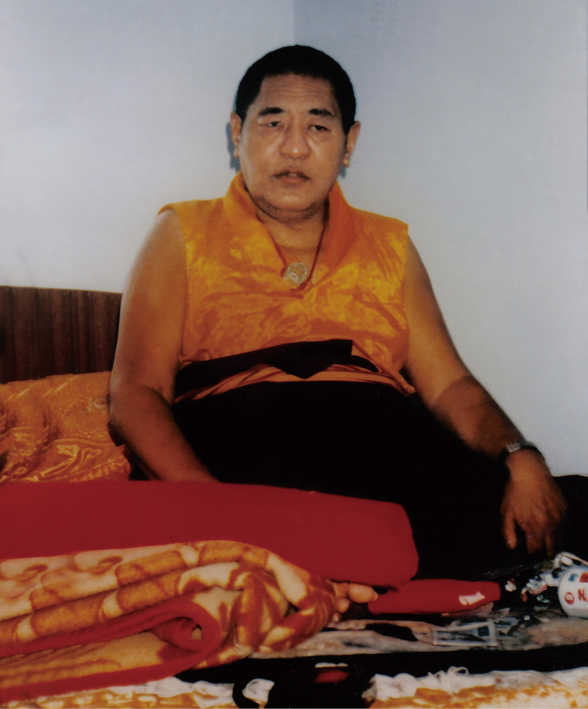

接下来的日子里，来自汉地不同城市的信众纷纷前来拜见法王，络绎不绝。法王慈悲加持每一位来访者，并为具缘弟子传授了“项袋金刚橛”等灌顶。

在此期间，绵阳金刚道场的尚居士等弟子恳请法王前去传法、放生。法王表示，这一次恐怕无法成行，但承诺年底的时候可以前往。同时，法王还与四川省的一些领导进行了会面。

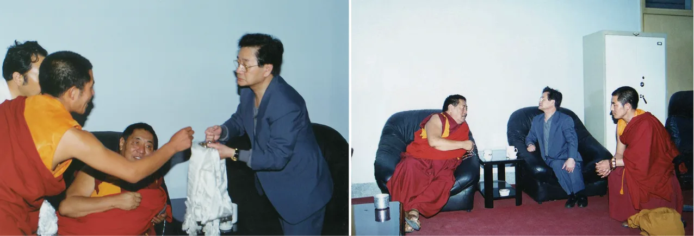

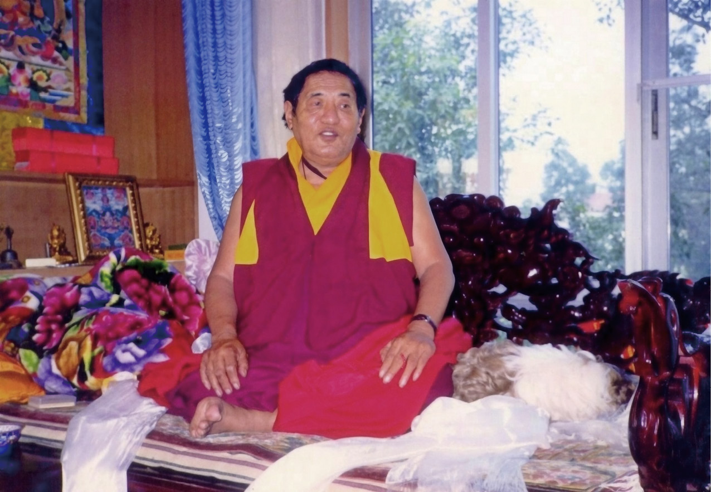

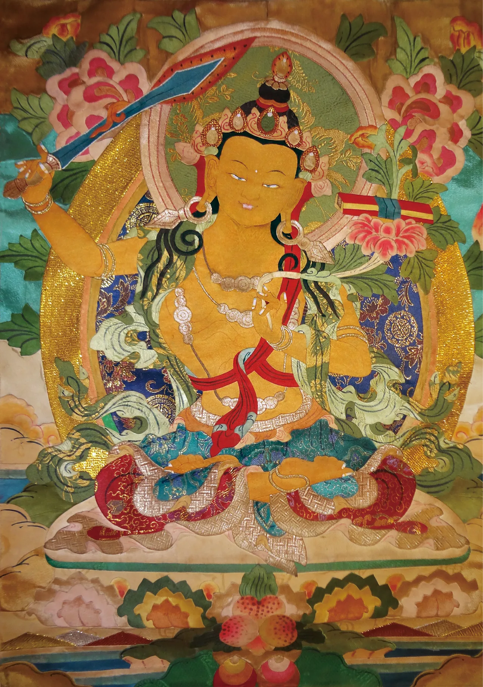

此次从东南亚归来，法王带回了几幅由他人供养的唐卡。大部分唐卡作为礼物赠予弟子，唯有一幅文殊菩萨的唐卡，法王特别指出，这与他本人无二无别，特意要求将其挂在自己床头。关于这幅唐卡，背后有一些神奇的故事，暂且不一一细述。

去雅安永兴寺

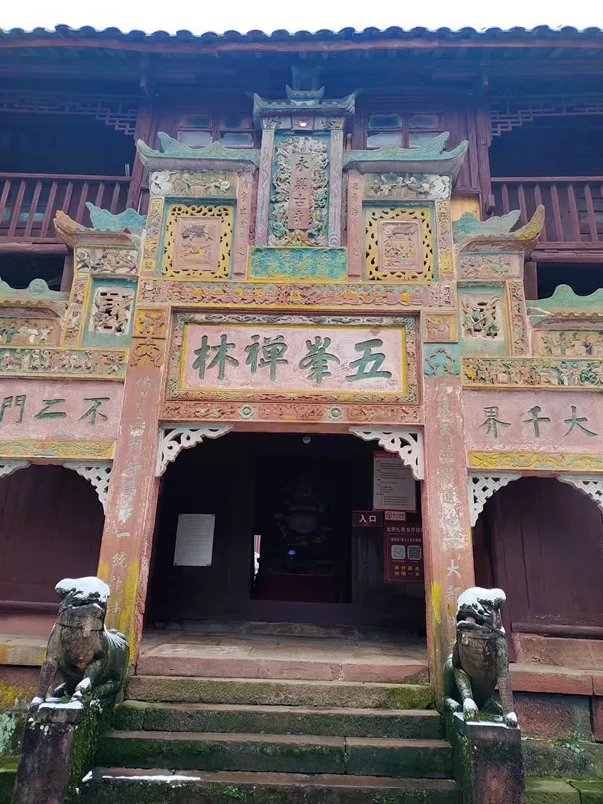

6月14日，法王从成都踏上归程，返回喇荣。途中，雅安一带的僧俗弟子纷纷邀请法王前来传授佛法。于是，法王乘车驶向雅安蒙顶山的永兴寺。这座古老的寺院拥有上千年的历史，坐落在山腰上，通往寺院的土路颇为颠簸。然而，一抵达此地，仿佛进入仙境，让人心旷神怡。细雨轻洒，与成都的炎热形成鲜明对比，山风拂面，空气中满是花草的清香，站在高处俯瞰脚下的云海，彷如一个神仙的世界。

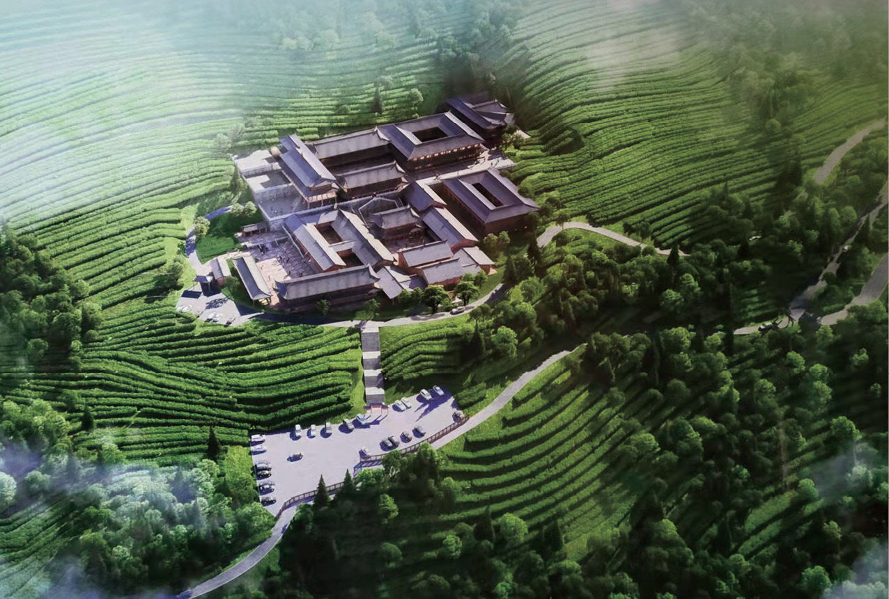

当天，闻讯而来的信众非常多，寺外停放着三四辆大巴，还有许多面包车，大约来了一两千人。法王在大雄宝殿门口，为大家做了简短的开示，随后进行了“文殊智慧勇识”灌顶。灌顶结束后，法王手持文殊像，亲自为在场众人逐一加持。接着，他走向大雄宝殿，为佛像进行开光。中午，法王在寺内与信众共进午餐。晚上，下榻于雅安的八一宾馆。来自附近县城的信徒络绎不绝，法王不辞辛劳，为每一个人做了摸顶加持。

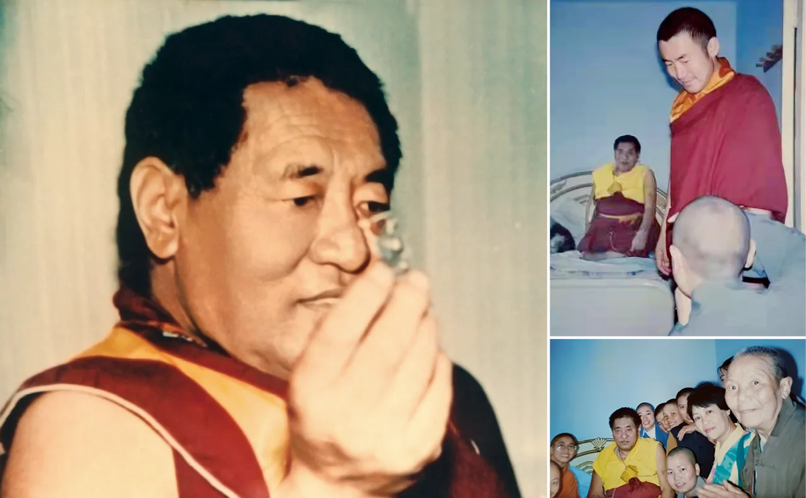

数十年后，我从赵先生口中得知了一段奇妙的经历：那天，他的岳母得知法王将在雅安灌顶，尽管她的脚腕刚骨折五天，伤势相当严重，但仍然坚持要女婿带着她前去求加持。一行人包车来到永兴寺，法王正在给大众传法。虽然赵先生并未皈依，但一见到法王，他感觉全身仿佛被电流贯穿，一股强大的力量围绕着自己。

灌顶结束后，大家排队拜见并供养法王，法王用文殊像为每一个人加持。岳母接受加持后，还想再得一次加持，于是她抬起受伤的脚，一跳一跳地上了台阶。法王看着她，用文殊像在她头顶敲了三四下，然后吹了一口气。当时许多信众涌过来，将她挤到台阶下，倒退了好几步。本以为脚伤可能会更加严重，没想到她完全不能着地的脚，当下居然好了，能够重新走路了。

赵先生原本并不信仰佛教，虽然听闻过一些高僧大德的神通事迹，但对此抱有怀疑。然而，岳母的这一经历，彻底颠覆了他固有的看法，使他对法王充满了信心，并对佛法产生了新的认识。法王即将离开永兴寺时，他站在人群中，与众人一同恭送。法王似乎感知到他内心的转变，忽然伸出手，越过前面的人，在他的头顶上用力拍了一下。他内心瞬间明白，法王无所不知。从那以后，他皈依佛门，一直如理闻思修行，依靠法王的加持，生命发生了巨大的变化。

到了康定金刚寺

6月15日，法王离开雅安，前往康定。途中，经过二郎山时，突降大雨使山路异常难行，车辆行进缓慢，车流拥堵。直到傍晚，法王才抵达康定。

这时，康定正在遭受特大洪水的侵袭。连日降雨导致多地泥石流和塌方，河道、桥洞阻塞，城区大面积被洪水淹没。我们到达时，洪水尚未达到最严重的程度。然而，一到金刚寺，洪水便凶猛地冲上街道，道路完全中断，康定城区陷入一片汪洋。这一情况后来也在当地报纸上报道过。

寺内僧众对法王的到来深感荣幸，热情迎请他入住特意为他修建的精舍。这座精舍分为上下两层，下层是坚固的石屋，上层是雅致的木屋，坐落在唐东嘉波长寿殿的遗址上。数年前，寺院着手计划为法王在寺内建造房屋，法王觉得缘起不错，欣然应允，并亲自为房屋提供了布局设计。而此次法王回来，精舍正好刚刚建成。他老人家能亲临入住，令在场大众无不欢喜。

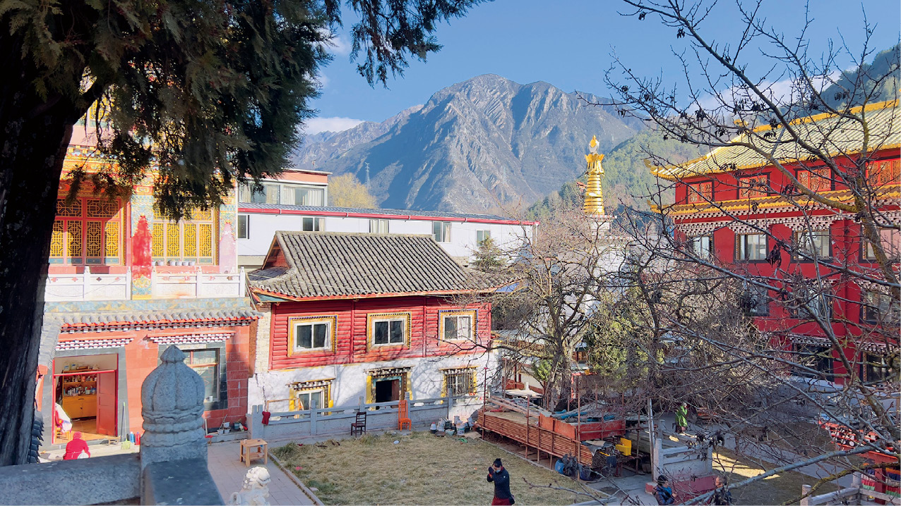

一入住，甘孜州统战、宗教、公安等部门的官员纷纷赶至，法王向他们汇报了东南亚的行程。在金刚寺期间，法王满足了个别僧人和藏医院医生的请求，为他们赐予了“文殊菩萨”灌顶。每天上午下午，大批信众前来拜见，法王亲自为他们摸顶加持。

在拜见的人群中，一位著名的藏族女歌手引起了法王的注意。法王劝告她：“你应该多唱一些佛教歌曲，不然，即使你嗓子再好，当无常降临时，又能如何呢？那位全球非常有名的歌手邓丽君，最近就死了……”她的丈夫由于没听清楚法王的讲话，紧张地跪在一旁询问：“法王是不是说她要死了？”我解释道：“不是这个意思，法王是提醒她要有无常观，要好好修行，因为死时一切都带不走。”随后，为了表达对法王的感激，这位歌手当场演唱了莲师心咒、观音心咒，作为供养。

在此期间，法王还特地前往康定市内，参拜了唐东嘉波所建的一座佛塔。在众人的祈请下，法王为佛塔进行了开光，并强调这座塔对众生至关重要，一定要好好保护。

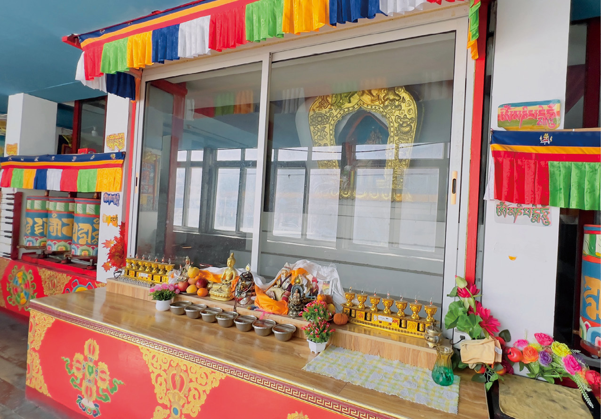

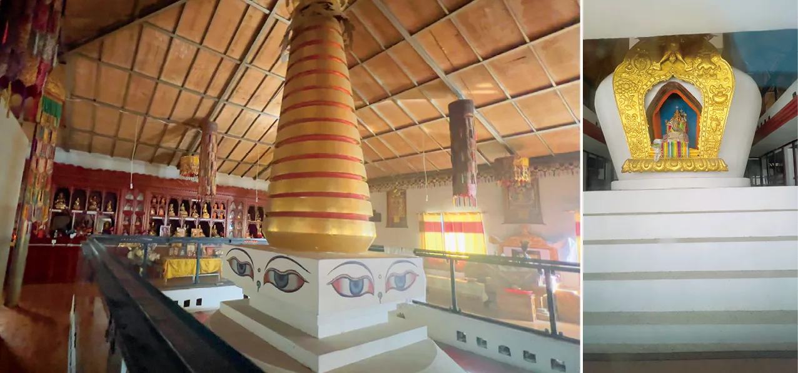

法王在金刚寺逗留了整整四天。多年来，他曾住过的那个精舍依旧保存完好。即使寺院进行重新修建，也没有拆除它。法王曾用过的床榻和物品都保持原状，摆放在当年的位置上，以作为对法王的深切怀念。

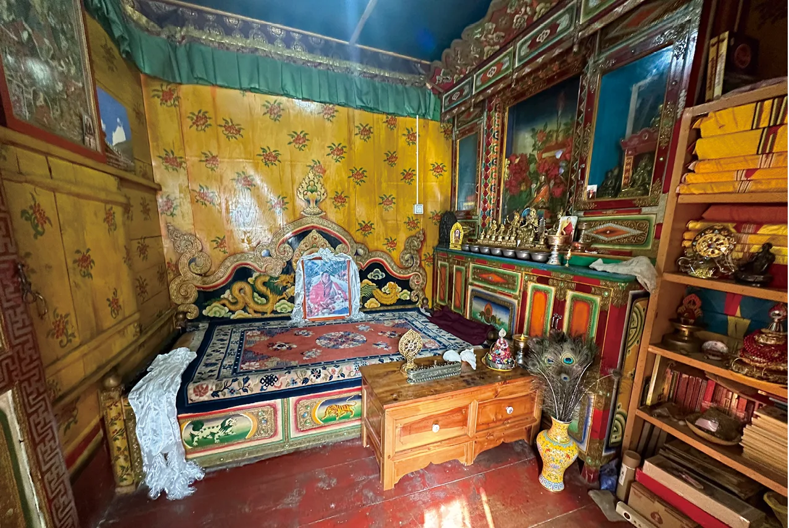

回到喇荣

6月20日，法王一早从康定出发，启程返回学院。晚上住在道孚，第二天直接回到了喇荣。

接近学院时，众弟子身披袈裟、手持哈达，站在道路两旁列队迎接上师，场面震撼人心。见到久违的上师平安归来，弟子们激动万分，泪流满面，内心充满无尽的喜悦。

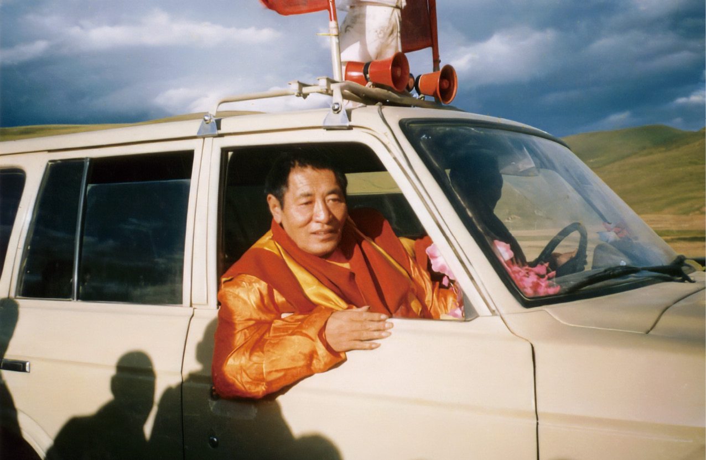

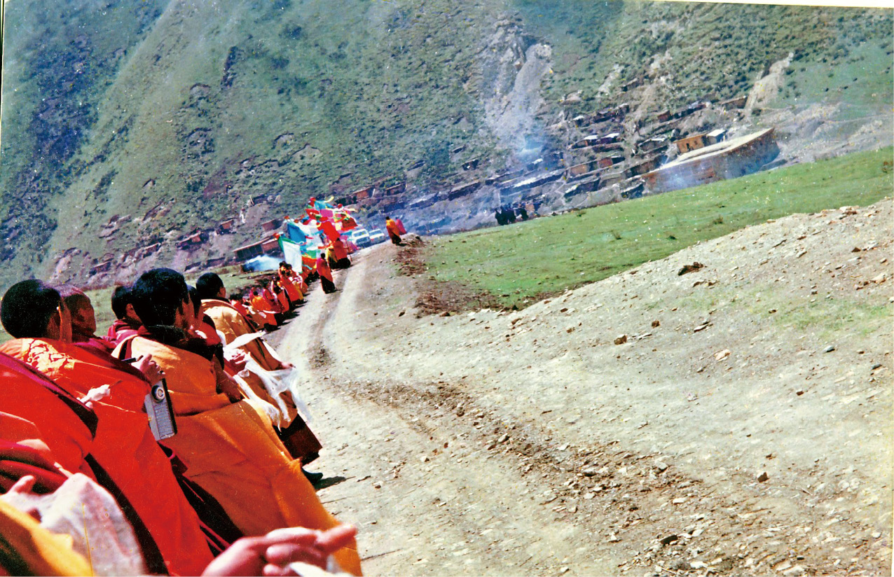

法王抵达学院后，径直前往法界宫，向大经堂里的僧众简要介绍了此次出国的经历。他提到：“我们大家又能在此圆满相聚，令人十分欢喜。总体来说，这次前往新加坡和马来西亚，弘法利生的效果不错，一切都非常顺利。在整个过程中，我的身体一直没有生病，食欲也很好，尽管随行带了医生，但除了量血压外，几乎没有用到。我身边的随行人员相处和睦，大家都非常融洽。此次出行接近两个月，我有点累。从明天开始，我将前往西山的喜悦林静处休息两天。之后，我会继续为大家传法。”

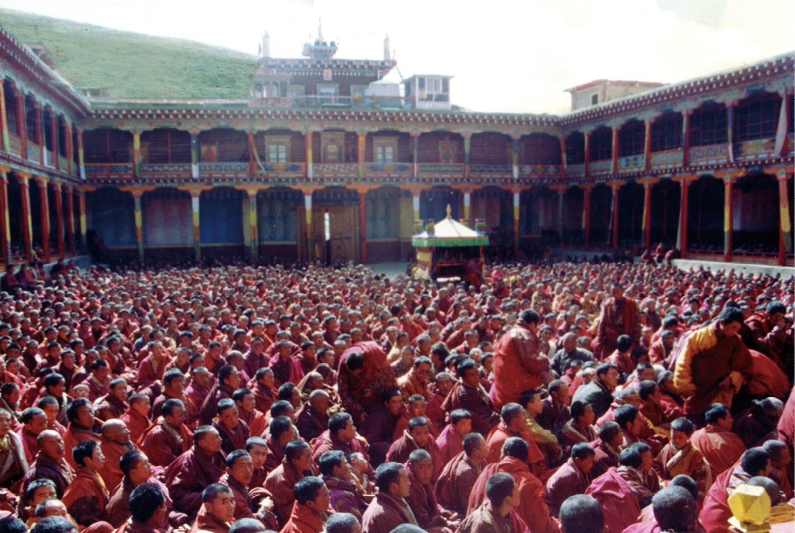

第二天，在法王前往西山的途中，我带着已七天未进食、生命垂危的父亲等在路边，恳求法王加持。法王的车子停了下来，慈悲地为父亲念了破瓦法，并告诉他好好祈祷阿弥陀佛，一定能往生极乐世界。父亲听后特别开心。当天下午，他双手合十念佛，在德巴堪布和阿苏活佛的助念声中安详往生。虽然父亲离世令我感到难过，但他在临终时得到了法王的加持，这让我感到无比欣慰。

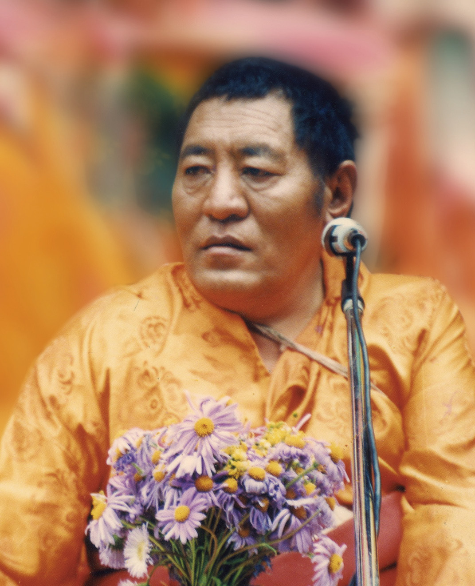

法王在西山休息了两天后，6月24日为僧众传授了“文殊智慧勇识”灌顶。随后，法王宣布：“从明日开始，我将用四天时间为大家传授‘上师心滴’的灌顶，并开始讲解麦彭仁波切的大圆满法类，相关书籍也已提前印刷好了。这个法特别甚深殊胜。我从14岁开始讲经说法，一直到现在63岁，许多次都想讲这个法，但一直舍不得。这次如果不讲，未来或许没有机会了。虽然此次对听法者的要求较为严格，但我希望大家好好珍惜机会，在这个夏天，我们一直讲闻大圆满法。”

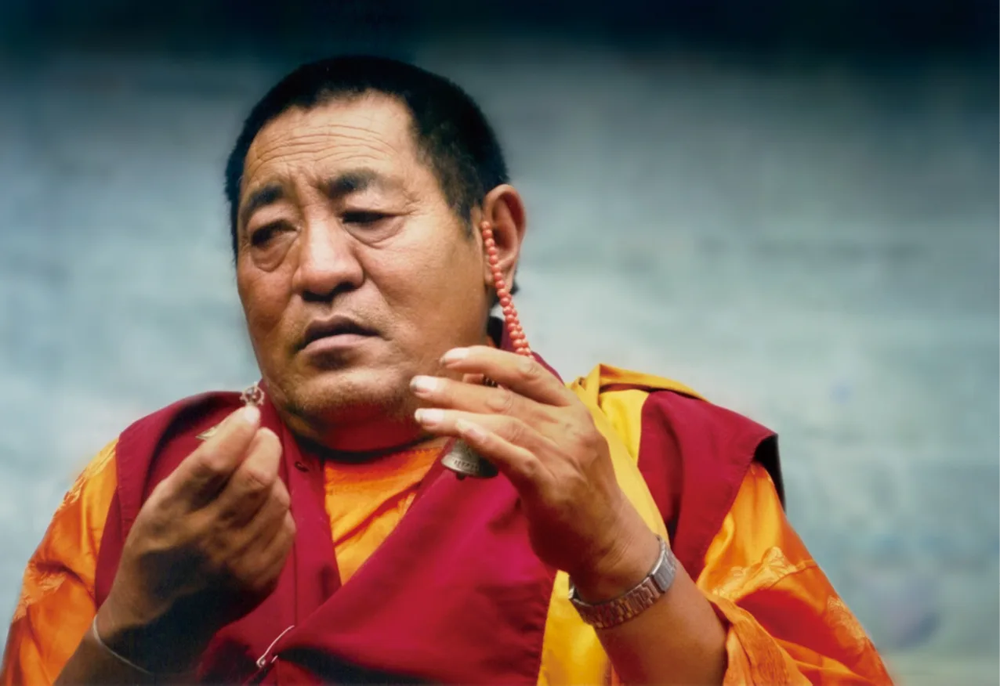

此后，我们一如既往地在寂静的喇荣，于上师如意宝座下日复一日地通过闻思修行，无有餍足地不断品尝佛法甘露……

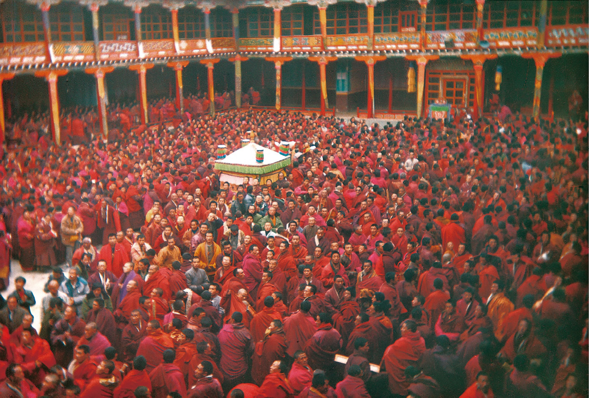

如是水月回忆之游舞，如梦人生回味之影像，

利益后世众生之喜宴，仰仗信心策笔而呈现。

此非寻常书籍可比拟，盛满上师口诀珍宝藏，

空行护法护之如眼目，加持悉地馨香正飘溢。

心眼沉迷网络此时代，窍诀甘露如草般舍弃，

然具信勤智慧善缘者，黄金十万焉能与之比？

来此人间一趟之意义，能遇上师教言此已足，

当以获得如意宝之念，将此融入心间岂不妙？

大恩上师如鹏翔空中，往生净土已过廿二年，

我等孤儿兄妹和合众，守护美丽家园未离散，

风雨冰雹肆虐雪域中，仰望寒热无常之天空，

熬过希忧悲欣之岁月，祈请上师依然猛加持。

如是撰著清净善业力，白法天神凯歌遍三界，

黑法魔众眷属皆降伏，广大国土众生享法乐。

一切吉祥利乐珍宝藏，圣教不衰金色胜幢高，

所有众生享受善乐德，殊妙光明庄严此世界。

此《水月回忆录》，于公元2025年11月11日，即藏历木蛇年九月二十二日星宿会合吉祥之日，由索达吉撰著圆满。善哉！
