# 新加坡

第一站

4/29-5/18

行程

Schedule

4月29日，抵达新加坡

4月30日，在鸿福中心，传授皈依戒、菩萨戒和密乘戒，  
 赐予“金刚萨埵”灌顶

5月1日，传讲《大乘显密教义与修法次第》

5月3日，在大众学佛研究会，传授“文殊大圆满”  
 “忿怒莲师”“项袋金刚橛”灌顶

5月4日，《文殊大圆满》第一节课

5月5日，《文殊大圆满》第二节课

5月6日，《文殊大圆满》第三节课

5月7日，《文殊大圆满》第四节课

5月8日，《文殊大圆满》第五节课

5月9日，《心性自解脱》第一节课  
 中午去菩提协会和白玉中心

5月10日，举行超度法会

5月11日，《心性自解脱》第二节课

5月12日，《心性自解脱》第三节课  
 中午去新加坡佛教居士林

5月13日，《心性自解脱》第四节课

5月14日，参加卫塞节的浴佛仪式及晚宴

5月16日，在普觉禅寺，传授“龙钦宁提持明总集”  
 灌顶

5月17日，传授“文殊大圆满”灌顶

正式出发

当法王通知我们即将出国时，首要任务就是办理签证。由于成都没有新加坡领事馆，只能前往北京进行办理。在经过各方面的协调和沟通之后，我们的签证于4月12日获批，但出国时间仅有短短的一个月。

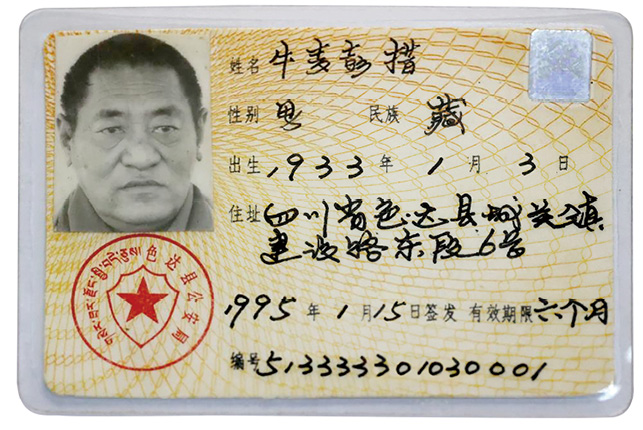

法王的临时身份证

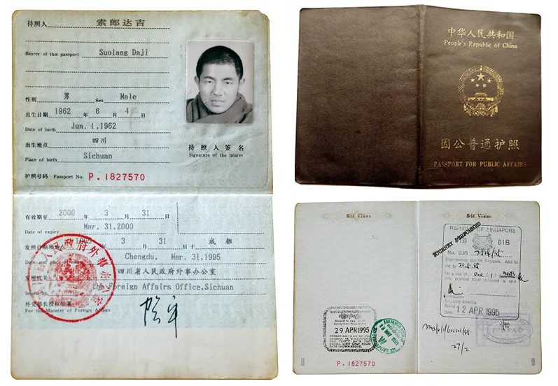

新加坡驻华大使馆颁发的一个月签证

4月29日上午，法王携同我们从成都双流机场启程，准备前往新加坡。在抵达机场后，突然出现了两名相关部门人员，手持法王的照片，收走了我们的护照，逐一进行详细排查。之后，其他人的护照很快被归还，唯独法王的被扣了下来。他们表示：“这个人不能出国，其他人可以放行。”

我们不断地与他们交涉，强调如果法王不能出国，我们的出行将毫无意义。新加坡的场地、住处、行程都已安排妥当，一旦无法前往，将会造成巨大损失……出人意料的是，在最后一刻，他们返还了法王的护照，说：“你们现在可以出发了。”我们松了口气，迅速办完出关手续，随后匆匆登上飞机。

历经四个多小时的飞行，终于抵达了新加坡樟宜机场（Changi Airport）。这段跌宕起伏的经历，成为我们东南亚弘法的难忘开端。

初到新加坡

众所周知，新加坡的国土面积极小，甚至不及色达县的十分之一，整个国家仅有一座城市。由于自然资源匮乏，人们对饮用水、粮食、水果等的需求大量依赖进口。然而，尽管如此，新加坡在经济、文化、教育等领域却展现出高度的发达，成为全球重要的商业和金融中心，曾被誉为“亚洲四小龙”之一。

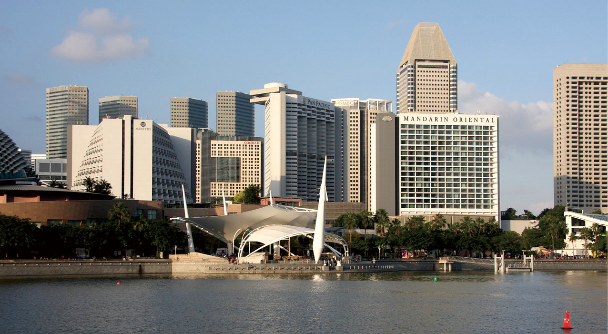

1995年新加坡一隅

来到新加坡之前，我听闻了关于这个国度的各种描述，使我对这片土地充满了向往和好奇。下了飞机以后，我发现当地人的素质很高，他们彬彬有礼，热情亲切。在海关，许多官员的态度非常友好，甚至亲自护送法王出关，使我们办理出关手续异常轻松、顺畅。

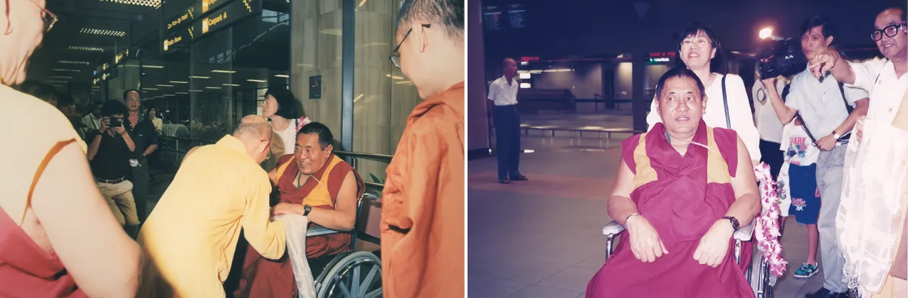

机场人员亲自护送法王出关 新加坡佛教总会会长向法王献哈达

走出关卡后，大众学佛研究会、新加坡佛教总会、白玉佛教中心等佛教团体的代表们早早在外恭候。他们手捧着哈达、鲜花，高举黄色横幅，上面醒目地写着“热烈欢迎法王晋美彭措勇列吉祥贤友好访问团莅新”，用隆重的仪式为我们新加坡之行拉开了帷幕。紧接着，大家在机场留下了合影，作为这次弘法的珍贵纪念。

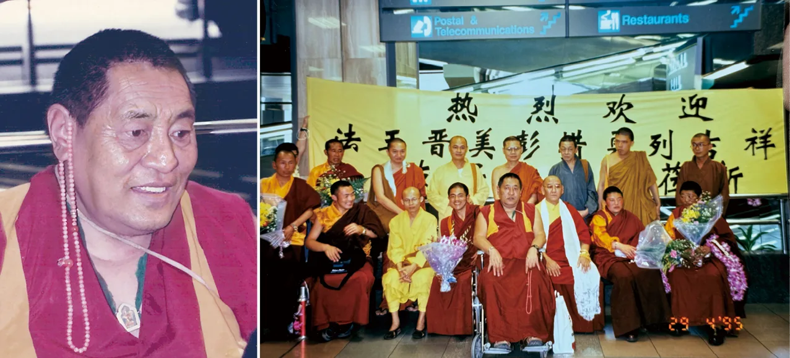

随后，我们驱车前往观慈精舍（Khoon Chee Vihara）。这是一个已有30多年历史的地方，虽然规模不大，但却是国际性的佛教活动场所，为来自不同国家的佛教团体提供了一个共享的弘法场地。曾有南传、汉传、藏传佛教的僧俗信众，包括来自不丹、印度、韩国、瑞士、美国、中国、澳大利亚等国的法师，都在这里留下了弘法的足迹。在新加坡逗留期间，我们一直居住于此，而传法活动则在其他地方进行。

当我们抵达精舍门口时，信众们整齐列队，以恭敬之心轻轻撒下玫瑰花瓣，口中齐声唱着“大自在祈祷文”。在这美妙的花雨和悠扬的唱诵声中，法王缓缓下车，受到了热烈的欢迎，随后被恭迎至下榻的住处。

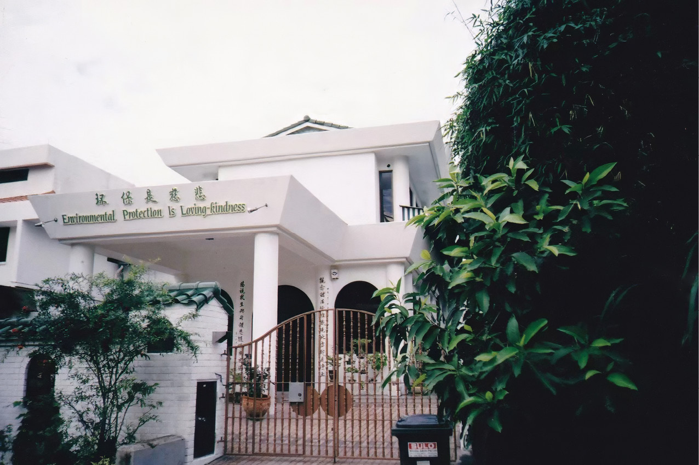

大众学佛研究会

这次邀请法王来新加坡弘法的，主要是大众学佛研究会。这一团体由在家信众组成，自上世纪80年代成立以来，致力于无偏弘扬南传、北传、藏传佛教的精髓。在新加坡的许多佛教寺院中，都能见到由他们培养的杰出僧侣。迄今为止，他们已有十多位男众出家、二十多位女众出家，有些甚至远赴藏地求法。包括新加坡佛教总会的主席、光明山普觉禅寺的住持，都曾在此学习深造。

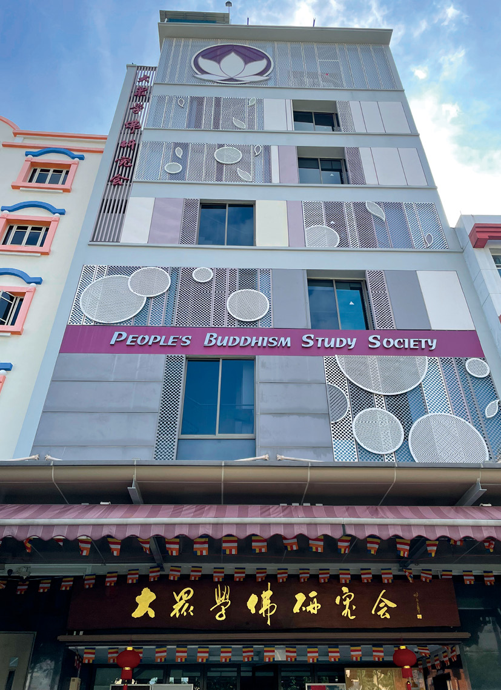

现在的大众学佛研究会

早年的大众学佛研究会历经了诸多挑战，仅仅搬迁就多达五次，但这一切都未能阻碍他们发展的脚步。尤其是在1995年，当法王亲临新加坡传法时，该研究会正值发展的黄金时期，各个部门如摄像组、接待组、宣传组、文案组、弘法部、编辑部等运作成熟，管理有序，展现出了非凡的组织能力。法王在新加坡的传法活动，无一不是由该研究会策划和执行，体现了他们对佛法传播的专业精神。

作为海外道场，维持日常庞大开销是必不可少的，因此收费听法也成为一种必然选择。法王传授的大圆满法，他们对会员收费500新币，非会员收费600新币，这一安排不仅保障了道场的运营，也是对佛法的尊重。

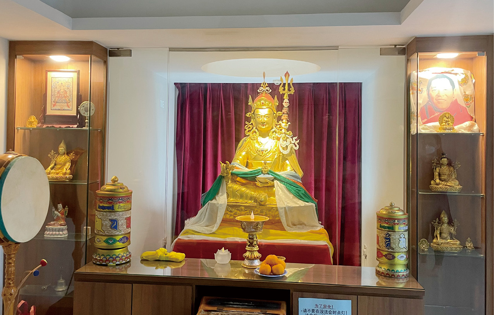

自从该研究会与法王如意宝建立联系以来，他们频繁邀请法王法脉中的大德前去灌顶、传法，不间断地学修显密教法。随着时间推移，他们的规模不断壮大，道场也日渐兴盛，如今已发展成为一座七层楼高的建筑，内部供奉着诸佛菩萨与显密祖师的圣像，包括莲师与法王的像。

此外，该研究会还注重通过多种方式广泛传播佛法。他们创办的《佛友资讯》杂志，自1989年以来已持续发行36年，成为连接佛法与众生的重要桥梁。

在新加坡，大众学佛研究会展现了在家信众在弘法方面的独特优势。他们邀请优秀的出家人担任道场的宗教顾问和理事，不断寻找真正的善知识来传授佛法、进行辅导，同时以在家身份独立管理并维护道场。这种模式充分展示了在家人在弘法中的潜力，让更多人意识到，在当今时代，学习与修行佛法并不受限于是否出家，每个人都能为佛法贡献一份力量，从而圆满自他二利。

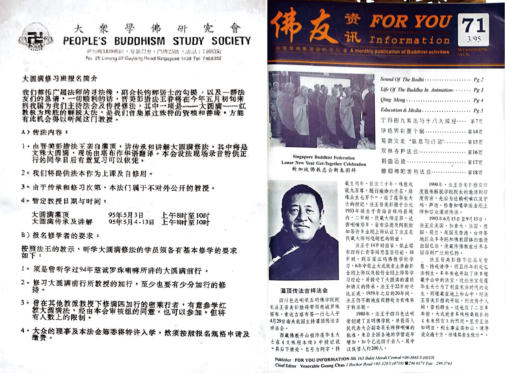

在鸿福中心传法

法王此次在新加坡的弘法活动，分为公开传法和内部传法两个阶段。前两天是公开传法，地点选在新加坡鸿福中心（The Concourse）一楼。这个地方是一家大型商场，一楼中间有一块空地，常常举办各种大型活动，因此是一个非常理想的法会场所。

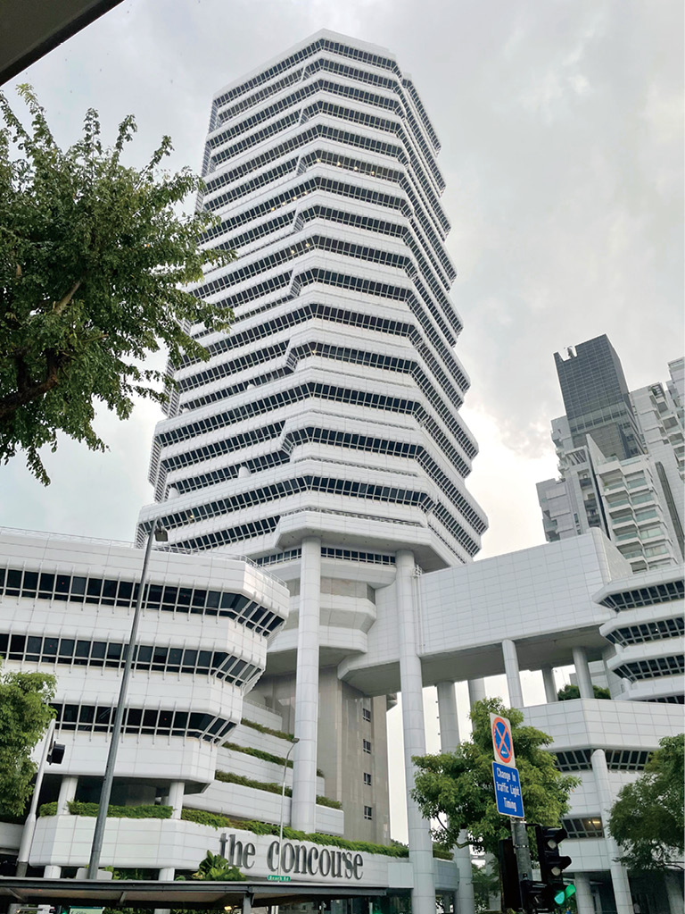

新加坡鸿福中心外观

为了这次活动，主办方精心布置了场地：宽敞的传法台铺设了红色地毯，并在中央安置了一个庄严的法座，成为全场的焦点。法座背后，悬挂着五幅精美的唐卡，居中的是金刚萨埵，两侧分别是地藏菩萨、文殊菩萨和释迦牟尼佛、莲花生大士。法座上方，一条醒目的黄色横幅书写着“法王晋美彭措灌顶传法吉祥法会”，四周飘扬的佛教旗帜为场地增添了一份庄严和神圣。

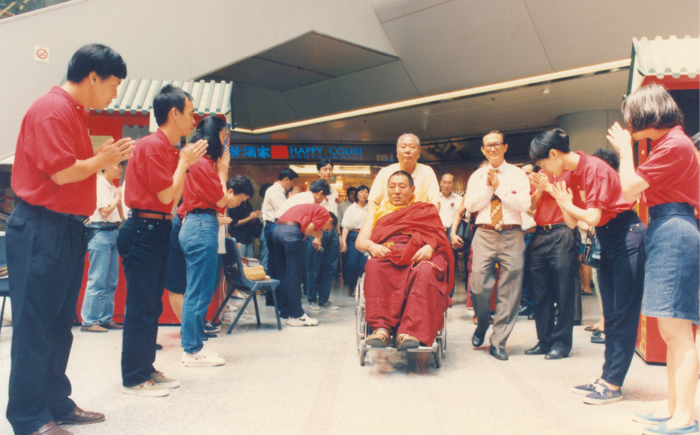

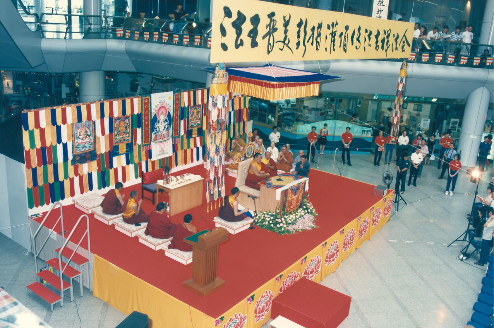

4月30日，法王向有缘信众传授了皈依戒、菩萨戒和密乘戒，并且赐予了“金刚萨埵”灌顶。接着在5月1日，法王讲解了《大乘显密教义与修法次第》，门措空行母则传授了“四臂观音”灌顶。此次法会吸引了两千多名参与者，他们来自不同的教派，包括出家人、在家人，以及一些当天慕名而来的信众。

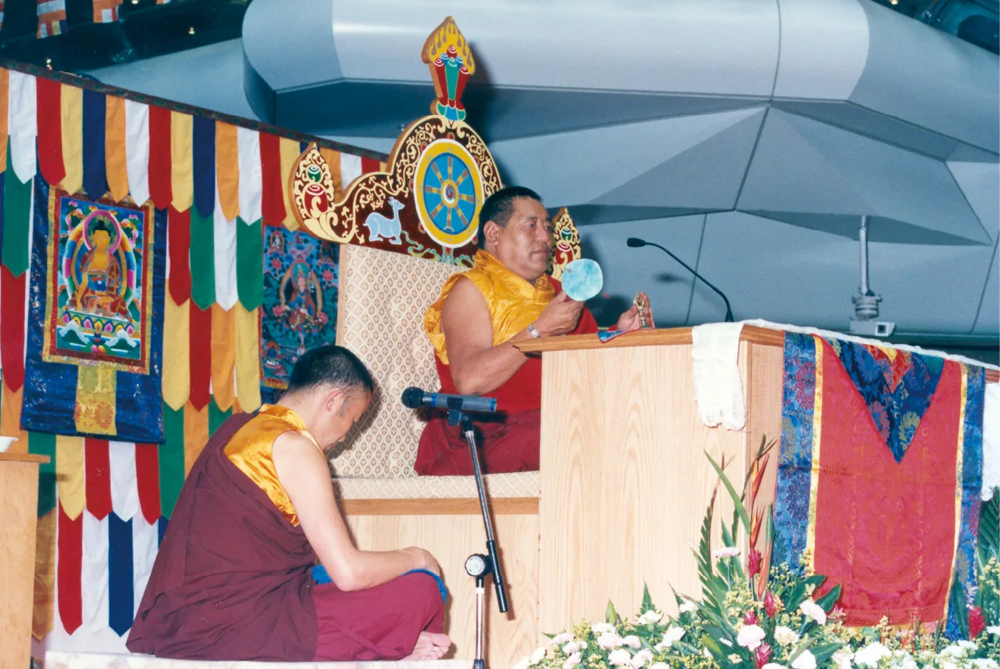

法王灌顶时，慈诚罗珠堪担任翻译

商场的三层密密麻麻站满了人，为了确保法会顺利进行，主办方特别邀请了八位在职警察担任法会的护法，同时，一百多位来自不同地区的自愿义工身穿红衣，分布在会场各处维持秩序。这是新加坡首次举办如此大规模的密宗法会。

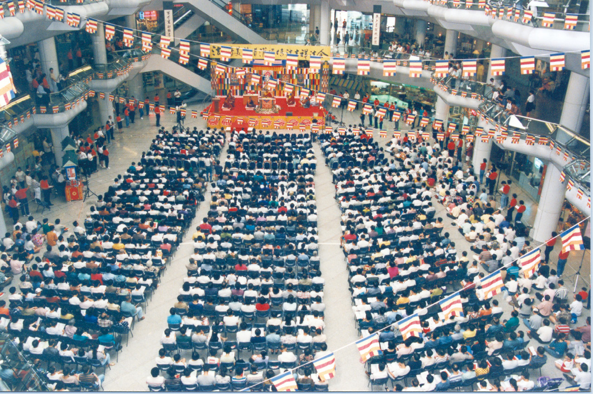

法王完成灌顶后，与其他南传、藏传、北传的法师们一起，手持灌顶加持物，逐一分发给在场的众人。这次“金刚萨埵”灌顶属于大圆满四灌顶，所以，法王手中的加持物，是象征句义灌顶的水晶柱。

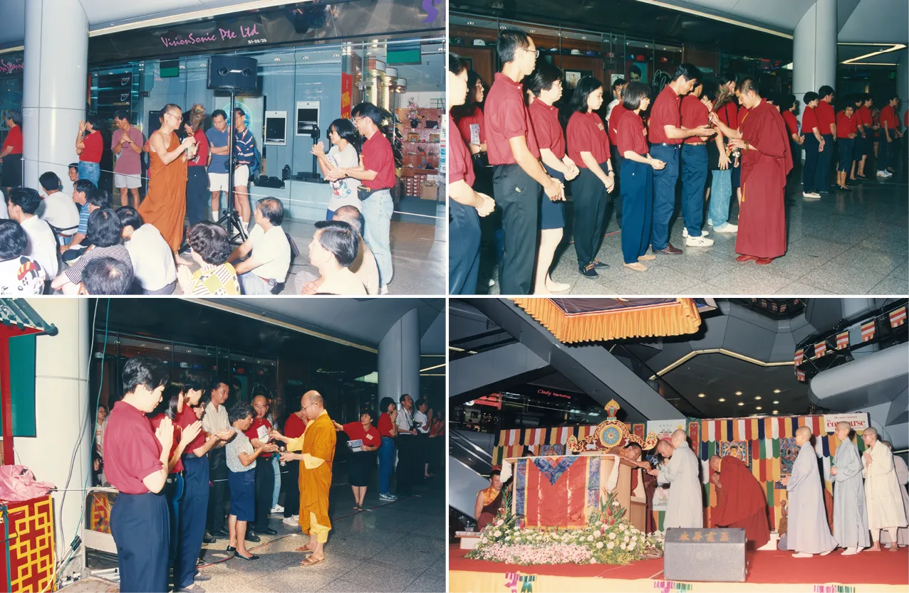

藏传、南传、汉传的法师们传递灌顶加持物

通常情况下，法王很少公开举行四灌顶，但为了让更多人通过金刚萨埵的忏悔法门来清净相续，遣除深重业障，法王做了特殊开许，如同藏地的“闻解脱”法门一般。甚至当天在商场购物的一些顾客，由于对法王生起信心，也纷纷接受了灌顶。

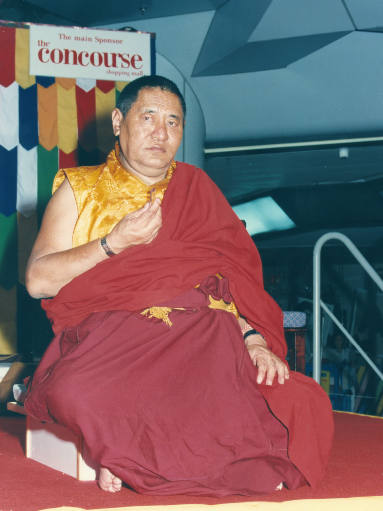

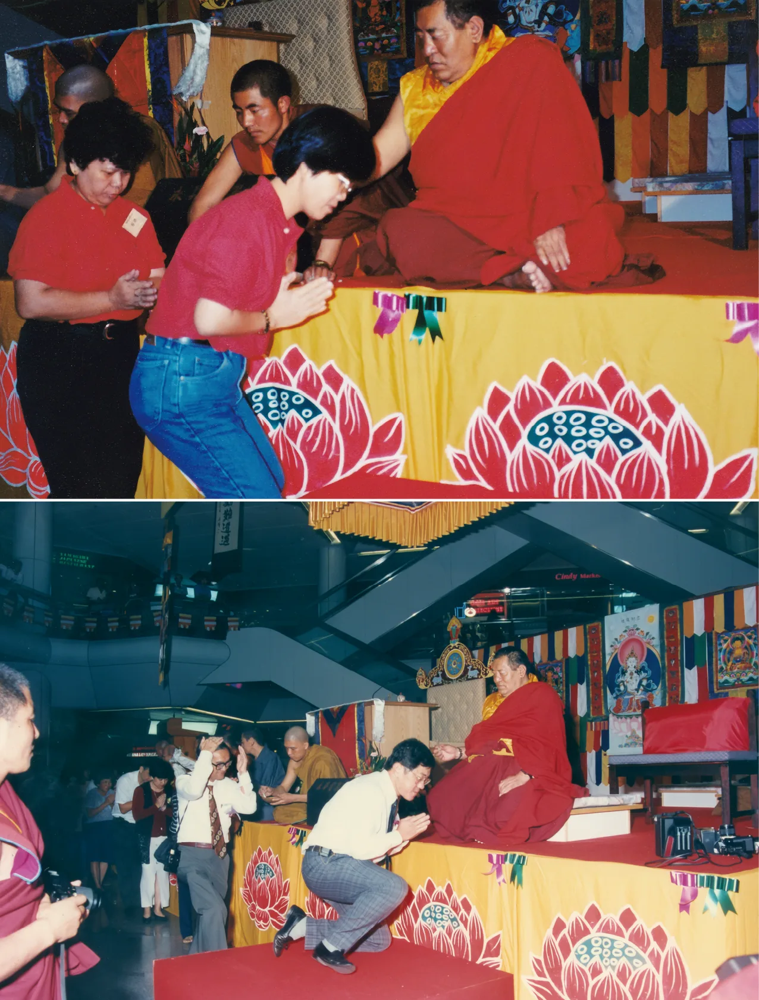

法王为大众学佛研究会的黄会长加持

灌顶结束后，法王讲了一句话：“今后我们很多人可能不会再见面，那么将来就在阿弥陀佛的极乐净土再见，扎西德勒！”

时至今日，尽管鸿福中心的内部布局已经变化，但这个地方仍然承载着那次法会的美好回忆。每当我前往新加坡，总会特意前往这座大厦，静静地站上一会儿，双手合掌，眼中渐渐湿润，心中默默祈祷，回想当年在上师面前领受甘露妙法是何等幸运，那些温暖而神圣的时刻仿佛再次浮现在眼前。

三皈居士戒

4月30日下午，法王在鸿福中心向大家传授别解脱戒、菩萨戒、密乘戒时，讲到了一段关于皈依戒的内容：

一般而言，居士戒有许多条，但今天主要传授的是皈依三宝的三皈居士戒，请大家认真听受。

只要是佛教徒，就必须受持此皈依戒。所谓“外道内道皈依别，大乘小乘发心别”，外道和内道的区别在于是否有皈依戒。因此，作为修行人，谁的相续中有了皈依戒，谁就是佛教徒；若无此戒，那就是外道徒。

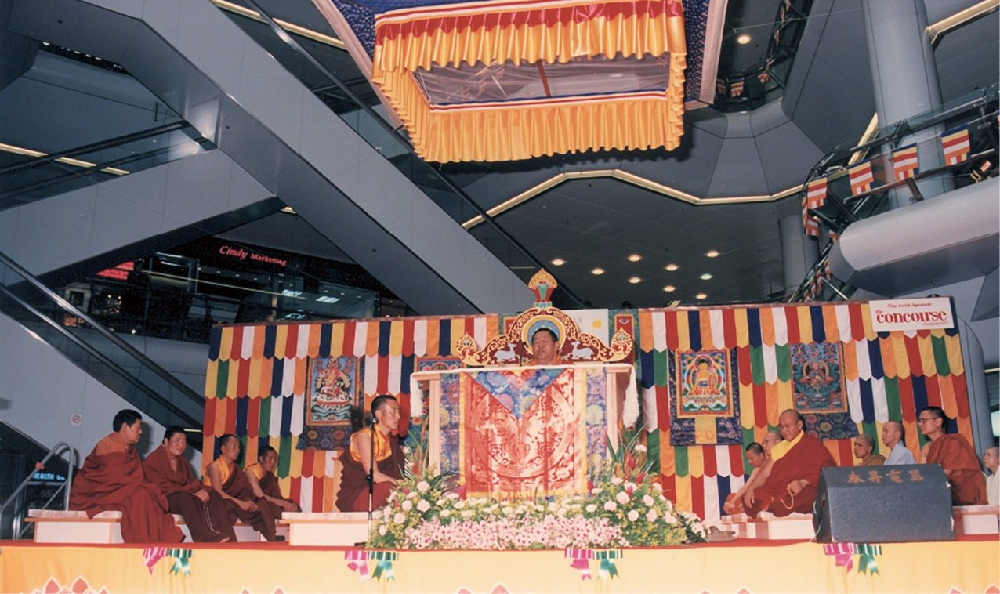

想要在相续中生起佛法中所说的功德，首先必须具备皈依戒，否则就不会有生起功德的机会。因此，皈依戒至关重要。若不愿意在此生短命、多病、贫穷、不顺心，也不愿意在来世遭受地狱、饿鬼、旁生的无量痛苦，就要受皈依三宝的戒。没有皈依戒，无法根本消除一切痛苦；而受了皈依戒，今生会长寿无病、受用丰厚、心愿如意，临终时将往生西方极乐世界。

特别值得一提的是，佛经中也讲过，受皈依戒者命终后会往生极乐世界。在座的各位已皈依了三宝，尤其是皈依了阿弥陀佛，因此往生极乐世界并不难。然而，若相续中没有皈依戒，则无法获得今生来世的圆满利乐。

若想真正皈依，你们要在心中立下誓言：“从现在开始，乃至生生世世，我唯一的导师是释迦牟尼佛，除此之外不依止其他导师；我所修行的法，唯一是释迦牟尼佛所传的法，除此之外不修行其他法；我修道的助伴，唯一是释迦牟尼佛的随行者，除此之外不与不喜佛教或持有邪见者为伍。”通过这种方式而想修道，即称为“因皈依”。依靠这样依止佛陀、实修正法、与僧众为伴，为最终成就佛果而修道，这便是“果皈依”。

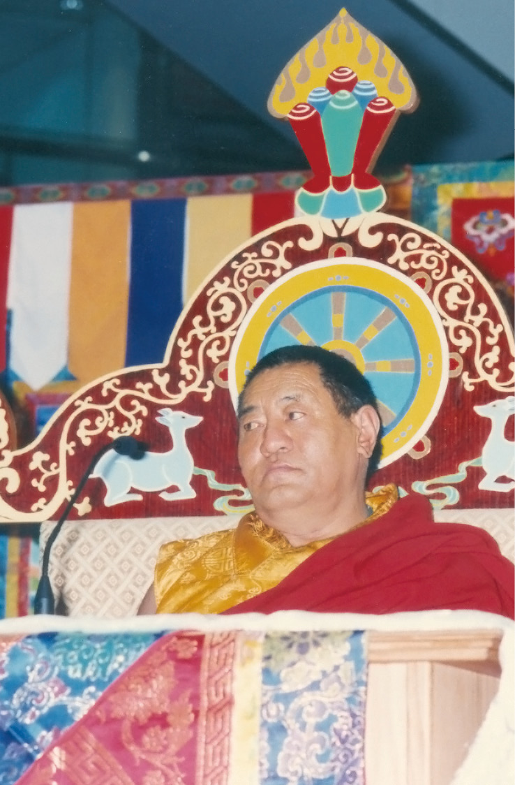

归纳而言，就是要在生生世世中，纵使遇到生命危险，也绝不舍弃珍贵的三宝，完全依赖三宝，诚心祈祷三宝。请大家怀着这种承诺来立誓，并重复以下皈依偈：“皈依师，皈依佛，皈依法，皈依僧。在我未证得佛果之前，愿受持三皈居士戒，请尊者摄受。”念两遍后，待第三遍念完，听到我弹指时，你们即获得了皈依戒，心想“从今天起，我成了一名佛教徒”，相续中要生起这样的意乐。

（念完第三遍后，法王说“是方便”，大家回答“善哉”。）

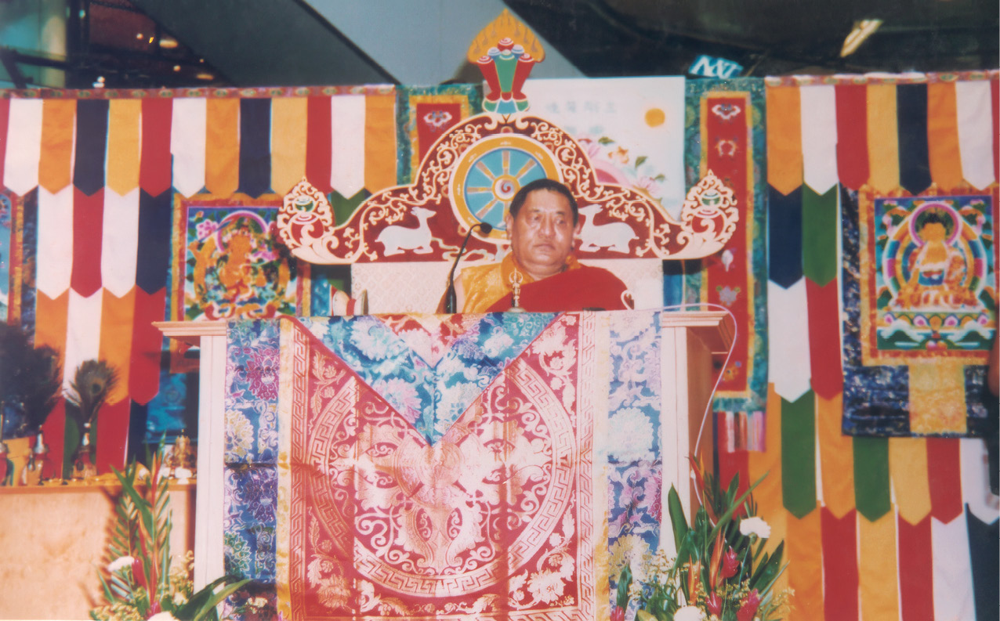

现在，你们已经得到了皈依戒。皈依的学处是，从现在起，你们已经皈依了佛，每天要以信心虔诚地祈祷佛，切勿忘记；你们已经皈依了法，必须尽量断除伤害有情的恶心与恶行；你们已经皈依了僧，不可与不恭敬佛陀或佛法的人交往。

再重申一下，现在你们已获得了皈依戒，不要忘记自己是佛教徒，不要今天喜爱佛教，明天喜爱其他教，而应以坚定不移的心祈祷三宝，修行正道。若能如此，一定可以从佛法中得到利益。

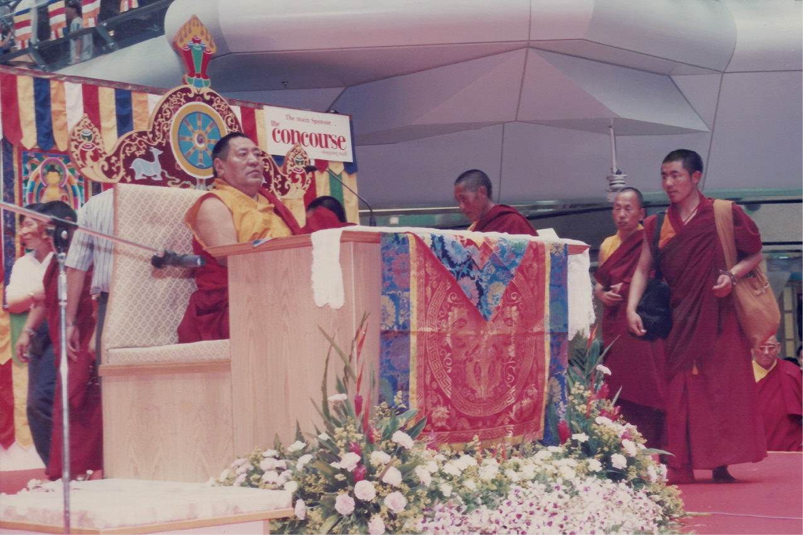

皈依戒是开始守持居士戒的起点，居士戒包括一分戒、少分戒、多分戒、圆分戒。你们慢慢深入了解后，根据个人情况选择适合自己的戒律是非常重要的。

去大使馆办签证

来到新加坡后，法王也想趁此机会，顺便朝拜一下东南亚其他佛教国家。

泰国，这个闻名遐迩的佛教国家，一直以来都是法王心心念念想去的地方。通过向当地人打听得知，去泰国大使馆办理签证非常方便，手续简单，而且泰国那边也有人邀请法王。于是，5月3日下午，法王和我们一同前往泰国大使馆。

泰国大使馆坐落在新加坡最繁华的乌节路上，是购物区内唯一的大使馆。据说这片土地最初是朱拉隆功国王于1893年购置的，后来逐步进行了扩建。大使馆中央是一座两层楼的白色建筑，也是我们签证办理的地方。

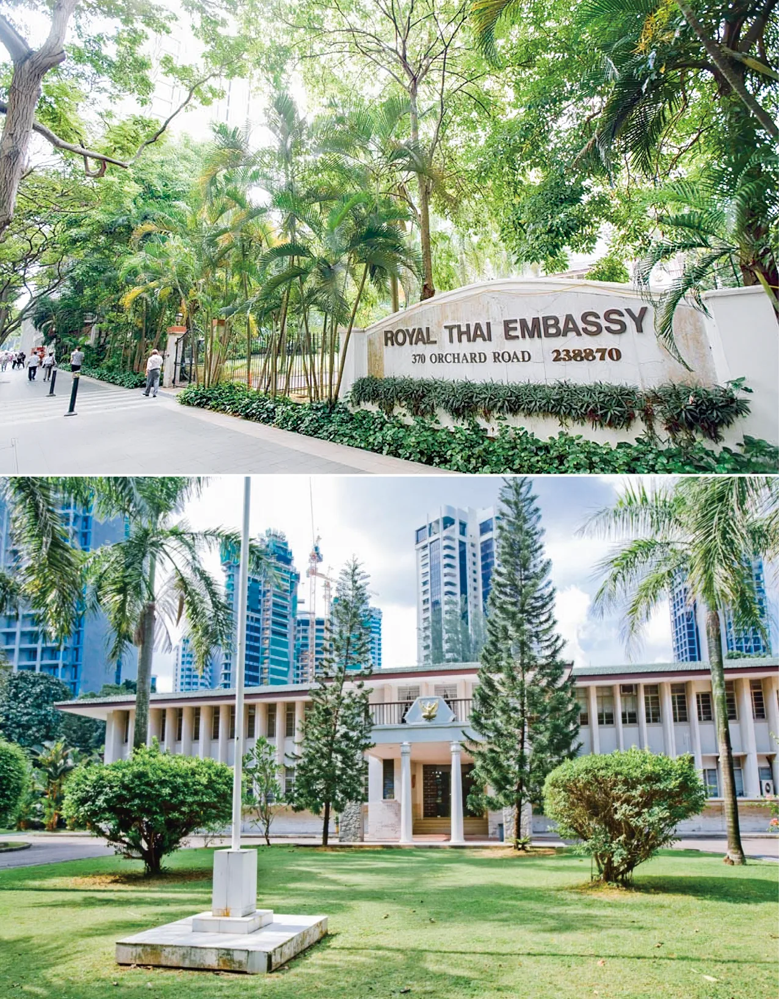

泰国大使馆

然而，到达后才发现，其他国家的公民可以直接在新加坡办理泰国签证，唯独中国有所不同，需要回国办理。尽管略感遗憾，但我们仍然欣赏了一番大使馆的建筑，然后离开了。

随后，我们来到了马来西亚大使馆。它的规模虽然不及泰国大使馆，但建筑别具风格。由于马来西亚与新加坡是友好邻邦，签证办理非常顺利，我们很快就拿到了14天的签证。

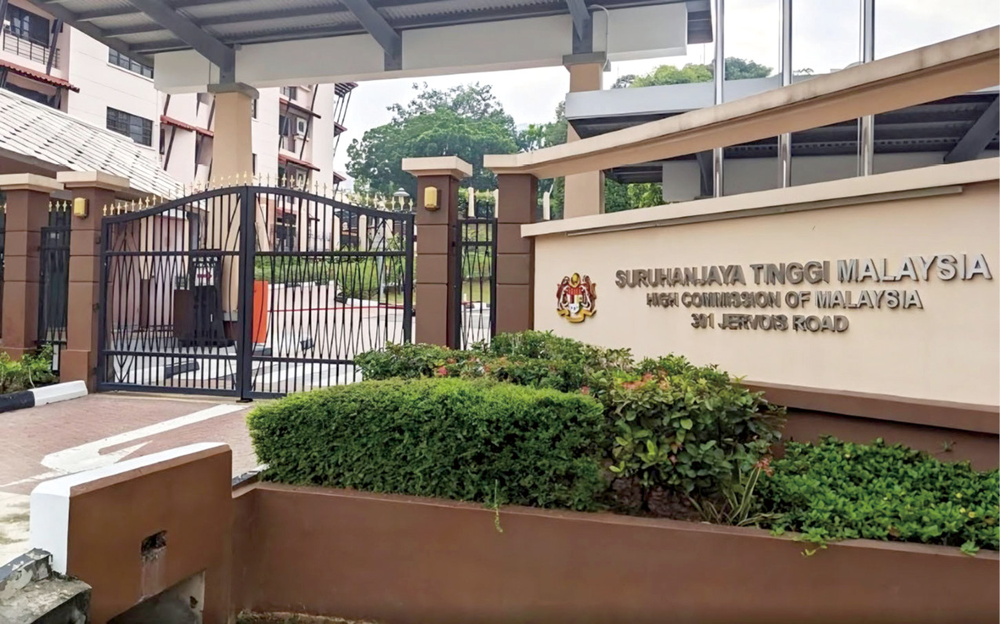

马来西亚大使馆

法王原本还计划前往印尼，因为那里是金洲大师修行的圣地，阿底峡尊者也曾去求法。然而，由于签证办理时间较长，而本次出国时间仅有短短一个月，我们不得不放弃了这个打算。

马来西亚大使馆颁发的十四天签证

实际上，如果当时政策更加开放一些，法王或许能在有生之年到访更多的国家。尽管如此，在那样的环境下，法王能顺利拿到一些国家的签证，也算是不易。

文殊大圆满·手中赐佛

法王如意宝曾亲自说过：“在我众多的意伏藏法中，具有近传加持的甚深法，是白文殊与大威德这两个灌顶；弘扬事业最广大的，是《文殊静修仪轨》和《文殊大圆满·手中赐佛》；缘起始终未被破坏的，是《项袋金刚橛》。”

尤其是《文殊大圆满》，其内容深奥精妙，修行起来又简便易行，许多修行人依此法修持，获得了非凡的境界。法王早年曾在喇荣向藏地修行人传授此法，由丹增嘉措活佛详细记录，我随后将其翻译成汉文，法王当时也开许以此方式将这一大圆满法留给后人。

1993年，法王前往西方弘法时，根据西方修行人的特点，多次阐述《文殊大圆满》的精髓，这些讲解被收录在《西游回忆录》中。

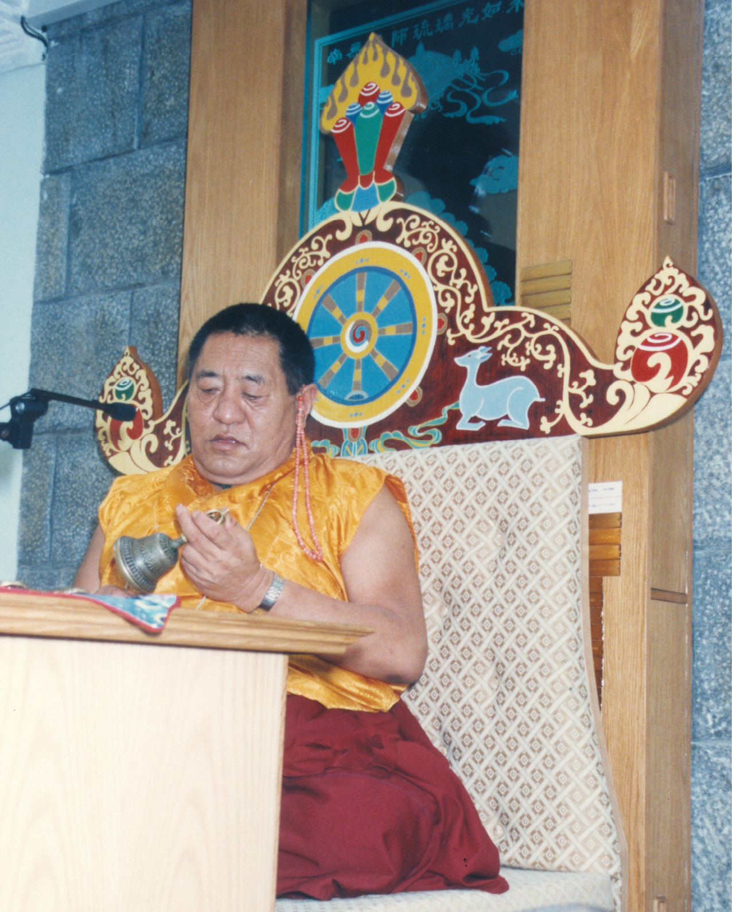

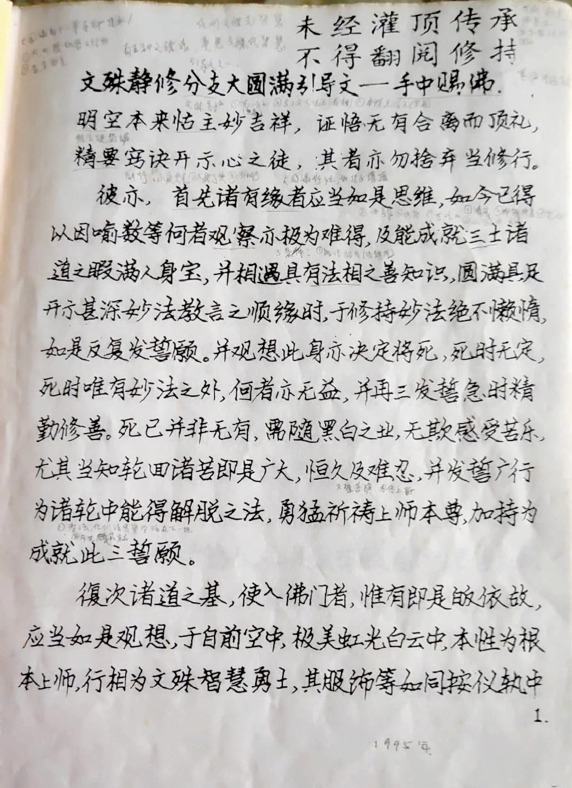

初译的《文殊大圆满》手抄法本

而这一次在新加坡、马来西亚传授此法，法王主要面向东南亚的华人群体。在传法的过程中，法王对许多修法进行了详细讲解，包括金刚坐式、法报化三身坐式等，亲自示范修行的正确姿势与观修方法。因此，这次讲座并未对外公开，参与者经过严格筛选，最终只有新加坡94位、马来西亚50位幸运者能够亲耳聆听。此次讲授具有特殊的重要性，未来得过灌顶、修过加行的人，若能依照这些窍诀实修，必定会获得不同程度的成就。

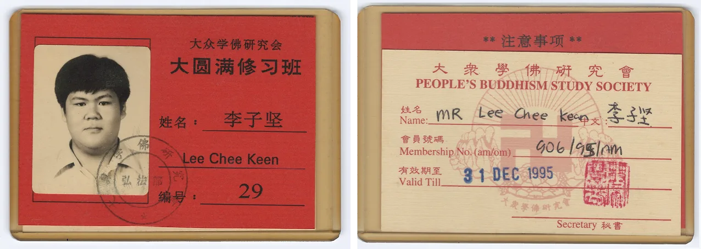

大圆满修习班闻法证 大众学佛研究会会员证

奇妙的是，尽管法王所传授的始终是同一部《文殊大圆满》，但根据不同地区、不同根基的修行人，法王讲解的窍诀和风格却各具特色。每一次聆听，不仅没有重复的感觉，反而仿佛听到了全新的法音。

或许对一般人来说，这些教言并不那么重要，但对那些渴望证悟心性的人而言，法王所讲的每一个字、每一句话，都是无价之宝。在过去的三十年里，我一直将这些珍贵的资料妥善保存，而这次我更进一步，多方搜集相关内容，并将其编纂成文。也许在未来的某一天，那些能品尝到这些教言美味的人，会感激我为此付出的心血与努力。

《文殊大圆满》第一节课

5月3日上午，法王传授了“文殊大圆满”“忿怒莲师”“项袋金刚橛”三个灌顶。尤其是在“文殊大圆满”灌顶之后，法王突然说道：“今天，我要把汇集三世诸佛意趣的醍醐开示给你们，你们要注意了。”说完，他将手掌从左到右扫过，问道：“你们当中，有人开悟了吗？”这一幕如同禅宗的直指心性，令当场的许多人印象深刻。

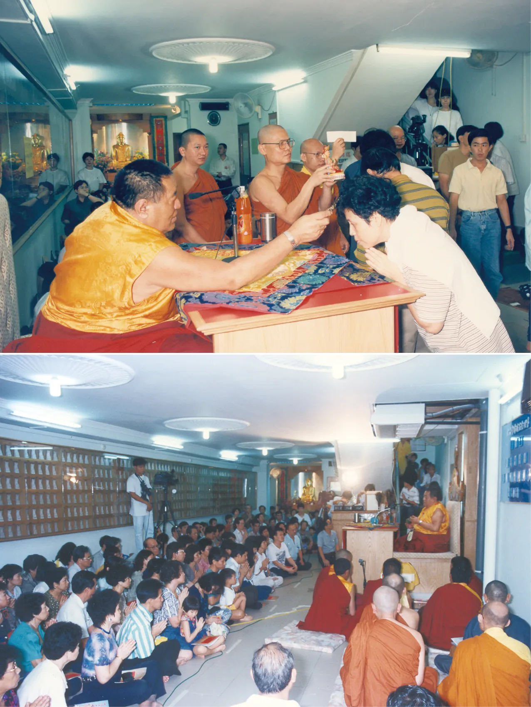

从5月4日至5月8日，法王每天上午8点到10点，在大众学佛研究会传授《文殊大圆满·手中赐佛》。

今天，我在开始传法之前，先亲自领诵了三遍“怀业祈祷文”，这是我们藏地的传统念诵方式。你们新加坡的念法也十分优美，听起来令人耳目一新。接下来，我希望那些声音悦耳的人能够带领大家一起念诵三遍“怀业祈祷文”，我们会录音后带回到藏地，并且有时在喇荣播放。现在，我们一同念诵三遍……

念完了“怀业祈祷文”后，法王说道：

在这次法会及日常生活中，我希望你们能坚持念诵这个祈祷文。这样做将会让新加坡整个国家，尤其是这个道场更加兴盛、繁荣、圆满，人们心想事成，一切顺遂，成就正法。此外，我们藏地和新加坡修行人之间结下的第一个法缘，便是这个祈祷文，这个缘起极其重要，因此永远不应忘记。

值得一提的是，新加坡佛教徒与喇荣五明佛学院修行人之间的第一位联系人就是广超法师。对于我们佛学院来说，他也是最早从国外前来求法的人之一。从那时起，新加坡大众学佛研究会的弟子们陆续来到我们学院。此后，全世界好似如意宝般珍贵的光明大圆满法，在新加坡各地广泛弘扬，这一切与他的恩德密切相关。他最初来到我们佛学院时，慷慨地供养了数万元，以这个缘起，我们整个僧团的生活状况得以大大改善。比如，在今年举办的“十万持明大法会”期间，有三万八千名僧人和数万名在家众参加，但我们佛学院有足够的条件为所有参加法会的人提供饮食。同样，今天这个法会，也得益于广超法师等人所提供的顺缘，我们所有人都应发自内心地感谢他们。

念完“文殊礼赞”和“请法偈”之后，法王开始正式传法：

请大家发起菩提心，怀着让普天下一切众生都获得永恒安乐的无上正等觉佛果的心愿，聆听并实修这些妙法。今天我们要听闻的法是，《文殊静修支分引导文·手中赐佛》。

这一大圆满法，虽然在佛法起源地印度圣境未能普遍传播，但后来通过莲花生大士、大班智达布玛莫札、大译师贝若札那等众多大德，在藏地得到了广泛的弘扬。在全世界，可能没有哪个地方能像藏地这样，使大圆满法如此兴盛。而且，自古至今，藏地一直有人通过实修这个法门而直接证悟了佛的境界，这样的现象从未中断过。尽管佛法浩如烟海，但能汇集其全部精髓的这个法门，在三时中都十分罕见，即使在藏地也极为稀少。

文殊法门的本尊，分为寂静、忿怒两种，我们今天所讲的文殊静修法，便是其中的寂静修法。这个法的灌顶，我们昨天已经完成。除了灌顶外，还有许多羯摩仪轨和修持方法，而这个引导文正是其中的一个分支。这个引导文被称为“手中赐佛”，其含义是直接将佛果赐予你手中。

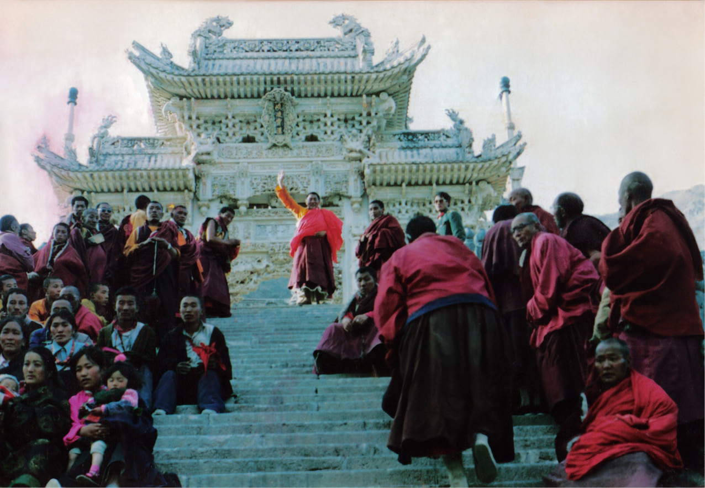

1987年法王携众眷属朝拜五台山

八年前，我与一万名藏族人一起前往汉地五台山朝圣，当时还有许多汉族人和蒙古族人同行。我们共同祈祷怙主文殊菩萨，每个人根据自己的缘分，出现了相应的感应和验相。在那段时间里，我在文殊菩萨的加持下，心中自然涌现出这个法门。它的加持力无比强大，传承也非常近——除了我，没有其他人介于你们和文殊菩萨之间。要知道，传承越近，加持力就越大。

> 觉空本来怙主妙吉祥，证悟无离无合而顶礼，

自心的法性，这现而无生的本性，便称之为“文殊怙主”。如果你真正认识了心的本性，就是亲见了文殊菩萨。他既不向内聚合也不向外扩散，正如人影在镜中的映照一般。在外相上，我们能够见到文殊菩萨通过自身妙力所展现的身、语、意的幻化游舞，而当你有一天亲自证得了佛果，也会现前他身、语、意的所有幻化。这一切的关键，在于对心性不增不减的认识。这里所提到的“顶礼”，是上根者以证悟心性的见解进行作礼。

> 我为心子开示精华要，汝亦切莫舍弃当实修。

大圆满六百四十万续的精华，都汇集在《手中赐佛》这个引导文中。因此，这一极为重要的教言，只能传授给那些如眼睛和心脏般珍贵的弟子，对其他人则不能传讲。今天在座的各位，已经圆满修完了加行，对大圆满怀有特殊的意乐、虔诚的信心，所以我才把这个法传给你们。

请千万不要舍弃它，并认真实地修行。如果你们只是浅尝辄止，了解皮毛，将很难从中得到极大的利益。对于此法的要义，绝不能仅仅满足于“大概是这样”的表面理解，然后就置之不理，否则，难以通过它来证得佛果。所以，必须把理解的意义付诸于实修。切记，想成佛绝不能忽视精进的修持。

当怙主文殊菩萨的加持融入我的相续时，这个法的所有句义都是以藏文形式呈现的。因此，对于懂藏文的藏族人来说，理解其含义并不困难。但现在转译成汉语，能否直接理解，翻译的难易程度我无从得知。关键是要深入理解每个词句，必须一字一句地弄明白。在我们藏族传统中，这种方法被比喻为“如乌龟爬行”，意指像乌龟那样缓慢而稳定地移动，不遗漏任何一个词句地深入理解。

在掌握字面意义之后，还需要了解实修的根本方法。如果只是粗略地理解文字，而对其深层含义一无所知，那么书本知识和个人修行便会脱节，不会有很好的修行效果。因此，深刻地理解这些教义至关重要。

如果我讲的时候你们没有完全听懂，还可以向慈诚罗珠堪布和索达吉堪布请教，我相信他们能够清晰地向你们解释这里的每一个细节。因此，你们从一开始就应该认真对待这次学习，确保自己能理解这个法的句义。这次，你们要踏踏实实地学习，首先明白法义的字面含义，然后检验自己在修行中是否有所体验。在这之外，即使你们前往藏地，也很难再有这样完备的学习条件。

想想看，对我而言，有数千名弟子，我通常是面向大众讲法，很少有机会像现在这样，只对大约一百名弟子进行如此深入细致的指导。此外，本次指导你们大圆满法的两位堪布，在喇荣佛学院中也是数一数二的，几乎无人能超越他们。在这次学习中，我亲自传授引导文，同时两位堪布也在场辅助，希望你们能充分利用这个难得的机会，彻底理解所学的内容。通过这次学习，你们的智慧定将大幅度提升，这是非常重要的，务必要记住。

> 人身难得：诸位有缘者首先应当思维：

所谓的“有缘者”，是指对大圆满有深刻理解、对上师有极大信心的人，这种人堪为此法的法器。这样的“有缘者”，一开始应该这样思维：必须将前行修持到位，不可草率急躁。如果准确无误地修完前行，正行就会相对容易许多。有时，仅凭上师的一两句话或一个简单的弹指，自己便有可能认识心的本性。但是，如果修前行时没有切中要领，那么即使正行下再大的功夫，也难以取得成效。因此，首先要掌握前行的修行次第。

> 自己如今已获得了从因缘、比喻、数量观察都极为难得

先要这样思维：我们现在拥有的这个人身，尤其是能修行正法的殊胜所依身，是极其难得的。从因的角度来看，如果没有在前世守护清净的戒律，没有积累资粮和净化业障，我们就不可能得到这样一个能修正法的人身；从数量上看，不修正法的众生如地狱、饿鬼、旁生等数不胜数，而修行正法的人少之又少；从比喻上看，就像将一把豆子撒向光滑的墙壁，只有外内密的众多因缘聚合时，极少数才可能会留在墙上，而获得宝贵人身比这更难。因此，无论从因、比喻、数目哪个角度观察，这个人身都来之不易。所以，我们首先要深信佛陀的经教，然后再去修行。

> 且能成就三士道菩提果位的暇满人身宝，

有人可能会问：“这难得的人身有什么利益呢？”

答案是，得到人身的利益非常大，它能让我们获得三士道的果位。

世间一切法无不包含在三士道中。修持佛教的许多人，希望远离地狱、饿鬼、旁生等恶趣的痛苦，获得人天善趣的果位，这类人被称为“小士”；希望摆脱轮回中的所有痛苦，自己趋入寂灭的果位，被称为“中士”；希望自他一切众生都获得不住二边的佛果，被称为“大士”。今生依靠这个人身，无论是修持三士道中的哪一种，都必定能成就相应的果位。

> 并遇到了具有法相的善知识

这一生，我们不仅获得了珍贵的暇满人身，还遇到了具足法相的上师善知识。那么，上师应具备什么样的法相呢？根据《大庄严续》中的描述“具慧离俗事，法性义如量，不昧所求义，密宗上师相”，上师应精通大圆满的深意，能为他人讲解法义；安住于法性义中，一心不乱；对今生的贪执较少，远离俗世纷扰；对于弟子的疑问，能给予清晰明确的答复。反之，那些为了现世利益而讲经说法，带有政治目的并以贪嗔之心修行的人，就不符合上师的法相。

> 宣说甚深妙法。

仅仅因为上师来到了我们所在之处，并不意味着我们就能自动受益。真正重要的是，上师要根据弟子们的不同根基，相应传授一切法的究竟——甚深光明大圆满。

> 在具足此等顺缘之此时，应当反复思维而立誓毫不懈怠地勤修正法。

当我们正拥有这些顺缘时，应认识到修行清净正法的重要性，之后立下坚定的誓言，全心全意投入到正法的修行中。

以上只是对“暇满难得”的简略介绍。若要广泛讲解这个引导文，其内容完全可以展开至五六百页。但在此处，我只是简明扼要地总结了其核心要义。大家应当观修这个教言的深层含义，至于那些更广泛的论述，你们知不知道都可以。

> 寿命无常：思维此身也必定死亡、死期无有定准、死时除正法外一切都无有利益的道理后，应当下定决心迅速勤修善法。

我们这个珍贵的暇满人身并不是永恒的，终将迎来死亡那一刻。宁玛派的莲花生大士和布玛莫札，以及他们的一些传承弟子，曾不舍肉身前往空行刹土或清净刹土。除此之外，在这个世界上，不论是谁，无一人能逃脱死亡的命运。即便回溯一百年，除了极少数人外，那时的人们如今已不在人间。一百年后，今天的我们也将不复存在。这说明，无人能逃避死亡的命运。因此，首先需认识到必定死亡。

当然，除了像动物一样的人之外，大多数人都明白“必定死亡”的事实。然而，更为关键的是意识到“死期不定”——没有人能预知自己何时会离开这个世界，可能是明天、后天，也可能是明年、后年的某个瞬间。谁又能确保明年的今天我们仍在人间？如果每个人都认为自己还有很长的时间可以活着，而一味追求口中吃的、身上穿的、社会名气等，那么在生命的尽头，将会发现自己没有任何修行境界。因此，我们必须有一种紧迫感，摒弃大大小小的世俗琐事，过着“只要身上不冷、肚子不饿即可”的知足少欲生活，专心致志于修习正法。

此外，我们不知道大限何时会降临，生缘极为有限，而死缘却不胜枚举——有些人因病而死，有些人着魔而亡，有些人食物不消化而一命呜呼，有些为了名利而命丧黄泉……导致生命终结的原因多种多样。当生命走到尽头时，除了正法以外，所有的财富和受用都变得毫无意义。即使一个人成为了世界的主宰，拥有无尽的财富，死时也不能带走一根针、一个随从。同样，名气和权力在死亡面前也毫无作用。那么，真正有利的是什么呢？唯有正法。如果修习了正法，生生世世都会快乐安宁，否则只会感受痛苦。所以，我们应该深刻认识到，在生命的最后关头，只有正法才对自己有利，我们应该下定决心，尽快地修行善法。

在观修“暇满难得”时，应立誓要行持善法；在观修“寿命无常”时，应立誓要尽快行善，因为如果不加快脚步行善，谁也无法确定自己是否还能迎来明天。如果从现在开始实修大圆满，即使这一生未能见到显著成就，来生也必将有所证悟。因此，我们必须立即行动，尽快行善，而所修之法必须是大圆满。

佛法极为广博，若试图修习所有法门，在当今这个生命短暂、琐事缠身的时代，要在临终前获得成就，无疑是极其困难的。佛陀在人们寿命较长的时代，传授了共同声闻乘的法；而在他真正住世期间，主要宣讲了菩萨乘的法；在当前这个时代，除了大圆满之外，很难有其他法门对自己直接有利。

对于实修共同乘的人来说，他们可能会怀疑：“修习大圆满是否真的如此简单、快速？”然而，真实情况是，只要你实修大圆满，获得成就其实并不难。这就如同一盘摆满各种美味的食物放在你面前，如果你不去品尝，永远无法体验到饱足；可一旦你尝试了，饥饿自然得到缓解。同样，如果你不去修行大圆满，就无法体验到它那如利刃割体般直接的加持力，但如果你去修行了，必然能得到相应的成就。

通过修习大圆满，许多人甚至无需经历死亡，或者即使面临死亡，他们的身体也会化为光。从过去的金刚持到现在的根本上师之间，许多人都已成就了无死虹身，即身体解脱为光明身。纵然未能达到这样的境界，修行者在生命的最后时刻也能无悔。就算是修行力量较弱的人，也能如同回家一样，安然往生至极乐世界等净土。

如果你们仍存有疑虑，不妨亲自前往藏地进行考察。利用现代科技的精密观察，或通过现量和比量的分析，你将会发现，这并非只是古代的传说。在藏地，真正成就虹身、身体无余消散的人，确实不在少数。比如，与我个人相关的上师、道友、弟子中，也有许多人达到了无死光明身的境界。其他法很难真正对症下药，因此，你们所应修行的法，应当是大圆满。这样，即使不修其他法门，大圆满也已涵盖了佛法的全部精华。所以，把它作为你修行的核心，全身心地投入，是至关重要的。

> 因果不虚：一切众生死后都并非一无所有，而必将随黑业白业无欺感受痛苦与安乐。

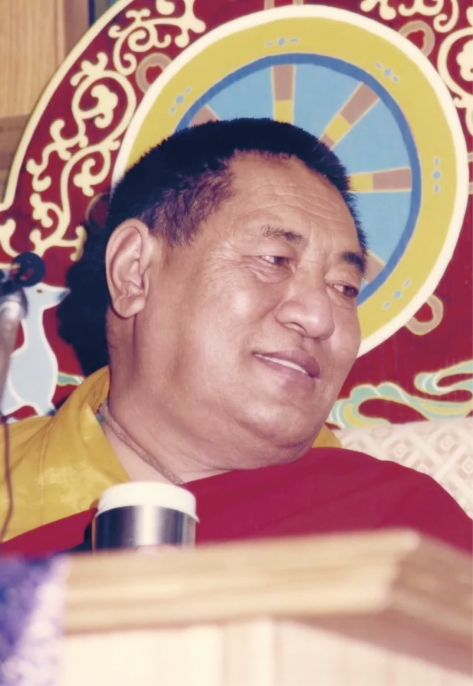

如果生命的终结只是意味着彻底消失，如同火灭了、水干了一样，我们可能无需过于担忧。但实际上，死亡并不代表一切归于虚无，而是由我们现在的行为决定未来的命运，行善能带来快乐，行恶会导致痛苦。如果自己造了罪业，则会投生于地狱、饿鬼、旁生中；即便转生为人，也会面临病痛折磨、人畜死亡、不幸临头等各种苦难。相反，若能积极行善，即使身处轮回之中，也能暂时享受幸福美满的生活，究竟往生极乐世界等净土。

特别是，在身语意的善业中，实修光明大圆满所摄的善法，可以使我们在这一生刚刚离世之际即刻获得佛果。由于业因果是真实不虚的，因此，对于小小的善事，也不要轻视而应尽力行持；对于小小的罪业，也不要认为它无关紧要，而应积极地断恶行善。如果我们忽视了弃恶从善的重要性，相续中就不会有生起大圆满境界的机会。

> 轮回痛苦：尤其对广大、漫长、难忍的轮回痛苦生起定解后，立誓修持能解脱轮回的广大法门。

如果我们因积累了恶业而投生恶趣，所经历的苦痛范围是特别广大的，持续时间也非常漫长。举个例子，假如我们因嗔心而杀了一个生命，结果转生到地狱中痛苦最轻的复合地狱。一到那里，地狱中成百上千、甚至成千上万的众生，就会以嗔恨心相互残杀，以此罪业为缘，自己只会越来越下堕，难以获得解脱。在人间度过许多亿年，却还不到复合地狱一天的时间。这样计算下来，自己将在许多劫中感受痛苦。这种痛苦，正如怙主龙树所述：“于此一日中感受，三百短矛猛刺苦，彼较地狱最微苦，难忍之分亦不及。”在这个世界上，一个重罪犯每天都被针、矛、锥子等慢慢刺入身体，却始终不死，可以想象其一生所受的痛苦有多么巨大，然而，这甚至无法与地狱中最轻微的苦难相比。此外，饿鬼和旁生所遭受的痛苦，也大致相同。

所以，我们需要利用这个人身实现解脱，获得遍知的果位。如果错过了这个机会，投生到恶趣中，将不再有解脱的机会。因此，首先需要通过观察“暇满难得”而下定决心修行正法，通过观察“寿命无常”而决定立刻修行。与此同时，我们必须修持一个广大的法，修习小法是远远不够的。只有通过修行光明大圆满，才能在临终时获得极大的安慰，而其他法很难达到这样的效果。

有人可能会问：“既然需要唯一修行大圆满，那是否意味着要抛弃共同乘、大乘显宗、不共金刚乘的所有法，转而修行一个单独的大圆满呢？”

事实上并非如此。在实修大圆满时，其中已经涵盖了所有那些法门的道要。以我们藏族的一位优秀上师为例，“外需严谨守戒律”，这意味着，在外，他需要清净守持斯里兰卡等地兴盛的别解脱戒；“内需善修菩提心”，在内，他需要修行汉地和日本等地兴盛的、以利他为核心的完整菩萨道。除了这些以外，大圆满没有一分要舍要立的其他法。

这一切法的最究竟修法，就是光明大圆满。就像“藏升里包含着藏合”一样——六藏合是一藏升，或者说，六个木碗包含了一个或两个木碗，这是常理。同样，如果真正实修大圆满，就无余涵盖了声闻乘、菩萨乘、密宗金刚乘的一切法。

如果问：“那么，大圆满是收集了所有其他法的一个法吗？”

那倒也不是。而是其他教义中未曾提及的最深实修法，以及在这一生就能成就佛果的许多窍诀，在大圆满里都有阐述。如果对这个法门充满信心，并且具备精进和大勇气，只需三四年就可以成就佛果。

以上讲述了四种厌世心的修法，并解释了在印度菩提伽耶南方许多国家兴盛的共同乘中所需观修的真实要点。

> 猛烈祈祷上师、本尊，加持自己实现以上所发的三誓愿。

现在讲“依止善知识”的引导。如果我们立誓修这样的大圆满，立誓要尽快修行，立誓修行广大的法，那么若想实现这三种愿望，就必须祈祷与大恩根本上师无二无别的怙主文殊菩萨加持。“无二无别”的含义是，上师即是怙主文殊菩萨，怙主文殊菩萨即是上师。怙主文殊在清净刹土中，正在以各种化身利益众生，而在不清净的所化众生面前，则幻现为有血有肉的上师。将上师视为文殊菩萨加持自己，对上师怀有虔诚的信心，一心一意地祈祷，这是至关重要的。以上是关于“依止善知识”的简要介绍。

“暇满难得”“寿命无常”“业因果”“轮回过患”“依止善知识”，这些称为“共同外前行”。

> 皈依：

现在是“不共内前行”，它包括皈依、发心两个部分。其中的“皈依”，虽然在共同乘中也有，但这里主要指大乘的皈依。

不共内前行，在印度菩提伽耶东方的很多国家相对兴盛，它主要属于显宗法藏的范畴。生起次第与圆满次第的法，在菩提伽耶西方与北方的许多国家广泛盛行。而将所有这些法集于一身的光明大圆满教法，则在北方的雪域特别兴盛。

也许有人会问：“为什么在这个人口稀少的地方却如此兴盛呢？”

根据佛陀自己的授记：“我此教法近于五百末世，从北向北兴盛。”这意味着大圆满法将在雪域得以广弘。佛陀还授记了松赞干布、赤松德赞、赤热巴坚等吐蕃法王的应世。同时也授记了莲花生大士、布玛莫札等班智达与藏地雪域的所化众生有缘。由此，藏地雪域成了全世界完整佛法的兴盛之地，至今佛法在这片土地上依然蓬勃发展。

> 皈依是一切道之基础，

所谓“皈依”，就是要立誓皈依三宝，纵然牺牲自己的性命也不舍弃三宝，始终将三宝视为究竟皈依处。

无论修行佛教的任何一个法门，首先都必须具备真正的皈依。如果没有皈依，就好比建造了四五十层的楼房却没有打好地基，那么所有楼层都不可能稳固。

> 能令我们趋入佛门，

一般来说，尽管内道佛教与外道在见解和修行方式上有许多不同，但二者主要的区别在于，如果一个人承诺将三宝作为永久的皈依处，他就是内道佛教徒；而如果不皈依三宝，那么他就是外道徒。

要知道，理解皈依的真正含义至关重要。所谓的皈依三宝，就是我们首先必须认准佛陀是自己的本师，并决心依循佛陀所指引的道路修行。有人可能会问：“这条道路是怎样的呢？”就是认识到轮回的本质是苦，由此产生一种强烈的愿望，希望从中解脱出来，进而致力于修行。

当今世界上的其他宗教，如基督教、伊斯兰教、印度教等——其中印度教主要信奉象鼻天、妙音天女、大自在天等天尊，他们的目标主要是追求今生的幸福快乐、名声远扬。而佛教，主要是为了成办来世的安乐，从而间接实现今生的幸福。如果能做到这一点，就标志着皈依了佛。

皈依了法之后，我们必须断除对众生的伤害。有些外道徒宣称，屠杀众生是一种善行，这与佛法的根本教义背道而驰。例如，基督教强调对所有人类应怀有爱心并提供帮助，但认为杀害马、羊、鱼、鲸等其它生命并无罪过；印度教禁止杀害牛，但允许屠杀其它动物；伊斯兰教认为，除了猪以外，宰杀其他生命无罪。这些教义所提倡的爱，实际上都是一种偏爱。相比之下，佛教提倡只要是有生命的有情，都应该让他们得到暂时的利益和究竟的安乐，这是绝对有必要的。

皈依了僧之后，就要将僧伽作为修行助伴，必须杜绝害他之事及害他之心，同时，要行持利他之事及利他之心。佛教徒所遵循的，绝对是无害寂灭之道。佛法的核心原则是不损害他众，这是非常重要的。因此，佛教中根本不存在损害他众的教义，正如佛陀所说：“害他非沙门。”

当今世界上兴盛的佛教，分为声闻乘、菩萨乘、密宗金刚乘这三种。它们之间的区别是什么呢？声闻乘强调自己的身语意守护十善道，根本不做伤害他众之事；菩萨乘在此基础上，更加强调利他而非自利，只要对他众有利，无论是直接还是间接，都会积极去行持，而如果对他众不利，纵然对自己有天大的利益，也会毅然决然地放弃；密宗金刚乘进一步将现有的一切都观为清净身智的自性，从而毫不费力、轻而易举地快速成办自他二利。

如果能同步修行这三种法，则是最理想的；若认为声闻乘、菩萨乘、密宗金刚乘的法各自分开，甚至互相矛盾，就不可能修行完整的佛法，反而成为片面的修持。所以，我们应当实修完整的道。

在过去，阿底峡尊者来到藏地时，向藏族智者中出类拔萃的大译师仁钦桑波，提出了显密及明处的问题。仁钦桑波无所不知，对答如流。阿底峡尊者说：“您这位大译师实在了不起。有您这样的人住在藏地，我都没必要来了。”随后，译师分享了他的修行方式：上午去一楼修声闻乘的法，中午到二楼修菩萨乘的法，下午到三楼修密宗金刚乘的法。阿底峡尊者听后说：“译师错了，看来我还是有必要来藏地。”我们必须明白，所有佛语就像糖块一样中边皆甜，应当学会在一座上进行修行。

此外，有些修行声闻乘的人，觉得密宗的法不好；而修行密宗的人，则认为声闻乘的法不好，这种观念会导致产生“有些佛经好，有些不好”的想法，从而造下舍法罪。在现今藏地兴盛的法中，佛经大约有一百零八函，其中包含完整的声闻乘、菩萨乘、密宗金刚乘的实修法，我们必须依照这样的原则实修。同时要清楚地认识到，若将一切乘执为相违，这就是舍法罪。

因此，我所讲的一切的核心是：作为我的弟子，你们首先要明白三乘法互不相违而应无偏实修，并将其普遍传播给他人。三乘所有法互不相违，究竟意趣是一致的，同时，还要尽可能地让众生入于大乘道。这就是我的希望。

我这样讲的原因在于，如果不了解三乘的究竟意趣一致，那所有受持佛法的人就不会和睦相处，彼此之间会像外道与内道一样，由此，无法使佛教大范围地弘扬开来，也无法广泛地利益世界上的所有众生。因此，你们要发挥想象，用心思维，真正理解世界上所有佛教的要点无有相互抵触之处，要懂得同一时间在一座上实修它们的法，并将其传播给更多的人。

> 因此应当依照仪轨中所说而明观皈依境（：空性之中，于自己前方虚空中观想：极为庄严的虹光白云中，本体为根本上师，形象为文殊智慧勇识。寂静含笑、相好庄严的童子身相，身色金黄如彩虹般，佩带珍宝、绫罗饰品，右手高擎智慧宝剑于空中，左手持执上置经函的莲花，在圆月莲花垫上，双足跏趺傲然而坐，身体每一汗毛孔中显现无数自然续部坛城，上下方隅虹光密布之中，自现的一切上师、空行、护法众如日尘般聚集）。观想完毕，应当思维从今起乃至菩提果之间，我只皈依您，依教奉行，在未得怙主上师果位之前，与见行相同的诸位道友一并不断勤修。如此发誓愿，即是显宗共同之皈依法。

三宝的本体总集于上师一身。唯一依止上师您，这是显宗共同乘中的皈依佛；心中唯一依照上师所说的言教奉行，是皈依法；与见行相同的诸位道友一起不断勤修，是皈依僧。与显宗稍有不同的是，此处是将三宝归摄于唯一的上师中而观修。

> 安住于证悟本来大清净之自心，即是了义文殊勇识之本性，护持所了知的境界，是不共自道之皈依法，

在了知自心就是怙主文殊菩萨的境界中安住而皈依，是自宗大圆满的皈依。

自心随着各种不同的妄念所转，是因为我们尚未如理证悟心的真正实相。假设如理证悟了，就是面见了文殊菩萨；哪怕没有如理证悟，心的本体也是文殊。对于本来如是的这种境界，了知之后进行护持，就是自宗的不共皈依。

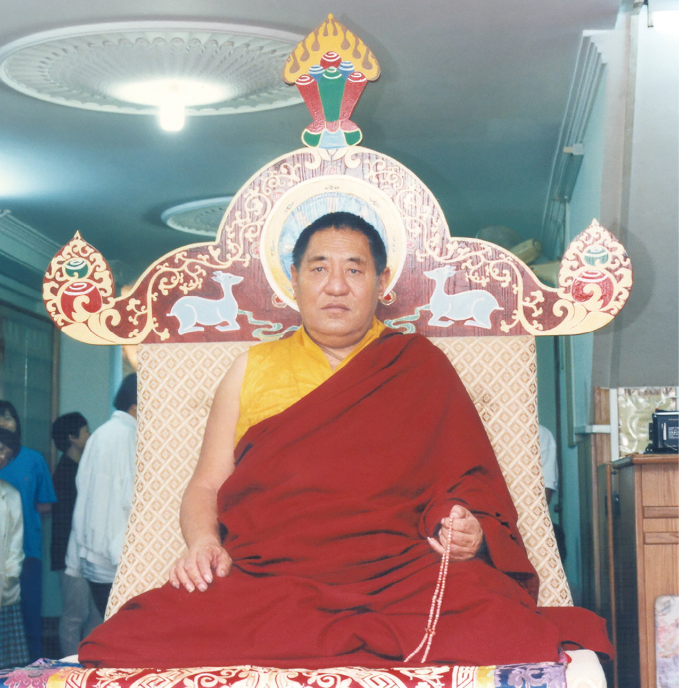

> 自己尽力不离此境界而念诵皈依偈：

> གཞི་དབྱིངས་ཀ་དག་གཞོན་ནུ་བུམ་པའི་སྐུ། །

> 基界本净童子瓶佛身，

> གདངས་རྩལ་མ་འགགས་རང་རིག་བྱང་ཆུབ་སེམས། །

> 妙力不灭自证菩提心，

> ངེས་དོན་འཇམ་དཔལ་དཔའ་བོའི་བདག་ཉིད་དུ། །

> 了义文殊勇识自性中，

> རང་ངོ་ཤེས་པའི་ངང་ནས་སྐྱབས་སུ་མཆི། །

> 了悟本来面目而皈依。

尽可能地进行念诵。最后，观想上师化光融入自己。

《文殊大圆满》第二节课

5月5日上午，法王继续在大众学佛研究会传授此法：

刚才你们念诵“怀业祈祷文”的音调十分悠扬，缘起特别好。我们藏人常说一切都依赖缘起，因此要认真观察。汉地各个省市有许多五明佛学院的分部道场，相比之下，你们的念法更加动听。以此缘起，未来我们的法缘将会更加紧密地连接在一起，对于弘法利生起到巨大的作用，请大家记在心中。

尽管我们佛学院没有像藏地的其他寺院和道场那样，有大量的念经活动，但我们也有一些少量的念诵。如果你们能够学着念，确实是一件好事，将来我们可以联系得更加密切。

对我个人而言，这是我第一次到新加坡，也可能是最后一次。将来或许会有一些来自藏地的上师到这里传法，但不会像我这样麻烦。尽管我并不刻意将自己塑造成大上师的形象，但出于各种原因，我不得不带着医生、侍者、翻译等随从。事实上，我这次已经尽量精简了，但仍然不可避免地需要七个人的队伍。这也给你们大众学佛研究会添了不少麻烦，无论是在餐饮还是其他方面。你们将这个学佛研究会与喇荣五明佛学院看作是同一个道场，我们也同样如此看待。未来，你们可以到藏地，我们也可以来新加坡，相互往来，保持着紧密的联系。

希望你们在学修这个法时，看看相续中有没有生起境界。我坚信这个法对你们的修行将大有利益。为什么我如此确信呢？因为初次见到你们这些信众时，我就感觉如同与亲友相见一般，心中涌起极大的喜悦。这种感觉也是一种宿缘，否则，素不相识的人们见面时并无太多值得欢喜之处。我曾去过中国大陆的北京、五台山、成都等地，也到过印度、尼泊尔、不丹、美国、加拿大、法国等许多国家，但从未有过像这次这样舒畅愉悦、神清气爽、身体安康的感觉。这也表明了我们师徒与这一法门有着深厚的因缘缘起。

正如我昨天所说，最初对我们佛学院在经济上的帮助和支持来自广超法师。从那时起直至今日，在喇荣也建起了你们的个别住舍。尽管那些房屋简朴小巧，但仍然吸引了许多弟子络绎不绝地前来居住、求法，他们对大圆满法门充满信解心和欲乐心，在修行过程中也体验到了不同程度的觉知和证悟。希望你们也能够精勤修行。我个人年事已高，时日无多，虽然我无法在有生之年将在座的每一个人百分之百都安置于佛地，但我可以保证，将竭尽全力帮助大多数人实现“临终无悔”的境界。这一点，请大家谨记。这些都是我的心里话，绝不是口是心非。

下面开始正式传法：

今天所听闻的法是《文殊大圆满·手中赐佛》，它是文殊菩萨的加持直接融入我心中所显现的一个法。之前已经讲了与共同乘相应的内容，包括“暇满难得”和“寿命无常”，目的在于帮助我们断除对今生的贪执；以及“业因果”和“轮回过患”，目的在于帮助我们断除对后世整个轮回的贪执，这四种厌世心都讲完了。在大乘初学者的法藏中，“皈依”和“发心”是两个重要的引导，其中，“皈依”已经讲完了，也就是说，纵然遇到生命危险也绝不舍弃三宝，要发下如此坚定的誓言。接下来要讲的是“发心”。

> 发心：观想如果连续不断地感受无边痛苦的一切众生能摆脱痛苦该多好！

所谓的“发心”，是大乘显宗的不共修法。如果发起了菩提心，就叫大乘菩萨道；如果没有菩提心，无论修什么法，也只是声闻乘的法。因此，区分大乘与小乘的关键，在于有没有菩提心。

要想生起这样的菩提心，必须具备两个关键条件。是什么呢？一个是缘众生的大悲心，另一个是缘佛果的大智慧。

所谓“缘众生的大悲心”，指的是一切有情无论是谁，甚至包括蝼蚁在内，从无始以来的生生世世中，无一未曾做过我们的父母，有时是父亲，有时是母亲。当他们做我们的父母时，完全像现在的父母一样，将最好的食物先给我们吃、最好的衣服先给我们穿，以无微不至的慈爱心和慈爱行，一直抚育我们成长。他们对我们有着大恩大德，因此，我们首先必须“知母”，然后要“念恩”。

然而，一切有情虽然渴望安乐，却不知道行持它的因——善业；尽管不愿经历痛苦，却未能断除痛苦的因，反而不断造下十不善业，所想与所行背道而驰，如同无助的盲人迷失在荒野中一样。这些众生真的十分可怜，我们需要生起这样的心态。这是以悲心缘他利的一面。

> 一直观修到生起强烈悲心而流泪为止。我今必须修成能救度众生的佛陀果位。

仅仅希望“一切众生离苦”并不能起到实质作用，我们还必须努力将他们从业和烦恼的苦因中解救出来，并且摆脱三种苦果，安置于永久的安乐中。然而，我并不具备救度众生的这种能力，就如同断臂的老妇人眼睁睁看着儿子被水冲走一样，只有单单的一个悲心，却没有救度众生的能力。因此，我必须寻求这种能力。相续中要生起这样的意乐。

这种度化众生的力量是指什么呢？就是指佛果。一旦证得了佛果，就能恒常、周遍、无勤任运地将一切有情安置于佛地。所以，我们务必要生起“愿自他一切众生成佛”的意乐。这是以智慧缘佛果的一面。

只有当我们同时具备了这两个方面，才是真正的菩提心。

> 不观待长久苦行、顺利迅速成就此佛果之道，唯有光明大圆满，因此应当实修大圆满法。最后于边解脱直定中安住

修持佛果是需要积资净障的，否则，无缘无故不会成佛。尽管大乘的共同教义中讲了很多相关内容，但按照那种方法修行，即使再努力也需要长达三大阿僧祇劫的时间——每一劫相当于人间的许多亿年，这是以常人的寿命无法计量的。若没有在那么长的时间里积资净障，便无法获得佛果。而且在这个过程中，还需要经历各种苦行，甚至包括布施自己的头颅肢体等。由此可见，这需要耗费大量时间，从而大大耽误了成办众生利益的时间。

然而，大圆满的修行与此不同，它无需长期艰苦修行，在轻松快乐中就能得果。修行者若具备特别大的精进和十足的信心，甚至可能在一个月内就获得利益众生的殊胜能力。

为了让一切有情都能成佛，我们发愿修行光明大圆满之道，这就是“愿菩提心”；按照这种誓言实修，全心全意安住于光明大圆满的境界中，则是“行菩提心”。自相续要将这两种立誓结合起来观修，这是大乘显宗教义的究竟要点。

在发菩提心时，应按照羯磨仪轨所述，在前方虚空中观想与根本上师无二无别的文殊菩萨，并在他面前承诺立誓。

> 而尽力念诵发心偈：

> གློ་བུར་འཁྲུལ་སྣང་སྒྱུ་མའི་གྲོང་ཁྱེར་ལ། །

> 暂时迷现幻化之城中，

> ཨ་འཐས་ཞེན་པས་ཁོར་མོར་འཕྱན་པ་རྣམས། །

> 顽固贪恋不断漂流众，

> ཡེ་གྲོལ་ཆོས་སྐུའི་ས་ལ་དབུགས་དབྱུང་ཕྱིར། །

> 为于本解法身得安慰，

> མཐའ་གྲོལ་ཅོག་བཞག་ཆེན་པོར་སེམས་བསྐྱེད་དོ། །

> 边解大直定中而发心。

迷惑众生受暂时的业与烦恼所驱使，将显而无自性、如梦如幻的轮回顽固地执为实有，在其中接连不断地漂泊。尽管他们本来具有解脱法身的自性，但却未能证悟此理。为了让一切有情于解脱的本性中得到安慰，或现前这种境界，我应修行光明大圆满。祈祷根本上师加持，愿我的相续中生起光明大圆满之道，愿四道相得以究竟，现前双运身果位，顺利快速地利益无边无际的一切有情。

在这样的观想中，念诵这个偈颂百遍、千遍、万遍，乃至十万遍。

> 最后观想从皈依境圣尊心间放射无量光芒照耀我与一切众生，从而无余净除罪障。自身也化光融入皈依境中。如是于无执中入定。

昨天灌顶时，你们都受了菩萨戒。平日里，每个人也应这样发愿：“为了使一切众生得到佛果，我要修行光明大圆满。”从你们的相续中生起菩萨戒体时起，就有一个要受持的学处，是什么呢？如果是直接利益众生的事，毋庸置疑，必定要去成办；即使不是直接利他，但对众生间接有利，也一定要尽力去做。相反，任何对众生毫无帮助的事情，都不应该去行持。这是最根本的。

然而，对于初学者来说，完全做到一心利他、毫不利己，确实有一定困难。但即便如此，也应该减轻对自身利益的关注，更着眼于利他，这才是菩萨的学处。

因此，声闻乘与大乘显宗的区别在于：声闻乘强调自利，顺带才会利他；而大乘则认为，要逐渐放下自私自利，成办广大的利他，否则无法实现自利。

单纯追求自利是不明智的。就如文殊怙主萨迦班智达所说：“欲成广大自利者，成办他利乃方便；欲获广大受用者，稍许布施即窍诀。”若想获得广大的自利，必须行持利他，否则，自利也难以实现。以经商为例，一个人若想获得丰厚的商业利润，却不常设法帮助对方、取悦对方，使他人快乐，那么最终自己的利益也无法实现。同理，如果希望得到广大的受用，初时布施少量的东西，结果将会有两三倍的回报。因此，即使是对于只求自利的声闻乘行人而言，利益他众也是非常重要的。从现在开始，我们应当主要以利他为重，尽可能断除自私自利的想法。只有这样，才能真正成为菩萨。

如果有人问：“那要怎样修行菩萨道呢？”

就如同印度的寂天论师所言：“众生诸苦痛，愿悉报吾身，愿因菩萨德，众生享安乐。”我们在内心默默观想：“愿一切有情的身心痛苦都成熟于我相续，他们像菩萨一样享受不可思议的喜乐。”每当用鼻孔呼气时，观想自己所有的美好、善妙、安乐都赐予一切有情，使他们离苦得乐；当吸气时，观想一切有情的苦难、不幸都成熟于己身。要持续这样观修。

利他的方式，正如《入行论》所言：“乃至有虚空，以及众生住，愿吾住世间，尽除众生苦。”我们应该思维：“乃至虚空没有穷尽之前，众生也不会有穷尽的一天；众生没有穷尽之前，愿我一直住在轮回中利益他们，遣除他们的一切痛苦，而不是自己舒舒服服地待着。”并发下如是善愿。这就是菩萨的完美思想和完美行为，因此，菩萨道的修行核心就是如此。

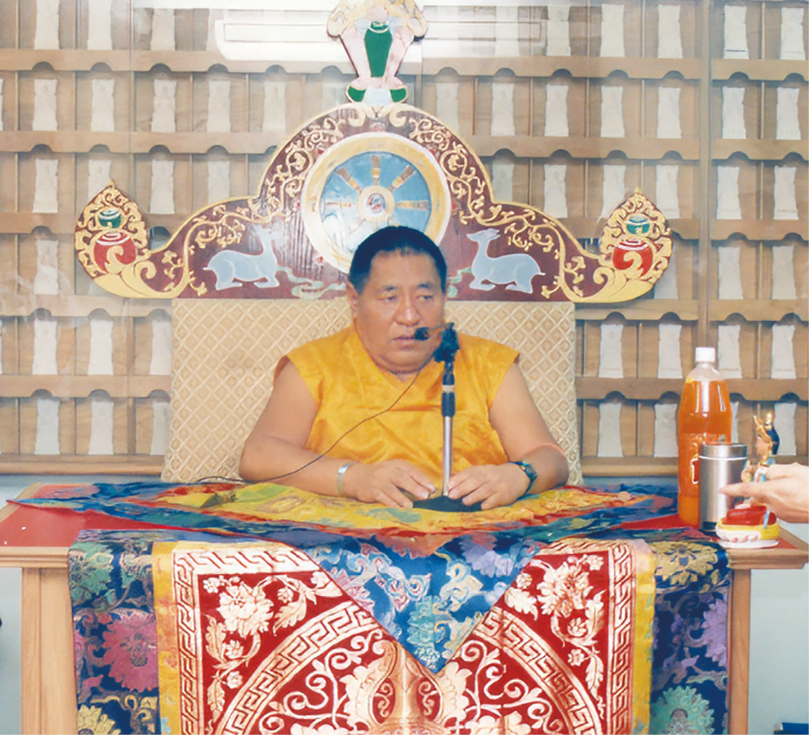

我问你们一个问题：你们的内心是否生起了“从现在起，比起自利，我应更注重利他，乃至众生穷尽之前，我一直都会利他”的意乐？当然，这种心态的转变并非一蹴而就，它不像改变布料的颜色那样能立竿见影，而是需要我们逐步努力，才能让利他之心超越自利之心。有这种意乐的人，请举手……（这时，法王和所有弟子都纷纷举手，没有一个人例外。）我也举起双手，立下这样的誓言：“从现在开始，直至虚空穷尽之前，像文殊菩萨一样，尽可能地利益众生。”

虽然本论中没有详细讲述声闻乘、大乘显宗、密宗金刚乘的法，但它们是非修不可的。因为，如果我们不能摆脱对轮回的贪恋，尤其是对今生的执念，做到只追求来世，那就无法成为大圆满的法器。因此，首先应按照“若贪今生非行者”来修行，如果我们贪恋今生今世，则无法真正成为修行人；当我们内在的境界稍稍稳定下来时，就要明白“贪执自利非菩萨”，这意味着，如果我们只追求自利而从不考虑利他，那根本不可能有机会生起大圆满的道相，因此需要进一步宣说大乘显宗的道理。

这些法门是阶梯式循序渐进的，首先要修行声闻乘的法，然后逐渐学修大乘显宗、密宗金刚乘。当所有的修行都得以稳固时，就很容易生起大圆满的境界。

不过，这次在修持引导时，没有足够的时间来全面修行。真正来说，每一引导都需要观修很长时间，只有当前一个引导的境界稳固后，才能进入下一个引导。因此，你们千万不要轻视这些前行法，而只把心思放在正行上。如果不先修这些前行法，就无法生起正行的境界。

下面开始讲密宗金刚乘的修法。它包括生起次第修本尊与圆满次第修风脉明点两部分。其中，生起次第主要讲的是“上师瑜伽”。在修上师瑜伽时，首先要依止上师。依止上师的过程中，最初要善巧观察上师，中间要善巧依止上师，最后要善巧学修上师的意行而抵达佛地。

最初要善巧观察上师，如果不加观察，遇到一个讲法的人，就随随便便在他面前听法，若此人不具备上师的资格，将会毁坏自他今生和来世的一切。相反，如果依止的是一位真正的上师，则会心想事成，得偿所愿。因此，最初的观察上师至关重要。我们首先要依靠别人的言谈来观察，然后凭借自己的智慧来判断，确认他是一位具法相的上师后，才开始依止。

也许有人会问：“在观察上师时，如何辨别其功过呢？”

在当今时代，有些人表面上虽然传授佛法，但实际上却是为了名声、财富或政治地位等，若在这样的人面前听法，会对自己造成损害。一个好的上师或真正的上师，应该具备声闻乘、大乘显宗、共同密宗、大圆满的修行境界，他自身要有觉受和证悟的功德，能够善巧地为众生宣说正法。

中间在依止过程中，我们需要令上师欢喜。上等者会做修行供养，即通过讲闻教法、修行证法、行善断恶，使上师心生欢喜；如果做不到这一点，中等者可以做承侍供养，通过为上师服务、做些力所能及的事情，让上师感到欣慰；下等者则可以做财物供养，将自己珍爱的所有财物、受用，毫不吝啬地供养上师，使其心生喜悦。

最后善巧修学上师的意行时，虽然每个人的根基有利有钝，但通过在上师面前得法，都必定能获得一些前所未有的道相。

以上是依止上师方法的要点总结。接下来，我们正式讲上师瑜伽。

> 上师瑜伽：如前明观上师后诚心祈祷：从今起生生世世中，我除一切皈依处总集之大恩上师您以外，甚至梦中也不寻其余指望处，只以您为皈依处，

首先，就像前面修“皈依”时一样，我们要清晰地明观福田，即在自己面前的虚空中，观想与上师无二无别的怙主文殊菩萨——明了上师与文殊菩萨是同一本体，其形相为文殊菩萨。

尽管从外表上看，上师显现为有血有肉、有质碍的不清净身体，但这只是因为我们业障未净所致，就像胆病患者将白色的海螺看成黄色一样。而且，上师与我们的关系比文殊菩萨更亲近，因为上师为我们灌顶、传法、授予窍诀等，其加持力特别直接，所以应将文殊菩萨的本体观为根本上师。在这样的根本上师面前，我们祈求“被您摄受、被您加持，将您视为我唯一的皈依处”。

以上简单讲了上师瑜伽的观想次第。

> 并以自己的身体、一切受用及三世善根供养您，

观想：我们将自己执为我所的一切，包括最珍爱的身体，饮食、衣服、装饰品等受用，三时所积累的一切善根——以这三种最执著的东西为主，无论是自己拥有的还是未拥有的，是真实供品还是意幻供品，全部供养给上师。这是供曼茶罗的简要引导。

> 发露忏悔无始以来所积累的一切堕罪。

这是念修金刚萨埵或净除罪障的窍诀。

从无始以来一直到现在，在轮回的生生世世中，我们以贪嗔痴为因，造下了入道后触犯别解脱戒、菩萨戒、密乘戒的佛制罪，以及未入道前各种各样的自性罪。这所有一切的罪业，在与上师无别的文殊菩萨您面前发露忏悔。对于自己以前所造的罪业，我深感后悔，并发誓以后绝不再造。通过这种方式来忏悔罪业，祈祷上师加持自相续得以清净。

> 祈愿成熟解脱我相续，加持我究竟证悟光明大圆满，获得殊胜导师您的果位。

祈祷上师加持我未成熟的相续，通过灌顶得以成熟，通过教言得以解脱；加持我生起光明大圆满的究竟甚深道，令四道相得以圆满，证悟无上佛果；加持我与殊胜的上师您成为同缘分者。

> 边观想边一心一意念诵祈祷：

> གཞོན་ནུའི་སྐུ་ལུས་འཆང་བ་པོ། །

> 具有童子身，

> ཡེ་ཤེས་སྒྲོན་མེས་རབ་ཏུ་བརྒྱན། །

> 庄严智慧灯，

> འཇིག་རྟེན་གཏི་མུག་མུན་སེལ་བ། །

> 能除世痴暗，

> འཇམ་པའི་དབྱངས་ལ་གསོལ་བ་འདེབས། །

> 祈祷文殊尊。

将上师观在前方的虚空中，进行祈祷、供养、忏罪，全身心地祈请上师加持我的相续。

> 最后观想上师三处放射出白红蓝光融入自己三处，从而清净三门罪障，现前身语意的一切功德，

观想从上师的眉间放出白光、喉间放出红光、心间放出蓝光，依次融入自己的三处，清净了三门的罪障，包括身体所造的杀生、不与取、邪淫之业，语言所造的妄语、离间语、粗语、绮语之业，心所造的贪心、嗔心、邪见之业。引发这所有罪业的根本即贪嗔痴、我执及习气，这一切全部得以清净，从而，文殊菩萨的相好身、梵音语、如所有智和尽所有智等身语意所有功德，全部融入了我的相续。

> 最终上师也化光融入自己。于离意本性中入定。

如果你具有一定的修行境界，则要在光明大圆满的实修境界中安住。即使做不到这一点，也要尽可能地安住于无所思维、一心专注的状态中。

> 从中出定时了知现有一切皆为上师之本体。善根回向菩提。

了知“一切所见皆是上师身体的游舞、一切所闻皆是上师语言的游舞、一切起心动念皆是上师智慧的游舞”，于这样的境界中将善根回向菩提。

下面我提醒大家几句比较重要的话：

在实修大圆满时，一切念诵与观修的根本就是“上师瑜伽”。每次入座的开头，都要念修一遍它，然后再进行观修，这一步绝不能忽略。

总的来说，大圆满一切道的根本，唯一就是“上师瑜伽”。如果能善巧依止上师，真实修持上师的意行，并不断祈祷上师，那么即使不懂得除此之外的任何法，仅凭上师的加持力，也能证悟大圆满。倘若对上师没有信心，从不进行祈祷，那即便修行一百年，也不会获得任何成就。所以，“上师瑜伽”是大圆满道的真正精髓。

在修其他法和其他续部时，上师和弟子要记住许多遣除歧途之障的窍诀，在实修中还必须掌握提升修行境界的增进窍诀。而修行大圆满，并不需要费这么多功夫，只要真心依止上师、祈祷上师，终身精进地修上师瑜伽，那么一切障碍都可依此遣除，一切进步都可依此获得。

虽然“上师瑜伽”属于前行，但实际上，它是最究竟的实修法。这是非常关键的一点，请大家牢记在心，并反反复复地修持上师瑜伽。

去海边放松

下午，一些信众热情建议法王去附近的海滩放松一下，享受海风的清凉。法王欣然同意，我们也跟着一起出发。四点多钟，我们乘车抵达了马林百列海岸（Marine Parade）。

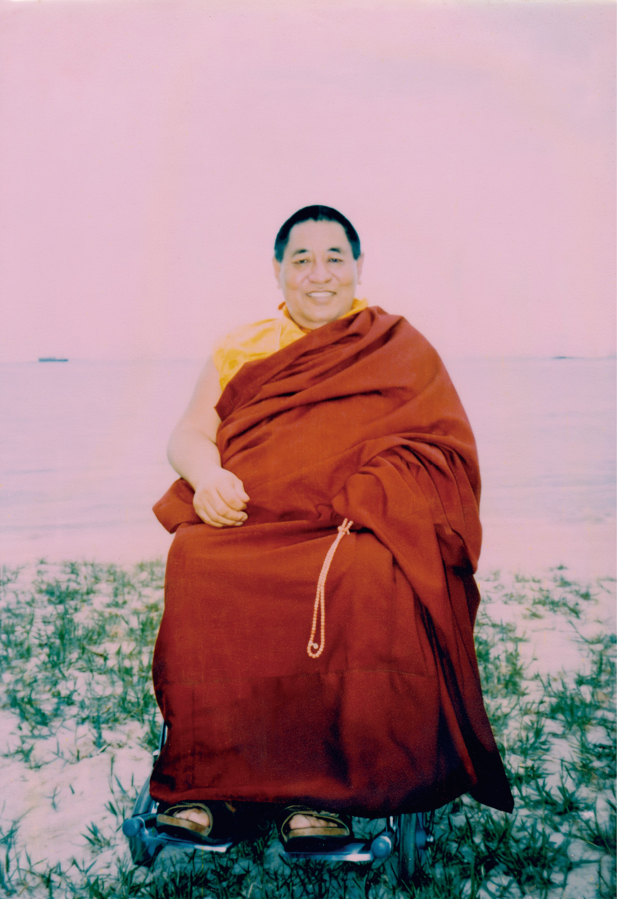

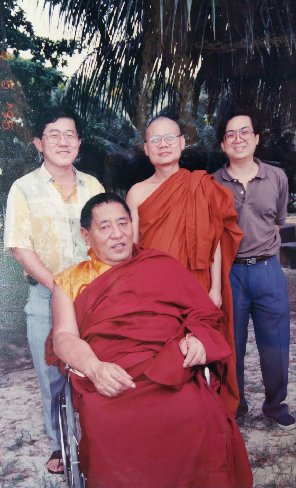

这片海滨天堂以其迷人的海滩、翠绿的椰林和多姿多彩的自然景观而闻名。细腻柔软的沙滩、清澈碧蓝的海水，还有壮观的日出和日落，构成了这个梦幻般的度假胜地。

那一天，阳光明媚，微风拂面。法王来到海边，心情格外愉悦。我们为他和阿里美珠准备了轮椅，缓缓推着他们，尽情享受海天一色的美景。

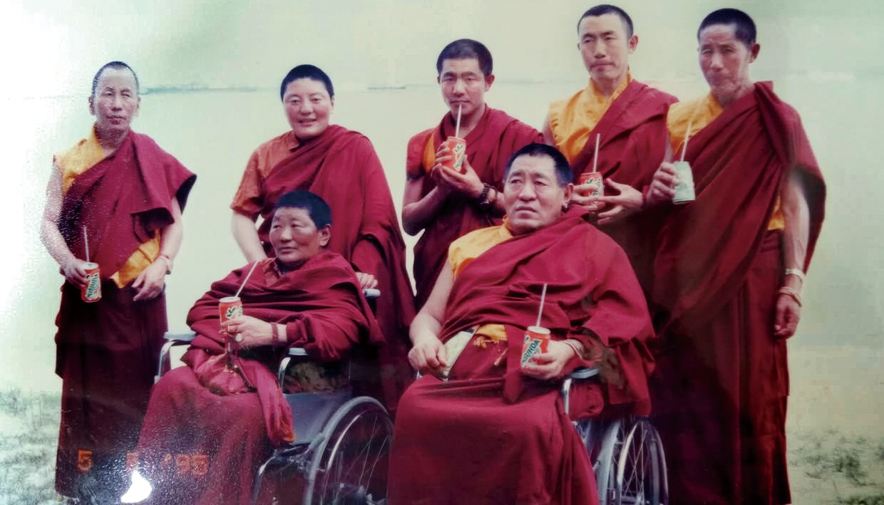

走了一段路，天气渐渐变热，于是我们找了一棵椰子树下歇息。品尝着带来的零食，喝着可口的芬达（Fanta），感受着海风的轻拂，心情无比惬意。海滩上游客寥寥，有人在拍照，有人在树下用餐，而我们则围绕在法王身旁，愉快地聊着天……

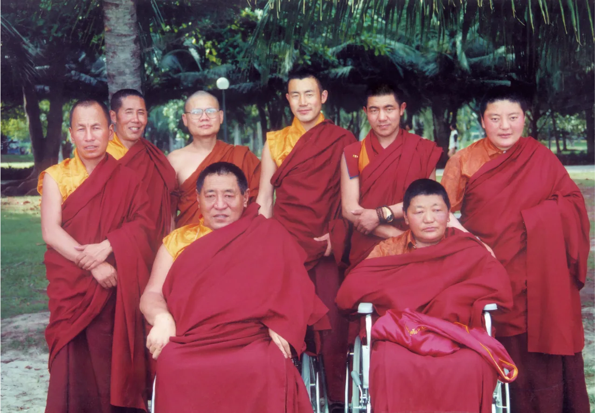

直到傍晚时分，我们才结束了这段美好的时光，返回了道场。

尽管这只是一次短暂的休闲，但对我来说，却是难以忘怀的回忆。当时，我们留下了一张珍贵的合影，至今我和慈诚罗珠堪布仍将它挂在自己小木屋的显眼之处，永远怀念着那段难忘的时光。

2013年我前往新加坡传法，当司机将车驶近这个地方时，我立刻认出了它，马上要求停车。再次来到法王曾经踏足的海滩，我眺望着一望无际的大海，默默地祈祷着上师。

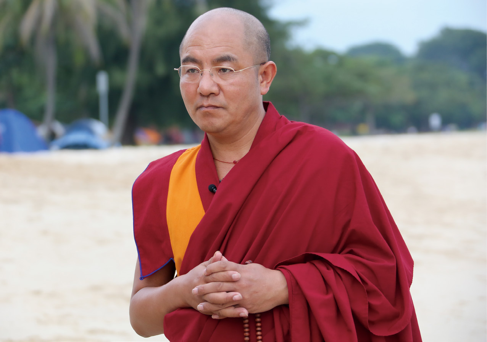

《文殊大圆满》第三节课

5月6日上午，法王继续传讲此法：

今天你们要听闻的法，是超群绝伦的深道大圆满，它涵盖了所有乘的要点，是究竟所诠，三世诸佛不依靠它则无法成佛。大圆满在藏地弘扬的过程中，以往有莲花生大士、布玛莫札、贝若札那的三种传承。而今，我要讲的这个引导文，是将这三位祖师的所有密意要点融合为一，由怙主文殊以大悲加持直接传授的，其加持力非凡，缘起始终未曾破坏，利益众生的时机也已成熟。

此引导文全面摄集了三乘的要诀。其摄集的方式，正如前面讲四种厌世心时所言，需要认识到整个轮回没有实质，皆为无常、空性的本质，唯有断除对它的贪执，才能在相续中生起无伪的出离心。共同乘的核心是了知轮回皆为痛苦的自性，然后发起想要从中解脱的真实心态，即出离心。因此，我们通过观修“暇满难得”“寿命无常”来断除对今生万事万物的执著，通过观修“业因果”“轮回过患”来断除对后世一切显现的贪执，想要出离整个轮回的意乐也归结于此。

而菩萨道的核心，在于追求利他的“皈依”与“发心”。这两个内容之前已经详细阐述过。

至于密宗金刚乘的核心，则是要证悟离边大见解，它包括了生起次第和圆满次第。所谓生起次第，是将自己观想成本尊；而圆满次第，则是切合风脉明点的要点，将自身修成智慧身的一种方便法。生起次第帮助我们消除不清净的贪执，圆满次第帮助我们消除清净的贪执，从而修行无贪之道。今天，我们结合总的密宗道来讲解圆满次第。

> 圆满次第：自身庸俗而住，观想正中蔚蓝色如竹箭般的中脉上端于顶处开口、下端于脐下闭合。其右方红色血脉及左方白色精脉的下端与中脉如恰（ཆ）字形相连，上端插入两鼻孔。边观想边除垢气。

修圆满次第时，自己的身体是什么样，就观想成那样，不必观成本尊身相。然后端直而坐，在身体的中央观想一条中脉，如竹箭般笔直，不歪不偏，粗细跟自己的无名指差不多，外面是白色，里面是红色，稍稍泛着蔚蓝色的光彩。这代表了三身：外白表示身化身，内红表示语报身，稍泛蔚蓝光彩表示意法身。将此中脉观成内外透明，是光的自性，上端开口于顶上的梵净穴，下端闭合于脐下四指处。

中脉右侧是红色的血脉，里面充满着湿润性的血液；左侧是白色的精脉，里面充满着湿润性的明点。这二者的粗细只有中脉的三分之一。两脉的下端，与中脉连在一起，犹如藏文恰（ཆ）字下半部分的形状；上端则穿过端直的身体，从头顶绕下分别插入左右鼻孔。然后除三次垢气。把身体观为内外透明，就像一个吹气的胎盘，这是观想外“身”的瑜伽。

观想体内三脉如柱子般竖立，这是观想内“脉”的瑜伽。

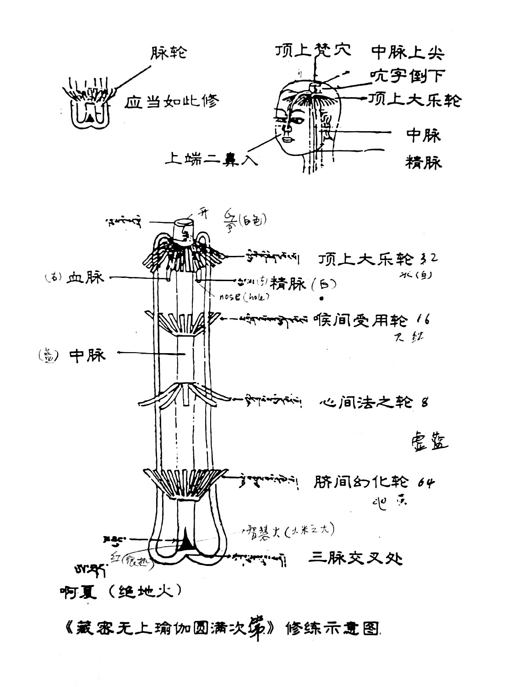

气脉明点观修图

接下来，从右鼻孔向外排三次气，观想清净由贪欲所生的一切病魔、业障、堕罪；再从左鼻孔向外排三次气，观想清净由嗔心所生的一切病魔、业障、堕罪；最后从左右鼻孔中同时向外排三次气，观想清净由痴心所生的一切病魔、业障、堕罪，这是观想“风”的瑜伽。

> 明观吸气时气从二鼻孔经精血脉而接触脐下三脉交汇处下端坚固、上端尖锐、十分炽热、青稞许的绝地智慧火，从而使火焰更旺，将一切有漏身体包括风脉明点皆焚尽无余，最后消失于无缘中。

在脐下四指处，三脉交汇的地方，观想一个绝地智慧火。当向内吸气时，观想从双鼻孔吸入的气息，沿着精脉和血脉的路径，触及脐下的火焰。

这个火焰根部粗大稳固，顶端又尖又细，所触非常炽热，大约有青稞粒那么大，火焰持续颤动着，必须观想它具有这五种特征。

当从双鼻孔吸入的气息接触到这个火焰时，火焰会燃烧得更加旺盛，将自己不清净的风脉明点全部焚毁，变成一片空荡荡的虚空。这是观想“火”的瑜伽。

> 又于空性中将自身观为文殊金刚身，内外通彻，如胎盘满气一般。

在空性中，将自己的身体明观为文殊菩萨的金刚身，以此生起次第为基础，再观修圆满次第。

就像之前在“皈依”“发心”“上师瑜伽”中所观修的文殊菩萨一样，将自己也观想成诸佛之无分别智慧所化现的本尊——文殊智慧勇识，身色是藏红花一般的红黄色，右手在空中挥舞着天蓝色的智慧宝剑，左手在胸前执持着花茎，莲花在耳边绽放，其上有般若经函。此身被十三种报身服饰所庄严，包括五佛冠、肩帔、飘带、腰带、下裙等绫罗五衣，以及头饰、耳环、项链、臂钏、璎珞、手镯、指环、足镯等珠宝八饰。双足金刚跏趺坐在莲花月轮上。

在心中清晰地观想这样的形相，这就是“明观”。这个身体并不是有血有肉、如土石山岩般有质碍、具有苦谛的一个蕴，而是一切种智显现为本尊身体的形相，就像镜中的影像或空中的彩虹一样，完全透明，远离一切质碍、遮障，这就是“净观”。然后，内心怀着自己就是这位本尊的佛慢，这就是“稳观”。

虽然以前一直将自己的身体视为不清净，但实际上它就是文殊智慧勇识的真身。具足了明、净、稳这三者的身体，就像水晶球或充满气的胎盘一样，内外通透。这是观想自“身”的瑜伽。

> 明观中间三脉四轮以及脐部短阿（Λ），中脉上端有集诸佛之本体、仅忆念便能生起空乐觉受、倒立的白色杭字（）。

观想内“脉”的瑜伽：就像之前所说，身体中央有蓝色的中脉，右侧是红色的血脉，左侧是白色的精脉，这三脉以恰（ཆ）字形于脐下连接。

在头顶中脉的上端，观想一个倒立的白色杭（）字，代表诸佛本体的总集，仅忆念它就能生起空乐觉受。

接着观想三脉四轮，即在头顶的发旋处观想顶上大乐轮，它有三十二个白色脉瓣，形似伞辐；在喉部天突穴处观想喉间受用轮，它有十六个红色脉瓣，稍稍向上散开；在心脏处观想心间法轮，它有八个蓝色脉瓣，略向外散开；在脐下三脉汇集处观想脐间幻化轮，它有六十四个黄色脉瓣。

> 从鼻孔吸入的气触及脐部绝地火（即短阿），针尖许的火焰上升接触到顶上的杭（）字，火焰更加旺盛，从中不断降下甘露，火与明点以相互追逐的方式依次充满四轮，从而领受四喜（喜、胜喜、殊喜、俱生喜）、四空（空、极空、大空、一切空）之智慧，现前空乐义智慧，于此境界中尽力安住，最后回向善根。

当外面的风吸入体内时，沿着精脉和血脉的路径，触及脐间的短阿（Λ），使细微如针的火苗向上燃烧，触碰到头顶的杭（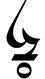）字。它的一滴甘露落到下面的火上，如同火上加油一般，使火焰更加炽盛。从上方的杭字，甘露源源不断地往下流，结果火焰无法向上延伸，只能向下逃窜。就这样，通过逃和追的方式，依次使顶上、喉间、心间、脐间四轮的所有脉瓣都充满了白色明点，由此现前了喜、胜喜、殊喜、俱生喜的四喜智慧，以及这四喜本体不成立的空、极空、大空、一切空的四空智慧。这是观想“明点”的瑜伽。

总而言之，一开始是观想身的瑜伽，随后依次观想脉的瑜伽、风的瑜伽、火的瑜伽、明点的瑜伽。如果反反复复这样修行，就会现前四喜和四空的智慧。

以上讲了圆满次第的修法。

这些内容，是与密宗金刚乘相应的实修方便。密宗金刚乘的所有道，都可以包含在生起次第与圆满次第中。修持这二者的意义在于，外器内情所摄的一切法，本来即是正等觉的自性，但众生并不了解这一点，为了证悟它，将一切都观成本尊的自性，这就是“生起次第”；为了净化一切不清净的蕴界处，而依靠风、脉、明点的瑜伽进行观修，这就是“圆满次第”。

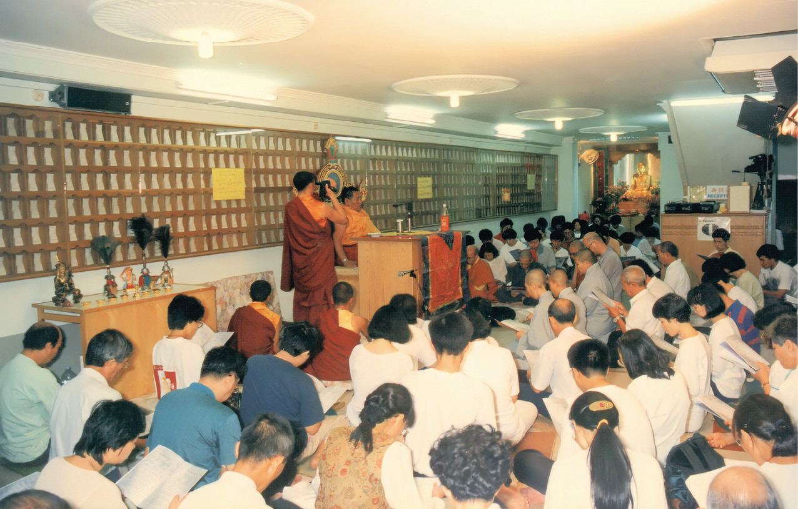

接下来要讲的是不共大圆满，它是三乘道要的总集，阐明了三乘的真谛，是通往佛果的捷径，也是最为甚深的法门。下面开始讲它的实修法。

> 大圆满分三：一、前行；二、正行；三、后行。

> 一（前行）分为三门引导身语意前行、三身引导四大瑜伽前行、觉性引导区分有寂前行。

> （一）三门引导身语意前行，分为身之前行、语之前行、意之前行三种。

> 身之前行：将自身观为一个蓝色迸射火花的金刚杵。长时间做金刚坐式，结果身体不由自主地跌倒，断尽分别念时自然安住而休息。如此反复修炼。

通过三门引导来直指觉性，包括身、语、意三种前行。

第一是身体的前行：将自己的身体观想成一个迸射火花的蓝色三股金刚杵，长时间做金刚坐式，全神贯注于此，直至身体不由自主地跌倒。当跌倒时，在断尽分别念的状态中，观心的本体。

金刚杵的表示意义是，上端的三股代表法身、报身、化身，这三身现今在自身中就已俱全；下端的三股代表本体、自性、大悲；中间的三股合一，表明“基位的本体、自性、大悲与果位的法、报、化三身，自己本来就以无二无别的方式具足”，了知此理后进行实修。

长时间保持金刚坐式，在自然跌倒之前一直坚持。跌倒时，无论向左还是向右，都要顺势倒在让身体不受伤的地方。当感到疲惫不堪时，在一无所思的状态中长时间安住。当再次出现分别念时，继续这样反复观修。

> 语之前行：观想心脏内的神识以吽（ཧཱུྃ）字形象而住，从中接连不断地出现无数细微吽字，触及外境中的山洲房屋等，结果均变成了吽字，外面的吽字入于自身，自身也变成了吽字，最后所有的吽字皆消于法界中。自然安住而休息。修此法时应当以悦耳之音长久唱吽歌。

第二是语言的前行：身体呈金刚跏趺坐，双手结定印，脊柱挺直，下颌微收，眼睛看向鼻尖。观想自己的心脏内外透明，如同搭起的青宝石帷幕，在它的中央，有一个纹丝不动的蓝色吽（ཧཱུྃ）字。从吽字的顶圆符中，一个接一个地放射吽字，从鼻孔出去，碰触到山川、房屋等，使其全部变成了吽字。然后，所有的吽字融入自己，自身也变成了吽字，最终消失于法界中。

观想的这个吽（ཧཱུྃ）字，并非像书写的那样平面，而是如木雕般立体，在心间向上耸立着。它的朝向，与观修者的面容方向一致。尽管吽字通常有许多观想法，但在这里就应该如此观修。

之后，以悠扬动听的声音，用拖长的音调唱起吽歌，最好以七个吽一组，“吽吽吽吽吽吽吽”。

身体的前行、语言的前行，至少各需要修二十一天。这一次，我们没有足够的时间带修，但日后你们务必要认真修行。若能如此，相续中自然会生起大圆满正行的境界。

> 意之前行：断定一切轮涅诸法均为心之幻化。

第三是心的前行：观想外在的器世界与内在的有情众生等一切法，都是心的幻现。

就像做梦时所经历的情景，无论是陡峭山峰、大江大河还是险隘之地，都是自心习气所显现的，外境中并不存在这一切。同样，当下的所有显现也与此一模一样。即便是将来有一天获得了佛果，刹土、眷属、清净身等这些相，也都是以清净心的妙力所显现的，外境中并不存在实有的本体。

所以，轮回和涅槃的一切法，其根源或作者就是这颗心，必须深刻认识心到底是怎样的。只有真正认识了心的自性，才能称得上对大圆满的见解有所了悟，除此之外别无他法。

> 观察心从何处生、住于何处、去往何处。则一切粗大的无情法可抉择为微尘，微尘可抉择为无分微尘，无分微尘抉择为无基，从而可断定心无有生、住、灭。若观察心是否有形、色、声、香、味、触，则何者也不成立，甚至明觉者也只是名言宣说的而已，此外无法得到真实确定的依处。因此应当击破实执的心房，了达无我之义。

那么，所谓的心到底是什么样的呢？

这颗心，若是有，就要断定它“存在”；若是没有，就要断定它“不存在”。假如认为它存在，那就需要观察一下，它最初是从什么中产生的，中间住于何处，最后又去了哪里。如果认为它是从外在的土石山岩或内在的自身等微尘构成的一个法中产生，那么再分析一下土石山岩，我们会发现，所有微尘可以剖析至无分微尘，最终连无分微尘也根本不存在，一切法都成了无基离根，由此就能够断定：在外境的无情法上，并不存在心的生处、住处、灭住。

如果认为心是在它本身上存在的，那么我们来观察一下。心从形色方面来看，并不具备四方形、半圆形、椭圆形等形状；从显色方面来看，也不具备白、黄、红、蓝、绿等颜色，因此它不成立为色法。同样，悦耳或刺耳的声法、香或臭的香法、甜或不甜的味法、柔软或粗糙的触法等，在心的本体上也都不成立。因此，它不是色、声、香、味、触等任何一种本体。

如果有人认为：“这样分析下来，心虽然的确不成立，但它本身却是明明了了地存在着。”其实这只是一种语言的表达，如果真正观察心的本体，它在身体的外、中、内哪里都找不到，依此可以击破实执之房，在没有引生出无我的定解之前，应该一直这样观修。

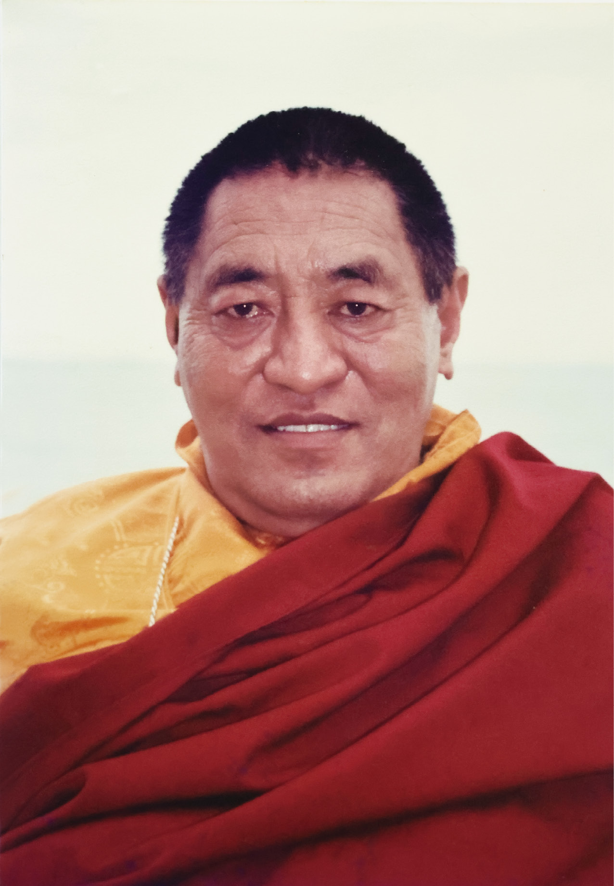

心的前行至关重要，所以，你们要踏踏实实去修持。能否认识大圆满的见解，关键在于这个根本。如果能确凿地认识这一见解，即使只是修行七天，也会使贪嗔烦恼妄念变得越来越薄弱；甚至只需修行六个月，也一定能趋至持明之地。大圆满是超乎寻常的甚深法，如果你们有真实的十足信心，这次就能认识心的本面。即使这次没有原原本本地认识，待日后你们圆满具足顺缘时，可以到藏地去，我们将非常欢迎。虽然我们无法提供盛大的款待，但一定能满足你们对佛法的希求。

能否了悟大圆满，归根到底取决于心的前行。因此，请诸位认认真真地去实修。

《文殊大圆满》第四节课

5月7日上午，法王继续传讲此法：

今天大家要听的法是，将九乘次第的所有要点汇为一体的甚深窍诀——《文殊大圆满·手中赐佛》。

之前已经讲解了随同共同声闻乘、不共菩萨乘、密宗金刚乘的修行次第。下面要讲的是大圆满的实修部分，它包括前行、正行、后行三个层次。

首先，前行包含三门引导、三身引导、觉性引导。虽然“三门引导”已经讲完了，但我认为大家应该特别重视这一部分。至于另外两个引导，由于地点和时间的限制，暂时不方便实地修行。

具体来说，最初修“身的前行”时，应做金刚坐式，将自己观为蓝色的三股金刚杵。

其次，在修“语的前行”时，将基住觉性或自心明观为吽字，由它不断地放射吽字，使一切器情都变成了吽字，然后将所有吽字收回，自身也变成了吽字，最终安住于无缘的境界中。如果掌握了坐式和观想法，则除此之外并没有太多难点。这些窍诀，你们最好在七天或二十一天内认真修持。

最后是“心的前行”，即观察心的生处、住处、灭处，这一点至关重要。然而，这次只有一两天的时间，除非是具有最上等根基和非凡信心的人，否则一般人很难轻易领悟。因此，我们需要年复一年地持续修行此法，在没有完全断定心的本性之前，不可能了悟正行的见解。

关于观察心的来龙去脉，昨天已经讲过了，今天我再进一步深入细致地讲解，希望大家将其与自心结合起来，认认真真地聆听。

那么，昨天是怎么讲的呢？就是要观察分析我们的这颗心，看它最初从什么地方产生，中间住在什么地方，最后去了什么地方。而今天要分析的是，这颗心是否真实存在。如果存在，它必然有生处、住处、灭处；如果根本不存在，那么讨论它的生处、住处、灭处也就没有意义了。

接下来，我们认真思考一下，这颗心到底存不存在。如果确实存在，它应该通过眼睛看得见，或通过耳朵听得见，或通过鼻子闻得到，或通过舌头尝得到，或通过身体感受得到，或通过意识感知得到。这六种感觉被称为六识，除了这六种感觉以外的心，根本没办法安立。如果不能通过这六种感觉来确认心，那我们就可以说“心根本不存在”。

首先，如果心可以通过眼睛看到，那它必然有颜色和形状。那么，我们仔细地思考一下，心是否具有白、红、黄、绿等各种颜色？是否具有四方形、三角形、半圆形等不同的形状？如果有，则可以断定心是存在的；如果没有，就可以确定它不存在。你们可以观察一下，自己的心有显色和形色吗？它是不是没有颜色和形状？这颗心，你们懂了吗？实际上，所谓的心，就是正在显现着的这个，因此，它并没有颜色和形状。这一点，即使成百的智者、上千的成就者说它有，也无法改变我们对“心不存在”的认知，必须要有这种确信。

同样，我们需要观察一下，心是否有动听或不动听的声音？是否有舌头可以品尝到的味道？是否有身体可以感受到的触觉？……务必要一一加以分析和确定。

除此之外，还可以用另一种方式来观察：心是否存在于身体的上、下、中间，或者外界的土石上？它究竟是有，还是没有？如果我们经过仔细观察，却根本找不到这颗心，那就可以断定它不存在，而无需犹豫不决地思考它到底有没有。

你们的心究竟是什么样子的？真的要深入思考一下，看这颗心是否根本不存在。在我看来，这颗心是怎样的呢？就像录音机播放声音时，虽然能听到语言，但实际上，无论是从录音机的内部、外部、中间寻找，都找不到声音在哪儿。同样，对于这颗心，在没有观察分析之前，认为能左思右想的它一定是存在的，可是一旦加以思维分析，就会发现它根本不成立，从来没有真正存在过。你们认同这个看法吗？我所认为的，是否与你们的认识一致呢？

其实，你们现在听闻的这个法非常深，除了在许多劫中积资净障的人以外，恐怕我今天无法用一句话就让你们彻底领悟。总的来说，这颗心如果存在，那就断定它存在；如果不存在，就要确定它不存在。这样一来，前行的基础就打好了。

探索心的本性，是内道佛教的不共特色。外道徒主要学修的，是断除身语的一切恶行，行持一切善行。而作为一名内道佛教徒，身语的所言所行只是作为辅助，关键是要探寻心的关要。就共同乘来讲，正如“调心是智者，调心最安乐”中所说，了知心的自性才是根本，所以，需要将心转为道用；从大乘显宗的角度来看，“若不知此心，奥秘法中尊，求乐或避苦，无义终漂泊”，研究心的本性至关重要，在没有得到定论之前，无法获得佛果。因此，我们首先要研究心的本性，这是内道所有佛法的究竟醍醐。特别是在光明大圆满中，唯一是直指心的本性，进而将其转为修行的道用。这一点大家务必铭记在心。

你们不要以为观察分析心很难，其实并不需要像科学研究那样用锐利的智慧长期思索，认识心的本性是非常容易的。尤其是，如果你对这个法有意乐，满怀信心地虔诚祈祷上师，只需稍稍反观内心，就能确定这颗心是存在还是不存在。关键在于各位有没有宿缘、能不能思考，除此之外，这个法本身并没有年龄老幼、男女性别、种族贵贱之分。无论是谁，一开始可能会有些怀疑，因为自己从来没有专注地观察过这颗心。但如果仔细观察了，那么“它到底是否存在”这一点，没有什么不懂的。

从另一个角度来看，你们对仇人等会不会生起嗔恨心？观察一下，正在生嗔的这颗心在哪里，它是什么样子的？当你们怒火中烧、面带怒容、紧握拳头时，观察嗔心的本体究竟在哪里，结果发现它何处也不存在，这是用言语无法表达的，大家懂了吗？

如果了悟这颗心是无基离根的，那就现量通达了无我之义。这涵盖了声闻乘与大乘显宗所要证悟的全部道要。当然，确认这一点并不是盲目信从，而是需要用心去断定。如果意识到所谓的心根本不成立，从未存在过，那就真正踏上了修行之道。在这个过程中，你们需要不断下功夫，这非常非常重要。

在这里，我再次强调了昨天所讲的内容。你们不仅要在这次修行中尽心尽力，更要持之以恒地反复修行。如果能年复一年地修，不通达其义是根本不可能的。大圆满与其他法门截然不同，实际上指的就是这一点。如果全力以赴地精进修行，哪怕只是短短一个月，也能对心的本性有所断定，这正是大圆满的不共特点。

下面开始讲《手中赐佛》的正文：

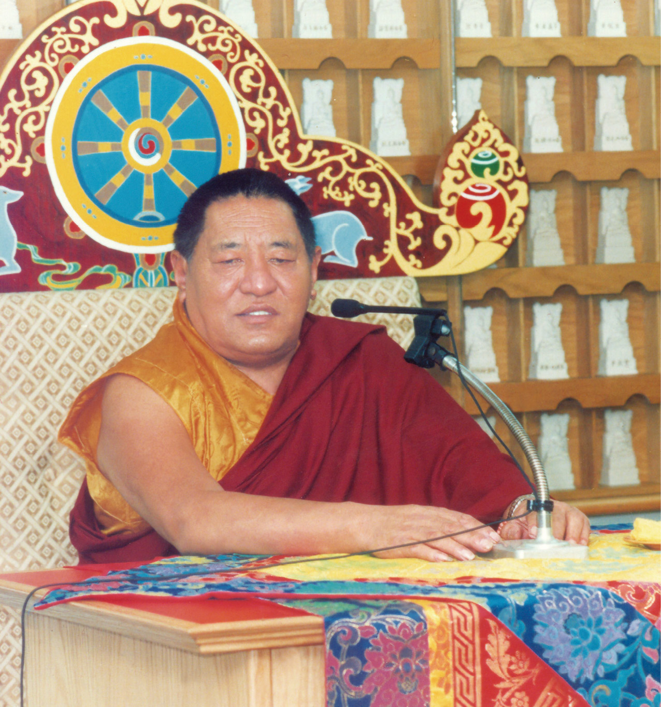

> （二）三身引导四大瑜伽前行：自心似乎融入了地水火风之声中一般，专注此境界而安住。不生任何分别执著时，应当于此境界中自然放松而认识心之自性。

这个四大瑜伽，虽然需要在前行中修学，但如今在藏地，并没有广泛实修此法的传统。你们这个地方，也很难具备修行它的良好条件，所以不修也是可以的。

但如果想修，当心自然安住时，就像前面观察心的生住灭一样，观察心的自性。比如，修地大的声音时，专注于双手拍掌的声音，心似乎融入了这种声音中，从而认识其无生的自性；修水大的声音时，去听江河奔流不息的声音、海浪潮起潮落的声音，心好似融入了这些水声中一般，并一缘安住，由此抉择心的本体；修火大的声音时，在燃烧木柴的火堆旁，心专注于它的声音；修风大的声音时，在高山上建造一个多孔房屋，从中传出各种风声，心好像融入了其中般专注，从而豁然显露心的本性，并对其有所断定。

这是修学四大瑜伽，就像观察心的生住灭一样，它也是一种了悟无生的方便，当心专注于声音时，自然会安住其中而通达心性。如果你们想修此法，修一两次也完全可以。

> （三）觉性引导区分有寂前行：随意做六道众生三门的行为。妄念纷纷时猛呼一声“啪的”便可断绝妄念。观当下之心的本面，乃至未得无基离根定解前反复修炼。

觉性引导区分有寂的行为，需要前往寂静的山间去修，这样才不会被未得灌顶、未入佛门的人看到或听到。

修的时候，最好是完全赤身裸体。如果无法做到，也可以只露出上身。

在藏地，有许多根本无人的幽静处可供修行。但像你们新加坡这样的城市，地方本就不大，很难找到一处完全无人的寂静之地，因此达到标准比较困难。大家也可以在各自的住处，按照这个引导的内容，在心里观修。

观修时，身体模仿地狱、饿鬼、旁生、人类等六道众生的行为，包括直立行走、爬行、奔跑、跳跃等，凡是在心里浮现的行为都去做；口中要说六道众生的语言，如人的谈话声、马的嘶鸣声、羊的咩咩声、牛的哞哞声、地狱众生的惨叫声等；心里要观想自己正在感受这些众生的痛苦。总之，除了杀、盗、淫、妄、酒等违犯别解脱戒的行为外，其余的行为可以一边用心观想，一边随心所欲地去做。比如，观想自己已经投生到地狱中，正在遭受地狱的痛苦，口里喊着疼痛，心里承受不了……当这些情景浮现时，突然猛呼一声“啪的”，然后观心的本体，就会认识到心是无基离根的自性。如是反复修行，就是区分有寂的行为。

以前莲花生大士、布玛莫札、嘉纳思札等大成就者，大约修了七年这种觉性禁行，所以这个法非常重要。如果将来你们到了藏地，可以规范地修行区分有寂。在这里，我们只能象征性地观修，不方便直接行持。

> 最后于三门不动摇中自然而观本住之心的本性，从而了达无念法身之见解。

所谓的“本住”，就是休息的意思。在此期间，身体如如不动，口中一言不发，心里一无所想，就像一棵树倒在地上一样，身体仰面朝天，完全放松下来，舒舒服服的，心尽量安住在什么也不想的状态中。

如果能在这种状态中休息，就会生起自性本住之寂止与自明自知之胜观双运的智慧。所以，大家要想方设法生起这种一缘寂止，依此现前无分别的法身果位。

> 之后做如声缘一样的寂静行为，做如菩萨一样的中等行为，做如忿怒本尊一样的威猛行为，此三行为与观心之本性相结合。前行时应当圆满止观修法而入道，即恢复到本性中。

所谓的“恢复本性”，即是入道。在前行阶段，心有时会被无生空性的胜观所占据，有时则自然安住于寂止之中。无论何种情况，若想真正步入修道，首先要像声闻一样，身体做毗卢七法，眯着眼晴直视鼻尖，通过寂静的威仪，行持止观双运之道；随后像菩萨一样，威仪略显粗犷，站起来行走，眼睛环顾四方，看能否与止观的境界相融；最后像忿怒本尊一样，身体行为威猛，跳跃、奔跑，口中吼着“哈哈、呵呵”，心里勾起贪嗔等各种妄念，之后看这些威仪能否与止观进行融合……总之，随时随地要修止观双运之道，在与自相续没有融为无二无别之前，需要一直修行。

现在该讲正行的修法了。

> 二、正行本来清净直断（车确）：自心不改、自然安住、直观其本性时，彻底证悟本空离根通彻、远离内外中边、自相不灭、无有任何分别动念、不可言说之义，从而了知三世诸佛之智与不清净众生之心无有贤劣，认识一切皆圆满于明空智慧中的本面，即是所谓的见解如山直定。

大圆满的正行修法，包括两个道：本来清净直断、任运自成顿超。“本来清净直断”是指修行空性之道，它能直接斩断所有分别妄念，使轮回蕴界处所摄的一切不清净法清净于法界中。而“任运自成顿超”之道，是使佛陀身智的所有功德，现今就呈现在我们现量根的行境中，从而使粗大的身心解脱为清净身与本智。

下面按照次第来讲解这两个引导：

首先，在修持直断的见解时，自己的心不要回溯过去，不要预期未来，也不要追随现在的色声香味触法，而是要自然地安住下来。这并不需要像前行那样进行分析，而是在自然观心的自性时，会发现心的本体在内中外何处也不存在，原本就是空性，并非由任何因缘所造作。因此，它超越了一切根本，没有任何质碍和所触，通彻无碍，远离外内中边。这样的无生空性，就是心的本性，被称为“本体空性”。

在住于空性的同时，本相并未泯灭，虽然心的自性无有能取所取的分别念，但对于无法言说的意义，内心是完全明了的，就如同白天用眼睛可以看见色法一样，这被称为“自性光明”。

心的本体空性与自性光明无二无别，这便是“大悲周遍”。

三世诸佛的智慧与不清净众生的心并没有贤劣之分，一切皆圆满于觉空本智界中。认识了这一本面，就称为“见解如山直定”。

对你们来说，关键是要明白这一点。因此，我再通俗易懂地解释一下：当我们用自己的心观心时，会发现心本来就是空性，远离一切根本，这应该很容易理解。所谓的心，在外面、里面、中间哪里都不成立，是一种空空荡荡的存在，这就叫“本体空性”；本体空性的自性，并不像土石山岩那样没有心，而是对自己心的内在法性非常明了，这就是“自性光明”；普贤如来的智慧与恶趣众生的心并没有贤劣之别，一切皆圆满于明空双运的本智中，这就是“大悲周遍”。这一切都建立在邬金莲花生大士对本体、自性、大悲三者直指的基础上。

> 在认识见解本面而自然安住时，无有任何有无是非执著的所修对境，远离破立等分别伺察之染污，法性本住之禅定与自明本面之胜观双运，称为修行如海直定。

认识到自本体明空无别或自性本来无生的见解后，应自然安住其中，而不加以勤作。

自然安住于这种境界时，是在修行“有”吗？由于心的法性不存在，因此并没有所修的一个有法。那么，是在修行“无”吗？也不是，因为它不像土石那样没有心，不是一种单单空无的断空。此外，“既有亦无”“非有非无”的法，在所知中不可能存在。我们所修的见解既然要与心的法性相应，心的法性又远离有无是非，没有任何执著，因此，所谓的修行也不存在。

换句话说，既没有向外遮破恶分别念的念头，也没有向内以伺察意建立空和明的想法，法性本然的禅定本来就安住于自性中，这就是心的法性。由于不追随所谓的“一无所有”，所以叫无有散乱。对于本然安住之寂止与自明本面之胜观双运的这一本性，内心确定无疑后不离此定解，就称为“修行如海直定”。

你们平日在修大圆满时，对于自己的心，有时可以让它妄念纷飞，再观察念头的本体；有时什么也不想地自然安住，然后观察它的本性。所谓的心，在外、中、内任何地方都不成立，本来就是空性，对此要确定下来，这就叫“见”或定解。通达了这种“见”之后，在此境界中护持相续，一心不乱地安住，这就是“修”。

藏地的一位上师乔美仁波切曾说过：“反观观自心，观心不见空，见中放松住，别无大手印。”以心观心时，会认识到心是空性的。一旦明白了它是空性，就要在不离这种定解的境界中自然安住。也就是说，必须在“见”的境界中长时间“修”。

现在我们正在享受大圆满的见修。我们相续中所拥有的一切，哪怕是微不足道的善心，也主要来自怙主文殊菩萨和全知麦彭仁波切等圣者的大悲加持。以此缘起，我引用全知麦彭仁波切的一句教证，再次给你们直指觉性。《大圆满见歌悦音》中说：“寻觅种种动念心，不得显现实相性，无垢觉界即是彼，当以无迷智救护。”你们反反复复地思考，无论是通过分析还是安住来寻找这颗心，结果都一无所得，这个无所得的觉性就是无垢觉界。在此境界中护持相续而修，就是以无有迷乱的智慧进行救护。这没什么不懂的，即反观自心，什么也得不到，一无所得的时候，就安住在无所得的状态中，这是大圆满的究竟修。

在这个著名的大圆满法中，前面提到的前行固然重要，但正行的见解和观修更为关键，这也是究竟所修。

接下来讲顿超。根据藏地的传统，顿超必须在直断的境界真正稳固后才能修行。如果一开始就修顿超，只能给自己种下善根，稍稍修一点是可以的，而长期修行则不太合理。你们的主要精力应该放在直断上。

帮法王买东西

自1990年以来，法王因视力不便，讲课依赖录音机成了常态。因此，来到新加坡后，法王便派我去商店看看，是否有售高品质的小型录音机。

在新加坡的日子里，我只要有时间，就四处搜寻合适的录音机。经过一番努力，我终于找到了一款音质出色、易于操作的索尼牌（Sony）小型录音机。法王试用后，连连赞叹，称其比先前在美国买的那一款还要好。

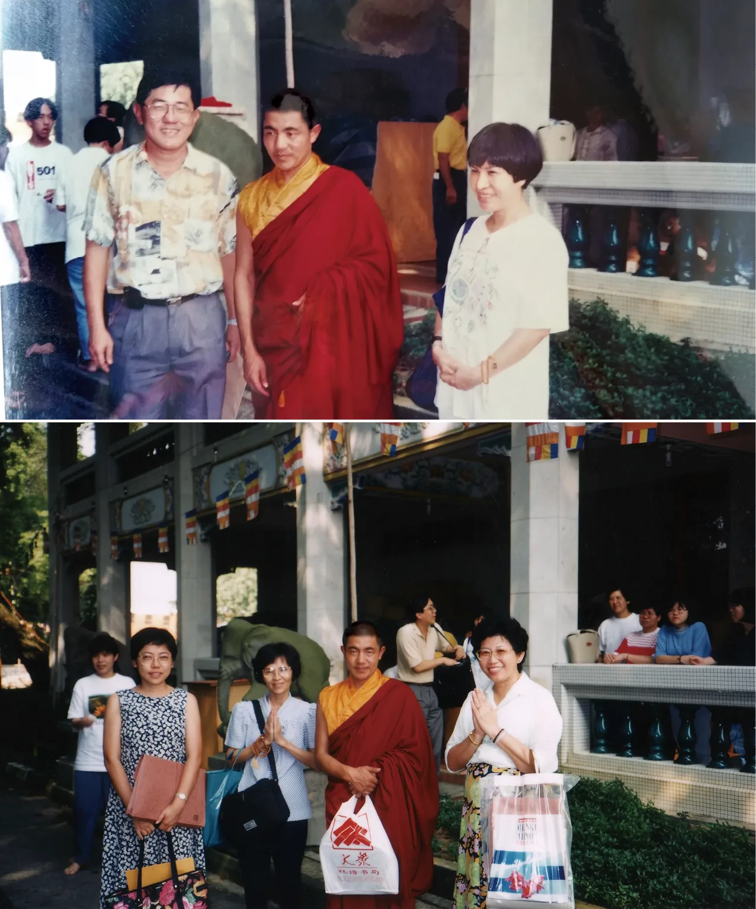

法王不仅用小录音机传法，在闲暇时，也喜欢用它来听一些道歌。对于歌舞，法王颇有兴趣，有时在藏地出行途中，周围的信众围绕着车辆，他会出于某些特殊的缘起，通过车外的小喇叭播放一些道歌，特别是仓央嘉措的情歌：“在那东山顶上，升起了洁白月亮，玛吉阿米的面容，便浮现在了我的心上……”此外，在学院期间，法王也会请声音悦耳的堪布为他唱诵前辈大德的道歌，如《大鹏展翅》、麦彭仁波切的《大圆满赞颂》等，并将这些录制成磁带，以便自己空闲时听。

在新加坡讲授《手中赐佛》第三节课时，法王首次使用了这款新购的录音机，并在课前播放了一段麦彭仁波切的道歌：“愿诸轮涅胜义性，自然本智文殊相，无勤光明尽驱散，众生二障心黑暗。奇哉闲暇诸智者，无常如电寿速灭，必随无欺业因果，坠入轮回无解脱。今遇正法知闻思，已得捷径精华教，若未一心专注修，何有较此更痴迷？”播放结束后，法王向大家介绍说：“这个录音机是在你们新加坡买的，里面装着我们藏族人的声音。这首道歌，是我们学院的堪布齐美仁真唱的，你们认识他吗？”

当时，进口电子产品在国内相对稀缺，不仅购买非常不容易，而且一旦损坏，修理难度也极大。因此，看到法王对这款录音机如此满意，我又额外购置了两台作为备用。

同时，考虑到法王需要定期测量血压，我发现新加坡有一种电子血压计，既先进又便捷，便为法王购买了两台。虽然偶尔会出现测量结果不够准确的情况，但使用起来确实更为方便、舒适。

临近离开新加坡之前，法王想要为学院的堪布们准备一些礼物，作为对他们长期讲经说法的肯定。在那个没有手机的时代，手表不仅是一种身份的象征，更是修行人在闻思中的重要工具。得知日本精工手表（SEIKO）以其卓越的品质著称，法王便委托我挑选合适的手表。

然而，选购手表的过程充满了挑战，许多商店的存货有限，通常每家只有两三块。于是，我不得不利用一切可能的时间，有时独自一人，有时召集几位同伴，逐家寻找。经过连日的努力，终于凑齐了几十块手表。这些手表价格不菲，每块大约是三百多元人民币。

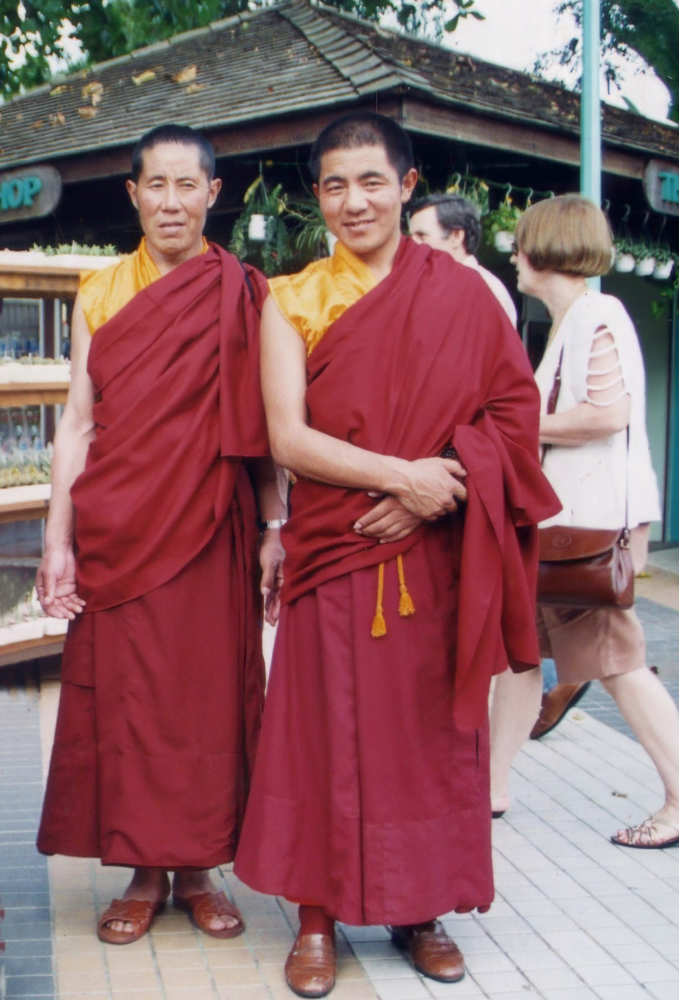

法王回到学院后，将这些手表赠送给许多堪布、活佛。他们收到礼物后都非常开心，并长时间佩戴这块手表。

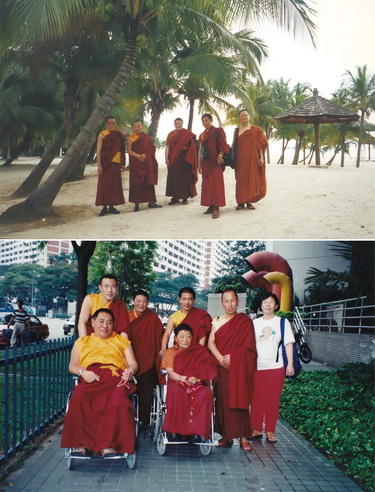

《文殊大圆满》第五节课

5月8日上午，在《文殊大圆满》的最后一节课，法王讲道：

大家要听闻的法是，诸乘之巅光明大圆满的实修法。之前已经讲完了共同外前行、不共内前行、大圆满自宗不共前行，今天要讲的是正行部分，它包括本来清净直断、任运自成顿超两种实修法。现在我们要抉择的是，本来清净直断之道。

或许有人会问：“直断与顿超是什么样的法？”

彻底断定自心法性的见解，就是“直断”；依靠各种方便法如实修行其意义，则是“顿超”。真正修行此乘究竟要点的方式，是通过亲身体验来如实认知心的自性，这也是此乘的终极目标。此乘的宗旨是，将心转为道用来修行，而无需分析外在的土石山岩是否存在。原因是什么呢？因为外在的种种显现都是心的幻化，只要能确定作为根本的心究竟有还是没有，外在的一切显现都会自然解脱。就像不需要去观察幻术的显现是否真实一样，只要彻底确定了幻师并不存在，幻术的所有变化也会自然消失。

或许有人会问：“如何确认外界的景象只是心的幻现呢？”

可以通过比喻来抉择。就像在梦中所见的高山深谷或白色、红色，这形形色色的景象都只是心的幻现。若将这些显现视为真实，并加以破立，就不会有机会从中解脱；但若明白一切显现皆如梦境，是心的幻变，那么外界的现象无论好坏，都对自己无利无害。

如果认为：“梦中将本无之人执为人、本无之马执为马是荒谬的，因为这一切都是虚幻的，没有真实的本体存在。然而在现实中，这种现象确实存在。”这也是一种未经观察的想法。比如，在梦中出现被水冲走的情景，会让人感到危险并产生恐惧；出现从悬崖上坠落的情景，也会引起同样的恐惧感；而享受美食和财物的情景，则会带来快乐和愉悦。然而，当醒来时，梦中的一切场景就不再有任何利害了，只成了回忆的对境。

同样，在现实中，悦意的外境让人快乐，不悦意的对境让人厌恶，这种种破立的感觉在获得佛果时，就像从梦中醒来一样，都变得了不可得。所有这些只存在于当时的梦境中，在今天的此时此刻，已经不复存在了。到了明天，无论是今天的显现还是梦中的显现，除了成为回忆的对境外，一无所有。因此，从各个方面来思考，梦境和现实并无差别、一模一样，都是在心的驱使下显现的各种形相。

就像面对同一杯水，地狱众生看到的是沸腾的铜汁、熊熊的火焰，仅仅接触就能焚烧身体四肢；饿鬼看见的是不悦意的脓血，却无法饮用；大多数的旁生与人类虽然认为水可以饮用，但所见也各不相同，水生动物长期生活在水里，依赖水来滋养身体，令诸根明晰，将水当成住处；而对于人类来说，连一天也不能待在水里，否则会使诸根蒙蔽，最终丧命；众天人将水看作甘露的自性；诸持明者视其为玛玛格佛母；而佛陀眼中的水，是远离诸边的大圆满本智自性。

在外境中，实际上并不存在真实的水、脓血或沸腾的铜汁，这些只是众生根据各自的业感所见之相。地狱众生会看到真正滚烫的铜汁，而被它烧得苦不堪言；人类受业感的牵引，可以用水来解渴、清洗等。事实上，所有的一切都是心的幻现，并不能断言外界“没有铜汁只有水”或者“没有水只有铜汁”。一切外境的显现取决于众生的不同业力，尤其是各种不同心的感召。这一点必须明白。

同样，对于同一堆火，我们人类和大多数动物如果接触它，会感到强烈的灼热并被烧伤；然而，动物中有一种火净野兽，跳入大火后会感到安乐，毛色也变得更加艳丽；还有一种火鼠，生活在火坑中，将火视为衣食之源，与火接触时也感到愉悦。人类普遍认定火是热的，有些众生感觉火是凉的，有些将其作为住处，因此，在外境中，真实的火并不存在，都是自心的幻现。

再比如，对于同一种食品，有些人觉得香，有些人觉得臭，有些人感到合意，有些人感到不合意。就像不净粪，人类感到特别脏，令人恶心，不愿靠近；而猪狗等众生遇到它，却觉得非常称心如意，十分欢喜，把它当作美食。

再以盐为例，人类将其视为饭食的佐料、必不可少的调味品；而青蛙吃了它，会导致身体出现穿孔，使其感到不适。这就是众生的业感不同。

再举例来说，在同一个住处，一个人感到舒适，另一个则认为不舒适。我们人类通常觉得不潮湿、柔软的住处更舒服，而大多数水生动物觉得，水分充沛、湿润的环境才是舒适的。这些感受都是心的执著，而在外境中，住所的舒适程度并没有绝对的标准。

想想房屋也是这样，我们认为不潮湿、有屋顶的房屋才舒心悦意；而水生动物与大多数野兽觉得，无屋顶、有湿润性的住处才是舒适的。这些观念都是心的执著，在外境中，房屋、衣食、住处等并不存在实有的好坏。

再以同一个人为例，敌人见到他时会感到心中不快，生起嗔恨，不愿遇见；而在亲戚、朋友、爱人眼中，他却是让人悦意的对境。这也只是心的幻现，对于这个人本身来说，悦意或不悦意并不存在。

同样，对于同一个人的容貌，有些人认为好看，有些人认为不好看，这也只是心的执著，实际上并不存在好坏之分。所以，一切都是被心的执著和熏染的习气所牵引，从而显现出千差万别的事物。

再比如太阳和月亮，许多人认为月亮给人带来清凉，太阳给人带来炽热；但对饿鬼而言，冬天却觉得太阳刺骨寒冷，夏天则感受到月光的灼热。所以，这些感受并非固定不变，而是受到众生业力的影响。事实上，外在世界并没有成实的冷热本体。

再者，太阳的光能让人类看到色法，带来快乐；但对于大多数罗刹和猫头鹰来说，太阳升起后，他们将看不见色法，整个世界变成了一片黑暗。可见，太阳光在某些众生面前现为光明，而在另一些众生面前现为黑暗。

再举例来说，同一块地，在有些众生看来是土地；而在有些众生眼中，它则显现为水、火、风、虚空等不同形态。风等也是如此，随着众生各自的业感，显现出各种各样的行相。这一切都是心的幻现，外界并没有实实在在的任何法。各种现象唯一是以心为根本幻现出来的。因此，作为内道佛教徒，尤其是实修大乘教义者，必须认识到，外器内情所摄的一切法都是心的幻现。

此外，电影中的各种影像，都是由设备操控而显现出来的，牛或马并不存在于外境中。同样，土石、山岩、高山、院子、房舍等一切法，也都是内心习气的幻现。正如印度大德龙树菩萨的弟子月称论师所说：“有情世间器世间，种种差别由心立，经说众生从业生，心已断者业非有。”这句话就指出了，各种现象都是由心产生的。

因此，我们必须追溯心这一根源，这就是“将显现直指为心”。其重点在于，必须认识到显现是心。否则，若执著显现存在于外境，将心孤立出来进行抉择，就会使外境的显现留存下来。只有当我们明白种种显现都是心的幻象时，才不需要再对外境进行观察和分析。因此，对心这一根本穷究到底就已经足够了。以上总结了显现是心的要点。

关于“一切显现就是心的幻现”的道理，如果广泛阐述，即便是诸佛菩萨在累劫中也说不尽。像我、慈诚罗珠、索达吉这样的讲者，恐怕几个月都讲不完其中的推理和含义。然而，我们一方面没有足够的时间，另一方面也无需如此详细解释。所讲的核心主要是，如前所述，在众生心的支配下，各种形相都可以显现，但实际上在外境中并不存在。首先需要认识这一点，在此基础上，追溯这一切的根源就是心。比如，在放映电影时，若要调整电影的大小和清晰度，必须明白电影中的影像都是依靠放映机投射的，因此调整这个设备就会使电影里的镜头发生变化。同样，面对外境中形形色色的显现，无需过多观察，而是需要深入探索自己的心，并将心的自性抉择为空性。

如果有人问：“那么，如何了知一切显现的根本是心呢？”

那就需要认识心的自性。而认识它的方法，就是之前正行中所讲的，不要追忆过去的种种，无论它令人是悲是喜、生贪生嗔；也不要憧憬、思虑、规划未来的所作所为；更不要理会现在的色声香味触法等对境。这颗心要全神贯注安住于一无所想的状态中，这就是安住法的窍诀。

在这样的安住中，会依次出现五种觉受。首先是如陡坡水般的动摇觉受。我们观察一下，刚开始时，这颗心能否如如不动地一缘专注呢？几乎不可能，甚至会比以往更加狂乱，让你觉得：“以前都没有这么多的分别念，而现在每当尝试安住时，它根本停不下来，如同悬崖上的瀑布一样。”在这个阶段，该怎么做呢？不要感到特别沮丧或苦恼，而应试着稍稍安住下来。如果无法安住，就暂时休息一下，然后再慢慢尝试。不知道你们这里有没有马？像我们藏族人，就有巧妙驯服野马的经验。若想逮住一匹野马，拼命追逐是徒劳的，必须慢慢地绕来绕去才能抓住它。心也是如此，过度强行控制只会让气阻滞在上身，从而出现发疯等情况，因此不能这样做。

当你稍微能安住下来时，试着保持这种状态。如果不能安住，就适当休息一下。若依此还不能安住，可将注意力转移到信心、慈悲心的善法上。仍然无法安住的话，则可以再次休息。如此反反复复修行，就会逐渐改善。

在这个阶段，存在两个歧途。哪两个呢？一是心始终太紧，常常会导致发疯或生病等情况，这是一个歧途；另一个是缺乏兴趣而松懈下来，甚至放弃观修。藏地的玛吉拉尊空行母曾说：“不紧亦不松，彼具见解要。”既要有点紧，也要有点松，适度的松紧是必要的。在这个阶段，大多数人会因为坚持不下去而退失修行，存在这个危险性，所以务必要小心。

这个大圆满法对具有信心的修行人来说，不管是谁去修，都不可能不获得佛果。然而，在当今时代，遇到大圆满的许多人都处于庸俗的状态中，这就是因为在动摇觉受阶段厌烦了修行，对修行失去兴趣而停滞不前。因此，大家必须要坚持修行。

或许有人会问：“那么，必须要长期苦行吗？”

与其他乘截然不同，这个法并不需要过于苦行。如果你们怀着虔诚的信心、意乐和恭敬心，坚持不懈、尽心尽力地祈祷上师，并按照修行法的窍诀来修七天，那就像上师麦彭仁波切所说：“若能修七日，业风幻轮松。”经过七天的修行，贪嗔痴等烦恼虽然不能完全化为乌有，但不像以前那样猖狂了，它们的力量会减弱，内心会感到快乐、宁静、轻松。只要掌握了上师的窍诀，这并不是特别难的事。然而，切记不可以离开上师。如果最初就离开了上师，声称只凭自己的力量就能修行成功，那将是非常艰难的。

接下来是第二种，如峡谷水般的获得觉受。相较之前，这种境界略显稳定，就像峡谷中的水流，速度依然很快，但与陡坡的流水相比，显得更为缓慢。当修行进一步稳固时，这种觉受会显现出来。

第三种是如江河般的串习觉受。在这之后，境界逐渐变得更加稳固，相较于峡谷中的水势，大江大河的水流更为缓慢。同样，心也会变得越来越坚稳。

第四种是如大海般的稳固觉受。大海远远望去，一片湛蓝，仿佛没有任何波澜，但当靠近时，仍能感受到波浪的起伏。同样，瑜伽行者有时会感觉自己仿佛心无所念，但仔细观察会发现，细微的分别念仍在不断产生，就像大海的波浪一样。

第五种是如山王般的究竟觉受。就像大山，无论风吹雨打，它都纹丝不动，同样，当修行境界达到究竟时，不会被任何分别妄念所动摇。这个欲界的身体，大约七天内连一刹那的分别念都不产生，就可以称之为“欲心一境”。在这个所依身上，已经达到了无法超越它的寂止极限。具备了这样的窍诀要点后，如果修行四禅定与四无色定，就能断除三界的一切烦恼。

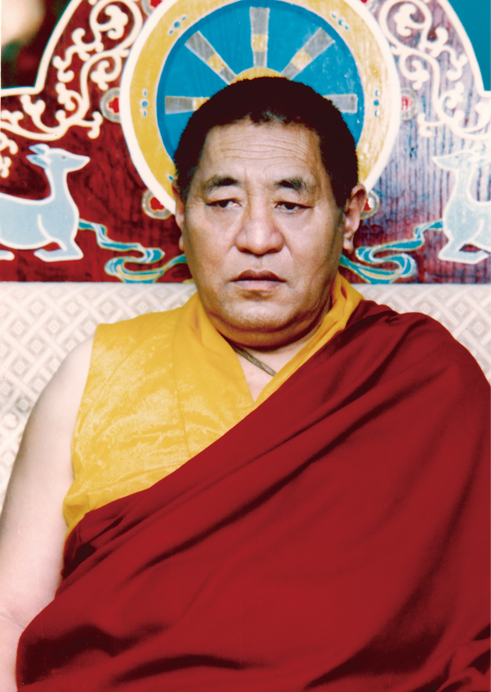

总的来讲，声闻乘、大乘显宗、密宗金刚乘修行寂止时，都需要这样来修。特别是在大圆满自宗中，平时让心自然安住，观察心的本性，如果懂得心的本性是了不可得的空性，那就可以说是认识了大圆满的觉性。要认识它，必须让心一缘安住，否则，在心境纷乱的情况下，无法认识心的本性。就像水中要映出影像，必须保持静止不动一样，只有让心安住下来，才能领悟到心的本性是无生空性。认识心本不成立的空性本面，这就是“见”，然后长时间护持这种境界，看它是否出现了明分，这就是“修”。

> 不断修行时，显现任何六聚境心，皆不应改变、取舍，不失觉空本来自性而行持，则其妙力中所现的一切法均无利无害，如波浪融入大海，名为行为显现直定。

在护持修行的相续时，眼睛看见的色法、耳朵听到的声音、鼻子嗅到的香气、舌头品尝的味道、身体感受的所触，以及意识显现的种种破立寻伺之法，对于这一切都不进行改造、转变、舍弃、取受。即使萌生善的念头，也不向内取受；即使生起恶的念头，也不向外舍弃。不做任何取舍，不失觉空的原始本位，只安住在之前直指见解的觉性本体空性、自性明分不灭的境界中。此时，眼识、耳识、鼻识、舌识、身识、意识六识，以及色声香味触法六境，所显现的一切都无利无害，就像波浪融入大海一样。这就是“行为显现直定”。

> 如此修习，最初认识觉性本面时，分别念自解脱如蛇结自解；中间圆满妙力时，任何分别识聚均无利无害，如空屋入贼；最后获得稳固时，不清净之法寻而不得，现前自性义智慧，如于金洲不得土石，此名为果位觉性直定。

这样串习时，最初无论出现什么念头，当观察其本体时，了知它正在显现时就是无生的自性，而没有任何刻意向外排斥和向内建立的自性，就像蛇结不需要被解开，它自然会解开一样。

中间妙力圆满的阶段，是从获得菩萨的暖相开始，无论出现任何分别念，都是无利无害的——善的分别念不会有帮助，恶的分别念也不会有损害，就像空屋子进了贼一样。

到达最终阶段时，所有贪执于能所二取的分别妄念全部清净于法界，从而显露出赤裸觉性本智。在这个时候，无论如何寻找，也得不到不清净的法，就像到了金洲找不到土石一样，由此现前了佛的智慧，这就是“果位觉性直定”。

以上这三种窍诀，即认识本面、妙力圆满、得以稳固，是归纳了持明者嘎绕多吉大圆满六百四十万续的精髓而讲解的。

> 三、后行任运自成顿超（脱噶）：为了现量见到非以伺察意安立的觉性光明密意，要修任运自成顿超法门。修行时，身要：依三坐式任何一种；语要：禁语，口中缓慢呼吸；心要：依直断直定自然慧灯；境要：无云晴空及日月明灯等；门要：上视、平视、垂视；

觉性大光明，是指本体空性、自性光明、大悲周遍的心性安住于自己心间，也即之前讲直断时的那个觉性。在此之前，我们仅仅通过伺察意来安立，而未使其成为现量根的对境。现在为了能够现量感知它，需要修持具足六个要点的顿超：

1．身体的要点：身体要具备三身坐式的任意一种。

1）如狮子蹲坐般的法身坐式：双脚掌并拢，稍向前伸，不要过于内收，各身体部位保持松弛，避免膝盖等感到疼痛，要舒舒服服地坐着。双手握成金刚拳，即拇指抵住无明指的根部，手掌合拢成拳，置于后脚跟旁，如狮子蹲坐一般，上身挺直，颈部略微仰起，眼睛半眯着，专注于眉间方向，通过观灯光等，看能否显现种种明点和微明点。若出现光和明点的形相，这就是清净身与智慧的显现。通过不断串习，有朝一日将会显现真正的清净身与智慧。

2）如大象卧姿的报身坐式：跪在地上，膝盖贴近胸部，双脚掌朝上，双手托腮，双肘拄地，双目平视左右，再观察是否能显现明点。

3）如仙人蹲坐的化身坐式：双脚掌着地蹲坐，双手环抱膝盖紧贴胸前，眼睛微咪，注视鼻尖方向，将明点往下引，看它能否现前。

当出现连绵状的明点，那便是总集三世诸佛之本体的怙主文殊菩萨。再进一步串习，最终会显现文殊菩萨真正的身相和手中的标帜。这些显现必须保持不动不晃，才是根本。若心与眼不动，这些显相就会稳固。

2．语言的要点：保持禁语，缓慢地由口中呼吸，而不是猛烈呼吸。

3．心的要点：处于直断直定自然慧灯的境界中。

4．境的要点：离垢的虚空及日、月、明灯等。专注于此会显现类似蓝色明点的法界净灯。为了显现所有光和明点，需注视蔚蓝的天空进行观修；或白天专注于太阳下一肘左右的位置，因直视太阳会伤害眼睛，故不可直接看向那里；或晚上应观月亮；或在早晚等其他时间观灯光。

5．门的要点：上视、平视与垂视，眼睛微眯着这样观。修持顿超时，眼睛必须半睁半闭，而并非完全睁着或完全闭着。法身看式是眼睛向上翻，经过两眼睫毛中间，观向眉间方向；化身看式是眼睛垂视鼻尖方向；报身看式是双眼平视两侧。

> 显现要：如此而修便会现前法界净灯、明点空灯与觉相金刚链。法界净灯即具有五光辐的蓝色周遍法界。明点空灯即内外多层五光圆形明点中央。觉相金刚链即如水晶珠严饰的金线般。

6．显现的要点：现前法界净灯、明点空灯与觉相金刚链。法界净灯，呈圆溜溜的形状，是周围被彩虹环绕的蓝色周遍大法界。明点空灯，是内外有许多层五光圆形的小明点，虽然最初没有显现，但修行几天后便会出现。在明点的中央会看到觉相金刚链，它宛如许多金线上穿着水晶珠般，弯弯曲曲，跑上跑下，这种显现在初期便可出现，比如今天大家应该都能看得到。

> 显现此等现相时令其稳固、毫不动摇，将自己的呼吸、眼识、意识三者都融入此境界中，专注于此，无有任何伺察意相状分别识聚长久修习，

上述内容即为修行顿超的六种要点。

总的来说，关于顿超的道要，各位上师的讲解、各个续部的意趣都有所不同，有些有三种要点，有些有四种，有些还有更多，但此处以六种要点来解释，这是诸佛无分别智慧总集的怙主文殊的不共窍诀。这六种要点若少一个就会欠缺，多一个则无意义。如此具足六种要点来观修，需要安住在直断的见解中。

> 从而可明显地见到法界净灯、明点空灯与觉相金刚链，即是法性现量相。彼等显现愈加明显、愈加稳固、愈加圆满并出现无量光芒，即是觉受增上相。

关于这四种道相，其他续部、其他乘中都没有，唯一在大圆满自宗中有。具体而言：

1．一开始就能明显见到法界净灯、明点空灯、觉相金刚链，这称为“法性现量相”。

2．明点越来越明晰，觉相金刚链越来越稳固，法界净灯越来越增上，并出现了无量光芒，这就是“觉受增上相”。

> 法界净灯显现清净为刹土，明点空灯圆满为无量殿，觉相金刚链成熟为佛身，所现前的全部是清净现相，即是觉性如量相。

3．法界净灯的一切显现清净为刹土，明点空灯圆满为无量殿，觉相金刚链成熟为佛身。所有这些显现完全是清净的现相，不清净的法如何寻找也得不到，这就是“觉性如量相”。

> 身智等无边有法的一切显现均入于法性童子瓶佛身界中，获得不现一切的坚地，即是法性灭尽相。

4．当一切不清净的显现达到觉性如量相时，就已经清净了。之后，所有清净身智的妙力显现，回归到内法界童子瓶佛身中，获得不现一切的坚地，这称为“法性灭尽相”。

> 之后在所化刹土中显现的一切庄严三身均是善愿聚合而产生的无欺自果。

圆满现前成佛后，通过所化众生的善业力与佛陀的愿力，以法身为增上缘，显现报身与化身，然后应机调化而显现无欺的缘起，尽虚空界利益有情。

> 倘若今生未得稳固殊胜的境界，则临终时，于心间将自心观成白色阿（ཨ）字，被风吹送而融入顶上安住的上师心间，上师也越来越高，去往极乐世界，即是自心与上师之意无二无别中入定而往生。

这是临死中阴的窍诀。假如这一生中没有证到佛果，那么在临近死亡时，应于自己的心脏内，将自心观成一个白色的“阿（ཨ）”字，同时念诵“阿阿阿……”，观想这个“阿”字从梵净穴出来，伴随着“呵嘎”或“啪的”的声音，融入上师的心间。上师怙主文殊菩萨越升越高，最后前往极乐世界。在无所住的境界中安住，依此而往生。

而我们现在修行时，则应这样观修：在自己心脏内如竹箭状的蓝色中脉里的心间节断上，明观一个白色阿字，心专注于它，口中念诵“阿阿……”，观想它射出头顶，融入上师文殊菩萨的心间。然后再观想上师化光向下融入自己的心间，以此获得寿命自在的无死悉地。

无论是现在反复修习，还是临死时实际运用，依靠以上方法即可。

> 法性中阴时，无论出现声音、光芒、光线等任何身智之游舞显现，都应当了知是自现，并以直定见解安住于所认识的本性上。在一切妙力显现未融入本基界中之前，应当一直安住不退。

在法性中阴时，首先会显现本尊身，随后显现圣聚，然后是任运自成的显现。在上方，会显现法身的种种相；在中间，会显现报身的种种相；在下方，会显现化身的种种相。

此时，首先要认识到诸法皆为自现，外界并没有真实之法，这是如子入母怀的教言；依靠直断直定的见解持坚地，安住在这一境界中，则是不变如金扦的教言；所有妙力的显现都融入本基而不再退转，这是如大力士射箭的教言。

> 如梦般出现转世中阴显现时，一心一意敬信上师、本尊，实修临死中阴窍诀，则可于自性化身刹土中获得安慰。

> 如是修法佛赐手，吾之智慧中流露，

> 个别词句分别造，然于某些初学者，

> 会有利益而著此。以造此论之善根，

> 愿遍虚空诸有情，同于法界得安慰。

> 此文是在文殊幻化殊胜刹土——五台山静处非天洞或名那罗延窟，阿旺罗珠宗美于晨息间撰著。

在心中观想：“以此讲法、听法的善根为主，综合自他三时所积累的一切善根，为令佛法如意宝广弘兴盛、长久住世，一切众生暂时享受善趣的美满幸福、究竟获得一切智智的佛果，而普皆回向。”请大家怀着这样的发心一同回向、发愿：

> 愿以此福得遍智，击败一切过患敌，

> 度众离生老病死，波涛汹涌轮回海。

> 文殊师利勇猛智，普贤慧行亦复然，

> 我今回向诸善根，随彼一切常修学。

> 三世诸佛所称叹，如是最胜诸大愿，

> 我今回向诸善根，为得普贤殊胜行。

> 愿我临欲命终时，尽除一切诸障碍，

> 面见彼佛阿弥陀，即得往生安乐刹。

> 我既往生彼国已，现前成就此大愿，

> 一切圆满尽无余，利乐一切众生界。

> 祈愿佛法广弘兴，一切有情皆安乐，

> 日日夜夜行正法，自他二利任运成。

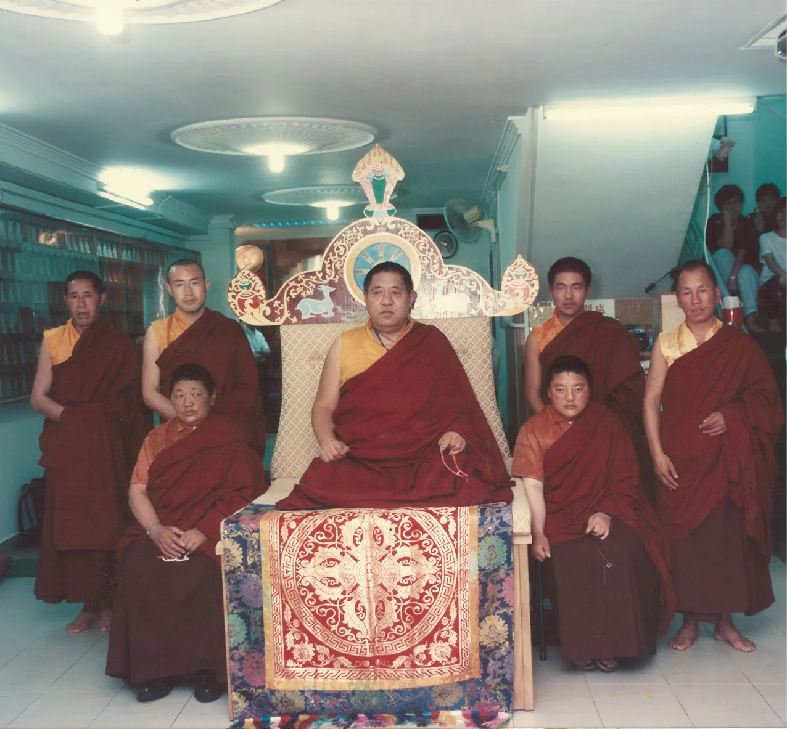

日常的承侍

在出国期间，我有幸在法王身边，与慈诚罗珠堪布轮流承侍。在这段特殊的时光里，我经常为法王泡脚并进行足底按摩，还会为他拔胡子、洗衣服、修剪指甲。特别是在外出时，因为他老人家腿脚不便，我常常扶着法王的手，让他走路更为轻松。

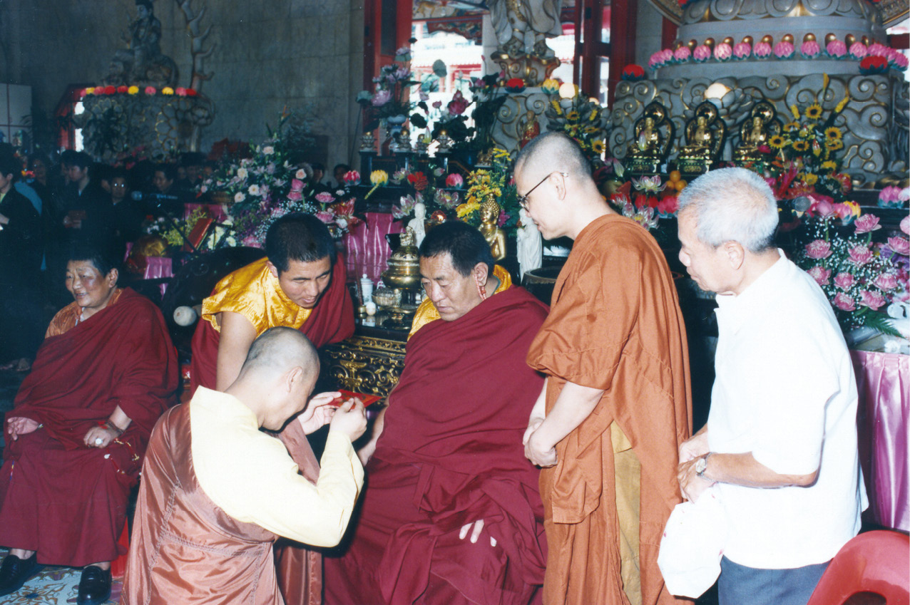

在搀扶的过程中，我领悟到一些微妙的窍诀。有些人因为害怕法王，用力的分寸难以把握，当法王把手放上去时，自己的力道就松懈了，或者过于用力抬高手臂，这都会让法王感到不适。扶的时候，力度需要既不过紧也不过松，让法王的手腕稳稳地托在那里。这样，即使我的力气不是很大，也能够牢牢地扶住高大魁梧的法王——这样的场景，至今仍常常在我梦中浮现。

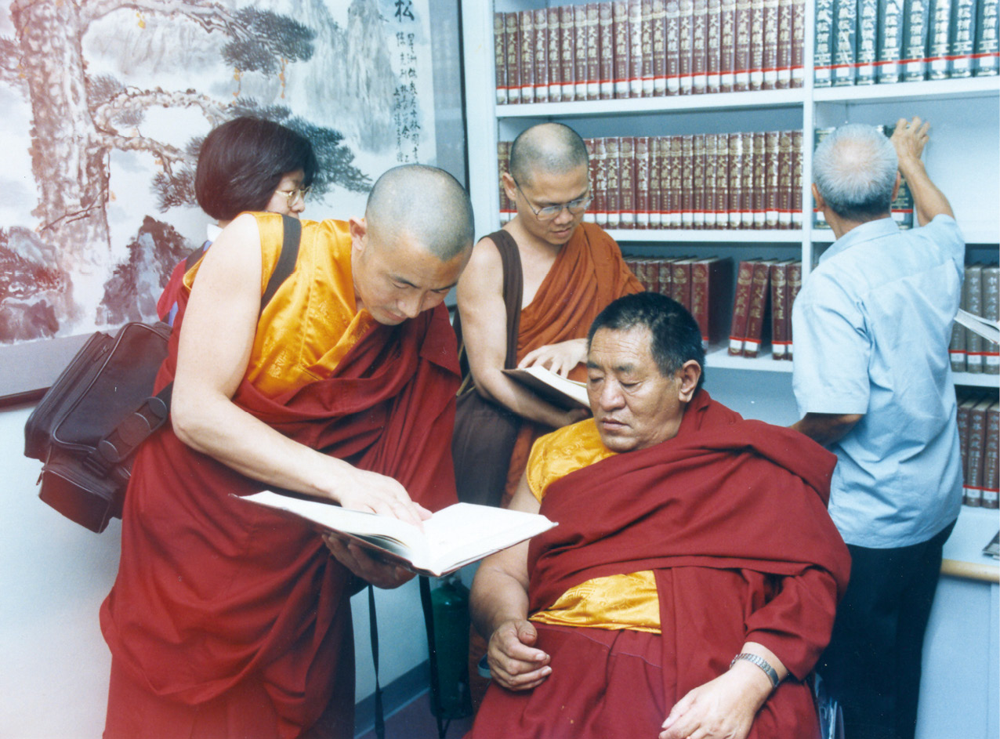

晚上，当法王准备入睡时，我会先帮他脱下外裙，取下腰带和金刚橛，然后拿下披单，将它们整整齐齐地叠放在一个地方，腰带和金刚橛放在最上面。接着，我会在法王够得着的地方放一保温瓶温开水，以备晚上可能需要吃药。同时在枕边放上手电筒。

我最喜欢洗法王的衣服。法王的衣服散发着一种自然的芳香，无论过去多少年，那独特的香味都始终如一。这美好的体验，让每一次洗衣都变得神圣而充满快乐。给法王洗衣服，如同一场心灵的洗礼，是一种心与心的连接，让我感觉与法王更加亲近。

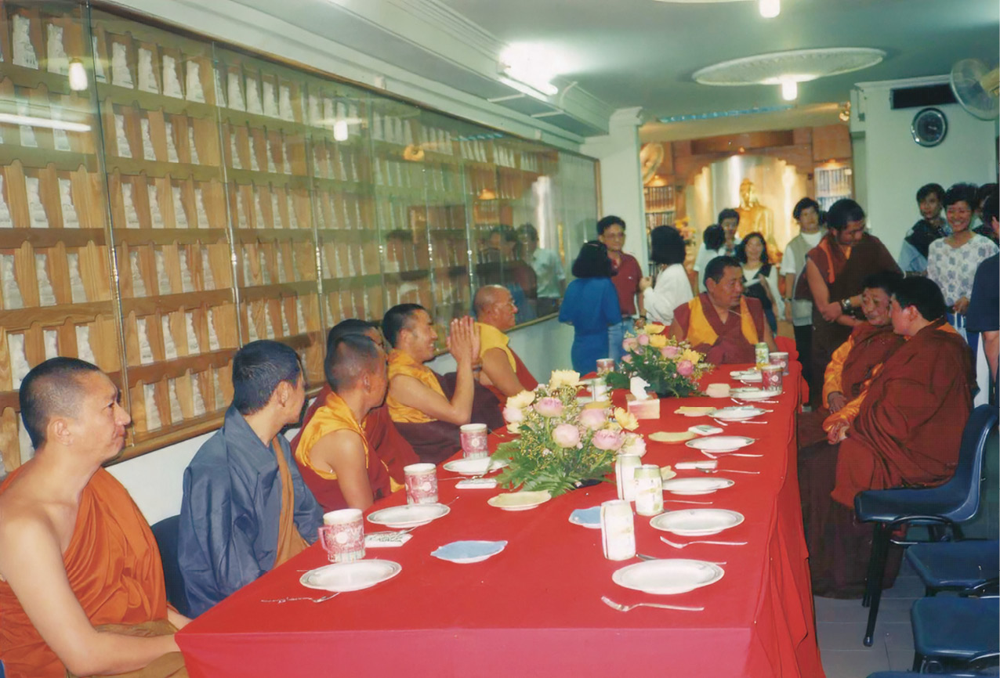

在大众学佛研究会用餐

《心性自解脱》第一节课

从5月9日起，法王在大众学佛研究会，安排四节课的时间，每天上午8点至10点，传授《心性自解脱》。

为确保法义通顺，本次编辑未引用《心性自解脱》的原文，而是忠实记录了法王所讲授的甚深窍诀。若欲深入了解，可自行对照原文。

请大家在内心发起殊胜的菩提心：“为了普天下一切众生获得永恒安乐的无上正等正觉佛果，听闻殊胜佛法并实地修行”，之后以不混淆取舍的闻法威仪来谛听。

今天所讲的，是涵盖了一切乘究竟要点的大圆满法。

此法最初由释迦牟尼佛等十二位大圆满本师在十方浩瀚的世界中广泛弘扬；其后，由集诸佛密意与加持于一身的持明者嘎绕多吉传入人间；后来，由莲花生大士和布玛莫札广泛传播；中期，由荣索班智达与全知龙钦巴弘扬；最后，由蒋扬钦哲旺波和全知麦彭仁波切进一步广弘，达到鼎盛时期。

在他们当中，对大圆满教法贡献最大、著作最丰、随学者最多的，当属全知龙钦巴。虽然他的一些著作已散失，但目前在藏地真正保留下来的，仅大圆满方面的著作就有十几大函。时至今日，雪域高原上所有修习大圆满的行人，唯以全知龙钦巴的教法为归宿。

今天要讲的，就是全知龙钦巴所造的《大圆满心性自解脱》。这部法讲述了大圆满前行、正行、后行的完整修法，是非常甚深的一个法。

> 顶礼金刚萨埵！

> 一切自性本来无有生，无说离思无二之法身，

> 心性之王自然普贤王，顶礼本基圆满无变性。

> 瑜伽果位即生决定教，现前诸位圣者之加持，

> 所现自解无有取舍义，结合引导我当于此说。

具有善巧方便、大慈大悲的正等正觉佛陀，随顺众生界性、根基而次第宣说的无量乘和法门的要义，可归摄为觉性菩提心。尽管它包含了诸多修持的教授，但都被边执的耽著所束缚，很少有即生解脱之道。而这里所讲的，是《大圆满心性自解脱》的窍诀，它是刹那证悟取舍基解脱的殊胜秘密方便法，决定超越一切乘的自性。

此法包括三个部分：传承上师之次第、所传之教授、珍重印持此教。

一、传承上师之次第

在密严刹土法界宫，法身普贤王如来将此法传给报身无量光佛，无量光佛传给化身莲花生大士，莲师传给空行母益西措嘉，益西措嘉传给上师西拉玛德，西拉玛德传给智者成就者德乐嘉措，德乐嘉措传给法王门兰哦色，法王门兰哦色传给全知龙钦巴。

本论所列出的传承，只到全知龙钦巴为止。

之后，全知龙钦巴传给持明者晋美朗巴，晋美朗巴传给晋美嘉威纽古，晋美嘉威纽古传给蒋扬钦哲旺波，蒋扬钦哲旺波传给全知麦彭仁波切，麦彭仁波切传给堪钦根桑华丹，根桑华丹传给托嘎如意宝，托嘎如意宝传给我。

二、所传之教授

这分为三个方面：今生修行自解脱的教授、中阴现基光明的教授、究竟果位的教授。

第一部分又分为前行、正行、后行三大块。

前 行

前行包括七法。第一法是获得加持的上师修法：

坐在舒适的坐垫上，皈依、发心后，刹那间观想：自己头顶的莲花、日月上，坐着与根本上师无二无别的莲花生大士，他相好庄严，身着忿怒装束，身色深蓝，手持金刚铃杵，严饰着珍宝、骨饰，与卡钦萨·益西措嘉双运。益西措嘉右手执弯刀，左手持托巴，拥抱莲师。周围环绕着所有传承上师，以及无量佛菩萨、勇士勇母。

在心中意念顶礼、供养、忏悔、随喜、请转法轮、请不涅槃。然后，念诵“祈祷上师如意宝加持我，净除身语意的障碍，获得身语意的悉地，即生得以成佛……”。再观想诸位上师身体放光，清净自己和一切众生身语意的障碍，一切现有都变为上师的自性。他们身语意的光芒，经由自己的头顶进入体内，在相续中生起明乐无念的智慧，及刹那自解脱的殊胜证悟。稍稍持风，再扩大所缘而观修。最后，在虚幻的境界中回向。

这样修持七天，会突然出现成就上师之相并获得殊胜加持。

第二法，圆满二资粮的曼茶罗修法：

在前方虚空中，观想上师与本尊坛城尊众。尽己所能地陈设曼茶罗供堆，观想四洲世界为主的十方刹土都是奇珍异宝的自性，充满了人天的种种欲妙，以及内外如海般的供云。将身体、受用、善根等一切，供养给诸位圣众，观想他们非常欢喜。昼夜七天勤修供曼茶罗。

这样修行的必要是，可以圆满福慧二资粮，相续中生起殊胜证悟。

第三法，净除二障的百字明修法：

在空性中，观想自己刹那间变为金刚萨埵，身色洁白，一面二臂，双手分别持金刚铃和金刚杵，以珍宝庄严，结跏趺坐。在心间莲花月轮的中央，有一个白色的“吽”字，外围以“嗡”字开头的百字明顺时针环绕，“吽”和“嗡”在一条直线上，从百字明中放出光芒，净除自己和一切众生的障碍。在七天内，尽力持诵百字明。

这样修行的必要是，可以净除恶业障碍，迅速证悟实相。

再明观：之后，观想传出咒语的自声，一切器情世界的显现皆为金刚萨埵身的自性，听到的一切声音皆为金刚萨埵语的自性，一切忆念分别皆为金刚萨埵意的游舞。在此无有任何不净显现的境界中，专注一心地念诵百字明。

如此修行的必要是，能净除一切障碍。

第四法，生起出离心的寿命无常修法：

心中思维：这个珍贵的暇满人身，不会长存，必定会很快坏灭。外在显现的这些对境，都会随着岁月流逝而变化无常，任何众生也无法逃脱死亡。想到亲友的死去，联想到自己的寿命也是无常的，这个近取蕴的身体终将分离瓦解，犹如水泡般脆弱，甚至连今天明天不死的把握也没有。想到必死无疑，观想今天可能就是这一辈子的终点，将要面临四大的瓦解和身心的分离。如此诚心诚意地深刻思维七天，心中会生起无常观、紧迫感，从而精进修法。

第五法，入道前行的皈依修法：

在前方虚空中，观想十方三世的诸佛菩萨、本尊坛城的尊众、声闻缘觉阿罗汉等三宝。发愿在没有成佛之前，以他们为依怙，尽力念诵皈依偈“皈依师、皈依佛、皈依法、皈依僧”。观想他们如父母慈爱子孙般，以大悲关照着我。从内心深处发自肺腑地皈依，再观想一切众生也朗朗重复皈依偈。如此精勤修持七天。

这样修行的必要是，可以息灭修行的障碍，越来越增上证悟。

第六法，趋入法道的菩提心修法：

在面前观想：地狱的寒热、饿鬼的饥渴、旁生的被役使、人的生老病死、阿修罗的争斗、天人的死堕等痛苦。思维他们恒常在遭受着这些苦，轮回的本性就是痛苦。想到这些众生长期被轮回之苦折磨着，愿以我的善根、身体、受用等，使他们暂时离苦得乐，安住于无有亲疏贪嗔的四无量心中，最终获得佛果。

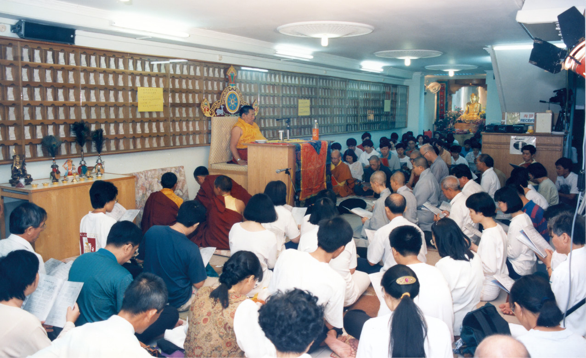

口中念诵简略的发心仪轨：“怙主佛子念，如三世诸佛，生起菩提心，如是为利众，我发菩提心，复于诸学处，次第勤修学，摧毁众诸苦，竭力成他利。”并轮番修持自己代受众生的痛苦、将自己的快乐给予众生的自他交换修法。以强烈的悲心修持七天。

这样修行的必要是，身语的一切勤作都会成为利他之因，从而趋入大乘道。

《心性自解脱》与《手中赐佛》这两部引导文，整体结构大致相同，但《手中赐佛》专门介绍了顿超的修法。我们选择本尊之花所投中的本尊，就是有缘的本尊。你们看能否精进地修持《手中赐佛》，这对心相续速得加持、速得成就等各方面都大有必要。

大圆满道的所有要点，可归纳为三种修行：

1．出离心：首先，通过前行来净治自相续，看到轮回一切都是痛苦的自性，进而生起真实的出离心。这并不是口头上说说，而是从内心深处生起想要解脱轮回的意乐。

2．菩提心：对一切众生生起菩提心，想到他们没有一个未曾当过自己的父母。对于所有的父母有情，爱他们胜过爱自己，为了他们获得佛果而修行。相续中要生起这种善意乐的菩提心。

3．正见：如昨天所讲，若断定轮回与涅槃都是心的幻化，心的自本体本来就不成立，是空性，这基本可以说已生起了大圆满正行的见解。

出离心、菩提心、正见这三者，涵盖了佛陀所传的八万四千法门的全部内容，尤其是大圆满的一切要义也纳入其中。宗喀巴大师将浩瀚的佛法归纳于这三法之中，大家应当好好理解这一点。

如前所述，从全世界各个国家来看，有些国家的修行人侧重出离心，并辅以守持清净戒律；有些侧重以利他菩提心为主的修行；有些则侧重正见的修行。将这些要点汇集一处、超越一切的，即是大圆满的见解。因此，大圆满法门现在已在世界各地广为流传。许多国家，如印度、美国等的修行人，都认为大圆满法比其他乘更有效，并积极修持。

如今在新加坡，以大众学佛研究会学员为主的许多信众，喜爱并信受大圆满法，未来喜爱大圆满法的人会越来越多。为什么呢？因为修行其他法难以立竿见影，而这个大圆满法，只要自己对它有信心、恭敬心、胜解心，就能迅速现量证悟心的法性。所以，新加坡未来必定会有大量佛教徒修持这个法。你们也应当努力修行，大圆满法是一生成佛的殊胜方便。讲大圆满法的功德，远超过讲其他法门，大家要记住这一点。

无论修行三乘中的哪种法门，皈依都是不可或缺的基础。必须要有坚定的誓言，即使舍弃生身性命也绝不舍弃三宝，对三宝要生起恭敬心。

1．对佛宝恭敬的方法：

尽管现在没有真佛住世，但要以虔诚的信心，恭敬地在佛像等前面，进行供养、顶礼、发愿。世界上所有的佛教徒，谁也不会不恭敬佛像。

2．对法宝恭敬的方法：

真正的法宝是经典文字。有些地方的人对经书十分恭敬，而有些地方的人只将其当作研究对象，并未给予足够的恭敬。作为佛教徒，应该将经书视为三宝中最重要、最值得恭敬的。佛陀临涅槃时曾说：“阿难莫悲伤，阿难莫哭泣，末法五百年，我现文字相，当作是我想，视为我本人，尔时恭敬彼。”这其中的意思就是，佛陀会化现为文字，应当恭敬这些文字。

特别是对我们来说，在上师面前听到的法，很难全部记得住，如果不断询问，上师也会感到厌烦。而如果能将其记录下来立成文字，这就是所谓的“无嗔上师”，即使看一千遍，它也不会生气。所以要好好地恭敬文字，否则，就会导致智慧减退，觉受证悟也会退失。因此，在看经书时，应以恭敬心对待，切勿将其直接放在地上等。

当然，我们大多数佛教徒都会遵循这一做法，但在美国等一些地方，有些人会坐在经书上，或从它的上面跨过去。我以前去美国时，有人问我：“你们藏人很讲究头尾，认为头和屁股有极大的净秽之别，觉得把经书放在头上好，把它坐在屁股下面不好。而我们美国人不会把头尾看成有净秽之分，那么如果我们不恭敬经书，真的不妥吗？”

我开玩笑地回答说：“你们想想，如果把鞋子或脚放在克林顿总统的头上，他会不高兴的。同样，把脚放在经书上，也是不恭敬的行为。所以大家一定要恭敬经书。”

3．对僧宝恭敬的方法：

出家人的功德远胜过在家人百倍千倍，所以说“堪为在家众，所应供养处”，出家人是世间人天的供养处。

通常来说，声闻乘有十八部，其中藏传佛教的所有持律者，都秉持着佛陀亲子、王族罗睺罗传下来的“说一切有部”的戒律传承；而斯里兰卡等地的许多持律者，主要是受持“上座部”的戒律传承。这两者都是佛陀的清净律法，因此，你们应当恭敬所有出家人，自己也要受皈依戒和居士戒等。最重要的是，受皈依戒后，要以信心恭敬三宝。

未来，你们诸位要尽全力让新加坡的出家僧团越来越多、越来越兴盛，千万不要忽视这一点。虽然总的来说，佛教在新加坡弘扬得很广泛，但出家僧团却十分稀少。只有出家僧团兴盛，佛法才能兴盛。佛法兴盛了，众生自然就会幸福。因此，如果未来你们中有人想舍弃俗家生活，出家修行，可以去斯里兰卡等地受“上座部”的戒，或者到藏地受“说一切有部”的戒，现在我们五明佛学院也给很多出家人传戒。总之，想要出家的人，必须受清净戒。

这里的出家僧团实在太少了。前几天，我去新加坡最大的佛教寺院——光明山，那里的出家人只有十几位。相比之下，我来这里之前，在喇荣举行了一次大法会，参加的僧人有三万八千人，其中也有几个新加坡人。之后我在新龙举办了法会，参加人数超过数十万。虽然平时聚集的人没有这么多，但有时举办法会的话，参与的人数非常庞大。一般来说，藏人非常热爱佛法，因此僧人的数量也最多。希望未来新加坡能有一个兴盛的大僧团，你们要加油啊，我也将为此祈愿！

去了两个道场

中午，法王应邀前往菩提协会（The Bodhi   
Association）。该协会成立于1991年，虽然是一个新兴的佛教团体，却在弘法利生方面取得了显著成就。他们致力于禅修、慈善及佛教文化的传播，不偏向任何教派，广泛邀请南传、汉传、藏传佛教的大德进行佛学交流，定期举办讲座和共修活动，努力让更多人了解佛法的真谛。

我记得，他们初期的地址位于牛车水珍珠坊26楼。1994年，慈诚罗珠堪布曾亲赴该地，传授《入行论》第一品、《释迦牟尼佛修法》，并细致讲解居士戒和密乘戒；而每逢周六，广超法师也会在此带领众人进行禅修。

当法王抵达菩提协会时，信众们热情洋溢地欢迎他，空气中弥漫着期待与激动。法王在这里享用了午餐，并为有缘者传授了“文殊智慧勇识”灌顶，为每一位在场信众进行摸顶加持，令大家内心充满了法喜。

法王与白玉中心的住持一起

随后，法王又前往贝诺法王在新加坡的道场——白玉中心（Palyul Nyingma Buddhist Association）参观。该中心在新加坡的佛教界中扮演着重要角色，他们经常举行灌顶、共修和闭关活动，帮助信众深入理解佛法，提升修行水平。

白玉中心位于三楼，楼梯狭窄且陡峭，法王因腿脚不便，走上去时显得有些吃力。尽管中心空间较小，前来的人却非常多，加上炎热的天气，空气略显闷热，室内有些拥挤。然而，法王当天心情很好，面带慈祥的微笑，向信众们传授了“长寿佛”灌顶。

超度法会

在新加坡的弘法日程中，大众学佛研究会特意安排了一场超度法会，希望通过法王的大悲加持，为亡者祈福超度。法王欣然应允。

为了这场法会，主办方诚邀信众提前报名，收集家中离世的亲人、朋友，甚至是大众学佛研究会之外需要超度的亡者信息。然后将每一位亡者的名字和生卒年月，端正地写在黄色的超度牌位上，整齐地贴在墙面上。同时，他们用心布置了庄严的佛坛，摆放着水、香、花、灯、果等供品，恭敬地供奉观音菩萨圣像。

慈诚罗珠堪布在布置法会佛坛

5月10日下午，法会正式开始。法王首先诵经洒净，清净坛场，随后端坐于法座上，念修天法意伏藏《佛海观音超度仪轨》。这一环节中，法王对亡者的神识进行了勾招、忏罪、施食、灌顶等，助他们脱离苦难，往生善趣或极乐世界。在法王的诵经声中，信众们虔诚合掌，默默念诵“南无观音菩萨”或六字真言。

法王诵经洒净

法王将亡者总集的牌位烧化，置于供盘之中，象征着亡者已得超度。紧接着，慈诚罗珠堪布带领信众前往室外的焚烧炉，逐一将亡者的牌位焚化。在此过程中，按照藏地的传统，还特别加入了面粉、饼干、糖果等食物，投放于火中焚烧。法王以悲心念诵麦彭仁波切的《焦烟仪轨》，帮助一切有缘的无形众生摆脱恶缘，最终步入解脱之路。

此次法会，法王亲自为当地的亡者及非人，做了一次殊胜的法布施。凡是结缘的众生，都能获得不同程度的解脱。在法会的最后，法王为信众做了相关开示，而我担任翻译，将法王的教诲传递给在场的每一个人。

《心性自解脱》第二节课

5月11日上午，法王继续传讲此法：

这里要讲的法，是全知法王龙钦巴所造的《大圆满心性自解脱引导文》。它分为前行、正行、后行三个部分。前行有七个法，前六个已经讲完了，现在讲第七个。

第七法、生起实相证悟的了义精华修法：

它又分为寻求寂止、生起胜观、认定止观双运。

1．寻求寂止：

双足结跏趺坐，不想过去已灭的念头，不想将来未生的念头，也不对现在的心识进行分别，就平等安住在这种状态中，努力修持七天。

这样修行的必要是，可以压制成为障碍的凡俗杂念，辨别觉性的清浊，从而容易认清突然浮现出的任何心识。

在修寂止时，需通过九种住心法来对治五种过患，依止八种想，然后再以励力运转、有间歇运转、无间歇运转、无功用运转四种作意来进行修持。一开始需要有勤作，到后来，要做到不加勤作，就像所说的“依止于所缘，极至生无缘”。

修寂止的初期，需要缘于外在的佛像、佛塔等所依对境；然后观内心；最终安住于什么也不执著的状态中。通过这三种窍诀来修寂止。

所谓寂止，就是心专注地安住下来。无论是修共同乘、大乘显宗还是密宗金刚乘，它都是必不可少的基础，正如生长庄稼必须依赖良田一样至关重要。

修寂止的方法有很多种，可以观佛像、文字等，也可以以自己的心来观心等。当然，如果怀着满满的虔诚信心、恭敬心、胜解心去观佛像，那更不必说了，即便心中带着嗔恨看一眼佛像，也能净除上亿劫的罪业，面见诸佛，逐渐获得遍知佛果。

在一心专注地观佛像时，如果心出现内收昏沉，可专注目视佛的无见顶相来修，这样可以消除昏愦；如果心涣散到形形色色的外境中，出现了掉举，则可专注目视佛心间的卐字符，自己的心也仿佛融入其中，这样就能平息掉举。有时观整个佛像，有时注视佛的眼睛、白毫等局部，若能如此观修，定会有所进步。因此，这种修法非常重要。

如果一心专注目视被三世诸佛加持的“阿（ཨ）”字、“吽（ཧཱུྃ）”字等，就能获得禅定智慧增上、戒律清净等广大功德。更简单的修法是，将不忘失的正念作为哨兵，以自己的心来观心，这一点没有什么不会的。正如萨绕哈尊者所说：“尽断思所思，如婴而安住。”就像刚出生的婴儿那样，不回想过去的对境，不思量未来的事情，不追随现在的行境，直截了当，自然放松，不作思维而修，这样心会逐渐安住，越来越稳固。此时，会任运获得诸佛菩萨所具有的无碍遍知诸法的神通、大变小与小变大等神变，以及一切断证功德。

若没有寂止的基础而修大圆满之道，就很难生起殊妙的觉受和证悟，因此，一开始要修持正确的寂止。在修寂止的过程中，如果用功过猛，可能会导致气上冲而发疯或生病。这种情况，依靠上师的窍诀可轻松化解，不会有什么害处。但若远离了上师又不懂上师的窍诀，那就会有难度。所以，不要过分约束心，而要专注修行寂止。

2．生起胜观：

虽然如前所述，寂止是浩瀚佛法的根本，但若只修寂止而无胜观，那便是世间道，只能享受轮回中色界和无色界的安乐。外道中也有寂止，因此必须具备胜观。胜观就是确定自心为空性，最初无有生处、中间无有住处、最终无有去处，如同空中的彩虹，既无基础也无根本。有时要分析而观，有时要安住而观，但必须认识到这颗心为无基空性。

3．认定止观双运：

若只修胜观而无寂止，会导致分别念增多；若只修寂止而无胜观，那就是无记法的分别念。因此，所谓正道，是以止观双运、不相脱离而修持。

具体来说，当心不追随三时任何对境而自然安住，就是寂止；正在安住时，确定心性为无生的自性，则是胜观；这两者永不分离地修持，便是止观双运。这也是所有大乘显密所应修的要点。

要修持正确的显宗波罗蜜多乘之道，必须有具足寂止的胜观；要修持密宗金刚乘之道，正如所说的“无止胜观散乱驰，无观寂止无记法，双运修治最胜道”，止观双运才是断除障碍、生起智慧的不共因；特别是在大圆满中，通过修道的力量，会在自相续中生起比以往更加殊胜的自性本然安住之寂止与自明自见之胜观。因此，修持止观双运非常重要。

正 行

首先，身体姿势是结跏趺坐或半跏趺坐，双手结定印，脊背挺直，颈部微屈，肩膀伸展像鹫翼一样，目视鼻尖，舌抵上颚，采用毗卢七法坐式。然后，让心不造作而自然安住。

要明白，内外器情的一切显现，唯一是心的自性、心的幻化、心所造作，除此之外别无其他，就像前面讲《手中赐佛》时详细直指的那样。

邬金莲花生大士曾说：“要认识心的本体是外内中三处均不成立的空性，这是法身；空性的自相光明不灭，这是报身；妙力悲心种种显现，这是化身。”

所谓心的空性，指的是无论是贪心、嗔心、痴心等不善念，还是信心、悲心、菩提心等善念，抑或是想吃、想走、想坐等这些无记法的分别念，当这些念头正在浮现时，如果能够通达它们无所成立、本来无生的本性，那就是认识了法身的觉性。

这并不是指首先有了一个恶念，之后才解脱为正念，而是了知自心本体本来解脱，即分别念自解脱。无论当下浮现出任何善念或恶念，都不要对它加以改造，而是直视它的本体，自然安住。这样，就能如前所直指的那样，认识到本体空性与自性不灭无二无别的本性，这便是直指觉性。

因为本体见解脱与自性知解脱这二者是无别双运的，因此安住于法相普解脱中，这就是心的自性。如果不加改造，自然安住在觉性明分不灭的境界中，那么它的妙力圆满之后，自然而然会显现明乐无念的所有觉受。在安住于当下心识的状态时，并不是一开始有，后来才从中解脱的，而是显现与解脱是同时的。在其他念头尚未生起之前，一直自然安住在这种境界中，就像漏底的容器无法存留灌入的溶液一样，任何念头也会因缺乏基础而无法生起。安住于此境界中，便是修行的正行。

如果了知一切现有都是法身唯一明点，远离一切生灭、中边的自性，觉性就不会中断。修是觉性的境界，不修也是觉性的境界；动念是觉性的境界，安住也是觉性的境界。

因此，无论生起何种烦恼，实则并无需要断除的“烦恼”，它即是智慧的自性，是明空无为法的本性，除了佛地的一切三身功德外，别无他法。自己本具圆满的一切功德，所以无需重新修成佛果。当观修这一意义时，只需要见到心的本面。如此逐渐串习后，终有一天会如实现前佛陀的十力等如海功德。

这个法并不像显宗波罗蜜多乘那样，认为贪嗔等烦恼恶念没有产生就感到高兴，生起了就觉得讨厌，必须刻意去断除。无论浮现何种念头，从它生起的那一刻起，就从来未曾产生过。在无生的同时，自相光明不灭，这即是明空双运的本性。如果能够认清这一点，所有烦恼也就成了智慧。因此，当前分别念的纷呈或安住，实际上唯一都是法身。思前想后的心，本身根本不成立，所以远离一切能思所思。

只需要在心的自性中放松安住，而不执著于这是空性还是光明，也不必想着“不能让心散射于对境，必须让它安住”。若能在自心本性中彻底放松安住，那就占据了觉性的本位，远离了能修与所修，不存在散乱与不散乱，任何念头的生起都解脱为法性。

超越一切能见所见而直接安住，就能了知其除了法身界外无处可去的本性，即使各种念头生起也无妨。念头散乱时，如果不加以管控，而是自然安住，就能觉悟到散射的自性本来根本不成立，从而回归本位。如此一来，即使散乱，也不会造成障碍。如果了知浮现的任何念头本体无生，它就像船上飞起的鸟，最终还是会落回到船上一样，所浮现的每个分别念，都是在法身的自性中如如不动。

动念与安住，皆为菩提心的自性，因此，专注也可以，不专注也可以，只要让远离一切能改所改的觉性本来面目赤裸地显露出来就可以。对治与所断，也都是觉性，因此纠正与不纠正皆可，专心致志地安住也可以，不安住也无妨。

总之，无论是在专心致志地安住时，还是在不安住时，都必须唯一修持赤裸显露的这个通彻觉性。不要执著于任何内外法，不要随念头而转，也不要打击分别妄念，而应让觉性自己掌控本位。粗大的妄念随意流散，是因为没有认识觉性本面，追随庸俗的念头而转。如果觉性掌控了本位而无执著，这才是解脱了过失。

现在，无论生起什么念头，都不必对它进行改造或进行破立，关键是要自然安住其中。不专注于有无是非，不执著于任何对境，既没有所取的对境，也没有能取的执著，无生的觉性本性便会显露无遗。

实修大圆满

当天，在讲完第二节课后，法王概括性地讲了大圆满的实修方法：

简而言之，无论你们修习《手中赐佛》还是《心性自解脱》的大圆满法，首先都要修所谓的“本住”，即结跏趺坐或半跏趺坐；口中除三次或九次垢气，观想依此净除一切病魔罪障，保持禁语的状态；心不作意于三时任何分别念，自然安住。需要先修这三种本住，或称三休息。

接着是皈依和发心：怀着信心祈祷与上师无别的不了义行相手印文殊菩萨，从而使自相续得到加持。胜义文殊即是自心无改的法性，也就是认识大圆满的觉性。首先修持“我要现前胜义文殊勇识本性”的皈依，以及“为了将无量众生安置于佛果，我要圆满实修这个甚深大圆满道”的发心。

然后，在前方虚空中，观想与文殊菩萨无二无别的上师，一心专注地祈祷他，长时间念诵“具有童子身，庄严智慧灯，能除世痴暗，祈祷文殊尊”的偈颂，随后观想上师化光融入自身，要这样修持上师瑜伽。之后不追随对境，看看自己是否懂了心的本性是什么样子。初学者除了什么都不想之外，对此无法理解。但心只要自然安住下来，常常一心专注地祈祷上师与怙主文殊菩萨，终有一天会证悟大圆满的意义。

白天可以以平等性的坐姿，伸展四肢仰卧，目光和意识仿佛融入了虚空般专注，一心一意地修行，这样可以消除身体的病痛与不适等。晚上睡觉时，可以采用慈悲本师涅槃时的吉祥卧式：右侧卧，头朝北，右手放在脸颊下，腿伸直，左手舒展放在腿上。这样睡会显现智慧的心念。相反，趴着睡会生起嗔恨的念头，左侧卧会生起愚痴的念头，仰卧会生起贪欲的念头。

或者观想在头顶上方，与上师无二无别的文殊菩萨放出光芒，其周围环绕着皈依境的尊众，心专注于此。有时以信心祈祷，有时尝试着安住于大圆满见解的境界中。平常也可以在心脏内明观清净刹土，再观想其中央有与上师无二无别的文殊菩萨放出光芒。如果这样入睡，就可以显现夜晚光明和白天光明，进而夜以继日地处于光明境界中。

虽然其他法需要闭着眼睛来修，但大圆满的修行，无论白天还是晚上什么时候，都不需要闭眼。其他法门修风脉明点时，需通过鼻子呼吸，但大圆满的直断与顿超无论哪一种，主要是通过口中呼吸。嘴巴不要张得太大，也不要闭得太紧，大约能放入一粒青稞、上下牙齿不相触即可，要觉察不到呼吸的运行。处于这种状态中修行。

开始时，以心观心；如果心思涣散，稍作休息后再继续观心。修持要像老房子漏水一样，短时间、多次数地进行。初学者无论念头是否散乱，每次观修时间控制在六分钟左右。有时也可以允许念头浮现。有朝一日，就能在七天内不生任何念头。为了在相续中生起殊胜的觉受、证悟，有时需要用悦耳的音调诵念上师与怙主文殊菩萨的祈祷文，这有助于增进证悟。

最后，要观想自己的所有善根，为了佛法兴盛，众生获得暂时的人天圆满安乐、究竟的佛果而作回向。

过去在印度和空行刹土等地，曾出世过通过修大圆满获得证悟的不可思议的成就者，这在许多佛教史中都有记载。在西藏雪域，莲花生大士与布玛莫札时期，获得成就与虹身的也大有人在。此后，例如在噶·当巴德西[^1]时期，约有十万人通过这条大圆满之道而无余解脱，成就虹身。在我们喇荣所在地，曾经一时间内有十三位虹身成就者无余涅槃。即使是现在，在藏地上中下三区域，仍有一些人以肉身直接飞往空行刹土，甚至有人的身体化为光。你们当中也可能会出现虹身成就者，因此，大家要坚持不懈地精进修行。

其实，不仅仅是以往曾出世过许多这样的成就者，在近百年的20世纪中，也涌现过非常多的成就者。正如我在开课第一天所说，我的上师中有很多人通过大圆满道获得了成就，并趋至佛地。我的道友中也有相当多的人，甚至我的弟子中，也有不少人获得了成就。

因此，判断是不是清净的正法，要看修法的成果。如果修某个法没有任何成果，那么即使大肆宣扬“这个法特别好”，也是无济于事。而大圆满并非如此，正如全知麦彭仁波切所言：“浊世衰败罩如暗，莲师事业明如月，密宗精藏如日光，照耀三界增吉祥。”意思就是，即便如今五浊恶世的黑暗如此严重地笼罩，但莲师的大圆满教法却如暗夜中的月光般更加明亮，得到了广泛弘扬。关于大圆满教法，在本论中也有提及，越是恶劣污浊的时代，它就越能兴盛。当人寿仅十岁时，持德空行母出世，将所有见闻忆触的众生都引导至佛地。

这个法不同于其他任何法。通常而言，佛法有果期、修期、教期和唯持形象期，前面都已过去，现在接近唯持形象期。然而，大圆满法如今正处于鼎盛时期。所以，相较于修其他法，大家要更精进地修持大圆满法，如此必定会无欺现前成就之果。

《心性自解脱》第三节课

5月12日上午，法王继续传讲此法：

这里所讲的法，是全知法王龙钦巴亲自撰写的《大圆满心性自解脱》，它汇集了大圆满续部、教典、窍诀的所有要点，分为前行、正行、后行三个部分。现在讲后行。

后 行

它可以分为修炼妙力、遣除障碍、增进境界。

一、修炼妙力

正如昨天所直指的，在入定时，要平等安住于无生觉性的境界中，无有任何执著和分别念。在后得阶段，当生起吃饭、睡觉、行住等各种念头时，应认识到念头的本体是无生的自性，并修炼一切显现如梦如幻。所谓的“修炼”，就像一个人锻炼身体一样，让觉性越来越善妙、越来越增长、越来越稳固。

二、遣除障碍

如果生了病，应该感到高兴，因为通过它可以清净过去的罪障。特别是，若能观病痛的本体而平等安住，这不仅有助于增进觉性，还能提升修炼妙力的境界。因此，不要想着祛除疾病、恢复健康，而要认识到生病是在净除过去的恶业，应该为此感到高兴。

然而，如果患有严重疾病，影响到修行菩提，那就需要治疗。如何治疗呢？

观想身体从头到脚生病的地方有一个洞，所有病魔和罪障都以蓝红色烟雾或气流的形相，从这个洞中排出去。接着，要观觉性的无生本体，认识到无始以来伤害自己的所有魔障，曾是自己的父母，他们在当父母时，都对自己有大恩大德，所以不要对这些众生产生报复的恶念，而要生起善念菩提心，想着：“愿他们的所有痛苦都成熟于我的相续中，愿我的一切善聚安乐都成熟于所有众生的相续中。”如果生起这种善的意乐，就能息灭一切魔障对你的加害。

三、增进境界

如果修什么法都没有进步，感到沮丧或十分迷茫，可以将与本尊无二无别的上师观在头顶、心间或前方虚空等处，猛烈地祈祷：“请加持我消除无法生起殊胜觉受、证悟的一切违缘、魔障与阻碍！请加持我的相续当下就生起光明大圆满的殊胜道相！请加持我迅速圆满一切地道功德，与殊胜导师、根本上师您无有贤劣之别，缘分等同！”相续中要生起强烈的出离心和厌离心，通过做会供等积累福德资粮，修持慈悲菩提心。

所谓“出离心”，是希望远离轮回中的一切苦而获得佛果的心。

所谓“厌离心”，是真诚希望远离轮回中总的身体病痛、内心苦恼，以及地狱寒热、饿鬼饥渴、旁生愚痴、人生老病死、阿修罗争斗、天人死堕等分别的痛苦。

所谓“会供”，在密宗生起次第和圆满次第的修行中，有广大会供这一类方法，而此处所说的会供，实际上是一种众会的供养：首先陈设食物、用具等一切必需品，供养殊胜福田的诸佛菩萨；中间供养以上师为主的三根本尊众，献上歌舞等密宗特有的行为，所有具信心的僧俗大众都享用供品；最后供养护法神，并将剩余供品分享给其他众生。

所谓“慈心”，是愿所有高低贵贱的众生暂时获得人天安乐，究竟获得佛果，我要使他们获得这一切。“悲心”是愿一切众生远离不善的苦因与痛苦的苦果，愿他们的苦成熟于我身，愿他们的病痛烦恼都消除。“菩提心”是愿一切众生远离痛苦，获得究竟安乐的佛果。

有时，可以前往尸陀林、空谷、寂静山间等地，数天中让各种分别念生起，并做出各种行为。当这些念头生起时，猛诵一声“啪的”，认定念头是无生的本性。如此反复长期地修炼，就会平息一切障碍与邪魔，生起殊胜的证悟。这与前行中区分有寂的行为相同。

总之，今生解脱的教授，主要是直指觉性、遣除障碍、修炼妙力、增进境界等。之后，串习生死中阴的要点，是即生成佛的方便法。

前面所讲的大圆满所有要义，概括起来就是：以自己的心观心时，通达这颗心是本来无生的空性，这称为见解，首先要认识到它如眼睛般必不可少；不忘失而一心专注地安住于这种境界中，即是修行；当任何念头生起时，不随它所转，而是护持觉空的境界，这就叫行为；最终，一切恶念逐渐清净，回归觉空本位，这便是果位。这是大圆满见、修、行、果的要义总结。

总的来说，大圆满共有六百四十万续部，所诠释的内容分为心部、界部、窍诀部，涵盖外类、内类、密类、极密类等。因此，这个所谓的大圆满，仅凭几十页纸或一两本书，根本无法完全呈现其真义。根据根基的利钝，有许多可讲解的内容，但这次所讲的是最精深、最究竟的精髓。

我认为，如果你们以大信心精进修持，即使亲见文殊菩萨，也不会听到比这更殊胜的教言。我们藏族的一些在家男女，即使终生依止某位上师，也难得听到如此完整的大圆满教授。即使是顶尖的高僧大德，若没有五六年的依止，也不可能直接传讲此法。

这次我来到这里，将所有深法毫无保留地传给大家，原因有四：第一，我们身处不同的国家，相距遥远，往来不便。第二，集聚在这里的你们对佛法充满信心，尤其特别喜爱大圆满。第三，大家正认认真真地修持这个法。此前，慈诚罗珠堪布和华作曾来这里讲过前行等内容，因此，这次正好是大家实修大圆满正行的时机。第四，你们为我们购买机票等，来回的开支不小，还忙前忙后，十分辛苦。因此，我希望满足你们的愿望，将这些教授毫无保留地传给你们。

我们传授这个法，并非为了名声和财富。一般来说，无论是谁，都不应当借传法之名来谋取名利。即使要追求这些，还有九乘其他各种法可以传讲，没必要用这么甚深的法。这次，我直接为你们讲解大圆满，并未用其他法来应付你们。因此，你们也应当祈祷上师本尊，踏踏实实、持之以恒地真正实修这个法。如此，你们的疑虑自然会消除，定解也将随之生起。

以后有时间的话，你们可以在夏天前往藏地，我们还可以讲其他窍诀和实修法。尽管藏地的海拔较高，气候寒冷，可能会面临一些困难，但菩萨在学道过程中若没有历经艰辛，就难以成就清净法。所以，你们不要向困难低头。对于上根者来说，能够在今生取得成就；即便今生做不到，也必定能在临终或中阴时获得成就，这是毫无疑问的。

赴居士林之约

中午，法王接受了新加坡佛教居士林（The Singapore   
Buddhist Lodge）的邀请，前往该道场。同行的还有一些大众学佛研究会的工作人员和其他寺院的僧人，总人数约三十左右。

在那里，大家先一同享用了午餐。随后，法王为居士林的重要管理人员进行了开示。考虑到居士林是净土宗道场，法王特别强调了阿弥陀佛法门，并为他们详细讲解了往生法的相关道理。

接下来，法王在大雄宝殿为释迦牟尼佛像、文殊菩萨像、普贤菩萨像、迦叶尊者像、阿难尊者像进行了开光，并与相关人员合影留念。之后，参观了这里的其他建筑，包括大经堂、会客室、活动厅。与此同时，法王倾听了他们分享的佛教团体管理经验。

法王参观五百罗汉浮雕

居士林创建于上世纪30年代，是新加坡佛教界的重要道场，地位仅次于佛教总会和光明山普觉禅寺。通常，这里会接待一些著名的高僧大德，还与中国佛协保持密切联系，四大佛教名山的长老也常来此交流佛法。值得一提的是，新加坡的许多佛教大德最初都在居士林学佛法，逐渐成熟相续并出家，所以，这里是一个重要的佛教人才基地。

几十年后的今天，尽管居士林的主要建筑经过重建，但法王当年开光过的佛像，依然在大雄宝殿中熠熠生辉，吸引着四面八方信众前来朝拜。

《心性自解脱》第四节课

5月13日上午，法王传讲了最后一节课：

这里所讲的法，是全知龙钦绕绛亲自赐予的《大圆满心性自解脱引导文》。现在讲的是“究竟果位之教授”。

无论是在今生、中阴，还是后世获得解脱，都决定是无上佛果。所谓的解脱，在共同乘的教义中承许，除了像悉达多太子那样极少数的特殊行者外，普通人是无法获得佛果的，而只能达到声闻阿罗汉的果位。然而，根据大乘教义的解释，道的究竟果位就是佛果。虽然暂时获得了声闻缘觉的果位，但那只是休息的台阶，最终的目标仍是要获得佛果。那么，佛果是指什么呢？就是断除所有能取所取的障碍，显现自心的本性，具有二清净的究竟法界法身，必须要证悟这个。

如果有人问：“所谓的法身，仅仅是心与心所清净于法界中的一个单空吗？”

并非如此。比如，尽管虚空是空的，但从虚空中能升起太阳，同样，太阳般的本相光明不灭，这就是报身。报身具有五种决定的本性：处所决定，是密严刹土；身决定，是具足相好庄严身；时间决定，是恒常相续转法轮；法决定，是唯一宣说大乘法；眷属决定，是业力清净的十地菩萨。

那么，对业力不清净的众生，又如何显现呢？就像太阳放射光芒一样，根据所化众生各自的界性、根基、信解、意乐的不同，报身佛不需要任何分别执著，如水中映现月影般，显现各种化身：在业力相对清净者面前，显现十二相成道等殊胜化身；在其他众生面前，根据各自所应调化的方式，显现为佛像、佛塔、文字等种种化身，以及展现各种工巧的工巧化身，或是从山川树木中发出法音等，不间断地出现各种化身。

在中阴时，获得解脱有两种方式：如果在中阴的第一阶段获得解脱，即是于法身本体中成佛。在成佛为法身本体的阶段，自现报身和化身利益众生，然后解脱于法身中。如果在中阴的第一阶段获得解脱，就解脱为法身；如果在第二阶段获得解脱，就解脱为报身。无论是解脱为法身还是报身，都会以化身利益自现的所化众生，然后融入法界。之后，再根据所化众生的界性，在清净与不清净相杂的所化众生前显现化身，在清净的所化众生前显现报身。尽管并不是真的分别化现出两个不同的报身和化身，但由于所化众生的显现方式不同，在业力不清净的所化众生的分别念前，佛显现为化身；在业力清净者前，则显现为报身。因此，佛陀虽然只有一个法身，但会根据所化众生的不同而显现各种形象，尽虚空际利益众生。

在中阴阶段，无论出现何种显现，如果能认识到那是自现，并且知道自己心中的一切分别念其实是法身的本体，那么报身将会融入法身，从而获得本初的稳固境界。

不仅仅是中阴阶段，现阶段也是如此。对我们来说，无论生起何种善恶分别念，如果不能确定它们是空性的自性，而追随各种能取所取的分别念，那就会出现三界轮回的各种显现。

三界轮回各种显现的产生方式，主要是由我执引发烦恼，由烦恼积累业力。这种业力只要是伴随烦恼而生，积累善业就会投生于人天善趣，积累恶业就会投生于三恶趣。只要烦恼依旧存在，无论如何行善作恶，都无法从轮回中解脱。虽然仅从烦恼中解脱可以获得声闻缘觉等涅槃寂灭的果位，但若内心断定心的本性是无改造的大空性，并不断串习这种境界，就能证得法身佛的果位。从法身中，可以无穷无尽地显现报身和化身，尽虚空际恒常、周遍、任运自成地利益所化众生。

因此，如果不了知自心的法性，便是漂泊于轮回的“众生”；如若了知自心法性的本来面目，那就是获得解脱并利益众生的“佛陀”。所以，轮回与涅槃的唯一区别在于是否认识本面，就如同手心与手背。掌握这一要点极为关键。

无论在中阴出现什么景象，不管是最初的身相显现，或是中间的智慧显现，还是最后的各种清净与不清净的任运显现，只要认识其为自现，当下就会获得解脱，其他所有下一层的显现都不会出现。如果在其中解脱，就像睡醒后梦境显现随之消失一样，由于认识了本来面目，会立即收摄入内明的境界中，没有任何不清净的显现，唯一现前佛的境界。

虽然现在这个觉性是无生的，但若不知道它是无生，而由意识积累业力，那就会投生到无色界。如果不知道它的本性是明空不灭的自性光明本相，而由语言积累业力，那就会投生到色界。如果不认识周遍一切的大悲，而将大悲执著为真实，身体就会积累各种善不善业，那就会投生到欲界。因此，认识本体、自性、大悲三者的本来面目至关重要。

如果不了知一切法的自性是空性，而随烦恼的力量，执著不善为实有并积业，那就会堕入三恶趣。如果修行善业却没有结合禅定，那就会投生于欲界人天中。如果结合禅定而积累善业，那就会投生于色界。如果结合专注无分别的禅定而积累善业，那就会投生于无色界。无论如何，只要不了知心的法性是空性自性，那么无论积累什么业，都将在轮回中流转，无法获得解脱。

当我们观现在这个觉性的自本性时，若明白它是空性的自性，则与法身相应。如果认识到了这一点，就能获得法身果位。了知它是空性的同时，光明本相不灭，则与报身相应，从而获得报身果位。从它明空无二的自妙用中，虽现各种善恶分别念，但始终未曾离开法身与报身大悲显现的各种形象，这就是化身。在果位阶段，是由不离法身和报身的化身来利益众生。

了知这样的自性，则称为现在基位的本体、自性、大悲三者。如果基位的本体、自性、大悲三者从能取所取的分别念网中解脱出来，就会显现法身、报身、化身三身。因此，基位的本体、自性、大悲三者与果位的三身，就如同太阳在被云层遮蔽时外在不明显，而一旦云层散去便会显现。同样，当被现在的分别念遮蔽时，众生面前不会如实显现本体、自性等智慧功德，可一旦离开遮蔽，佛地的一切功德与智慧便会现前。因此，称其为“基果无别”。

在金刚乘中，所谓的“金刚”意味着不可分割，因而也理解为不可分离。根据显宗的说法，基位阶段的众生从根本上转变为无基，才在后来果位阶段获得另一个佛果。然而，在密宗金刚乘中，并不是这样承许的，而是说现今本基中存在的功德只是正被障碍所遮蔽，通过离开障碍即能显现出来，这就称为果。因此，所谓“金刚乘”或“不可分乘”的含义，就是一切众生本来是佛。

佛地的法身，是离一切分别戏论的无生本性。报身则是佛陀的自现，及住于十地相续末际的菩萨们的显现：在需要以寂静相调伏的众生面前，显现为毗卢遮那佛、金刚萨埵等寂静相；在需要以忿怒相调伏的众生面前，化现为吉祥金刚黑日嘎等忿怒相，尽虚空际利益众生。然后，化身则了知所化众生的界性、根基、信解、意乐等各种差别，分别以如所有智了知一切法的法性，以尽所有智见到有法，借由这两种智慧的增上缘，不断展现利益众生的事业。

报身佛具有五智的功德：法界性智，即指自本体无生的部分；大圆镜智，作为其他智慧显现的基础；平等性智，是从不执著于轮回和涅槃的贤劣角度而言的；妙观察智，是从如所有智与尽所智各不混淆、了了分明地证悟一切法而言的；成所作智，则指这一切智慧都具备恒常、周遍、任运自成地利益所化众生的广大作用。

原文的小字中提到，此法的传授对境不能超过三位具缘者。但实际上，龙钦巴在其他著作中指出：如果是具缘者，即便有成百上千的弟子也不算多；若不具缘，即使只有三位弟子也显得过多。这一数量标准与清净基、清净果有关，象征着基位阶段的本体、自性、大悲三门清净基，以及果位阶段的法身、报身、化身三身清净果，并不一定只限于三个人。

因此，最重要的是，听此法的所有人都是具缘者，因为若将此法传授给不具缘分的人，上师和弟子都要堕入金刚地狱一次。所以，大家应当认真对待。所谓具缘者，主要是指对上师有信心，对法有意乐，并能以恒心和毅力持续不断精进修行，同时不喜欢、不信仰也不追随外道等邪道。这样的人，就可以称为具缘弟子。所以大家务必要谨慎。

我在新加坡的十四天内，已将大圆满的灌顶、引导和窍诀全部讲完。在未来的修行中，大家应当努力获得真实的成果。什么样的成果呢？首先，要明确了解这个世界上的外道和佛教之间的区别。也就是说，相信三宝、皈依三宝、祈祷三宝的人，无论身份如何，都被称作佛教徒；反之，不皈依、不祈祷、不信仰、不尊敬三宝的人，无论是谁，都被称为外道。

对于内道和外道这二者，应该持什么样的态度呢？如果是政治家，为了实现当今世界的和平，会主张与外道等保持团结的原则。从佛教的角度来说，正所谓“于世间外道，莫生嗔恨心，于彼怀慈悲，第一胜安忍”。对于世界上存在的所有外道，如果他们不伤害众生，也不危害佛法，我们应尽力对他们修慈悲菩提心，这是应该追寻的道。但若他们损害佛法、伤害众生，那就应当竭力阻止。这是对待他方的做法。

对于自身的要求是，从皈依三宝开始，必须从根本上做到：不相信、不信仰、不皈依世间的大力天神、大力龙王、天龙八部等，也不修持他们的法，彻底断除并永远避免与恶友结交等。因为外道法和佛法，一个是利益众生，另一个是伤害众生，所以无法同时修持。我们必须以这样的准则，真正下定决心而发愿：只修行佛法、只皈依本师佛陀、只亲近僧众友伴，这是根本。

关于佛教的法，我前面已多次向大家讲解。在当今世界，广泛弘扬的佛教可以归纳为三种传统：共同乘、菩萨乘、密宗金刚乘。那么，它们的修行方式是什么样的呢？共同乘随学舍利子、目犍连、大迦叶等的意趣和行为，最终获得声闻阿罗汉的果位；菩萨乘则学修文殊菩萨、普贤菩萨等的行境，获得菩萨的果位；而密宗金刚乘学修释迦牟尼佛、金刚萨埵等的行境，最终获得佛的果位。

三乘道的高低差别主要体现在这一方面。比如，释迦牟尼佛、圣者观世音菩萨、声闻大迦叶三者之间存在的差别，是因为他们的道有高低、快慢的不同。这种差别并非我个人随意的看法，而是来自各乘所认可的教义。共同乘的经论中提到，他们所获得的果位，是像大迦叶那样的声闻阿罗汉果，这是他们自己承认的，而不是别人强加的“这是你们的宗派”。菩萨乘也指出“要获得像观世音菩萨那样的果位”，这同样是他们自己教义中的说法，而非别人强行说“这是你们的道”。至于密宗金刚乘，其究竟果位与所追求的道，则是趋入佛的行境，这是其自身教义的主张，而不是我今天在这里像法官判决一样宣称“他们之间有高低的差别”。因为这些差别是基于教义并且各乘自己也承认，所以我们应当了解三者之间的差异。

这三者都必然要获得佛果。怎么说呢？如果进入密宗金刚乘之道，则无需经历其他的声闻道、缘觉道、菩萨道，就能直接成就佛果；如果进入菩萨道，那么首先需现前菩萨果位，随后才能证得佛果；如果进入声闻道，则需要先证得声闻果位，再进入菩萨道以证得菩萨果位，最终才能究竟菩萨果位而成就佛果。因此，道的快慢确实有差别。就像我们要去印度的菩提伽耶，走路前往就像声闻道，需花费很长时间；若选择菩萨道，好比乘坐汽车，速度中等；密宗金刚乘道则像搭乘飞机，能够迅速抵达。因此，三乘道的修行快慢和得果的难易程度也是如此。

那么，在场的人应当修持哪个道呢？总体而言，如果能够完整修持世界上广泛传播的三乘法，那将是非常理想的。如何修行呢？首先是修共同乘的道，也就是断除害他及其根源，在心相续中受持清净的戒律。所有在家居士应尽力守持居士戒与八关斋戒等。尤其是在新加坡这个地方，出家人是非常稀少的，你们应该稍微加把劲，佛法的住世与否主要取决于出家人。如果出家人都能守持清净的沙弥戒和比丘戒，并断除伤害他众及其根源，就涵盖了共同乘的所有要点。同时，你们也应学修利益一切众生的菩萨乘学处。如果希望获得临终无悔的把握，最好能实修密宗金刚乘，特别是光明大圆满之道。

在雪域高原上，只要是具有德相的修行人，都是这样修持的。比如，我们从藏地来新加坡的七个人，首先都是“说一切有部”传承的沙弥和比丘；然后每天受持菩萨戒，学习菩萨道；尤其是，我们内心究竟受持的，就是这个光明大圆满之道。因此，你们也应尽可能在同一座上，无违地同时修行三乘法，这一点极为重要。

如果你们还不清楚未来该如何修持这个法，建议你们前往藏地，必能满足你们的愿望。如今，佛法在世界上弘扬最广泛的地方，是泰国和藏地雪域。特别是在藏地，尽管经济条件贫困，但佛法与文化却极为丰富。藏族的地域分为上部阿里三地、中部卫藏四翼、下部多康六岗，这些都是圣者观世音菩萨和莲花生大士加持的圣地。如果你们以后去参访、旅游，必会发现藏地上中下三个地域，遍布着神奇的佛像、文字、法器、足迹、手印、身印等种种神变遗迹，一个比一个奇妙，数不胜数。例如，在下部多康的一个大圣地，就蕴含着无量的功德。若有能够详细介绍的人带领你们去一个大圣地，必将使你们感到震惊不已。到了那样的地方，因圣地的加持，心中自然会生起大乘法的大部分功德。而藏族人对大乘法与密宗金刚乘皆有信解，因此他们也是很好的朋友。在藏地，虽然生活艰苦、条件较差、海拔又高，面临诸多挑战，但五月到九月的夏季是温暖而舒适的季节，若你们在此时前往，游览观光，向藏地的上师请法，聆听教言，你们的心相续中自然会生起大乘法的境界。

说实话，世界上几乎没有哪个地方像藏地雪域一样，整个民族都信奉大乘法。因此，与藏地建立联系非常重要。如今，我们之间已经结下了深厚的法缘，并建立了密切的关系。未来，你们不要放弃这段法缘，要精进修法，这样定能找到在今生或中阴获得佛果的方法。

最后，将此讲闻佛法的善根为主的自他三时所积累的一切善根，合而为一进行回向，愿佛法如意宝广弘、兴盛、长久住世，愿一切众生暂时享受人天圆满的福乐，究竟迅速获得佛果如意宝。怀着这样的发心，念诵回向文：

> 愿以此福得遍智，击败一切过患敌，

> 度众离生老病死，波涛汹涌轮回海。

> 文殊师利勇猛智，普贤慧行亦复然，

> 我今回向诸善根，随彼一切常修学。

> 三世诸佛所称叹，如是最胜诸大愿，

> 我今回向诸善根，为得普贤殊胜行。

> 愿我临欲命终时，尽除一切诸障碍，

> 面见彼佛阿弥陀，即得往生安乐刹。

> 我既往生彼国已，现前成就此大愿，

> 一切圆满尽无余，利乐一切众生界。

> 祈愿佛法广弘兴，一切有情皆安乐，

> 日日夜夜行正法，自他二利任运成。

庆祝卫塞节

在法王传授完所有密法后的第二天，也就是5月14日，正好迎来了卫塞节（Vesak Day）。

卫塞节，实际上是将佛陀诞生、成道、涅槃这三个重要节日汇聚在同一天纪念，类似藏传佛教的萨迦月。据记载，佛陀在五月的月圆之日降生；35年后同样在五月的月圆之日，在菩提树下证得正觉；而他最终涅槃的那一天，也是五月的月圆之日。尽管这三个事件并非同一天发生，但它们都在五月的月圆之日。因此，后世的佛教徒们约定，在每年五月的第一个月圆之日，共同庆祝卫塞节。

在一些国家，由于采用独特的历法，卫塞节的日期可能有所不同。然而，在新加坡，他们将其定在农历四月十五。这一天被设为新加坡的法定假日，也是该国最为重要的佛教节日。无论是南传、藏传还是汉传，新加坡的所有佛教团体都会高高悬挂佛教旗帜，依照各自的传统和仪轨，举行隆重的庆祝仪式。光明山普觉禅寺更是每年都会举办礼佛活动，成千上万的信徒齐声唱念“南无本师释迦牟尼佛”，三步一拜地向佛陀顶礼，场面感人至深。值得一提的是，各道场还会邀请高僧大德参与卫塞节，为这一特殊时刻增光添彩。正是因为大众学佛研究会希望在这一天邀请到法王，因此特意将庆祝卫塞节纳入法王的弘法日程中。

5月14日上午，法王亲临大众学佛研究会，带领众人参与浴佛仪式。昔日释迦牟尼佛降生时，一手指天，一手指地，口中宣示“天上天下，唯我独尊”，大地为之震动，天降甘露为佛陀沐浴。为了纪念佛陀的诞生，不同时代的人们都会以各种方式进行庆祝，而傣族的“泼水节”也源自这一传统。在浴佛仪式中，法王轻轻舀水洒在释迦牟尼佛的太子诞生像上，周围点缀着芬芳的鲜花，仿佛再现了佛陀诞生的神圣时刻。之后，法王恭敬地喝了一口浴佛水，其他人也纷纷效仿，希望通过这一仪式净化身心，获得佛陀的加持。

随后，法王做了简短而深刻的开示。仪式圆满结束后，法王返回观慈精舍，在院内搭建的场地上，向信众传授了与佛陀十二相成道有关的教言。当谈及世尊的大慈大悲、难忍能忍等功德时，在场的众人无不动容，对佛陀生起了深深的信心。

晚上，法王及随行人员出席了卫塞节的盛大晚宴，继而前往新加坡室内体育馆（Singapore Indoor Stadium），观赏了一场由该国政府主办的佛教主题晚会。这个场馆宏伟壮观，可容纳多达12000名观众，舞台背景是一尊巨大的释迦牟尼佛像。

晚会开始前，新加坡内政部长黄根成、佛教总会主席隆根长老分别上台致辞，他们不仅表达了对佛陀崇高的敬意，同时也强调了佛教在促进国家繁荣、民众安乐中所扮演的重要角色。紧接着的供佛环节，更是将晚会的氛围推向了高潮。随着体育馆内的灯光渐渐熄灭，每位在场的人都怀着对佛陀的深深敬仰，举起了手中的莲花灯，整个场馆瞬间化为了一片星光闪耀的浩瀚星河，场面异常庄严而神圣。

在晚会期间，一连串精彩的佛教节目轮番上演，特别是来自阿弥陀佛学校、文殊中学的孩子们，以纯真活泼的方式演绎佛教故事，感动了所有的观众。作为一国政府，如此重视佛教，让下一代从小接触佛法，以佛陀的智慧指引他们成长，实在非常可贵。

尽管晚会的持续时间较长，法王出现了身体不适，本欲外出呼吸新鲜空气，但考虑到可能给其他观众带来干扰，于是选择一直坚持到最后。

当晚会结束，我们一行人返回精舍时，虽然已是深夜，但每个人的心中充满了喜悦和感慨。这样有意义的活动，激发了人们对佛陀的深切热爱，将成为我们心中难以磨灭的记忆。

在光明山灌顶

在大众学佛研究会的弘法圆满之后，法王应光明山普觉禅寺广声法师的邀请，于5月16日莅临普觉禅寺（Kong Meng San Phor Kark See Monastery）。

这座寺院，是新加坡最大的佛教寺院，也是东南亚最大的禅寺之一。它坐落于光明山的山顶，面积超过7.5万平方米，相当于11个足球场的大小，四周被葱郁的绿色植被环绕，环境宁静而幽雅。寺内建筑气势恢宏，大悲殿、大雄宝殿、禅楼、戒堂、藏经楼、宝塔等错落有致，其设计融合了中国古代宫殿的风格，金碧辉煌的屋顶与精美的浮雕，独特地彰显了佛教文化的艺术魅力。

法王与普觉禅寺广声法师一起

此前，许多佛友因未曾得过大圆满灌顶，心中一直充满渴望。经过多次虔诚的祈请，法王决定在普觉禅寺的藏经楼，为符合灌顶资格的僧俗信众，每天上午8点开始，举办两场大圆满灌顶。这一消息令许多人激动不已。

5月16日，法王传授了“龙钦宁提持明总集”灌顶。此灌顶仪轨是晋美林巴的意伏藏，经贡智·云丹嘉措编辑而成。灌顶结束后，法王就大圆满的见修行果做了深入浅出的开示。中午，与寺内的僧众共进午餐，气氛温馨且庄重。下午，法王亲自为寺院的三宝所依开光，并参观了寺内各大庄严的建筑。

5月17日，传授了“文殊大圆满”灌顶。之后，法王以深邃的智慧，窍诀性地讲解了这个大圆满实修法。对很多初闻此法的弟子来说，法王的开示犹如拨云见日，顿时使他们的内心豁然开朗，明确了今后的修行方向。

此外，法王还特别为那些未能参加灌顶的广大信众，在大悲殿做了殊胜开示，确保每一位前来朝拜的人，都能满载而归。这两场灌顶和开示，均由我担任翻译。

据当地一些法师回忆，法王来新加坡之前，虽然也有其他宗派的大德传授过密宗灌顶，但大多是结缘灌顶，而这次无上大圆满的灌顶，是他们第一次获得，感到无比珍贵。当时的参与者中，除了少数南传、北传、藏传的出家人外，在家人的数量尤为庞大。大家得到这些能成熟的灌顶、能解脱的教言后，内心都发生了巨大的变化。

此次法王的传法，不仅让参与者的心灵得到了净化，也为许多人播下了深厚的解脱种子，开启了他们修持密法的因缘。如今，很多当年在场的信众依然在加拿大、尼泊尔等地继续修行，并从这些法义中不断汲取智慧与力量。

值得一提的是，法王在新加坡灌顶与传法所用的法座，是大众学佛研究会特别订制的，每一场活动都使用了。后来在光明山灌顶，法座也随之搬到普觉禅寺，并被留在了那里。2013年我前往新加坡讲法时，特意去光明山朝拜法王当年灌顶的殿堂与法座。然而，那天因为抵达较晚，大殿已然关门，掌管钥匙的人也不在。我只能趴在门上，透过窗户窥见殿内的一隅，心中默默发愿祈祷。未来，或许我还有去亲自拜见的机会。

我俩也传了一些法

尽管法王在新加坡弘法的时间并不长，但他的传法深深触动了许多人的心灵，他们纷纷表示，这是自己最有收获的修行经历。

在法王到来之前，新加坡的许多人虽然已接触过各种密法，但由于缺乏恰当的翻译和指导，尽管得到了灌顶，听闻过许多密法教义，他们心中依然感到迷茫，不知如何开始自己的修行之路。而法王的传法犹如一缕明光，照亮了他们的内心，使他们体会到密法的精妙，打开了一扇通往全新智慧的大门。

法王在传法过程中，特别重视翻译者的专业素养。因慈诚罗珠堪布曾来过新加坡，大家对他的教学风格感到熟悉，所以法王在传法期间主要让他担任翻译；而在灌顶等特殊场合，则由我负责翻译。

除了灌顶，法王还系统地传授了密法教义。他细致入微地讲解从坐姿、持气到念诵的每一个细节，确保每位参与者都能清晰地领会到要点。

为了帮助大家更好地理解密法的深意、消除疑惑，法王特别安排慈诚罗珠堪布为已学习过共同加行的学员，在光明山普觉禅寺传授《大圆满前行》的不共加行；而我则为那些尚未学过《大圆满前行》但有幸接受灌顶的初学者，在大众学佛研究会讲解《大圆满心性休息》的显宗部分。

此外，在马来西亚期间，我还受邀在马六甲密宗（卡玛迦如）佛教会、人生佛学中心、武吉波浪佛教会，为当地信众讲了不同主题的法。

1997年，慈诚罗珠堪布再次踏足新加坡，聚集了之前的学员，复习五加行，并传讲《大幻化网》的见解及五条根本戒。此后，他还于2014年、2015年、2016年多次前往新加坡，分别在大众学佛研究会、滨海湾金沙（Marina Bay Sands）等处，为有缘的佛友继续讲解显密教法。

1999年，我也再度赴新加坡，讲解《大圆满心性休息》的密宗部分，并传授了实修法《心性休息三处三善引导文》。随后的2013年和2016年，我应邀前往新加坡国立大学（National University of Singapore），分别做了《领悟人生》和《佛教与信仰》的开示。

从种种经历来看，我们与新加坡的信众之间确实很有缘。他们对佛法的信心非常坚定，直至现在，许多人仍在潜心修持当年所学的深法，从未间断。

红宝石念珠

1995年，是法王修持怀业最重要的一年。在这一年，无论是年初的十万持明法会，还是日常的诵咒观修，法王都专注于念诵“怀业祈祷文”。而这时，法王正好需要一串红宝石念珠，作为修法的助缘。

随着法王抵达新加坡，我们开始着手寻找这种特殊的念珠。我走访了数家珠宝店，但始终未能找到红宝石念珠。得知此事后，广超法师提醒我：“在南传佛教中，出家人走进珠宝店，容易引起世人的误解。作为出家人，最好不要亲自去，应该请在家居士去找。”

于是，我们转而求助于大众学佛研究会的林廷茂居士。他在珠宝行业工作多年，具有丰富的鉴定经验，对寻找红宝石念珠有一定的了解。经过多方询问，我们得知，优质的红宝石大多被用来制作首饰，很少有人将其做成念珠。而且，红宝石的价格昂贵，一克拉的价格通常要上千新币，因此市场上几乎找不到这样的念珠。

不过，经过进一步打听，我们得知印度可能会有红宝石念珠。大众学佛研究会的道友们也想与此结缘，供养了一万四千多新币，折合人民币约五六万元。林居士随即启程前往印度，与当地的珠宝供应商直接联系，亲自进行筛选。

在印度逗留了两天后，他精心挑选出三串红宝石念珠，尺寸分别为大、中、小号，花费了一万两千多新币。剩余的两千新币也悉数供养给法王。事后，他还特地写了一封信，详细汇报了这笔款项的使用情况。

法王拿到红宝石念珠后，十分欢喜，说缘起非常好。他将其中一串留作自己使用，另两串则分别赠予了妹妹阿里美珠和门措空行母。

在我的记忆中，法王一生中常常使用红色的念珠，红珊瑚或红宝石都有，珠粒一般都非常小。即便是某些特殊修法需要用到其他颜色的念珠，法王使用的时间也并不长。

每当法王念咒时，如果突然有人前来拜见，或需要处理其他事务，他总会习惯性地将念珠挂在左耳上。初次见到的人，或许会误以为那是一种装饰，但实际上，这是法王为自己念咒的数量做标记。待事情处理完后，法王会从左耳处取下念珠，继续念咒。

时光荏苒，多年以后，法王将自己长期使用的一串红宝石念珠拆开，分发给我们一百位堪布，每位堪布分得一颗，条件是每人需念诵一亿遍“阿”字。至今，我依然不确定，这是否就是当年在新加坡购买的那串念珠。不过，当时我也得到了其中一颗，并将它一直挂在脖子上，作为自己信心的所依。

Malaysian

[^1]: 宁玛派高僧噶·当巴德西，在1159年创建白玉噶陀寺。
