# 缘起

行程

Schedulew

1994年12月29日，法王接到来自新加坡的邀请函

1995年4月，从喇荣出发，途经康定抵达成都

4月12日，获得赴新签证

最初的请法因缘

1992年夏天，法王如意宝带领学院僧众来到紫青山谷耍坝子，他们在遍满鲜花的草原上搭起了帐篷，共同欣赏着丰富多彩的佛教节目，享受着轻松而欢乐的时光。

一天，两位身着南传佛教僧衣的新加坡比丘，广超法师及其弟子，前来拜见法王。这两位比丘不仅对南传佛教有深入了解，对汉传佛教和藏传佛教也充满信心，拥有丰富的修学经验。对于喇荣的许多藏族僧人来说，这是第一次见到南传佛教的僧人。

法王如意宝热情地接待了这两位贵宾，亲自为他们灌顶、传法并赐予了铃杵等法器。随后，他们表达了在喇荣长期学习和修行的愿望，希望能在学院修建自己的住房。法王便委托我负责此事。于是我在男众摩尼宝区选址，为他们建造了两套木屋，努力确保一切进展顺利，最终在那年的秋天完工。这些建筑被大家亲切地称为“新加坡和尚的房子”，也是学院首次为外籍人士提供住所。后来，他们在女众区也建了几间小木屋。从那以后，新加坡的僧人和居士开始频繁地来到喇荣学习。

1993年，我随法王前往美国。在此期间，慈诚罗珠堪布在学院为汉僧授课。广超法师也来到学院，听了一段时间的课后，邀请堪布去新加坡传法。起初，堪布由于专注于闻思修行，并忙于其他事情，不太想离开学院，因此没有接受邀请。但法王从西方归来后，新加坡的法师们再次前来请求，法王便同意了派遣堪布去新加坡弘法。

1994年夏天，慈诚罗珠堪布抵达新加坡，在那里的佛教道场，如大众学佛研究会、居士林、大悲佛教中心等地，展开了一系列的讲法活动。据说，新加坡的信众通过这次因缘，对藏传佛教，尤其是法王如意宝的法脉有了更深入的了解，因此非常希望能邀请法王前去弘法。

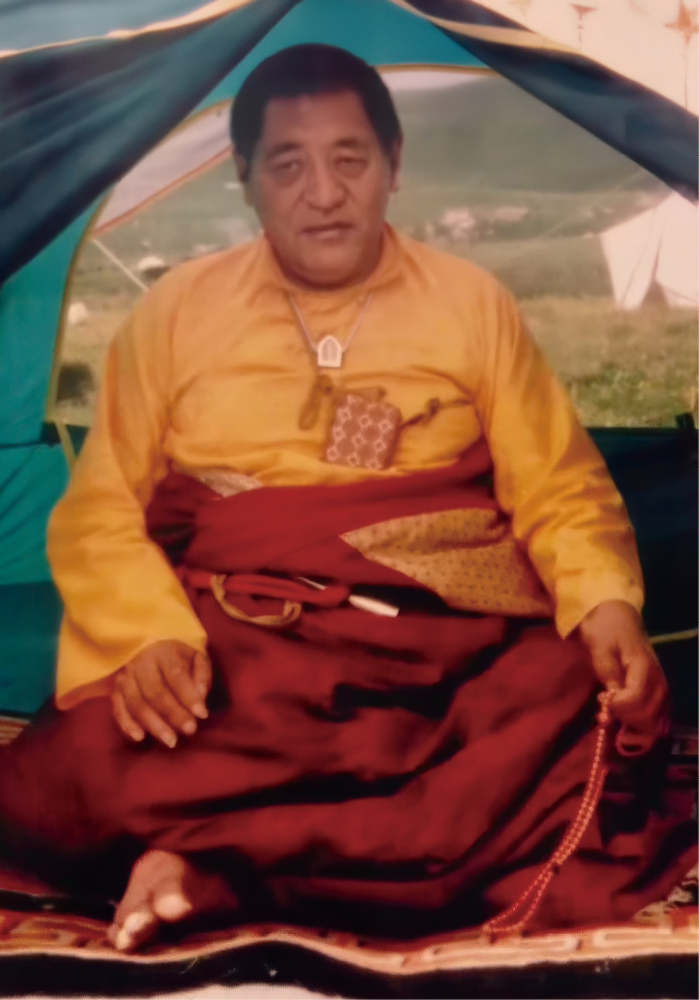

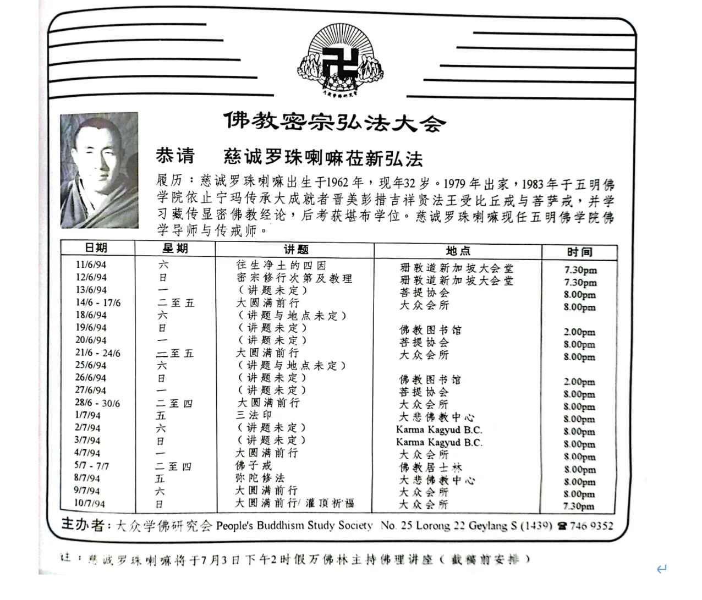

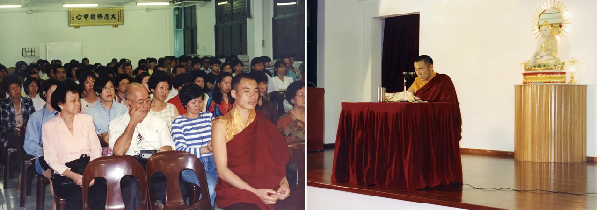

同年12月，新加坡大众学佛研究会（People's Buddhism Study Society）的请法团，从新加坡出发，飞往成都，随后历经三四天的颠簸路程，终于到达喇荣。对于习惯了热带气候的他们来说，零下三十度的严寒和高原反应，无疑是一种巨大的挑战。

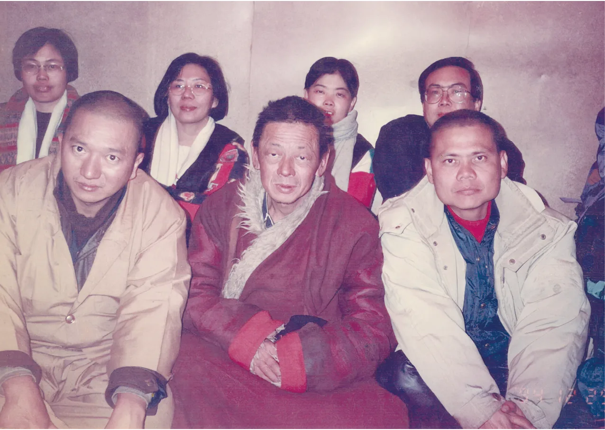

在短暂休息和适应之后，12月29日这一天，请法团向法王递交了邀请函，诚恳地祈求他老人家前往新加坡弘法，并特别邀请慈诚罗珠堪布作为随同翻译。法王在仔细阅读邀请函并了解了一些情况后，欣然答应了。他们请求法王在新加坡赐予灌顶、文殊法门以及其他大圆满法。经过深思熟虑，法王表示，如果签证办得下来，各方面因缘具足，他将为新加坡信众传授《文殊大圆满》和《大圆满心性自解脱》。

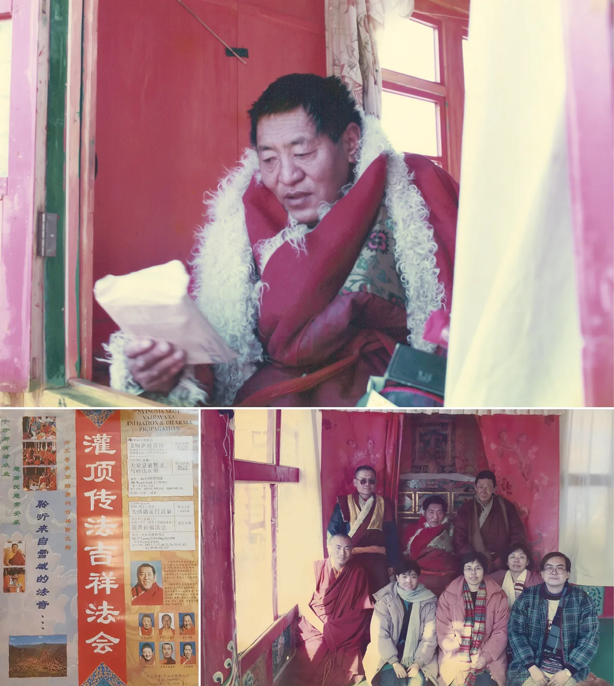

为了确保此次弘法的顺利进行，请法团的一部分成员立即返回新加坡，开始着手筹备相关事宜，包括制作宣传海报、安排接待和法会场地等。与此同时，另一部分成员选择留在学院进行闻思修行。

出国前的准备

1995年1月1日，法王私下召集了索顿喇嘛、热巴医生、慈诚罗珠堪布及我，透露了这则特别的消息：“如果一切顺利，我计划于今年5月前往新加坡弘法。这可能是我此生最后一次出国。”

回顾起1990年我们一同前往印度的完美之旅，法王希望再次带上当时的所有成员。因慈诚罗珠堪布之前去过新加坡并受到了邀请，他也将陪伴法王前往。法王以轻松愉悦的语气说：“我们要开开心心地去弘法，时间应该不会太长。如果条件允许，还可能会去附近几个国家。至于费用，新加坡的道场已经答应负责。当然，如果你们中有人不愿意去，完全可以自由选择。”

听了法王的话，我们每个人都感到无比的兴奋，谁也不愿错过与法王同行的珍贵机会。尤其是索顿喇嘛，他对再次有机会陪同法王出国感到特别激动。我们纷纷表示愿意随行。

法王随后安排了此行的具体分工：热巴医生如往常一样负责照顾法王的健康；索顿喇嘛负责法王的日常起居，尽管新加坡的道场已经做了安排，但他的角色依然不可或缺；慈诚罗珠堪布和我将担任法王的翻译，并处理一些日常事务，包括与邀请方的沟通和日程安排等。

由于慈诚罗珠堪布对新加坡的出国手续较为熟悉，他负责这方面的准备工作。同时，我开始着手翻译《文殊大圆满》和《大圆满心性自解脱》的法本。在一次私下讨论中，我们一致认为法王此行非常难得，应该详细记录下这些宝贵的时刻。为此，堪布准备了他在新加坡购买的小型摄像机，而我则新购一部高质量的相机。在经过咨询和比较后，我选择了一款当时广受好评的日本理光（Ricoh）相机。

鉴于我负责汉僧的管理和教学，且听法的人数日益增多，我不能像以往那样轻易离开。因此，在出国之前，我安排益西彭措堪布开始为汉僧传讲《般若摄颂》，并让其他汉族堪布堪姆讲解《入菩萨行论》。

在紧张的四个月准备期中，我们倾尽全力，确保每一个细节都被周到地考虑和安排，满怀期待与法王出行的每一刻。

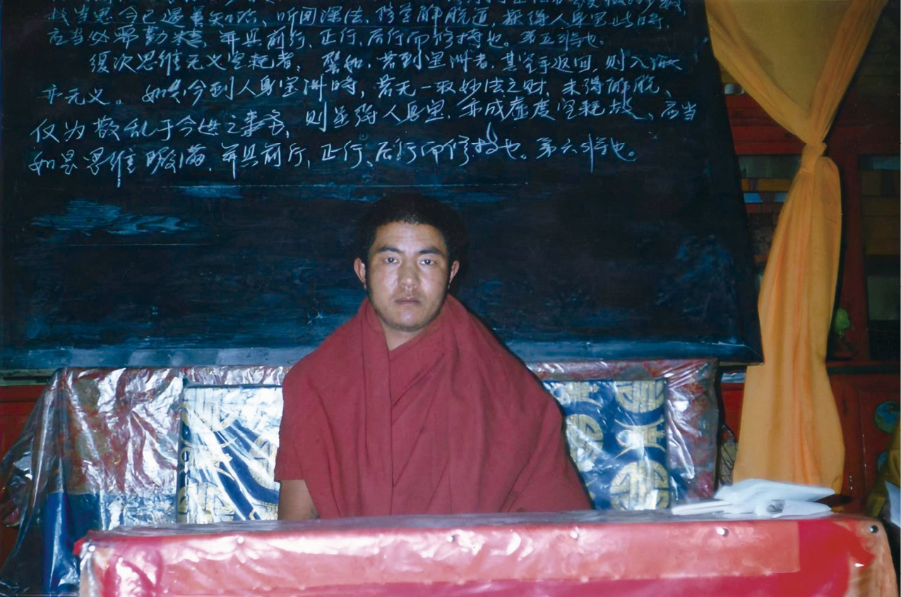

首届“十万持明大法会”

在前往新加坡之前，法王做出了一个重大的决定：在喇荣的觉姆经堂，举行首届持明法会。法王说：“这个持明法会，旨在引导人与非人趋向正法，获得解脱。法会将在每年的藏历神变月举行，从新年初一开始。希望它能够像藏地的新年燃灯法会一样，成为具有重大意义的佛教活动。”

消息一经宣布，迅速吸引了来自世界各地的出家人和在家信众，包括藏地各大寺院的高僧大德，也纷纷开始准备参与。随后，法王幽默地指出：“学院的许多大德还在若无其事地静静坐着，但我发现，来自十方刹土的勇士和空行得知喇荣将举行持明大法会后，都急匆匆地赶来。今年，参加的人和非人加起来，必定超过十万。此后，这个法会可定名为‘十万持明大法会’。”

由于这次法会非同寻常，法王在多个场合频频提及它的功德，并表示，如果第一届法会举办得成功，将为未来弘法利生创造特殊的缘起。因此，学院根据当时的条件，为法会做了充分准备，堪布们也亲自接待来自各地的高僧大德。

藏历一月初一，也就是公历3月2日，法会如期举行，场面极为壮观，信众无不为之震撼。尤其是身披黄色袈裟的僧众遍布山坡，金光闪闪，耀眼夺目，似乎连阳光都显得逊色。有一天，法王提到：“昔日，文殊菩萨在上方世界的尊胜宫，为帝释天等传讲了密法，有十万众生共同成就；观音菩萨在下方世界的龙宫，为娑伽罗龙王传讲了密法，也有十万众生共同成就；金刚手菩萨在炽燃火焰山为五贤者传授了甚深续部，国王匝等获得持明果位。正如他们一样，我也有此缘起。依据《应成根本续》中的‘尔后具慧者受持’等授记，如果我举办十万持明法会，连同十万眷属一起，将共同抵达持明地。

本来，这个缘起的时机已至，但由于所化众生的福报尚浅，加上魔众的强大阻碍，缘起未能完全圆满，尤其是开启十三大伏藏门的缘起遭到破坏。然而，在雪域大德们和各界人士的关怀下，通过广做佛事、祈祷发愿，这次十万持明法会终于得以顺利举行。亲自参加的僧人超过三万八千，再加上有形与无形的持明众，共计十万，这实在可喜可贺。

此法会依观音九本尊的甚深修法来修怀业，唯一目的在于弘扬佛法、利乐有情，尤其是为藏地雪域的众生铺就解脱之路。同时，关于喇荣佛法的住世时间，根据列绕朗巴和第一世敦珠法王的授记，未来仍能延续三百年左右。对此尽管有许多佛事可做，但最重要的是深修怀业的十万持明法会。如果这一法会能够持续不间断地如理举行，即便未来我不在了，这个佛学院也能够在三代以上广兴佛法。佛法是否能长久住世，关键就在于这个法会。因此，大家必须倍加重视，积极参与。”

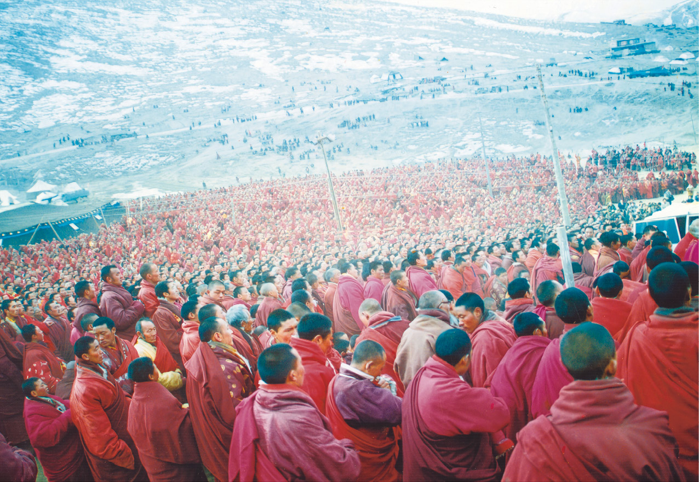

最终，持明大法会举办得非常圆满，现场更是出现了诸多瑞相，甚至神奇的舍利从天而降。当年怀业坛城中的甘露丸，被誉为“九五大自在丸”，以其强大的加持力而声名远扬。法王法脉中的一些弟子，在弘法利生方面展现出非凡的能力，或许也与此法会的加持力密切相关。

至今，十万持明大法会已经举办了三十届，并从未中断。尽管规模不如初时宏大，但依然有大量众生与其结缘，继续在法会的加持下，走向解脱的彼岸。

新建“幻化网坛城塔”

持明大法会成功举办后，法王为了给众生建立一个顶礼、转绕、忏悔的殊胜对境，于是特意在学院西北方的山顶选定了一处宝地，亲自规划并决定建造一座“幻化网坛城塔”。

坛城塔的布局，法王以《幻化网》根本颂及其注释、修法仪轨为依据，经过深思熟虑而精心构建。塔内安放了四十二尊寂静本尊，每一尊都神圣庄严，令朝拜者由衷地生起信心。围绕塔身的二十三座殿堂，分别供奉着藏传佛教八大修派、汉传佛教、南传佛教的大德祖师、三根本及护法等。与此同时，法王将一百尊自己珍藏的古印度佛像和伏藏佛像、宝箧、发愿以遗体治愈顽疾的天法门吉多杰活佛舍利等无量圣物，悉数隐藏在坛城塔中，使其更具强大的加持力，成为积累资粮、清净业障、祛病禳灾的殊胜所依。

为了这一伟大工程，法王与门措空行母倾注了数百万人民币，毫无保留地奉献其财力与心力。法王曾引用《无垢忏悔续》中的教义指出：“无论是谁，只要见到此坛城塔，哪怕只是见过一次，也必定不会堕入恶趣。”

法王还阐述了转绕坛城塔的四种等级与相应功德——

下等者：转绕一百圈，能关闭恶趣之门，转生善趣；

中等者：转绕一千圈，能够超越三界轮回，获得解脱果位；

上等者：转绕一万圈，将在极乐世界或其他净土，获得菩萨果位；

最上等者：转绕十万圈，将迅速圆满佛果，成就无上菩提。

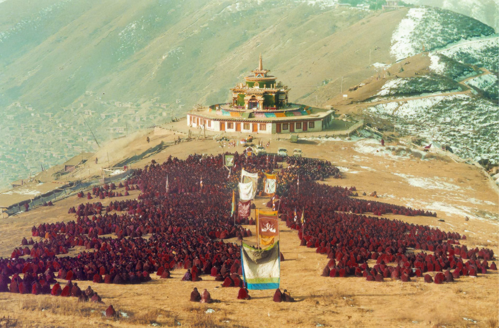

法王特别强调，转绕坛城塔的每一圈，都需要结合顶礼与念诵百字明，数量与转绕圈数一一对应。例如，转绕一百圈，需顶礼一百次，念诵百字明一百遍。如此，每一次的转绕，都将积累极大的功德，获得无量的加持，这是快速成就的难得法门。正如《深法寂猛密意自解脱灌顶》所云：“凡见坛城者，七世之内必能解脱证果。”

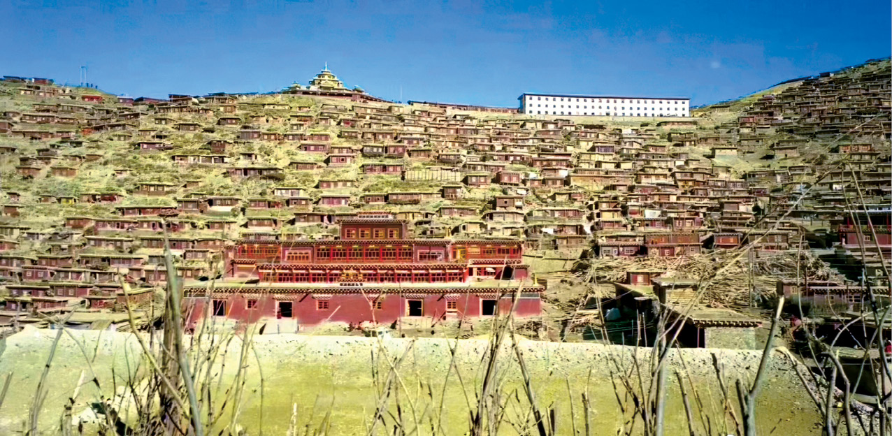

在当年，我与绕桑管家共同负责二十三座殿堂的建造及其他附属建筑，如底层的转经轮、坛城宾馆等。经过两年的精心修建，庄严宏伟的坛城塔终于竣工，巍然屹立于山巅，气势非凡，周围的环境也在其加持下愈发清净庄严，宛如一片净土，给人以心灵的宁静与力量。

从那时起，每天都有成千上万的信众来此朝拜，虔诚的步伐络绎不绝。即便是一些没有宗教信仰的游客，也会在见到、进入或转绕坛城塔后，自然而然播下解脱的种子，与佛法结下殊胜的缘分。

举办极乐法会

年初，法王前往喇荣附近的多个地方，连续举办了几场殊胜的极乐法会，勉励大众发愿念诵弥陀名号，修持净土法门。

3月23日，法王来到色达上方的克戈乡，在附近的草原上，举行为期三天的极乐法会，传授了“阿弥陀佛”灌顶，并详细讲解了往生净土的四因。

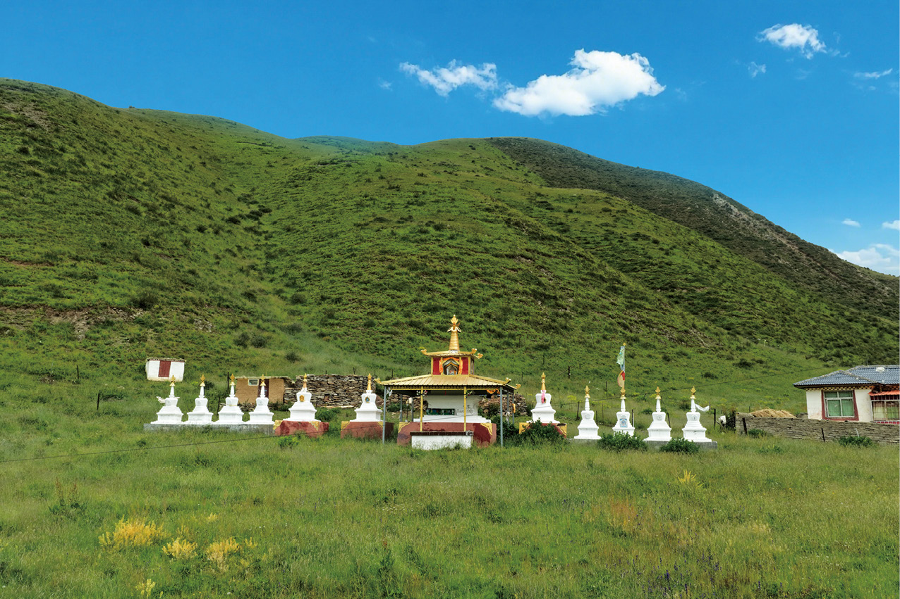

克戈乡的法王法座

法会结束后，法王前往色达的冈扎，为新建的吉祥增善寺加持地基，并为当地护法神供煨桑，念诵了《莲师除障法》和佛陀成道时的降魔咒。此外，为了增上当地的福报，法王还念了大量的地藏菩萨名号。冈扎的信众曾多次供养喇荣的僧众，法王对此表示感谢，并为信众们做了开示。

接着，他来到扎玛朵，与年轻时在石渠求学的道友朗仓多杰重逢。两人共在白色帐篷中用餐，回忆了当年求学的往事。随后，法王为当地信众做了开示。

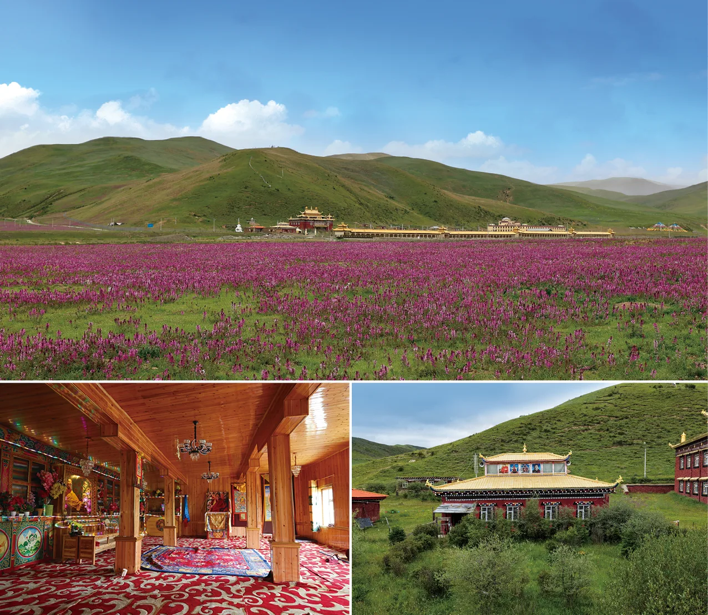

冈扎的法王纪念堂

3月29日，法王应秋吉尼玛活佛等人的邀请，前往炉霍的玲珑寺，受到热烈欢迎，迎接仪式人山人海。次日开始，法王在这座寺院中举行为期五天的极乐法会，传授了“阿弥陀佛”灌顶、“观音菩萨”灌顶、“时轮金刚”略灌顶，教导大家如何通过四对治力忏悔罪障，净化身心。

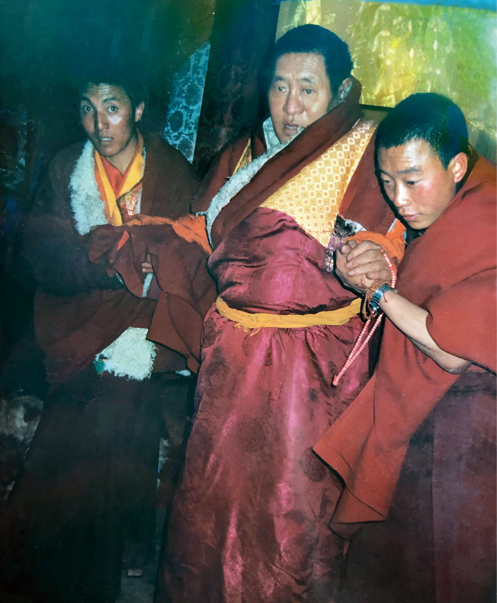

在玲珑寺，恰达堪布与丹增诺吾活佛扶法王登上法座

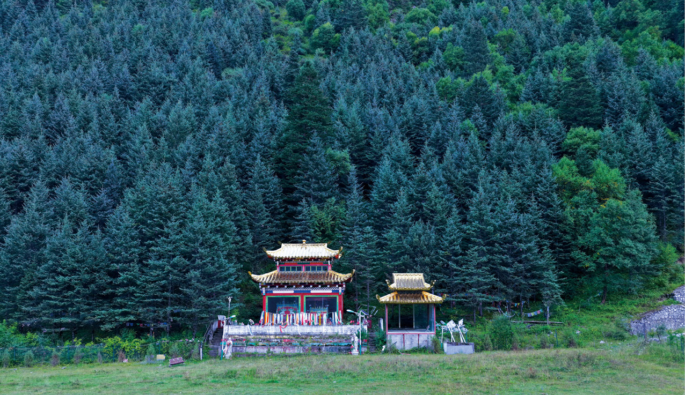

玲珑寺的法王纪念堂

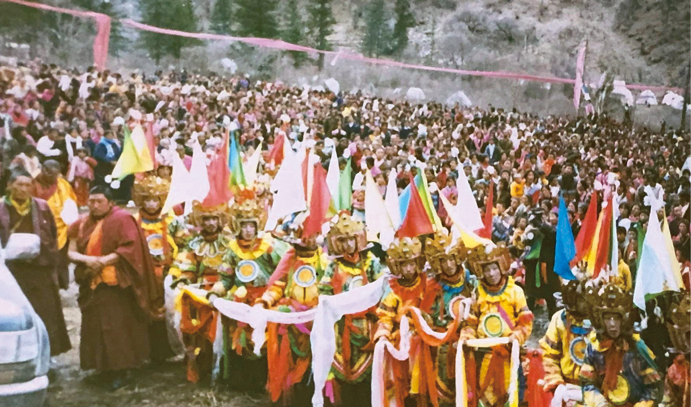

玲珑寺信众欢迎法王到来

4月4日，法王抵达木娘寺，住了一夜，并为寺中的僧众和信众开示。接下来，从4月5日开始，法王在该寺附近的释迦草坝上，举行为期五天的极乐法会，传授了“阿弥陀佛”灌顶，并讲解了麦彭仁波切的《净土教言》。

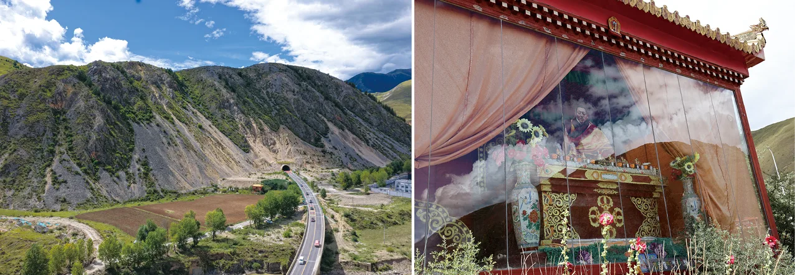

木娘寺附近的释迦草坝

4月10日，法王前往新龙，入住吾瓦寺，并为寺中的僧众和信众开示。

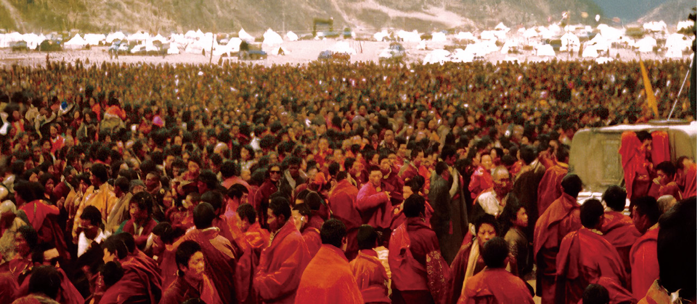

新龙的极乐法会现场

4月11日，法王继续前往通宵寺，在通宵草原上举办了为期八天的极乐法会。当时，来自当地六十多座寺院的僧众、八大部落的信众，列队欢迎法王的到来，场面热烈而隆重。来自安多、卫藏等各地的信众纷纷前来参加法会。

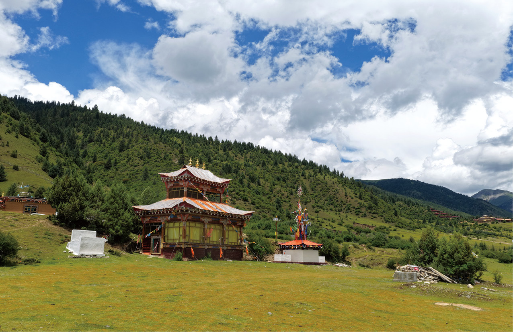

通宵草原的法王纪念堂

法王传授了“阿弥陀佛”灌顶，讲解了《净土教言》，并深入阐述往生净土的四因，特别强调了信心与意乐的重要性，同时提醒大家要谨慎防范舍法罪和五无间罪。

法王还引用菩提金刚的授记说，凡是与他结缘者，皆能往生极乐世界。他勉励大家要真诚忏悔，虔心念佛，为往生净土创造最殊胜的因缘。法会现场的信众纷纷发愿，立誓念满一百万遍弥陀名号，以求往生极乐刹土。

在法会期间，许多人亲眼目睹天上降下舍利，出现了许多不共的瑞相。这场法会是法王一生中三次最大的极乐法会之一，参与人数达到数十万，场面壮观，盛况空前。

正如经中所说：“无论是如来安坐之处，或行走之地，或站立之所，或如狮子般卧睡之地，我们都应以头礼敬这些圣地。”法王在各地传法的每一个法座，如今都被当地寺院悉心保护，同时建造了纪念塔、纪念堂，供后人回忆当年的弘法盛况。时至今日，这些地方依然是信众朝拜和瞻仰的圣地。

4月20日，法王回到了喇荣，利用短短两天的时间，为僧众传讲《佛子行》。随后，他告别学院僧众，前往康定住了一天，之后在成都稍作停留，随即正式开始了他的弘法之旅。

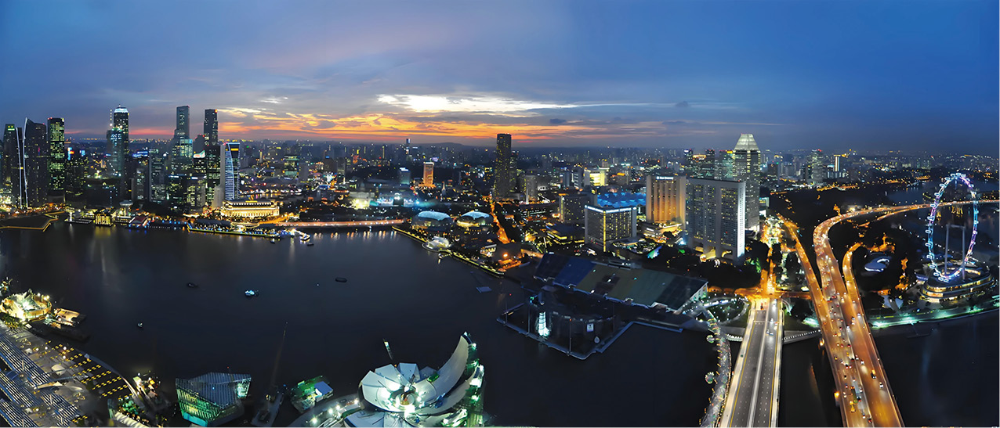

Singapore
