# 马来西亚

第二站

5/18-5/29

行程

Schedule

5月18日，抵达马六甲

5月19日，在马六甲密宗佛教会，

传授“龙钦宁提持明总集”灌顶

5月20日，接见信众并开示

5月21日，入住华美酒店

5月22日，《文殊大圆满》第一节课

5月23日，《文殊大圆满》第二节课

5月24日，《文殊大圆满》第三节课

5月25日，《文殊大圆满》第四节课

5月26日，参观青云亭

5月27-28日，抵达吉隆坡，传授“阿弥陀佛”灌顶，

传讲《忠言心之明点》

来到噶举派中心

在新加坡的传法圆满后，应马来西亚佛教团体的邀请，法王于5月18日下午启程前往马六甲。

当天，新加坡的佛友们自发分成两拨，一部分亲自送我们前往马六甲，另一部分则陪伴我们一起到海关。过境手续相对简单，因为新加坡与马来西亚仅隔一条狭窄的海峡，完成入境检查后，我们坐上车，驱车一个多小时便抵达了目的地。

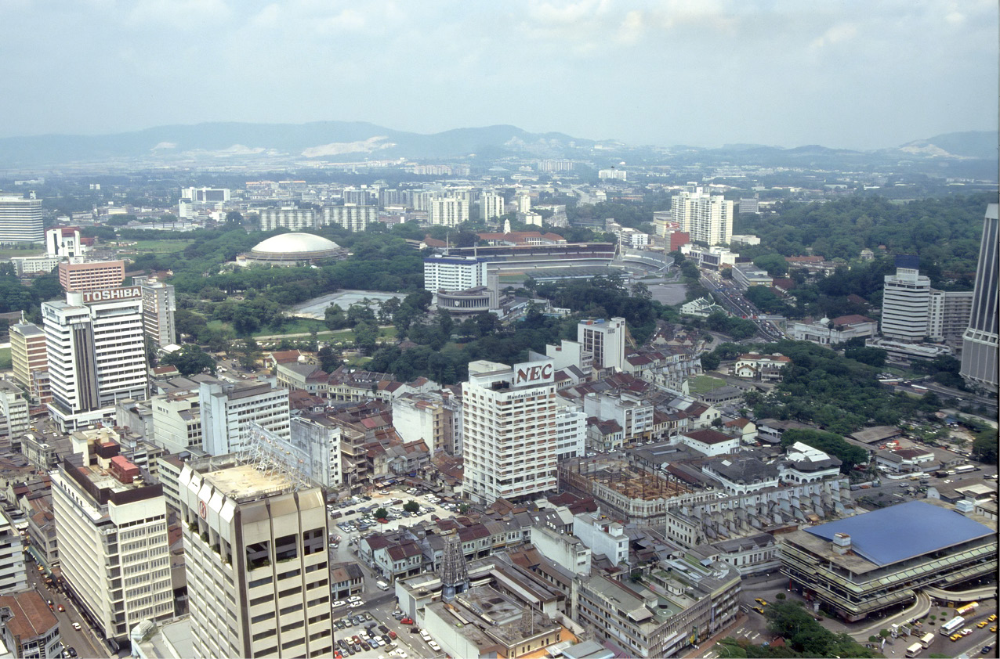

这是我们第一次踏上马来西亚的土地，发现这里比新加坡大得多，按面积计算，马来西亚大约是新加坡的459倍。新加坡与马来西亚之间的贸易关系紧密，几乎所有的食品，甚至是饮用水，都依赖从马来西亚进口。几十年来，新加坡的淡水供应始终依赖马来西亚。

傍晚六点左右，我们到达了马六甲，入住了马六甲密宗（卡玛迦如）佛教会（The Karma Kagyu Dharma Society）。法王将在此展开为期两天的弘法活动。这个会所虽然隶属于噶举派，但其学员也依止顶果钦哲法王等宁玛派的上师，修学各派的教法。会所常常迎请不同宗派的高僧大德来传法，气氛温暖而包容，令人倍感亲切。

会所是一栋双层的小楼，宽敞的院子里早已挤满了前来听法的信众。由于大殿空间有限，许多佛友在院子的东西两侧铺上席子或坐垫，准备接受佛法甘露。大门通向大殿的道路上，铺着一条红色地毯，两旁站着恭敬合掌、含着热泪的居士们。对当地而言，这是一场极为隆重的盛会。

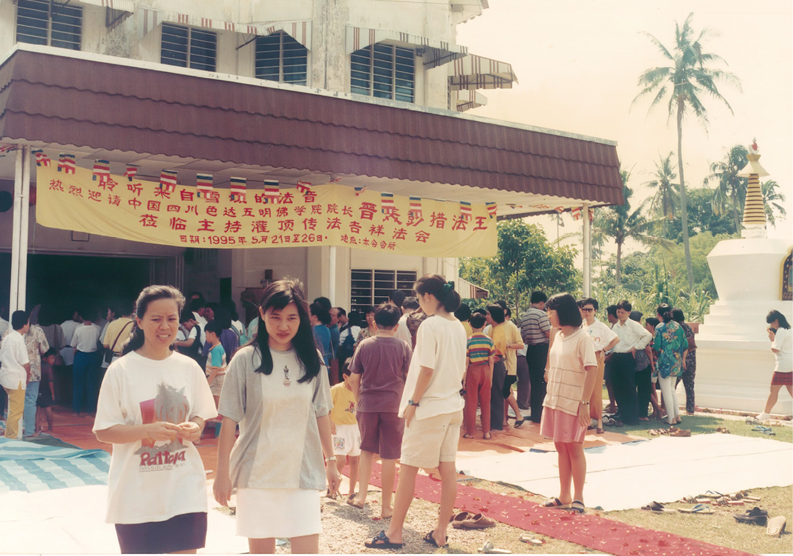

大殿内，庄严的法座高高摆设，门口悬挂着一条黄色横幅，几行红字赫然写着：

“聆听来自雪域的法音”

“热烈迎请中国四川色达五明佛学院院长晋美彭措法王莅临主持灌顶传法吉祥法会”

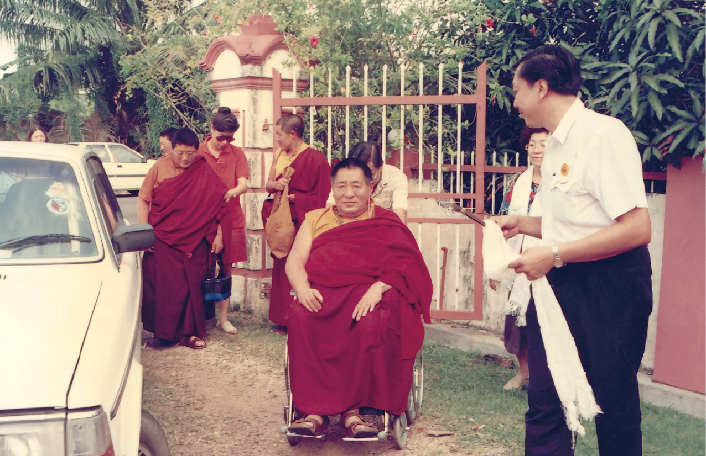

马六甲密宗佛教会的陈主席迎接法王

当法王缓缓下车时，信众们用最热烈的方式迎接他。梵呗的旋律在空中回荡，花瓣如雨般撒落在法王的脚下，所有人的眼中都闪烁着敬仰与欢喜。法王为在场的信众做了简短的开示，并亲自为每一个人加持。

5月19日，法王在会所内为信众灌顶。原本安排的是“文殊菩萨”灌顶，但法王通过观察缘起，决定改为“龙钦宁提持明总集”灌顶。

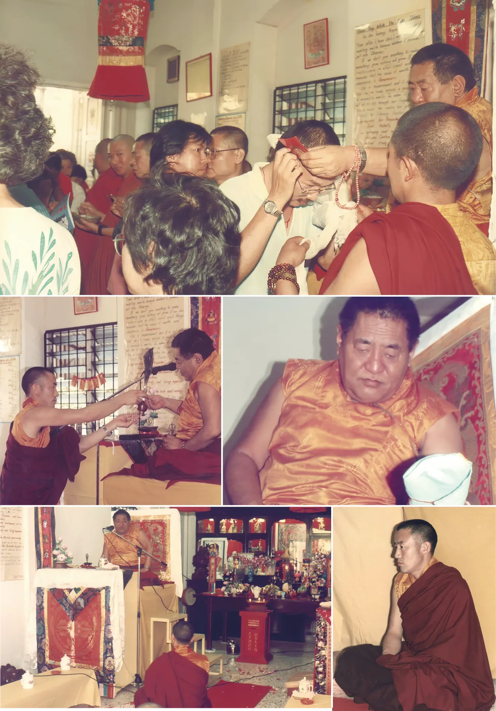

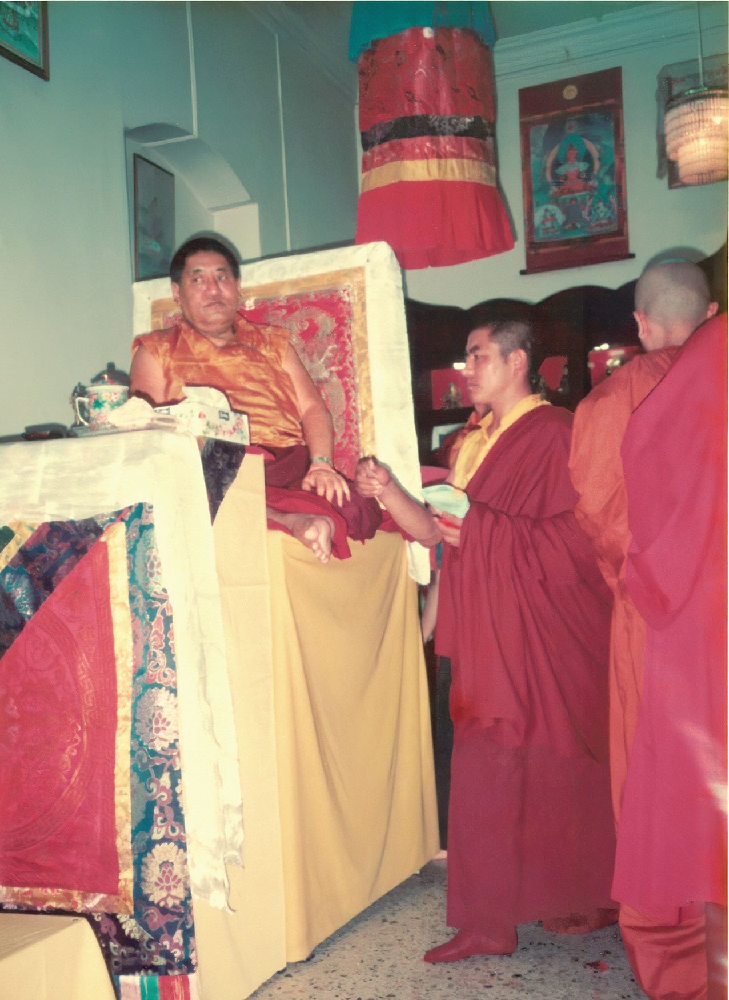

5月20日，法王接见信众并进行开示，讲述了信心、悲心、智慧的重要性。许多信众是远道而来，他们得知法王驾临，纷纷抽出时间赶来，渴望获得他的加持。法王不仅为大家开示佛法，还慈悲地为信众送上祝福。

多年后，这个会所虽已不再使用，但对许多法王的弟子而言，它依然是一个令人铭记的殊胜之地，承载着无数美好的回忆。慈诚罗珠堪布后来前往马来西亚时，也特意前去参拜过。

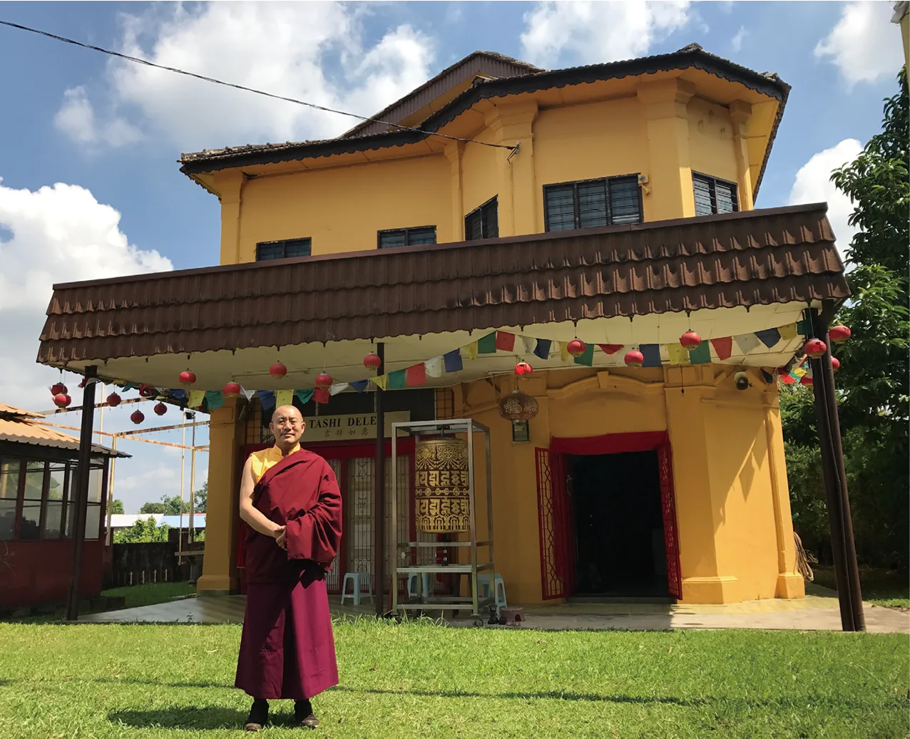

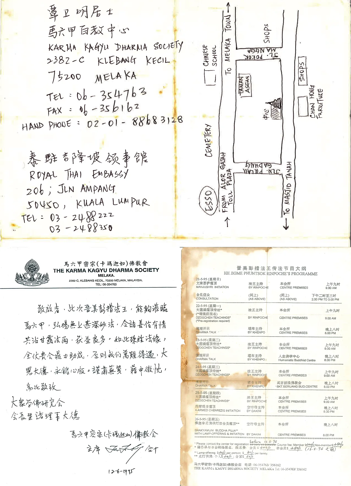

第一次住五星级宾馆

5月21日，马来西亚的佛友们安排我们入住华美酒店（Wah May Hotel），这是一家五星级宾馆。

其实，法王无论是前往汉地还是出国，如果住处由对方安排，并不会要求条件过于奢华。即便住在酒店，他的要求也十分简单，只需楼层不高、配有卫生间，且环境干净即可。大多数情况下，法王更倾向于住在居士家中或佛教道场，以免给他人带来经济压力。然而，这次在马来西亚，佛友们主动提出要让我们住得更好一些，法王便同意了。

当年，华美酒店的一间房间，报价500马币一晚，但出于对佛教徒的善意，酒店老板特意将价格降低至250马币。按当时2:1的汇率折算，相当于人民币500元。在30年前，这样的价格无疑是相当惊人的。

对于法王和我们随从人员来说，这都是第一次住五星级宾馆。刚踏入酒店时，豪华的装修和高档的设施令我们感到耳目一新，大家拍了几张照片，记录下这段特别的时光。但随着时间推移，我们渐渐发现，五星级的待遇和世间的妙欲，终究不过是浮光掠影。那份初时的震撼也逐渐被平淡取代，毕竟，心中的法乐远比任何外在的享乐更加持久。对我们而言，最重要的并不是享受这些奢华，而是看到上师能够得到一些轻松与安宁，这使我们感到更加欣慰。

在酒店期间，由于离海边不远，我和慈诚罗珠堪布经常去海边散步。堪布对大海有着特别的喜爱，他总是情不自禁地停下脚步，静静凝视着浩瀚的海面。看到他如此投入，我忍不住打趣道：“你这辈子如此钟情于海，是不是前世曾在海里待过？”虽然我对大海的感情不如他那般深厚，但每次站在海边，感受到那份宁静与辽阔，也不禁为之心旷神怡。

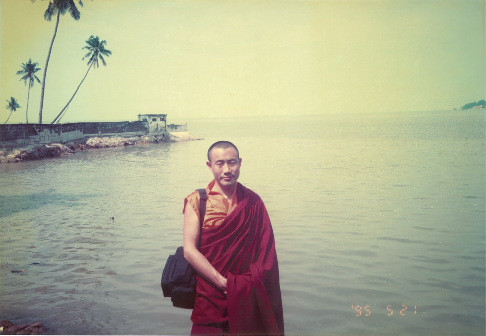

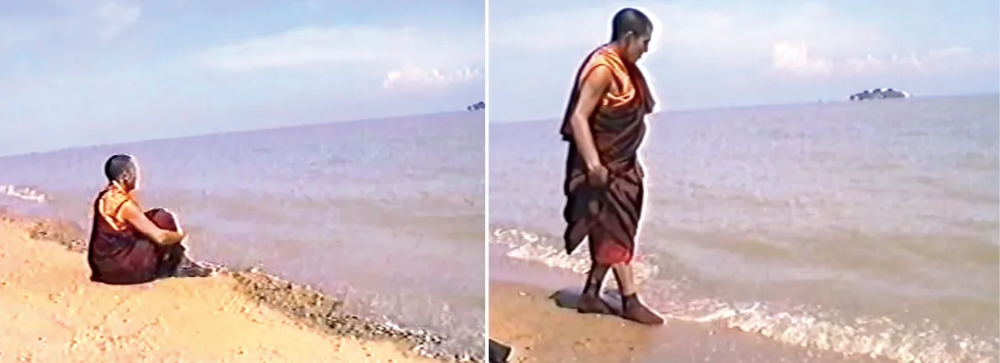

有一天，我们在酒店里翻阅报纸时，看到了一条引人注目的新闻：著名歌手邓丽君在泰国清迈去世。她是那个时代最具影响力的华语歌手，深受世人喜爱。法王常常关心时事，我便将这则新闻告诉了他。

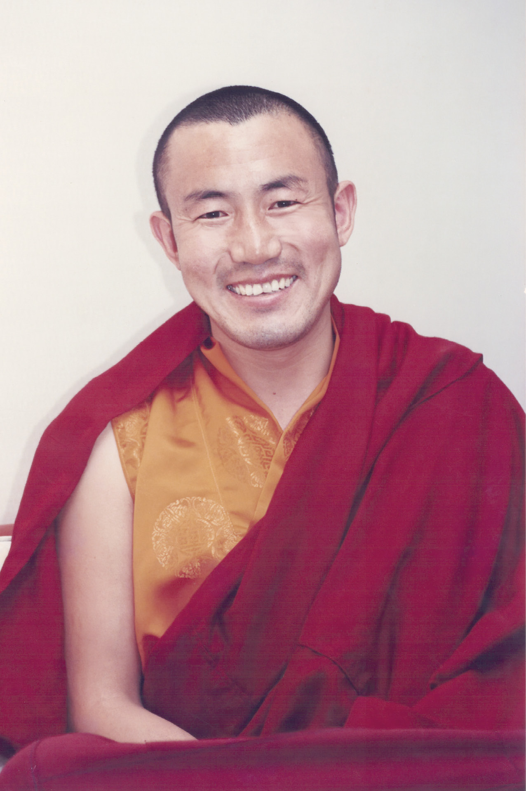

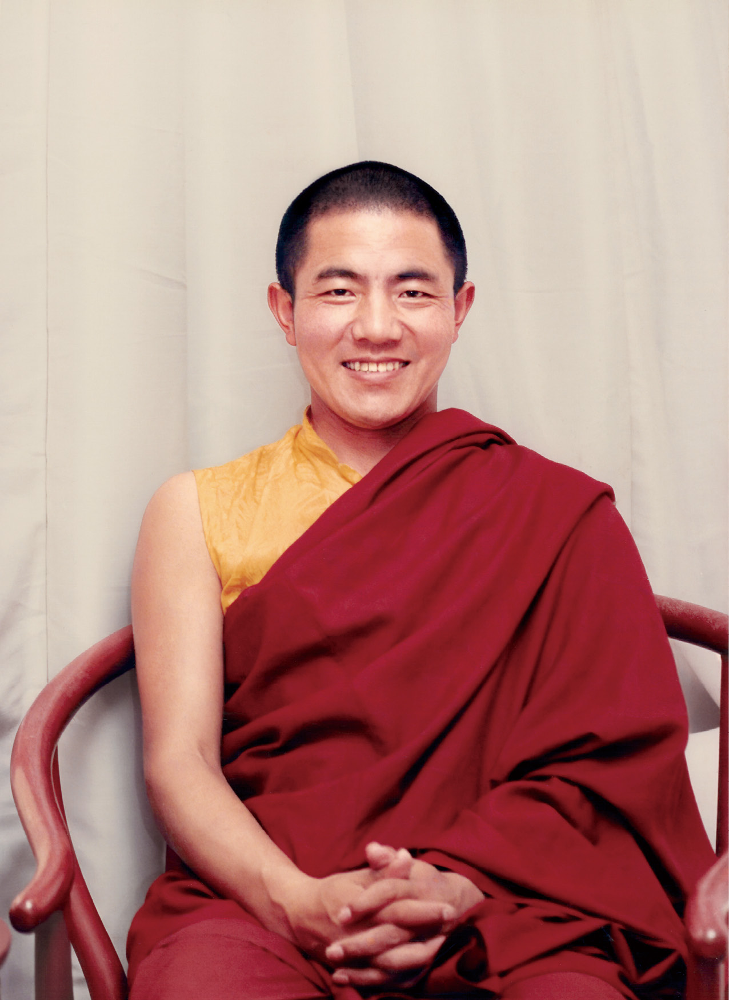

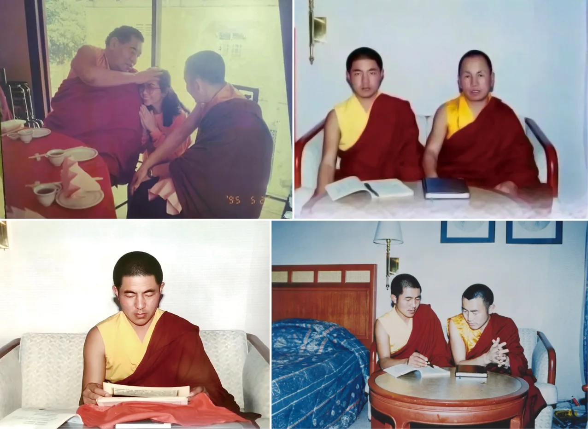

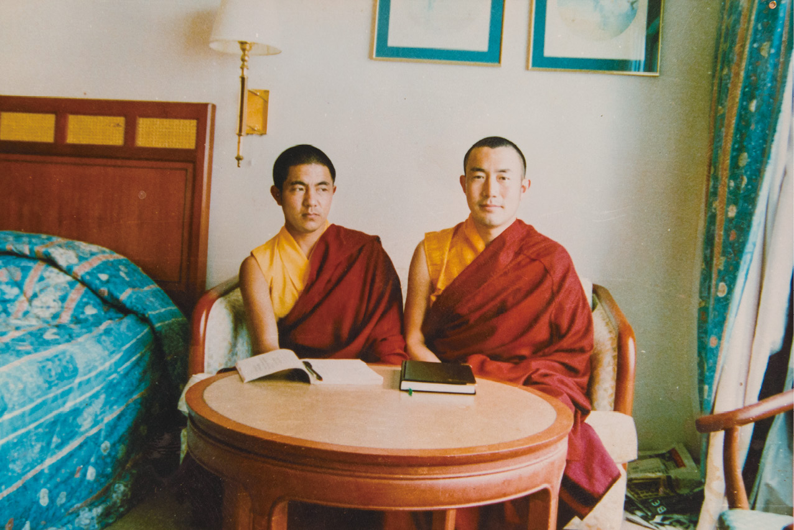

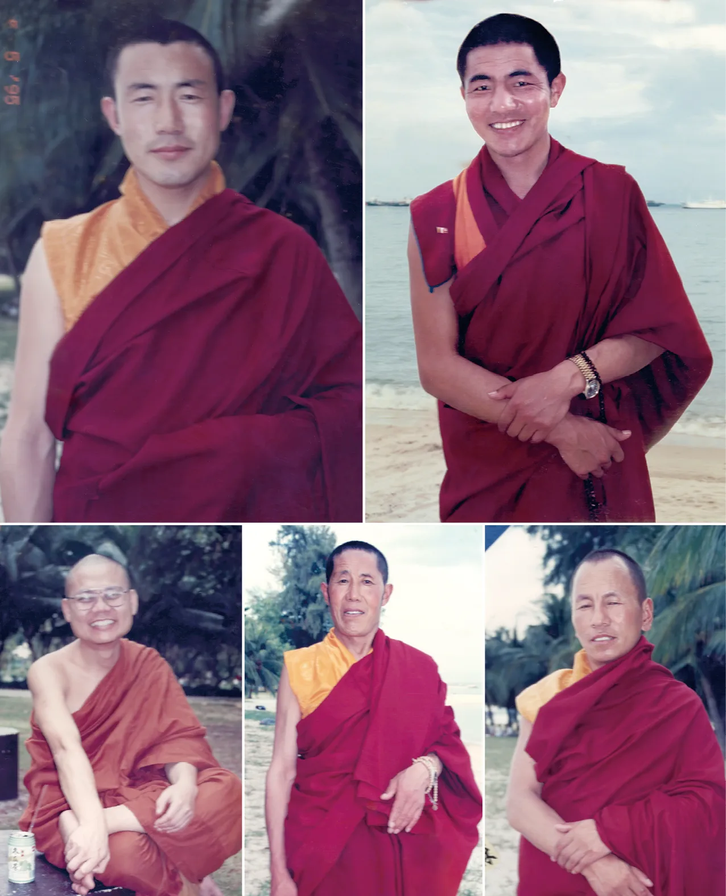

虽然在马来西亚的时间并不长，但回想起来，像法王这样伟大的菩萨，无论走到哪里，即使在某个地方住上短短一夜，也定会给当地众生带来福气。可以说，法王曾经踏足的地方，都会留下特殊的加持；他到访的寺庙和道场，无论岁月如何变迁，都会留下不可磨灭的印记，成为历史的一部分。

这一切，或许就是佛法的力量。

《文殊大圆满》第一节课

5月22日，法王在华美大酒店开始传授《文殊大圆满》：

请在心里观想：“为了天边无际的一切众生，我要获得无上正等正觉佛果如意宝，为此听闻殊胜佛法并实地修行。”由此，发起无上菩提心来听法。

现在所听闻的法是《文殊静修支分引导文·手中赐佛》。

“文殊静修支分”的意思是，文殊菩萨有寂静和忿怒两种形相。其中，寂静文殊又有白、黄、红、黑、蓝等多种修法。据可靠的古代文献记载，修黄文殊可以获得深邃的智慧，修白文殊可以获得敏锐的智慧。而此处所讲的，是黄文殊的修法支分。

“支分”一词从总的续部来看，包括见解、等持、行为、坛城、灌顶、誓言、修行、供养、事业、手印、密咒等十一种续事。抉择其中任何一项，都可以被视为支分。

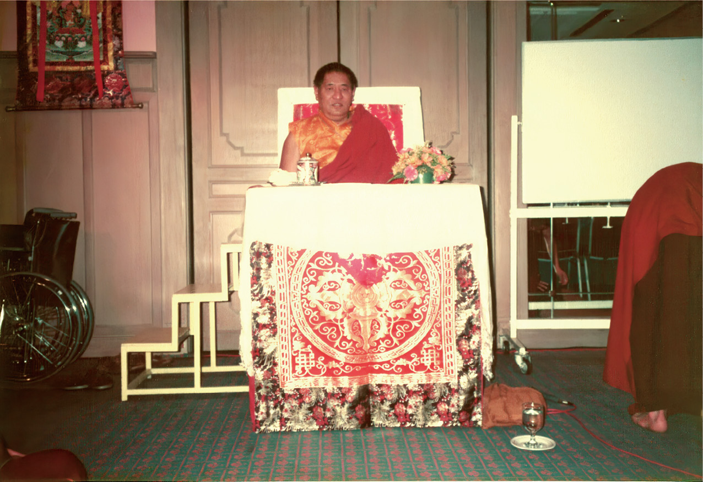

从大圆满的角度来看，有两种讲法方式：一是广大班智达派的讲法方式，即依靠教证、理证和窍诀广泛阐释，全盘托出密续的隐义，理清错乱的内容，阐明不清晰的部分，将零散的内容汇集在一起；二是甚深古萨里派的讲法方式，直接揭示甚深的窍诀，宣说能使一位具缘者成佛的完整道。这里采用的是甚深古萨里派的讲法方式。

之所以叫“手中赐佛”，意味着当下把佛果交到你手中。一般来说，佛法如意宝分为共同乘和大乘两种法脉。共同乘的修行人只承认最终获得阿罗汉果位，而不承许获得佛果，也不为此精进。因此，如果说“最终目标是成佛”，这就表明是大乘法门。大乘中，有认为成佛需经过三大阿僧祇劫的，也有认为经过三世或十六世就能成佛的。而此处更为殊胜之处在于，当下就把佛果赐予你手中，因此称为甚深引导文“手中赐佛”。

> 觉空本来怙主妙吉祥，证悟无离无合而顶礼。

通常而言，“文殊”有多重含义：一切现有本来即是文殊的本性，这称为分别识聚文殊的自性。根据诸大续部的解释，所有高山都是文殊的自性，所有粗糙的东西都是金刚手的自性，所有柔软的东西都是观世音的自性。了知文殊的这种自性，叫做“分别识聚幻化网”。当现前了文殊的这种自性，最终显现出具有面、臂、身相、智慧的游舞，这就是“不了义相幻化网”。一切法清净平等、与真谛无别的究竟法性，才是“了义幻化网”。现在瑜伽行者如实修行其意义，即称为“本尊与分别念无别幻化网”或“文殊智慧勇识”。

在这一切之中，若观察分析自己的心，就会发现它本来就是无所成立的空性，而在空的同时明分不灭，是现空双运的自性，这就是真正的了义怙主文殊菩萨。他并非先前不存在，而是通过修行力聚合而来，也不会因为业和烦恼而远离，而是以与自己这颗心不可分割的方式存在。

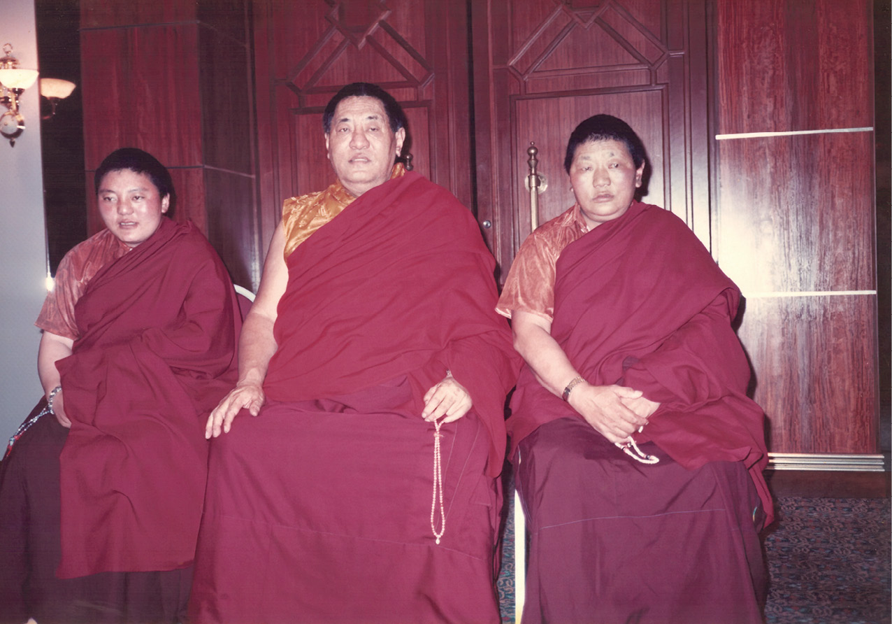

一般而言，顶礼可以分为三种方式：上等者是通过见解而证悟的顶礼，中等者是通过修持而串习的顶礼，下等者是通过行为而敬信的顶礼。这里所说的“证悟无离无合而顶礼”，指的是上等者通过见解而证悟的顶礼，也就是，证悟了无离无合的境界，在此称之为“顶礼”。

> 我为心子开示精华要，汝亦切莫舍弃当实修。

通常而言，具有善巧方便、大慈大悲的我等本师佛陀，随顺所化众生的界性、根基、信解、意乐的不同，宣讲了八万四千法门。这所有法门的究竟要点，归根到底就是这个大圆满阿底瑜伽。

在结集十二位大圆满本师所说的教法时，持明嘎绕多吉将大圆满续汇集为六百四十万偈。他的弟子蒋花西宁将其分为外心部、内界部、密窍诀部三大类，并进行明确的阐释。他的弟子西日桑哈大师又将密窍诀部解析为外类、内类、密类、极密心滴类四大类，汇集为耳传与讲传两种法脉。他的弟子大班智达布玛莫札将教法汇集为《金文》《璁玉文》《砗磲文》《镶文》四部甚深书函，并明确地作了阐释。之后，莲花生大士将这些汇集成珍宝黄纸、仿纸、灰纸三大类，并解释了所有要点。这些前辈持明者传授的要点，就是所谓的“精华要”，它只传授给如心脏般的你们这些弟子，而不是随便传给其他人。因此，你们应当不惜生命地唯一希求并实修这个法门，以获得究竟的佛果。

《文殊大圆满》第二节课

5月23日，法王在华美大酒店继续传讲此法：

这里所要听闻的法，是大圆满法。实修它分为两部分：净化自相续的前行、在相续中能生起实修境界的正行。

前行又分为三类：一是遵循显宗波罗蜜多乘的方式净化自心，二是遵循密宗金刚乘的一般传统净化自心，三是按照无上光明大圆满自道的方式实修。

第一类的前行，又分为共同外前行、不共内前行两种。共同外前行包括四种厌世心：通过思维暇满难得与寿命无常，断除对今生琐事的贪执；通过思维业因果和轮回过患，断除对后世轮回的贪执。接下来，逐一讲解这四种厌世心。

> 人身难得：诸位有缘者首先应当思维：自己如今已获得了从因缘、比喻、数量观察都极为难得且能成就三士道菩提果位的暇满人身宝，并遇到了具有法相的善知识宣说甚深妙法。在具足此等顺缘之此时，应当反复思维而立誓毫不懈怠地勤修正法。

这里所说的“有缘者”，是指堪为修持这一甚深法要的法器。首先，需要这样思维：暇满人身从因、比喻、数量三方面来看，都是极其难得的。

从因的角度来看，必须守持清净戒律，并以广行布施等众多善根作为助缘，才能获得人身，不可能凭空而得。如果不守持清净戒律，即使广行布施等，也无法得到人身。月称论师曾说：“失坏戒足诸众生，于恶趣受布施果。”如果不受持任何戒律，如男女居士戒或比丘、比丘尼戒等，即使广行布施，也只能感得旁生之身，无法获得人身。因此，获得珍宝人身的根本在于守持清净戒律。而若没有遇到佛法如意宝，就没有机会守持清净戒律。

从比喻的角度来看，正所谓“人天导师佛陀说，犹如盲龟颈恰入，漂于海中木轭孔，人身较此更难得”，就像三千大千世界变成一个大海，海面上漂浮的木轭孔与海底盲龟的颈相遇，这个几率极其渺小，而获得暇满人身比这更困难。其他教典中也提到，获得人身的难度甚至超过在光滑墙上抛撒豌豆而不掉落。

从数量的角度来看，地狱众生如同大地微尘那么多，饿鬼如同恒河的沙子，旁生如同酒糟。而在人天中，不行善业者如夜晚繁星，行持善业者则稀如晨星。

现在，我们已经获得了如此难得的珍贵人身。这个暇满人身不仅难得，而且意义重大。为什么意义重大呢？因为凭借这个身体，我们能够成就小士道、中士道、大士道的任何果位。

小士道的行人，是希望远离三恶趣的痛苦，获得人天善趣的安乐；中士道的行人，是希望解脱轮回的一切痛苦，自己获得究竟安乐的果位；大士道的行人，是以大智慧直接证悟无我而不住于轮回，以大悲心虽证得寂静果位却不堕入寂灭，而是尽虚空际利益众生。如果想成就超越轮回与涅槃二边的佛果，也能依靠这个珍贵人身而达成。

我们不仅获得了具足十八暇满的珍宝人身，而且遇到了具有德相的上师善知识。一般来说，具有法相的上师善知识的功德有很多，但主要体现为三点：一是在摄受弟子的过程中，善于讲解佛法；二是自己有觉受与证悟的修行体验；三是具有能利益所化众生的伟大事业。如今，我们已遇到了这样的具德上师。

当然，仅仅是遇到也难以得到切实利益，但上师已根据每个弟子的根基，次第开启了广大的正法宝藏之门。如果这次不好好修行清净的佛法，以后又如何能获得这样殊妙的身份呢？正如大菩萨寂天所说：“依此人身筏，能渡大苦海，此筏难复得，愚者勿贪眠。”意思是，轮回就如同一片大海，而人身则是能渡过这片大海的优质航船。我们必须依靠这个人身来渡过轮回大海，一旦失去这个机会，就无法再到达彼岸。因此，我们应当反复立誓修行善法。

这就是关于暇满难得的引导。虽然详细的引导文中有许多关于八闲暇和十圆满的解释，但在此只是总结其精要来讲的。

> 寿命无常：思维此身也必定死亡、死期无有定准、死时除正法外一切都无有利益的道理后，应当下定决心迅速勤修善法。

即使我们获得了具足十八暇满的珍贵人身，但它也必定会死亡。只要有生就必然会有死，一旦出生，死亡就不可避免。正如大菩萨寂天所说：“昼夜不暂留，此生恒衰减，额外无复增，吾命岂不亡？”

就像源头中断的水池终将干涸，我们的生命也是有减无增，一直在不断流逝，终将趋向死亡。然而，只是想想必定会死，并不足以成为修行正法的动力。除了动物，只要是个人，都知道自己会死，但却不清楚什么时候会死——可能是明年，也可能是后年，甚至可能是明天或后天，死亡的时间是无法确定的。龙树菩萨说：“寿命多害即无常，犹如水泡为风吹，呼气吸气沉睡间，能得觉醒极稀奇。”意思是，晚上入睡后，在呼吸之间能有机会再度醒来，是非常稀奇的事。为什么说稀奇呢？因为维持生命的条件，主要依靠饮食与衣服这两种，而导致死亡的因素，则有疾病、魔障、火灾、水灾、坠崖、敌人等诸多危难。同时，维持生命的食物也可能因为吃错而变为毒药，为了衣服甚至可能招来仇恨而丧命。因此，死亡的时间是不确定的，它可能随时降临。

死亡时，财富、地位、名声等一切都帮不上忙，我们只能孤零零地空手前往一个陌生的地方。即便是统领数亿人的领袖，也无权带走一个仆人；即使是拥有整个世界财富的富翁，也无法带走一针一线。到那时，唯有正法才真正对我们有益。如果在死亡来临之前未曾修行正法，心中必然充满悔恨与悲伤，因此必须赶快修行正法。这样观想并立下誓言。

这就是关于寿命无常的引导。

> 因果不虚：一切众生死后都并非一无所有，而必将随黑业白业无欺感受痛苦与安乐。

如果死后一切都消失，就像火灭了或水干了一样，那倒是简单。但事实并非如此，我们必定会根据自己所造的善恶业，感受相应的果报。佛陀曾说：“众生之诸业，百劫不毁灭，因缘聚合时，其果定成熟。”也就是，众生所造的善恶业，即使经过百劫也不会虚耗，当因缘聚合时，必定会无碍地成熟果报。

我们在轮回中，本来无“我”，却执著有“我”；本来“我”不存在，却不断强化对自我的认同。只要我执存在，就会因其积累的一切不善业，投生于地狱、饿鬼、旁生等恶趣。同样，如果行持布施、持戒等善业，则能投生于天界、人间等善趣。若能现量证悟无我，那依靠所行的一切善业，暂时会获得声闻缘觉的果位，最终会获得无上佛果。

因此，应从内心深处相信因果永远不会有欺惑。对于哪怕极微小的善恶业，也应当谨慎取舍，如此才能做到临终无悔，觉得自己已成就了清净的善法。最理想的是不造恶业，即使造了，也应完全忏悔清净。有了这样的把握，获得人身才有价值，这才称得上是名副其实的佛教徒。

这就是关于如理断恶行善的业因果之引导。

> 轮回痛苦：尤其对广大、漫长、难忍的轮回痛苦生起定解后，立誓修持能解脱轮回的广大法门。

随着业力投生于轮回的过程中，虽偶尔也能获得一些人天善趣的快乐，但这种快乐毫无恒常性和稳固性。即使现在舒适安乐，它也是有漏的，往往会成为未来痛苦的因，无法超越行苦与变苦的本性。

尤其是地狱、饿鬼、旁生等恶趣的痛苦，极其广大。诚如龙树菩萨所言：“于此一日中感受，三百短矛猛刺苦，彼较地狱最微苦，难忍之分亦不及。”即便是地狱中最轻的痛苦，也比在人间一天内被三百支短矛猛烈刺戳的痛苦还要难以忍受。

地狱众生的痛苦是广大的，寿命是漫长的，其身体如同婴儿般柔嫩，而地狱的大地全是火红的烧铁，充满了难以忍受的无量痛苦。因此，在尚未感受地狱的痛苦之前，我们应该利用好这个人身，在有生之年做些有利益的事，立誓修持广大的善法，从而避免未来再次流转于轮回。

这就是思维轮回过患的引导。

> 猛烈祈祷上师、本尊，加持自己实现以上所发的三誓愿。

思维上述的“暇满难得”后，要立誓修持清净法；思维“寿命无常”后，要立誓迅速修法，不再明日复明日地拖延；思维“业因果”和“轮回过患”后，要立誓修持广大的佛法，以便在临终时有足够的自信和把握。这是自己应当立下的三个誓言。

接下来，应当祈祷上师。祈祷上师加持自己，让这三个誓言圆满实现；祈祷自己认识到，传授灌顶、讲解密续、赐予窍诀的根本上师，与诸佛无分别智慧显现为本尊的文殊菩萨是无二无别的；祈祷加持自己以大精进弃恶从善。应当一心一意地这样祈祷。

这就是依止善知识的引导。

> 皈依：皈依是一切道之基础，能令我们趋入佛门，因此应当依照仪轨中所说而明观皈依境。

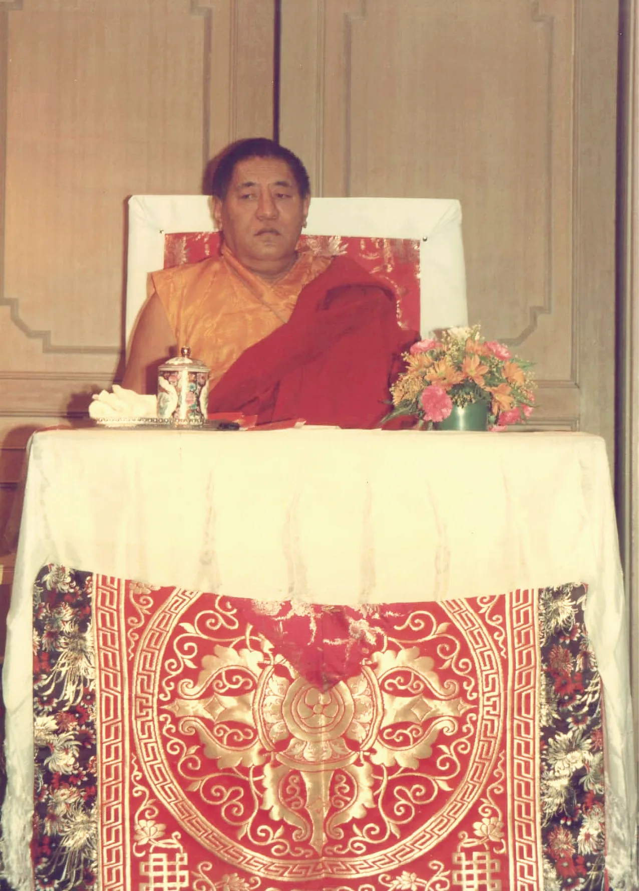

不共内前行的第一个是皈依。

对三宝中的佛陀生起本师想，对法生起正道想，对僧众生起助伴想，从立誓要皈依他们开始，就叫佛教徒了。如果没有将佛陀视作本师，没有将佛法视作正道，也没有将僧众视作助伴，那就不能称为佛教徒。

皈依不仅是进入佛教行列的唯一关键，而且无论修行声闻乘、菩萨乘还是密宗金刚乘的任何法门，都必须以皈依为前提。正如马鸣阿阇黎所说：“戒律皆可受，未皈依无有。”比如，即使受持八关斋戒，也必须先皈依三宝，否则戒体不会生起。如果没有先皈依，无论修什么善法，都不能算作佛教的修法。

自相续受菩萨戒或学处，以及实修时，必须先皈依。修行任何内外密宗金刚乘的法门，也必须先皈依。因此，皈依是佛教一切修行的基础，是能够进入佛教行列的唯一关要。

> （空性之中，于自己前方虚空中观想：极为庄严的虹光白云中，本体为根本上师，形象为文殊智慧勇识。寂静含笑、相好庄严的童子身相，身色金黄如彩虹般，佩带珍宝、绫罗饰品，右手高擎智慧宝剑于空中，左手持执上置经函的莲花，在圆月莲花垫上，双足跏趺傲然而坐，身体每一汗毛孔中显现无数自然续部坛城，上下方隅虹光密布之中，自现的一切上师、空行、护法众如日尘般聚集。）

在自己前方虚空美丽的虹光白云中，观想本体是根本上师，其形相是文殊菩萨，庄严与装束如仪轨中所描绘的那样清晰可见。

现在的根本上师，为我们灌顶、讲解密续、赐予加持，从而建立了很多外、内、密的缘起，所以，祈祷根本上师更容易获得加持。如果祈祷其他本尊，由于缘起没有那么殊胜，加持也就不会那么快速。

上师显现为有漏的血肉之躯，是因为我们的业感不清净。然而，上师的本体是由无量福德所成就的无漏身，与本尊无二无别。因此，应按照仪轨中所说的方式，将上师的形相观想为文殊智慧勇识。

> 观想完毕，应当思维从今起乃至菩提果之间，我只皈依您，依教奉行，在未得怙主上师果位之前，与见行相同的诸位道友一并不断勤修。如此发誓愿，即是显宗共同之皈依法。安住于证悟本来大清净之自心，即是了义文殊勇识之本性。护持所了知的境界，是不共自道之皈依法。

这样清晰观想上师后，应当发愿：“从现在直到证悟菩提之间，我只皈依您，依教奉行，与见行相同的道友们一起勤修。在未获得与您相同的果位之前，我会一直努力修行。”

在这里，将三宝总集的上师作佛陀想来皈依，把心交付于上师，是皈依佛；依教奉行，是皈依法；与见行相同的诸位道友一起勤修，是皈依僧。如此将三宝都归摄于根本上师中，以本师、正道、助伴的方式来皈依，这是“因皈依”。发愿在没有获得与文殊菩萨无二无别的上师果位之前一直修行，这是“果皈依”。

> 自己尽力不离此境界而念诵皈依偈：“基界本净童子瓶佛身，妙力不灭自证菩提心，了义文殊勇识自性中，了悟本来面目而皈依。”

最后，观想上师化为光融入自身，自己的心与上师的智慧无二无别。在这种境界中，一心安住。

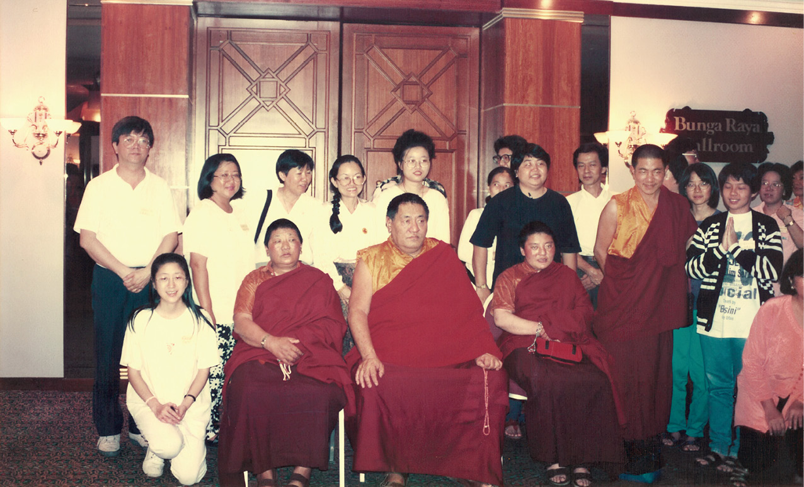

《文殊大圆满》第三节课

5月24日，法王在华美大酒店继续传讲此法：

这里所要听闻的法，是堪为九乘之巅的光明大圆满的最深究竟大窍诀部的精要引导，名为《手中赐佛》。此法的讲解分为前行和正行两部分。前行又分为共同外前行与不共内前行。其中，第二部分不共内前行包括皈依、发心、上师瑜伽三个方面。

第一，皈依主要是针对所有佛教徒而言。作为佛教徒，应将佛陀视为本师，将正法视为正道，将僧众视为友伴，立下坚定的誓言，实地去修行。这是所有进入佛门的共同乘行者所修持的法。

第二，发心是大乘菩萨道的修行法。这种比共同乘更殊胜的大乘菩萨道，是将无量众生视为母亲和孩子，爱他们胜过爱自己，行持菩萨道，与谋求自利相比，更侧重于利他，这就是菩萨的发心。

第三，上师瑜伽是大乘密宗金刚乘特有的殊胜道。大乘密宗金刚乘认识到一切不清净法本来就是清净的三身五智的游舞，是一种不共之道。

因此，这三者分别总结了共同乘、菩萨乘、密宗金刚乘三种道的精要，所以将它们安立为大圆满的前行法。

对于这三乘在何处广传及其差异，我们需要稍微了解一下。如果不清楚这一点，有些人可能会误以为三乘如水火不相容，修一个就不能修另一个，认为它们是矛盾的，这实在是大错特错。也有人认为三乘没有任何区别，都是一模一样的，这也不正确。三乘各有其独特的特点，因此我们需要正确理解三乘的区别。

从三乘广泛弘扬的地区来看：共同乘的法，主要在斯里兰卡、泰国、缅甸等印度菩提伽耶以南的许多国家弘扬得较为兴盛；菩萨乘的法，主要在菩提伽耶东方的中国、日本等许多国家传播广泛；密宗金刚乘的法，如佛陀在许多经典中所授记，主要广弘于印度菩提伽耶北方的藏地雪域高原。可以说，如今正是藏传佛教弘扬的鼎盛时期。就藏地情况而言，尽管作为少数民族地区，现代科技知识与其他民族相比略显落后，但从宗教方面来看，95%的藏族人热爱佛教，约50%的人对藏传佛教有较深的修学境界。因此，藏传佛教在欧洲、美洲等的三十二个国家，正在得到广泛传播。

例如，现今的这个佛学会，就是藏传噶举派的中心。以前美国有位噶举派的上师名叫创巴仁波切，他一个人就拥有一百多个佛教中心。前年我前往西方时，参访过他的许多佛教中心。

再如不丹王国，据说曾经是西藏的属地，如今藏传佛教在不丹及东西方的许多国家都非常兴盛。

关于三乘的见、修、行又有什么差别呢？

不害他众，是共同乘的道；只利益他众，是大乘菩萨乘的道；而广泛、轻松、迅速地利益他众，则是密宗金刚乘的道。

这三乘之间是否存在矛盾呢？对此有不同的观点：下乘认为上乘不是佛陀所宣说的——共同乘对菩萨乘的教法是否为佛说存在不同程度的怀疑；一些大乘行者对密宗金刚乘是否为佛陀亲口所说也有争议。但上乘则无有争议地一致认为下乘都是佛所说。

原因是什么呢？因为下乘的行者无法理解上乘的见解与行为。例如，当佛陀宣说大乘菩萨法藏时，除了文殊、普贤等已获得自在的菩萨外，所有共同乘种姓的行人都未曾听闻过，因此他们怀疑这些法不是佛说。密宗金刚乘更为殊胜，佛陀在密严刹土将其传授给金刚手等，而并未对共同的所化众生宣讲，因此关于其是否佛说也存在争议。但上乘行人能够理解所有下乘法，所以认为小乘、大乘、密乘皆为佛所说。

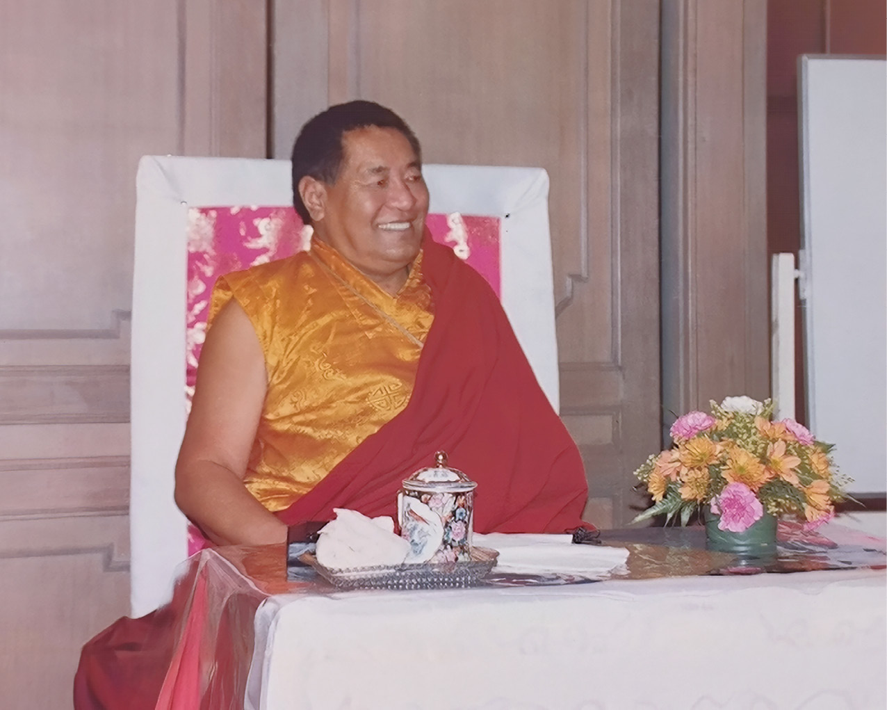

那么，如何证明是佛所说呢？例如，佛涅槃后，魔所加持的行人扰乱了教法，使声闻乘分裂为十八部。正如迦叶佛时代哲哲国王的女儿梦见十八人在拉扯一大块布，最后每个人都得到了一块。当询问迦叶佛时，佛陀说这预示着未来释迦牟尼佛的教法会出现争论，声闻乘将分裂成十八部，但这一切都是清净的佛语。前辈上师们以此为依据，一致认为佛陀涅槃后分出的声闻十八部皆是佛所说，因此，这些教法源自同一位释迦牟尼佛。佛陀早期主要宣讲共同乘法，中期侧重宣说菩萨乘法，末期临涅槃时亲自宣说并在涅槃后化现为金刚手等宣说密宗金刚乘法。

从教法的兴衰来看，共同乘教法有果期、修期、教期和唯持形象期，目前已经过了教期，接近唯持形象期，教法日渐衰微，力量也愈显薄弱。菩萨乘法虽然永不衰灭，但修行者越来越少，觉受与证悟也越来越弱。相反，密宗金刚乘教法越是到末时浊世，越能明显地发挥其作用，就如同黑暗中的阳光般越来越亮丽，而不会越来越糟糕。

那么我们该如何修持这三乘呢？一个人应该无有矛盾地同时修行三乘。首先，要以共同乘的别解脱戒为基础，最好是受持沙弥或比丘的出家戒。如果无法出家，在家男女行人也应在自相续中受持居士五戒或八关斋戒，恪守清净戒律。否则，如果不守持戒律，连暂时的人天果位都没有机会获得，更不用说最终的佛果了。

同时，还需发起大乘的意乐，与菩提心相应。若经常为一切众生谋求利益，就能迅速圆满两种资粮，从而获得佛果。如果只顾自利而不利他，虽有可能解脱轮回的痛苦，但无法成就广大的自他二利。因此，应当修行菩萨道。

当然，菩萨道需要在多劫等漫长的时间内，为度化芸芸众生而修行，这极为艰难，所以我们应修持密宗金刚乘或光明大圆满，这样就能在一生中获得与佛陀同等缘分的果位。因此，一个人必须懂得如何在自相续中不相抵触地同时修持三乘。

例如，在这个地方，共同乘、菩萨乘、密宗金刚乘三种法都极为兴盛。如果这些法真的是相互矛盾，你们心中就会认为有些法好、有些法不好，这样便会积累舍法的业，从而堕入地狱。如龙树菩萨所说：“若持邪见纵行善，亦具难忍之苦果。”根本没有比对佛语生起邪见更可怕的事情了，这一点需要特别谨慎。

对于我们雪域高原的藏人而言，除了少数执著于世间八法和政治的人外，绝大多数人并不会以贪嗔的心态谈论“你们的宗派”“我们的宗派”，或者“你们的寺院”“我们的寺院”等，没人会争论三乘是不是佛所说，而是会互不相违地修持它们。在新加坡，很多佛法都在弘传，你们也应当如此修持，这一点极其重要。

以前我曾问过你们的一位上师：“我们藏传佛教的僧人，到泰国的话，能否加入南传佛教的僧团？”他说：“你们是出家人，算是佛的随行者，但不知能否加入。”我认为他说得有道理。如果是懂得诸乘要点的好修行人，我们都是同一本师的随行者，犹如同父同母的同胞兄弟，只能谈论个人的戒律清净与否，怎么能说这些宗派谁好谁坏呢？

尽管在某些地方，什么都不懂的在家男女有的会说大乘最殊胜，有的说密乘更深，还有的说共同乘更好，但实际上大家绝对不应积累这种恶业，千万不要忘记这一点。

我来到这里的时间虽短，但着重强调了“互不相违地修持三乘”这一要点。我在新加坡也宣讲过两次，如今在马来西亚又讲了一次。你们所有入佛门的人都应如此修持，这一点极为重要，因此我才再三强调。

> 发心：观想如果连续不断地感受无边痛苦的一切众生能摆脱痛苦该多好！一直观修到生起强烈悲心而流泪为止。我今必须修成能救度众生的佛陀果位。不观待长久苦行、顺利迅速成就此佛果之道唯有光明大圆满，因此应当实修大圆满法。最后于边解脱直定中安住而尽力念诵发心偈：“暂时迷现幻化之城中，顽固贪恋不断漂流众，为于本解法身得安慰，边解大直定中而发心。”

> 最后观想从皈依境圣尊心间放射无量光芒照耀我与一切众生，从而无余净除罪障。自身也化光融入皈依境中。如是于无执中入定。

这里的发心主要包括两种：以大悲缘利他、以智慧缘佛果的愿菩提心，以及履行誓言精进行持的行菩提心。安住于广大本解脱的境界中发心，实修光明大圆满之义，则是大圆满自宗的发心。

> 上师瑜伽：如前明观上师后，

所谓的上师瑜伽，是指观修上师并祈祷的过程，需依止上师而实修。正所谓：“十万劫中勤观修，具相随好之本尊，不如刹那念师胜；念咒修法千万遍，不如祈师一遍胜。”意思是，在百千万劫中观修浩瀚无边的本尊，也不如仅仅忆念一次上师的功德和加持更为殊胜；一劫又一劫地持诵其他本尊的心咒，也不如祈祷上师一次更为殊胜。

为什么呢？因为我们自己与上师有着不可思议的缘分和愿力紧密相连，依靠自身业力清净的力量，我们得以见到上师的身相，听闻上师的教言，相续中获得上师智慧的加持。上师是三世诸佛加持的总集，显现为人相而利益众生。因此，我们应当首先观察上师，中间依止上师，最终学修上师的意行，必须明白上师是三宝总集的本性。

上师的身为僧，语为法，意为佛。佛陀曾说：“末法五百世，化为善知识，利益汝等众。”佛陀直接度化众生的时期已过，真正利益众生的就是上师善知识，所以应当观修上师。

那么，如何修上师瑜伽呢？

> 诚心祈祷：从今起生生世世中，我除一切皈依处总集之大恩上师您以外，甚至梦中也不寻其余指望处，只以您为皈依处，并以自己的身体、一切受用及三世善根供养您，

在显宗中，佛陀是皈依处，但在这里，上师是唯一的皈依处。我除了您这位集三宝于一体的根本上师外，不仅白天不依止其他皈依处，连晚上做梦时也不依赖他人。我将自己完全托付于您，无论我高高在上还是沦落低谷，无论承受痛苦还是享受快乐，无论遇到吉祥还是遭遇凶险，唯有大恩根本上师您了知，唯有您垂念于我，唯有您才是我的指望处和依靠处。

我将自己最珍贵的身体、受用和三世所有善根都供养您。这个身体必然供养给大恩根本上师，如寂天菩萨所言：“愿以吾身心，恒献佛佛子，恳请哀纳受，我愿为尊仆，尊既慈摄护，利生无怯顾。”

我将这个身体供养给大恩根本上师您。从现在起，我不再拥有自己的身体，它完全属于上师您。现在，我将依照您的意愿弘法利生。与过去截然不同的是，我已不再对轮回的痛苦心生畏惧，不再怯懦。

同样，我将珍爱的饮食、衣服、装饰等一切受用，以及过去、现在、未来三时所积累的一切善根，连同有主物、无主物、意念幻化的、定力幻化的、咒力幻化的等一切供品，全部供养给大恩根本上师您。

这是曼茶罗的引导。

> 发露忏悔无始以来所积累的一切堕罪。

以诸佛菩萨作为见证，成为所依对治力。在他们面前，对从无始轮回以来到现在，由贪嗔痴驱使所造的一切佛制罪和自性罪，感到后悔，并发誓不再造作。通过持诵陀罗尼咒和明咒、修持禅定等方式来忏悔，祈请加持以清净我的相续。

这是对治罪障的念修金刚萨埵之引导。

> 祈愿成熟解脱我相续，加持我究竟证悟光明大圆满，获得殊胜导师您的果位。

祈请大恩上师您以灌顶使我未成熟的相续得以成熟，以教言使我已成熟的相续得以解脱，究竟证悟本来清净和任运自成的光明大圆满，获得与最胜导师您无二无别的果位。

> 边观想边一心一意念诵祈祷：“具有童子身，庄严智慧灯，能除世痴暗，祈祷文殊尊。”

这四句祈祷文是佛陀亲口所说，是化身的大译师们通过成就谛实语用藏语所加持的。后来在五台山，又通过文殊菩萨的莲花舌加持，使其加持力更为强大。以后在持诵时，如果理解其深意并以藏语念诵，那将更加殊胜。

其中，“具有童子身”是说文殊菩萨在三世一切佛之前已经成佛，不仅如此，他还是引导贤劫一千零二位佛等一切佛陀最初发菩提心、中间修学六度的人，但在所化众生面前，他一直安住于十地末际，示现十六岁童子的身相。这是不可思议的身密、语密、意密，是三世诸佛智慧的幻化显现，因此称之为“庄严智慧灯”。仅仅忆念怙主文殊菩萨，就能遣除一切业和烦恼的根本无明愚痴，所以说“能除世痴暗，祈祷文殊尊”。

> 最后观想上师三处放射出白红蓝光融入自己三处。从而清净三门罪障，现前身语意的一切功德，最终上师也化光融入自己。于离意本性中入定。从中出定时，了知现有一切皆为上师之本体。善根回向菩提。

观想上师眉间的白色“嗡”字、喉间的红色“啊”字、心间的蓝色“吽”字，放出白红蓝三色光芒，融入自身三处，清净身语意的三障，并获得上师身语意的一切功德。

> 圆满次第：自身庸俗而住，观想正中蔚蓝色如竹箭般的中脉上端于顶处、下端于脐下闭合，其右方红色血脉及左方白色精脉的下端与中脉如恰（ཆ）字形相连，上端插入两鼻孔。边观想边除垢气，明观吸气时气从二鼻孔经精血脉而接触脐下三脉交叉处下端坚固、上端尖锐、十分炽热、青稞许的绝地智慧火，从而使火焰更旺，将一切有漏身体包括风脉明点皆焚尽无余，最后消失于无缘中。

> 又于空性中将自身观为文殊金刚身，内外通彻，如胎盘满气一般。明观中间三脉四轮以及脐部短阿（Λ），中脉上端有集诸佛之本体、仅忆念便能生起空乐觉受倒立的白色杭字（）。从鼻孔吸入的气触及脐部绝地火（即短阿），针尖许的火焰上升接触到顶上的杭（）字，火焰更加旺盛，从中不断降下甘露，火与明点以相互追逐的方式依次充满四轮，从而领受四喜（喜、胜喜、殊喜、俱生喜）、四空（空、极空、大空、一切空）之智慧，现前空乐义智慧，于此境界中尽力安住，最后回向善根。

门措空行母也灌了一些顶

门措空行母，拥有深厚的修证与德行，她在藏地和西方国家都为众生灌顶、传法，成为无数信徒的金刚上师，享有极高的威望。无论身处何地，凡是遇见她的人，都会深切感受到她的慈悲和智慧，心中自然生出无尽的信心与敬仰。

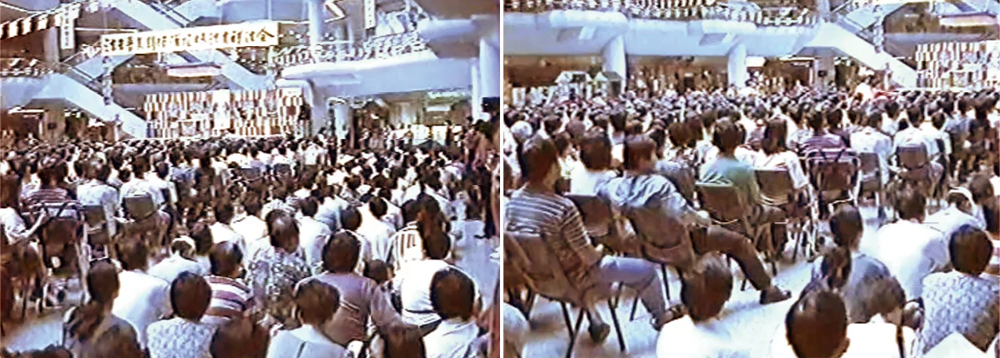

在信仰南传佛教的国家，几乎没有女性出家人；而在信仰北传佛教的国家，也很难见到能够为大众灌顶和传授密法的女性上师。因此，当门措空行母此次踏上东南亚的土地时，新加坡和马来西亚的佛友们早已翘首以待，渴望与她结上深厚的法缘，得到她的不共加持。即使行程已排得满满当当，但为了满足大家的愿望，主办方特意安排了空行母为信众传法。

第一次是5月1日在新加坡的鸿福中心，门措空行母为大众传授了“四臂观音”灌顶，慈诚罗珠堪布进行翻译。当天，现场挤满了来自不同地区的信徒。随着灌顶的进行，空行母为大家分发加持品时，北传的出家尼众们也悉心协助，场面温馨而和谐。

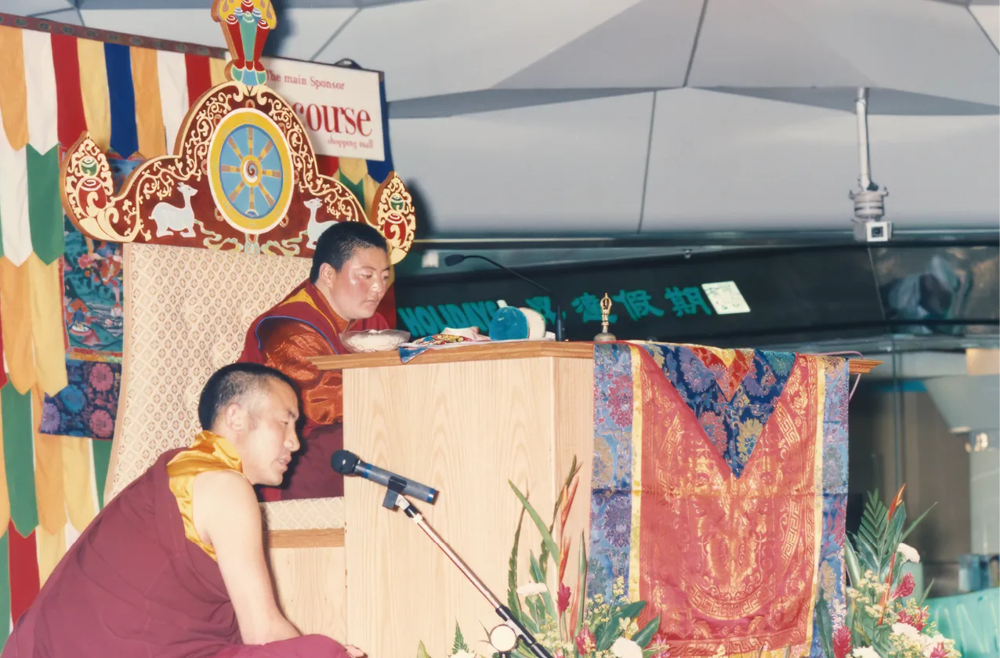

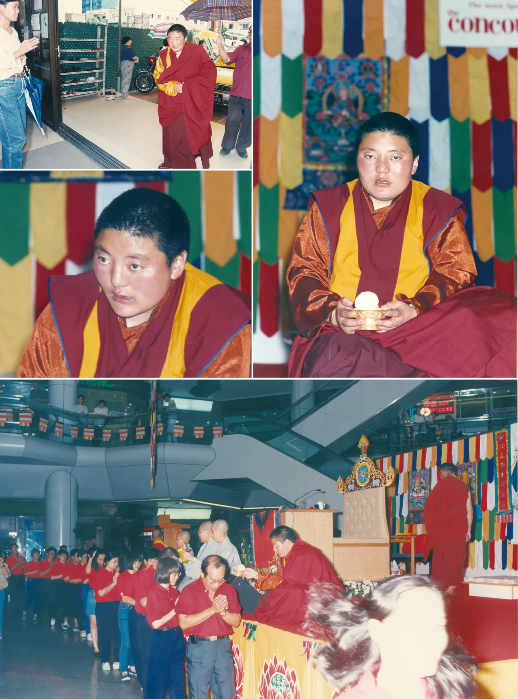

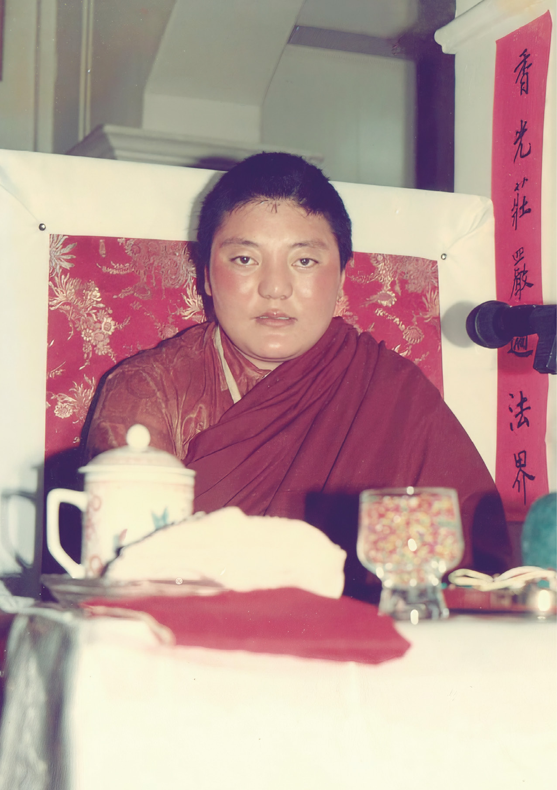

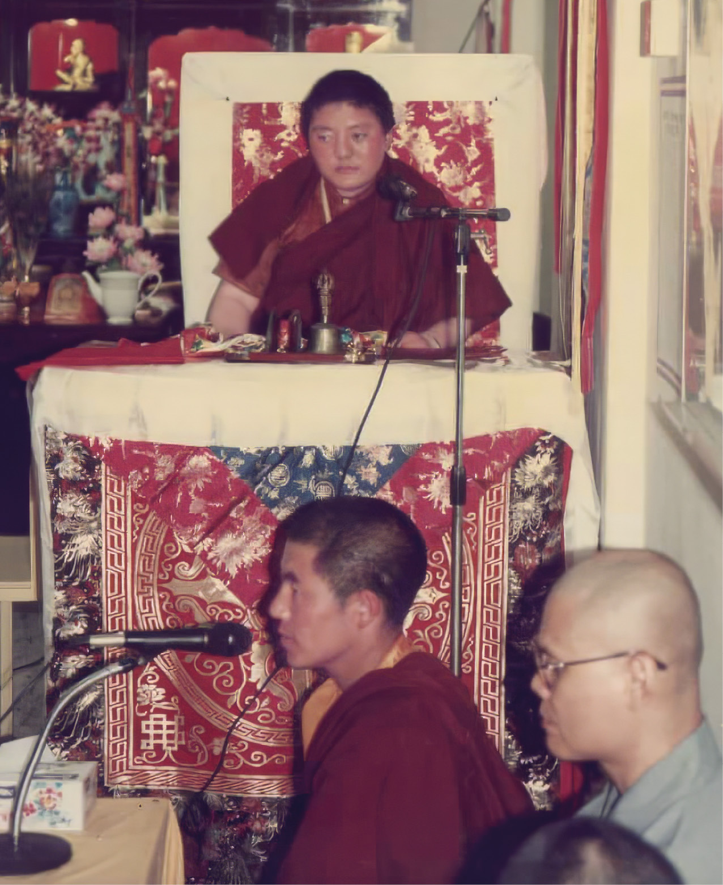

第二次是5月25日在马来西亚的马六甲，空行母再次带来了“四臂观音”的灌顶，这次由我担任翻译。此外，在5月26日，空行母还主持了一场释迦牟尼佛灯供法会。她专注地点燃一盏盏油灯，双手轻托着灯盏，默默祈愿：“愿以佛法的光明，驱散众生的无明黑暗。”那一刻，整个法会现场充满了温暖与吉祥。

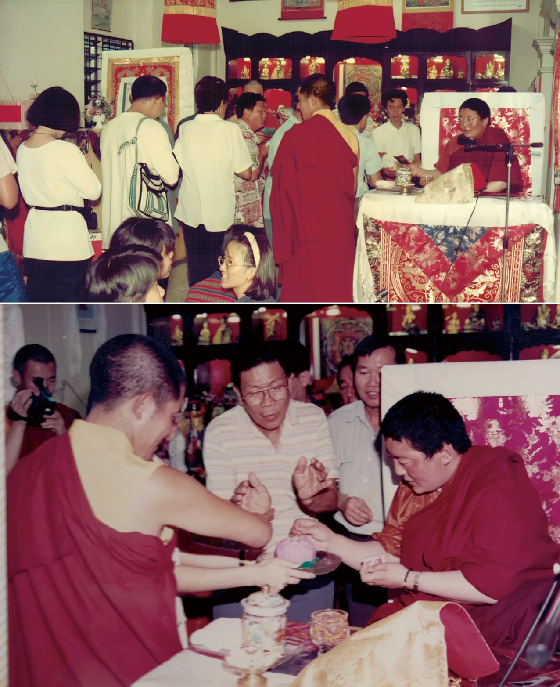

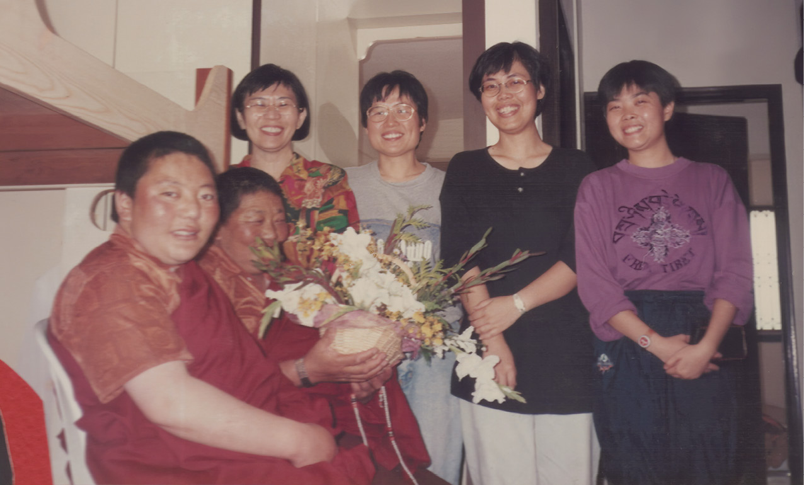

空行母为人谦逊低调，和蔼可亲，始终保持着祥和平静的气质，深受东南亚佛友们的尊敬与爱戴。尤其是许多女性弟子，更是乐于亲近她，纷纷皈依，渴望从她的言传身教中汲取智慧的力量。

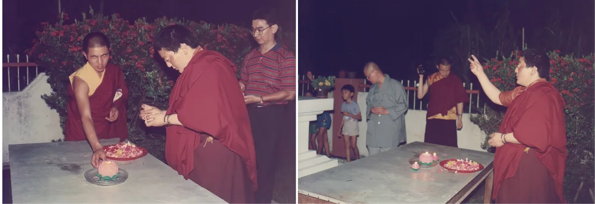

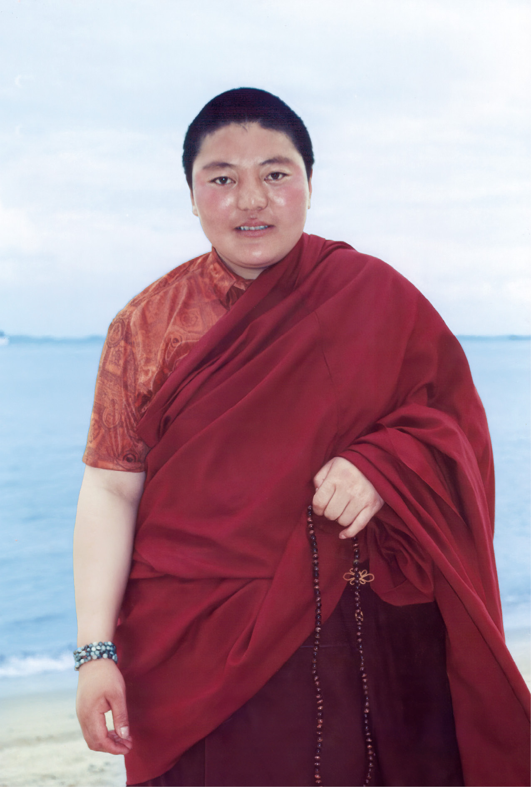

有一次，一群佛友焦急地找到我，手中捧着一只奄奄一息的鸽子。这只鸽子被猫抓伤，生命垂危。佛友们恳求我，请空行母加持这只小生命。门措空行母一向对小动物充满慈爱，得知后，她立刻走到鸽子身旁，低下头，温柔地注视着它，轻轻地抚摸着，并低语念诵经文，为其加持。

第二天早晨，大家惊喜地发现，这只鸽子竟然完全康复，展翅飞向蓝天。

《文殊大圆满》第四节课

5月25日，法王在华美大酒店讲了最后一节课：

现在所要听闻的法是：佛陀八万四千法门的究竟要点——光明大圆满实修法，其精髓汇集为一的《手中赐佛》。它分为前行和大圆满正行两个部分。现在讲的是前行法。

在修持大圆满道时，如果没有真正打好前行法的基础，就无法在相续中生起它的道相。因此，一开始不要直接高攀所谓的光明大圆满，而应认认真真、扎扎实实地修持前行法。

一般来说，前辈大德们对前行法有许多不同的解释方法，但在《手中赐佛》中，将所有这些精华总结为四种厌世心、皈依、发菩提心、上师瑜伽、生圆次第。即使无法完全理解这些内容，也必须在自己的相续中生起出离心和菩提心。

1．出离心

出离心是指认识到轮回的剧烈痛苦。比如，地狱、饿鬼、旁生等恶趣众生，恒常遭受身体痛苦和内心苦恼的煎熬，因此没有人会喜欢和向往这些境遇，这很容易生起厌离心和出离心。看似稍微幸福的天人和人类，实际上也永远无法超脱痛苦的自性。在人间和天界，虽然丰衣足食，拥有显赫地位、权势、名声、财富等，但如果不加观察，它们虽暂时看似带来快乐，却不会长存坚固，瞬间就会消失，所以也是痛苦的自性。

尤其是在色界和无色界的禅定境界中，存在一种既非快乐也非痛苦的等舍感受，就像睡着了一样，大多数人误将这视为安乐而追求色界和无色界的果位，大多数外道也在为此而努力。然而，这种安乐是短暂而有漏的善果，当其消耗殆尽时，仍然会落入恶趣，周而复始，犹如瓶中的蜜蜂或水车一样，永远在轮回中流转，绝对超离不了行苦的自性。

因此，无论投生到轮回高低的哪一趣，正所谓“三恶趣以剧苦逼，人天则以变苦恼，色无色界行苦缚，愿见轮回真面目”，一旦认识到轮回是痛苦的自性，便会对其不再喜爱和向往，而会生起厌离心。无论投生到三界的哪一处，都是痛苦的自性、痛苦的纷扰，如同火坑、罗刹洲、利剑之锋，丝毫没有安乐的机会。

认识到这一点后，一旦相续中真正生起渴求解脱的心，那就是出离心。没有对整个轮回产生如牢狱般的认知之前，必须反复观修，否则，相续中就没有机会生起大圆满的境界。

希望从整个轮回中解脱，获得声闻、缘觉、菩萨与佛陀的果位，这种心也叫出离心。同样，若往生西方极乐世界阿弥陀佛的净土，连痛苦的名字都听不到。一旦往生到那里，身体没有病痛，内心没有苦恼，将不再转入轮回。除了造舍法罪和五无间罪的人，只要对阿弥陀佛有信心并希望往生极乐世界，无论上中下根基，如果发愿就一定能往生，所以，大家皆应怀着这种希求心发愿往生。

释迦牟尼佛在《极乐世界功德庄严经》中曾授记：“娑婆世界无量无数众生，将往生阿弥陀佛净土。”现在正是验证这一点的时候。尤其是如今用汉语念佛的人，皆是阿弥陀佛的所化众生。一般来讲，几乎所有说汉语的人都会念“南无阿弥陀佛”，这些人未来都有机会往生极乐世界。

因此，大家应祈祷阿弥陀佛，发愿往生极乐世界。从现在开始，尽量不要生起希望再来此轮回的意乐。

舍弃对整个轮回的贪执，首先要断除对今生的贪执，放下对今生财富受用、亲朋好友等的贪恋，以及对不喜欢的敌人等的嗔恨。当然，仅从一两位上师那里听闻几天的法，很难断除对食物、衣服、受用等的贪执，能否断除主要取决于自己。要一再下定决心，反复观察自心，真正地修行。

同样，无论上中下根基的任何人，只要修持这个大圆满法，毫无疑问都能在一生中成佛。然而，一些共同乘的行人，以及未入佛教的普通人，可能会想：“这么容易就能获得佛果吗？大圆满是不是假的？”

当然，是否能获得佛果，最终取决于修行者自己。如果真正修行并实证大圆满法，必定能够获得佛果，这一点绝不会有欺惑。但如果只是一味地忙于今生事务而散乱，哪怕这个法再甚深，也对修行者的相续无济于事，这就叫做自相续与佛法背道而驰。即使法非常深，但如果自己的心相续没有调伏，那就像阳光无法照进洞口朝北的山洞一样。因此，首先要舍弃对今生的贪执，这一点相当重要。

然而，当今世界上，大多数人唯一忙于今生的事，把来世抛在脑后。因此，你们不应效仿这些人，而要追求来世的解脱。

不过，富裕的人担心财富减少，往往一而再、再而三地积累，结果无法修行；而没有财富的人，则整日忙于寻找和收集食物、衣服，心神散乱，也难以修行。我从藏地来到新加坡和马来西亚，现在对这里也算比较熟悉。我们藏地贫富悬殊，大多数人每天为寻求食物而奔波，无法修持善法。而新加坡和马来西亚贫富差距较小，大多数人生活富裕。然而，这里人们的衣食受用，大多需要从其他国家进口，所以经常患得患失，担心能否获取这些物资。

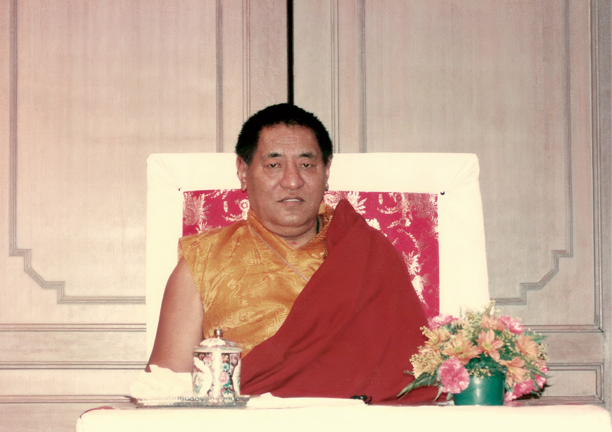

尤其是你们，当有了一笔财富后，希望积累两笔；有了两笔，又希望积累三笔；有了十万，就想积累到一百万，不断谋求财富受用。我看到一些富人的受用时，感到非常吃惊，但他们依然不知足，似乎从未考虑过需要成办来世的大事。因此，我们应当自我约束，就如“今天的食物今天吃，明天的食物明天找”一样，以简单朴素的衣食维持生活即可。修行人绝不会因饥荒而饿死，所以应放下大大小小的事情，专心修行善法。

作为佛教徒，从一开始就应知足少欲。“少欲”是指不贪图他人的财物；“知足”是指对自己拥有的一点点东西，能解决温饱就满足，专注于修行佛法。今天，聚集在这个大厅里的众人，不仅是佛教徒，而且大多数人应该已看破今世，放下了大大小小的琐事，为了来世而修行。如果你们能放下一切琐事去修行，绝不会因寒热、饥渴而死。

一个人即使拥有世上的一切财富，在死时也无权带走一根针；即便是统治世界上所有国家的人，死时也无法带走一个仆人。而且在临终时，儿女们一步也不能陪伴你、送你走，你必须有独自面对一切的把握。因此，从现在开始，请不要再贪恋今生，放下所有琐事，一心一意地生起出离心，不要错过为来世修行的机会。

这是第一个前行法。

2．菩提心

无量无边的众生，没有一个未曾当过我们的父母，我们理应回报所有这些父母众生的恩德。然而，用轮回中的任何快乐和财富，都无法真正报答他们的恩情。究竟的报恩，就是让他们成就永恒安乐与解脱的佛果。因此，我们应将所有这些众生安置于佛地。而在自己没有修成佛果之前，根本无法将所有众生安置于佛地，所以，首先自己必须迅速成佛。而要修成佛果，必须依靠像光明大圆满这样甚深殊胜的快速之道，否则，所有众生等待的时间太长了。

这种要迅速修成佛果的意乐，就是菩提心。要在自相续中生起菩提心，必须绝对拥有善意乐。以往我们对比自己优秀的人心生嫉妒，对与自己平等的人竞争，对低于自己的人轻视等，这些恶念应如毒药般舍弃。从现在起，要时刻唯一修习希望所有高低贵贱的众生身体无痛苦、内心无苦恼的善意乐。

首先，要修自他平等的菩提心。然后，修习爱他胜己的菩提心——比起消除自己的痛苦，看能不能更努力地消除他人的痛苦？比起追求自己的快乐，看能不能更加顽强、更加精进地去成办他人的快乐？最终，修持自他交换的菩提心，把自己所有的安乐和善妙都布施给他众，并努力承受他人所有的痛苦，唯修善意乐。

这是第二个前行法。

3．无二慧

如是具有出离心和菩提心的人，应抉择一切法为空性，然后互不相违地实修三乘。

这是什么意思呢？内外器情所摄的一切法，虽然显现，但实际上并不成立，就像昨晚的梦境、影像、幻术一般。虽然是空性，但空性的自妙力不灭，呈现出无边无际的轮回和涅槃的显现。

例如，镜中影像虽能广大而持久地映现，却连一点色法的实体都不成立。同样，尽管轮回和涅槃的显现无边无际，但这只是心的幻化而已，无所成立。

再比如，在电影中虽然有着各种景象和行为，但连一个极细微的色尘都不成立。同样，轮回与涅槃的所有法，也都是空性的自性。

在了悟这一切皆为空性的境界中，一心专注地修行，这就是无二慧。我们需要集中精力，实修这个正行唯一的究竟见解。

在讲解正文之前，我昨天和今天说了很多话。如同世亲论师所言：“宣说经义者，以必要摄义，词义与承接，辩论答复说。”意思是，在讲解任何经论时，有五种传讲方法。我也是按照这种方式，简明扼要地向你们讲解了三乘的修行。

如今，这个世界上，共同乘、菩萨乘、密宗乘这三乘法都在兴盛。我简单讲解了如何互不相违地修持这三者，以及必须修行它们的要义。

一个人要想不相违地实修三乘，其窍诀的来源可以追溯到从印度来藏地的大堪布菩提萨埵，他说过：“外守清净戒，内修菩提心，秘得密成就，杨柳宫成佛。”

宁玛派的阿里大班智达班玛旺嘉也曾说：“功德基础别解脱，随力引发菩提心，乃是密宗之分支，获能成熟之灌顶，守护三戒如眼目，修知三相尊生次，有相无相圆次第。”

共同乘的出离心、不共大乘的菩提心、密宗金刚乘的正见，这三者互不相违的实修方法，正是东方胜者宗喀巴大师的意趣。

因此，我将大堪布菩提萨埵、阿里大班智达班玛旺嘉、至尊宗喀巴大师三者的意趣综合起来，向大家进行了简要讲解。

随后，法王念诵了《文殊大圆满》最后部分的传承，圆满了这部法的所有内容。紧接着，法王带领大家进行了回向：

> 愿以此福得遍智，击败一切过患敌，

> 度众离生老病死，波涛汹涌轮回海。

> 文殊师利勇猛智，普贤慧行亦复然，

> 我今回向诸善根，随彼一切常修学。

> 三世诸佛所称叹，如是最胜诸大愿，

> 我今回向诸善根，为得普贤殊胜行。

> 愿我临欲命终时，尽除一切诸障碍，

> 面见彼佛阿弥陀，即得往生安乐刹。

> 我既往生彼国已，现前成就此大愿，

> 一切圆满尽无余，利乐一切众生界。

> 祈愿佛法广弘兴，一切有情皆安乐，

> 日日夜夜行正法，自他二利任运成。

回向完毕，法王举行了一场庄严的大会供，以酬谢三根本及护法神的慈悲加持，令此次东南亚弘法之行非常顺利。

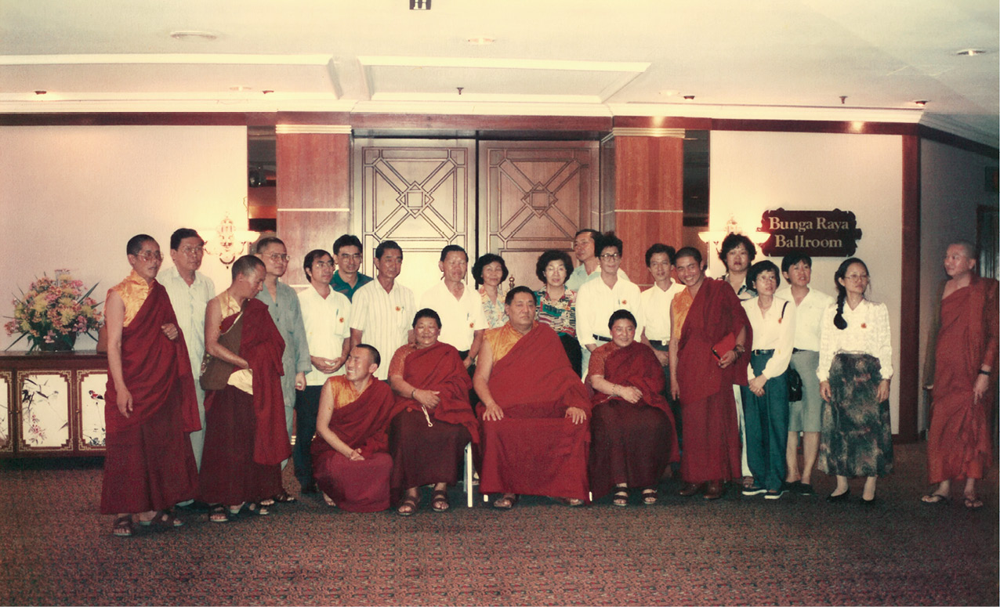

参观青云亭

马六甲是马来西亚历史最悠久的古城。在当地的传法圆满后，5月26日，法王受到了信众的邀请，前往马来西亚最古老的华人寺院——青云亭（Cheng Hoon Teng Temple）参观。

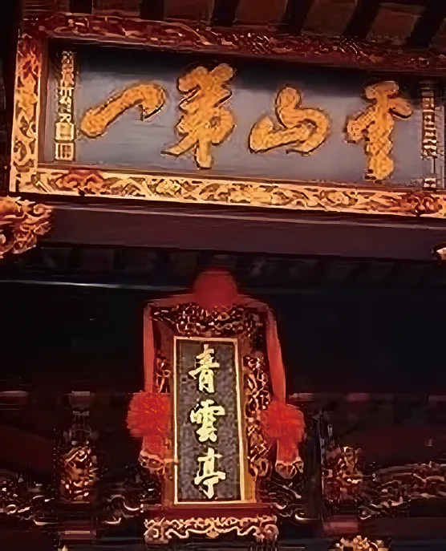

青云亭距今已有四五百年历史，它不仅是一个宗教场所，更是马来西亚华人文化的重要象征。历史上，这里曾作为华人社会的“宗教法庭”，处理民事纠纷，并为华人社区提供法律与社会服务。该寺院主要供奉观音菩萨，同时也敬奉妈祖、保生大帝、关帝等神明，展现出佛教、道教和儒教的信仰融合，体现了多元文化的特点。

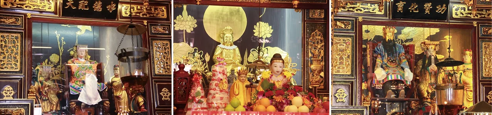

法王抵达青云亭后，看到这座庄严而古老的寺院，显得十分高兴，随后带领大家转绕了一圈。寺内的住持热情款待，邀请法王及随行人员进入客堂，并奉上香茶。

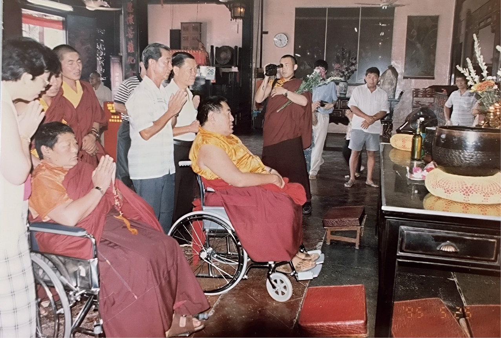

在交流中，住持提到：“我听说你们佛学院培养了许多优秀的僧才，并通过弘扬佛法，为众生带来了巨大的利益，请您介绍一下这方面的情况。”法王随即介绍了喇荣五明佛学院。听完后，住持非常高兴，随喜赞叹不已。

临别之际，大家在观音殿前合影留念，记录下这一刻的珍贵时光。

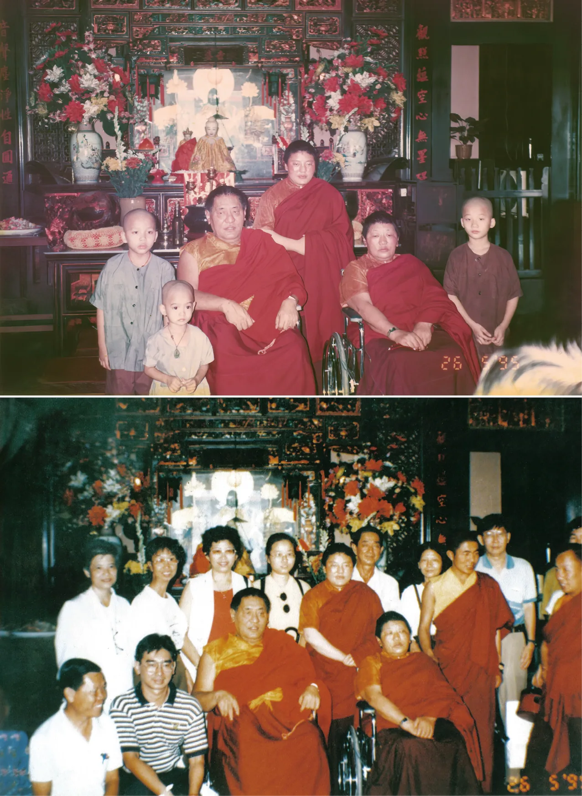

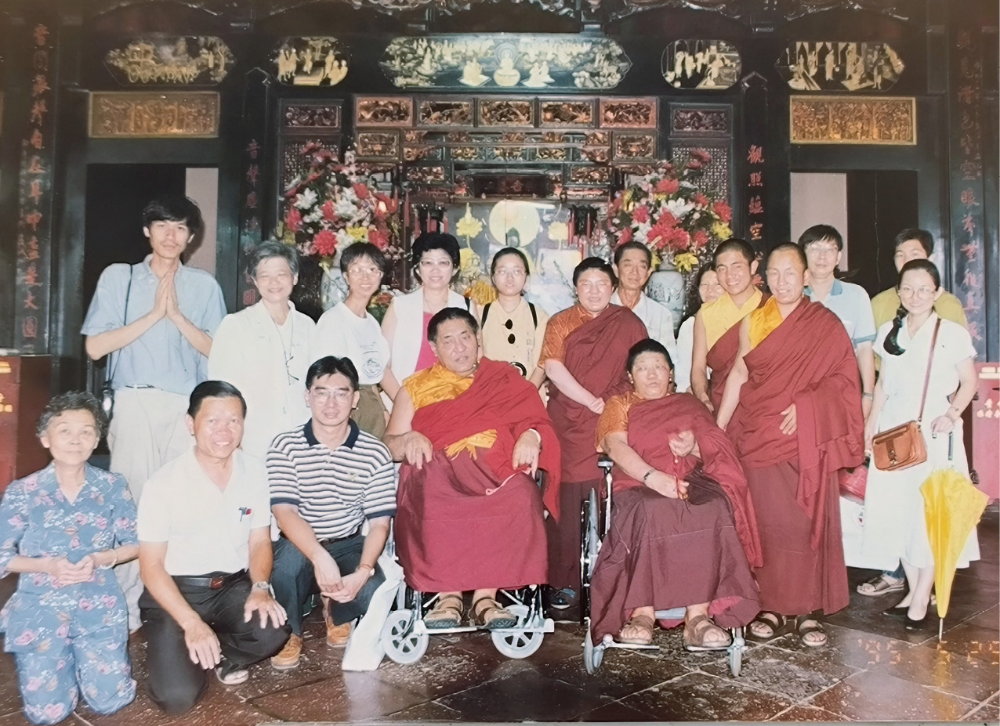

到达吉隆坡

完成了马六甲的弘法后，5月27日，法王乘车两个多小时，来到了吉隆坡，这是此次东南亚之行的最后一站。作为马来西亚的首都，吉隆坡不仅是一座文化多元的都市，更与佛教有着深厚的渊源。尤其是在华人社区，许多家庭都会在家中供奉佛像，并定期参与佛教活动。

法王抵达吉隆坡后，入住了瑞士花园酒店（Swiss-Garden Hotel），在这里停留了三天两夜。期间，法王接见了当地信众，包括吉隆坡的佛友和佛堂的负责人，传授了“阿弥陀佛”灌顶，并以窍诀性的方式讲解了《忠言心之明点》。

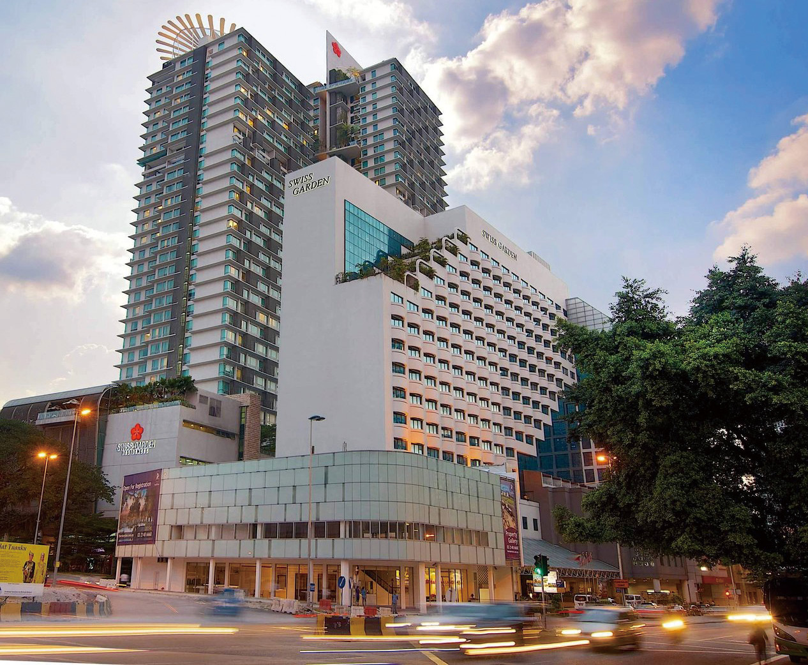

有一天下午，在当地信众的热情邀请下，法王抽出时间前往附近的超市。尽管没有买些什么，但法王通过这次小小的外出，亲自感受了吉隆坡的独特风土人情，了解了当地人们的日常生活。

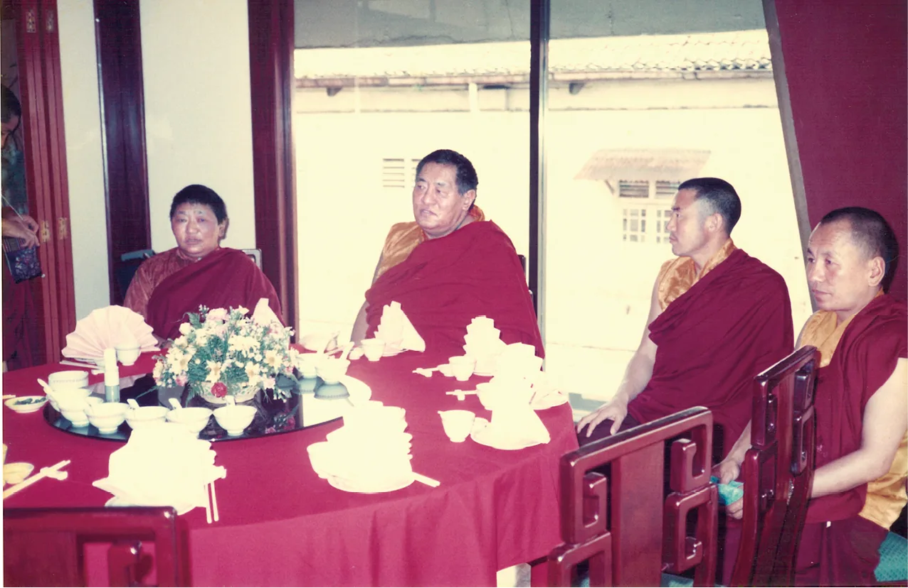

5月29日，法王离开酒店，前往机场，准备从香港转机回成都。在乘电梯时，遇到了一位姓覃的19岁女孩。她是马来西亚道场负责人的女儿，刚刚高中毕业。法王问她有没有念经，她回答道，她曾念过莲师心咒120万遍，但此后就没有再念。法王鼓励她继续念莲师心咒，每天至少108遍，并提醒她要对三宝有信心。

据她回忆，法王那句“要对三宝有信心”，给了她莫大的力量和启发。她原本性格内向、胆小，但自那时起，每当遇到困境，她总能想起法王的教诲，信心倍增，迎难而上。

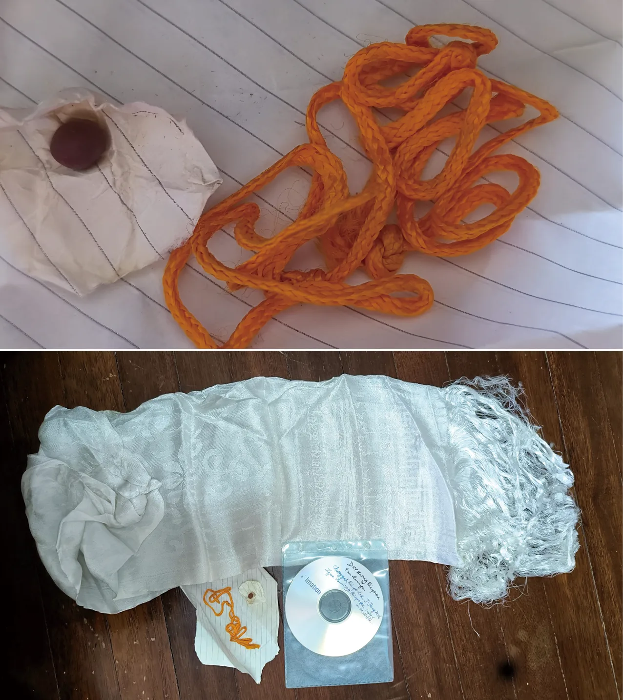

法王回国后，她开始认真听法王的弘法录音，一点一滴地自修《文殊大圆满》，并从中获益良多。至今，她的修行从未中断。法王留下的甘露丸、白色哈达、黄色金刚结、传法光盘，她也一直珍藏到今天，令我不禁感慨不已。有些人虽依止上师已久，但上师的法并不一定对其产生作用；而真正有缘的弟子，即使依止上师的时间不长，却能给自己带来终身的利益。

在新加坡和马来西亚，像她这样善根深厚的佛友，还有不少。例如，马六甲的詹居士告诉我，直到今天，法王传授的法，他们大部分弟子都在修。有些老一辈的弟子已经往生，年轻一点的依然在修持，这令人感到欣慰。

他还分享道：“在修行的过程中，随着时间的推移，我的身心渐渐发生了改变，菩提心在不断增长，对空性也有了一定的认识，这是非常难得的。如果依照法王的口诀和修法心得，只要我们有恒心、有信心去修持，就一定能获得许多体验和觉受。那种感觉难以言说。

我当年38岁，如今已经30年过去了。很庆幸，我依然身体健康，可以继续修法。法王的教诲，我们始终铭记在心，没有断过，一直修持到今时今日。这也是法王的一种加被吧。”

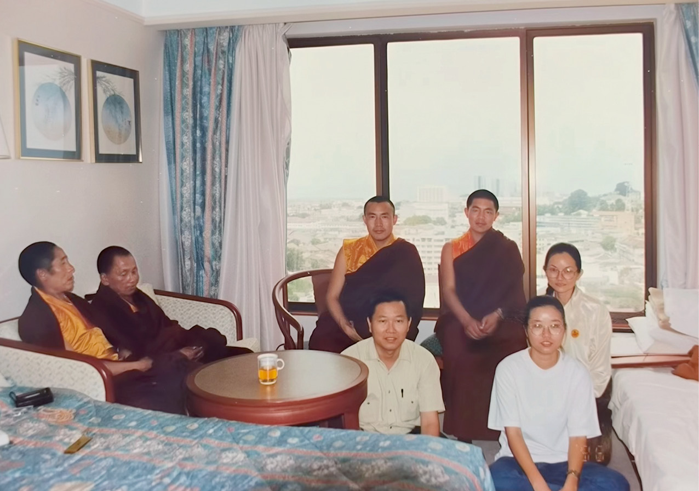

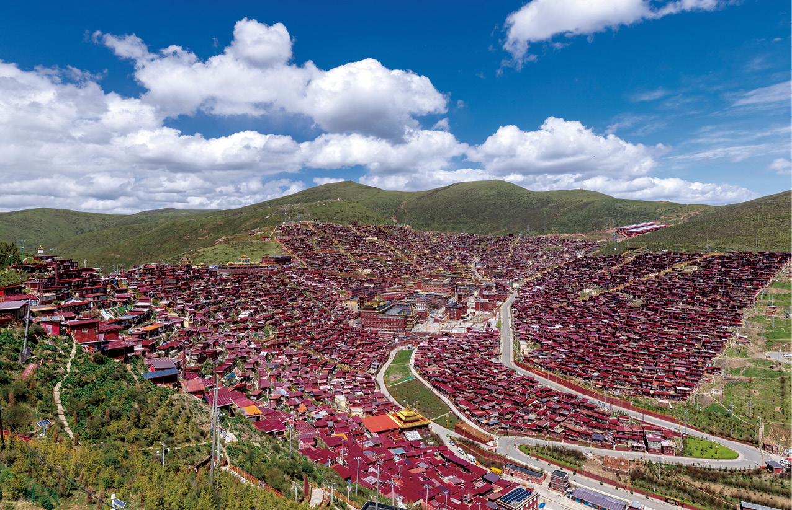

Return
