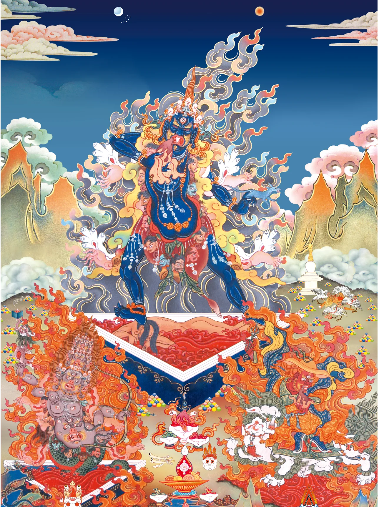

# 三根本供

——成诸事业

ཨོཾ་ཨཱཿ ཧཱུྃ།

嗡啊吽  嗡啊吽

ཀུན་ཁྱབ་ཆོས་ཀྱི་དབྱིངས་དང་མཉམ་པ་ཡི། །

根恰秋杰样当年巴耶周遍一切法界平等性

སྣང་སྲིད་ཟག་མེད་བདུད་རྩིར་ཞུ་བའི་བཅུད། །

囊哲Ra美德则耶沃杰现有化为无漏甘露精

འཇའ་ཟེར་ཐིག་ལེ་མཆོད་པའི་སྤྲིན་ཕུང་འཕྲོ། །

嘉瑞特类秋波珍彭绰虹光明点供养云聚散

མཉམ་ཉིད་བདེ་ཆེན་འདུད་རྩིའི་གཏོར་མ་འདི། །

年涅得钦德贼朵玛德等性大乐甘露此食子

བརྒྱུད་གསུམ་རིག་འཛིན་བླ་མའི་ཚོགས་རྣམས་དང༌། །

觉森仁增喇美措南当供养三传持明上师众

ཡི་དམ་ཞི་ཁྲོ་གནས་གསུམ་མཁའ་འགྲོའི་ཚོགས། །

耶丹耶绰内森夸珠措寂猛本尊三处空行众

ཆོས་སྐྱོང་ནོར་ལྷ་གཏེར་དང་གཞི་ཡི་བདག །

秋炯诺拉得当耶耶达诸护法神财神伏藏主

མ་ལུས་འཁོར་དང་བཅས་ལ་མཆོད་པར་འབུལ། །

玛利括当具拉秋巴波地神以及无余眷属众

ཁྱད་པར་འཇམ་དཔལ་གཤིན་རྗེ་པདྨ་དབང་། །

恰巴蒋华辛杰巴玛旺尤其大威德尊莲花王

གསང་བདག་རྡོ་རྗེ་ཕྲིན་ལས་ཕུར་པའི་ལྷ། །

桑达多杰陈类颇波拉密主金刚事业橛本尊

སྤྲུལ་པ་ཡང་སྤྲུལ་འཁོར་དང་བཀའ་ཉན་བཅས། །

哲巴样哲括当瓜年具化身复化听命眷属前

མཆོད་ཅིང་བསྟོད་དོ་འདོད་དགུའི་དངོས་གྲུབ་སྩོལ། །

秋江朵多多给悟哲作供赞祈赐所欲诸悉地

བསྟན་སྲུང་རྒྱ་མཚོ་སྡེ་དཔོན་ལེགས་ལྡན་ནག །

丹仲嘉措得魂拉丹那如海护法主尊黑具善

ལྷ་ཆེན་དཔལ་འབར་མ་ནིང་མགོན་པོ་དང༌། །

拉钦华巴玛囊衮波当大天勇猛中性怙主神

དཔལ་ལྡན་མ་ཧཱ་ཀཱ་ལ་ཚོགས་ཀྱི་བདག །

华丹玛哈嘎拉措杰达具德玛哈嘎拉会众主

སྔགས་ཀྱི་སྲུང་མ་རྡོ་རྗེ་རལ་གཅིག་མ། །

阿杰仲玛多杰Ra吉玛密宗护法金刚一髻母

མ་ཅིག་དཔལ་ལྡན་ལྷ་མོ་རེ་མ་ཏི། །

玛吉华丹拉姆瑞玛德玛吉具德天女瑞玛德

ཞིང་སྐྱོང་སྨན་བཙུན་རྒྱལ་མོ་མཆེད་ལྔ་དང༌། །

样炯曼怎嘉莫切阿当护刹药神王妃五姊妹

དམ་ཅན་སྐྱེས་བུ་བཛྲ་སཱ་དྷུ་རྩལ། །

单坚吉沃班匝萨德匝单坚士夫班匝萨德匝

དྲང་སྲོང་གཟའ་མཆོག་ཆེན་པོ་རཱ་ཧུ་ལ། །

章仲Ra巧钦波Ra呵拉大胜仙人曜尊绕呵拉

འཆི་བདག་ལས་ཀྱི་གཤིན་རྗེའི་རྒྱལ་པོ་དང༌། །

切达类杰辛吉嘉波当死亡之主业力阎罗王

བགེགས་འདུལ་གཉན་ཆེན་རྡོ་རྗེ་འབར་བ་རྩལ། །

嘎德年钦多杰巴瓦匝降魔大妖金刚燃妙力

དགྲ་བླའི་རྒྱལ་པོ་སྐྱེས་མཆོག་ཡིད་བཞིན་ནོར། །

扎类嘉波吉巧耶印诺战神格萨尔王如意宝

མཐུ་ལྡན་ཆེ་བཙན་རོལ་པ་སྐྱ་བདུན་དང༌། །

特丹切赞若巴嘉敦当具力妖圣游舞七骑士

རྣམ་སྲས་ཛམ་ལྷ་ཞིང་སྐྱོང་སེང་གེའི་གདོང༌། །

南这赞拉样炯桑给东多闻财神护刹狮面神

དུར་ཁྲོད་ལྷ་མོ་ཤན་པ་དམར་ནག་དང༌། །

德绰拉姆现巴玛那当寒林女神红黑刽子手

སྔགས་ཀྱི་སྲུང་མ་ཤ་ཟ་ཁ་མོ་ཆེ། །

阿杰仲玛夏Ra卡莫切密宗护法食肉大嘴母

སོགས་འདིར་གང་དགོས་འཛུད།

（若有任何需念之护法，可加在此处）

མ་སང་སྐྱེས་གཅིག་བེག་ཙེ་ལྕམ་སྲིང་གཉིས། །

玛桑吉吉瓦贼坚章尼玛桑一士文则二姊妹

བདུད་བཙན་ཀླུ་གསུམ་མཐུ་ཆེན་སྡེ་བཞི་དང༌། །

德赞勒森特钦得耶当魔妖龙及四部大力神

གིང་ཆེན་སྡེ་ལྔ་རྒྱལ་ཆེན་སྐུ་ལྔ་དང༌། །

刚钦得阿嘉钦格阿当五部大骷髅鬼五大王

འགོ་བའི་ལྷ་ལྔ་སྡེ་དྲུག་སྲུང་མ་དང༌། །

果沃拉阿得珠仲玛当五守舍神六部护法母

འབར་བ་སྤུན་བདུན་དྲེགས་པ་སྡེ་བརྒྱད་དང༌། །

巴瓦本敦扎巴得嘉当巴瓦七兄八部傲力神

ཞང་བློན་སྡེ་དགུ་གནས་བཅུའི་སྲུང་མ་དང༌། །

样伦得格内吉仲玛当九部舅臣十处护神母

བཅུ་གཅིག་ཐེག་པའི་བཀའ་སྐྱོང་འཁོར་དང་བཅས། །

杰吉特波瓜炯括当具十一乘教护法及眷属

ཕུར་སྲུང་བཅུ་གཉིས་བརྟན་མ་བཅུ་གཉིས་དང༌། །

颇仲杰尼丹玛杰尼当十二护橛十二安地母

མགུལ་ལྷ་བཅུ་གསུམ་དགྲ་བླ་བཅུ་གསུམ་དང༌། །

格拉杰森扎拉杰森当十三颈神十三战敌神

དྲེགས་པ་བཅོ་བརྒྱད་དགེ་བསྙེན་ཉེར་གཅིག་དང༌། །

扎巴久嘉给您涅吉当十八傲神廿一优婆塞

སྡེ་དཔོན་སུམ་ཅུ་དཔལ་མགོན་དོན་ལྔ་སོགས། །

得魂森杰华衮敦阿索三十主神七十五怙等

བརྒྱུད་གསུམ་བླ་མའི་དམ་ཚིག་ལ་གནས་པའི། །

觉森喇美丹策拉内波安守三传上师誓言者

སྡེ་གསུམ་སྣང་སྲིད་དྲེགས་པ་མ་ལུས་ལ། །

得森囊哲扎巴玛利拉三部现有无余护法前

ཕྱི་ནང་གསང་བའི་མཆོད་པ་རབ་འབྱམས་འབུལ། །

协囊桑沃秋巴Ra坚波供养浩瀚外内密供品

རོ་མཉམ་རྡོ་རྗེའི་དབྱིངས་སུ་དམ་བསྲེ་ན། །

若年多吉样色丹这那融于一味金刚法界中

བྱང་ཆུབ་བར་དུ་སྲུང་སྐྱོབ་མི་གཡེལ་བར། །

香确瓦德仲久么耶瓦乃至菩提守护不懈怠

མི་མཐུན་ཕྱོགས་ཞི་ཚེ་དཔལ་ལོངས་སྤྱོད་རྒྱས། །

么腾秀耶才华隆秀吉止息违品增长福寿财

ཁམས་གསུམ་དབང་བསྡུས་དགྲ་བགེགས་ཚར་གཅོད་ཅིང༌། །

堪森旺第扎嘎擦久江怀摄三界降伏怨敌魔

ཡང་དག་ལམ་གྱི་བར་ཆད་བསལ་ནས་སུ། །

样达兰杰瓦恰萨内色遣除正道一切障碍已

མཆོག་ཐུན་དངོས་གྲུབ་ཆར་བཞིན་འབེབ་པ་དང༌། །

巧吞悟哲恰印贝巴当殊胜共同悉地如雨降

ཇི་ལྟར་བཅོལ་པའི་ཕྲིན་ལས་མ་ལུས་པ། །

杰达久波陈类玛利巴祈愿凡所托付之事业

ཐོགས་མེད་ཡིད་བཞིན་འགྲུབ་པར་མཛད་དུ་གསོལ། །

托美耶印哲巴匝德索无余无碍如意得成办

ཞེས་པའང་རབ་ཚེས་མེ་བྱི་ཟླ་བ་བཞི་པའི་ཚེས་བཅོ་ལྔ་ལ་འཇམ་དཔལ་དགྱེས་པས་བྲིས་པ་མངྒ་ལཾ།། །།

此文，火鼠年四月十五日，文殊欢喜（麦彭仁波切）撰写。愿吉祥！

༄༅། །མ་གཟའ་དམ་གསུམ་གྱི་གསོལ་མཆོད།
