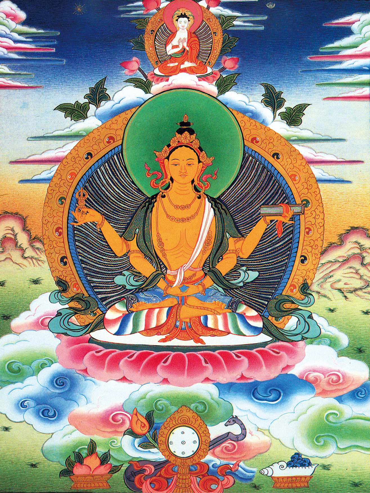

# 三聚经仪轨（意）

诸众生恒时皈依师 皈依佛 皈依法 皈依僧

南无释迦牟尼如来 应供 正遍知 明行足 善逝 世间解 无上士调御丈夫 天人师 佛 世尊

南无金刚不坏佛 南无宝光佛

南无龙尊王佛 南无精进军佛

南无精进喜佛 南无宝火佛

南无宝月光佛 南无现无愚佛

南无宝月佛 南无无垢佛

南无离垢佛 南无勇施佛

南无清净佛 南无清净施佛

南无娑留那佛 南无水天佛

南无坚德佛 南无旃檀功德佛

南无无量掬光佛 南无光德佛

南无无忧德佛 南无那罗延佛

南无功德华佛 南无莲华光游戏神通佛

南无财功德佛 南无德念佛

南无善名称功德佛 南无红炎帝幢王佛

南无善游步功德佛 南无斗战胜佛

南无善游步佛 南无周匝庄严功德佛

南无宝华游步佛 南无宝莲华善住娑罗树王佛

如是等一切世界诸佛世尊常住在世，是诸世尊当慈念我！若我此生，若我前生，从无始生死已来所作众罪，若自作、若教他作，见作随喜；若塔、若僧、若四方僧物，若自取、若教他取，见取随喜；五无间罪，若自作、若教他作，见作随喜；十不善道，若自作、若教他作，见作随喜；所作罪障，或有覆藏、或不覆藏，应堕地狱、饿鬼、畜生，诸余恶趣边地下贱及弥戾车，如是等处，所作罪障今皆忏悔！

今诸佛世尊，当证知我，当忆念我。我复于诸佛世尊前作如是言：若我此生，若于余生，曾行布施，或守净戒，乃至施与畜生一抟之食，或修净行所有善根，成就众生所有善根，修行菩提所有善根，及无上智所有善根，一切合集校计筹量，皆悉回向阿耨多罗三藐三菩提。如过去、未来、现在诸佛所作回向，我亦如是回向。

众罪皆忏悔 诸福尽随喜

及请佛功德 愿成无上智

去来现在佛 于众生最胜

无量功德海 我今归命礼

（以上内容摘自《大宝积经》）

菩萨具足大悲力 勇士救护利有情

救度无依罪恶我 彼诸菩萨我皈依

摘自《集学论》

三种身之业 语四意三业

十种不善业 悉皆各忏悔

无始至今生 十恶五无间

心随烦恼转 诸罪皆忏悔

愿戒无有过 具足清净戒

以无执心戒 戒度得圆满

我昔所作诸恶业 皆由无始贪嗔痴

从身语意之所生 一切我今皆忏悔

所有礼赞供养福 请佛住世转法轮

随喜忏悔诸善根   回向众生及佛道

༄༅། །བཅོམ་ལྡན་འདས་མ་ཤེས་རབ་ཀྱི་ཕ་རོལ་ཏུ་

ཕྱིན་པའི་སྙིང་པོ་བཞུགས་སོ། །
