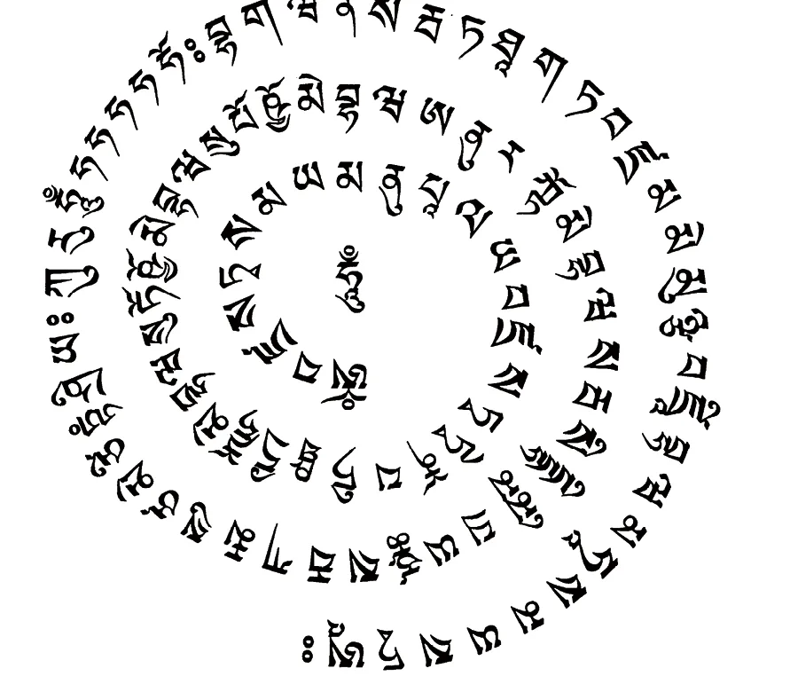

# 前行·开显解脱道

བླ་མ་མཁྱེན། ལན་གསུམ།

喇嘛钦 上师知 诵三遍

དལ་འབྱོར་རྙེད་དཀའ་ཨུ་དུམ་ཝ་ར་འདྲ། །

达久涅嘎额登瓦Ra扎 暇满难得如昙花

རྙེད་ན་དོན་ཆེན་ཡིད་བཞིན་ནོར་ལས་ལྷག །

涅那敦钦耶印诺类拉 得具大义胜摩尼

འདི་འདྲ་རྙེད་པ་ད་རེས་ཙམ་ཞིག་ལ། །

德扎涅巴达瑞赞耶拉 获得如是唯此次

དོན་ཆེན་གཏན་གྱི་འདུན་མ་མི་སྒྲུབ་པར། །

敦钦丹杰登玛么哲巴 未行大义永久计

དོན་མེད་ཆུད་ཟར་གྱུར་པ་བདག་ཅག་ལ། །

敦美切Ra杰巴达嘉拉  无义虚度我等众

དཀོན་མཆོག་ཀུན་འདུས་བླ་མས་ཐུགས་རྗེས་གཟིགས། །

衮巧根第喇美特吉热  总集三宝师悲视

དལ་འབྱོར་དོན་ཡོད་བྱེད་པར་བྱིན་གྱིས་རློབས། །

达久敦哟协巴辛吉洛  加持暇满具实义

དམིགས་རྐང་དང་པོའོ། ། 第一观修法竟

འདུས་བྱས་ཐམས་ཅད་མི་རྟག་གློག་བཞིན་གཡོ། །

第旭檀嘉么达洛印哟  诸法无常如闪电

སྣོད་བཅུད་གང་ལ་བསམས་ཀྱང་འཇིག་པའི་ཆོས། །

诺杰刚拉三江杰波秋  思维器情皆坏法

འཆི་བར་ངེས་ཤིང་ནམ་འཆི་ཆ་མེད་ཀྱང༌། །

切瓦诶香南切恰美江  定死死期无定准

རྟག་འཛིན་སེམས་ཀྱིས་རང་མགོ་བསྐོར་ནས་སུ། །

达怎森吉让果果内色  以常执心欺自己

བག་མེད་ངང་དུ་གནས་པ་བདག་ཅག་ལ། །

瓦美昂德内巴达嘉拉  处放逸中我等众

དཀོན་མཆོག་ཀུན་འདུས་བླ་མས་ཐུགས་རྗེས་གཟིགས། །

衮巧根第喇美特吉热  总集三宝师悲视

མི་རྟག་འཆི་བ་དྲན་པར་བྱིན་གྱིས་རློབས། །

么达切瓦占巴辛吉洛  加持忆念死无常

དམིགས་རྐང་གཉིས་པའོ། ། 第二观修法竟

དཀར་ནག་ལས་འབྲས་ནམ་ཡང་ཆུད་མི་ཟ། །

嘎那类追南样切么Ra  黑白业果永不虚

རྒྱུ་འབྲས་བསླུ་བ་མེད་པའི་ལམ་འདི་ལས། །

杰追勒瓦美波兰德类  无欺因果此道中

འཁོར་དང་མྱ་ངན་འདས་པའི་ཆོས་སུ་སྣང༌། །

括当Nia安第波秋色囊  显现轮回涅槃法

རང་བྱས་རང་ལ་སྨིན་པར་ངེས་ན་ཡང༌། །

让旭让拉门巴诶那样  自作必定成熟自

ཚུལ་བཞིན་འཇུག་ལྡོག་མི་ནུས་བདག་ཅག་ལ། །

策印久多么尼达嘉拉  未能取舍我等众

དཀོན་མཆོག་ཀུན་འདུས་བླ་མས་ཐུགས་རྗེས་གཟིགས། །

衮巧根第喇美特吉热  总集三宝师悲视

དགེ་སྡིག་བླང་དོར་བགྱིད་པར་བྱིན་གྱིས་རློབས། །

给德朗多杰巴辛吉洛  加持断恶而行善

དམིགས་རྐང་གསུམ་པའོ། ། 第三观修法竟

བཟོད་པར་དཀའ་བའི་སྡུག་བསྔལ་མང་དང་ལྡན། །

若巴嘎沃德尔芒当丹  具多难忍之痛苦

བདེ་བར་སྣང་བས་ཡིད་བསླུས་འགྱུར་བ་ཅན། །

得瓦囊卫耶利杰瓦坚  现乐变化欺惑心

ཟག་བཅས་ཕུང་པོ་མཐའ་དག་སྡུག་བསྔལ་རྒྱུ། །

Ra具彭波塔达德尔杰  有漏诸蕴痛苦因

ཁམས་གསུམ་འཁོར་བ་མེ་ཡི་འོབས་འདྲ་ཡང༌། །

堪森括瓦美耶哦扎样  三界轮回如火坑

དེ་ལྟར་མི་ཤེས་ཆགས་ལྡན་བདག་ཅག་ལ། །

得达么西恰丹达嘉拉  不知贪此我等众

དཀོན་མཆོག་ཀུན་འདུས་བླ་མས་ཐུགས་རྗེས་གཟིགས། །

衮巧根第喇美特吉热 总集三宝师悲视

ངེས་འབྱུང་བསམ་པ་སྐྱེ་བར་བྱིན་གྱིས་རློབས། །

诶炯三巴杰瓦辛吉洛  加持生起出离心

དམིགས་རྐང་བཞི་པའོ། ། 第四观修法竟

དེ་ནས་ཐུན་མིན་སྔོན་འགྲོའི་སྐྱབས་འགྲོ་ནི། 不共前行之皈依：

མདུན་དུ་དཔག་བསམ་ཤིང་ཆེན་ཡལ་ག་ལྔའི། །

登德华三香钦雅嘎诶  前观五枝如意树

དབུས་སུ་བླ་མ་ཨོ་རྒྱན་རྡོ་རྗེ་འཆང༌། །

卫色喇嘛哦坚多杰强  中央莲师金刚持

བརྒྱུད་པའི་བླ་མ་ཡི་དམ་མཁའ་འགྲོས་བསྐོར། །

觉波喇嘛耶丹夸珠果  传承师尊空行绕

མདུན་དུ་སྟོན་མཆོག་དུས་གསུམ་སངས་རྒྱས་རྣམས། །

登德敦巧第森桑吉南  前枝导师三时佛

གཡས་སུ་ཉེ་སྲས་ཐེག་ཆེན་འཕགས་པའི་ཚོགས། །

益色涅这特钦帕波措  右近佛子大乘圣

རྒྱབ་ཏུ་གསུང་རབ་གླེགས་བམ་རྣམ་པ་ཅན། །

嘉德松Ra拉万南巴坚  后枝佛典经函卷

གཡོན་དུ་མཆོག་བརྒྱད་ཉན་རང་དགེ་འདུན་དང༌། །

云德巧嘉年让给登当  左枝八胜声缘僧

མཐའ་སྐོར་ཡེ་ཤེས་ཆོས་སྐྱོང་ཚོགས་རྣམས་ཏེ། །

塔果耶西秋炯措南得  周围智慧护法众

ཕྱོགས་བཅུ་དུས་གསུམ་སྐྱབས་ཡུལ་ཐམས་ཅད་ཀུན། །

秀杰第森嘉耶檀嘉根  明观十方三时中

མ་ཚང་མེད་པ་ཏིལ་གོང་ལྟར་གསལ་བའི། །

玛仓美巴德贡达萨沃  诸皈境如芝麻荚

མདུན་དུ་རང་དང་མ་སོགས་ལྟོས་བཅས་དང༌། །

登德让当玛索度具当  前观我及母亲等

མཁའ་ཁྱབ་སེམས་ཅན་ཀུན་གྱིས་གུས་བཏུད་དེ། །

夸恰森坚根吉给德得  普天众生敬顶礼

དུས་འདི་ནས་བཟུང་བྱང་ཆུབ་སྙིང་པོའི་བར། །

第德内荣香确酿布瓦  从今直至菩提果

ཡིད་ཆེས་མཆོག་གིས་སྐྱབས་སུ་འགྲོ་བར་བསམ། །

耶齐巧给嘉色卓瓦三  以最诚信而皈依

ནམ་མཁའི་གནས་སུ་ནམ་མཁའ་གང་བ་ཡི། །

南葵内色南夸刚瓦耶  遍满虚空尽边际

བླ་མ་ཡི་དམ་མཁའ་འགྲོའི་ཚོགས་རྣམས་དང༌། །

喇嘛耶丹夸珠措南当  上师本尊空行众

སངས་རྒྱས་ཆོས་དང་འཕགས་པའི་དགེ་འདུན་ལ། །

桑吉秋当帕波给登拉  佛陀正法圣僧前

བདག་དང་འགྲོ་དྲུག་གུས་པས་སྐྱབས་སུ་མཆི། །

达当卓珠给贝嘉森切  我与六道敬皈依

སྐྱབས་ཡུལ་དེ་ལྟ་བུའི་མདུན་དུ་སེམས་བསྐྱེད་པ་ལ། ཐོག་མར་ཚད་མེད་བཞི་ལ་བློ་སྦྱངས་ནས་སེམས་ཅན་ཐམས་ཅད་བདེ་བ་དང་སོགས་ཅི་རིགས་བསགས།

于如是皈依境前发心：

首先修四无量心，尽力念诵“愿诸众生永具安乐及安乐因，愿诸众生永离众苦及众苦因，愿诸众生永具无苦之乐我心喜悦，愿诸众生远离贪嗔之心住平等舍”。

དངོས་གཞི་སེམས་བསྐྱེད་པ་ནི། 正行发心：

ཧོ། ཇི་ལྟར་དུས་གསུམ་རྒྱལ་བ་སྲས་བཅས་ཀྱིས། །

吙 杰达第森嘉瓦这具吉 吙 如三时佛及佛子

བྱང་ཆུབ་མཆོག་ཏུ་ཐུགས་ནི་བསྐྱེད་པ་ལྟར། །

香确巧德特呢杰巴达  发起殊胜菩提心

བདག་ཀྱང་མཁའ་ཁྱབ་འགྲོ་ཀུན་བསྒྲལ་བྱའི་ཕྱིར། །

达江夸恰卓根扎旭协  我亦为度普天众

བླ་མེད་བྱང་ཆུབ་མཆོག་ཏུ་སེམས་བསྐྱེད་དོ། །

拉美香确巧德森杰多  发起无上菩提心

འདི་འབུམ་བསགས། 诵十万遍

རྗེས་སུ་འབྲས་བུ་སྔགས་ཀྱི་སེམས་བསྐྱེད་ཚུལ་ཁྱད་པར་གྱི་ཚུལ་དུ།

随后，密宗果乘之殊胜发心法：

བདག་དང་མཐའ་ཡས་སེམས་ཅན་རྣམས། །

达当塔益森坚南  我与无边众

ཡེ་ནས་སངས་རྒྱས་ཡིན་པ་ལ། །

耶内桑吉印巴拉  本是正等觉

ཡིན་པར་ཤེས་པའི་བདག་ཉིད་དུ། །

印巴西波达涅德  了知如是性

བྱང་ཆུབ་མཆོག་ཏུ་སེམས་བསྐྱེད་དོ། །

香确巧德森杰多  发大菩提心

ཞེས་པའང་ཅི་རིགས་བརྗོད་དོ། ། 尽量念诵

མཎྜལ་ལ་ཚོམ་བུ་བཀོད་ལ། 于曼茶盘中安置供堆：

ཨོཾ་ཨཱཿ ཧཱུྃ།

嗡啊吽  嗡啊吽

ཆོས་དབྱིངས་མཉམ་ཉིད་ཆོས་སྐུའི་ཞིང་ཁམས་སུ། །

秋样年涅秋给样堪色  法界等性法身刹

རང་སྣང་མ་འགགས་ལོངས་སྐུ་རིགས་ལྔའི་ཞིང༌། །

让囊玛嘎隆格热诶样  自现五部报身刹

མཁའ་ཁྱབ་སྤྲུལ་སྐུའི་ཞིང་གི་བཀོད་པ་རྣམས། །

夸恰哲给样格果巴南  遍空化身刹庄严

ཀུན་བཟང་བདེ་ཆེན་མཆོད་པའི་སྤྲིན་དུ་འབུལ། །

根让得钦秋波珍德波  普贤大乐供云献

ཨོཾ་རཏྣ་མཎྜལ་པཱུ་ཛ་མེ་གྷ་ས་མུ་དྲ་སྥ་ར་ཎ་ས་མ་ཡེ་ཨ་ཧཱུྃ།

嗡Ra那曼扎拉 波匝美嘎萨么扎 萨帕Ra那萨玛耶啊吽

ཞེས་འབུལ། 以此供养

རྡོར་སེམས་བསྒོམ་བཟླས་ནི། 念修金刚萨埵：

ཨཱ། བདག་གི་སྤྱི་གཙུག་པད་ཟླའི་གདན་སྟེང་དུ། །

阿 达格协则巴第丹当德 阿 自顶莲月之垫上

དཔལ་ལྡན་རྡོ་རྗེ་སེམས་དཔའ་ཟླ་བའི་མདོག །

华丹多杰森华达沃多  月色金刚萨埵尊

རྡོ་རྗེ་དྲིལ་འཛིན་སྙེམས་མ་ཡུམ་དང་འཁྱུད། །

多杰哲怎您玛印当切  执持铃杵拥慢母

ལོངས་སྐུའི་ཆས་རྫོགས་རྡོ་རྗེའི་སྐྱིལ་ཀྲུང་བཞུགས། །

隆给齐作多吉杰仲尤  金刚跏趺报身装

ཐུགས་ཀར་ཟླ་སྟེང་ཧཱུྃ་ལ་ཡིག་བརྒྱས་བསྐོར། །

特嘎达当吽拉耶吉果  心月上吽ཧཱུྃ百字绕

བདུད་རྩིའི་རྒྱུན་བབ་སྡིག་སྒྲིབ་དག་པར་གྱུར། །

德贼晋瓦德哲达巴杰 降甘露流净罪障

སྟོབས་བཞི་ཚང་བའི་སྒོ་ནས་བདུད་རྩི་འབེབ་སྦྱོང་གི་དམིགས་པ་བཅས་ཡིག་བརྒྱ་བཟླ།

以具足四力，随着观想降下甘露净除罪障而诵百字明：

ཨོཾ་བཛྲ་ས་ཏྭ་ས་མ་ཡ། མ་ནུ་པ་ལ་ཡ། བཛྲ་ས་ཏྭ་ཏྭེ་ནོ་པ། ཏིཥྛ་དྲྀ་ཌྷོ་མེ་བྷ་ཝ།

嗡班匝儿萨埵萨玛雅 玛呢巴拉雅 班匝儿萨埵第诺巴 第叉哲卓美巴瓦

སུ་ཏོཥྱོ་མེ་བྷ་ཝ། སུ་པོཥྱོ་མེ་བྷ་ཝ། ཨ་ནུ་རཀྟོ་མེ་བྷ་ཝ། སརྦ་སིདྡྷིམྨེ་པྲ་

色多卡哟美巴瓦 色波卡哟美巴瓦 阿呢Ra多美巴瓦萨儿瓦色德玛美抓

ཡཙྪ། སརྦ་ཀརྨ་སུ་ཙ་མེ། ཙིཏྟཾ་ཤྲི་ཡཾ་ཀུ་རུ་ཧཱུྃ། ཧ་ཧ་ཧ་ཧ་ཧོ། བྷ་ག་ཝཱན།

雅匝 萨儿瓦噶儿玛色匝美 则当西儿样格热吽 哈哈哈哈吙 巴嘎万

སརྦ་ཏ་ཐཱ་ག་ཏ། བཛྲ་མ་མེ་མུཉྩ། བཛྲཱི་བྷ་ཝ། མ་ཧཱ་ས་མ་ཡ་ས་ཏྭ་ཨཱཿ

萨儿瓦达塔嘎达 班匝儿玛美门匝 班则儿巴瓦 玛哈萨玛雅 萨埵阿

ཐུན་མཐར། 结座：

མགོན་པོ་བདག་ནི་མི་ཤེས་རྨོངས་པ་ཡིས། །

衮波达呢么西蒙巴益  怙主 我以无知愚

དམ་ཚིག་ལས་ནི་འགལ་ཞིང་ཉམས། །

丹策类呢嘎样年  违越失誓言

བླ་མ་མགོན་པོས་སྐྱབས་མཛོད་ཅིག །

喇嘛衮布嘉作吉  祈愿师怙救

གཙོ་བོ་རྡོ་རྗེ་འཛིན་པ་སྟེ། །

作沃多杰怎巴得  主尊金刚持

ཐུགས་རྗེ་ཆེན་པོའི་བདག་ཉིད་ཅན། །

特杰钦布达涅坚  大悲本性尊

འགྲོ་བའི་གཙོ་ལ་བདག་སྐྱབས་མཆི། །

卓沃作拉达嘉切  众主我皈依

བདག་དང་སེམས་ཅན་ཐམས་ཅད་ཀྱི་སྐུ་གསུང་ཐུགས་རྩ་བ་དང་ཡན་ལག་

达当森坚檀嘉杰 格松特 匝瓦当 严拉

གི་དམ་ཚིག་ཉམས་པ་ཐམས་ཅད་མཐོལ་ལོ་བཤགས་སོ། །སྡིག་སྒྲིབ་ཉེས་

格 丹策年巴檀嘉托洛夏索 德哲尼

ལྟུང་དྲི་མའི་ཚོགས་ཐམས་ཅད་བྱང་ཞིང་དག་པར་མཛད་དུ་གསོལ།

东哲美措 檀嘉香样达巴匝德索

ཞེས་གསོལ་བ་བཏབ་པས་རྡོ་རྗེ་སེམས་དཔའི་ཞལ་ནས་རིགས་ཀྱི་བུ་

益 索瓦达贝 多杰森慧雅内热杰沃

ཁྱོད་ཀྱི་དམ་ཚིག་ཉམས་ཆག་ཐམས་ཅད་དག་པ་ཡིན་ནོ་ཞེས་གནང་བ་

秋杰丹策年恰檀嘉达巴印诺 益 囊瓦

བྱིན་ནས་རང་ལ་ཐིམ་པས་རང་དང་སེམས་ཅན་ཐམས་ཅད་རྡོ་རྗེ་སེམས་

辛内 让拉腾贝 让当森坚檀嘉多杰森

དཔའི་སྐུར་གྱུར་པར་བསམས་ལ།

慧格 杰巴三拉

我与一切有情发露忏悔所失坏之一切身语意根本、支分誓言，祈愿令所有业障、堕罪垢染悉皆清净。以此祈祷，观想金刚萨埵亲自赐言：“善男子，汝所失坏之一切誓言皆已清净。”后融入自身，自己与一切有情变成金刚萨埵身，

ཡིག་དྲུག་བཟླ། 诵六字心咒：

ཨོཾ་བཛྲ་ས་ཏྭ་ཧཱུྃ།

嗡班匝儿萨埵吽

མཐར། 最后回向：

དགེ་བ་འདི་ཡིས་མྱུར་དུ་བདག །

给瓦德益涅德达 愿我以此善

རྡོ་རྗེ་སེམས་དཔའ་འགྲུབ་གྱུར་ནས། །

多杰森华哲杰内 速成金萨尊

འགྲོ་བ་གཅིག་ཀྱང་མ་ལུས་པ། །

卓瓦吉江玛利巴 众生无一余

དེ་ཡི་ས་ལ་འགོད་པར་ཤོག །

得耶萨拉果巴秀 安置彼果位

བདག་དང་སེམས་ཅན་ཐམས་ཅད་ཀྱི། །

达当森坚檀嘉杰 愿我诸有情

དམ་ཚིག་ཉམས་ཆག་ཀུན་དག་ཅིང༌། །

丹策年恰根达江 失誓皆清净

འདི་ནས་བྱང་ཆུབ་སྙིང་པོའི་བར། །

德内香确酿布瓦 今至菩提果

དམ་ཚིག་རྣམ་པར་དག་པར་ཤོག །

丹策南巴达巴秀 誓言悉清净

ཅེས་སོགས་སྨོན་ལམ་གདབ་བོ། ། 以此等发愿

༈ བླ་མའི་རྣལ་འབྱོར་ནི། 上师瑜伽：

ཨེ་མ་ཧོ།

诶玛吙 诶玛吙

རང་སྣང་དག་པ་རབ་འབྱམས་ཞིང་ཁམས་སུ། །

让囊达巴Ra坚样堪色 浩瀚自现净土中

རང་ལུས་རྡོ་རྗེ་རྣལ་འབྱོར་མར་གསལ་བའི། །

让利多杰那久玛萨沃 自观金刚瑜伽母

སྤྱི་བོར་ཆུ་སྐྱེས་འདབ་སྟོང་ཉི་ཟླའི་སྟེང༌། །

协沃切吉达东涅第当 顶千瓣莲日月上

སྐྱབས་གནས་ཀུན་འདུས་ཨོ་རྒྱན་རྡོ་རྗེ་འཆང༌། །

嘉内根第哦坚多杰强 皈处总集莲师尊

དཀར་དམར་ཞི་འཛུམ་རྡོ་རྗེ་ཐོད་བུམ་བསྣམས། །

嘎玛耶怎多杰托温南 白红含笑持杵盖

ལོངས་སྐུའི་ཆས་རྫོགས་མཚོ་རྒྱལ་ཡུམ་དང་འཁྲིལ། །

隆给齐作措嘉印当彻 报身装拥措嘉母

སྐུ་ལ་རང་བྱུང་རྒྱུད་སྡེའི་དཀྱིལ་འཁོར་རྫོགས། །

格拉让雄杰第金括作 身圆自生续坛城

རྩ་བརྒྱུད་བླ་མ་མཁའ་འགྲོ་དམ་ཅན་བཅས། །

匝觉喇嘛夸卓丹坚具 上师空行护法众

ཏིལ་གྱི་གོང་བུ་ཕྱེ་བ་བཞིན་དུ་བཞུགས། །

德杰贡沃协瓦印德尤 安住如开芝麻荚

རྔ་ཡབ་གླིང་ནས་དེ་འདྲའི་ཡེ་ཤེས་པ། །

阿雅朗内得这耶西巴 妙拂洲中智慧尊

ཆར་ལྟར་བབ་པ་བསྒོམ་པའི་རྟེན་ལ་ཐིམ། །

恰达瓦巴贡波定拉腾 如雨降临融修依

ཧཱུྃཿ ཨོ་རྒྱན་ཡུལ་སོགས་ཚིག་བདུན་གསོལ་འདེབས་གསུམ་མམ་བདུན་བརྗོད་པས་སྤྱན་དྲངས་ལ་བསྟིམས་ནས།

诵此七句祈祷文三遍或七遍而迎请上师融入，

ཧཱུྃ༔ ཨོ་རྒྱན་ཡུལ་གྱི་ནུབ་བྱང་མཚམས༔

吽 哦坚耶杰呢香灿 吽 邬金西北隅

པདྨ་གེ་སར་སྡོང་པོ་ལ༔

巴玛给萨东波拉 莲花蕊茎上

ཡ་མཚན་མཆོག་གི་དངོས་གྲུབ་བརྙེས༔

雅灿巧格悟哲尼 稀有成就尊

པདྨ་འབྱུང་གནས་ཞེས་སུ་གྲགས༔

巴玛炯内益色扎 共称莲花生

འཁོར་དུ་མཁའ་འགྲོ་མང་པོས་བསྐོར༔

括德夸卓芒布果 空行众围绕

ཁྱེད་ཀྱི་རྗེས་སུ་བདག་བསྒྲུབ་ཀྱིས༔

切杰吉色达哲吉 我随汝修行

བྱིན་གྱིས་བརླབ་ཕྱིར་གཤེགས་སུ་གསོལ༔

辛吉拉协夏色索 祈临赐加持

གུ་རུ་པདྨ་སིདྡྷི་ཧཱུྃ༔

格热巴玛色德吽 格热巴玛色德吽

ཡན་ལག་བདུན་པ་བྱ་བ་ནི། 随后作七支供：

ཧོ། རྡུལ་སྙེད་ལུས་བཏུད་གུས་པས་ཕྱག་འཚལ་ལོ། །

吙 德涅利德给贝香擦洛 吙 微尘数身敬顶礼

སྣང་སྲིད་གཞིར་བཞེངས་ཀུན་བཟང་མཆོད་པས་མཆོད། །

囊哲耶样根让秋贝秋  现有基现普贤供

ཚེ་རབས་ནས་བསགས་སྡིག་ལྟུང་ཅི་མཆིས་བཤགས། །

才Ra内萨德东杰齐夏  忏悔累世积堕罪

འཁོར་འདས་དགེ་ཚོགས་ཀུན་ལ་རྗེས་ཡི་རང༌། །

括第给措根拉吉耶让  随喜轮涅诸善聚

འགྲོ་ཁམས་ཇི་སྲིད་རྡོ་རྗེའི་སྐུར་བཞུགས་ནས། །

卓堪杰哲多吉格尤内  金刚身住尽有界

ཟབ་རྒྱས་ཆོས་ཀྱི་འཁོར་ལོ་བསྐོར་དུ་གསོལ། །

Ra吉秋杰括罗果德索  请转深广妙法轮

དགེ་ཚོགས་མ་ལུས་སངས་རྒྱས་ཐོབ་ཕྱིར་བསྔོ། །

给措玛利桑吉托协哦  回向善资为成佛

གསོལ་བ་གདབ་པ་ནི། 祈祷：

ནུབ་ཕྱོགས་ཨོ་རྒྱན་དབང་གི་ཕོ་བྲང་དུ། །

呢秀哦坚旺格颇庄德  西方邬金自在宫

བདེ་གཤེགས་སྐུ་གསུང་ཐུགས་ཀྱི་སྤྲུལ་པ་སྟེ། །

得夏格松特杰哲巴得  善逝身语意化身

འཛམ་བུའི་གླིང་དུ་འགྲོ་བའི་དོན་ལ་བྱོན། །

赞卫朗德卓沃敦拉迅  为利众生降赡洲

རིག་འཛིན་མཁའ་འགྲོ་མང་པོའི་འཁོར་གྱིས་བསྐོར། །

仁增夸卓芒布括吉果  持明空行众围绕

པདྨ་འབྱུང་གནས་ཀྱི་ལྷ་ཚོགས་ལ་གསོལ་བ་འདེབས། །

巴玛炯内杰拉措拉索瓦得 祈祷莲师之尊众

ཨོ་རྒྱན་པདྨ་འབྱུང་གནས་ལ་གསོལ་བ་འདེབས། །

哦坚巴玛炯内拉索瓦得  祈祷邬金莲花生

བདག་ལ་དབང་བསྐུར་བྱིན་གྱིས་བརླབ་ཏུ་གསོལ། །

达拉旺格辛吉拉德索  祈赐灌顶加持吾

ཞེས་མོས་གུས་གདུང་ཤུགས་དྲག་པོས་གསོལ་བ་བཏབ་ཅིང་འོད་ཟེར་བདུད་རྩིའི་རྒྱུན་གྱིས་སྤྱི་བོ་ནས་དབང་བསྐུར་བྱིན་གྱིས་བརླབས་པར་བསམ།

益 木给东协扎布索瓦达江哦瑞德贼晋吉协沃内 旺格辛吉拉巴三

以强烈信解恭敬心猛厉祈祷，观想光芒甘露流由经顶上赐予灌顶加持。

ཨོཾ་ཨཱཿ ཧཱུྃ་བཛྲ་གུ་རུ་པདྨ་སིདྡྷི་ཧཱུྃ༔

嗡啊吽班匝儿格热巴玛色德吽

གཞན་ཡང་ཨོ་རྒྱན་ཆེན་པོ་དང་ཡི་དམ་གང་ཡང་རུང་བ་དབྱེར་མེད་ཀྱི་བླ་མའི་རྣལ་འབྱོར་ལ་དཔེར་མཚོན་ན་རྟ་མགྲིན་ལྟ་བུ་ལ་ངོ་བོ་ཨོ་རྒྱན་ཆེན་པོ་ལ་རྣམ་པ་རྟ་མགྲིན་དུ་གསལ་བཏབ་ལ།

此外，莲师与任意本尊无别之上师瑜伽：以马头明王为例，本体为邬金莲花生大士，形象观为马头明王：

དམར་ནག་གྲུ་གསུམ་དབང་གི་གཞལ་ཡས་ན༔

玛那哲森旺格雅益那 红黑三角自在宫

བདུད་ནག་ཕོ་མོ་བརྫིས་པའི་གདན་སྟེང་དུ༔

德那颇莫贼波丹当德 踩踏男女魔垫上

དབང་གི་རྒྱལ་པོ་པདྨ་ཧེ་རུ་ཀ༔

旺格嘉波巴玛黑热嘎 怀王班玛黑热嘎

པདྨ་རིགས་ཀྱི་ཁྲོ་བོ་རྣམས་ཀྱིས་བསྐོར༔

巴玛热杰绰沃南吉果 莲花部众怒尊绕

རྟ་མགྲིན་དབང་གི་ལྷ་ཚོགས་ལ་གསོལ་བ་འདེབས༔

达珍旺格拉措拉索瓦得 祈祷马头明王众

ཨོ་རྒྱན་པདྨ་འབྱུང་གནས་ལ་གསོལ་བ་འདེབས༔

哦坚巴玛炯内拉索瓦得 祈祷邬金莲花生

བདག་ལ་དབང་བསྐུར་བྱིན་གྱིས་བརླབ་ཏུ་གསོལ༔

达拉旺格辛吉拉德索 祈赐灌顶加持吾

ཞེས་སྦྱར་བའི་ཚིག་བདུན་པོས་གསོལ་བ་བཏབ། 以此七句祈祷

དེ་བཞིན་གཤིན་རྗེའི་གཤེད་ལ། 以大威德为例：

མཐིང་ནག་ཨེ་ལས་དྲག་པོའི་གཞལ་ཡས་ན༔

唐那诶类扎布雅益那 蓝黑诶ཨེ成威猛宫

གཤིན་རྗེ་ཆུ་གླང་བརྫིས་པའི་གདན་སྟེང་དུ༔

辛杰切朗贼波丹当德 踩踏阎罗水牛上

འཇམ་དཔལ་ཡ་མཱནྟ་ཀ་གཤིན་རྗེའི་གཤེད༔

蒋华雅曼达嘎辛吉协 妙吉祥尊大威德

གཤེད་པོ་ཁྲོ་བོ་དྲེགས་པའི་འཁོར་གྱིས་བསྐོར༔

协波绰沃扎波括吉果 怒傲阎卒眷围绕

གཤིན་རྗེ་གཤེད་པོའི་ལྷ་ཚོགས་ལ་གསོལ་བ་འདེབས༔

辛杰协布拉措拉索瓦得 祈祷大威德尊众

ཨོ་རྒྱན་པདྨ་འབྱུང་གནས་ལ་གསོལ་བ་འདེབས༔

哦坚巴玛炯内拉索瓦得 祈祷邬金莲花生

བདག་ལ་དབང་བསྐུར་བྱིན་གྱིས་བརླབ་ཏུ་གསོལ༔

达拉旺格辛吉拉德索 祈赐灌顶加持吾

ཐུན་མཐར་དབང་བཞི་ལེན་པ་ནི། 结座受四灌顶：

བླ་མའི་གནས་གསུམ་ཡི་གེ་འབྲུ་གསུམ་ལས། །

喇美内森耶给哲森类  上师三处三字中

འོད་ཟེར་དཀར་དམར་མཐིང་གསུམ་བྱུང་ནས་སུ། །

哦瑞嘎玛唐森雄内色  放白红蓝三光芒

རང་གི་གནས་གསུམ་ཐིམ་པས་བྱིན་གྱིས་བརླབས། །

让格内森腾贝辛吉拉  融自三处作加持

སླར་ཡང་བླ་མ་འཁོར་བཅས་འོད་དུ་ཞུ། །

拉样喇嘛括具哦德耶  复师及眷化为光

ཚངས་པའི་ལམ་ནས་སྙིང་གི་ཐིག་ལེར་ཐིམ། །

仓波兰内酿格特类腾  经梵穴融心明点

བླ་མའི་ཐུགས་དང་རང་སེམས་དབྱེར་མེད་པ། །

喇美特当让森耶美巴  师意自心成无别

སེམས་ཉིད་གཉུག་མ་ཆོས་སྐུའི་ངང་བཞག་པས། །

森涅涅玛秋给昂雅贝  安住心性本法身

སྒྲིབ་པ་བཞི་དག་དབང་བཞིའི་ཡེ་ཤེས་ཐོབ། །

哲巴耶达旺益耶西托  净四障获四灌智

ལམ་བཞི་འབྱོངས་ཤིང་སྐུ་བཞི་མངོན་གྱུར་པའི། །

兰耶炯香格耶温杰波  纯熟四道现四身

བྱིན་རླབས་དབང་བསྐུར་མ་ལུས་ཐོབ་པར་གྱུར། །

辛拉旺格玛利托巴杰  尽得灌顶及加持

ཅེས་བསམས་ལ། བཛྲ་གུ་རུ་ཅི་རིགས་བགྲང་མཐར།

如是观想尽力念诵莲师心咒：

ཨོཾ་ཨཱཿ ཧཱུྃ་བཛྲ་གུ་རུ་པདྨ་སིདྡྷི་ཧཱུྃ༔

嗡啊吽班匝儿格热巴玛色德吽

最后发愿：

སྐྱེ་བ་ཀུན་ཏུ་ཡང་དག་བླ་མ་དང༌། །

杰瓦根德样达喇嘛当生生世世不离师

འབྲལ་མེད་ཆོས་ཀྱི་དཔལ་ལ་ལོངས་སྤྱོད་ཅིང་། །

抓美秋杰华拉隆秀江恒时享用胜法乐

ས་དང་ལམ་གྱི་ཡོན་ཏན་རབ་རྫོགས་ནས། །

萨当兰杰云丹Ra作内圆满地道功德已

རྡོ་རྗེ་འཆང་གི་གོ་འཕང་མྱུར་ཐོབ་ཤོག །

多杰强格果庞涅托秀唯愿速得金刚持

སྔོན་འགྲོའི་ངག་འདོན་འདི་ནི་མི་ཕམ་འཇམ་དཔལ་དགྱེས་པས་བསྡེབས་པ་དགེ་ལེགས་འཕེལ།། །།

此前行念诵仪轨，麦彭蒋华吉巴撰写，增上善妙！

༄༅། །རྡོ་རྗེ་སེམས་དཔའི་སྒྲུབ་ཐབས་ནི།
