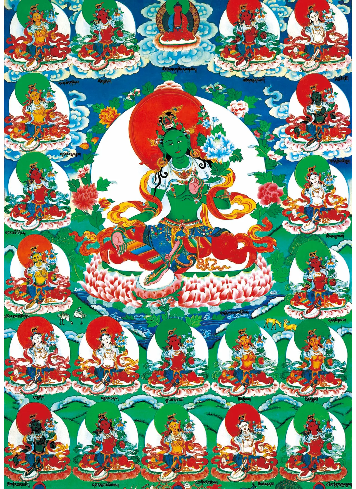

# 古萨里修法

ཕཊ༔ ལུས་གཅེས་འཛིན་བོར་བས་ལྷ་བདུད་བཅོམ༔

啪的 利吉怎沃卫拉德炯  啪的 舍爱身执毁天魔

སེམས་ཚངས་པའི་སྒོ་ནས་དབྱིངས་ལ་ཐོན༔

森仓波果内样拉吞 心出梵穴入法界

འཆི་བདག་གི་བདུད་བཅོམ་ཁྲོས་མར་གྱུར༔

切达格德炯楚玛杰 毁死魔成忿怒母

གཡས་ཉོན་མོངས་བདུད་བཅོམ་གྲི་གུག་གིས༔

益纽蒙德炯哲格给 右弯刀毁烦恼魔

གཟུགས་ཕུང་པོའི་བདུད་བཅོམ་ཐོད་པ་བྲེགས༔

热彭布德炯托巴抓 斩头颅毁色蕴魔

གཡོན་ལས་བྱེད་ཚུལ་གྱིས་བྷནྡྷ་ཐོགས༔

云类协策吉班达托 左手业印持托巴

སྐུ་གསུམ་གྱི་མི་མགོའི་སྒྱེད་པུར་བཞག༔

格森杰么固杰波雅 置于三身人头灶

ནང་སྟོང་གསུམ་གང་བའི་བམ་རོ་དེ༔

囊东森刚沃万若得 内尸身满三千界

ཨ་ཐུང་དང་ཧཾ་ཡིག་གིས་བདུད་རྩིར་བཞུ༔

阿通当杭耶给德则耶 以短阿Λ杭融甘露

འབྲུ་གསུམ་གྱི་ནུས་པས་སྦྱངས་སྤེལ་བསྒྱུར༔

哲森杰尼贝样贝杰 三字咒力净增转

ཨོཾ་ཨཱཿ ཧཱུྃ༔

嗡啊吽

གྲངས་མེད་མཐར། 随力念诵

ཕཊ༔ ཡར་མཆོད་ཡུལ་མགྲོན་གྱི་ཐུགས་དམ་བསྐང་༔

啪的 雅秋耶准杰特丹刚  啪的 上供圣客酬尊意

ཚོགས་རྫོགས་ནས་མཆོག་ཐུན་དངོས་གྲུབ་ཐོབ༔

措作内巧吞悟哲托 圆资获胜共悉地

མར་འཁོར་བའི་མགྲོན་མཉེས་ལན་ཆགས་བྱང་༔

玛括沃准尼兰恰香 下施凡客喜偿债

ཁྱད་པར་དུ་གནོད་བྱེད་བགེགས་རིགས་ཚིམ༔

恰巴德诺协嘎热层 尤令作害魔种足

ནད་གདོན་དང་བར་ཆད་དབྱིངས་སུ་ཞི༔

那敦当瓦恰样色耶 病魔障碍消法界

རྐྱེན་ངན་དང་བདག་འཛིན་རྡུལ་དུ་བརླགས༔

晋安当达怎德德拉 恶缘我执摧为尘

མཐར་མཆོད་བྱ་དང་མཆོད་ཡུལ་མ་ལུས་ཀུན༔

塔秋夏当秋耶玛利根 末诸供物能所供

གཤིས་རྫོགས་པ་ཆེན་པོར་མ་བཅོས་ཨ༔

西作巴钦波玛久阿 大圆满中无改阿

༈ ན་མོ། ཕན་བདེ་མ་རྣམས་ཀུན་ལ་བསྔོ༔

南无 攀得玛南根拉哦 南无 利乐回向诸慈母

ཕན་བདེས་ནམ་མཁའ་གང་བར་ཤོག༔

攀第南夸刚瓦秀 愿诸利乐遍虚空

སྡུག་བསྔལ་མ་ལུས་བདག་ལ་སྨིན༔

德尔玛利达拉门 无余痛苦成熟我

སྡུག་བསྔལ་གྱི་རྒྱ་མཚོ་སྐེམ་པར་ཤོག༔

德尔杰嘉措根巴秀 愿令苦海悉干涸

༈ ན་མོ། ཆོས་རྣམས་ཐམས་ཅད་རྒྱུ་ལས་བྱུང༌། །

南无 秋南檀嘉杰类雄 南无 诸法从缘起

དེ་རྒྱུ་དེ་བཞིན་གཤེགས་པས་གསུངས། །

得杰得印夏贝松 如来说是因

རྒྱུ་ལ་འགོག་པ་གང་ཡིན་པ། །

杰拉果巴刚印巴 彼法因缘尽

དགེ་སྦྱོང་ཆེན་པོས་འདི་སྐད་གསུངས། །

给永钦布德嘎松 是大沙门说

༈ སྡིག་པ་ཅི་ཡང་མི་བྱ་ཞིང་། །

德巴杰样么夏样 诸恶莫作

དགེ་བ་ཕུན་སུམ་ཚོགས་པར་སྤྱད། །

给瓦彭森措巴夏 诸善奉行

རང་གི་སེམས་ནི་ཡོངས་སུ་འདུལ། །

让格森呢永色德 自净其意

འདི་ནི་སངས་རྒྱས་བསྟན་པ་ཡིན། །

德呢桑吉丹巴印 是诸佛教

བསྟན་པ་དམ་པའི་ཆོས་ལ་ཡུན་རིང་དུ་གནས་པར་གྱུར་ཅིག །

丹巴丹波秋拉印让德内巴杰吉 祈愿圣教正法常住世

ལྷ་དང་ལྷ་མིན་ཅོད་པན་གྱིས། །

拉当拉门久班吉  一切天人与非天

ཞབས་ཀྱི་པདྨོ་ལ་བཏུད་དེ། །

雅杰巴莫拉德得  悉皆顶戴其足莲

ཕོངས་པ་ཀུན་ལས་སྒྲོལ་མཛད་ཅིང། །

彭巴根类卓匝江 救脱所有诸穷困

སྒྲོལ་མ་ཡུམ་ལ་ཕྱག་འཚལ་ལོ། །

卓玛印拉香擦洛  度母佛母我顶礼

ཞེས་པ་འདི་ནི་དཱི་པཾ་ཀཱ་ར་ཤྲཱི་ཛྙཱ་ནས་མཛད་པའོ། །

༄༅། །འཕགས་མ་ལྷ་མོ་སྒྲོལ་མ་ལ་བསྟོད་པ་ཉི་ཤུ་རྩ་གཅིག་ཅེས་བྱ་བ་བཞུགས་སོ། །
