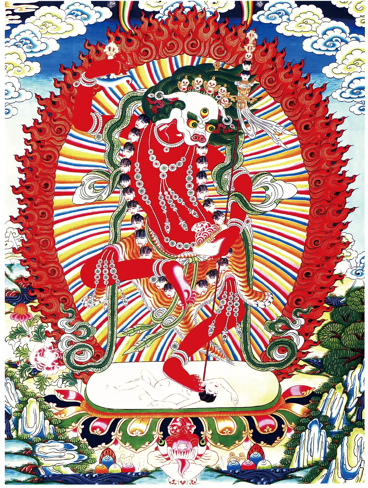

# 心经仪轨（意）

无可言思般若度 不生不灭虚空体

各别自证智行境 三世佛母我敬礼

般若波罗蜜多心经

顶礼般若佛母！

观自在菩萨，行深般若波罗蜜多时，照见五蕴皆空，度一切苦厄。舍利子，色不异空，空不异色，色即是空，空即是色，受想行识，亦复如是。舍利子，是诸法空相，不生不灭，不垢不净，不增不减。是故空中无色，无受想行识，无眼耳鼻舌身意，无色声香味触法，无眼界，乃至无意识界，无无明，亦无无明尽，乃至无老死，亦无老死尽。无苦集灭道，无智亦无得。以无所得故。菩提萨埵，依般若波罗蜜多故，心无挂碍。无挂碍故，无有恐怖，远离颠倒梦想，究竟涅槃。三世诸佛，依般若波罗蜜多故，得阿耨多罗三藐三菩提。故知般若波罗蜜多，是大神咒，是大明咒，是无上咒，是无等等咒，能除一切苦，真实不虚。故说般若波罗蜜多咒，即说咒曰：揭谛揭谛，波罗揭谛，波罗僧揭谛，菩提萨婆诃。

（唐三藏法师玄奘翻译）

南无 顶礼师、顶礼佛、顶礼法、顶礼僧

顶礼般若波罗蜜多大佛母 愿我成就谛实语

如昔天王帝释依于思维甚深般若波罗蜜多之义、念诵词句而回遮魔王波旬等一切违缘，愿我亦依于思维甚深般若波罗蜜多之义、念诵词句而回遮、空无、寂灭、善灭魔王波旬等一切违缘。

不生亦不灭 不常亦不断

不一亦不异  不来亦不去

能说是因缘 善灭诸戏论

我稽首礼佛 诸说中第一

平息八万魔障类 远离损害之违缘

圆满成办诸顺缘 依此吉祥今吉祥

修行菩提时 内外诸危害

一切诸障碍 悉皆得息灭

༄༅། །མཁའ་འགྲོའི་གཙོ་སྒྲུབ་ཟབ་ཏིག་བཞུགས༔
