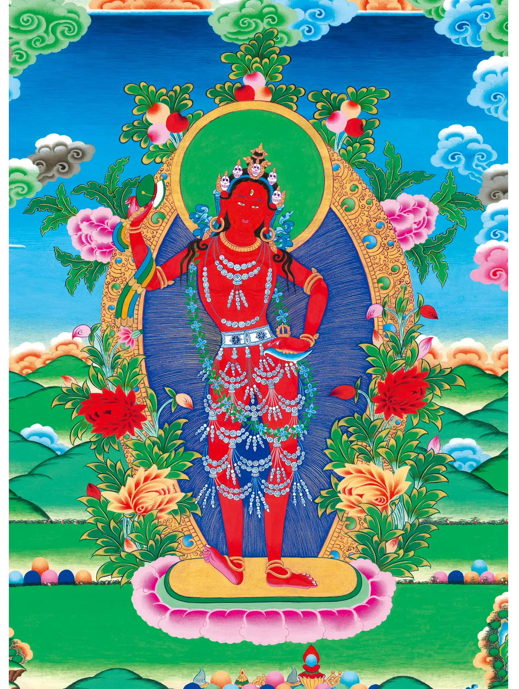

# 施 食 法

འདོད་ཡོན་ལྔ་དང་ཟས་སྣ་ཅི་འབྱོར་བཤམས་ནས་བྲན།

尽己所能陈设五欲妙与种种食物，洒水，

ན་མཿ སརྦ་ཏ་ཐཱ་ག་ཏ་ཨ་ཝ་ལོ་ཀི་ཏེ་ཨོཾ་སཾ་བྷ་ར་སཾ་བྷ་ར་ཧཱུྃ།

那美萨儿瓦达塔嘎达 阿瓦洛格得 嗡桑巴Ra桑巴Ra吽

འཇིག་རྟེན་འདི་ནས་ཚེ་ལས་འདས་པ་འདི་ཉིད་ལ་སྦྱིན་ནོ༔ བསྔོའོ༔

杰定德内才类第巴德涅拉印诺 哦喔

布施回向离此世者

མིག་གི་ཡུལ་དུ་གཟུགས་མཛེས་པ༔

么格耶德热贼巴 眼境美色

རྣ་བའི་ཡུལ་དུ་སྒྲ་སྙན་པ༔

那沃耶德扎年巴 耳境悦音

སྣ་ཡི་ཡུལ་དུ་དྲི་ཞིམ་པ༔

那耶耶德哲印巴 鼻境妙香

ལྕེ་ཡི་ཡུལ་དུ་རོ་བྲོ་བ༔

杰耶耶德若卓瓦 舌境美味

ལུས་ཀྱི་ཡུལ་དུ་རེག་བྱ་འཇམ་པ༔

利杰耶德Ra夏蒋巴  身境柔触

ཡིད་ཀྱི་ཡུལ་དུ་བདེ་བས་ཚིམ་པ༔

耶杰耶德得卫层巴  意境乐足

བར་དོ་ལོངས་སྤྱོད་རྫོགས་པའི་སྐུ་མཚན་དང་དཔེ་བྱད་ཀྱིས་བརྒྱན་པར་གྱུར་ཅིག༔

瓦多隆秀作波格灿当 慧夏吉 坚巴杰吉

愿中阴成就相好庄严报身

ཀྱཻ་མ་ཚེ་འདས་རིགས་ཀྱི་བུ༔

杰玛才第热杰沃 奇哉离世善男子

ཡང་དག་ངེས་པའི་ལུང་འདི་ཉོན༔

样达诶波隆德纽 听此决定真实教

རིན་ཆེན་རྟེན་དང་ཕུང་པོའི་དཀྱིལ༔

仁钦定当彭布杰 珍宝所依蕴身中

རང་རིག་གསལ་བའི་སྒོ་ཕྱེས་པ༔

让热萨沃果西巴 开启自明觉性门

འདི་ནི་སངས་རྒྱས་ཞིང་ཁམས་ཏེ༔

德呢桑吉样堪得 此者即是佛刹土

འདི་ལས་བུ་གཅིག་མ་གཡོ་ཞིག༔

德类沃吉玛哟耶 此中莫动善男子

ལོངས་སྤྱོད་ཚོགས་འདི་རབ་ཏུ་ལོངས༔

隆秀措德Ra德隆 尽享用此受用聚

སྟོང་ཉིད་གསལ་བའི་སྒོ་ཕྱེས་ལ༔

东涅萨沃果西拉 开启空性光明门

རིག་པ་རང་བྱུང་སྟོང་པ་མཉམ༔

热巴让雄东巴年 自然觉性空平等

ཟས་འདི་ལོངས་ལ་རང་སྣང་ལྟོས༔

瑞德隆拉让囊度 当受此食观自现

འདི་ནི་ཁྱོད་ཀྱི་གཏན་སྲིད་ཡིན༔

德呢秋杰丹哲印 此乃汝之永久位

འདིར་ནི་བུ་དང་བུ་མོ་དང་༔

德呢沃当沃莫当 于此子与女

ཕ་མ་སྤུན་ཟླ་གཟའ་རོགས་དང་༔

帕玛本达Ra若当 父母兄夫友

ཇོ་ཇོ་མིང་པོ་ལྕམ་སྲིང་དང་༔

久久芒波坚章当 兄弟与姊妹

ཞང་པོ་མ་སྲུ་གྲོགས་པོ་དང་༔

样波玛哲卓波当 舅姨与友伴

ཉེ་རིང་བརྩེ་བ་ཐམས་ཅད་ཀྱིས༔

涅让贼瓦檀嘉吉 诸慈远近亲

རོ་མཆོག་ལྡན་པའི་ཟས་མང་ཐོགས༔

若巧丹波瑞芒托 持胜丰美食

གདུང་བའི་ཤུགས་ཀྱིས་མཆི་མ་ཕྱུང་༔

东沃协吉切玛雄 悲伤而泪涌

ཟས་ཀྱི་ཐ་མ་འདི་ཡིན་པས༔

瑞杰塔玛德印贝 此乃最后食

སྐྱེ་བ་གཏན་གྱི་ལོངས་སྤྱོད་ཟས༔

杰瓦丹杰隆秀瑞 永生受用食

མི་འཛད་ནམ་མཁའི་མཛོད་ལ་སྤྱོད༔

么匝南葵作拉秀 无尽虚空藏

སྦྱིན་པའི་ཕ་རོལ་ཡོངས་རྫོགས་པས༔

印波帕若永作贝 为圆布施度

ཟས་གཏད་འདི་ནི་དགའ་བས་ལོངས༔

瑞达德呢嘎卫隆 喜纳此授食

གསོན་ཡང་གཤིན་ལ་མི་འཕྲེང་ངོ་༔

孙样辛拉么创哦 活亦勿恋死

གཤིན་ཡང་གསོན་ལ་མ་ཆགས་པར༔

辛样孙拉玛恰巴 死亦莫贪生

བདེ་ཆེན་དག་པའི་ཞིང་དུ་གཤེགས༔

得钦达波样德夏 往大乐净土

འཁོར་བ་འདི་ན་སྡུག་བསྔལ་ཆེ༔

括瓦德那德尔切 此轮回剧苦

བྱས་པས་མི་ཟད་ལས་ཡོད་པས༔

旭贝么Ra类哟贝 诸事无完结

འཁོར་བ་འདི་རུ་མ་གནས་པར༔

括瓦德热玛内巴 莫住此轮回

རང་གི་ཆོས་ཉིད་འདི་རིག་པས༔

让格秋涅德热贝 觉悟自法性

བདེ་བ་ཅན་གྱི་ཞིང་ཁམས་ན༔

得瓦坚杰样堪那 极乐刹土中

སྟོང་པ་ཆེན་པོའི་ཡུལ་རེ་ཡངས༔

东巴钦布耶瑞样 大空境广阔

འཁོར་བ་རིགས་དྲུག་གཅོང་རོང་ཆེ༔

括瓦热珠炯荣切 六道大险处

པདྨོ་བཀོད་པའི་ཞིང་ཁམས་ན༔

巴莫果波样堪那 莲花庄严刹

ཆོས་ཉིད་འོད་གསལ་ལྷུན་རེ་འཐུག༔

秋涅哦萨伦瑞特 法性光密严

སེམས་དཔའ་སེམས་མ་གྲོགས་རེ་བཟང་༔

森华森玛卓瑞让 菩萨善伴侣

དེ་བས་དམིགས་ཡུལ་ཚེ་འདས་ཁྱོད༔

得卫么耶才第秋 所缘亡者你

ཟས་འདི་ལོངས་ལ་བདེ་བར་གཤེགས༔

瑞德隆拉得瓦夏 受此食善去

ཨོཾ ་ཨཱཿ ཧཱུྃ་སྭཱ་ཧཱ༔ ལི་བྷ་ཏ༔ བྷ་དུ་ཡ་ཡ༔ ཨ་ལི་ཨུ་ལི༔ ཏ་ལི་ཏ་པ་ལི༔ ཨརྒྷཾ་པྲ་ཏིཙྪ་ཧོ༔

嗡啊吽索哈 勒巴达 巴德雅雅 阿勒额勒 达勒达巴勒 阿儿刚抓德匝吙

དེ་བཞིན་གཤེགས་པ་རིན་ཆེན་མང་ལ་ཕྱག་འཚལ་ལོ། །

得印夏巴仁钦芒拉香擦洛

南无多宝如来

དེ་བཞིན་གཤེགས་པ་གཟུགས་མཛེས་དམ་པ་ལ་ཕྱག་འཚལ་ལོ། །

得印夏巴热贼丹巴拉香擦洛

南无妙色身如来

དེ་བཞིན་གཤེགས་པ་སྐུ་འཇམ་ཀླས་ལ་ཕྱག་འཚལ་ལོ། །

得印夏巴格蒋利拉香擦洛

南无广博身如来

དེ་བཞིན་གཤེགས་པ་འཇིགས་པ་ཐམས་ཅད་ཡོངས་སུ་བྲལ་བའི་ལྷ་ལ་ཕྱག་འཚལ་ལོ། །

得印夏巴杰巴檀嘉永色抓沃拉拉香擦洛

南无离怖畏如来

གསུར་འདོད་པའི་ཡོན་ཏན་ལྔ་དང་ལྡན་པ་འདི་ཉིད་བསྔོ་ཞིང་སྦྱིན་པའི་

色多波 云丹阿当丹巴德涅哦样印波

གནས་སུ་གྱུར་པ་ནི། མདང་ད་ནང་གི་ཤི་བ་བསད་པ་ལྕེབས་པ། ཚེ་སྔ་

内色杰巴呢 当达囊格协瓦萨巴杰巴 才阿

ལུས་བོར་ཞིང་ཕྱི་ལུས་མ་ལོན་པར་སྲིད་པ་བར་མ་དོ་ན་གནས་པའི་

利沃样协利 玛伦巴 哲巴瓦玛多那内波

འབྲེལ་ཐོགས་ཚེ་ལས་འདས་པ་འདས་མ་ཐམས་ཅད་ལ་སྦྱིན་ནོ། །བར་དོ་

追托才类第巴第玛檀嘉拉印诺 瓦多

ལ་བར་དོ་ཡིན་པར་ངོ་ཤེས་ནས་བར་དོར་རྒྱལ་བ་ལོངས་སྤྱོད་རྫོགས་

拉 瓦多印巴哦西内 瓦多嘉瓦隆秀作

པའི་སྐུར་མངོན་པར་འཚང་རྒྱ་བར་གྱུར་ཅིག དེ་ལྟར་མ་ནུས་ཀྱང་མི་

波格 温巴仓嘉瓦 杰吉 得达玛尼江 么

ཁོམ་པའི་གནས་བརྒྱད་ཀྱི་ངན་སོང་གི་སྐྱེ་སྒྲོ་དུ་མ་ཁེགས་ནས་

空波 内嘉杰 安松格 杰卓德玛卡内

དག་པའི་ཞིང་ནུབ་ཕྱོགས་བདེ་བ་ཅན་དུ་པདྨའི་སྙིང་པོ་ལ་བརྫུས་

达波样 呢秀得瓦坚德巴美酿波拉 贼

ཏེ་སྐྱེ་བ་ལེན་པའི་སྐལ་བ་མཆོག་དང་ལྡན་པར་གྱུར་ཅིག

得杰瓦林波嘎瓦巧当丹巴杰吉

堪为回向、布施处的这一具五欲妙焦烟，施予昨晚今晨寿终、遭杀、自尽而死者，舍弃前世身、未受后世身、住于中有的所有结缘男女离世者。祈愿彼等于中阴认识是中阴，于中阴界现前报身如来而成佛。即使不能做到如此，也祈愿阻塞八无暇之恶趣门，具足往生西方极乐净土于莲花中化生之殊胜缘分。

སངས་རྒྱས་མགོན་པོ་མི་འཁྲུགས་པ་ལ་ཕྱག་འཚལ་ལོ། །

桑吉衮波么彻巴拉香擦洛 顶礼怙主不动佛

ན་མོ་རཏྣ་ཏྲ་ཡཱ་ཡ། ཨོཾ་ཀཾ་ཀ་ནི་ཀཾ་ཀ་ནི། རོ་ཙ་ནི་རོ་ཙ་ནི། ཏྲོ་ཊ་ནི་ཏྲོ་ཊ་ནི།

那莫Ra那扎雅雅 嗡刚嘎呢刚嘎呢 若匝呢若匝呢 卓扎呢卓扎呢

ཏྲཱ་ས་ནི་ཏྲཱ་ས་ནི། པྲ་ཏི་ཧ་ན་པྲ་ཏི་ཧ་ན། སརྦ་ཀརྨ་པ་རཾ་པ་རཱ་ཎི་མེ་སརྦ་ས་

扎萨呢扎萨呢 抓德哈那抓德哈那 萨儿瓦噶儿玛巴让巴Ra呢美萨儿瓦萨

ཏྭཱ་ནཱཉྩ་སྭཱ་ཧཱ།

埵南匝索哈

བར་དོའི་སེམས་ཅན་ཀུན་ཚིམ་ནས། །

瓦度森坚根层内 愿中阴众满足已

བཀྲེས་སྐོམ་སྡུག་བསྔལ་ཞི་གྱུར་ཅིག །

这贡德尔耶杰吉 饥渴痛苦得止息

ཐམས་ཅད་ནམ་མཁའ་མཛོད་བཞིན་དུ། །

檀嘉南夸作印德 愿一切如虚空藏

ལོངས་སྤྱོད་ཆད་པ་མེད་པར་ཤོག །

隆秀恰巴美巴秀 所有受用无间断

རྩོད་པ་མེད་ཅིང་འཚེ་མེད་པར། །

作巴美江才美巴 无有诤论无损恼

རང་དབང་དུ་ནི་སྤྱོད་པར་ཤོག །

让旺德呢秀巴秀 自由自在而享用

༄༅། །ཀློང་ཆེན་སྙིང་གི་ཐིག་ལེ་ལས༔འཕོ་བ་

མ་བསྒོམས་སངས་རྒྱས་བཞུགས༔
