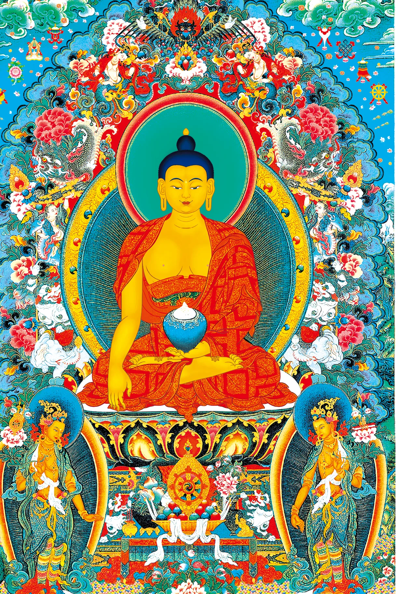

# 普获悉地祈祷文

སྤྲུལ་པའི་གུ་རུ་མཚན་བརྒྱད་དང༌། །

哲波格热灿嘉当八相幻化莲师尊

གྲུབ་པའི་རིག་འཛིན་ཆེན་པོ་བརྒྱད། །

哲波仁增钦波嘉八大成就持明者

བྱང་སེམས་ཉེ་བའི་སྲས་བརྒྱད་དང༌། །

香森涅沃这嘉当八大菩萨近佛子

སྒྲུབ་ཆེན་བཀའ་བརྒྱད་ལྷ་ཚོགས་ལ། །

哲钦瓜嘉拉措拉八大法行尊众前

གསོལ་བ་འདེབས་སོ་བྱིན་གྱིས་རློབས། །

索瓦得索辛吉洛虔诚祈祷予加持

ཕྱི་ནང་གསང་བའི་བར་ཆད་སོལ། །

协囊桑沃瓦恰索尽除外内密违缘

བསམ་པ་ཡིད་བཞིན་འགྲུབ་པ་དང༌། །

三巴耶印哲巴当如意成就诸心愿

མཆོག་དང་ཐུན་མོང་དངོས་གྲུབ་སྩོལ། །

巧当吞蒙悟哲作赐胜共同诸悉地

གསེར་འཕྱང་མེ་བྱ་སྨིན་ཟླའི་དམར་ཕྱོགས་དགའ་བ་དང་པོའི་ཉི་ཤར་ལ་འཇམ་དཔལ་རྡོ་རྗེའི་ཡིད་མཚོ་ལས་རྡོལ་བའོ། །རང་གི་དུས་གསུམ་ཀུན་གྱི་འདོན་ཆ་ཡི། །སྙིང་པོ་འདི་ནི་འདི་ཤར་ནས་ནི་བདག །ཤིན་ཏུ་བརྒལ་དཀའ་སྡུག་བསྔལ་འདམ་ལས་ཐར། །དགེ་ལེགས་རྟག་པ་དམ་པའི་དངོས་གྲུབ་ཐོབ། །སླན་ཆད་འདི་འབུམ་བཏོན་ན་རང་བསམ་གེགས་མེད་བསམ་འཕེལ་ལྷུན་གྲུབ་འབྱུང་། དགེ། །།

火鸡年十一月十六日晨朝，蒋华多吉（麦彭仁波切）觉海中自然流露。自诸三时念诵中，显现精华此偈颂，我离难越苦淤泥，恒善妙得胜悉地。若将来有人诵此十万遍，则无碍如意任运实现所愿。善哉！

༈ ཁྱེད་ལ་བསྟོད་ཅིང་གསོལ་བ་བཏབ་པའི་མཐུས། །

切拉多江索瓦达波提依赞祈祷汝威力

བདག་སོགས་གང་དུ་གནས་པའི་ས་ཕྱོགས་སུ། །

达索刚德内波萨秀色我等所住之方所

ནད་གདོན་དབུལ་ཕོངས་འཐབ་རྩོད་ཞི་བ་དང་། །

那敦沃彭塔作耶瓦当消除病魔贫诤斗

ཆོས་དང་བཀྲ་ཤིས་འཕེལ་བར་མཛད་དུ་གསོལ། །  
秋当扎西佩瓦匝德索增上正法普吉祥

ཆོས་རྒྱལ་ཁྲི་སྲོང་ལྡེའུ་བཙན་གྱིས་གསུངས་སོ། །

国王赤松德赞言

༄༅། །ཐུབ་ཆོག་བྱིན་རླབས་གཏེར་མཛོད།
