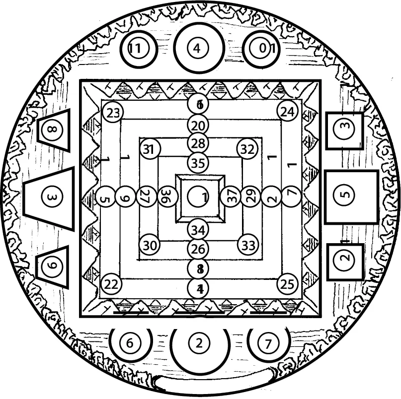

# 曼茶供

ཨོཾ་བཛྲ་བྷུ་མི་ཨཱཿ ཧཱུྃ།

嗡班匝儿波么啊吽 嗡班匝儿波么啊吽

གཞི་རྣམ་པར་དག་པ་དབང་ཆེན་གསེར་གྱི་ས་གཞི།

耶南巴 达巴旺钦色杰萨耶 清净本基大自在金地

ཨོཾ་བཛྲ་རེ་ཁེ་ཨཱཿ ཧཱུྃ།

嗡班匝儿瑞剋啊吽 嗡班匝儿瑞剋啊吽

ཕྱི་ལྕགས་རི་ཁོར་ཡུག་གིས་བསྐོར་བའི་དབུས་སུ་ཧཱུྃ་རི་ཡི་རྒྱལ་པོ་རི་རབ།

协 嘉热括耶给 果沃卫色吽 热耶嘉波热Ra

外铁围山环绕 中央吽ཧཱུྃ变须弥山王

ཤར་ལུས་འཕགས་པོ། ལྷོ་འཛམ་བུ་གླིང༌།

夏利帕波 洛赞沃朗 东胜身洲 南赡部洲

ནུབ་བ་ལང་སྤྱོད། བྱང་སྒྲ་མི་སྙན།

呢瓦朗秀 香扎么年 西牛货洲 北俱卢洲

ལུས་དང་ལུས་འཕགས།

利当 利帕  身洲及胜身洲

རྔ་ཡབ་དང་རྔ་ཡབ་གཞན།

阿雅当 阿雅严  拂洲及妙拂洲

གཡོ་ལྡན་དང་ལམ་མཆོག་འགྲོ།

哟丹当 兰巧卓  行洲及胜道行洲

སྒྲ་མི་སྙན་དང་སྒྲ་མི་སྙན་གྱི་ཟླ།

扎么年当 扎么年杰达  恶音洲及恶音对洲

རིན་པོ་ཆེའི་རི་བོ། དཔག་བསམ་གྱི་ཤིང༌།

仁波齐热沃 华三杰香 珍宝山 如意树

འདོད་འཇོའི་བ། མ་རྨོས་པའི་ལོ་ཏོག

多久瓦 玛木波洛多 如意牛 自然稻

འཁོར་ལོ་རིན་པོ་ཆེ། ནོར་བུ་རིན་པོ་ཆེ།

括罗仁波切 诺沃仁波切  金轮宝 如意宝

བཙུན་མོ་རིན་པོ་ཆེ། བློན་པོ་རིན་པོ་ཆེ།

怎莫仁波切 伦波仁波切  玉女宝 大臣宝

གླང་པོ་རིན་པོ་ཆེ། རྟ་མཆོག་རིན་པོ་ཆེ།

朗波仁波切 达巧仁波切  大象宝 绀马宝

དམག་དཔོན་རིན་པོ་ཆེ། གཏེར་ཆེན་པོའི་བུམ་པ།

玛魂仁波切 得钦布温巴  将军宝 宝藏瓶

སྒེག་པ་མ། ཕྲེང་བ་མ།

嘎巴玛 创瓦玛 嬉女 鬘女

གླུ་མ། གར་མ།

勒玛 嘎玛 歌女 舞女

མེ་ཏོག་མ། བདུག་སྤོས་མ།

美朵玛 德富玛 花女 香女

སྣང་གསལ་མ། དྲི་ཆབ་མ།

囊萨玛 哲恰玛 灯女 涂香女

ཉི་མ། ཟླ་བ། རིན་པོ་ཆེའི་གདུགས།

涅玛 达瓦 仁波齐德 日 月 珍宝伞

ཕྱོགས་ལས་རྣམ་པར་རྒྱལ་བའི་རྒྱལ་མཚན།

秀类南巴嘉沃嘉灿 尊胜幢

ལྷ་དང་མིའི་དཔལ་འབྱོར་ཕུན་སུམ་ཚོགས་པ་མ་ཚང་བ་མེད་པ་འདི་

拉当美 华久彭森措巴玛仓瓦 美巴德

ཉིད་དྲིན་ཅན་རྩ་བ་དང་བརྒྱུད་པར་བཅས་པའི་དཔལ་ལྡན་བླ་མ་དམ་

涅珍坚匝瓦当 觉巴具波华丹喇嘛丹

པ་རྣམས་ལ་དབུལ་བར་བགྱིའོ། །

巴南拉沃瓦杰哦

将此等无不圆满之人天受用

供养大恩具德诸根本及传承殊胜上师

ཐུགས་རྗེས་འགྲོ་བའི་དོན་དུ་བཞེས་སུ་གསོལ། །བཞེས་ནས་བྱིན་གྱིས་བརླབ་ཏུ་གསོལ། །

特吉卓沃敦德益色索 益内辛吉拉德索

祈为利生悲纳受 受已赐加持

ས་གཞི་སྤོས་ཆུས་བྱུགས་ཤིང་མེ་ཏོག་བཀྲམ། །

萨耶富齐协香美朵占涂香鲜花遍大地

རི་རབ་གླིང་བཞི་ཉི་ཟླས་བརྒྱན་པ་འདི། །

热Ra朗耶涅第坚巴德须弥四洲日月饰

སངས་རྒྱས་ཞིང་དུ་དམིགས་ཏེ་ཕུལ་བ་ཡིས། །

桑吉样德么得颇瓦益观想佛刹作供养

འགྲོ་ཀུན་རྣམ་དག་ཞིང་ལ་སྤྱོད་པར་ཤོག །

卓根南达样拉秀巴秀愿诸众生行佛刹

ཏྲཾ་གུ་རུ་རཏྣ་མཎྜལ་པཱུ་ཛ་མེ་གྷ་ས་མུ་དྲ་སྥ་ར་ཎ་ས་མ་ཡེ་ཨཿ ཧཱུྃ།

章 格热Ra那曼扎拉 波匝美嘎萨么扎 萨帕Ra那 萨玛耶啊吽

༄༅། །ཚིག་བདུན་སྤྱན་འདྲེན་བླ་མའི་རྣལ་འབྱོར་དང་

འབྲེལ་བའི་ཚོགས་མཆོད་བསྡུས་པ།
