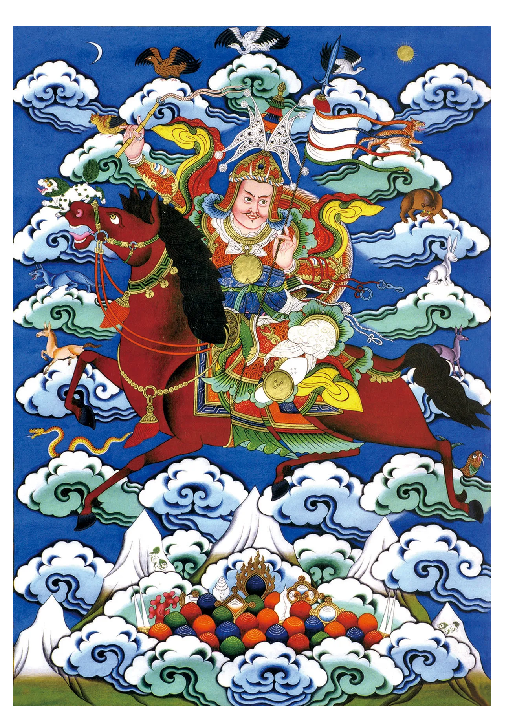

# 生生世世摄受愿文

དུས་གསུམ་གཤེགས་པའི་རྒྱལ་བ་ཐམས་ཅད་ཀུན། །

第森夏波嘉瓦檀嘉根 三世一切善逝佛

རང་ངོར་བཤེས་གཉེན་མཆོག་གི་སྐུར་སྣང་བ། །

让哦西您巧格格囊瓦 自前显现善知识

བཀའ་དྲིན་མཚུངས་བྲལ་ཡོན་ཏན་རྒྱ་མཚོའི་གཏེར། །

瓜珍聪抓云丹嘉促得 无等洪恩德海藏

ཡིད་བཞིན་ནོར་བུ་ཁྱེད་ལ་གསོལ་བ་འདེབས། །

耶印诺沃切拉索瓦得 如意宝前诚祈祷

ཁྱེད་ཀྱིས་འགྲོ་འདུལ་ཐབས་མཁས་སྤྱོད་པ་ནི། །

切吉卓德塔葵秀巴呢 您度众生方便行

རྣམ་པ་སྣ་ཚོགས་ཇི་ལྟར་བསྟན་བྱས་ཀྱང་། །

南巴那措杰达丹旭江 如何示现种种相

སྐད་ཅིག་ཙམ་ཡང་ལོག་ལྟ་མི་སྐྱེ་བར། །

嘎吉赞样洛达么杰瓦 刹那邪见亦不生

ཅི་མཛད་ལེགས་པར་མཐོང་བར་བྱིན་གྱིས་རློབས། །

杰匝拉巴通瓦辛吉洛 善观所行求加持

གང་གིས་བརྩེ་བར་གདམས་པའི་གསུང་བཟང་ལས། །

刚给贼瓦丹波松让类 愿您慈授之善说

ཚིག་ཟུར་ཙམ་ཡང་འགོངས་པར་མི་བྱེད་ཅིང་། །

策热赞样贡巴么协江 只言我亦不违越

བུམ་པ་གང་བྱོའི་ཚུལ་གྱིས་བྱིན་རླབས་ཀུན། །

温巴刚秀策吉辛拉根 满瓶倾泻诸加持

མ་ལུས་བདག་གི་རྒྱུད་ལ་འཕོ་བར་ཤོག །

玛利达格杰拉破瓦秀 无余融入我相续

མགོན་ཁྱོད་དག་དང་མ་དག་ཞིང་རྣམས་སུ། །

衮秋达当玛达样南色 愿怙主于净秽刹

སྣ་ཚོགས་སྤྲུལ་པའི་རོལ་གར་ངོམ་པའི་ཚེ། །

那措哲波若嘎翁波才 示现种种幻舞时

བདག་ཀྱང་ཁྱོད་ཀྱི་ཞབས་འབྲང་མཆོག་གྱུར་ནས། །

达江秋杰雅庄巧杰内 我成您之胜随从

བྱང་ཆུབ་སྤྱོད་ལ་མཉམ་དུ་འཇུག་པར་ཤོག །

香确秀拉年德久巴秀 一同趋入菩提行

ནམ་ཞིག་རང་སྣང་དག་པའི་ཞིང་མཆོག་ཏུ། །

南耶让囊达波样巧德 一旦自现胜净土

རྗེ་ཁྱོད་མངོན་འཚང་རྒྱ་བའི་ཚུལ་སྟོན་ཚེ། །

杰秋温仓嘉沃策敦才 至尊示现成佛时

བདག་ཀྱང་འདུས་པ་དང་པོའི་གྲལ་འཁོད་དེ། །

达江第巴当布扎括得 愿吾亦列首眷属

ཕྲིན་ལས་སྤེལ་བའི་བྱེད་པོ་མཆོག་ཏུ་སྨོན། །

陈类贝沃协波巧德门 成为弘扬事业尊

མདོར་ན་ད་ནས་སྐྱེ་བ་ཐམས་ཅད་དུ། །

多那达内杰瓦檀嘉德 愿从今起生生世

སྐྱབས་གཅིག་དམ་པ་ཁྱེད་དང་མི་འབྲལ་ཞིང་། །

嘉吉丹巴切当门抓样 不离唯一依怙您

བྱང་ཆུབ་ཐོབ་ཀྱང་རིགས་ཀྱི་བདག་པོ་རུ། །

香确托江热杰达波热 证觉汝亦成部主

གྱུར་ནས་འགྲོ་ཁམས་དོང་ནས་སྤྲུགས་པར་ཤོག །

杰内卓堪东内哲巴秀 根除一切众生界

ཚེ་གང་འགྲོགས་པའི་བུ་མཆོག་རིག་གྲོལ་གྱིས། །ཚེ་གཅིག་ཉམས་སུ་ལེན་པའི་ཆོས་སྐལ་དུ། །ཚེ་རབས་རྗེས་འཛིན་སྨོན་ལམ་འབྲི་དགོས་ཞེས། །ཚེ་མཐར་འཁྱོལ་བའི་རྒན་བུར་བསྐུལ་བྱས་ཀྱང་། །རབ་བརྗིད་ཤ་ཡི་སྡེར་ཁ་དཔངས་མཐོ་ཞིང་། །རབ་དཀར་ཚིལ་གྱི་ཐིགས་པ་འབུམ་དུ་བརྡལ། །རབ་མཛེས་རྒྱན་གྱིས་ལེགས་པར་བཀླུབས་བྱས་ན། །རབ་སྙན་གཏམ་ལ་ཟད་མཐའ་མེད་མོད་ཀྱང་། །བཅུད་མེད་ཟས་མང་ཕོ་བའི་གཤེད་དུ་གྱུར། །གོས་མེད་ལྷགས་པས་སོར་མོ་དམ་པོར་འཁྱུད། །བཤེས་མེད་ས་མཐར་འཁྱམས་པས་ཡིད་སྐྱོ་ནས། །དོན་མེད་སྨྲ་བ་མང་པོ་བཞག་ན་སྙམ། །

一生依止弟子日珠尊，具有一生实修之法缘，劝请临近寿终老者我，撰写世世摄受之愿文。若盘中有高堆极佳肴，泛起油滴营养极丰富，身上亦有极美服饰著，极动听语必会无尽涌，然无营养多食伤害腹，无衣严寒紧裹诸手指，漂泊无亲异乡心忧伤，只想放舍无义多言语。

ཞེས་གྲང་ངར་གྱིས་ཧ་ཅང་གདུངས་ནས་སོར་མོ་རྣམས་ཀྱང་ཀུམ་ཀུམ་པོར་གྱུར་ཚེ་ངག་དབང་བློ་གྲོས་མཚུངས་མེད་པས་བྲིས་པའོ། །འདི་ཡང་རི་བོ་རྩེ་ལྔ་ནས་སོ།། །།

严寒逼迫、手指冻僵之际，阿旺罗珠宗美撰写于五台山。

༧ ༡

༧ ཆོས་རྗེ་ཡིད་བཞིན་ནོར་བུའི་ཐམ་ཀ

༧ ཆོས་རྗེ་ཡིད་བཞིན་ནོར་བུའི་ཕྱག་ཐེལ།

法王如意宝晋美彭措之印

法王如意宝晋美彭措手印

སྒར་གྱི་སྐུ་རིམ་འདོན་ཆོག་སྐོར།

佛 事 类

Ⅱ

ཆོས་སྐུ་ཡུམ་ཆེན་མོ་ལ་ན་མོ།

南无般若佛母

གསོལ་ཁའི་སྐོར།

护法类

Ⅲ

ཆོས་སྐྱོང་གསུམ་མགོན་ལ་ན་མོ།

南无护法三怙主

ཉེར་མཁོའི་འདོན་ཆོག་སྐོར།

常用念诵类

Ⅳ

རྡོ་རྗེ་ཁྲོ་མོ་ལ་ན་མོ།

南无金刚忿怒母

སྨོན་ལམ་སྐོར།

愿文类

Ⅴ
