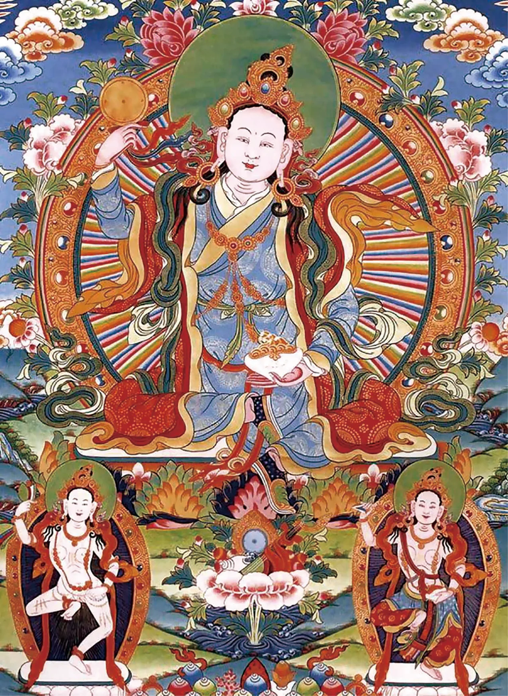

# 二十一度母赞

索达吉堪布·译

嘉嘎嘎德（梵音：）阿雅达瑞得沃多扎诶嘎邦夏德那玛

沃嘎德（藏音：）帕玛拉姆卓玛拉多巴涅协匝吉吉夏瓦

汉意：二十一圣度母赞

> 嗡 顶礼至尊圣度母！

> 顶礼奋迅救度母，目如刹那闪电光，

> 三域怙主莲花面，花蕊绽放从中现。

> 顶礼月色白度母，秋百满月聚集脸，

> 成千群星同汇聚，尽放威光极灿然。

> 顶礼紫磨金色母，莲花庄严其妙手，

> 布施精进苦行静，安忍禅定行境性。

> 顶礼如来顶髻母，奉持无边尊胜行，

> 获得无余波罗蜜，一切佛子近依止。

> 顶礼吽音叱咤母，声遍欲色虚空界，

> 其足压伏七世间，皆能勾招尽无余。

> 顶礼帝梵恭奉母，火神风神自在供，

> 鬼王起尸及寻香，夜叉众会皆赞叹。

> 顶礼胜伏他方母，札的啪的尽毁敌惑轮，

> 右屈左伸足压伏，盛燃熊熊烈火焰。

> 顶礼大怖救度母，摧毁一切凶猛魔，

> 莲花容颜现颦眉，无余斩尽诸仇怨。

> 顶礼三宝严印母，手指当胸露威严，

> 庄严无余诸方轮，自之光芒普萦绕。

> 顶礼欢悦威德母，顶饰光鬘诚斑斓，

> 喜笑大笑圣咒音，怀柔群魔与世间。

> 顶礼解厄圣度母，能召一切护地神，

> 颦眉竖动发吽光，消除所有诸贫穷。

> 顶礼月相冠冕母，一切饰品极璀璨，

> 无量光佛髻中现，恒常光芒最耀眼。

> 顶礼烈焰圣度母，如末劫火住光鬘，

> 右伸左屈喜姿态，击毁一切诸敌军。

> 顶礼颦眉圣度母，手掌压地足踩踏，

> 面露怒容发吽声，击破七重一切处。

> 顶礼安乐柔善母，寂灭涅槃行境性，

> 真实咒语索哈嗡，摧毁一切大罪恶。

> 顶礼明觉吽度母，众会围绕极欢喜，

> 怨敌之身悉击碎，十字庄严明咒吽。

> 顶礼震撼三界母，足踏吽相为种子，

> 须弥玻雪曼达Ra，三世间界皆摇动。

> 顶礼灭毒圣度母，手持天海相皎月，

> 诵二达Ra啪的字声，无余灭除一切毒。

> 顶礼天王所敬母，天人非人咸依止，

> 披甲欢喜之威德，遣除诤斗与恶梦。

> 顶礼消疫圣度母，日月双眸光鲜明，

> 诵二哈Ra德达Ra，消除剧猛瘟疫病。

> 顶礼具光胜度母，安立一切三真如，

> 正具寂灭威神力，摧魔起尸夜叉众。

以根本咒礼赞二十一度母终

略祈祷文：

> 至尊度母您垂念，祈求救脱诸苦难。

度母心咒：

嗡达瑞 德达瑞 德瑞索哈

## ༄༅།།ཡེ་ཤེས་མཚོ་རྒྱལ་གྱི་སྒྲུབ་ཐབས་

## ཡིད་བཞིན་ནོར་བུ་བཞུགསཿ
