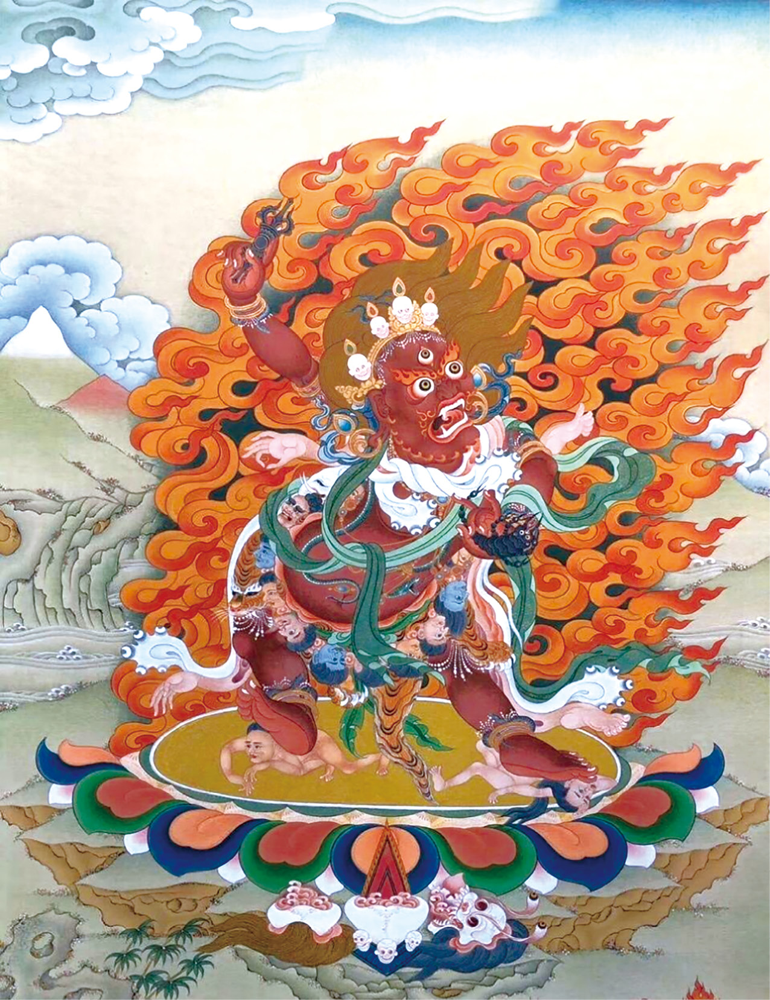

# 会供仪轨

麦彭仁波切·造

索达吉堪布·译

皈依（三遍）：

ནམ་མཁའི་གནས་སུ་ནམ་མཁའ་གང་བ་ཡི། །

南葵内色南夸刚瓦耶 遍满虚空尽边际

བླ་མ་ཡི་དམ་མཁའ་འགྲོའི་ཚོགས་རྣམས་དང༌། །

喇嘛耶丹夸珠措南当 上师本尊空行众

སངས་རྒྱས་ཆོས་དང་འཕགས་པའི་དགེ་འདུན་ལ། །

桑吉秋当帕波给登拉 佛陀正法圣僧前

བདག་དང་འགྲོ་དྲུག་གུས་པས་སྐྱབས་སུ་མཆི། །

达当卓珠给贝嘉森切 我与六道敬皈依

发心（三遍）：

བདག་དང་མཐའ་ཡས་སེམས་ཅན་རྣམས། །

达当塔益森坚南 我与无边众

ཡེ་ནས་སངས་རྒྱས་ཡིན་པ་ལ། །

耶内桑吉印巴拉 本是正等觉

ཡིན་པར་ཤེས་པའི་བདག་ཉིད་དུ། །

印巴西波达涅德 了知如是性

བྱང་ཆུབ་མཆོག་ཏུ་སེམས་བསྐྱེད་དོ། །

香确巧德森杰多 发大菩提心

## ༄༅། །ཚིག་བདུན་གསོལ་འདེབས་དང་འབྲེལ་བའི་

## བླ་མའི་རྣལ་འབྱོར་བྱིན་རླབས་ཆར་འབེབས་བཞུགས་སོ། །

## 与七句祈祷文相属之上师瑜伽·降加持雨

ཨཱཿ

阿 阿

རང་ལུས་ཐ་མལ་གནས་པའི་མདུན་མཁའ་རུ། །

让利塔玛内波登夸热 自身平庸而住前虚空

ཨོ་རྒྱན་དྲི་མེད་དྷ་ན་ཀོ་ཤའི་མཚོ། །

哦坚哲美达那果西措 邬金无垢达那够夏海

གཏིང་ཟབ་ཡན་ལག་བརྒྱད་ལྡན་ཆུས་གང་བའི། །

当Ra严拉嘉丹齐刚沃 甚深盈满具八功德水

དབུས་སུ་རིན་ཆེན་པད་སྡོང་འདབ་རྒྱས་སྟེང་། །

卫色仁钦巴东达吉当 中央珍宝茎瓣圆莲上

སྐྱབས་གནས་ཀུན་འདུས་ཨོ་རྒྱན་རྡོ་རྗེ་འཆང་། །

嘉内根第哦坚多杰强 依处总集邬金金刚持

མཚན་དཔེའི་དཔལ་འབར་མཚོ་རྒྱལ་ཡུམ་དང་འཁྲིལ། །

灿慧华巴措嘉印当彻 相好灿然拥抱措嘉母

ཕྱག་གཡས་རྡོ་རྗེ་གཡོན་པས་ཐོད་བུམ་བསྣམས། །

香益多杰云贝托温南 右手金刚左持颅器瓶

དར་དང་རིན་ཆེན་རུས་པའི་རྒྱན་གྱིས་མཛེས། །

达当仁钦瑞波坚吉贼 绫罗珍宝骨饰作庄严

འོད་ལྔའི་ཀློང་ན་བདེ་ཆེན་གཟི་བྱིན་འབར། །

哦诶隆那得钦热辛巴 五光界内大乐威光灿

འཁོར་དུ་རྩ་གསུམ་རྒྱ་མཚོ་སྤྲིན་ལྟར་གཏིབས། །

括德匝森嘉措珍达德 眷属三根本海如云集

བྱིན་རླབས་ཐུགས་རྗེའི་ཆར་འབེབས་བདག་ལ་གཟིགས། །

辛拉特吉恰贝达拉热 加持大悲雨降观照我

རྒྱལ་ཀུན་ངོ་བོ་འཆི་མེད་ཡེ་ཤེས་སྐུར། །

嘉根哦沃切美耶西格 诸佛本体无死智慧身

གདུང་ཤུགས་དྲག་པོས་དད་ཕྱག་རྟག་ཏུ་འཚལ། །

东协扎布达香达德擦 深怀强烈信心恒顶礼

ལུས་དང་ལོངས་སྤྱོད་དུས་གསུམ་དགེ་བའི་ཚོགས། །

利当隆秀第森给沃措 身及受用三时之善资

ཀུན་བཟང་མཆོད་པའི་སྤྲིན་དུ་དམིགས་ནས་འབུལ། །

根让秋波珍德么内波 观想普贤供云而供养

ཐོག་མེད་ནས་བསགས་སྡིག་ལྟུང་མ་ལུས་བཤགས། །

托美内萨德东玛利夏 无始所积堕罪无余忏

སྲས་བཅས་རྒྱལ་བ་ཀུན་གྱི་ཡོན་ཏན་གྱི། །

这具嘉瓦根杰云丹杰 一切佛子如来之功德

ཁྱབ་བདག་གཅིག་པུ་མགོན་པོའི་རྣམ་ཐར་ལ། །

恰达吉波衮布南塔拉 唯一遍主怙主之事迹

སྙིང་ནས་ཡི་རང་དད་པས་གསོལ་འདེབས་ཤིང་། །

酿内耶让达贝索得香 诚心随喜虔信而祈祷

ཟབ་རྒྱས་ཆོས་ཀྱི་ཆར་ཆེན་འབེབས་པར་བསྐུལ། །

Ra吉秋杰恰钦贝巴格 劝请降下深广大法雨

རང་གཞན་དགེ་བའི་དངོས་པོ་ཀུན་བསྡོམས་ནས། །

让严给沃悟波根东内 总集自他一切善事已

འགྲོ་ཁམས་རྒྱ་མཚོ་ཇི་སྲིད་གནས་ཀྱི་བར། །

卓堪嘉措杰哲内杰瓦 乃至众生界海存在间

མགོན་པོ་ཁྱེད་ཀྱི་རྣམ་ཐར་རྗེས་བསྙེགས་ཏེ། །

衮波切杰南塔吉Nia得 追随怙主汝尊之足迹

མཁའ་ཁྱབ་འགྲོ་བ་འདྲེན་པའི་དོན་དུ་བསྔོ། །

夸恰卓瓦珍波敦德哦 为导天下众生而回向

སྐྱབས་གནས་ཀུན་འདུས་མཁྱེན་བརྩེའི་གཏེར་ཆེན་པོ། །

嘉内根第钦贼得钦波 皈处总集智悲大宝藏

དུས་ངན་སྙིགས་མའི་སྐྱབས་གཅིག་རིན་པོ་ཆེ། །

第安涅美嘉吉仁波切 浊世唯一怙主如意宝

ལྔ་བདོའི་རྒུད་པས་མནར་བཞིན་གདུང་ཤུགས་ཀྱིས། །

阿度格贝那印东协吉 五浊猖獗衰败逼迫时

གསོལ་འདེབས་བུ་ལ་བརྩེ་བས་མྱུར་དུ་གཟིགས། །

索得沃拉贼卫涅德热 猛厉祈祷速慈垂念我

དགོངས་པའི་ཀློང་ནས་ཐུགས་རྗེའི་རྩལ་ཕྱུང་ལ། །

贡波隆内特吉匝雄拉 密意界中发出大悲力

མོས་ལྡན་བདག་གི་སྙིང་ལ་བྱིན་གྱིས་རློབས། །

木丹达格酿拉辛吉洛 加持具有信解我心田

རྟགས་དང་མཚན་མ་མྱུར་དུ་བསྟན་པ་དང་། །

达当灿玛涅德丹巴当 迅疾显示验相及感应

མཆོག་དང་ཐུན་མོང་དངོས་གྲུབ་སྩལ་དུ་གསོལ། །

巧当吞蒙悟哲匝德索 祈赐殊胜共同诸悉地

ཞེས་བྱས་ལ་ཚིག་བདུན་གསོལ་འདེབས་ཅི་ནུས་སུ་འདོན།

尽力念诵七句祈祷文：

ཧཱུྃ།

吽 吽

ཨོ་རྒྱན་ཡུལ་གྱི་ནུབ་བྱང་མཚམས༔

哦坚耶杰呢香灿 邬金西北隅

པདྨ་གེ་སར་སྡོང་པོ་ལ༔

巴玛给萨东波拉 莲花蕊茎上

ཡ་མཚན་མཆོག་གི་དངོས་གྲུབ་བརྙེས༔

雅灿巧格悟哲尼 稀有成就尊

པདྨ་འབྱུང་གནས་ཞེས་སུ་གྲགས༔

巴玛炯内益色扎 共称莲花生

འཁོར་དུ་མཁའ་འགྲོ་མང་པོས་བསྐོར༔

括德夸卓芒布果 空行众围绕

ཁྱེད་ཀྱི་རྗེས་སུ་བདག་བསྒྲུབ་ཀྱིས༔

切杰吉色达哲吉 我随汝修行

བྱིན་གྱིས་བརླབ་ཕྱིར་གཤེགས་སུ་གསོལ༔

辛吉拉协夏色索 祈临赐加持

གུ་རུ་པདྨ་སིདྡྷི་ཧཱུྃ༔

格热巴玛色德吽 格热巴玛色德吽

མོས་གུས་ཀྱིས་གསོལ་བ་བཏབ་པས་བླ་མ་ཡབ་ཡུམ་གྱི་སྦྱོར་མཚམས་དང་། ཐུགས་ཀ་ནས་ཡེ་ཤེས་ཀྱི་འོད་ཟེར་སྣ་ལྔ་བ་ཐག་ལྟར་བརྐྱངས་ནས་རང་གི་སྙིང་གར་ཐིམ་པས་རྒྱུད་བྱིན་གྱིས་བརླབས་པར་བསམ།

木给吉 索瓦达贝 喇嘛雅印杰 哟灿当 特嘎内 耶西杰 哦瑞那 阿瓦塔达江内 让 格酿嘎腾贝杰 辛吉拉巴三

以敬信心祈祷，观想上师佛父佛母双运处及心间，发出智慧五光如蛛丝延伸般融入自己心间，加持相续。

ༀ་ཨཱཿཧཱུྃ་བཛྲ་གུ་རུ་པདྨ་སིདྡྷི་ཧཱུྃ།

尽可能念诵：嗡啊吽 班匝儿格热巴玛色德吽

བླ་མའི་གནས་གསུམ་ཡི་གེ་འབྲུ་གསུམ་ལས། །

喇美内森耶给哲森类 由从上师三处三字中

འོད་ཟེར་དཀར་དམར་མཐིང་གསུམ་བྱུང་ནས་སུ། །

哦瑞嘎玛唐森雄内色 放出白红蓝色三种光

རང་གི་གནས་གསུམ་ཐིམ་པས་སྒོ་གསུམ་གྱི། །

让格内森腾贝果森杰 融自三处三门障碍净

སྒྲིབ་བྱང་སྐུ་གསུང་ཐུགས་ཀྱི་རྡོ་རྗེར་གྱུར། །

哲香格松特杰多杰杰 成为身语意之三金刚

མཐར་ནི་བླ་མ་འཁོར་བཅས་འོད་དུ་ཞུ། །

塔呢喇嘛括具哦德耶 最终上师眷属化为光

དཀར་དམར་ཐིག་ལེ་ཧཱུྃ་གིས་མཚན་པ་རུ། །

嘎玛特类吽给灿巴热 红白明点以吽ཧཱུྃ作严饰

རང་གི་སྙིང་གར་ཐིམ་པས་བླ་མའི་ཐུགས། །

让格酿嘎腾贝喇美特 融己心间师意与自心

རང་སེམས་དབྱེར་མེད་ལྷན་སྐྱེས་ཆོས་སྐུར་གནས། །

让森耶美兰吉秋格内 无二安住俱生法身中

ཨ་ཨཱཿཞེས་བརྗོད་ལ་ཡེ་ནས་བཅོས་བསྒྱུར་སྤང་བླང་ལས་འདས་པ་རང་གི་སེམས་ཉིད་གདོད་མའི་ཆོས་སྐུ་ཆེན་པོའི་རང་ཞལ་བལྟ་ཞིང་སླར་ཡང་སྒྱུ་མ་ལྟ་བུའི་སྣང་བ་ཐམས་ཅད་བླ་མའི་རང་བཞིན་དུ་བལྟས་ལ་དགེ་བ་བསྔོ་བ་ནི།

念诵“阿阿”，观本来超越改造、转变、取舍自之心性原本大法身的本来面目，复观一切如幻的显现为上师之自性，并回向善根，诵吉祥偈。

ཞེས་པའང་ཐམས་ཅད་འདུལ་ཅེས་པའི་གྲོ་བཞིན་ཟླ་བའི་ཡར་ཚེས་བརྒྱད་ལ།ཚེ་རབས་ཐམས་ཅད་དུ་གུ་རུ་པདྨའི་བྲན་དུ་སྨོན་ལམ་འདེབས་པ་མི་ཕམ་རྣམ་པར་རྒྱལ་བའི་ཡིད་ཀྱི་མཚོ་ལས་བྱུང་བ་དགེའོ།།མངྒ་ལཾ།། །།

此文，也是于丁亥年（即火猪年）七月初八，发愿生生世世做莲师奴仆麦彭南白嘉瓦意海中浮现。善哉！增吉祥！

## 与七句祈祷文相属之会供

༈ ཧཱུྃ།

吽 吽

ཨཱ་ལས་ཆོས་དབྱིངས་དང་མཉམ་ཀ་པཱ་ལར། །

阿类秋样当年嘎巴拉 由阿于等法界颅器中

ཨོཾ་ལས་སྣང་སྲིད་འདོད་ཡོན་ཚོགས་སུ་བཤམས། །

嗡类囊哲多云措色现 由嗡陈设现有欲妙供

ཧཱུྃ་གིས་བདེ་ཆེན་ཡེ་ཤེས་རོལ་པར་བསྒྱུར། །

吽给得钦耶西若巴杰 以吽转成大乐智游舞

ཧྲཱིཿ ཡིས་རྩ་གསུམ་ལྷ་ཚོགས་དགྱེས་པ་བསྐང་། །

舍益匝森拉措吉巴刚 以舍喜酬三根本尊众

ཨོཾ་ཨཱཿཧཱུྃཿཧྲཱིས་བྱིན་གྱིས་བརླབས།

ཚོགས་ཞིང་སྤྱན་འདྲེན་ཞིང་མཆོད་པ་འབུལ་པ་ནི།

以“嗡啊吽舍”加持，迎请福田、供养供品：

ཧཱུྃ༔

吽 吽

ཨོ་རྒྱན་ཡུལ་གྱི་ནུབ་བྱང་མཚམས༔

哦坚耶杰呢香灿 邬金刹土西北隅

པདྨ་གེ་སར་སྡོང་པོ་ལ༔

巴玛给萨东波拉 莲花蕊茎之座上

ཡ་མཚན་མཆོག་གི་དངོས་གྲུབ་བརྙེས༔

雅灿巧格悟哲尼 稀有殊胜成就者

པདྨ་འབྱུང་གནས་ཞེས་སུ་གྲགས༔

巴玛炯内益色扎 世称名号莲花生

འཁོར་དུ་མཁའ་འགྲོ་མང་པོས་བསྐོར༔

括德夸卓芒布果 空行眷属众围绕

ཁྱེད་ཀྱི་རྗེས་སུ་བདག་སྒྲུབ་ཀྱིས༔

切杰吉色达哲吉 我随汝尊而修持

འདོད་ཡོན་ཚོགས་ལ་སྤྱན་འདྲེན་ན༔

多云措拉现珍那 迎至欲妙会供中

བྱིན་གྱིས་རློབས་ཕྱིར་གཤེགས་སུ་གསོལ༔

辛吉洛协夏色索 为赐加持祈降临

གནས་མཆོག་འདི་རུ་བྱིན་ཕོབ་ལ༔

内巧德热辛颇拉 迎请临此殊胜处

ཚོགས་མཆོད་ཡེ་ཤེས་བདུད་རྩིར་བསྒྱུར༔

措秋耶西德则杰 会供品转智甘露

སྒྲུབ་མཆོག་བདག་ལ་དབང་བཞི་བསྐུར༔

哲巧达拉旺耶格 予胜修我四灌顶

བགེགས་དང་ལོག་འདྲེན་བར་ཆད་སོལ༔

嘎当洛珍瓦恰索 遣除恶魔邪祟障

མཆོག་དང་ཐུན་མོང་དངོས་གྲུབ་སྩོལ༔

巧当吞蒙悟哲作 赐予殊胜共悉地

ཧཱུྃ༔

吽 吽

བླ་མ་རྗེ་བཙུན་པདྨ་ཐོད་ཕྲེང་རྩལ༔

喇嘛杰怎巴玛托创匝 至尊上师班玛托创匝

རིག་འཛིན་མཁའ་འགྲོའི་ཚོགས་དང་བཅས་པ་ཡི༔

仁增夸珠措当具巴耶 持明空行尊众三根本

རྩ་གསུམ་ཀུན་འདུས་རྒྱལ་བའི་དཀྱིལ་འཁོར་ལ༔

匝森根第嘉沃金括拉 彼之总集佛陀坛城前

མོས་གུས་གདུང་ཤུགས་དྲག་པོས་གསོལ་བ་འདེབས༔

木给东协扎布索瓦得 强烈敬信猛厉诚祈祷

བདག་གཞན་སྒོ་གསུམ་དགེ་ཚོགས་ལོངས་སྤྱོད་བཅས༔

达严果森给措隆秀具 自他三门善资及受用

སྣང་སྲིད་འདོད་ཡོན་དགྱེས་དགུ་མ་ཚང་མེད༔

囊哲多云吉格玛仓美 一切现有欲妙无不全

ཀུན་བཟང་བདེ་ཆེན་ཚོགས་ཀྱི་འཁོར་ལོར་འབུལ༔

根让得钦措杰括罗波 供养普贤大乐会供轮

ཐུགས་བརྩེས་དགྱེས་བཞེས་ཐུགས་དམ་སྐོང་གྱུར་ཅིག༔

特贼吉益特丹贡杰吉 祈愿慈悲喜纳满心愿

གསོལ་བ་འདེབས་སོ་གུ་རུ་རིན་པོ་ཆེ༔

索瓦得索格热仁波切 虔诚祈祷莲师如意宝

བྱིན་གྱིས་རློབས་ཤིག་རིག་འཛིན་མཁའ་འགྲོའི་ཚོགས༔

辛吉洛西仁增夸珠措 予以加持持明空行众

མོས་ལྡན་བུ་ལ་མཆོག་ཐུན་དངོས་གྲུབ་སྩོལ༔

木丹沃拉巧吞悟哲作 共同殊胜悉地赐予我

དམ་ཚིག་ཉམས་ཆག་ཐམས་ཅད་སྦྱང་དུ་གསོལ༔

丹策年恰檀嘉样德索 诸所失坏誓言祈清净

ཕྱི་ནང་གསང་བའི་བར་ཆད་དབྱིངས་སུ་སྒྲོལ༔

协囊桑沃瓦恰样色卓 外内密之违缘度法界

བྱང་ཆུབ་བར་དུ་འབྲལ་མེད་རྗེས་འཛིན་ཞིང༔

香确瓦德抓美吉怎样 乃至菩提不离予摄受

ཚེ་བསོད་ཉམས་རྟོགས་ཡང་ངོའི་ཟླ་བཞིན་འཕེལ༔

才索年多样悟达印佩 福寿觉悟增如上弦月

བསམ་པ་ལྷུན་གྱིས་འགྲུབ་པར་བྱིན་གྱིས་རློབས༔

三巴伦吉哲巴辛吉洛 加持意乐任运而自成

ཨོཾ་ཨཱཿཧཱུྃ་བཛྲ་གུ་རུ་པདྨ་སིདྡྷི་ཧཱུྃ།

嗡啊吽 班匝儿格热巴玛色德吽

ཞེས་པའང་གསེར་འཕྱང་གི་ལོའི་བོད་ཟླའི་ཚེས་༡༠ལ་འཇམ་དཔལ་དགྱེས་པའི་ཡིད་མཚོ་ལས་བྱུང་བའི་ནོར་བུ་བསམ་འཕེལ་ཡང་དག་པ་མངྒ་ལཾ།། །།

此文也是于丁酉年（即火鸡年）二月初十，文殊欢喜（即麦彭仁波切）意海中所出现之如意宝。增吉祥！

## ༄༅། །ཚོགས་བསྡུས་ནི།

## 简供

ཚོགས་རྫས་རྣམས།

ཨོཾ་ཨཱཿཧཱུྃ་ཧོཿ བྱིན་གྱིས་བརླབས།

以“嗡啊吽吙”加持会供品

རྩ་གསུམ་ལྷ་ཚོགས་ཚོགས་ལ་སྤྱན་འདྲེན་གཤེགས། །

匝森拉措措拉现珍夏 迎请三根本众临会供

ཕྱི་ནང་གསང་བའི་བདེ་ཆེན་ཚོགས་མཆོད་འབུལ། །

协囊桑沃得钦措秋波 献外内密大乐之会供

དམ་ཚིག་ཉམས་ཆག་ཐམས་ཅད་མཐོལ་ལོ་བཤགས། །

丹策年恰檀嘉托洛夏 一切违失誓言发露忏

གཉིས་འཛིན་དགྲ་བགེགས་ཆོས་ཀྱི་དབྱིངས་སུ་སྒྲོལ། །

尼怎扎嘎秋杰样色卓 二执怨魔诛灭法界中

མཉམ་ཉིད་བདེ་བ་ཆེན་པོར་ཐུགས་དམ་བསྐང་། །

年涅得瓦钦波特丹刚 于平等性大乐满意愿

མཆོག་དང་ཐུན་མོང་དངོས་གྲུབ་སྩལ་དུ་གསོལ། །

巧当吞蒙悟哲匝德索 祈赐殊胜共同诸悉地

ཞེས་པའང་ཚོགས་གྲངས་བསག་པ་སོགས་ལ་མཁོ་བའི་ཚོགས་བསྡུས་འཇམ་དཔལ་རྡོ་རྗེས་སོ། །

此为积累会供数量时所需之简供，嘉华多吉（即麦彭仁波切）作。

༈ གུ་རུ་དྲག་པོའི་སྒྲུབ་ཐབས།
