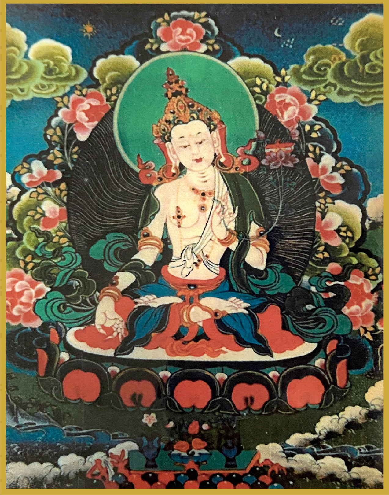

# 文殊语狮子祈祷文

乔美仁波切·造

索达吉堪布·译

ན་མོ་ལོ་ཀི་ཤྭ་རཱ་ཡ། །

纳莫罗格修Ra雅

དུས་གསུམ་སངས་རྒྱས་ཐམས་ཅད་ཀྱི། །

迪森桑吉檀嘉杰 三世一切诸佛陀

གསུང་གི་བདག་ཉིད་བཅོམ་ལྡན་འདས། །

松格达涅炯丹迪 语之自性薄伽梵

པདྨའི་རིགས་ཀྱི་བདག་པོ་སྟེ། །

巴美热杰达波得 乃莲花部之主尊

གསུང་གི་རྡོ་རྗེ་ཞེས་ཀྱང་བྱ། །

松格多杰益江夏 亦可名为语金刚

འོད་དཔག་མེད་ལ་གསོལ་བ་འདེབས། །

哦华美拉索瓦得 无量光佛我祈祷

དེ་དང་ངོ་བོ་དབྱེར་མེད་པའི། །

得当哦沃耶美波 与彼本体无有别

སྲས་ཀྱི་ཐུ་བོའི་ཚུལ་བཟུང་བ། །

贼杰特沃策宗瓦 而化现为长子相

བྱང་ཆུབ་སེམས་དཔའ་སེམས་དཔའ་ཆེ། །

香切森华森华切 殊胜菩萨摩诃萨

འཇམ་དཔལ་དམར་པོ་རལ་གྲི་འཛིན། །

蒋华玛波Ra哲怎 执持宝剑红文殊

སྨྲ་བའི་སེང་གེར་གསོལ་བ་འདེབས། །

玛卫桑给索瓦得 语狮子尊我祈祷

ཤེས་རབ་ཡུམ་གྱི་ཚུལ་བཟུང་བ། །

西Ra印杰策宗瓦 现为般若佛母相

དུས་གསུམ་སངས་རྒྱས་ཐམས་ཅད་ཀྱི། །

迪森桑吉檀嘉杰 三世一切诸佛陀

གསུང་གི་ལྷ་མོ་དབྱངས་ཅན་མ། །

松格拉莫扬坚玛 语之佛母妙音女

གང་གཱའི་ལྷ་མོ་ཞེས་ཀྱང་བྱ། །

刚格拉莫益江夏 亦名恒河之女神

ངག་གི་ལྷ་མོར་གསོལ་བ་འདེབས། །

阿格拉莫索瓦得 语天女尊我祈祷

གསོལ་བ་བཏབ་པའི་བྱིན་རླབས་ཀྱིས། །

索瓦达波辛拉吉 以此祈祷之加持

བདག་དང་བདག་གི་རྗེས་འཇུག་དང་། །

达当达格吉杰当 愿我以及随学我

མཐོང་ཐོས་དྲན་རེག་འགྲོ་བ་ཀུན། །

通托占瑞卓瓦根 见闻忆触诸众生

མི་ཤེས་མུན་པ་རབ་བསལ་ནས། །

么西门巴Ra萨内 尽除一切无知暗

ཤེས་རབ་རྩ་ཁ་བྱེ་བར་ཤོག །

西Ra匝卡耶瓦修 开启智慧之脉门

སྐྱེ་བ་འདི་ནས་ཚེ་རབས་ཀུན། །

杰瓦德内才Ra根 愿今乃至世世中

ཤེས་རབ་འཆལ་བར་མི་འབྱུང་ཞིང་། །

西Ra恰瓦么炯扬 颠倒邪慧永不生

ཤེས་རབ་ཕུན་སུམ་ཚོགས་པར་ཤོག །

西Ra彭森措巴修 胜妙智慧极圆满

རྒྱལ་བའི་གསུང་རབ་རྒྱ་མཚོ་ལ། །

嘉卫松Ra嘉措拉 于诸如海之佛经

མི་བརྗེད་གཟུངས་ཀྱང་ཐོབ་པར་ཤོག །

么杰宗江托巴修 获得不忘陀罗尼

ཆོས་ཉིད་རྣམ་པར་དག་པ་དང་། །

秋涅南巴达巴当 以彼清净法性力

རྟེན་འབྲེལ་བསླུ་བ་མེད་པ་དང་། །

定贼勒瓦美巴当 以及无欺缘起力

འཇམ་དཔལ་ཡབ་ཡུམ་ཐུགས་རྗེས་ཡིས། །

蒋华雅印特吉益 文殊父母大悲力

སྨོན་ལམ་བཏབ་བཞིན་འགྲུབ་པར་ཤོག །

门兰达印哲巴修 令此大愿得成就

ཅེས་པ་འདིའང་མཁས་གྲུབ་རཱ་ག་ཨ་སྲས་ཉེར་མཁོའི་ཆེད་དུ་སྦྱར་བས་བསྟན་དང་འགྲོ་ལ་གནས་སྐབས་ཕན་པ་དང་མཐར་ཐུག་བདེ་བའི་རྒྱུར་གྱུར་ཅིག །དགེའོ། །དགེའོ། །དགེའོ། །

此文乃智成就者绕嘎阿这（乔美仁波切）以有必要而特地撰著，愿成教法和众生暂时利益与究竟安乐之因！善哉！善哉！善哉！

## ༄༅། །འཇམ་དཔལ་དཀར་པོ་

## ཨ་ཡིག་སྒྲུབ་ཐབས་བཞུགས་སོ། །
