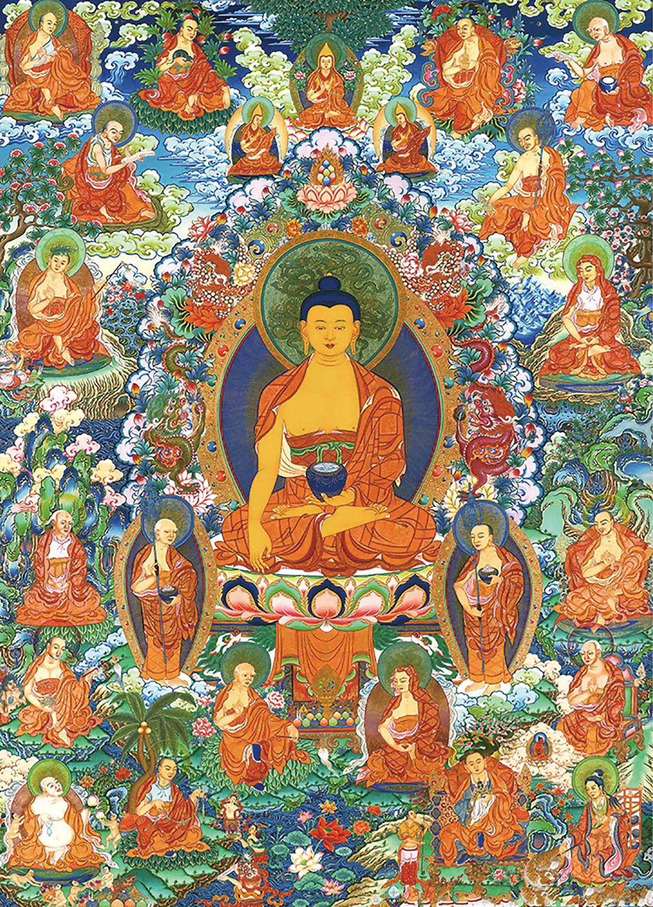

# 紫玛护法神仪轨

——怀诛电索

法王晋美彭措·取伏藏

索达吉堪布·翻译

于此陈设食子、血肉等，以“讷哲班匝昂革夏匝”勾招怨魔，以“萨瓦夏吽玛绕雅啪的”降伏，以“让扬康嗡啊吽”加持。

> 哲

> 呼唤西方红凶境，凶神恶煞之命主，

> 携同眷属一切众，降临此入所设座。

西拉哲班匝萨玛雅匝萨玛雅地叉蓝

> 觉

> 本体无漏之智慧，形相降伏诸怨魔，

> 骨肉堆积高如山，血液汇聚如大海。

> 复有种种余神馐，亲眼可见诸供品，

> 满足紫玛护神意，满足四部将士意，

> 满足天龙八部意，忏悔所失违誓言。

> 祈愿如母爱其子，垂念我等师徒眷，

> 无碍速成所嘱托，息增怀诛诸事业。

于南方蒙卡岩附近之波塘吉祥源地，夜叉战神王（紫玛护法神）在我为具信心之有些弟子传授缘起除障法灌顶时，承诺成办所嘱托之事业。次日于班朗寺吉祥冈当密宗法林，依靠细微觉受引发，阿旺罗珠宗美口述，南珠堪布立成文字。愿增吉祥！

十七胜生周藏历铁马年八月三日

