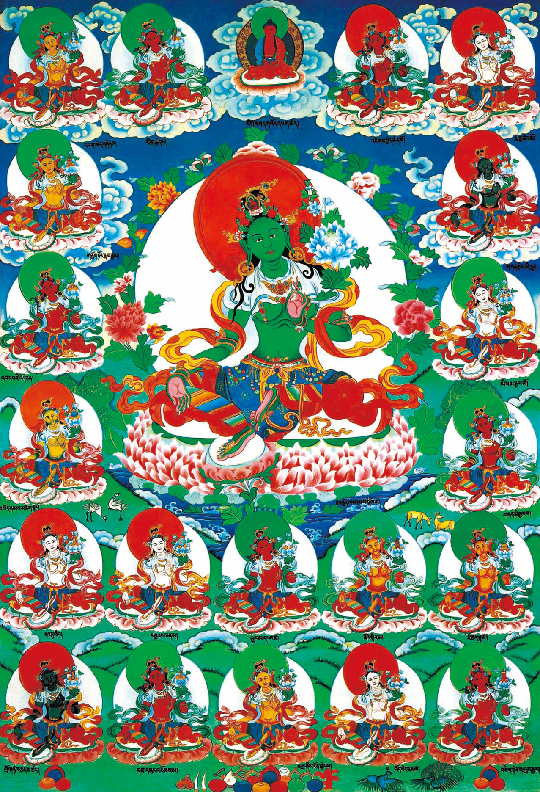

# 项袋金刚橛·补充镶嵌宝簇

法王晋美彭措·取伏藏

索达吉堪布·翻译

རྗེས་ཀྱི་རིམ་པ་ལ། མཆོད་པ་ནི།

后行次第·供养：

ཧཱུྃཿ

吽 吽

མཉམ་ཉིད་མི་གཡོ་མཉམ་པའི་སངས་རྒྱས་ལ། །

年涅莫友年毕桑吉拉 等性不动平等佛

ངན་རྟོག་མཚན་མའི་སྤྱོད་ཡུལ་གང་ཡང་མེད། །

安多灿咪秀耶刚扬美 全无恶念相行境

གཟུང་འཛིན་མཚན་མ་ཀུན་ལས་འདས་པ་ཡིས། །

宗怎灿玛根累第巴益 超离一切二取相

མཉམ་པ་ཆེན་་པོ་མཆོད་པ་རྣམ་པར་རོལ། །

年巴钦波秋巴南白如 享用广大平等供

མ་ཧཱ་པཱུ་ཛ་ཧོ།

玛哈布匝吙

བསྟོད་པ་ནི།

赞颂：

ཧཱུྃཿ

吽 吽

ཤིན་ཏུ་གདུག་ཅིང་གཏུམ་པ་ལ། །

辛德登江的巴拉 于极凶狠者

ཞི་བས་ཕན་པར་མི་འགྱུར་ཏེ། །

叶倍攀白莫杰得 寂静无利益

ཁྲོ་བོ་དེ་བཞིན་གཤེགས་སྐུ་མཛད། །

措吾得云香革赞 示现怒佛身

རྡོ་རྗེ་འདུ་འཕྲོ་བྱེད་ལ་བསྟོད། །

多吉德出雪拉多 赞金刚收射

དངོས་གྲུབ་བླང་བ་ནི།

取悉地：

ཧཱུྃཿ

吽 吽

རྡོ་རྗེ་གཞོན་ནུའི་རིག་འཛིན་རྣམས། །

吽多吉云尼柔怎南 金刚童子持明众

སྲིད་པ་རྡོ་རྗེ་གྲུབ་མཛོད་ཅིག །

哲巴多吉珠作吉 诸有金刚愿成就

སྲིད་པ་རྡོ་རྗེ་ཕུར་བུའི་ལྷ། །

哲巴多吉普为拉 诸有忿怒金刚橛

ཡེ་ཤེས་ཁྲོ་བོ་གྲུབ་པར་མཛོད། །

益西措吾珠白 智慧本尊愿成就

ཨོཾ་བཛྲ་ཀཱི་ལི་ཀཱི་ལ་ཡ་སརྦ་སིདྡྷི་ཕ་ལ་ཧཱུྃ།

嗡班则革勒革拉雅萨瓦斯德帕拉吽

ལྷ་སྣང་མི་བསྡུ་ཞེན་པ་མེད། །

拉囊莫德因巴美 不摄尊相无贪执

ཆོས་ཉིད་མཉམ་པའི་ངང་དུ་ཀློད། །

秋涅年毕昂德罗 法性等性中放松

ཚོགས་དྲུག་སྣང་རྟོག་རོལ་པ་ཀུན། །

促哲囊多如巴根 六识相念诸游舞

རིག་སྟོང་ཡེ་ཤེས་རྒྱན་དུ་ཤར། །

柔东益西坚德夏尔 显现觉空智庄严

ཨ་ཨ་ཨ།

阿阿阿

དགེ་བསྔོ་ནི།

回向善根：

དགེ་བ་འདིས་མཚོན་དུས་གསུམ་ལེགས་བྱས་ཀུན། །

格瓦地村谛森勒雪根 愿此为主三世善

མཁའ་ཁྱབ་འགྲོ་བའི་རྒྱུད་ལ་ཡོངས་སྨིན་ནས། །

卡恰珠为杰拉永门内 回向遍空众相续

ཀུན་ཀྱང་རིགས་ཀྱི་གཙོ་དང་དབྱེར་མེད་པར། །

根江柔介走当热美白尔 皆与部主成无别

རང་སྣང་དཀྱིལ་འཁོར་མངོན་དུ་འགྱུར་བར་ཤོག །

让囊杰扣温德杰瓦秀 现前自现之坛城

ཤིས་བརྗོད་ནི།

吉祥诵：

ཧོ

吙 吙

དཔལ་ཆེན་ཡོངས་རྫོགས་འཕྲིན་ལས་གཅིག་གི་ངང་། །

花钦永奏陈列吉各昂 大吉祥圆一事业

ཐུགས་གས་རྗེ་ཐབས་ཀྱིས་སྲིད་གསུམ་གདུག་མ་འདུལ། །

特吉塔吉哲森登玛度 悲方便调三有凶

གང་འདུལ་མཛད་པའི་ཆོ་འཕྲུལ་བསམ་མི་ཁྱབ། །

刚度赞毕秋彻森莫强 应化幻变不可思

བཅོམ་ལྡན་རྡོ་རྗེ་གཞོན་ནུའི་བཀྲ་ཤིས་ཤོག །

玖丹多吉云尼札西秀 金刚童佛愿吉祥

ལྕགས་རྟ་ཟླ་༦་ཚེས༢༨་ལ་པདྨ་དབང་ཆེན་དགྱེས་པའི་རྡོ་རྗེའི་རིག་ཀློང་ནས་རྡོལ་པའོ། །འདིའི་ཚིག་དོན་རྣམས་མཇུག་ནས་ཡར་གོ་ལྡོག་ཏུ་ཤར་འོངས་བས་རྟེན་འབྲེལ་གྱི་གནད་ངོ་མཚར་ཅན་ཞིག་ཡོད་པ་འདྲའོ། །དགེ་ལེགས་འཕེལ།། །།

铁马年六月二十八，莲花大自在欢喜金刚（法王晋美彭措）觉性界中流露。此句义于终结时浮现与上顺序颠倒，因此似乎有个稀奇缘起之要。愿增善妙！

