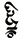

# 明点的堂奥

第三，‘修炼明点’：三手印中，一是修业手印，明观三脉五轮，于头顶大乐轮观想吭字（）、脐部幻轮回处观想短阿（）、三处明观各自的文字。短阿接触到吭字，头顶的甘露如乳汁般降下，依靠风牵引明点，遍及所有脉轮，增长上引等，犹如竹筒引水般，达到依靠风把菩提心引至任何一处的能力，这一点十分关键。依此令风、明点堪能，持心于所有脉轮中央文字，从而使精脉、血脉之风融入中脉，现前四喜智慧。

二是修身手印，如前一样明观内外空朗朗，刹那将自己明观成本尊身体，持宝瓶气，观想红白明点于三脉五轮的上下脉结处相会。如前明观五轮的种子，于四瓣莲花中央观想旺（）字，四瓣分别明观哈（）、热（）、讷（）、萨（），外形明观成红色法源。之后，观想具种姓的勇士为意手印，明观三脉及五轮。于白色五股金刚的中央观想白如水晶色、倒立的吽（），于金刚的其余四股观想绕（）、匝（）、舍（）、雅（）四字。此外，于方便智慧有数无数的一切脉界中明观阿乐嘎乐（）明点等。其后，观想：脐间的短阿中燃起的智慧火沿着中脉道触及顶上的吭（）佛父相菩提心作为缘，从各脉处降下菩提心流融合于中脉。观想从吭的十六滴甘露降到顶部而使喜智慧越来越增上，八滴甘露降至喉间使胜喜智慧增上，四滴甘露降至心间使殊喜智慧增上，两滴甘露降至脐间使俱生喜智慧增上，一滴甘露降至密处使离喜智慧增上，这就是下固四喜。再者，依靠风与觉性的力量，使所有明点由下至上一直到融合于顶部的吭字之间，是上固四喜。另外观想，所有脉处白色部分成为身金刚，红色部分成为语金刚，风心清净为意金刚。观修所有轮处住有的地、水清净后，现前身金刚的自性；火、风清净后，现前语金刚的自性；虚空与心清净后，现前意金刚的自性。总之，外，粗大幻身是三坛城的自性；内，风脉明点是三金刚的自性；密，明乐无分别是三身的自性。要现前真如，通过实修获得大手印持明果位。

三是方便手印，善加观察、勾招具足法相五部幻化的勇士，与其双运……一开始令他进入能成熟的灌顶及能解脱的教言之门，随后令他外内密的生起次第与圆满次第达到一定能力、出现验相。认真赐予一切身语意誓言，做到三门所为刹那也不行非法，以三种义灌顶使之心相续成熟、解脱。之后，明观成方便智慧本尊的身体中央有三脉五轮，于五处明观方便五部勇士、智慧五部勇母，于四肢明观四门佛父佛母，此外一切脉处以勇士空行的形相，如五处一样观成方便智慧相。于顶髻智慧轮中央月垫上观想吽（）字，距脐四指的界限，中脉下端喜乐脉结如日光般存在，中央是红色如针尖划的一样的短阿，燃起四智闪动之火，随后，以方便之四因、智慧母之四缘，开始具八分支之双运，合而为一，就是资粮道。身体的根识作为增上缘，头顶甘露菩提心云涌动作为所缘缘，次第领受四喜，是加行道。其后，方便菩提心云降至智慧母密处，红白菩提相会，将八十种分别念摧毁于法界中，从而现前离言平等性智慧，称为游舞下门三界。明点从密处到达莲花花蕊，使第一应时风隐没，获得一地功德。明点从花蕊引至密处，使第二应时风隐没，获得二地。明点引至脐与密处之间，第三应时风清净，获得三地。明点引至脐间，第四应时风清净，获得四地。明点引至心与脐之间，第五应时风清净，获得五地。明点引至心间，第六应时风清净，获得六地。明点引至心与喉之间，第七应时风清净，获得七地。明点引至喉间，第八应时风清净，获得八地。明点达到喉至眉间，第九应时风清净，获得九地。明点引至眉宇与头顶之间，第十应时风清净，获得十地，从而现证任运持明。明点到达头顶安置于十一普光地。明点到达头顶与顶髻之间，住于十二不贪莲花地。明点于顶髻与吭合一，住于十三金刚持地。如此依靠双运的要点进行降伏，不观待所有因、果、地道次第，顿时经行的捷径就是这个。如果你这样实修，明点会成熟为佛身，现前吻合七支的觉性身，可于即生获得双运金刚持果位。”

与此同时，上师化成一道白色光明点融入了我的头顶。这时我从睡梦中醒来。
