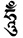

# 除障的窍诀

一天晚上，我梦到许多瑜伽士聚集在一个大平原中间。我想这是做什么啊，然后去了那里。当时，我看到在他们中间，大瑜伽士多罗那他穿着沙门的装束，头上戴着红色的帽子，双手以休息手印持着青莲花茎，莲花瓣在耳边绽放，其上以宝剑和经函为庄严，双足金刚跏趺坐，神采奕奕，光芒耀眼。我心想：“我这个病到底该怎么办，应该请这位上师指点一下。”所以我去了上师跟前顶礼。

结果，上师变成了黑日嘎的身相，授予了我秘密灌顶，并如是宣说除障窍诀：“奇哉善女子，你要这样观想：身体是空朗朗的。瞬间将自己的身体明观为金刚瑜伽母，从头顶至足掌间如胎盘满气般通明一片，无有遮障。再明观她的身体中央，有清净的三脉，右脉是红色，左脉是白色，中脉是淡蓝色。她的脐间幻化轮有六十四个脉瓣，外形是三角形，观想它中央芥子许的月垫上有一个短阿（）。心间法轮有八个白色脉瓣，开口朝下，外形如旺字（）一样圆形中央芥子许的月垫上有倒立的蓝色吽（）字，从中菩提心如云涌动的形相。喉间受用轮有十六个红色脉瓣，开口朝上，与脐间相同，它的外形是圆形，观想它中央的月垫上有正立的红色嗡（）字。头顶大乐轮有五色的三十二个脉瓣，开口朝下，外形是三角形，中央有倒立的白色吭（）字，菩提心云像晶莹剔透的露珠。依此有使风脉堪能而成熟明点的关键性要点。”

我说：“尊贵的上师，我以前修风脉时，就是在头顶与脐间观想吭字与短阿，再没有别的文字了。请上师明确宣说这次需要明观四处文字的窍诀功德、观修诸文字之处、于脉轮处持心的方法。”

上师教诲说：“善女人请谛听，于二轮观想文字只是共同修法，没有超胜之处。于四轮观想文字是不共窍诀的要点，有特别的殊胜性。观想那些种子之处是靠近内在脊椎的中脉内，各轮中央正对位置，精血两脉在中脉成结的交界，需要观想在中脉内。观想的标准是于三脉及脉瓣处持心，在没有将那些种子字观想得一清二楚之前要一直观修。假设初学者难以做到将所有脉瓣都观想得清清楚楚，那么就观想三脉及中央的诸文字明显出现。这样就容易集风，是生起四喜智慧、心融合于明点而使明点成熟为本尊身的殊胜窍诀。你自己这样实修，如理对诸随行者宣说要点，这样一来，全部会成为风心自在的大德。”

当上师刚说到这儿，我从梦中醒了。从那以后，我依照上师言教进行实修，结果病愈了，风也稍微得以稳固。
