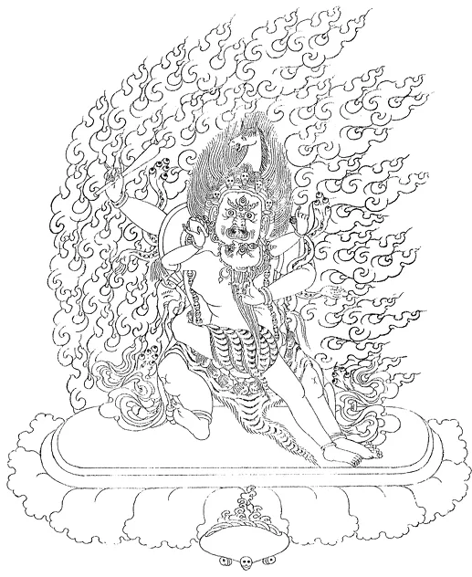

> 丙四（无上瑜伽生圆次第）分三：一、无上父续；二、无上母续；三、无上无二续。

> 丁一、无上父续：

此乘明观诸法为三坛城本来正等觉，以生起次第方便为主实修。主要修密集金刚等法。

此处结合《良马游舞续》而言：

前行：皈依、发心。

正行：于空性中观想莲花日月上舍（ཧྲཱིཿ）字与玛（མཿ）字变为马头明王佛父佛母双运，佛父屈伸式，右手挥舞棍棒，左手结期克印于胸前，佛母右手挥舞弯刀，左手托充满血之托巴供养佛父。佛父佛母均是一面三目，身红色，佩有一切忿怒饰品。佛父顶上绿色马头发出马鸣声传向四方，身著人皮、虎裙，悬垂颅鬘、腋络。身材魁梧，肢体粗大，身上盛燃末劫火，足可焚毁一切大千世界，心间莲花日月上吽字为心咒所旋绕。观想所迎请之智慧尊者融入后无量光佛变为顶饰。又观想其心间吽字喷射火焰并化出无数小猛尊，火焰蔓延震动一切大千世界。

尽力念诵“嗡班则卓达哈雅革尔瓦喝乐喝乐吽啪的（ༀ་བཛྲ་ཀྲོདྷ་ཧྱ་གྲཱི་ཝ་ཧུ་ལུ་ཧུ་ལུ་ཧཱུྃ་ཕཊ）”。彼等皆依次融入心间吽字，直至融入奔德之间。于无缘法性中安住。

后行：回向善根。

第九十六修法终

དཔལ་རྟ་མགྲིན།

马头明王
