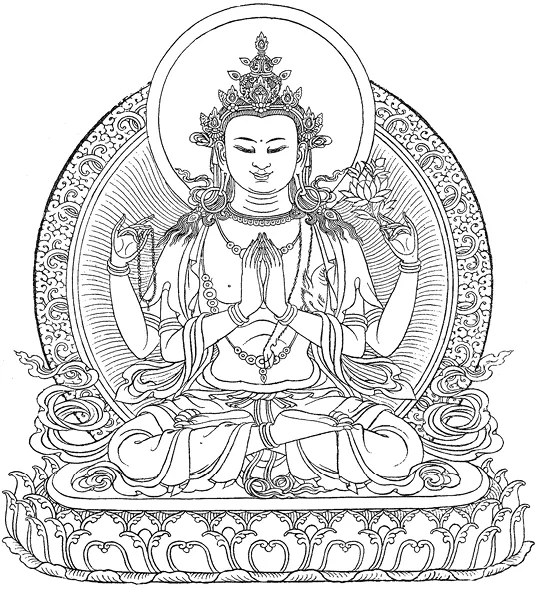

> 乙二（所修教言之引导）分四：一、事续生圆次第；二、行续生圆次第；三、瑜伽续生圆次第；四、无上大瑜伽续生圆次第。

> 丙一、事续生圆次第：

显宗与密宗成就佛果虽相同，但就密乘于修法深广圣道之理不愚昧、方便多、不需苦行、利根之法而言，是至高无上的，是一个人迅速成佛的无上乘。一位修行者若修持此显密二宗，那么显宗就成了趋入密乘道之阶梯——前行法了。密宗即是道之正行。密宗修法中首先是入门事续智亚（ཀྲཱི་ཡ）乘，此乘主要修大悲观音菩萨等本尊。修行时，着重沐浴、清洁。

此处以大悲观音修法为例：

前行：皈依、发心。

正行：于自己前方虚空中观想莲月之上端坐着大慈大悲观世音菩萨，身色洁白，一面四臂，顶具发髻，珍宝头饰，身佩项链、璎珞、手镯、足镯，身著绫罗衣裙，金刚跏趺坐，第一双手合掌于胸前，下右手持念珠，下左手持白莲，心间莲月中央的“舍（ཧྲཱིཿ）”字为六字真言环绕，从中放射光芒照耀我与一切众生，净除一切罪障，皆诵七字真言。以悦耳妙音念诵七字真言“嗡玛讷巴美吽舍（ༀ་མ་ཎི་པདྨེ་ཧཱུྃ་ཧྲཱི༔）。”又观想大悲观音身之光芒照射有情，最后消于空性中，自己也消失于空性中。于大悲观音亦不缘中安住片刻。

后行：回向善根。

此乃净除罪障所有修法中最殊胜、最甚深之法。

第九十三修法终

སྙིང་རྗེའི་གཏེར་གྱུར་སྤྱན་རས་གཟིགས།

大悲尊主观世音菩萨
