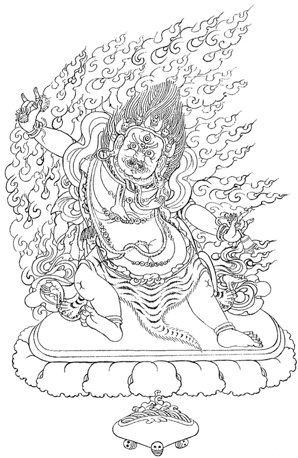
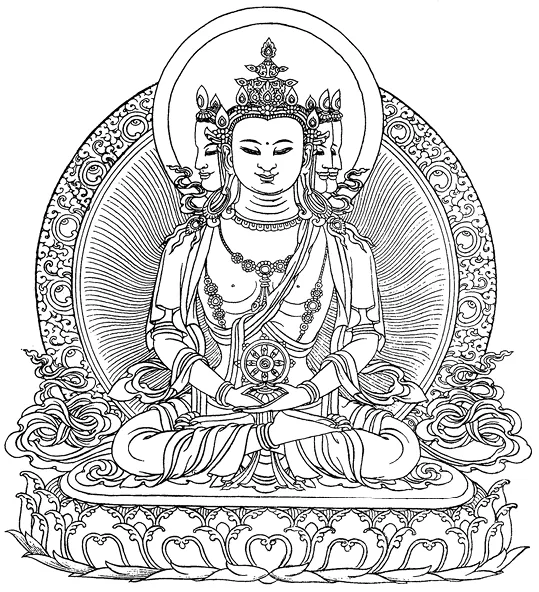

> 丙三、瑜伽续生圆次第：

此乘承认自己为誓言尊者，以迎送智慧尊者而获得悉地。

此处以净除恶趣法为例：

前行：皈依、发心。

正行：于空性中观想三界尊胜威猛佛，身蓝绿色，一面二臂，持金刚铃杵，于莲日上右足屈左足伸，具所有忿怒服饰，身体炽燃熊熊烈火遍布虚空界，漫布金刚帷幕、华盖，并且幻化出许多猛尊。自己结手印：拇指与中指无名指接触，二小指相连，食指外伸，念诵“嗡班则萨垛、卓达阿那下嘎玛卓达、札瓦札瓦布札瓦布札瓦萨瓦阿巴雅、那夏雅那夏雅、哈Ra哈Ra札那吽啪的（ༀ་བཛྲ་སཏྭ་ཀྲོ་དྷ་ཨཱ་ན་ལཱརྒ་མ་ཧཱ་ཀྲོདྷ་དྲ་བ་དྲ་བ་བི་དྲ་བ་བི་དྲ་བ་སརྦ་ཨ་ཕ་ལ།ནཱ་ཤ་ཡ་ནཱ་ཤ་ཡ།ཧ་ར་ཧ་ར་པྲ་ནཾ་ཧཱུྃ་ཕཊ）”三遍，以此保护自己、处所以及瑜伽修法。

ཁྲོ་བོ་འཇིག་རྟེན་གསུམ་རྒྱལ།

三界尊胜威猛佛

又空性中于心间狮子莲月上将自己观为出有坏普明毗卢遮那佛：身白色，四面二臂，双手结等印，双足跏趺坐，根本面部白色，右面黄色，左面红色，背面绿色，身披绫罗、佩有珍宝饰品，心间莲月上嗡（ༀ）字为心咒所绕旋。再观想从密严刹土迎请与彼相同、为诸多佛菩萨围绕的毗卢遮那佛，以诵“匝吽旺霍（ཛཿཧཱུྃ་བ་ཧོཿ）”观想彼等无二融入誓言尊者。以心咒所放射的光芒净除自己与六道众生罪障，上供圣者，下利众生。并尽力诵“嗡那么巴嘎瓦德、萨瓦德嘎德、巴热雪达讷Ra匝雅、达塔嘎达雅、阿尔哈得萨母雅桑布达雅、达雅塔、嗡雪达内雪达内萨瓦巴帮布薛达那耶索哈（ༀ་ན་མོ་བྷ་ག་ཝ་ཏེ།སརྦ་དུརྒ་ཏི།པ་རི་ཤོ་དྷ་ནི་རཱ་ཛཱ་ཡ།ཏ་ཐཱ་ག་ཏཱ་ཡ།ཨརྷ་ཏེ་སམྱཀྶཾ་བུདྡྷཱ་ཡ།ཏདྱཐཱ།ༀ་ཤོ་དྷ་ནེ་ཤོ་དྷ་ནེ་སརྦ་པཱ་པཾ་བི་ཤོདྷ་ན་ཡེ་སྭཱ་ཧཱ།）”。供养香花等外供品，又诵赞文“清净法界智，毗卢遮那佛，具等持手印，顶礼普明佛。”后以“嗡班则莫ༀ་བཛྲ་མུ༔”祈送所请之智慧尊者返回密严刹土。誓言尊者如向镜面吹气般消失融入嗡（ༀ）字间。于嗡字亦不缘中入定片刻。

后行：将善根回向于一切众生。

五无间罪也可依此修法尽除，是故功德极大。

第九十五修法终

ཀུན་རིག་རྣམ་པར་སྣང་མཛད།

普明毗卢遮那佛
