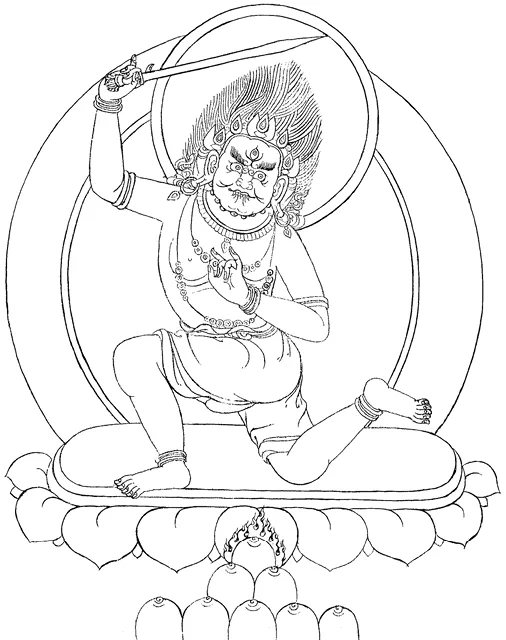

> 丙二、行续生圆次第：

行续修法以自己为誓言尊者，前方观想智慧尊者。

此处以不动佛修法为例：

前行：皈依、发心。

正行：以空性咒“嗡所巴瓦谢达所瓦达玛所巴瓦布西多古吭（ༀ་སྭ་བྷཱ་ཝ་ཤུདྡྷཱཿསརྦ་དྷརྨཱཿསྭ་བྷཱ་ཝ་བི་ཤུདྡྷོ་྅་ཧཾ）”将诸法观为空性。空性中于莲花日月上将自己观为不动佛：身色洁白，一面三目，上齿压下唇，须发红黄色，右手挥舞宝剑于顶上，左手结期克印于心间，右膝插入日轮中，左足掌踩在月轮上，佩有一切珍宝饰品，身著绫罗裙子，心间莲月中央吽（ཧཱུྃ）字为心咒所环绕。又于自己前方观想一尊相同的不动佛，自己心间的吽字咒轮入于前方不动佛口中，旋转其身，最后从彼脐部入于自己脐部，绕旋咒串之光芒摄集十方诸佛菩萨之智慧、等持、证悟、寿命、福德等一切功德融入自己心间的吽（ཧཱུྃ）字。从而自己具足了彼等功德。尽力念诵“嗡班则赞札玛哈如卡讷吽啪的（ༀ་བཛྲ་ཙཎྜ་མ་ཧཱ་རོ་ཥ་ཎ་ཧཱུྃ་ཕཊ）”。之后咒轮收于心间，祈送智慧尊者。

后行：于无缘中回向善根。

第九十四修法终

རྗེ་བཙུན་མི་གཡོ་བ།

至尊不动佛
