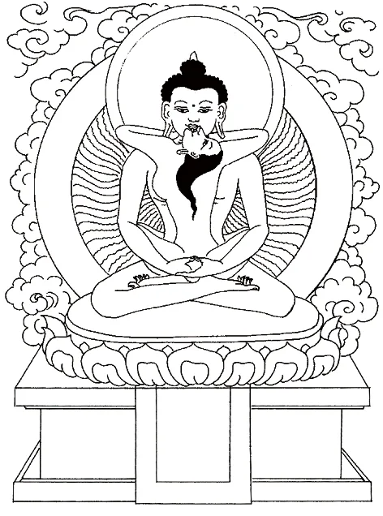

> 戊二（别修深道）分三：一、加持成就之要；二、前行除障之要；三、正行殊胜之要。

> 己一、加持成就之要：

前行：皈依、发心。

正行：于空性中将自己观为本尊，顶上观想上师佛父佛母、空行勇士双运，对彼等供养、赞颂、祈祷后，从上师佛父佛母双运处降下甘露，融入自己身语意，获得前三灌顶，一切皆融入大乐本体中，甘露降至自心间而获得无二智慧金刚本性自生句宝灌顶。于此境界中放松安住片刻。

后行：回向善根。

依此可直接获得加持，间接显现证悟，遣除修道违缘，断除道障歧途，获得二种悉地，因而是极密之要诀。

第一百零二修法终

དཔལ་ཀུན་ཏུ་བཟང་པོ།

普贤如来
