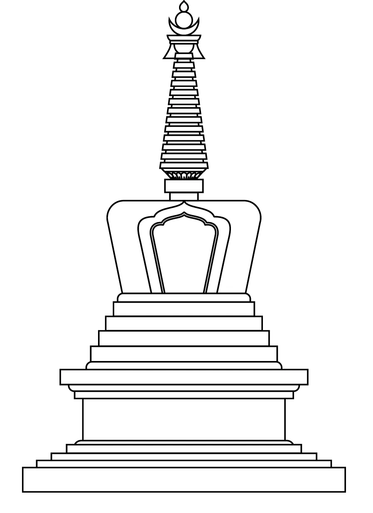
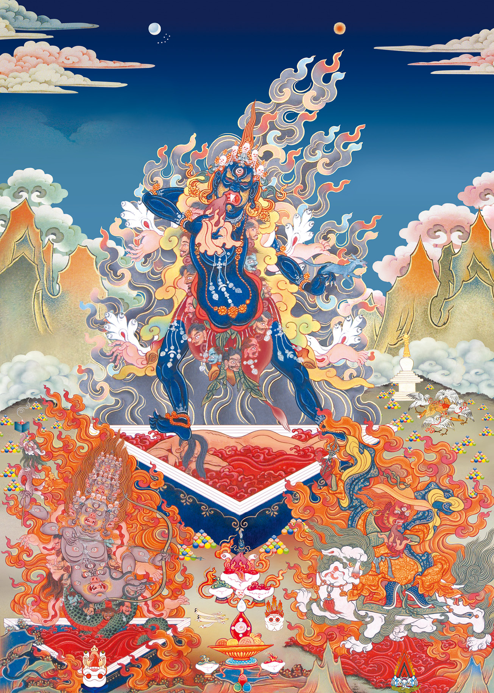

# 四安住方便注解

（作者不详）

萨瓦诶嘎绕，是诸法空性本智的方便。

顶礼本基空性大种本净性。

内外意义的密宗显现为这一秘密要义，显现三时安住的诸佛之意密，是驱散心中黑暗的光明灯，为了遣除世间无明翳障的幽暗。

以金刚链本智的显色而证悟自觉性，断除一切艰难，依靠无变见解的方便窍诀进行印持以后，入于深广法界净灯中，安住于远离常断之边的唯一明点本性中。

依此教言安慰昏迷的布玛莫札等众人，共称它与诸佛的密意等同，持而不得的这一自现觉性，想受持它的有缘大智者应当恒常修习嘉纳思札的这一遗教文字。

奇哉！

如果恒常修行此法，则自然而然获得安乐。奇哉！如果想获得大平等的等持地，就要夜以继日恒常不散乱修行它。如果想一切行为修持妙力，就应当以显现直定而安住于一切自清净的显现中。如果想在观修为主的一切窍诀上获得威力，就应当以如海直定的密意不间断安住于迷乱未迷乱的识、法二者合一中。如果想一切见解自解脱，就应当以如山直定的自现显现而使诸法趋至尽地。如果想一切果住于自地，就应当以觉性直定的见解窍诀而安住于一切迷乱解脱自地中。

迷乱显现是自住的缘故，本来与空性相联系。心识安住自地的缘故，本来与有实法相联系。诸法安住自地的缘故，果位与显现中，内法界与觉性有着超越方便的联系。一切迷乱是果自清净之直定的缘故，本来与自解脱相联系。了然的这些显现无有踪迹，如同水的波纹，因此显现同体安住于唯一本性中；忆念无有踪迹，如同鸟飞翔空中，因此思维同体安住唯一本性中；迷乱自净，如同飞禽出网，因此空性同住唯一本性中；清净不退，如同瘟疫痊愈，因此觉性同体解脱于唯一性中。

能享用并转变显现，如酒与酒醇，因此五大种安住自地。住心并定量如猎人网捕野兽，因此心自入显现而安住自地。不住法之识趋至尽地而现见觉性，如同面容与镜，因此诸法安住自地。迷乱解脱于本位上，如同蛇与蛇结，因此无有迷乱与未迷乱而安住自地。显现自解脱，如同正直智者入于殿堂而不贪执显现，一切思维融入本基，如同大海不为风所动。法界与觉性自遇，如至山王之巅。三身不退转而抵达自地，如同漆树之果不复返于因。这是见修行的核心，是降伏刚强难化者的窍诀，是夜以继日追溯失踪者的窍诀，是撑开层层迷茫、斩断见解之城相续的窍诀，是速持广大显现法的窍诀，是调化野蛮紊者的窍诀，是锐利威猛的窍诀。是诸凡所思所行安置自地的窍诀。它是种种显现道用之足，是斩断忆念相续之手，是见真实法界觉性之目，是迷乱清净于本基之浴，是迷乱显现遇缘自解脱之道，是心识遇缘之基，是观见遇缘之境；是解脱遇缘超离法之果。

此乃嘉纳思札涅槃时，布玛莫札昏厥倒地，大声呼喊“呜呼哀哉……”依此，从虚空中传出大音声，当他醒来，见光蕴中现出右手臂肘以下，将一指之宝箧降至布玛莫札右手掌中。他打开，发现其内是用蓝琉璃写于五宝纸之遗教。布玛莫札只是见到就有了证悟的确信。显现于巴桑大尸林，嘉纳思札之遗教——能即生成佛，行为自住、观修自住、见解自住、果位自住教言之四安住方便·暗穴之灯圆满。

请保密！俄塔！西帮！

2023年12月3日

译于云南普贤大乐宫

（1995年版，密法部分）

（2004年版，密法部分）

护法三怙主
