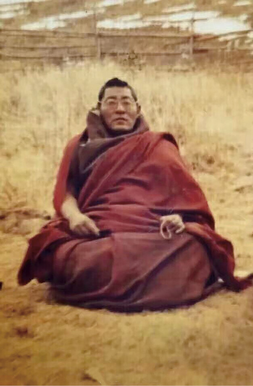

# “临终弥留际，唯福能救护”

麦彭仁波切说过：“轮回中的安乐，犹如闪电般短暂，丝毫也不可靠。”

现在我们拥有了宝贵的人身，又听受了殊胜的佛法，此时不管是谁，都应好好利用这个机会修行，如此才能对死亡有一定的把握。就像华智仁波切所说：“永舍天灵盖！”意思就是，我们通过精进修行，舍弃今生这个人身后，便不会再以业和烦恼流转轮回，永远从苦海中获得了解脱。

但非常可惜的是，不少人总以为自己离死亡很远，对死期从来就没想过，一辈子的时间都在汲汲经营名利，完全没把解脱放在心上。他们平日放逸无度，却不知无常会突然降临，死亡的极大恐怖瞬间就会将其击垮。

其实，死神将于何时何地出现，这是谁也无法预料的。当这一天到来时，就算关系密切的亲友围绕在身旁，声嘶力竭地呼唤着我们的名字，撕心裂肺地痛哭流涕，甚至因悲伤过度而昏厥倒地，死神也会毫不留情。此时，哪怕心中再依依不舍，我们还是不得不离开人间，孤身一人走上凄凄惨惨的中阴路。

正如《入菩萨行论》所形容的：“临终弥留际，众亲虽围绕，命绝诸苦痛，唯吾一人受。魔使来执时，亲朋有何益？唯福能救护，然我未曾修。”

每个人在不久的将来，注定都会走上这条路——离开这个幻化无常的人间，离开自己最爱恋的亲人。因此，对于今生的一切，我们没必要过于执著，而应抓紧时间，为长久的安乐而修行正法，为死亡的到来做好充分准备！

